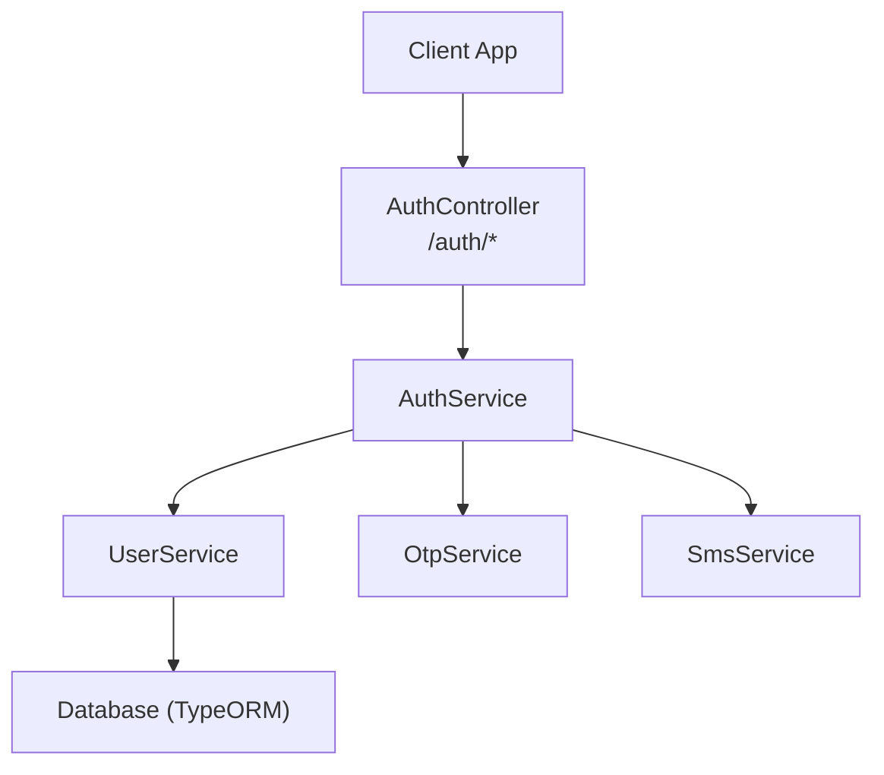
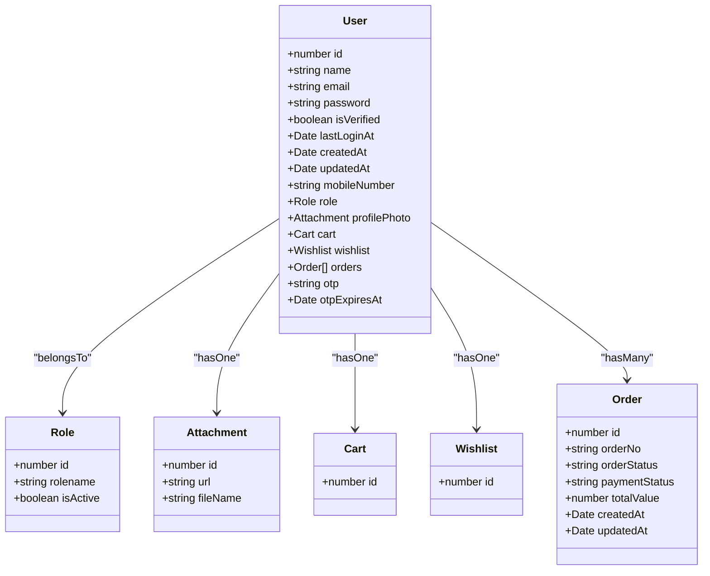
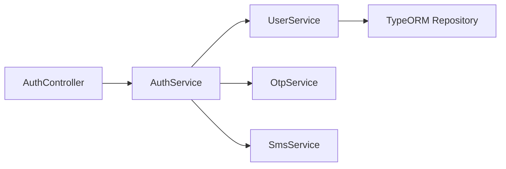

# User Registration & Login

<cite>
**Referenced Files in This Document**
- [auth.controller.ts](file://apps/backend/src/auth/auth.controller.ts)
- [auth.service.ts](file://apps/backend/src/auth/auth.service.ts)
- [register.dto.ts](file://apps/backend/src/auth/dto/register.dto.ts)
- [login.dto.ts](file://apps/backend/src/auth/dto/login.dto.ts)
- [mobile-login.dto.ts](file://apps/backend/src/auth/dto/mobile-login.dto.ts)
- [user.service.ts](file://apps/backend/src/user/user.service.ts)
- [user.entity.ts](file://apps/backend/src/user/entities/user.entity.ts)
- [otp.service.ts](file://apps/backend/src/auth/otp.service.ts)
- [sms.service.ts](file://apps/backend/src/auth/sms.service.ts)
- [email.service.ts](file://apps/backend/src/email/email.service.ts)
</cite>

## Table of Contents
1. [Introduction](#introduction)
2. [Project Structure](#project-structure)
3. [Core Components](#core-components)
4. [Architecture Overview](#architecture-overview)
5. [Detailed Component Analysis](#detailed-component-analysis)
6. [Dependency Analysis](#dependency-analysis)
7. [Performance Considerations](#performance-considerations)
8. [Troubleshooting Guide](#troubleshooting-guide)
9. [Conclusion](#conclusion)

## Introduction
This document provides comprehensive API documentation for user registration and login endpoints, including email/password authentication and mobile OTP-based login. It covers request/response schemas, validation rules, password hashing with bcrypt, OTP generation and verification, account status management, error responses, security considerations (rate limiting, input sanitization, brute-force protection), and client integration guidance.

## Project Structure
The authentication features are implemented in the backend NestJS application:
- Controllers define HTTP endpoints under /auth.
- Services implement business logic for token issuance, OTP flows, and user operations.
- DTOs define request validation rules and Swagger metadata.
- User entity defines database schema and sensitive field exclusion.
- Supporting services handle OTP generation/validation and SMS delivery.

**Diagram sources**
- [auth.controller.ts:31-309](file://apps/backend/src/auth/auth.controller.ts#L31-L309)
- [auth.service.ts:21-433](file://apps/backend/src/auth/auth.service.ts#L21-L433)
- [user.service.ts:29-948](file://apps/backend/src/user/user.service.ts#L29-L948)
- [otp.service.ts:4-35](file://apps/backend/src/auth/otp.service.ts#L4-L35)
- [sms.service.ts:6-64](file://apps/backend/src/auth/sms.service.ts#L6-L64)

**Section sources**
- [auth.controller.ts:31-309](file://apps/backend/src/auth/auth.controller.ts#L31-L309)
- [auth.service.ts:21-433](file://apps/backend/src/auth/auth.service.ts#L21-L433)
- [user.service.ts:29-948](file://apps/backend/src/user/user.service.ts#L29-L948)

## Core Components
- AuthController: Exposes public endpoints for register, login, refresh, logout, validate, mobile-login, and verify-otp. Applies throttling to protect against abuse.
- AuthService: Implements login, token refresh, mobile OTP initiation and verification, JWT signing, and audit logging helpers.
- UserService: Handles user creation, updates, password hashing with bcrypt, lookup by email/mobile, and last login timestamp updates.
- DTOs: Define and validate request payloads for registration, login, and mobile OTP flows.
- OtpService: Generates OTPs, computes expiration, and validates OTPs against stored values and time windows.
- SmsService: Sends OTP via external SMS gateway; returns success/failure based on provider response.
- EmailService: Provides email utilities used elsewhere in the app; not directly invoked by auth endpoints but relevant for related flows like password reset.

**Section sources**
- [auth.controller.ts:31-309](file://apps/backend/src/auth/auth.controller.ts#L31-L309)
- [auth.service.ts:21-433](file://apps/backend/src/auth/auth.service.ts#L21-L433)
- [user.service.ts:561-629](file://apps/backend/src/user/user.service.ts#L561-L629)
- [register.dto.ts:13-62](file://apps/backend/src/auth/dto/register.dto.ts#L13-L62)
- [login.dto.ts:4-26](file://apps/backend/src/auth/dto/login.dto.ts#L4-L26)
- [mobile-login.dto.ts:5-40](file://apps/backend/src/auth/dto/mobile-login.dto.ts#L5-L40)
- [otp.service.ts:4-35](file://apps/backend/src/auth/otp.service.ts#L4-L35)
- [sms.service.ts:6-64](file://apps/backend/src/auth/sms.service.ts#L6-L64)

## Architecture Overview
The authentication architecture follows a layered approach:
- Controller layer validates requests using DTOs and applies rate limiting.
- Service layer orchestrates business logic, interacts with data access and external services.
- Data layer persists users and credentials securely.
- External integrations include SMS providers for OTP delivery.

```mermaid
sequenceDiagram
participant C as "Client"
participant AC as "AuthController"
participant AS as "AuthService"
participant US as "UserService"
participant OS as "OtpService"
participant SS as "SmsService"
C->>AC : POST /auth/register
AC->>US : create(RegisterDto)
US-->>AC : {message, statusCode, data : User}
AC-->>C : 201 Created
C->>AC : POST /auth/login
AC->>AS : login(LoginDto)
AS->>US : findByEmailWithPassword(email)
US-->>AS : User
AS->>AS : bcrypt.compare(password, hash)
AS->>AS : generateTokens(user)
AS-->>AC : {accessToken, refreshToken}
AC-->>C : 200 OK
C->>AC : POST /auth/mobile-login
AC->>AS : initiateMobileLogin(mobileNumber)
AS->>OS : generateOtp()
AS->>US : update(user.id, {otp, otpExpiresAt})
AS->>SS : sendSms(mobileNumber, message)
SS-->>AS : boolean
AS-->>AC : {message, data : {mobileNumber}}
AC-->>C : 200 OK
C->>AC : POST /auth/verify-otp
AC->>AS : verifyMobileOtp(mobileNumber, otp, name?)
AS->>OS : verifyOtp(...)
AS->>US : update(user.id, {isVerified, ...})
AS->>AS : generateTokens(user)
AS-->>AC : {accessToken, refreshToken, user}
AC-->>C : 200 OK
```

**Diagram sources**
- [auth.controller.ts:38-309](file://apps/backend/src/auth/auth.controller.ts#L38-L309)
- [auth.service.ts:54-170](file://apps/backend/src/auth/auth.service.ts#L54-L170)
- [auth.service.ts:172-358](file://apps/backend/src/auth/auth.service.ts#L172-L358)
- [user.service.ts:808-829](file://apps/backend/src/user/user.service.ts#L808-L829)
- [otp.service.ts:8-33](file://apps/backend/src/auth/otp.service.ts#L8-L33)
- [sms.service.ts:12-62](file://apps/backend/src/auth/sms.service.ts#L12-L62)

## Detailed Component Analysis

### Endpoints Reference

#### Register
- Method: POST
- Path: /auth/register
- Throttle: 5 requests per minute
- Request body: RegisterDto
- Success response: 201 Created with user object and tokens
- Error responses: 400 Bad Request for duplicate email or invalid payload

Request schema (RegisterDto):
- email: string, required, valid email format
- name: string, required, length 2–100
- password: string, required, min 8 chars, must contain uppercase, lowercase, number, special character
- mobileNumber: string, optional, valid international phone number

Example request:
{
  "email": "user@example.com",
  "name": "John Doe",
  "password": "SecurePass1!",
  "mobileNumber": "+8801712345678"
}

Example success response (201):
{
  "message": "User created successfully",
  "statusCode": 201,
  "data": {
    "id": 1,
    "email": "user@example.com",
    "name": "John Doe",
    "mobileNumber": "+8801712345678",
    "role": { "id": 3, "rolename": "customer" },
    "isVerified": false,
    "lastLoginAt": null,
    "createdAt": "2024-01-01T00:00:00.000Z",
    "updatedAt": "2024-01-01T00:00:00.000Z"
  }
}

Error example (400 - duplicate email):
{
  "message": "Email already exists",
  "statusCode": 400,
  "error": "Bad Request"
}

Implementation notes:
- Password is hashed using bcrypt before storage.
- Duplicate email and mobile number checks are enforced.
- Default role assigned if invalid or missing.

**Section sources**
- [auth.controller.ts:38-79](file://apps/backend/src/auth/auth.controller.ts#L38-L79)
- [register.dto.ts:13-62](file://apps/backend/src/auth/dto/register.dto.ts#L13-L62)
- [user.service.ts:561-629](file://apps/backend/src/user/user.service.ts#L561-L629)

#### Login (Email/Password)
- Method: POST
- Path: /auth/login
- Throttle: 10 requests per minute
- Request body: LoginDto
- Success response: 200 OK with accessToken and refreshToken
- Error responses: 401 Unauthorized for invalid credentials

Request schema (LoginDto):
- email: string, required, valid email format
- password: string, required, min 6 chars

Example request:
{
  "email": "user@example.com",
  "password": "SecurePass1!"
}

Example success response (200):
{
  "message": "Login successful",
  "statusCode": 200,
  "data": {
    "accessToken": "jwt.access.token",
    "refreshToken": "jwt.refresh.token"
  }
}

Error example (401 - invalid credentials):
{
  "message": "Invalid credentials",
  "statusCode": 401,
  "error": "Unauthorized"
}

Implementation notes:
- Password comparison uses bcrypt.compare.
- Last login timestamp updated asynchronously.
- Audit log entry created for login activity.

**Section sources**
- [auth.controller.ts:81-114](file://apps/backend/src/auth/auth.controller.ts#L81-L114)
- [login.dto.ts:4-26](file://apps/backend/src/auth/dto/login.dto.ts#L4-L26)
- [auth.service.ts:54-100](file://apps/backend/src/auth/auth.service.ts#L54-L100)

#### Mobile Login (OTP Initiation)
- Method: POST
- Path: /auth/mobile-login
- Throttle: short=30/min, medium=100/5min, long=300/hour
- Request body: MobileLoginDto
- Success response: 200 OK with mobileNumber
- Error responses: 400 Bad Request for invalid mobile number, 429 Too Many Requests for cooldown, 503 Service Unavailable for SMS failures

Request schema (MobileLoginDto):
- mobileNumber: string, required, valid international phone number

Example request:
{
  "mobileNumber": "+8801712345678"
}

Example success response (200):
{
  "message": "OTP sent successfully",
  "statusCode": 200,
  "data": {
    "mobileNumber": "+8801712345678"
  }
}

Error examples:
- 400 Bad Request:
{
  "message": "Invalid mobile number format",
  "statusCode": 400
}
- 429 Too Many Requests:
{
  "message": "OTP already sent. Please wait a minute before requesting again.",
  "statusCode": 429,
  "data": {
    "mobileNumber": "+8801712345678"
  }
}
- 503 Service Unavailable:
{
  "message": "Failed to send OTP. Please try again later.",
  "statusCode": 503
}

Implementation notes:
- If user does not exist, a temporary account is created with placeholder credentials.
- Per-number cooldown prevents resending within 60 seconds.
- OTP stored with expiration; SMS sent via provider.

**Section sources**
- [auth.controller.ts:231-267](file://apps/backend/src/auth/auth.controller.ts#L231-L267)
- [mobile-login.dto.ts:5-13](file://apps/backend/src/auth/dto/mobile-login.dto.ts#L5-L13)
- [auth.service.ts:172-250](file://apps/backend/src/auth/auth.service.ts#L172-L250)
- [otp.service.ts:8-26](file://apps/backend/src/auth/otp.service.ts#L8-L26)
- [sms.service.ts:12-62](file://apps/backend/src/auth/sms.service.ts#L12-L62)

#### Verify OTP (Complete Mobile Login)
- Method: POST
- Path: /auth/verify-otp
- Throttle: short=30/min, medium=100/5min, long=500/hour
- Request body: VerifyOtpDto
- Success response: 200 OK with accessToken, refreshToken, and minimal user info
- Error responses: 400 Bad Request for invalid OTP format, 401 Unauthorized for invalid/expired OTP or unregistered mobile

Request schema (VerifyOtpDto):
- mobileNumber: string, required, valid international phone number
- otp: string, required, exactly 6 digits
- name: string, optional, trimmed and applied to user profile

Example request:
{
  "mobileNumber": "+8801712345678",
  "otp": "123456",
  "name": "John Doe"
}

Example success response (200):
{
  "message": "Mobile login successful",
  "statusCode": 200,
  "data": {
    "accessToken": "jwt.access.token",
    "refreshToken": "jwt.refresh.token",
    "user": {
      "id": 1,
      "name": "John Doe",
      "mobileNumber": "+8801712345678",
      "roles": ["customer"],
      "isVerified": true
    }
  }
}

Error examples:
- 400 Bad Request:
{
  "message": "OTP must be 6 digits",
  "statusCode": 400
}
- 401 Unauthorized:
{
  "message": "Invalid OTP",
  "statusCode": 401
}

Implementation notes:
- On successful verification, user is marked verified and optional name is set.
- Tokens are generated and returned along with sanitized user data.
- Audit logs record mobile login activity.

**Section sources**
- [auth.controller.ts:269-307](file://apps/backend/src/auth/auth.controller.ts#L269-L307)
- [mobile-login.dto.ts:15-40](file://apps/backend/src/auth/dto/mobile-login.dto.ts#L15-L40)
- [auth.service.ts:252-358](file://apps/backend/src/auth/auth.service.ts#L252-L358)

### Security and Validation Details

#### Password Hashing
- Algorithm: bcrypt with salt rounds configured at 10.
- Storage: Only hashed passwords are persisted; plaintext never stored.
- Comparison: Uses bcrypt.compare during login and password change flows.

**Section sources**
- [user.service.ts:612-619](file://apps/backend/src/user/user.service.ts#L612-L619)
- [auth.service.ts:54-73](file://apps/backend/src/auth/auth.service.ts#L54-L73)

#### Input Validation
- Email: Validated using class-validator IsEmail and pattern constraints.
- Password: Enforced minimum length and complexity requirements for registration; minimum length for login.
- Mobile Number: International phone format validated; strict regex checks in service layer.
- OTP: Exactly 6 digits enforced; expiration checked against stored timestamp.

**Section sources**
- [register.dto.ts:13-62](file://apps/backend/src/auth/dto/register.dto.ts#L13-L62)
- [login.dto.ts:4-26](file://apps/backend/src/auth/dto/login.dto.ts#L4-L26)
- [mobile-login.dto.ts:5-40](file://apps/backend/src/auth/dto/mobile-login.dto.ts#L5-L40)
- [auth.service.ts:360-362](file://apps/backend/src/auth/auth.service.ts#L360-L362)
- [auth.service.ts:269-274](file://apps/backend/src/auth/auth.service.ts#L269-L274)

#### Account Status Management
- isVerified: Set to true upon successful OTP verification.
- lastLoginAt: Updated after successful login (async).
- Roles: Default customer role assigned if invalid or missing during registration.

**Section sources**
- [user.entity.ts:79-85](file://apps/backend/src/user/entities/user.entity.ts#L79-L85)
- [user.service.ts:816-819](file://apps/backend/src/user/user.service.ts#L816-L819)
- [auth.service.ts:301-313](file://apps/backend/src/auth/auth.service.ts#L301-L313)

#### Rate Limiting and Brute Force Protection
- Register endpoint: 5 requests per minute.
- Login endpoint: 10 requests per minute.
- Mobile login and verify-otp: Multi-tier throttling (short/medium/long) to mitigate automated attacks.
- OTP resend cooldown: 60-second per-number cooldown to prevent rapid retries.

**Section sources**
- [auth.controller.ts:38-40](file://apps/backend/src/auth/auth.controller.ts#L38-L40)
- [auth.controller.ts:81-83](file://apps/backend/src/auth/auth.controller.ts#L81-L83)
- [auth.controller.ts:231-240](file://apps/backend/src/auth/auth.controller.ts#L231-L240)
- [auth.controller.ts:272-276](file://apps/backend/src/auth/auth.controller.ts#L272-L276)
- [auth.service.ts:204-218](file://apps/backend/src/auth/auth.service.ts#L204-L218)

### Data Models

**Diagram sources**
- [user.entity.ts:22-182](file://apps/backend/src/user/entities/user.entity.ts#L22-L182)

## Dependency Analysis

**Diagram sources**
- [auth.controller.ts:31-309](file://apps/backend/src/auth/auth.controller.ts#L31-L309)
- [auth.service.ts:21-433](file://apps/backend/src/auth/auth.service.ts#L21-L433)
- [user.service.ts:29-948](file://apps/backend/src/user/user.service.ts#L29-L948)
- [otp.service.ts:4-35](file://apps/backend/src/auth/otp.service.ts#L4-L35)
- [sms.service.ts:6-64](file://apps/backend/src/auth/sms.service.ts#L6-L64)

**Section sources**
- [auth.controller.ts:31-309](file://apps/backend/src/auth/auth.controller.ts#L31-L309)
- [auth.service.ts:21-433](file://apps/backend/src/auth/auth.service.ts#L21-L433)
- [user.service.ts:29-948](file://apps/backend/src/user/user.service.ts#L29-L948)

## Performance Considerations
- Asynchronous audit logging: Login/logout activity writes are fire-and-forget to avoid blocking responses.
- Non-critical DB latency: Updates to lastLoginAt do not block login responses.
- Efficient OTP handling: Cooldowns reduce unnecessary SMS calls and DB writes.
- Parallel token generation: Access and refresh tokens are signed concurrently.

[No sources needed since this section provides general guidance]

## Troubleshooting Guide
Common errors and resolutions:
- Duplicate email during registration: Ensure the email is unique; prompt user to use another address.
- Invalid credentials during login: Check email/password correctness; ensure password meets complexity requirements.
- Invalid mobile number: Validate international format (+country code); correct formatting resolves the issue.
- OTP resend blocked: Wait at least 60 seconds before retrying; check server-side cooldown logs.
- SMS delivery failure: Inspect SMS provider configuration (API key, sender ID, URL); retry after resolving provider issues.
- OTP expired: Request a new OTP; ensure client handles expiration gracefully.

**Section sources**
- [user.service.ts:588-610](file://apps/backend/src/user/user.service.ts#L588-L610)
- [auth.service.ts:54-73](file://apps/backend/src/auth/auth.service.ts#L54-L73)
- [auth.service.ts:172-250](file://apps/backend/src/auth/auth.service.ts#L172-L250)
- [auth.service.ts:252-358](file://apps/backend/src/auth/auth.service.ts#L252-L358)
- [sms.service.ts:12-62](file://apps/backend/src/auth/sms.service.ts#L12-L62)

## Conclusion
The authentication system provides secure and robust user registration and login capabilities with strong input validation, password hashing, OTP-based mobile authentication, and protective rate limiting. Clients should implement form validation, handle error responses appropriately, and manage sessions using the provided JWT tokens. For production deployments, ensure proper configuration of SMS and email services and monitor rate limits and audit logs for security and performance insights.

[No sources needed since this section summarizes without analyzing specific files]