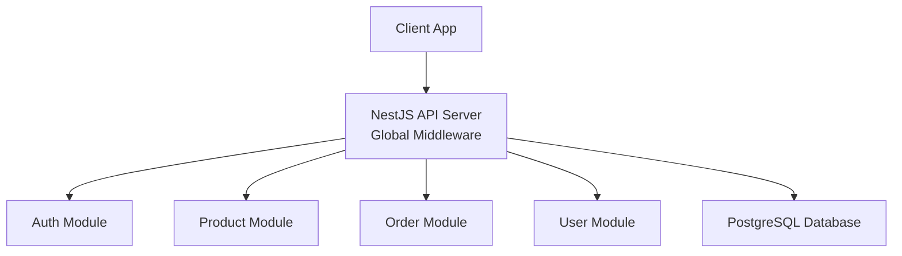
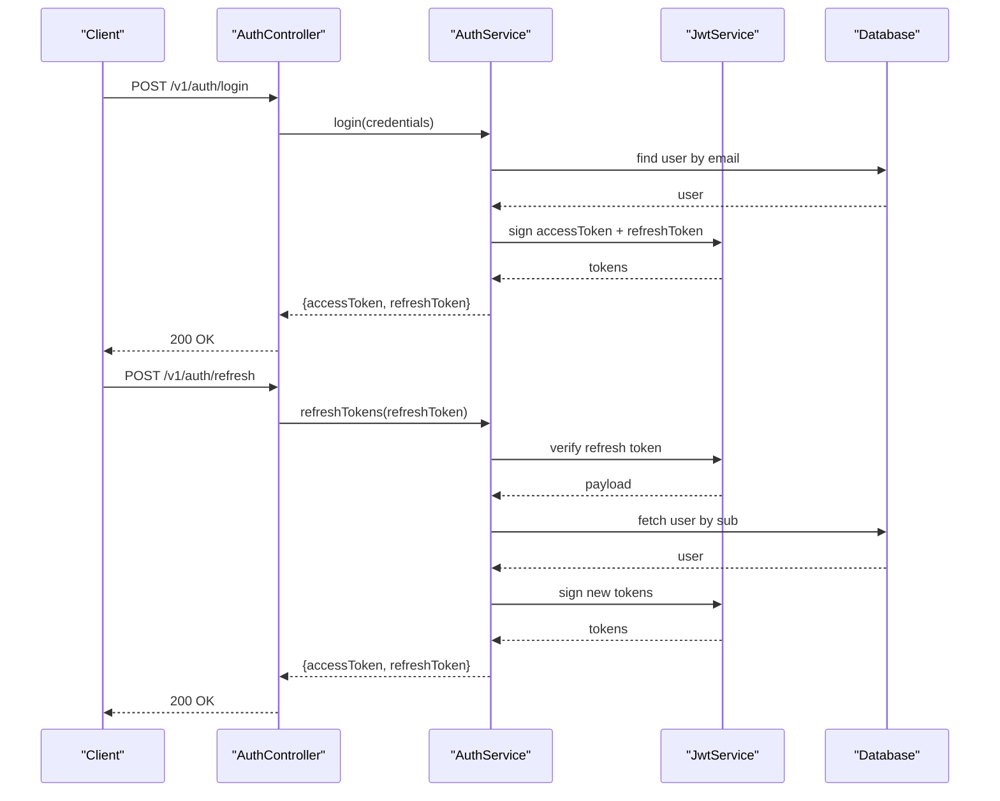
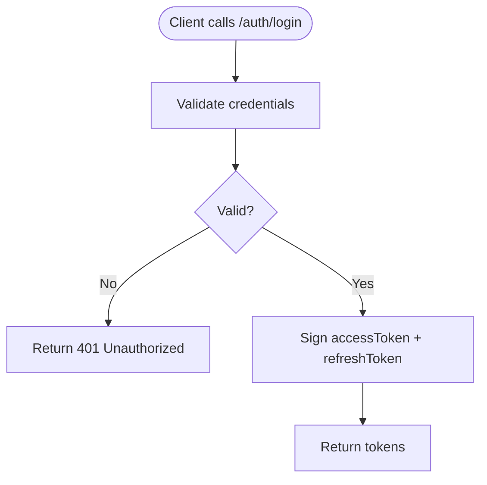
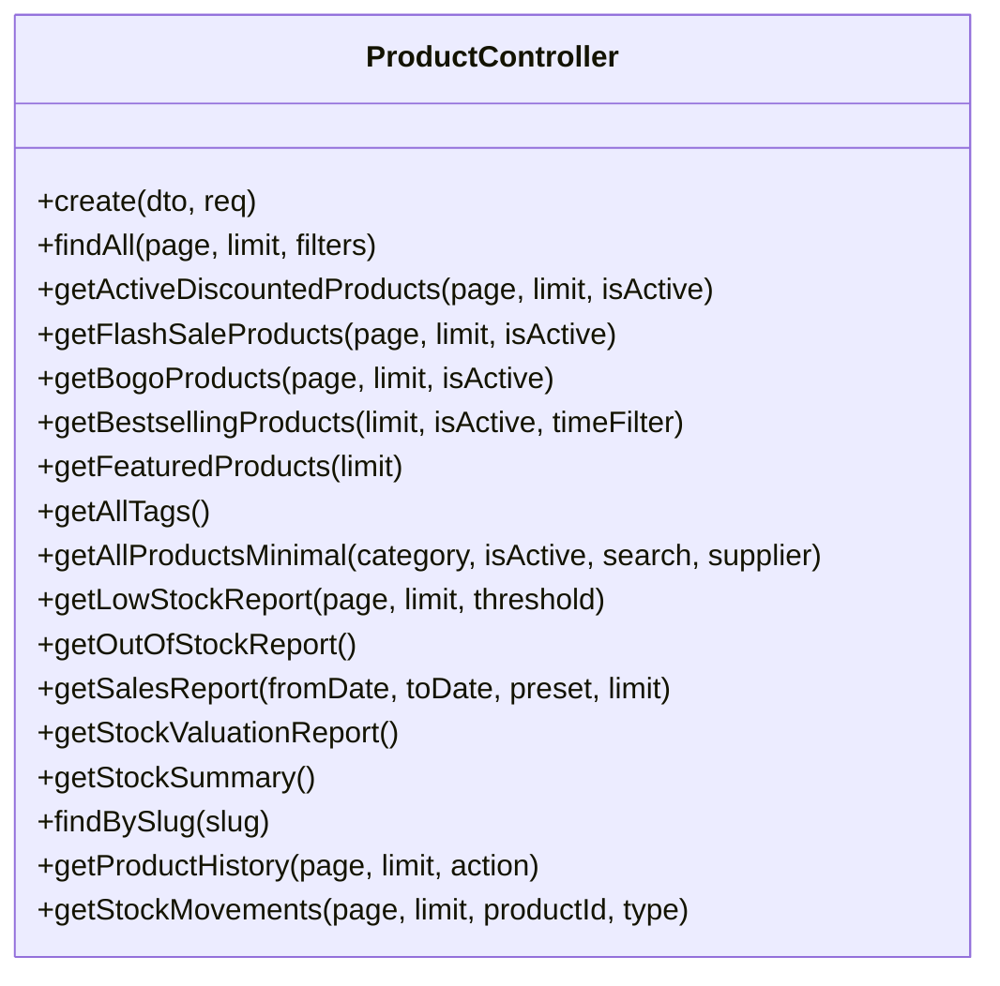
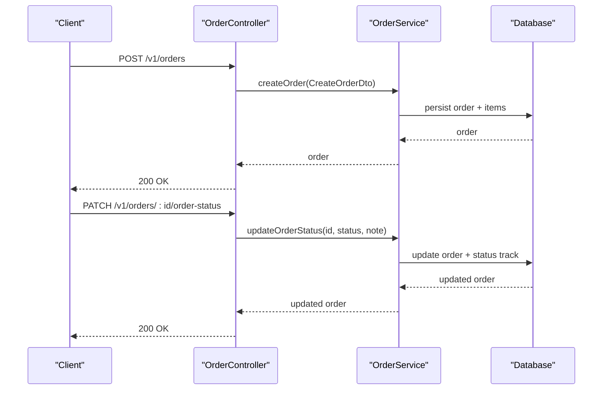
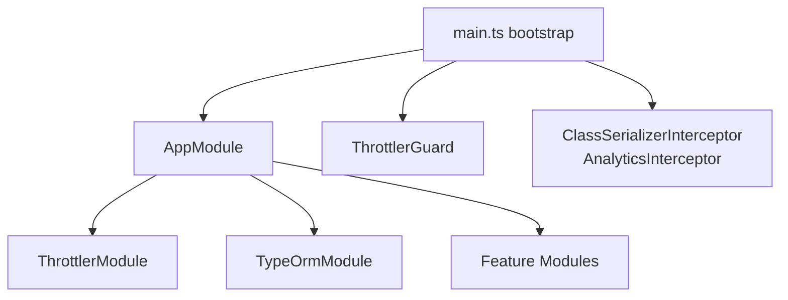

# Backend API Reference

<cite>
**Referenced Files in This Document**   
- [main.ts](file://apps/backend/src/main.ts)
- [app.module.ts](file://apps/backend/src/app.module.ts)
- [auth.controller.ts](file://apps/backend/src/auth/auth.controller.ts)
- [auth.service.ts](file://apps/backend/src/auth/auth.service.ts)
- [jwt-refresh.guard.ts](file://apps/backend/src/auth/guards/jwt-refresh.guard.ts)
- [jwt-refresh.strategy.ts](file://apps/backend/src/auth/strategies/jwt-refresh.strategy.ts)
- [tokens.dto.ts](file://apps/backend/src/auth/dto/tokens.dto.ts)
- [product.controller.ts](file://apps/backend/src/product/product.controller.ts)
- [create-product.dto.ts](file://apps/backend/src/product/dto/create-product.dto.ts)
- [order.controller.ts](file://apps/backend/src/order/order.controller.ts)
- [create-order.dto.ts](file://apps/backend/src/order/dto/create-order.dto.ts)
- [order-status-track.entity.ts](file://apps/backend/src/order/entities/order-status-track.entity.ts)
- [order-payment-method.entity.ts](file://apps/backend/src/order-payment-method/entities/order-payment-method.entity.ts)
- [shipping-method.entity.ts](file://apps/backend/src/shipping-methods/entities/shipping-method.entity.ts)
- [user.controller.ts](file://apps/backend/src/user/user.controller.ts)
- [create-user.dto.ts](file://apps/backend/src/user/dto/create-user.dto.ts)
- [throttler.guard.ts](file://apps/backend/src/common/guards/throttler.guard.ts)
- [skip-throttle.decorator.ts](file://apps/backend/src/common/decorators/skip-throttle.decorator.ts)
</cite>

## Table of Contents
1. [Introduction](#introduction)
2. [Project Structure](#project-structure)
3. [Core Components](#core-components)
4. [Architecture Overview](#architecture-overview)
5. [Detailed Component Analysis](#detailed-component-analysis)
6. [Dependency Analysis](#dependency-analysis)
7. [Performance Considerations](#performance-considerations)
8. [Troubleshooting Guide](#troubleshooting-guide)
9. [Conclusion](#conclusion)
10. [Appendices](#appendices)

## Introduction
This document provides comprehensive API documentation for the German Butcher backend RESTful APIs. It covers authentication, product management, order processing, and user management endpoints. It also documents request/response schemas, validation rules, pagination, filtering, rate limiting, security considerations, and client integration guidelines.

The API is versioned under `/v1`, uses JSON payloads, supports bearer JWT authentication, and exposes Swagger documentation at `/docs` when enabled.

## Project Structure
The backend is a NestJS application with feature-based modules:
- Authentication module handles login, registration, token refresh, logout, and mobile OTP flows.
- Product module exposes CRUD and search endpoints with rich filters and caching.
- Order module manages order lifecycle, status tracking, payment status updates, and admin reports.
- User module provides user administration endpoints and password reset flows.
- Global middleware applies validation, compression, security headers, CORS, throttling, and response serialization.

**Diagram sources**
- [main.ts:16-128](file://apps/backend/src/main.ts#L16-L128)
- [app.module.ts:60-183](file://apps/backend/src/app.module.ts#L60-L183)

**Section sources**
- [main.ts:16-128](file://apps/backend/src/main.ts#L16-L128)
- [app.module.ts:60-183](file://apps/backend/src/app.module.ts#L60-L183)

## Core Components
- Authentication: Login, register, refresh tokens, logout, validate token, mobile login, verify OTP.
- Products: Create, list with filters, discounted/flash-sale/BOGO/bestsellers/featured lists, tags, minimal list, low-stock/out-of-stock reports, sales report, stock valuation/summary, history, stock movements.
- Orders: List, create, get by ID, neighbors, by user, update status, add note, update payment status, dashboard/report endpoints.
- Users: List customers/staff, top customers, customer list report, get/update/delete user, change password, password reset request/reset.

Key global behaviors:
- Base path: `/v1`.
- Bearer JWT via `Authorization: Bearer <token>`.
- ValidationPipe whitelisting and transformation.
- ClassSerializerInterceptor strips excluded fields (e.g., passwords).
- Helmet, compression, CORS configured.
- Throttling with three named tiers and per-endpoint overrides.

**Section sources**
- [main.ts:37-128](file://apps/backend/src/main.ts#L37-L128)
- [app.module.ts:70-92](file://apps/backend/src/app.module.ts#L70-L92)

## Architecture Overview
Authentication flow:
- Clients authenticate via email/password or mobile OTP to receive access and refresh tokens.
- Access tokens are used for protected endpoints; refresh tokens are used to obtain new access tokens.
- Role-based access control is enforced via guards and permission decorators on admin endpoints.

**Diagram sources**
- [auth.controller.ts:38-150](file://apps/backend/src/auth/auth.controller.ts#L38-L150)
- [auth.service.ts:75-170](file://apps/backend/src/auth/auth.service.ts#L75-L170)
- [jwt-refresh.strategy.ts:12-24](file://apps/backend/src/auth/strategies/jwt-refresh.strategy.ts#L12-L24)

**Section sources**
- [auth.controller.ts:38-150](file://apps/backend/src/auth/auth.controller.ts#L38-L150)
- [auth.service.ts:75-170](file://apps/backend/src/auth/auth.service.ts#L75-L170)

## Detailed Component Analysis

### Authentication API
Base path: `/v1/auth`

Endpoints:
- POST `/register`
  - Body: RegisterDto (see user DTO section for required fields)
  - Success: 201 Created with user object and tokens
  - Errors: 400 Bad Request if email exists or invalid data
  - Rate limit: 5 requests per minute
- POST `/login`
  - Body: LoginDto (email, password)
  - Success: 200 OK with accessToken, refreshToken
  - Errors: 401 Unauthorized for invalid credentials
  - Rate limit: 10 requests per minute
- POST `/refresh`
  - Header: Authorization: Bearer <refreshToken>
  - Success: 200 OK with new accessToken, refreshToken
  - Errors: 401 Unauthorized for invalid/expired refresh token
- POST `/logout`
  - Header: Authorization: Bearer <accessToken>
  - Success: 200 OK
  - Errors: 401 Unauthorized
- POST `/validate`
  - Header: Authorization: Bearer <accessToken>
  - Success: 200 OK if token valid
  - Errors: 401 Unauthorized
- POST `/mobile-login`
  - Body: MobileLoginDto (mobileNumber)
  - Success: 200 OK with mobileNumber
  - Errors: 400 Bad Request for invalid mobile number
  - Rate limit: short/medium/long tiers
- POST `/verify-otp`
  - Body: VerifyOtpDto (mobileNumber, otp, optional name)
  - Success: 200 OK with tokens and minimal user info
  - Errors: 400/401 for invalid OTP or missing OTP request
  - Rate limit: short/medium/long tiers

Request/Response Schemas:
- TokensDto:
  - accessToken: string (JWT)
  - refreshToken: string (JWT)
- CreateUserDto:
  - name: string (optional, min 2, max 100)
  - email: string (optional, email format)
  - password: string (optional, min 8, max 100)
  - mobileNumber: string (optional, phone format)
  - isVerified: boolean (optional)
  - roleId: number (optional)

Security and RBAC:
- Access tokens carry roles; admin endpoints require PermissionGuard and module permissions.
- Refresh token endpoint uses JwtRefreshStrategy with separate secret.

Rate Limiting:
- Global throttler defines short/medium/long tiers.
- Per-endpoint overrides applied where needed.

Error Codes:
- 201 Created: Registration success
- 200 OK: Successful operations
- 400 Bad Request: Invalid input
- 401 Unauthorized: Invalid credentials or tokens
- 429 Too Many Requests: Rate limited

**Diagram sources**
- [auth.controller.ts:81-114](file://apps/backend/src/auth/auth.controller.ts#L81-L114)
- [auth.service.ts:75-100](file://apps/backend/src/auth/auth.service.ts#L75-L100)

**Section sources**
- [auth.controller.ts:38-309](file://apps/backend/src/auth/auth.controller.ts#L38-L309)
- [auth.service.ts:75-170](file://apps/backend/src/auth/auth.service.ts#L75-L170)
- [jwt-refresh.guard.ts:12-61](file://apps/backend/src/auth/guards/jwt-refresh.guard.ts#L12-L61)
- [jwt-refresh.strategy.ts:12-24](file://apps/backend/src/auth/strategies/jwt-refresh.strategy.ts#L12-L24)
- [tokens.dto.ts:4-27](file://apps/backend/src/auth/dto/tokens.dto.ts#L4-L27)
- [create-user.dto.ts:15-80](file://apps/backend/src/user/dto/create-user.dto.ts#L15-L80)

### Product Management API
Base path: `/v1/products`

Public endpoints:
- GET `/`
  - Query parameters: page, limit, category, brand, supplier, featured, search, sort, minPrice, maxPrice, isActive, hasDiscount, discountType, discountActive, tags
  - Response: paginated product list with total, page, limit, totalPages
- GET `/discounted`
  - Query: page, limit, isActive
  - Response: paginated active discounted products
- GET `/flash-sale`
  - Query: page, limit, isActive
  - Response: paginated flash sale products
- GET `/bogo`
  - Query: page, limit, isActive
  - Response: paginated BOGO products
- GET `/bestsellers`
  - Query: limit, isActive, timeFilter
  - Response: best-selling products
- GET `/featured`
  - Query: limit
  - Response: featured products
- GET `/tags`
  - Response: unique product tags
- GET `/all`
  - Query: category, isActive, search, supplier
  - Response: minimal product list without pagination
- GET `/slug/:slug`
  - Response: single product details

Admin endpoints (require JWT + PermissionGuard):
- POST `/`
  - Body: CreateProductDto
  - Success: 201 Created
- GET `/reports/low-stock`
  - Query: page, limit, threshold
- GET `/reports/out-of-stock`
- GET `/reports/sales`
  - Query: fromDate, toDate, preset, limit
- GET `/reports/stock-valuation`
- GET `/reports/stock-summary`
- GET `/history`
  - Query: page, limit, action
- GET `/stock-movements`
  - Query: page, limit, productId, type

Validation Rules (CreateProductDto highlights):
- Required: name, sellingPrice, stock, unitId, supplierId, galleryId, categoryId, brandId
- Optional: slug, description, productDetails, purchasePrice, productSku, attachment, weight, isActive, isFeatured, discountType, discountValue, discountStartDate, discountEndDate, tags
- Numeric validations: positive values, decimal precision constraints
- Enumerations: discountType from DiscountType

Pagination Pattern:
- page: integer, default 1
- limit: integer, default varies by endpoint
- Response includes total, page, limit, totalPages

Filtering Options:
- Category/brand/supplier IDs
- Price range minPrice/maxPrice
- Featured/discount flags and types
- Tags (comma-separated)
- Sorting by price or name ascending/descending

Caching:
- Several endpoints use HTTP cache and in-memory cache keys for performance.

Error Codes:
- 200 OK: Successful retrieval
- 201 Created: Product created
- 400 Bad Request: Validation errors
- 401 Unauthorized: Missing/invalid token
- 403 Forbidden: Insufficient permissions
- 404 Not Found: Resource not found

**Diagram sources**
- [product.controller.ts:49-800](file://apps/backend/src/product/product.controller.ts#L49-L800)

**Section sources**
- [product.controller.ts:49-800](file://apps/backend/src/product/product.controller.ts#L49-L800)
- [create-product.dto.ts:17-230](file://apps/backend/src/product/dto/create-product.dto.ts#L17-L230)

### Order Processing API
Base path: `/v1/orders`

Customer endpoints (require JWT):
- GET `/`
  - Query: page, limit, search, sort, orderStatus, paymentStatus, paymentMethodId, shippingMethodId, area, division, city
  - Response: paginated orders with total, page, limit, totalPages
- POST `/`
  - Body: CreateOrderDto
  - Success: 200 OK with created order
  - Rate limit: short/medium/long tiers
- GET `/:id`
  - Response: single order (owner or staff only)
- GET `/:id/neighbors`
  - Response: previous and next order IDs
- GET `/user/:userId`
  - Response: orders for specified user (owner or staff only)

Admin endpoints (require JWT + PermissionGuard):
- PATCH `/:id/order-status`
  - Body: { status, note }
  - Success: 200 OK with updated order
- POST `/:id/notes`
  - Body: { note }
  - Success: 201 Created with order note
- PATCH `/:id/payment-status`
  - Body: { status }
  - Success: 200 OK with updated order
- GET `/reports/dashboard`
- GET `/reports/date-range`
  - Query: fromDate, toDate, preset, orderStatus, paymentStatus, page, limit
- GET `/reports/daily-summary`
  - Query: fromDate, toDate, preset
- GET `/reports/refunds`
  - Query: fromDate, toDate, preset
- GET `/reports/deliveryman-performance`
  - Query: fromDate, toDate, preset
- GET `/reports/area-wise-orders`
  - Query: fromDate, toDate, preset
- GET `/reports/delivery-performance-summary`
- GET `/reports/statistics`
- GET `/reports/monthly`
  - Query: year
- GET `/reports/monthly/years`
- GET `/reports/last-30-days-delivered`
- GET `/reports/today`

Order Lifecycle:
- Creation: validated via CreateOrderDto (addressId, userId, shippingMethodId, paymentMethodId, items[], couponId?, paidAmount?)
- Status tracking: persisted via OrderStatusTrack entity with status, note, updatedBy, timestamps
- Payment status updates: persisted and reflected in order
- Notifications: WebSocket notifications sent on status/payment changes

Data Models:
- OrderStatusTrack: id, order, status, updatedBy, note, createdAt, updatedAt
- OrderPaymentMethod: id, name, code, isActive, description, createdAt, updatedAt
- ShippingMethod: displayOrder, isPickup, timestamps, createdBy, updatedBy

Error Codes:
- 200 OK: Successful operations
- 201 Created: Note added
- 400 Bad Request: Validation errors
- 401 Unauthorized: Missing/invalid token
- 403 Forbidden: Not owner or insufficient permissions
- 404 Not Found: Order not found

**Diagram sources**
- [order.controller.ts:159-261](file://apps/backend/src/order/order.controller.ts#L159-L261)
- [order-status-track.entity.ts:14-50](file://apps/backend/src/order/entities/order-status-track.entity.ts#L14-L50)

**Section sources**
- [order.controller.ts:39-800](file://apps/backend/src/order/order.controller.ts#L39-L800)
- [create-order.dto.ts:13-59](file://apps/backend/src/order/dto/create-order.dto.ts#L13-L59)
- [order-status-track.entity.ts:14-50](file://apps/backend/src/order/entities/order-status-track.entity.ts#L14-L50)
- [order-payment-method.entity.ts:14-67](file://apps/backend/src/order-payment-method/entities/order-payment-method.entity.ts#L14-L67)
- [shipping-method.entity.ts:54-97](file://apps/backend/src/shipping-methods/entities/shipping-method.entity.ts#L54-L97)

### User Management API
Base path: `/v1/users`

Admin endpoints (require JWT + PermissionGuard):
- GET `/customers`
  - Query: page, limit, search, sort
  - Response: paginated customer users
- GET `/users`
  - Query: page, limit, role, search, sort
  - Response: paginated non-customer users
- GET `/customers/top`
  - Query: limit, sortBy, timeFilter
  - Response: top customers by orders/spending
- GET `/reports/customer-list`
  - Query: fromDate, toDate, preset
  - Response: customer list report with summary

User endpoints (require JWT):
- GET `/:id`
  - Response: user by ID
- PATCH `/password/change`
  - Body: ChangePasswordDto (currentPassword, newPassword)
  - Success: 200 OK
- PATCH `/:id`
  - Body: UpdateUserDto
  - Success: 200 OK
- DELETE `/:id`
  - Success: 200 OK

Password Reset:
- POST `/password/reset-request`
  - Body: { mobileNumber }
  - Rate limit: short/medium/long tiers
- POST `/password/reset`
  - Body: { mobileNumber, otp, newPassword }
  - Success: 200 OK

Validation Rules (CreateUserDto highlights):
- name: optional, min 2, max 100
- email: optional, email format
- password: optional, min 8, max 100
- mobileNumber: optional, phone format
- isVerified: optional boolean
- roleId: optional number

Error Codes:
- 200 OK: Successful operations
- 201 Created: User created
- 400 Bad Request: Validation errors
- 401 Unauthorized: Missing/invalid token
- 404 Not Found: User not found

**Section sources**
- [user.controller.ts:37-399](file://apps/backend/src/user/user.controller.ts#L37-L399)
- [create-user.dto.ts:15-80](file://apps/backend/src/user/dto/create-user.dto.ts#L15-L80)

## Dependency Analysis
Global dependencies and cross-cutting concerns:
- Throttling: Configured via ThrottlerModule with short/medium/long tiers; custom ThrottlerGuard respects SkipThrottle decorator.
- Security: Helmet headers, CORS configuration, body size limits, trust proxy.
- Serialization: ClassSerializerInterceptor excludes sensitive fields globally.
- Analytics: Interceptor logs activity across routes.

**Diagram sources**
- [main.ts:16-128](file://apps/backend/src/main.ts#L16-L128)
- [app.module.ts:60-183](file://apps/backend/src/app.module.ts#L60-L183)
- [throttler.guard.ts:6-27](file://apps/backend/src/common/guards/throttler.guard.ts#L6-L27)
- [skip-throttle.decorator.ts:3-4](file://apps/backend/src/common/decorators/skip-throttle.decorator.ts#L3-L4)

**Section sources**
- [main.ts:16-128](file://apps/backend/src/main.ts#L16-L128)
- [app.module.ts:60-183](file://apps/backend/src/app.module.ts#L60-L183)
- [throttler.guard.ts:6-27](file://apps/backend/src/common/guards/throttler.guard.ts#L6-L27)
- [skip-throttle.decorator.ts:3-4](file://apps/backend/src/common/decorators/skip-throttle.decorator.ts#L3-L4)

## Performance Considerations
- Compression enabled for JSON responses.
- HTTP cache headers and in-memory cache keys used on several product endpoints.
- Pagination reduces payload sizes for large datasets.
- Database pool settings configured for connection efficiency.
- Avoid heavy synchronous operations in hot paths; async writes for audit/logging are fire-and-forget.

[No sources needed since this section provides general guidance]

## Troubleshooting Guide
Common issues and resolutions:
- 401 Unauthorized: Ensure Authorization header contains valid Bearer token; check token expiration and refresh flow.
- 403 Forbidden: Verify user role and module permissions for admin endpoints.
- 429 Too Many Requests: Respect rate limits; implement backoff strategies.
- Validation errors: Check DTO constraints and field formats (e.g., email, phone, numeric ranges).
- Token refresh failures: Confirm refresh token is valid and not expired; handle 401 by redirecting to login.

**Section sources**
- [auth.controller.ts:116-150](file://apps/backend/src/auth/auth.controller.ts#L116-L150)
- [auth.service.ts:107-170](file://apps/backend/src/auth/auth.service.ts#L107-L170)

## Conclusion
The German Butcher backend provides a robust, secure, and well-structured REST API covering authentication, product catalog management, order processing, and user administration. It leverages modern NestJS features including validation, guards, interceptors, caching, and throttling to deliver a reliable platform for e-commerce operations.

[No sources needed since this section summarizes without analyzing specific files]

## Appendices

### Authentication Requirements
- Bearer JWT in Authorization header for protected endpoints.
- Separate refresh token secret for token renewal.
- Role-based access control via PermissionGuard and module permissions.

**Section sources**
- [main.ts:55-66](file://apps/backend/src/main.ts#L55-L66)
- [jwt-refresh.strategy.ts:12-24](file://apps/backend/src/auth/strategies/jwt-refresh.strategy.ts#L12-L24)

### Pagination Patterns
- Consistent query parameters: page, limit.
- Responses include total, page, limit, totalPages where applicable.

**Section sources**
- [product.controller.ts:87-250](file://apps/backend/src/product/product.controller.ts#L87-L250)
- [order.controller.ts:59-158](file://apps/backend/src/order/order.controller.ts#L59-L158)

### Filtering Options
- Products: category, brand, supplier, featured, search, sort, minPrice, maxPrice, isActive, hasDiscount, discountType, discountActive, tags.
- Orders: orderStatus, paymentStatus, paymentMethodId, shippingMethodId, area, division, city.

**Section sources**
- [product.controller.ts:94-203](file://apps/backend/src/product/product.controller.ts#L94-L203)
- [order.controller.ts:62-117](file://apps/backend/src/order/order.controller.ts#L62-L117)

### Error Codes Summary
- 200 OK: Successful operation
- 201 Created: Resource created
- 400 Bad Request: Invalid input
- 401 Unauthorized: Authentication failure
- 403 Forbidden: Authorization failure
- 404 Not Found: Resource not found
- 429 Too Many Requests: Rate limited
- 500 Internal Server Error: Unexpected server error

**Section sources**
- [auth.controller.ts:38-309](file://apps/backend/src/auth/auth.controller.ts#L38-L309)
- [product.controller.ts:49-800](file://apps/backend/src/product/product.controller.ts#L49-L800)
- [order.controller.ts:39-800](file://apps/backend/src/order/order.controller.ts#L39-L800)
- [user.controller.ts:37-399](file://apps/backend/src/user/user.controller.ts#L37-L399)