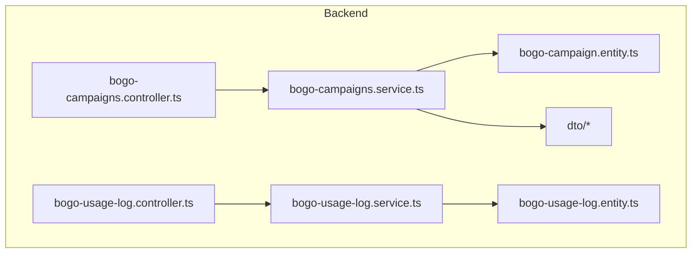
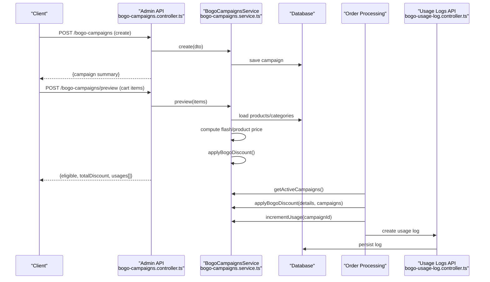
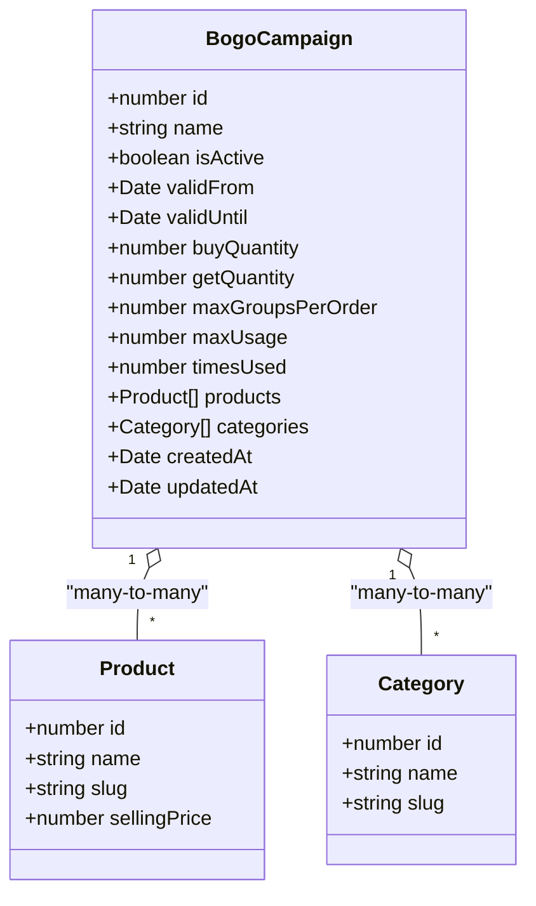
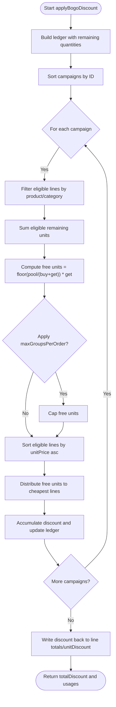
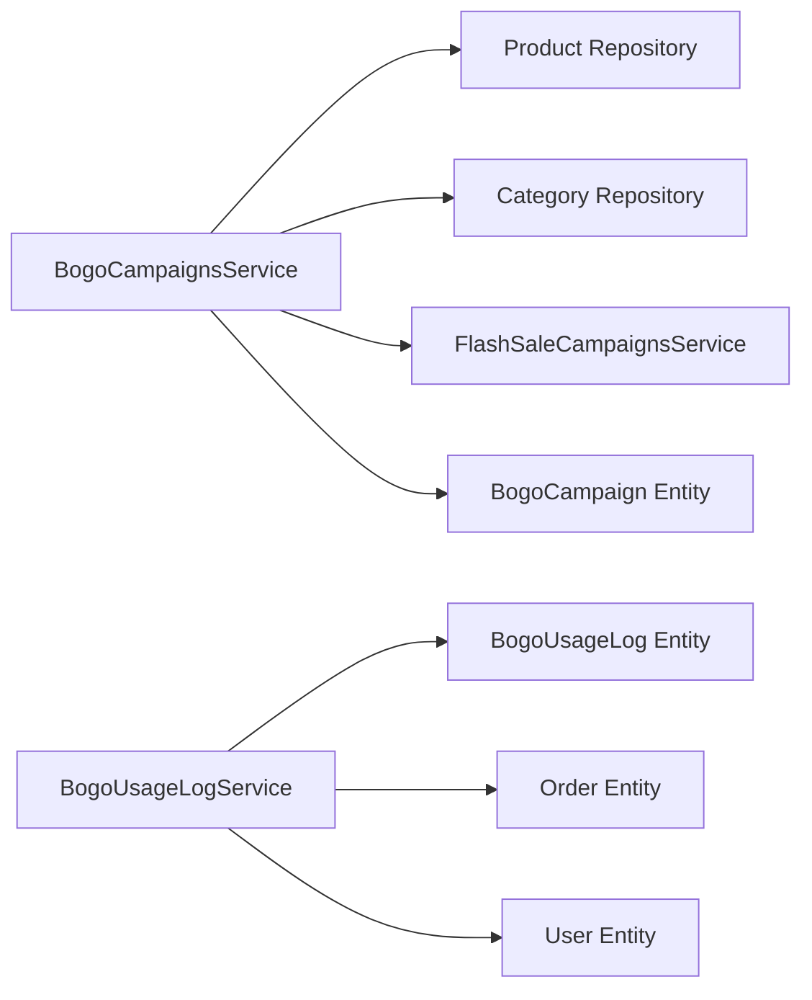

# BOGO Campaigns API

<cite>
**Referenced Files in This Document**
- [bogo-campaigns.controller.ts](file://apps/backend/src/bogo-campaigns/bogo-campaigns.controller.ts)
- [bogo-campaigns.service.ts](file://apps/backend/src/bogo-campaigns/bogo-campaigns.service.ts)
- [bogo-campaign.entity.ts](file://apps/backend/src/bogo-campaigns/entities/bogo-campaign.entity.ts)
- [create-bogo-campaign.dto.ts](file://apps/backend/src/bogo-campaigns/dto/create-bogo-campaign.dto.ts)
- [update-bogo-campaign.dto.ts](file://apps/backend/src/bogo-campaigns/dto/update-bogo-campaign.dto.ts)
- [preview-bogo.dto.ts](file://apps/backend/src/bogo-campaigns/dto/preview-bogo.dto.ts)
- [bogo-usage-log.controller.ts](file://apps/backend/src/bogo-usage-log/bogo-usage-log.controller.ts)
- [bogo-usage-log.service.ts](file://apps/backend/src/bogo-usage-log/bogo-usage-log.service.ts)
- [bogo-usage-log.entity.ts](file://apps/backend/src/bogo-usage-log/entities/bogo-usage-log.entity.ts)
</cite>

## Table of Contents
1. [Introduction](#introduction)
2. [Project Structure](#project-structure)
3. [Core Components](#core-components)
4. [Architecture Overview](#architecture-overview)
5. [Detailed Component Analysis](#detailed-component-analysis)
6. [Dependency Analysis](#dependency-analysis)
7. [Performance Considerations](#performance-considerations)
8. [Troubleshooting Guide](#troubleshooting-guide)
9. [Conclusion](#conclusion)

## Introduction
This document provides comprehensive API documentation for the BOGO (Buy One Get One) campaign system. It covers campaign creation, configuration, management, previewing discounts, eligibility rules, discount application logic, scheduling, usage logging, and reporting. The goal is to help both administrators configuring campaigns and frontend or backend integrators applying BOGO discounts during cart validation and order processing.

BOGO campaigns apply a “buy X get Y free” rule: for every group of `buyQuantity + getQuantity` eligible units in an order, the `getQuantity` cheapest eligible units become free. Eligibility is determined by product or category scoping; if neither is set, the campaign applies to the whole catalog. Multiple active campaigns can overlap; they are processed in ascending ID order so the lowest-ID campaign claims eligible units first.

## Project Structure
The BOGO feature is implemented in the backend NestJS application under two main modules:

- `bogo-campaigns`: Admin endpoints and service for managing BOGO campaigns, plus public preview.
- `bogo-usage-log`: Endpoints and service for recording and querying campaign usage and generating reports.

**Diagram sources**
- [bogo-campaigns.controller.ts:28-129](file://apps/backend/src/bogo-campaigns/bogo-campaigns.controller.ts#L28-L129)
- [bogo-campaigns.service.ts:177-518](file://apps/backend/src/bogo-campaigns/bogo-campaigns.service.ts#L177-L518)
- [bogo-campaign.entity.ts:22-107](file://apps/backend/src/bogo-campaigns/entities/bogo-campaign.entity.ts#L22-L107)
- [bogo-usage-log.controller.ts:21-133](file://apps/backend/src/bogo-usage-log/bogo-usage-log.controller.ts#L21-L133)
- [bogo-usage-log.service.ts:30-150](file://apps/backend/src/bogo-usage-log/bogo-usage-log.service.ts#L30-L150)
- [bogo-usage-log.entity.ts:14-69](file://apps/backend/src/bogo-usage-log/entities/bogo-usage-log.entity.ts#L14-L69)

**Section sources**
- [bogo-campaigns.controller.ts:28-129](file://apps/backend/src/bogo-campaigns/bogo-campaigns.controller.ts#L28-L129)
- [bogo-campaigns.service.ts:177-518](file://apps/backend/src/bogo-campaigns/bogo-campaigns.service.ts#L177-L518)
- [bogo-usage-log.controller.ts:21-133](file://apps/backend/src/bogo-usage-log/bogo-usage-log.controller.ts#L21-L133)
- [bogo-usage-log.service.ts:30-150](file://apps/backend/src/bogo-usage-log/bogo-usage-log.service.ts#L30-L150)

## Core Components
- **BogoCampaign entity**: Defines campaign fields such as name, activation state, schedule (`validFrom`, `validUntil`), BOGO parameters (`buyQuantity`, `getQuantity`), per-order caps (`maxGroupsPerOrder`), lifetime limits (`maxUsage`, `timesUsed`), and relations to products and categories.
- **BogoCampaignsService**: Provides CRUD operations, active campaign resolution, product-level display hints, cart preview, discount application, and atomic usage increment.
- **BogoUsageLog entity and service**: Record each BOGO application with campaign snapshot, order, user, discount amount, free units, and order total; provide paginated logs and aggregated report stats.
- **Controllers**: Expose REST endpoints for admin campaign management, public preview, usage log listing, and report statistics.

Key responsibilities:
- Campaign lifecycle: create, read, update, delete.
- Scheduling and activation: enforce date ranges and max usage.
- Product/category scoping: determine eligible items.
- Discount engine: pool eligible units across lines, apply cheapest-free logic, cap groups per order.
- Preview: estimate discount without persisting changes.
- Usage tracking: record applied discounts and generate analytics.

**Section sources**
- [bogo-campaign.entity.ts:14-107](file://apps/backend/src/bogo-campaigns/entities/bogo-campaign.entity.ts#L14-L107)
- [bogo-campaigns.service.ts:85-175](file://apps/backend/src/bogo-campaigns/bogo-campaigns.service.ts#L85-L175)
- [bogo-usage-log.entity.ts:14-69](file://apps/backend/src/bogo-usage-log/entities/bogo-usage-log.entity.ts#L14-L69)
- [bogo-usage-log.service.ts:30-150](file://apps/backend/src/bogo-usage-log/bogo-usage-log.service.ts#L30-L150)

## Architecture Overview
The BOGO system integrates with product data, flash sale pricing, cart/order processing, and usage logging.

**Diagram sources**
- [bogo-campaigns.controller.ts:35-129](file://apps/backend/src/bogo-campaigns/bogo-campaigns.controller.ts#L35-L129)
- [bogo-campaigns.service.ts:191-518](file://apps/backend/src/bogo-campaigns/bogo-campaigns.service.ts#L191-L518)
- [bogo-usage-log.controller.ts:31-133](file://apps/backend/src/bogo-usage-log/bogo-usage-log.controller.ts#L31-L133)

## Detailed Component Analysis

### Campaign Data Model
The BOGO campaign model defines the core configuration and constraints.

**Diagram sources**
- [bogo-campaign.entity.ts:22-107](file://apps/backend/src/bogo-campaigns/entities/bogo-campaign.entity.ts#L22-L107)

**Section sources**
- [bogo-campaign.entity.ts:14-107](file://apps/backend/src/bogo-campaigns/entities/bogo-campaign.entity.ts#L14-L107)

### Admin Campaign Management API
Endpoints for creating, reading, updating, and deleting BOGO campaigns. All admin endpoints require JWT authentication and module permissions.

- `POST /bogo-campaigns`
  - Purpose: Create a new BOGO campaign.
  - Request body: `CreateBogoCampaignDto`.
  - Response: `AdminBogoCampaignSummary`.
  - Validation: name required; `buyQuantity` and `getQuantity` must be at least 1; optional `productIds` and `categoryIds`; optional `maxGroupsPerOrder` and `maxUsage`.
  - Date validation: `validUntil` must be after `validFrom`.

- `PATCH /bogo-campaigns/:id`
  - Purpose: Update an existing campaign.
  - Request body: `UpdateBogoCampaignDto` (partial).
  - Response: `AdminBogoCampaignSummary`.

- `GET /bogo-campaigns`
  - Purpose: List all campaigns.
  - Response: array of `AdminBogoCampaignSummary`.

- `GET /bogo-campaigns/:id`
  - Purpose: Retrieve a single campaign.
  - Response: `AdminBogoCampaignSummary`.

- `DELETE /bogo-campaigns/:id`
  - Purpose: Delete a campaign.
  - Response: success message.

Request/response types:
- `CreateBogoCampaignDto`: includes name, isActive, validFrom, validUntil, buyQuantity, getQuantity, maxGroupsPerOrder, maxUsage, productIds, categoryIds.
- `UpdateBogoCampaignDto`: partial version of create DTO.
- `AdminBogoCampaignSummary`: trimmed campaign with safe product/category summaries.

Security:
- Protected by `JwtAuthGuard` and `PermissionGuard`.
- Module permission path: `/admin/marketing/bogo/bogo-list`.

Error handling:
- Not found when retrieving or mutating a non-existent campaign.
- Bad request when date range is invalid.

**Section sources**
- [bogo-campaigns.controller.ts:56-129](file://apps/backend/src/bogo-campaigns/bogo-campaigns.controller.ts#L56-L129)
- [bogo-campaigns.service.ts:191-262](file://apps/backend/src/bogo-campaigns/bogo-campaigns.service.ts#L191-L262)
- [create-bogo-campaign.dto.ts:15-83](file://apps/backend/src/bogo-campaigns/dto/create-bogo-campaign.dto.ts#L15-L83)
- [update-bogo-campaign.dto.ts:1-5](file://apps/backend/src/bogo-campaigns/dto/update-bogo-campaign.dto.ts#L1-L5)

### Public Preview API
Purpose: Estimate BOGO discount for a cart without persisting changes. Useful for storefront display and testing configurations before activation.

- `POST /bogo-campaigns/preview`
  - Purpose: Calculate potential BOGO discount for given cart items.
  - Request body: `PreviewBogoDto.items` — array of `{ productId, quantity }`.
  - Response:
    - `eligible`: boolean indicating whether any discount applies.
    - `totalDiscount`: sum of discounts from all applicable campaigns.
    - `usages`: per-campaign breakdown including campaign summary, discount amount, and number of free units.

Behavior:
- Resolves product prices considering flash sales (no stacking) or product discount windows.
- Applies active BOGO campaigns in ascending ID order.
- Pools eligible units across order lines; applies cheapest-free logic.
- Honors `maxGroupsPerOrder` per campaign.

Validation:
- Each item must reference an existing product; otherwise returns not found.

**Section sources**
- [bogo-campaigns.controller.ts:35-54](file://apps/backend/src/bogo-campaigns/bogo-campaigns.controller.ts#L35-L54)
- [bogo-campaigns.service.ts:419-494](file://apps/backend/src/bogo-campaigns/bogo-campaigns.service.ts#L419-L494)
- [preview-bogo.dto.ts:11-29](file://apps/backend/src/bogo-campaigns/dto/preview-bogo.dto.ts#L11-L29)

### Discount Application Logic
The discount engine computes how many free units to award and which units become free.

Algorithm overview:
- Build a ledger of line details with remaining quantities.
- For each active campaign (sorted by ID):
  - Filter eligible lines based on product or category scope.
  - Compute total eligible units and group size (`buyQuantity + getQuantity`).
  - Determine free units: floor(totalUnits / groupSize) * getQuantity.
  - Apply per-order cap via `maxGroupsPerOrder`.
  - Distribute free units to the cheapest eligible lines first.
  - Accumulate discount and update line totals and unit discounts.
- Write back adjusted totals and unit discounts into pricing details.

Complexity:
- Sorting eligible lines per campaign adds O(k log k) where k is eligible lines.
- Overall complexity is linear in number of campaigns plus sorting overhead.

Edge cases:
- Whole-catalog campaigns (no products/categories) cover all lines.
- Overlapping campaigns: lower ID wins first due to sort order.
- Zero or negative free units: skip campaign.

**Diagram sources**
- [bogo-campaigns.service.ts:95-175](file://apps/backend/src/bogo-campaigns/bogo-campaigns.service.ts#L95-L175)

**Section sources**
- [bogo-campaigns.service.ts:85-175](file://apps/backend/src/bogo-campaigns/bogo-campaigns.service.ts#L85-L175)

### Active Campaign Resolution and Display Hints
- Active campaigns are those that are active, within their scheduled time window, and not exhausted by `maxUsage`. Results are cached for 30 seconds to reduce database load while allowing near-real-time storefront updates.
- Product-level display hints attach minimal BOGO info to products for UI badges or tooltips, showing campaign name, buy/get quantities, and end time.

Integration points:
- Cart and product listings can call active campaign resolution to show eligibility hints.
- Order processing uses the same active campaign list to ensure consistent pricing.

**Section sources**
- [bogo-campaigns.service.ts:322-361](file://apps/backend/src/bogo-campaigns/bogo-campaigns.service.ts#L322-L361)
- [bogo-campaigns.service.ts:388-412](file://apps/backend/src/bogo-campaigns/bogo-campaigns.service.ts#L388-L412)

### Usage Logging and Reporting
After an order applies BOGO discounts, the system records usage for auditing and analytics.

Usage log fields:
- Campaign reference and snapshot name.
- Order and user references.
- Discount amount and free units awarded.
- Order total value at time of usage.
- Timestamp.

Endpoints:
- `GET /bogo-usage-logs`
  - Purpose: Paginated list of usage logs with filters.
  - Query params: page, limit, campaignId, fromDate, toDate.
  - Response: array of logs plus pagination metadata.

- `GET /bogo-usage-logs/report-stats`
  - Purpose: Aggregated metrics across campaigns or filtered by date/campaign.
  - Metrics: totalUses, totalDiscount, totalFreeUnits, totalOrderValue, avgOrderValue, uniqueCampaigns.

Service methods:
- `create(input)`: persists a usage log entry.
- `findAll(options)`: paginated query with joins and filters.
- `findByOrder(orderId)`: retrieve all logs for a specific order.
- `getReportStats(options)`: aggregate SQL-based stats.

**Section sources**
- [bogo-usage-log.controller.ts:31-133](file://apps/backend/src/bogo-usage-log/bogo-usage-log.controller.ts#L31-L133)
- [bogo-usage-log.service.ts:39-150](file://apps/backend/src/bogo-usage-log/bogo-usage-log.service.ts#L39-L150)
- [bogo-usage-log.entity.ts:14-69](file://apps/backend/src/bogo-usage-log/entities/bogo-usage-log.entity.ts#L14-L69)

### Integration with Cart Validation and Order Processing
Recommended integration flow:
1. Resolve active BOGO campaigns once per cart/order context.
2. Compute per-line pricing mirroring order service behavior:
   - Flash sale price takes precedence over product discount window.
   - If no flash sale, apply product discount window if active.
3. Call `applyBogoDiscount` with pricing details and active campaigns.
4. Persist order items using updated line totals and unit discounts.
5. Atomically increment campaign usage via `incrementUsage`.
6. Record usage logs with campaign snapshot, discount amount, free units, and order total.

Notes:
- Preview endpoint mirrors order pricing but does not persist changes.
- Campaign usage increment returns false if the campaign reaches its limit mid-order; callers should still log and proceed.

**Section sources**
- [bogo-campaigns.service.ts:419-494](file://apps/backend/src/bogo-campaigns/bogo-campaigns.service.ts#L419-L494)
- [bogo-campaigns.service.ts:506-517](file://apps/backend/src/bogo-campaigns/bogo-campaigns.service.ts#L506-L517)

### Examples of Complex BOGO Scenarios
- Buy X get Y free:
  - Set `buyQuantity` to X and `getQuantity` to Y.
  - Example: buy 2 get 1 free means every 3 eligible units yield 1 free unit.
- Tiered discounts:
  - Use multiple campaigns with different scopes and group sizes.
  - Lower-ID campaigns claim units first; higher-ID campaigns apply to remaining units.
- Conditional offers:
  - Scope by product IDs or category IDs to target specific segments.
  - Combine with scheduling (`validFrom`, `validUntil`) for time-bound promotions.
- Per-order caps:
  - Set `maxGroupsPerOrder` to limit the number of free groups per order.
  - Example: buy 1 get 1 with `maxGroupsPerOrder=1` allows at most one free unit per order.
- Lifetime limits:
  - Set `maxUsage` to cap total applications across all orders.
  - `timesUsed` tracks actual applications; `incrementUsage` atomically increments.

Best practices:
- Prefer category scoping for broad campaigns; use product scoping for precise targeting.
- Keep campaign IDs stable and ordered intentionally to control precedence.
- Use preview endpoint extensively to validate complex scenarios before activation.
- Monitor usage logs and report stats to assess impact and adjust rules.

[No sources needed since this section provides conceptual examples and best practices]

## Dependency Analysis
The BOGO system depends on product and category entities, flash sale pricing utilities, and order/user entities for logging.

**Diagram sources**
- [bogo-campaigns.service.ts:177-187](file://apps/backend/src/bogo-campaigns/bogo-campaigns.service.ts#L177-L187)
- [bogo-usage-log.service.ts:30-37](file://apps/backend/src/bogo-usage-log/bogo-usage-log.service.ts#L30-L37)
- [bogo-campaign.entity.ts:84-100](file://apps/backend/src/bogo-campaigns/entities/bogo-campaign.entity.ts#L84-L100)
- [bogo-usage-log.entity.ts:20-40](file://apps/backend/src/bogo-usage-log/entities/bogo-usage-log.entity.ts#L20-L40)

**Section sources**
- [bogo-campaigns.service.ts:177-187](file://apps/backend/src/bogo-campaigns/bogo-campaigns.service.ts#L177-L187)
- [bogo-usage-log.service.ts:30-37](file://apps/backend/src/bogo-usage-log/bogo-usage-log.service.ts#L30-L37)

## Performance Considerations
- Active campaign queries are cached for 30 seconds to reduce database pressure while maintaining near-real-time storefront accuracy.
- Preview resolves flash sale campaigns once per cart and computes product prices efficiently.
- Discount application sorts eligible lines per campaign; keep product/category scopes tight to minimize sorting overhead.
- Usage log queries use pagination and join-free counts for performance.

Recommendations:
- Limit the number of active overlapping campaigns.
- Use category scoping judiciously to avoid overly broad matching.
- Monitor cache hit rates and adjust TTL if necessary.
- Archive old usage logs periodically to maintain query performance.

[No sources needed since this section provides general guidance]

## Troubleshooting Guide
Common issues and resolutions:
- Invalid date range:
  - Ensure `validUntil` is after `validFrom`.
  - The service throws a bad request error if dates are invalid.
- Product not found in preview:
  - Verify all `productId` values exist in the product catalog.
- Campaign not applying:
  - Check activation status, schedule, and usage limits.
  - Confirm product/category scoping matches cart items.
- Unexpected discount distribution:
  - Review campaign precedence (lower ID first) and per-order caps.
  - Validate that cheapest-free logic aligns with expectations.
- Usage limit reached mid-order:
  - `incrementUsage` may return false; log the event and continue processing.

Operational checks:
- Use preview endpoint to simulate cart scenarios.
- Inspect usage logs for applied discounts and free units.
- Review report stats to understand overall impact.

**Section sources**
- [bogo-campaigns.service.ts:292-296](file://apps/backend/src/bogo-campaigns/bogo-campaigns.service.ts#L292-L296)
- [bogo-campaigns.service.ts:439-443](file://apps/backend/src/bogo-campaigns/bogo-campaigns.service.ts#L439-L443)
- [bogo-campaigns.service.ts:506-517](file://apps/backend/src/bogo-campaigns/bogo-campaigns.service.ts#L506-L517)

## Conclusion
The BOGO Campaigns API provides a robust framework for configuring and applying “buy X get Y free” promotions. Administrators can define campaigns with flexible scoping, scheduling, and limits. The preview endpoint enables safe testing of configurations, while the discount engine ensures consistent and fair application of free units. Usage logging and reporting support ongoing analysis and optimization. Integrating these APIs with cart validation and order processing allows for seamless promotion experiences that maximize conversion while controlling costs.

[No sources needed since this section summarizes without analyzing specific files]