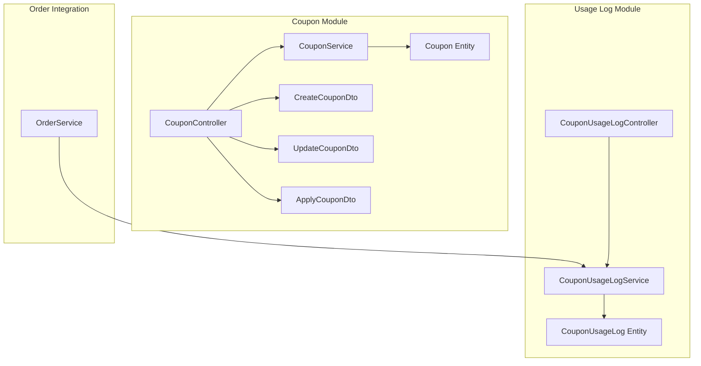
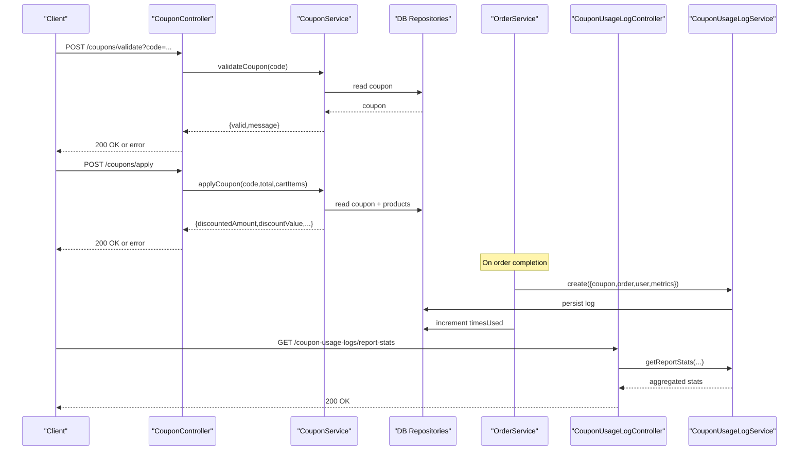
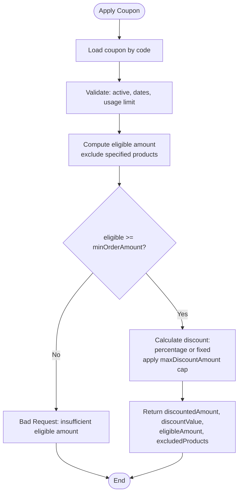
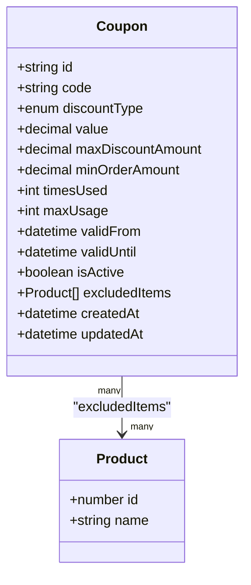
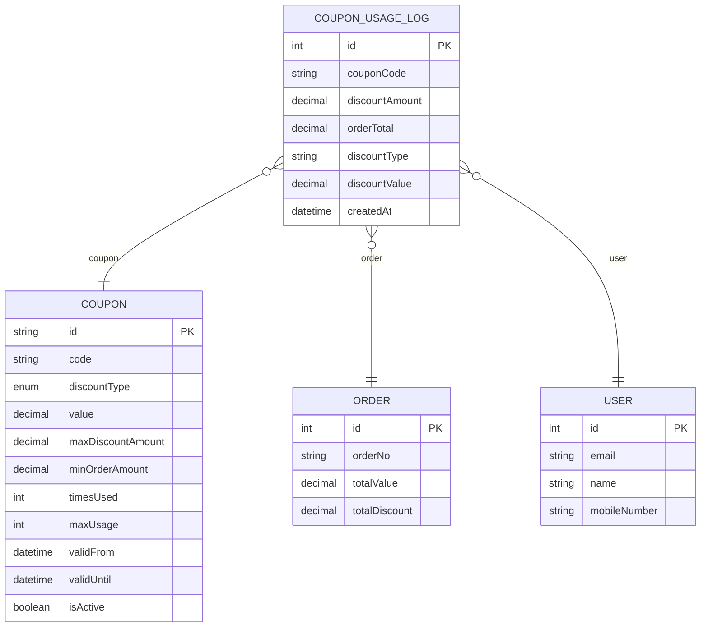
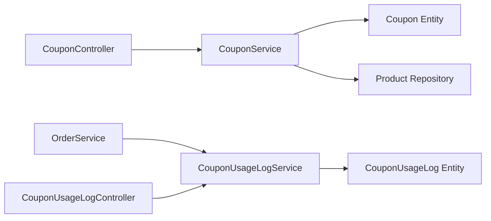

# Coupon Management API

<cite>
**Referenced Files in This Document**
- [coupon.controller.ts](file://apps/backend/src/coupon/coupon.controller.ts)
- [coupon.service.ts](file://apps/backend/src/coupon/coupon.service.ts)
- [coupon.entity.ts](file://apps/backend/src/coupon/entities/coupon.entity.ts)
- [create-coupon.dto.ts](file://apps/backend/src/coupon/dto/create-coupon.dto.ts)
- [update-coupon.dto.ts](file://apps/backend/src/coupon/dto/update-coupon.dto.ts)
- [apply-coupon.dto.ts](file://apps/backend/src/coupon/dto/apply-coupon.dto.ts)
- [index.ts (enums)](file://apps/backend/src/common/enums/index.ts)
- [coupon-usage-log.controller.ts](file://apps/backend/src/coupon-usage-log/coupon-usage-log.controller.ts)
- [coupon-usage-log.service.ts](file://apps/backend/src/coupon-usage-log/coupon-usage-log.service.ts)
- [coupon-usage-log.entity.ts](file://apps/backend/src/coupon-usage-log/entities/coupon-usage-log.entity.ts)
- [order.service.ts](file://apps/backend/src/order/order.service.ts)
</cite>

## Table of Contents
1. Introduction
2. Project Structure
3. Core Components
4. Architecture Overview
5. Detailed Component Analysis
6. Dependency Analysis
7. Performance Considerations
8. Troubleshooting Guide
9. Conclusion

## Introduction
This document provides comprehensive API documentation for the coupon management system. It covers coupon creation, validation, application logic, usage logging, and analytics endpoints. The system supports percentage and fixed discounts, minimum order thresholds, maximum discount caps, validity windows, usage limits, and product exclusions. It also includes usage logs and reporting endpoints to track distribution and performance of coupons.

Note: The current implementation supports two discount types: percentage and fixed. Buy-one-get-one is not present in the codebase; see the DiscountType enum for supported values.

## Project Structure
The coupon feature is implemented as a NestJS module with controllers, services, DTOs, and entities. Usage analytics are provided by a separate module that records and reports on coupon usage.

**Diagram sources**
- [coupon.controller.ts:37-41](file://apps/backend/src/coupon/coupon.controller.ts#L37-L41)
- [coupon.service.ts:16-23](file://apps/backend/src/coupon/coupon.service.ts#L16-L23)
- [coupon.entity.ts:13-59](file://apps/backend/src/coupon/entities/coupon.entity.ts#L13-L59)
- [create-coupon.dto.ts:6-88](file://apps/backend/src/coupon/dto/create-coupon.dto.ts#L6-L88)
- [update-coupon.dto.ts:13-55](file://apps/backend/src/coupon/dto/update-coupon.dto.ts#L13-L55)
- [apply-coupon.dto.ts:4-22](file://apps/backend/src/coupon/dto/apply-coupon.dto.ts#L4-L22)
- [coupon-usage-log.controller.ts:26-32](file://apps/backend/src/coupon-usage-log/coupon-usage-log.controller.ts#L26-L32)
- [coupon-usage-log.service.ts:20-27](file://apps/backend/src/coupon-usage-log/coupon-usage-log.service.ts#L20-L27)
- [coupon-usage-log.entity.ts:14-72](file://apps/backend/src/coupon-usage-log/entities/coupon-usage-log.entity.ts#L14-L72)
- [order.service.ts:450-475](file://apps/backend/src/order/order.service.ts#L450-L475)

**Section sources**
- [coupon.controller.ts:37-41](file://apps/backend/src/coupon/coupon.controller.ts#L37-L41)
- [coupon.service.ts:16-23](file://apps/backend/src/coupon/coupon.service.ts#L16-L23)
- [coupon-usage-log.controller.ts:26-32](file://apps/backend/src/coupon-usage-log/coupon-usage-log.controller.ts#L26-L32)
- [coupon-usage-log.service.ts:20-27](file://apps/backend/src/coupon-usage-log/coupon-usage-log.service.ts#L20-L27)
- [order.service.ts:450-475](file://apps/backend/src/order/order.service.ts#L450-L475)

## Core Components
- Coupon Controller: Exposes REST endpoints for CRUD operations, validation, cart-aware validation, and application of coupons.
- Coupon Service: Implements business rules for validation, discount calculation, exclusion handling, and eligibility checks.
- Coupon Entity: Defines data model including discount type, value, caps, thresholds, validity window, usage counters, and excluded products.
- DTOs: Validate inputs for creating, updating, and applying coupons.
- Usage Log Controller and Service: Provide paginated listing, filtering, statistics, and top coupons analytics.
- Order Integration: On successful order placement, logs coupon usage and increments coupon usage count.

Key responsibilities:
- Validation: active status, date range, usage limits.
- Application: eligible amount computation considering exclusions, min order threshold, discount type math, max discount cap.
- Analytics: aggregate stats, per-coupon stats, top coupons over time.

**Section sources**
- [coupon.controller.ts:43-324](file://apps/backend/src/coupon/coupon.controller.ts#L43-L324)
- [coupon.service.ts:25-391](file://apps/backend/src/coupon/coupon.service.ts#L25-L391)
- [coupon.entity.ts:13-59](file://apps/backend/src/coupon/entities/coupon.entity.ts#L13-L59)
- [create-coupon.dto.ts:6-88](file://apps/backend/src/coupon/dto/create-coupon.dto.ts#L6-L88)
- [update-coupon.dto.ts:13-55](file://apps/backend/src/coupon/dto/update-coupon.dto.ts#L13-L55)
- [apply-coupon.dto.ts:4-22](file://apps/backend/src/coupon/dto/apply-coupon.dto.ts#L4-L22)
- [coupon-usage-log.controller.ts:34-236](file://apps/backend/src/coupon-usage-log/coupon-usage-log.controller.ts#L34-L236)
- [coupon-usage-log.service.ts:29-251](file://apps/backend/src/coupon-usage-log/coupon-usage-log.service.ts#L29-L251)
- [order.service.ts:450-475](file://apps/backend/src/order/order.service.ts#L450-L475)

## Architecture Overview
The coupon system integrates with orders and users through usage logs. Admins manage coupons via protected endpoints. Clients validate and apply coupons during checkout.

**Diagram sources**
- [coupon.controller.ts:177-266](file://apps/backend/src/coupon/coupon.controller.ts#L177-L266)
- [coupon.service.ts:135-306](file://apps/backend/src/coupon/coupon.service.ts#L135-L306)
- [order.service.ts:450-475](file://apps/backend/src/order/order.service.ts#L450-L475)
- [coupon-usage-log.controller.ts:79-123](file://apps/backend/src/coupon-usage-log/coupon-usage-log.controller.ts#L79-L123)
- [coupon-usage-log.service.ts:181-215](file://apps/backend/src/coupon-usage-log/coupon-usage-log.service.ts#L181-L215)

## Detailed Component Analysis

### Coupon Endpoints
- Create coupon
  - Method: POST
  - Path: /coupons
  - Auth: JWT + PermissionGuard
  - Body: CreateCouponDto
  - Response: Created coupon entity
- Get all coupons
  - Method: GET
  - Path: /coupons
  - Auth: JWT + PermissionGuard
  - Response: Array of coupons
- Get coupon by code
  - Method: GET
  - Path: /coupons/:code
  - Auth: JWT + PermissionGuard
  - Response: Single coupon
- Update coupon
  - Method: PATCH
  - Path: /coupons/:id
  - Auth: JWT + PermissionGuard
  - Body: UpdateCouponDto
  - Response: Updated coupon
- Delete coupon
  - Method: DELETE
  - Path: /coupons/:id
  - Auth: JWT + PermissionGuard
  - Response: null
- Validate coupon
  - Method: POST
  - Path: /coupons/validate
  - Query: code
  - Response: { valid, message }
- Apply coupon
  - Method: POST
  - Path: /coupons/apply
  - Body: ApplyCouponDto
  - Response: { discountedAmount, discountValue, couponId, eligibleAmount, excludedProducts? }
- Validate coupon for cart
  - Method: POST
  - Path: /coupons/validate-cart
  - Query: code, productIds (comma-separated)
  - Response: { valid, message, excludedProducts?, warning? }

Security and access control:
- All admin endpoints require JWT authentication and module-level permissions.
- Public-facing validation endpoints do not enforce JWT but should be rate-limited at gateway level.

Error responses:
- Not found when coupon does not exist.
- Bad request for inactive, not-yet-valid, or usage limit exceeded.
- Gone (410) for expired coupons.

**Section sources**
- [coupon.controller.ts:43-324](file://apps/backend/src/coupon/coupon.controller.ts#L43-L324)

### Business Logic: Validation and Application
Validation flow:
- Load coupon by code.
- Check isActive.
- Check validFrom and validUntil against current time.
- Enforce maxUsage vs timesUsed.

Application flow:
- Validate coupon first.
- Compute eligible amount:
  - If excluded items exist, sum prices of non-excluded cart items.
  - If only product IDs are provided, use totalAmount as fallback.
- Enforce minOrderAmount against eligible amount.
- Calculate discount:
  - Percentage: eligibleAmount * (value / 100), capped by maxDiscountAmount if set.
  - Fixed: value, capped by maxDiscountAmount if set.
- Return discountedAmount = max(eligibleAmount - discountValue, 0).

Cart-aware validation:
- Returns whether coupon is valid even if some cart items are excluded.
- Provides excludedProducts list and a warning message indicating which items will not receive the discount.

**Diagram sources**
- [coupon.service.ts:180-306](file://apps/backend/src/coupon/coupon.service.ts#L180-L306)

**Section sources**
- [coupon.service.ts:135-306](file://apps/backend/src/coupon/coupon.service.ts#L135-L306)

### Data Model: Coupon
Fields:
- id: string primary key
- code: unique string
- discountType: enum (percentage, fixed)
- value: decimal
- maxDiscountAmount: optional decimal cap
- minOrderAmount: optional decimal threshold
- timesUsed: integer counter
- maxUsage: optional integer limit
- validFrom: datetime
- validUntil: datetime
- isActive: boolean
- excludedItems: many-to-many relation to Product
- createdAt, updatedAt: timestamps

Relationships:
- ManyToMany with Product via join table coupon_excluded_products.

**Diagram sources**
- [coupon.entity.ts:13-59](file://apps/backend/src/coupon/entities/coupon.entity.ts#L13-L59)

**Section sources**
- [coupon.entity.ts:13-59](file://apps/backend/src/coupon/entities/coupon.entity.ts#L13-L59)

### DTOs
- CreateCouponDto: validates code, discountType, value, optional maxDiscountAmount, minOrderAmount, maxUsage, validFrom, validUntil, isActive, excludedItemIds.
- UpdateCouponDto: same fields as create but optional.
- ApplyCouponDto: requires code and cartItems array with productId and price.

Validation constraints:
- Non-negative numeric fields where applicable.
- Date parsing and validation.
- Enum enforcement for discountType.

**Section sources**
- [create-coupon.dto.ts:6-88](file://apps/backend/src/coupon/dto/create-coupon.dto.ts#L6-L88)
- [update-coupon.dto.ts:13-55](file://apps/backend/src/coupon/dto/update-coupon.dto.ts#L13-L55)
- [apply-coupon.dto.ts:4-22](file://apps/backend/src/coupon/dto/apply-coupon.dto.ts#L4-L22)

### Usage Logs and Analytics
Endpoints:
- List all usage logs
  - GET /coupon-usage-logs
  - Query params: page, limit, fromDate, toDate
  - Response: paginated array with totals and metadata
- Report stats
  - GET /coupon-usage-logs/report-stats
  - Query params: fromDate, toDate, couponCode
  - Response: { totalUses, totalDiscountGiven, totalOrderValue, avgDiscountAmount, uniqueCoupons }
- Logs by coupon code
  - GET /coupon-usage-logs/coupon/:couponCode
  - Query params: page, limit
  - Response: paginated logs for a specific coupon
- Stats by coupon code
  - GET /coupon-usage-logs/stats/:couponCode
  - Response: { totalUses, totalDiscountGiven, avgDiscountAmount, totalOrderValue }
- Top coupons
  - GET /coupon-usage-logs/reports/top
  - Query params: days, limit
  - Response: array of { couponCode, uses, discountGiven, orderValue }

Data model:
- CouponUsageLog stores denormalized metrics for efficient aggregation: couponCode, discountAmount, orderTotal, discountType, discountValue, plus relations to coupon, order, user.

Integration:
- OrderService creates usage logs upon successful order placement and increments coupon.timesUsed.

**Diagram sources**
- [coupon-usage-log.entity.ts:14-72](file://apps/backend/src/coupon-usage-log/entities/coupon-usage-log.entity.ts#L14-L72)

**Section sources**
- [coupon-usage-log.controller.ts:34-236](file://apps/backend/src/coupon-usage-log/coupon-usage-log.controller.ts#L34-L236)
- [coupon-usage-log.service.ts:29-251](file://apps/backend/src/coupon-usage-log/coupon-usage-log.service.ts#L29-L251)
- [coupon-usage-log.entity.ts:14-72](file://apps/backend/src/coupon-usage-log/entities/coupon-usage-log.entity.ts#L14-L72)
- [order.service.ts:450-475](file://apps/backend/src/order/order.service.ts#L450-L475)

### Discount Types and Rules
Supported discount types:
- percentage: discount equals eligibleAmount * (value / 100), optionally capped by maxDiscountAmount.
- fixed: discount equals value, optionally capped by maxDiscountAmount.

Rules:
- Minimum eligible order amount must be met after excluding specified products.
- Max discount cap applies to both percentage and fixed types.
- Validity window enforced by validFrom and validUntil.
- Global usage limit enforced by maxUsage vs timesUsed.

Buy-one-get-one:
- Not implemented in the current codebase. Only percentage and fixed discounts are supported.

Customer-specific coupons:
- Not implemented at the coupon level. There is no customer ID restriction field in the Coupon entity.

Category restrictions:
- Not implemented directly. Exclusions are product-based via excludedItems. Category-based restrictions would require additional modeling.

Minimum purchase requirements:
- Supported via minOrderAmount applied to eligible amount.

Stacking rules:
- Not explicitly implemented. The apply endpoint calculates a single coupon’s discount. To support stacking, an orchestrator would need to define precedence and conflict resolution.

Promotional code strategies:
- Use minOrderAmount to encourage higher cart values.
- Use maxDiscountAmount to cap exposure.
- Use validFrom/validUntil for time-bound campaigns.
- Use excludedItems to exclude low-margin or promotional items from discounts.

**Section sources**
- [index.ts (enums):38-41](file://apps/backend/src/common/enums/index.ts#L38-L41)
- [coupon.service.ts:251-283](file://apps/backend/src/coupon/coupon.service.ts#L251-L283)
- [coupon.entity.ts:21-59](file://apps/backend/src/coupon/entities/coupon.entity.ts#L21-L59)

### Security Considerations and Fraud Prevention
- Authentication and authorization:
  - Admin endpoints are protected by JWTAuthGuard and PermissionGuard with module-level permissions.
- Rate limiting:
  - Implement rate limiting at the API gateway or controller level for public validation endpoints to prevent abuse.
- Input validation:
  - DTOs enforce types, ranges, and enums to prevent malformed requests.
- Idempotency:
  - Ensure apply and validation calls are idempotent at the client layer; server-side idempotency can be added using request IDs.
- Auditability:
  - Usage logs capture who used which coupon, on which order, and how much was discounted.
- Anti-fraud measures:
  - Enforce maxUsage and timesUsed strictly.
  - Monitor anomalies via report-stats and top coupons endpoints.
  - Consider adding per-user usage limits and device fingerprinting at the gateway.

**Section sources**
- [coupon.controller.ts:43-45](file://apps/backend/src/coupon/coupon.controller.ts#L43-L45)
- [coupon.controller.ts:177-222](file://apps/backend/src/coupon/coupon.controller.ts#L177-L222)
- [coupon-usage-log.controller.ts:26-32](file://apps/backend/src/coupon-usage-log/coupon-usage-log.controller.ts#L26-L32)
- [order.service.ts:450-475](file://apps/backend/src/order/order.service.ts#L450-L475)

### Performance Optimization for High-Traffic Checkout
- Database queries:
  - Use selective relations and avoid N+1 queries when loading coupons with excluded items.
  - Index frequently queried fields such as code, isActive, validFrom, validUntil, and timesUsed.
- Caching:
  - Cache validated coupon results for short TTLs to reduce DB load during peak checkout.
- Pagination and filtering:
  - Usage log endpoints already support pagination and date-range filters to keep responses small.
- Aggregations:
  - Use SQL aggregations for report-stats and top coupons to minimize application-side processing.
- Concurrency:
  - For high concurrency, consider optimistic locking or atomic increments for timesUsed to avoid race conditions.

[No sources needed since this section provides general guidance]

## Dependency Analysis

**Diagram sources**
- [coupon.controller.ts:37-41](file://apps/backend/src/coupon/coupon.controller.ts#L37-L41)
- [coupon.service.ts:16-23](file://apps/backend/src/coupon/coupon.service.ts#L16-L23)
- [order.service.ts:450-475](file://apps/backend/src/order/order.service.ts#L450-L475)
- [coupon-usage-log.controller.ts:26-32](file://apps/backend/src/coupon-usage-log/coupon-usage-log.controller.ts#L26-L32)
- [coupon-usage-log.service.ts:20-27](file://apps/backend/src/coupon-usage-log/coupon-usage-log.service.ts#L20-L27)

**Section sources**
- [coupon.controller.ts:37-41](file://apps/backend/src/coupon/coupon.controller.ts#L37-L41)
- [coupon.service.ts:16-23](file://apps/backend/src/coupon/coupon.service.ts#L16-L23)
- [order.service.ts:450-475](file://apps/backend/src/order/order.service.ts#L450-L475)
- [coupon-usage-log.controller.ts:26-32](file://apps/backend/src/coupon-usage-log/coupon-usage-log.controller.ts#L26-L32)
- [coupon-usage-log.service.ts:20-27](file://apps/backend/src/coupon-usage-log/coupon-usage-log.service.ts#L20-L27)

## Performance Considerations
- Prefer passing full cart items with prices to apply endpoint to ensure accurate eligible amount calculations.
- Avoid unnecessary joins in analytics queries; rely on denormalized fields in usage logs.
- Use database indexes on coupon.code, coupon.isActive, coupon.validFrom, coupon.validUntil, and coupon.timesUsed.
- Consider caching frequently accessed coupons and their exclusion lists.
- Batch updates for timesUsed under high concurrency to reduce contention.

[No sources needed since this section provides general guidance]

## Troubleshooting Guide
Common issues:
- Coupon not found:
  - Verify the code exists and is accessible.
- Coupon is not active:
  - Check isActive flag in the coupon record.
- Coupon has expired:
  - Confirm current time is before validUntil.
- Coupon is not yet valid:
  - Confirm current time is after validFrom.
- Usage limit exceeded:
  - Compare timesUsed with maxUsage.
- Minimum eligible amount not met:
  - Ensure eligible amount (after exclusions) meets minOrderAmount.
- Excluded products:
  - Review excludedItems and ensure they are not included in eligible amount.

Operational tips:
- Use validate-cart endpoint to inform users about excluded products before applying.
- Inspect usage logs via report-stats and top coupons to detect anomalies.
- When debugging discount calculations, compare eligibleAmount and discountValue returned by apply endpoint.

**Section sources**
- [coupon.service.ts:135-178](file://apps/backend/src/coupon/coupon.service.ts#L135-L178)
- [coupon.service.ts:251-283](file://apps/backend/src/coupon/coupon.service.ts#L251-L283)
- [coupon.service.ts:313-391](file://apps/backend/src/coupon/coupon.service.ts#L313-L391)
- [coupon-usage-log.service.ts:181-251](file://apps/backend/src/coupon-usage-log/coupon-usage-log.service.ts#L181-L251)

## Conclusion
The coupon management system provides robust APIs for creating, validating, and applying coupons with clear business rules around eligibility, exclusions, and caps. Usage logs and analytics enable monitoring and optimization of promotional campaigns. While buy-one-get-one and customer/category-specific restrictions are not currently implemented, the existing architecture supports extension. For high-traffic scenarios, focus on indexing, caching, and careful concurrency handling to maintain performance and accuracy.

[No sources needed since this section summarizes without analyzing specific files]