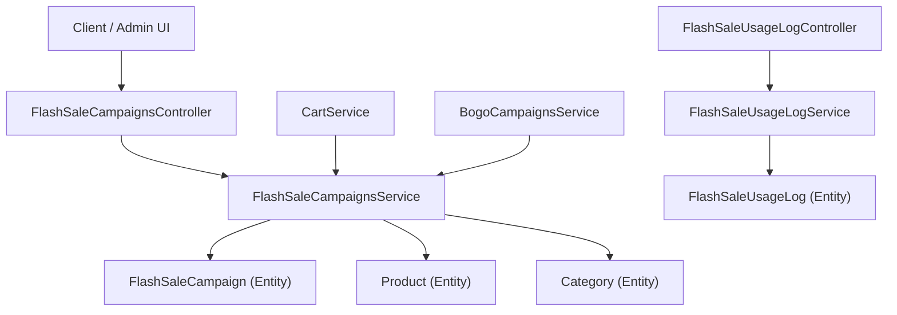
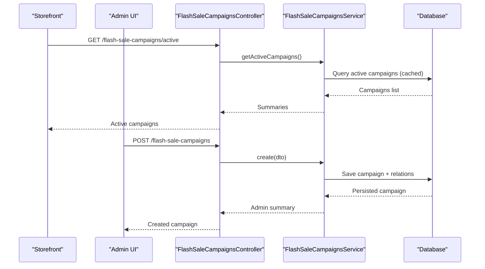
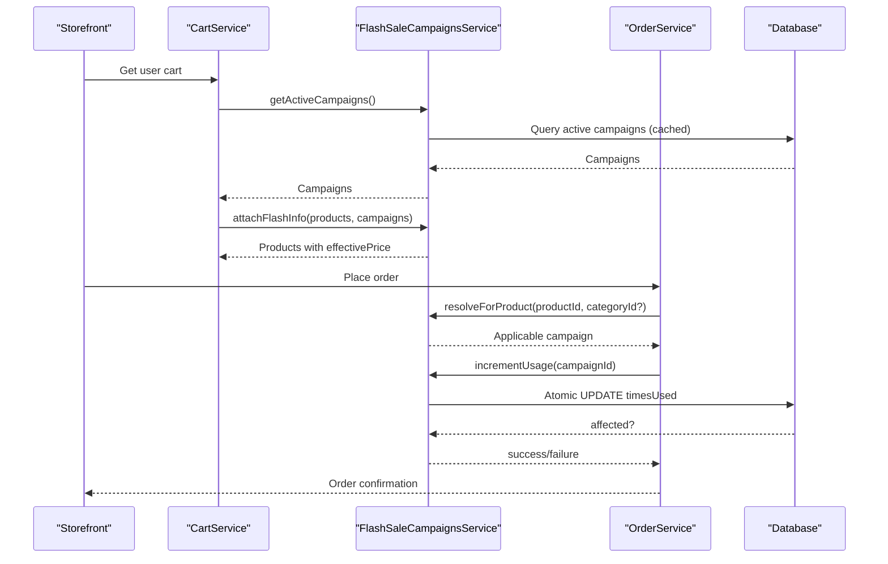
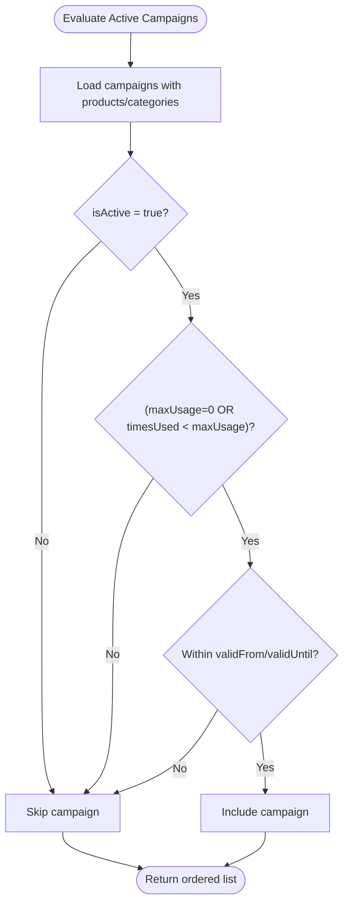
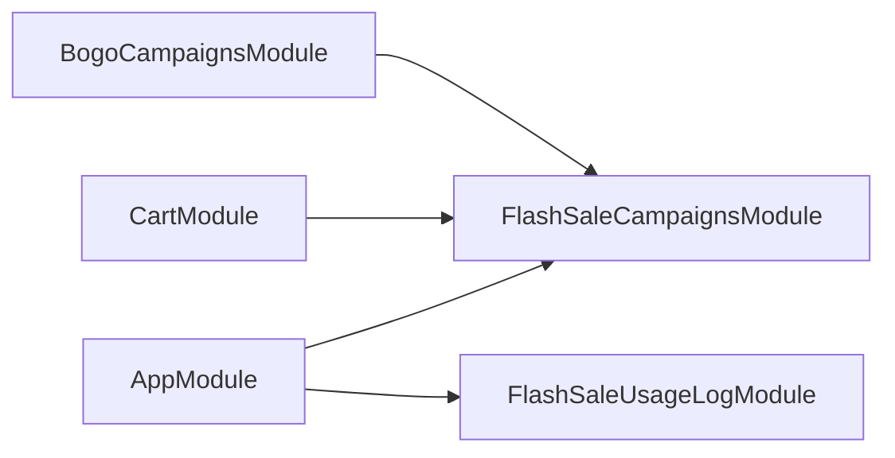

# Flash Sale Campaigns API

<cite>
**Referenced Files in This Document**
- [app.module.ts](file://apps/backend/src/app.module.ts)
- [flash-sale-campaigns.controller.ts](file://apps/backend/src/flash-sale-campaigns/flash-sale-campaigns.controller.ts)
- [flash-sale-campaigns.service.ts](file://apps/backend/src/flash-sale-campaigns/flash-sale-campaigns.service.ts)
- [flash-sale-campaign.entity.ts](file://apps/backend/src/flash-sale-campaigns/entities/flash-sale-campaign.entity.ts)
- [create-flash-sale-campaign.dto.ts](file://apps/backend/src/flash-sale-campaigns/dto/create-flash-sale-campaign.dto.ts)
- [update-flash-sale-campaign.dto.ts](file://apps/backend/src/flash-sale-campaigns/dto/update-flash-sale-campaign.dto.ts)
- [cart.service.ts](file://apps/backend/src/cart/cart.service.ts)
- [bogo-campaigns.service.ts](file://apps/backend/src/bogo-campaigns/bogo-campaigns.service.ts)
- [flash-sale-usage-log.controller.ts](file://apps/backend/src/flash-sale-usage-log/flash-sale-usage-log.controller.ts)
- [flash-sale-usage-log.service.ts](file://apps/backend/src/flash-sale-usage-log/flash-sale-usage-log.service.ts)
- [flash-sale-usage-log.entity.ts](file://apps/backend/src/flash-sale-usage-log/entities/flash-sale-usage-log.entity.ts)
</cite>

## Table of Contents
1. [Introduction](#introduction)
2. [Project Structure](#project-structure)
3. [Core Components](#core-components)
4. [Architecture Overview](#architecture-overview)
5. [Detailed Component Analysis](#detailed-component-analysis)
6. [Dependency Analysis](#dependency-analysis)
7. [Performance Considerations](#performance-considerations)
8. [Troubleshooting Guide](#troubleshooting-guide)
9. [Conclusion](#conclusion)

## Introduction
This document provides comprehensive API documentation for the Flash Sale Campaigns feature. It covers time-limited promotional campaigns with start/end date management, product and category selection, discount application, usage limits, inventory allocation semantics, automatic expiration handling, real-time status updates, countdown timers, and automated campaign lifecycle management. It also documents integration points with product pricing systems, inventory management, and sales tracking, along with concurrency safeguards, race condition handling, and cache invalidation strategies.

## Project Structure
The Flash Sale Campaigns feature is implemented as a NestJS module with:
- A REST controller exposing public and admin endpoints
- A service implementing validation, CRUD, active campaign resolution, price computation, and usage accounting
- An entity modeling campaign metadata, relations to products and categories, and usage counters
- DTOs for request validation
- Usage logging endpoints and services for analytics and reporting
- Integration with cart and BOGO systems for consistent pricing and promotion precedence



**Diagram sources**
- [flash-sale-campaigns.controller.ts:27-120](file://apps/backend/src/flash-sale-campaigns/flash-sale-campaigns.controller.ts#L27-L120)
- [flash-sale-campaigns.service.ts:82-374](file://apps/backend/src/flash-sale-campaigns/flash-sale-campaigns.service.ts#L82-L374)
- [flash-sale-campaign.entity.ts:21-97](file://apps/backend/src/flash-sale-campaigns/entities/flash-sale-campaign.entity.ts#L21-L97)
- [cart.service.ts:15-48](file://apps/backend/src/cart/cart.service.ts#L15-L48)
- [bogo-campaigns.service.ts:177-187](file://apps/backend/src/bogo-campaigns/bogo-campaigns.service.ts#L177-L187)
- [flash-sale-usage-log.controller.ts:21-132](file://apps/backend/src/flash-sale-usage-log/flash-sale-usage-log.controller.ts#L21-L132)
- [flash-sale-usage-log.service.ts:29-138](file://apps/backend/src/flash-sale-usage-log/flash-sale-usage-log.service.ts#L29-L138)
- [flash-sale-usage-log.entity.ts:14-62](file://apps/backend/src/flash-sale-usage-log/entities/flash-sale-usage-log.entity.ts#L14-L62)

**Section sources**
- [app.module.ts:26-27](file://apps/backend/src/app.module.ts#L26-L27)
- [app.module.ts:134-135](file://apps/backend/src/app.module.ts#L134-L135)

## Core Components
- FlashSaleCampaignsController: Exposes public and admin endpoints for listing active campaigns and managing campaigns.
- FlashSaleCampaignsService: Implements validation, CRUD, active campaign evaluation, price computation, usage incrementing, and helper methods for attaching flash sale info to products.
- FlashSaleCampaign Entity: Defines campaign schema including dates, discount type/value, usage counters, and M2M relations to products and categories.
- DTOs: Create and Update DTOs validate inputs such as name, isActive, validFrom/validUntil, discountType/discountValue, maxUsage, productIds, categoryIds.
- Usage Logging: Controllers and services provide paginated logs and aggregated report stats for campaign performance.

Key responsibilities:
- Public endpoint returns only safe summaries for storefront display.
- Admin endpoints require authentication and permissions.
- Active campaign resolution uses caching and strict ordering to avoid ambiguity when multiple campaigns overlap.
- Price computation ensures non-negative effective prices and correct percentage/fixed discount handling.
- Usage incrementing is atomic and safe under concurrent access.

**Section sources**
- [flash-sale-campaigns.controller.ts:27-120](file://apps/backend/src/flash-sale-campaigns/flash-sale-campaigns.controller.ts#L27-L120)
- [flash-sale-campaigns.service.ts:82-374](file://apps/backend/src/flash-sale-campaigns/flash-sale-campaigns.service.ts#L82-L374)
- [flash-sale-campaign.entity.ts:21-97](file://apps/backend/src/flash-sale-campaigns/entities/flash-sale-campaign.entity.ts#L21-L97)
- [create-flash-sale-campaign.dto.ts:17-70](file://apps/backend/src/flash-sale-campaigns/dto/create-flash-sale-campaign.dto.ts#L17-L70)
- [update-flash-sale-campaign.dto.ts:4-6](file://apps/backend/src/flash-sale-campaigns/dto/update-flash-sale-campaign.dto.ts#L4-L6)
- [flash-sale-usage-log.controller.ts:21-132](file://apps/backend/src/flash-sale-usage-log/flash-sale-usage-log.controller.ts#L21-L132)
- [flash-sale-usage-log.service.ts:29-138](file://apps/backend/src/flash-sale-usage-log/flash-sale-usage-log.service.ts#L29-L138)

## Architecture Overview
The system integrates three primary layers:
- Presentation Layer: Admin UI and storefront clients call REST endpoints.
- Business Layer: Services enforce business rules, compute prices, manage usage, and coordinate with other modules.
- Data Layer: TypeORM entities persist campaigns, usage logs, and related data.



**Diagram sources**
- [flash-sale-campaigns.controller.ts:34-88](file://apps/backend/src/flash-sale-campaigns/flash-sale-campaigns.controller.ts#L34-L88)
- [flash-sale-campaigns.service.ts:93-104](file://apps/backend/src/flash-sale-campaigns/flash-sale-campaigns.service.ts#L93-L104)
- [flash-sale-campaigns.service.ts:247-265](file://apps/backend/src/flash-sale-campaigns/flash-sale-campaigns.service.ts#L247-L265)

## Detailed Component Analysis

### Flash Sale Campaigns Controller
Endpoints:
- GET /flash-sale-campaigns/active
  - Purpose: Public endpoint returning active campaigns for storefront display.
  - Response: Array of active campaign summaries with minimal product/category fields.
- GET /flash-sale-campaigns
  - Purpose: Admin endpoint listing all campaigns.
  - Auth: JWT + PermissionGuard; module permission required.
- GET /flash-sale-campaigns/:id
  - Purpose: Admin endpoint retrieving a single campaign by ID.
- POST /flash-sale-campaigns
  - Purpose: Admin endpoint creating a new campaign.
  - Input: CreateFlashSaleCampaignDto.
- PATCH /flash-sale-campaigns/:id
  - Purpose: Admin endpoint updating an existing campaign.
  - Input: UpdateFlashSaleCampaignDto.
- DELETE /flash-sale-campaigns/:id
  - Purpose: Admin endpoint deleting a campaign.

Security:
- Public endpoint does not require authentication.
- Admin endpoints require JWT and module-level permissions.

Response envelope:
- All responses are wrapped in ApiResponseDto with message, statusCode, and data.

**Section sources**
- [flash-sale-campaigns.controller.ts:27-120](file://apps/backend/src/flash-sale-campaigns/flash-sale-campaigns.controller.ts#L27-L120)

### Flash Sale Campaigns Service
Responsibilities:
- Validation: Date range and discount value constraints.
- CRUD: Create, update, find, remove campaigns with relation assignment.
- Active Campaign Resolution: Fetch active campaigns with caching and filter by validity window and usage limits.
- Price Computation: Compute effective price based on discount type and value.
- Usage Accounting: Atomically increment usage counters.
- Product Enrichment: Attach flash sale info and effective price to product objects for display.

Key behaviors:
- Overlap resolution: When multiple campaigns cover the same product or category, the lowest id wins.
- Caching: Active campaigns are cached for 30 seconds to reduce database load while allowing near-real-time storefront updates.
- Safety: Effective price is never negative; percentage discounts capped at 100%.

Important methods:
- create(dto): Validates and persists campaign with product/category relations.
- update(id, dto): Validates partial updates and persists changes.
- findAll(): Returns admin summaries with trimmed relations.
- findOne(id): Returns a single admin summary.
- remove(id): Deletes a campaign.
- getActiveCampaigns(): Retrieves active campaigns with caching and filters by validity and usage.
- resolveForProduct(productId, categoryId?): Resolves first applicable campaign from a preloaded list.
- attachFlashInfo(products, campaigns): Attaches flashSale and effectivePrice to products.
- incrementUsage(id): Atomically increments timesUsed if within limit.

Complexity considerations:
- getActiveCampaigns performs a join query with caching; filtering occurs in memory for time windows.
- attachFlashInfo iterates over products and resolves campaign per product/category.

Concurrency and race conditions:
- incrementUsage uses a single SQL UPDATE with a condition to ensure atomicity and prevent overuse.
- If a campaign reaches its limit mid-order, usage increment fails gracefully and logs a warning.

**Section sources**
- [flash-sale-campaigns.service.ts:82-374](file://apps/backend/src/flash-sale-campaigns/flash-sale-campaigns.service.ts#L82-L374)

### Flash Sale Campaign Entity
Fields:
- id: Primary key.
- name: Campaign name.
- isActive: Whether the campaign is active.
- validFrom: Optional start timestamp.
- validUntil: Optional end timestamp.
- discountType: Enum indicating percentage or fixed discount.
- discountValue: Numeric discount amount.
- maxUsage: Maximum number of applications (0 means unlimited).
- timesUsed: Current usage count.
- products: ManyToMany relation to Product.
- categories: ManyToMany relation to Category.
- createdAt, updatedAt: Timestamps.

Design notes:
- Relations use join tables for products and categories.
- The entity supports both direct product targeting and category-wide promotions.

**Section sources**
- [flash-sale-campaign.entity.ts:21-97](file://apps/backend/src/flash-sale-campaigns/entities/flash-sale-campaign.entity.ts#L21-L97)

### DTOs
CreateFlashSaleCampaignDto:
- name: Required string.
- isActive: Optional boolean.
- validFrom: Optional ISO date string.
- validUntil: Optional ISO date string.
- discountType: Enum (percentage or fixed).
- discountValue: Number with decimal precision.
- maxUsage: Optional integer >= 0.
- productIds: Optional array of product IDs (max size 100).
- categoryIds: Optional array of category IDs (max size 100).

UpdateFlashSaleCampaignDto:
- Extends Partial(CreateFlashSaleCampaignDto), allowing partial updates.

Validation highlights:
- Date strings validated via IsDateString.
- Discount values constrained to non-negative numbers and percentage cap at 100.
- Arrays validated for size and numeric elements.

**Section sources**
- [create-flash-sale-campaign.dto.ts:17-70](file://apps/backend/src/flash-sale-campaigns/dto/create-flash-sale-campaign.dto.ts#L17-L70)
- [update-flash-sale-campaign.dto.ts:4-6](file://apps/backend/src/flash-sale-campaigns/dto/update-flash-sale-campaign.dto.ts#L4-L6)

### Usage Logging Controller and Service
Controller endpoints:
- GET /flash-sale-usage-logs
  - Pagination: page, limit.
  - Filters: campaignId, fromDate, toDate.
  - Response: Paginated array of usage logs with total, page, limit, totalPages.
- GET /flash-sale-usage-logs/report-stats
  - Aggregated statistics: totalUses, totalDiscount, totalOrderValue, avgOrderValue, uniqueCampaigns.
  - Filters: fromDate, toDate, campaignId.

Service methods:
- create(input): Persists usage log entry and logs details.
- findAll(options): Paginates and filters usage logs with joins to campaign, order, user.
- getReportStats(options): Computes aggregated metrics across logs.

Data model:
- FlashSaleUsageLog includes references to campaign, order, user; snapshot of campaignName; discountAmount; orderTotal; createdAt.

**Section sources**
- [flash-sale-usage-log.controller.ts:21-132](file://apps/backend/src/flash-sale-usage-log/flash-sale-usage-log.controller.ts#L21-L132)
- [flash-sale-usage-log.service.ts:29-138](file://apps/backend/src/flash-sale-usage-log/flash-sale-usage-log.service.ts#L29-L138)
- [flash-sale-usage-log.entity.ts:14-62](file://apps/backend/src/flash-sale-usage-log/entities/flash-sale-usage-log.entity.ts#L14-L62)

### Integration with Cart and Pricing
CartService integrates flash sale pricing into the cart:
- getUserCart enriches cart items with flash sale info and effective price using FlashSaleCampaignsService.
- BOGO campaigns are applied alongside flash sales, with precedence rules ensuring flash sale discounts are not stacked with product own discounts.

Pricing precedence:
- Flash sale overrides product’s own discount.
- BOGO applies after unit price is determined (flash sale first, then product discount window).

**Section sources**
- [cart.service.ts:15-48](file://apps/backend/src/cart/cart.service.ts#L15-L48)
- [bogo-campaigns.service.ts:414-494](file://apps/backend/src/bogo-campaigns/bogo-campaigns.service.ts#L414-L494)

### Class Diagram
```mermaid
classDiagram
class FlashSaleCampaign {
+number id
+string name
+boolean isActive
+Date validFrom
+Date validUntil
+enum discountType
+number discountValue
+number maxUsage
+number timesUsed
+Product[] products
+Category[] categories
+Date createdAt
+Date updatedAt
}
class FlashSaleCampaignsService {
+create(dto) AdminCampaignSummary
+update(id, dto) AdminCampaignSummary
+findAll() AdminCampaignSummary[]
+findOne(id) AdminCampaignSummary
+remove(id) void
+getActiveCampaigns() FlashSaleCampaign[]
+resolveForProduct(productId, categoryId?) FlashSaleCampaign|null
+attachFlashInfo(products, campaigns) T
+incrementUsage(id) boolean
}
class FlashSaleCampaignsController {
+findActive() ActiveCampaignSummary[]
+findAll() AdminCampaignSummary[]
+findOne(id) AdminCampaignSummary
+create(dto) AdminCampaignSummary
+update(id, dto) AdminCampaignSummary
+remove(id) void
}
class FlashSaleUsageLog {
+number id
+FlashSaleCampaign campaign
+string campaignName
+Order order
+User user
+number discountAmount
+number orderTotal
+Date createdAt
}
class FlashSaleUsageLogService {
+create(input) FlashSaleUsageLog
+findAll(options) {data,total}
+getReportStats(options) ReportStats
}
FlashSaleCampaignsController --> FlashSaleCampaignsService : "uses"
FlashSaleCampaignsService --> FlashSaleCampaign : "persists"
FlashSaleUsageLogService --> FlashSaleUsageLog : "persists"
```

**Diagram sources**
- [flash-sale-campaigns.controller.ts:27-120](file://apps/backend/src/flash-sale-campaigns/flash-sale-campaigns.controller.ts#L27-L120)
- [flash-sale-campaigns.service.ts:82-374](file://apps/backend/src/flash-sale-campaigns/flash-sale-campaigns.service.ts#L82-L374)
- [flash-sale-campaign.entity.ts:21-97](file://apps/backend/src/flash-sale-campaigns/entities/flash-sale-campaign.entity.ts#L21-L97)
- [flash-sale-usage-log.controller.ts:21-132](file://apps/backend/src/flash-sale-usage-log/flash-sale-usage-log.controller.ts#L21-L132)
- [flash-sale-usage-log.service.ts:29-138](file://apps/backend/src/flash-sale-usage-log/flash-sale-usage-log.service.ts#L29-L138)
- [flash-sale-usage-log.entity.ts:14-62](file://apps/backend/src/flash-sale-usage-log/entities/flash-sale-usage-log.entity.ts#L14-L62)

### Sequence Diagram: Order-Time Pricing and Usage Increment


**Diagram sources**
- [cart.service.ts:31-48](file://apps/backend/src/cart/cart.service.ts#L31-L48)
- [flash-sale-campaigns.service.ts:287-293](file://apps/backend/src/flash-sale-campaigns/flash-sale-campaigns.service.ts#L287-L293)
- [flash-sale-campaigns.service.ts:360-373](file://apps/backend/src/flash-sale-campaigns/flash-sale-campaigns.service.ts#L360-L373)

### Flowchart: Active Campaign Evaluation


**Diagram sources**
- [flash-sale-campaigns.service.ts:247-265](file://apps/backend/src/flash-sale-campaigns/flash-sale-campaigns.service.ts#L247-L265)

## Dependency Analysis
Module registration:
- AppModule imports FlashSaleCampaignsModule and FlashSaleUsageLogModule, enabling controllers, services, and entities.

Cross-module dependencies:
- CartService depends on FlashSaleCampaignsService to attach flash sale info and effective price to cart items.
- BogoCampaignsService depends on FlashSaleCampaignsService to respect precedence (flash sale before product discount).



**Diagram sources**
- [app.module.ts:26-27](file://apps/backend/src/app.module.ts#L26-L27)
- [app.module.ts:134-135](file://apps/backend/src/app.module.ts#L134-L135)
- [cart.service.ts:15-24](file://apps/backend/src/cart/cart.service.ts#L15-L24)
- [bogo-campaigns.service.ts:177-187](file://apps/backend/src/bogo-campaigns/bogo-campaigns.service.ts#L177-L187)

**Section sources**
- [app.module.ts:26-27](file://apps/backend/src/app.module.ts#L26-L27)
- [app.module.ts:134-135](file://apps/backend/src/app.module.ts#L134-L135)
- [cart.service.ts:15-24](file://apps/backend/src/cart/cart.service.ts#L15-L24)
- [bogo-campaigns.service.ts:177-187](file://apps/backend/src/bogo-campaigns/bogo-campaigns.service.ts#L177-L187)

## Performance Considerations
- Caching: Active campaigns are cached for 30 seconds to reduce database load and improve response times during high traffic.
- Database queries: Use of left joins and selective relations minimizes payload size and improves query efficiency.
- Atomic operations: Usage increment uses a single SQL UPDATE to avoid race conditions and ensure accurate counts.
- Throttling: Global throttler guards protect endpoints from excessive requests.

Recommendations:
- Monitor cache hit rates and adjust TTL if necessary.
- Ensure indexes exist on frequently filtered columns (isActive, validFrom, validUntil, timesUsed, maxUsage).
- Use pagination for admin endpoints to handle large datasets efficiently.

[No sources needed since this section provides general guidance]

## Troubleshooting Guide
Common issues and resolutions:
- Invalid date range: Ensure validUntil is after validFrom; otherwise, a BadRequestException is thrown.
- Percentage discount > 100: Prevented by validation; adjust discountValue accordingly.
- Campaign not found: Verify campaign ID exists; NotFoundException is thrown if missing.
- Usage exhaustion: If a campaign reaches maxUsage mid-order, incrementUsage returns false; logs a warning but allows order completion.
- Cache staleness: Active campaigns are cached for 30 seconds; expect slight lag in storefront visibility after campaign state changes.

Debugging tips:
- Inspect usage logs via GET /flash-sale-usage-logs to track campaign applications.
- Use report stats to analyze total discount given and order value impact.
- Review logs for warnings about campaign usage exhaustion.

**Section sources**
- [flash-sale-campaigns.service.ts:203-221](file://apps/backend/src/flash-sale-campaigns/flash-sale-campaigns.service.ts#L203-L221)
- [flash-sale-campaigns.service.ts:360-373](file://apps/backend/src/flash-sale-campaigns/flash-sale-campaigns.service.ts#L360-L373)
- [flash-sale-usage-log.controller.ts:31-85](file://apps/backend/src/flash-sale-usage-log/flash-sale-usage-log.controller.ts#L31-L85)
- [flash-sale-usage-log.controller.ts:87-131](file://apps/backend/src/flash-sale-usage-log/flash-sale-usage-log.controller.ts#L87-L131)

## Conclusion
The Flash Sale Campaigns API provides robust support for time-limited promotions with precise control over product and category targeting, discount application, and usage limits. It integrates seamlessly with cart and pricing systems, ensuring consistent and fair discount precedence. Concurrency safeguards and caching strategies maintain performance and correctness under high traffic. Administrators can manage campaigns through secure endpoints and monitor performance via detailed usage logs and aggregated reports.

[No sources needed since this section summarizes without analyzing specific files]