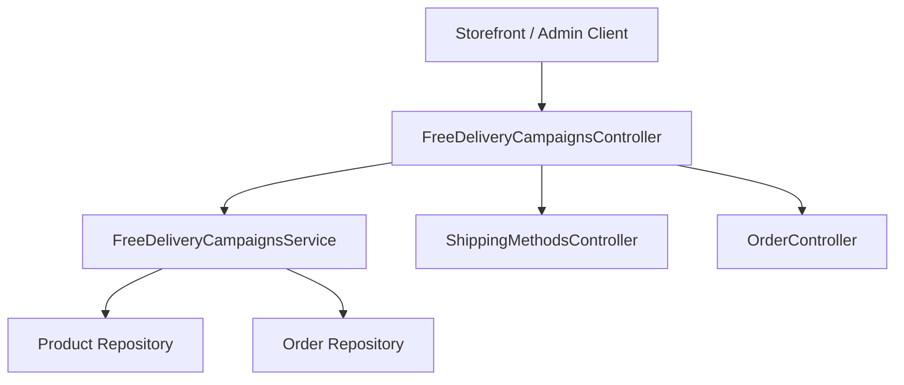
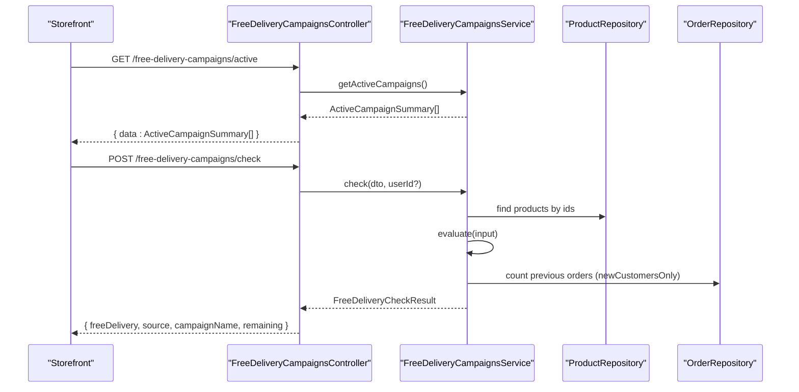
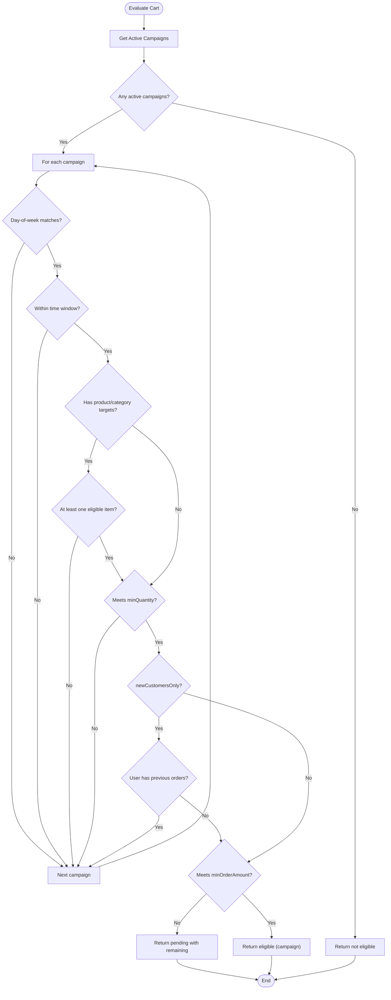
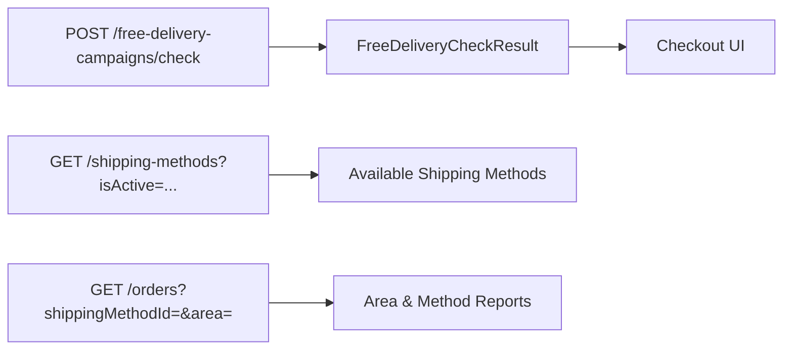

# Free Delivery Campaigns API

<cite>
**Referenced Files in This Document**
- [free-delivery-campaigns.controller.ts](file://apps/backend/src/free-delivery-campaigns/free-delivery-campaigns.controller.ts)
- [free-delivery-campaigns.service.ts](file://apps/backend/src/free-delivery-campaigns/free-delivery-campaigns.service.ts)
- [check-free-delivery.dto.ts](file://apps/backend/src/free-delivery-campaigns/dto/check-free-delivery.dto.ts)
- [create-free-delivery-campaign.dto.ts](file://apps/backend/src/free-delivery-campaigns/dto/create-free-delivery-campaign.dto.ts)
- [update-free-delivery-campaign.dto.ts](file://apps/backend/src/free-delivery-campaigns/dto/update-free-delivery-campaign.dto.ts)
- [shipping-methods.controller.ts](file://apps/backend/src/shipping-methods/shipping-methods.controller.ts)
- [order.controller.ts](file://apps/backend/src/order/order.controller.ts)
</cite>

## Table of Contents
1. [Introduction](#introduction)
2. [Project Structure](#project-structure)
3. [Core Components](#core-components)
4. [Architecture Overview](#architecture-overview)
5. [Detailed Component Analysis](#detailed-component-analysis)
6. [Dependency Analysis](#dependency-analysis)
7. [Performance Considerations](#performance-considerations)
8. [Troubleshooting Guide](#troubleshooting-guide)
9. [Conclusion](#conclusion)

## Introduction
This document provides comprehensive API documentation for the free delivery campaign system. It covers:
- Minimum order value thresholds and quantity rules
- Geographic restrictions and delivery method eligibility
- Campaign configuration including date ranges, customer segmentation, and product/category exclusions
- Real-time delivery eligibility checking during checkout
- Integration with shipping methods and order processing workflows
- Examples of threshold-based campaigns, location-specific promotions, and automated delivery cost calculations
- Performance optimization, caching strategies, and scalability considerations for high-volume orders

The free delivery feature is implemented as a NestJS module exposing public storefront endpoints and admin management endpoints. Eligibility evaluation considers active campaigns, time windows, day-of-week constraints, minimum order amount, minimum item quantity, new-customer-only rules, and product or category targeting.

## Project Structure
The free delivery campaign functionality lives under the backend application:
- Controller exposes REST endpoints for storefront display, real-time eligibility checks, and admin CRUD operations
- Service implements campaign evaluation logic, date validation, relation assignment, and usage tracking
- DTOs define request payloads for creating, updating, and checking free delivery eligibility
- Related modules include shipping methods and orders, which integrate with delivery cost calculation and fulfillment workflows

**Diagram sources**
- [free-delivery-campaigns.controller.ts:30-146](file://apps/backend/src/free-delivery-campaigns/free-delivery-campaigns.controller.ts#L30-L146)
- [free-delivery-campaigns.service.ts:84-417](file://apps/backend/src/free-delivery-campaigns/free-delivery-campaigns.service.ts#L84-L417)
- [shipping-methods.controller.ts:28-113](file://apps/backend/src/shipping-methods/shipping-methods.controller.ts#L28-L113)
- [order.controller.ts:39-181](file://apps/backend/src/order/order.controller.ts#L39-L181)

**Section sources**
- [free-delivery-campaigns.controller.ts:30-146](file://apps/backend/src/free-delivery-campaigns/free-delivery-campaigns.controller.ts#L30-L146)
- [free-delivery-campaigns.service.ts:84-417](file://apps/backend/src/free-delivery-campaigns/free-delivery-campaigns.service.ts#L84-L417)

## Core Components
- FreeDeliveryCampaignsController: Public and admin endpoints for listing active campaigns, evaluating eligibility, and managing campaigns
- FreeDeliveryCampaignsService: Campaign evaluation engine, date range validation, M2M relation handling, and usage counting
- DTOs:
  - CheckFreeDeliveryDto: Payload for real-time eligibility check
  - CreateFreeDeliveryCampaignDto: Configuration fields for campaigns
  - UpdateFreeDeliveryCampaignDto: Partial update payload

Key responsibilities:
- Expose active campaigns for storefront UI
- Evaluate cart against all active campaigns to determine free delivery eligibility
- Provide pending progress when a campaign is close to unlocking (minimum order amount)
- Manage campaign lifecycle (CRUD) with proper validation and relation updates

**Section sources**
- [free-delivery-campaigns.controller.ts:30-146](file://apps/backend/src/free-delivery-campaigns/free-delivery-campaigns.controller.ts#L30-L146)
- [free-delivery-campaigns.service.ts:84-417](file://apps/backend/src/free-delivery-campaigns/free-delivery-campaigns.service.ts#L84-L417)
- [check-free-delivery.dto.ts:1-41](file://apps/backend/src/free-delivery-campaigns/dto/check-free-delivery.dto.ts#L1-L41)
- [create-free-delivery-campaign.dto.ts:1-90](file://apps/backend/src/free-delivery-campaigns/dto/create-free-delivery-campaign.dto.ts#L1-L90)
- [update-free-delivery-campaign.dto.ts:1-7](file://apps/backend/src/free-delivery-campaigns/dto/update-free-delivery-campaign.dto.ts#L1-L7)

## Architecture Overview
The free delivery campaign system integrates with shipping methods and order processing:
- Storefront calls GET /free-delivery-campaigns/active to display eligible campaigns
- Checkout calls POST /free-delivery-campaigns/check to evaluate eligibility in real time
- Admin manages campaigns via protected endpoints
- Shipping methods are configured separately and can be filtered by activation status
- Orders reference shipping methods and areas; reports support filtering by area and shipping method

**Diagram sources**
- [free-delivery-campaigns.controller.ts:37-71](file://apps/backend/src/free-delivery-campaigns/free-delivery-campaigns.controller.ts#L37-L71)
- [free-delivery-campaigns.service.ts:224-410](file://apps/backend/src/free-delivery-campaigns/free-delivery-campaigns.service.ts#L224-L410)

## Detailed Component Analysis

### Free Delivery Campaigns Controller
Endpoints:
- GET /free-delivery-campaigns/active
  - Purpose: Return active campaigns for storefront display
  - Authentication: None
  - Response: List of active campaign summaries with minimal product/category info
- POST /free-delivery-campaigns/check
  - Purpose: Real-time eligibility check for cart items
  - Authentication: Optional JWT (guests allowed; newCustomersOnly requires token)
  - Request body: CheckFreeDeliveryDto
  - Response: FreeDeliveryCheckResult indicating eligibility, source, campaign name, and remaining amount if pending
- Admin endpoints (JWT + PermissionGuard):
  - GET /free-delivery-campaigns
  - GET /free-delivery-campaigns/:id
  - POST /free-delivery-campaigns
  - PATCH /free-delivery-campaigns/:id
  - DELETE /free-delivery-campaigns/:id

Security:
- Public endpoints are open for storefront use
- Admin endpoints require JWT authentication and module permissions

**Section sources**
- [free-delivery-campaigns.controller.ts:30-146](file://apps/backend/src/free-delivery-campaigns/free-delivery-campaigns.controller.ts#L30-L146)

### Free Delivery Campaigns Service
Responsibilities:
- Date range validation: Ensure validFrom <= validUntil
- Relation assignment: Map productIds and categoryIds to M2M relations
- Active campaign retrieval: Filter by isActive and current time window
- Evaluation engine: Assess campaigns based on:
  - Day-of-week constraints
  - Time window (startTime/endTime), including midnight wrap-around
  - Product/category targeting (at least one eligible item required)
  - Minimum quantity rule
  - New customers only rule (requires user token and zero previous orders)
  - Minimum order amount (returns 'amount' when close but not met)
- Usage tracking: Increment usageCount atomically

Data models exposed:
- ActiveCampaignSummary: Trimmed campaign data for storefront
- AdminCampaignSummary: Trimmed campaign data for admin UI
- FreeDeliveryCheckResult: Eligibility result with source and optional remaining amount

Complexity:
- Evaluation iterates over active campaigns; each assessment performs constant-time checks plus potential DB query for newCustomersOnly
- Category lookup uses a map built from product queries to avoid repeated lookups

Error handling:
- BadRequestException for invalid date ranges
- NotFoundException for missing campaigns in admin paths

**Section sources**
- [free-delivery-campaigns.service.ts:84-417](file://apps/backend/src/free-delivery-campaigns/free-delivery-campaigns.service.ts#L84-L417)

### DTOs

#### CheckFreeDeliveryDto
Fields:
- payableSubtotal: number (>= 0)
- totalQuantity: integer (>= 0)
- items: array of CheckItemDto (max 100)
  - productId: integer
  - quantity: integer (>= 1)

Usage:
- Used by POST /free-delivery-campaigns/check to evaluate cart eligibility

**Section sources**
- [check-free-delivery.dto.ts:1-41](file://apps/backend/src/free-delivery-campaigns/dto/check-free-delivery.dto.ts#L1-L41)

#### CreateFreeDeliveryCampaignDto
Configuration fields:
- name: string (required)
- isActive: boolean (optional, default true)
- validFrom: ISO date string (optional)
- validUntil: ISO date string (optional)
- daysOfWeek: array of integers 0..6 (optional; empty means every day)
- startTime: HH:mm string (optional)
- endTime: HH:mm string (optional)
- minOrderAmount: number (>= 0, optional)
- minQuantity: integer (>= 1, optional)
- newCustomersOnly: boolean (optional)
- productIds: array of integers (optional; empty means any product)
- categoryIds: array of integers (optional; empty means any category)

Validation:
- Days must be within 0..6
- Time strings must match HH:mm format
- Amounts and quantities validated for non-negative/non-zero constraints

**Section sources**
- [create-free-delivery-campaign.dto.ts:1-90](file://apps/backend/src/free-delivery-campaigns/dto/create-free-delivery-campaign.dto.ts#L1-L90)

#### UpdateFreeDeliveryCampaignDto
- Partial type of CreateFreeDeliveryCampaignDto

**Section sources**
- [update-free-delivery-campaign.dto.ts:1-7](file://apps/backend/src/free-delivery-campaigns/dto/update-free-delivery-campaign.dto.ts#L1-L7)

### Evaluation Flow
The service evaluates campaigns in order and returns the first match. If no match, it reports pending campaigns where only the minimum order amount was not met.

**Diagram sources**
- [free-delivery-campaigns.service.ts:269-410](file://apps/backend/src/free-delivery-campaigns/free-delivery-campaigns.service.ts#L269-L410)

### Integration with Shipping Methods and Orders
- Shipping methods are managed via a separate controller with CRUD endpoints and an optional isActive filter
- Orders support filtering by shippingMethodId and area/division/city, enabling reporting and analysis tied to delivery zones
- Free delivery campaigns influence delivery cost calculation at checkout by marking delivery as free when eligible

**Diagram sources**
- [free-delivery-campaigns.controller.ts:54-71](file://apps/backend/src/free-delivery-campaigns/free-delivery-campaigns.controller.ts#L54-L71)
- [shipping-methods.controller.ts:53-70](file://apps/backend/src/shipping-methods/shipping-methods.controller.ts#L53-L70)
- [order.controller.ts:94-145](file://apps/backend/src/order/order.controller.ts#L94-L145)

**Section sources**
- [shipping-methods.controller.ts:28-113](file://apps/backend/src/shipping-methods/shipping-methods.controller.ts#L28-L113)
- [order.controller.ts:94-145](file://apps/backend/src/order/order.controller.ts#L94-L145)

## Dependency Analysis
- FreeDeliveryCampaignsController depends on FreeDeliveryCampaignsService
- FreeDeliveryCampaignsService depends on:
  - Product repository for resolving product categories during eligibility checks
  - Order repository for counting previous orders when newCustomersOnly is enabled
- Storefront integration points:
  - GET /free-delivery-campaigns/active
  - POST /free-delivery-campaigns/check
- Admin integration points:
  - Full CRUD for campaigns
- External integrations:
  - Shipping methods module for available delivery options
  - Orders module for area-based reporting and shipping method filters

Potential coupling:
- The evaluation logic directly queries Product and Order entities; consider caching product-category mappings and user order counts for high-throughput scenarios
- Campaign list queries load relations (products/categories); ensure database indexes exist on frequently filtered fields (isActive, validFrom, validUntil)

**Section sources**
- [free-delivery-campaigns.controller.ts:30-146](file://apps/backend/src/free-delivery-campaigns/free-delivery-campaigns.controller.ts#L30-L146)
- [free-delivery-campaigns.service.ts:84-417](file://apps/backend/src/free-delivery-campaigns/free-delivery-campaigns.service.ts#L84-L417)

## Performance Considerations
Optimization recommendations:
- Cache active campaigns:
  - Cache the list of active campaigns with a short TTL (e.g., minutes) since campaigns change infrequently
  - Invalidate cache on campaign create/update/delete
- Cache product-to-category mapping:
  - Build a map of productId -> categoryId once per request or cache globally with invalidation on product/category changes
- Reduce DB round-trips:
  - Batch product queries using IN clauses (already used in service)
  - For newCustomersOnly, consider caching user order counts per session or using a lightweight counter table
- Database indexing:
  - Index campaigns.isActive, validFrom, validUntil
  - Index products.id and categories.id for faster joins
- Rate limiting:
  - Apply throttling to POST /free-delivery-campaigns/check to prevent abuse during peak checkout times
- Response shaping:
  - Continue returning trimmed summaries (ActiveCampaignSummary/AdminCampaignSummary) to reduce payload size

Scalability considerations:
- Horizontal scaling:
  - Stateless service design allows multiple instances behind a load balancer
  - Use distributed cache (Redis) for shared campaign/product caches
- High-volume orders:
  - Precompute eligibility hints for popular product sets
  - Offload heavy analytics to background jobs

[No sources needed since this section provides general guidance]

## Troubleshooting Guide
Common issues and resolutions:
- Invalid date range:
  - Error: validUntil must be after validFrom
  - Resolution: Ensure validFrom <= validUntil when creating/updating campaigns
- Missing campaign ID:
  - Error: Campaign with ID X not found
  - Resolution: Verify campaign exists before fetching or updating
- New customers only without token:
  - Behavior: Campaign rejected for guests
  - Resolution: Require login for campaigns marked newCustomersOnly
- Time window mismatches:
  - Behavior: Campaign not applied outside startTime/endTime
  - Resolution: Adjust time window or verify server timezone alignment
- Product/category targeting:
  - Behavior: Campaign not applied if no eligible items present
  - Resolution: Add at least one matching product or category to the cart

Operational tips:
- Monitor usageCount increments to track campaign adoption
- Review area-wise order reports to validate geographic restrictions
- Validate shipping method availability for selected delivery zones

**Section sources**
- [free-delivery-campaigns.service.ts:201-205](file://apps/backend/src/free-delivery-campaigns/free-delivery-campaigns.service.ts#L201-L205)
- [free-delivery-campaigns.service.ts:159-169](file://apps/backend/src/free-delivery-campaigns/free-delivery-campaigns.service.ts#L159-L169)
- [free-delivery-campaigns.service.ts:302-308](file://apps/backend/src/free-delivery-campaigns/free-delivery-campaigns.service.ts#L302-L308)
- [free-delivery-campaigns.service.ts:279-285](file://apps/backend/src/free-delivery-campaigns/free-delivery-campaigns.service.ts#L279-L285)
- [free-delivery-campaigns.service.ts:287-296](file://apps/backend/src/free-delivery-campaigns/free-delivery-campaigns.service.ts#L287-L296)

## Conclusion
The free delivery campaign system provides flexible, configurable promotion mechanics that integrate seamlessly with checkout and order workflows. Administrators can define campaigns with precise controls over timing, customer segments, and product/category scope. The real-time eligibility endpoint supports dynamic UX during checkout, while admin endpoints enable full campaign lifecycle management. With careful caching, indexing, and rate limiting, the system can scale to handle high-volume orders efficiently.

[No sources needed since this section summarizes without analyzing specific files]