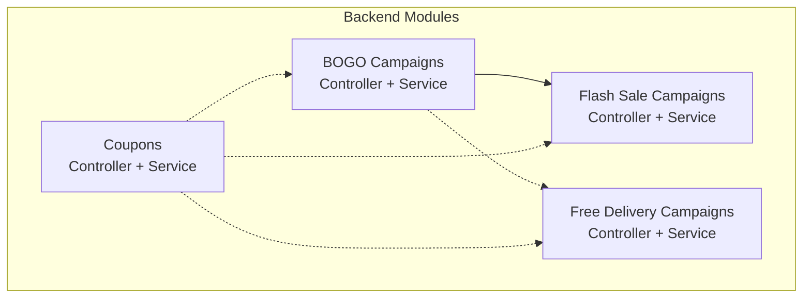
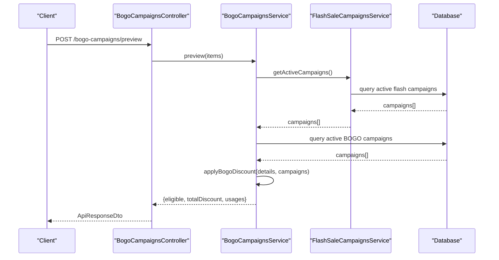
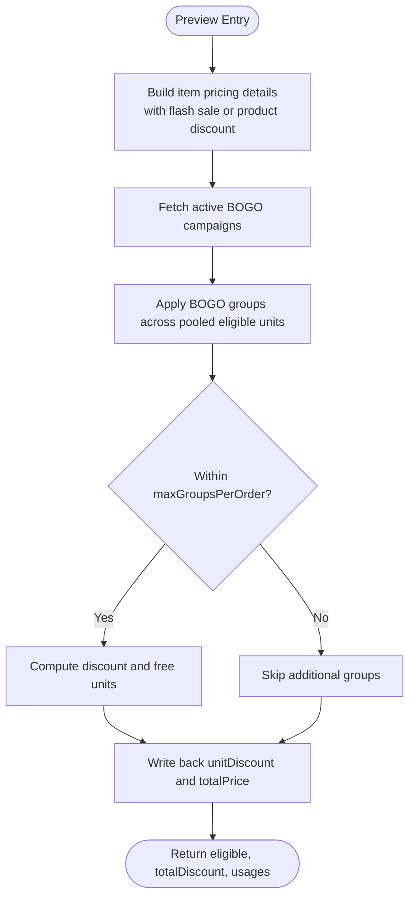
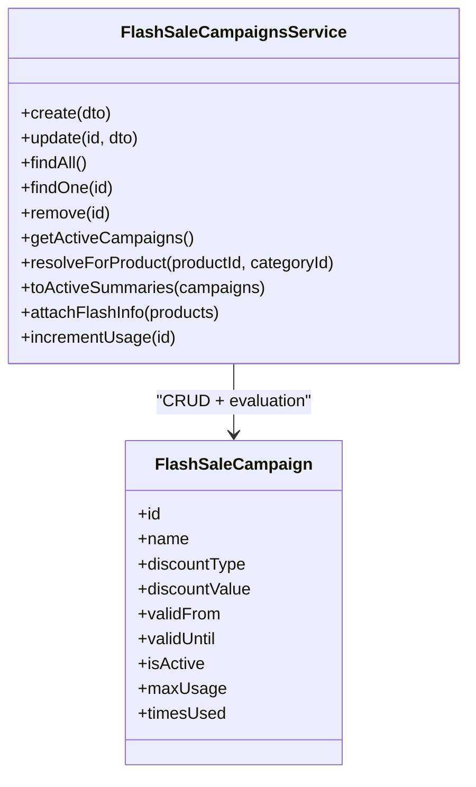
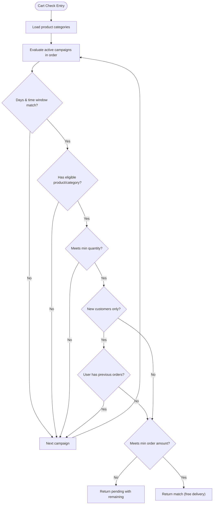
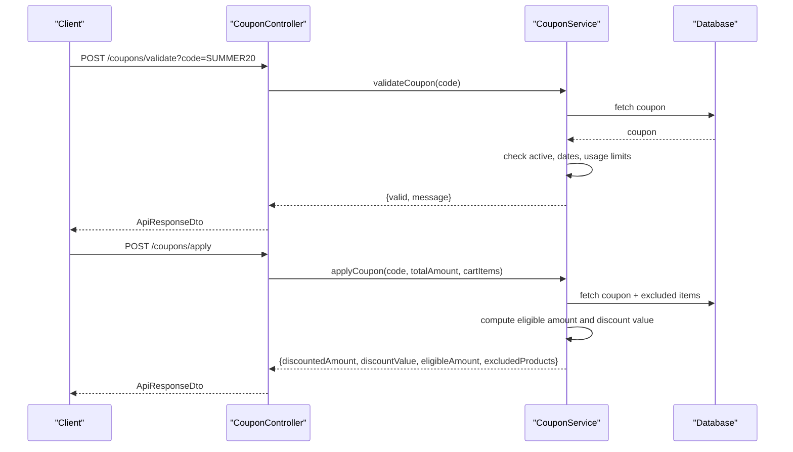
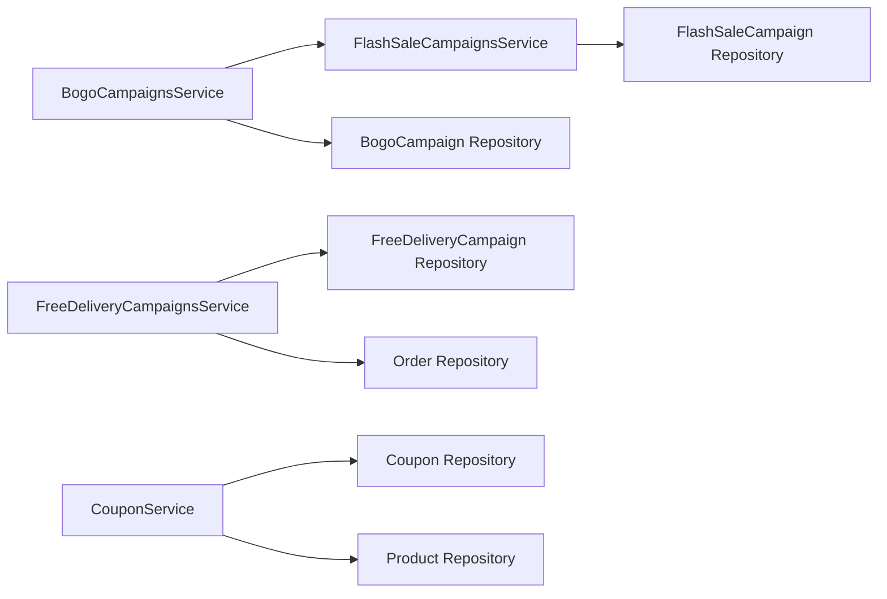

# Marketing Campaign APIs

<cite>
**Referenced Files in This Document**
- [bogo-campaigns.controller.ts](file://apps/backend/src/bogo-campaigns/bogo-campaigns.controller.ts)
- [bogo-campaigns.service.ts](file://apps/backend/src/bogo-campaigns/bogo-campaigns.service.ts)
- [flash-sale-campaigns.controller.ts](file://apps/backend/src/flash-sale-campaigns/flash-sale-campaigns.controller.ts)
- [flash-sale-campaigns.service.ts](file://apps/backend/src/flash-sale-campaigns/flash-sale-campaigns.service.ts)
- [free-delivery-campaigns.controller.ts](file://apps/backend/src/free-delivery-campaigns/free-delivery-campaigns.controller.ts)
- [free-delivery-campaigns.service.ts](file://apps/backend/src/free-delivery-campaigns/free-delivery-campaigns.service.ts)
- [coupon.controller.ts](file://apps/backend/src/coupon/coupon.controller.ts)
- [coupon.service.ts](file://apps/backend/src/coupon/coupon.service.ts)
</cite>

## Table of Contents
1. [Introduction](#introduction)
2. [Project Structure](#project-structure)
3. [Core Components](#core-components)
4. [Architecture Overview](#architecture-overview)
5. [Detailed Component Analysis](#detailed-component-analysis)
6. [Dependency Analysis](#dependency-analysis)
7. [Performance Considerations](#performance-considerations)
8. [Troubleshooting Guide](#troubleshooting-guide)
9. [Conclusion](#conclusion)
10. [Appendices](#appendices)

## Introduction
This document provides detailed API documentation for marketing campaign endpoints covering BOGO (Buy One Get One) campaigns, flash sale management, free delivery campaigns, and the coupon system. It explains how to create, schedule, target, and evaluate campaigns; how coupons are generated, validated, and applied; and how eligibility rules, product restrictions, and customer segmentation work. It also includes guidance on performance tracking, ROI calculation, conversion tracking, integration patterns with email marketing and social media platforms, A/B testing setups, and automated campaign triggers.

## Project Structure
The marketing features are implemented as NestJS modules under the backend application:
- BOGO campaigns: controller and service for listing, previewing, creating, updating, and deleting campaigns, plus discount evaluation logic.
- Flash sale campaigns: controller and service for active listings and CRUD operations, with price computation utilities.
- Free delivery campaigns: controller and service for active listings, cart checks, and eligibility evaluation including day/time windows, minimum order amount, and new customer targeting.
- Coupons: controller and service for CRUD, validation, and application against carts with exclusion handling.

**Diagram sources**
- [bogo-campaigns.controller.ts:28-129](file://apps/backend/src/bogo-campaigns/bogo-campaigns.controller.ts#L28-L129)
- [bogo-campaigns.service.ts:177-519](file://apps/backend/src/bogo-campaigns/bogo-campaigns.service.ts#L177-L519)
- [flash-sale-campaigns.controller.ts:27-120](file://apps/backend/src/flash-sale-campaigns/flash-sale-campaigns.controller.ts#L27-L120)
- [flash-sale-campaigns.service.ts:82-375](file://apps/backend/src/flash-sale-campaigns/flash-sale-campaigns.service.ts#L82-L375)
- [free-delivery-campaigns.controller.ts:30-146](file://apps/backend/src/free-delivery-campaigns/free-delivery-campaigns.controller.ts#L30-L146)
- [free-delivery-campaigns.service.ts:84-418](file://apps/backend/src/free-delivery-campaigns/free-delivery-campaigns.service.ts#L84-L418)
- [coupon.controller.ts:37-325](file://apps/backend/src/coupon/coupon.controller.ts#L37-L325)
- [coupon.service.ts:16-393](file://apps/backend/src/coupon/coupon.service.ts#L16-L393)

**Section sources**
- [bogo-campaigns.controller.ts:28-129](file://apps/backend/src/bogo-campaigns/bogo-campaigns.controller.ts#L28-L129)
- [flash-sale-campaigns.controller.ts:27-120](file://apps/backend/src/flash-sale-campaigns/flash-sale-campaigns.controller.ts#L27-L120)
- [free-delivery-campaigns.controller.ts:30-146](file://apps/backend/src/free-delivery-campaigns/free-delivery-campaigns.controller.ts#L30-L146)
- [coupon.controller.ts:37-325](file://apps/backend/src/coupon/coupon.controller.ts#L37-L325)

## Core Components
- BOGO Campaigns: Provide a public preview endpoint to estimate discounts based on cart items, plus admin CRUD endpoints. Evaluation supports product/category scoping, per-order group caps, and usage limits.
- Flash Sale Campaigns: Provide an active endpoint for storefront display and admin CRUD. Price computation is deterministic and non-stacking with product-level discounts.
- Free Delivery Campaigns: Provide active listing and a cart check endpoint that evaluates eligibility across multiple conditions (days/times, product/category inclusion, min quantity, min order amount, new customers only).
- Coupons: Provide full CRUD, code validation, cart-specific validation, and application with eligible amount calculation and excluded products support.

Key responsibilities:
- Scheduling: validFrom/validUntil date ranges control campaign availability.
- Targeting: product and category scopes; new customer-only flags; day-of-week and time-window filters.
- Eligibility: layered evaluation with precedence rules (e.g., flash sale over product discount; BOGO uses pooled eligible units).
- Usage accounting: atomic increments for campaign usage counters.

**Section sources**
- [bogo-campaigns.service.ts:85-175](file://apps/backend/src/bogo-campaigns/bogo-campaigns.service.ts#L85-L175)
- [flash-sale-campaigns.service.ts:69-80](file://apps/backend/src/flash-sale-campaigns/flash-sale-campaigns.service.ts#L69-L80)
- [free-delivery-campaigns.service.ts:269-340](file://apps/backend/src/free-delivery-campaigns/free-delivery-campaigns.service.ts#L269-L340)
- [coupon.service.ts:135-178](file://apps/backend/src/coupon/coupon.service.ts#L135-L178)

## Architecture Overview
The marketing stack follows a layered architecture:
- Controllers expose REST endpoints with Swagger annotations and role-based guards.
- Services encapsulate business logic, data access, and evaluation algorithms.
- Entities and DTOs define schemas for persistence and request/response contracts.
- Shared utilities provide time normalization and common types.

**Diagram sources**
- [bogo-campaigns.controller.ts:35-54](file://apps/backend/src/bogo-campaigns/bogo-campaigns.controller.ts#L35-L54)
- [bogo-campaigns.service.ts:419-494](file://apps/backend/src/bogo-campaigns/bogo-campaigns.service.ts#L419-L494)
- [flash-sale-campaigns.service.ts:247-265](file://apps/backend/src/flash-sale-campaigns/flash-sale-campaigns.service.ts#L247-L265)

## Detailed Component Analysis

### BOGO Campaigns API
Endpoints:
- POST /bogo-campaigns/preview: Public endpoint to estimate BOGO discount for cart items. Returns eligibility, total discount, and per-campaign usage details.
- GET /bogo-campaigns: Admin list of campaigns.
- GET /bogo-campaigns/:id: Admin single campaign.
- POST /bogo-campaigns: Admin create campaign.
- PATCH /bogo-campaigns/:id: Admin update campaign.
- DELETE /bogo-campaigns/:id: Admin delete campaign.

Behavior highlights:
- Preview computes per-item pricing using flash sale precedence, then pools eligible units across lines and applies BOGO groups (buyQuantity + getQuantity), selecting cheapest units as free.
- Per-order cap via maxGroupsPerOrder controls maximum free groups per order.
- Active campaigns are filtered by isActive, date range, and usage limit, ordered by id so lower ids claim first when overlapping.
- Atomic usage increment ensures campaigns stop counting once exhausted.

**Diagram sources**
- [bogo-campaigns.service.ts:95-175](file://apps/backend/src/bogo-campaigns/bogo-campaigns.service.ts#L95-L175)
- [bogo-campaigns.service.ts:419-494](file://apps/backend/src/bogo-campaigns/bogo-campaigns.service.ts#L419-L494)

Usage accounting:
- Increment usage atomically; returns false if campaign reached maxUsage mid-order, allowing graceful fallback.

**Section sources**
- [bogo-campaigns.controller.ts:35-129](file://apps/backend/src/bogo-campaigns/bogo-campaigns.controller.ts#L35-L129)
- [bogo-campaigns.service.ts:177-519](file://apps/backend/src/bogo-campaigns/bogo-campaigns.service.ts#L177-L519)

### Flash Sale Campaigns API
Endpoints:
- GET /flash-sale-campaigns/active: Public endpoint returning active flash sale campaigns for storefront display.
- GET /flash-sale-campaigns: Admin list.
- GET /flash-sale-campaigns/:id: Admin single.
- POST /flash-sale-campaigns: Admin create.
- PATCH /flash-sale-campaigns/:id: Admin update.
- DELETE /flash-sale-campaigns/:id: Admin delete.

Behavior highlights:
- computeFlashPrice calculates discounted price based on discountType (percentage or fixed) and discountValue.
- Active campaigns are cached for 30 seconds; order-time pricing re-resolves to avoid money loss due to staleness.
- Product attachment and category relations are trimmed for public responses to prevent leaking sensitive data.

**Diagram sources**
- [flash-sale-campaigns.service.ts:82-375](file://apps/backend/src/flash-sale-campaigns/flash-sale-campaigns.service.ts#L82-L375)

**Section sources**
- [flash-sale-campaigns.controller.ts:27-120](file://apps/backend/src/flash-sale-campaigns/flash-sale-campaigns.controller.ts#L27-L120)
- [flash-sale-campaigns.service.ts:69-375](file://apps/backend/src/flash-sale-campaigns/flash-sale-campaigns.service.ts#L69-L375)

### Free Delivery Campaigns API
Endpoints:
- GET /free-delivery-campaigns/active: Public endpoint returning active free delivery campaigns.
- POST /free-delivery-campaigns/check: Public (optional auth) endpoint evaluating cart eligibility against campaigns and legacy thresholds.
- GET /free-delivery-campaigns: Admin list.
- GET /free-delivery-campaigns/:id: Admin single.
- POST /free-delivery-campaigns: Admin create.
- PATCH /free-delivery-campaigns/:id: Admin update.
- DELETE /free-delivery-campaigns/:id: Admin delete.

Eligibility rules:
- Days of week filter.
- Time window filter supporting midnight wrap-around.
- Product/category inclusion requirement.
- Minimum quantity threshold.
- New customers only requires authenticated user with no prior orders.
- Minimum order amount threshold; returns pending status with remaining amount needed.

**Diagram sources**
- [free-delivery-campaigns.service.ts:269-340](file://apps/backend/src/free-delivery-campaigns/free-delivery-campaigns.service.ts#L269-L340)
- [free-delivery-campaigns.service.ts:346-410](file://apps/backend/src/free-delivery-campaigns/free-delivery-campaigns.service.ts#L346-L410)

**Section sources**
- [free-delivery-campaigns.controller.ts:30-146](file://apps/backend/src/free-delivery-campaigns/free-delivery-campaigns.controller.ts#L30-L146)
- [free-delivery-campaigns.service.ts:84-418](file://apps/backend/src/free-delivery-campaigns/free-delivery-campaigns.service.ts#L84-L418)

### Coupon System API
Endpoints:
- POST /coupons: Admin create coupon.
- GET /coupons: Admin list coupons.
- GET /coupons/:code: Admin get coupon by code.
- PATCH /coupons/:id: Admin update coupon.
- DELETE /coupons/:id: Admin delete coupon.
- POST /coupons/validate: Validate coupon code (returns validity and message).
- POST /coupons/apply: Apply coupon to order/cart (returns discounted amount, eligible amount, and excluded products).
- POST /coupons/validate-cart: Validate coupon for specific cart items (returns validity, warning, and excluded products).

Validation and application logic:
- Validates activity, expiration, start date, and usage limits.
- Applies percentage or fixed discounts with optional max discount cap.
- Computes eligible amount excluding specified products.
- Enforces minimum eligible order amount.

**Diagram sources**
- [coupon.controller.ts:177-325](file://apps/backend/src/coupon/coupon.controller.ts#L177-L325)
- [coupon.service.ts:135-306](file://apps/backend/src/coupon/coupon.service.ts#L135-L306)

**Section sources**
- [coupon.controller.ts:37-325](file://apps/backend/src/coupon/coupon.controller.ts#L37-L325)
- [coupon.service.ts:16-393](file://apps/backend/src/coupon/coupon.service.ts#L16-L393)

## Dependency Analysis
- BOGO depends on FlashSaleCampaignsService to resolve effective product prices before applying BOGO discounts.
- All campaign services depend on TypeORM repositories for entities and use caching where appropriate.
- Free delivery evaluation depends on Order repository to determine new customer status.
- Coupon service depends on Product repository to resolve excluded items and names.

**Diagram sources**
- [bogo-campaigns.service.ts:177-187](file://apps/backend/src/bogo-campaigns/bogo-campaigns.service.ts#L177-L187)
- [flash-sale-campaigns.service.ts:82-89](file://apps/backend/src/flash-sale-campaigns/flash-sale-campaigns.service.ts#L82-L89)
- [free-delivery-campaigns.service.ts:84-93](file://apps/backend/src/free-delivery-campaigns/free-delivery-campaigns.service.ts#L84-L93)
- [coupon.service.ts:16-23](file://apps/backend/src/coupon/coupon.service.ts#L16-L23)

**Section sources**
- [bogo-campaigns.service.ts:177-187](file://apps/backend/src/bogo-campaigns/bogo-campaigns.service.ts#L177-L187)
- [flash-sale-campaigns.service.ts:82-89](file://apps/backend/src/flash-sale-campaigns/flash-sale-campaigns.service.ts#L82-L89)
- [free-delivery-campaigns.service.ts:84-93](file://apps/backend/src/free-delivery-campaigns/free-delivery-campaigns.service.ts#L84-L93)
- [coupon.service.ts:16-23](file://apps/backend/src/coupon/coupon.service.ts#L16-L23)

## Performance Considerations
- Caching: Active campaign queries are cached for 30 seconds to reduce database load while ensuring order-time pricing remains authoritative.
- Query optimization: Use minimal relation loading for public endpoints to avoid leaking sensitive data and reduce payload size.
- Atomic updates: Usage increments use atomic SQL updates to prevent race conditions during high-concurrency checkout.
- Efficient scoping: Product/category sets are converted to hash sets for fast membership checks during eligibility evaluation.

[No sources needed since this section provides general guidance]

## Troubleshooting Guide
Common issues and resolutions:
- Invalid date ranges: Ensure validUntil is after validFrom; otherwise requests will be rejected.
- Percentage discount > 100%: Flash sale campaigns reject invalid discount values.
- Coupon not found or expired: Validation endpoints return clear error codes; handle 410 Gone for expired coupons.
- Usage limits exceeded: Both BOGO and flash sale campaigns log warnings when reaching maxUsage mid-order; callers should proceed gracefully.
- Free delivery pending: When a campaign fails only on minimum order amount, the response includes remaining amount to help guide users.

**Section sources**
- [bogo-campaigns.service.ts:292-296](file://apps/backend/src/bogo-campaigns/bogo-campaigns.service.ts#L292-L296)
- [flash-sale-campaigns.service.ts:209-221](file://apps/backend/src/flash-sale-campaigns/flash-sale-campaigns.service.ts#L209-L221)
- [coupon.service.ts:147-163](file://apps/backend/src/coupon/coupon.service.ts#L147-L163)
- [free-delivery-campaigns.service.ts:380-404](file://apps/backend/src/free-delivery-campaigns/free-delivery-campaigns.service.ts#L380-L404)

## Conclusion
The marketing campaign APIs provide robust tools for managing BOGO promotions, flash sales, free delivery offers, and coupons. They support scheduling, targeted eligibility, and precise evaluation logic with safe usage accounting. The design emphasizes security (trimmed relations), performance (caching and efficient checks), and clarity (explicit validation and error responses). Integration with external systems can follow the documented endpoints and event-driven patterns described below.

[No sources needed since this section summarizes without analyzing specific files]

## Appendices

### Campaign Creation, Scheduling, and Targeting
- Create campaigns via admin endpoints and set validFrom/validUntil for scheduling.
- Target products and categories through M2M relations in DTOs.
- For free delivery, configure daysOfWeek, startTime/endTime, minQuantity, minOrderAmount, and newCustomersOnly.

**Section sources**
- [bogo-campaigns.controller.ts:84-129](file://apps/backend/src/bogo-campaigns/bogo-campaigns.controller.ts#L84-L129)
- [flash-sale-campaigns.controller.ts:75-120](file://apps/backend/src/flash-sale-campaigns/flash-sale-campaigns.controller.ts#L75-L120)
- [free-delivery-campaigns.controller.ts:101-146](file://apps/backend/src/free-delivery-campaigns/free-delivery-campaigns.controller.ts#L101-L146)

### Performance Tracking, ROI Calculation, and Conversion Tracking
- Track campaign usage via incrementUsage calls after successful order completion.
- Capture analytics events through existing analytics endpoints to correlate conversions with campaigns.
- Calculate ROI by comparing incremental revenue from campaigns against costs (ad spend, discounts).

[No sources needed since this section provides general guidance]

### Integration Patterns with Email Marketing and Social Media
- Trigger emails upon campaign activation/expiry by subscribing to internal events or scheduled jobs.
- Post campaign creatives to social platforms via webhooks or SDKs after campaign creation/update.
- Use coupon codes embedded in campaign communications to attribute conversions.

[No sources needed since this section provides general guidance]

### A/B Testing Setups
- Run parallel campaigns with different discount strategies (e.g., BOGO vs. percentage off) and segment audiences by product/category scope.
- Measure conversion rates and average order value per variant using analytics endpoints.

[No sources needed since this section provides general guidance]

### Automated Campaign Triggers
- Schedule campaign starts/end times using cron jobs or task schedulers.
- Auto-enable campaigns based on inventory thresholds or promotional calendars.

[No sources needed since this section provides general guidance]