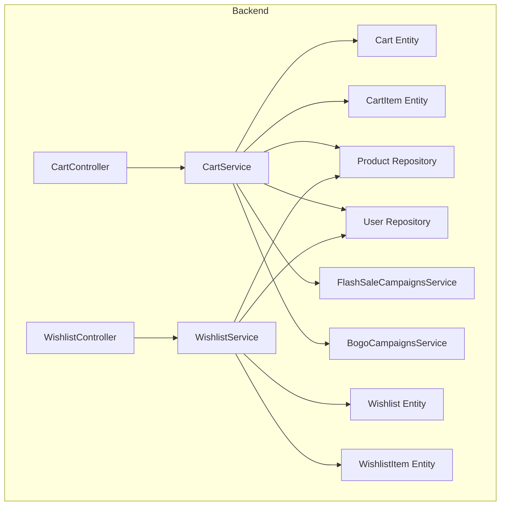
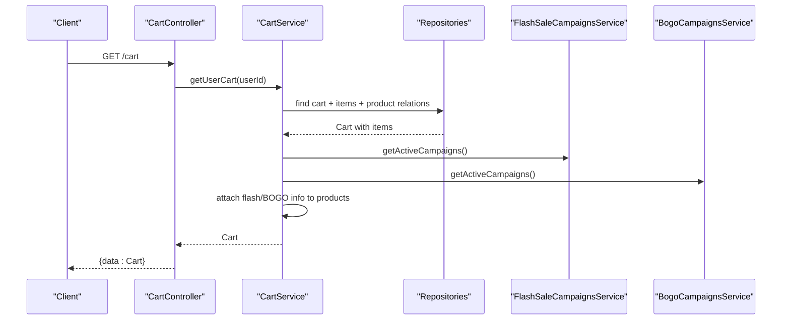
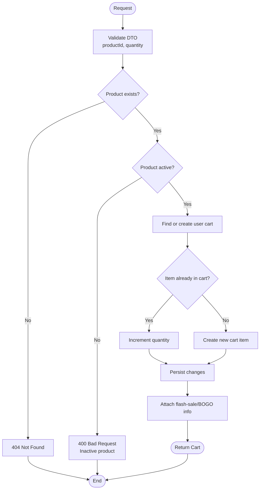
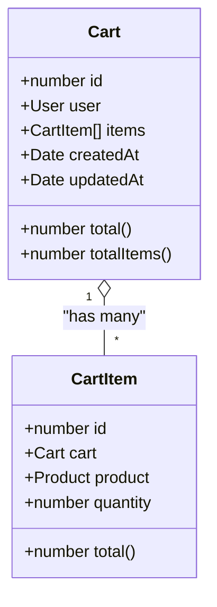
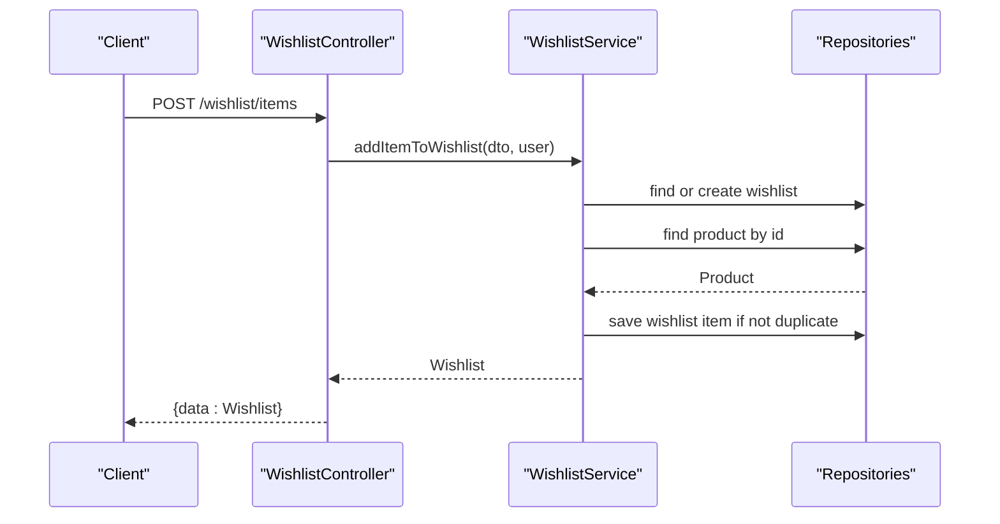
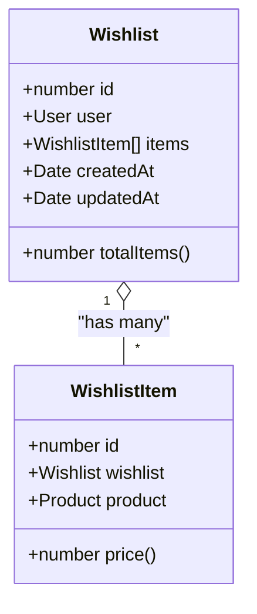
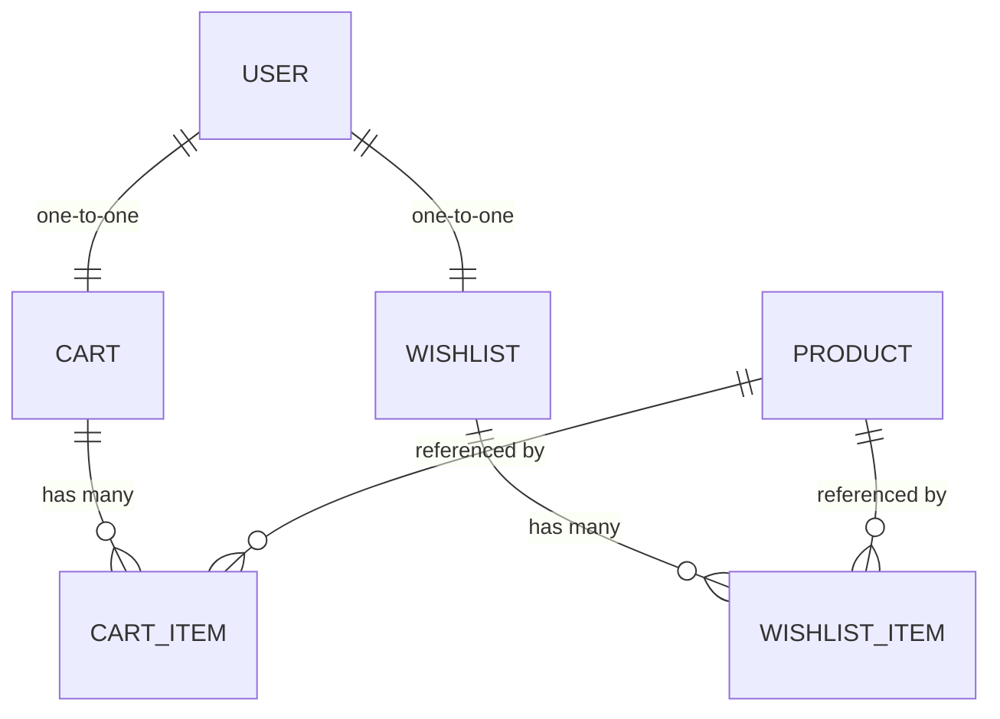
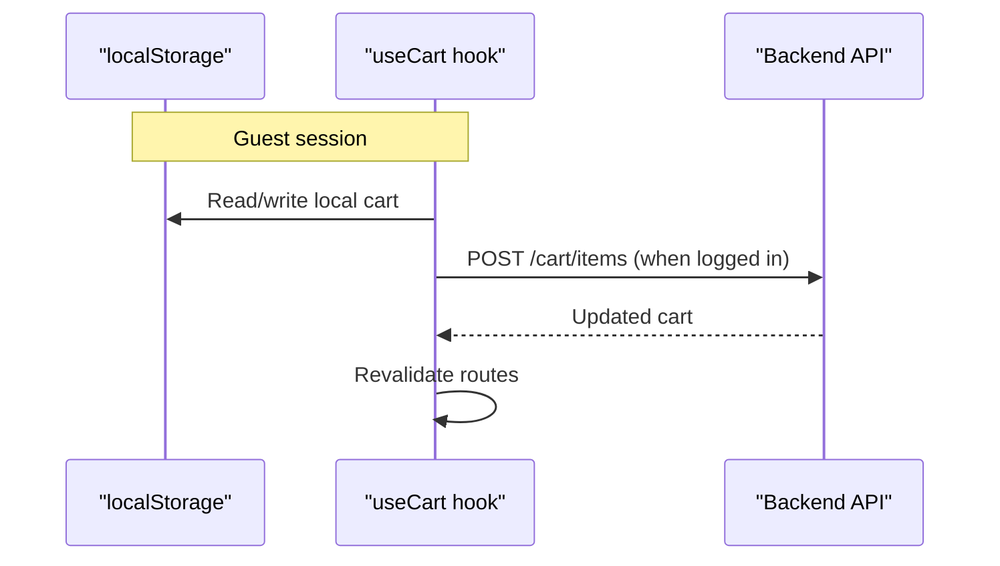
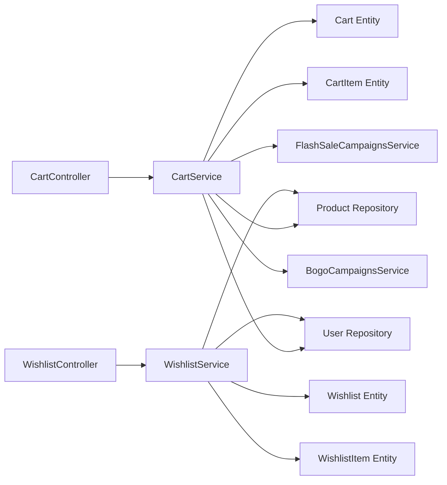
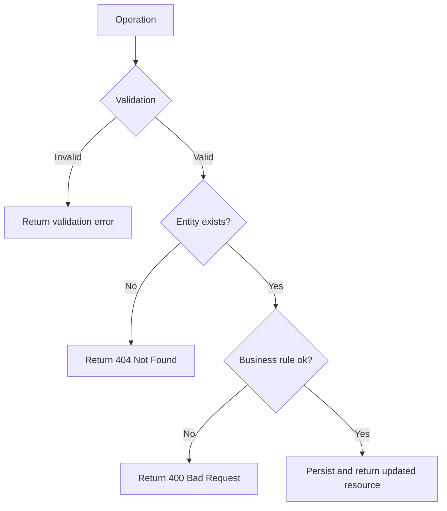

# Cart & Wishlist Management

<cite>
**Referenced Files in This Document**
- [cart.controller.ts](file://apps/backend/src/cart/cart.controller.ts)
- [cart.service.ts](file://apps/backend/src/cart/cart.service.ts)
- [cart.entity.ts](file://apps/backend/src/cart/entities/cart.entity.ts)
- [cart-item.entity.ts](file://apps/backend/src/cart/entities/cart-item.entity.ts)
- [cart-item.dto.ts](file://apps/backend/src/cart/dto/cart-item.dto.ts)
- [update-cart.dto.ts](file://apps/backend/src/cart/dto/update-cart.dto.ts)
- [wishlist.controller.ts](file://apps/backend/src/wishlist/wishlist.controller.ts)
- [wishlist.service.ts](file://apps/backend/src/wishlist/wishlist.service.ts)
- [wishlist.entity.ts](file://apps/backend/src/wishlist/entities/wishlist.entity.ts)
- [wishlist-item.entity.ts](file://apps/backend/src/wishlist/entities/wishlist-item.entity.ts)
- [add-wishlist-item.dto.ts](file://apps/backend/src/wishlist/dto/add-wishlist-item.dto.ts)
- [cart-provider.tsx](file://apps/frontend/providers/cart-provider.tsx)
- [cart-storage.ts](file://apps/frontend/utils/cart-storage.ts)
- [use-cart.ts](file://apps/frontend/hooks/use-cart.ts)
- [add-to-wishlist-button.tsx](file://apps/frontend/components/wishlist/add-to-wishlist-button.tsx)
- [wishlist-page.tsx](file://apps/frontend/app/(main)/user/(account)/[id]/wishlist/page.tsx)
</cite>

## Table of Contents
1. [Introduction](#introduction)
2. [Project Structure](#project-structure)
3. [Core Components](#core-components)
4. [Architecture Overview](#architecture-overview)
5. [Detailed Component Analysis](#detailed-component-analysis)
6. [Dependency Analysis](#dependency-analysis)
7. [Performance Considerations](#performance-considerations)
8. [Troubleshooting Guide](#troubleshooting-guide)
9. [Conclusion](#conclusion)

## Introduction
This document provides detailed API documentation for cart and wishlist management endpoints, including request/response contracts, data models, business rules, error handling, and performance considerations. It also explains how the frontend persists guest carts locally and synchronizes them with the server for authenticated users, and how user-specific data is handled across both features.

## Project Structure
The backend exposes two NestJS modules:
- Cart module: REST endpoints to manage a user’s shopping cart.
- Wishlist module: REST endpoints to manage a user’s saved products.

Both modules follow a controller-service-entity pattern:
- Controllers handle HTTP routing, authentication, and response formatting.
- Services implement business logic, persistence, and integration with product and campaign services.
- Entities define database schema, relations, and computed properties.

**Diagram sources**
- [cart.controller.ts:35-213](file://apps/backend/src/cart/cart.controller.ts#L35-L213)
- [cart.service.ts:15-298](file://apps/backend/src/cart/cart.service.ts#L15-L298)
- [cart.entity.ts:16-78](file://apps/backend/src/cart/entities/cart.entity.ts#L16-L78)
- [cart-item.entity.ts:7-50](file://apps/backend/src/cart/entities/cart-item.entity.ts#L7-L50)
- [wishlist.controller.ts:29-141](file://apps/backend/src/wishlist/wishlist.controller.ts#L29-L141)
- [wishlist.service.ts:10-124](file://apps/backend/src/wishlist/wishlist.service.ts#L10-L124)
- [wishlist.entity.ts:16-63](file://apps/backend/src/wishlist/entities/wishlist.entity.ts#L16-L63)
- [wishlist-item.entity.ts:7-42](file://apps/backend/src/wishlist/entities/wishlist-item.entity.ts#L7-L42)

**Section sources**
- [cart.controller.ts:35-213](file://apps/backend/src/cart/cart.controller.ts#L35-L213)
- [wishlist.controller.ts:29-141](file://apps/backend/src/wishlist/wishlist.controller.ts#L29-L141)

## Core Components
- Cart endpoints:
  - GET /cart: Retrieve the authenticated user’s cart.
  - POST /cart/items: Add an item to the cart (quantity defaults to 1).
  - PATCH /cart/items/:id: Update quantity of a specific cart item.
  - DELETE /cart/items/:id: Remove a specific cart item.
  - DELETE /cart: Clear all items from the cart.
  - GET /cart/reports/abandoned-summary: Admin-only summary of abandoned carts.
  - GET /cart/reports/abandoned: Admin-only paginated list of abandoned carts.
- Wishlist endpoints:
  - GET /wishlist: Retrieve the authenticated user’s wishlist.
  - POST /wishlist/items: Add a product to the wishlist.
  - DELETE /wishlist/items/:id: Remove a specific wishlist item.
  - DELETE /wishlist: Clear all items from the wishlist.

All mutating endpoints require JWT authentication. Some admin endpoints additionally require module permissions.

**Section sources**
- [cart.controller.ts:40-167](file://apps/backend/src/cart/cart.controller.ts#L40-L167)
- [cart.controller.ts:169-212](file://apps/backend/src/cart/cart.controller.ts#L169-L212)
- [wishlist.controller.ts:34-140](file://apps/backend/src/wishlist/wishlist.controller.ts#L34-L140)

## Architecture Overview
The cart flow integrates product pricing and promotional campaigns at read time:
- When returning a cart, the service attaches flash-sale and BOGO information to each product for display purposes only.
- The cart total is computed from product sale prices and quantities.
- The wishlist is simpler: it stores unique products per user without quantities.

**Diagram sources**
- [cart.controller.ts:40-66](file://apps/backend/src/cart/cart.controller.ts#L40-L66)
- [cart.service.ts:31-48](file://apps/backend/src/cart/cart.service.ts#L31-L48)
- [cart.service.ts:50-119](file://apps/backend/src/cart/cart.service.ts#L50-L119)

## Detailed Component Analysis

### Cart API

#### Endpoints
- GET /cart
  - Auth: JWT required.
  - Response: Standard ApiResponseDto wrapping a Cart object.
  - Behavior: Returns the user’s cart; creates one if missing.
- POST /cart/items
  - Auth: JWT required.
  - Request body: productId (required), quantity (optional, default 1).
  - Validation: productId must be positive integer; quantity must be integer >= 1.
  - Behavior: Adds or increments item quantity; returns updated cart.
- PATCH /cart/items/:id
  - Auth: JWT required.
  - Request body: quantity (required, integer >= 1).
  - Behavior: Updates the specified cart item’s quantity; returns updated cart.
- DELETE /cart/items/:id
  - Auth: JWT required.
  - Behavior: Removes the specified cart item; returns updated cart.
- DELETE /cart
  - Auth: JWT required.
  - Behavior: Clears all items from the cart; returns empty cart.
- GET /cart/reports/abandoned-summary
  - Auth: JWT + permission guard for /admin/dashboard.
  - Response: Summary with abandonedCarts count and abandonedValue sum.
- GET /cart/reports/abandoned?page&limit
  - Auth: JWT + permission guard for /admin/analytics/abandoned-carts.
  - Query params: page (default 1), limit (default 10, capped at 50).
  - Response: Paginated abandoned carts with per-cart details and totals.

**Diagram sources**
- [cart.service.ts:121-158](file://apps/backend/src/cart/cart.service.ts#L121-L158)
- [cart.service.ts:50-119](file://apps/backend/src/cart/cart.service.ts#L50-L119)
- [cart.service.ts:31-48](file://apps/backend/src/cart/cart.service.ts#L31-L48)

**Section sources**
- [cart.controller.ts:40-167](file://apps/backend/src/cart/cart.controller.ts#L40-L167)
- [cart.service.ts:121-201](file://apps/backend/src/cart/cart.service.ts#L121-L201)
- [cart-item.dto.ts:5-28](file://apps/backend/src/cart/dto/cart-item.dto.ts#L5-L28)
- [update-cart.dto.ts:4-17](file://apps/backend/src/cart/dto/update-cart.dto.ts#L4-L17)

#### Data Models
- Cart
  - Fields: id, user, items[], createdAt, updatedAt.
  - Computed:
    - total: sum of item.product.salePrice × quantity.
    - totalItems: sum of item.quantity.
- CartItem
  - Fields: id, cart, product, quantity.
  - Computed:
    - total: product.salePrice × quantity.

**Diagram sources**
- [cart.entity.ts:16-78](file://apps/backend/src/cart/entities/cart.entity.ts#L16-L78)
- [cart-item.entity.ts:7-50](file://apps/backend/src/cart/entities/cart-item.entity.ts#L7-L50)

**Section sources**
- [cart.entity.ts:16-78](file://apps/backend/src/cart/entities/cart.entity.ts#L16-L78)
- [cart-item.entity.ts:7-50](file://apps/backend/src/cart/entities/cart-item.entity.ts#L7-L50)

### Wishlist API

#### Endpoints
- GET /wishlist
  - Auth: JWT required.
  - Response: Standard ApiResponseDto wrapping a Wishlist object.
  - Behavior: Returns the user’s wishlist; creates one if missing.
- POST /wishlist/items
  - Auth: JWT required.
  - Request body: productId (required, positive integer).
  - Behavior: Adds product to wishlist if not already present; returns updated wishlist.
- DELETE /wishlist/items/:id
  - Auth: JWT required.
  - Behavior: Removes the specified wishlist item; returns updated wishlist.
- DELETE /wishlist
  - Auth: JWT required.
  - Behavior: Clears all items from the wishlist; returns empty wishlist.

**Diagram sources**
- [wishlist.controller.ts:61-82](file://apps/backend/src/wishlist/wishlist.controller.ts#L61-L82)
- [wishlist.service.ts:67-97](file://apps/backend/src/wishlist/wishlist.service.ts#L67-L97)

**Section sources**
- [wishlist.controller.ts:34-140](file://apps/backend/src/wishlist/wishlist.controller.ts#L34-L140)
- [wishlist.service.ts:20-124](file://apps/backend/src/wishlist/wishlist.service.ts#L20-L124)
- [add-wishlist-item.dto.ts:4-14](file://apps/backend/src/wishlist/dto/add-wishlist-item.dto.ts#L4-L14)

#### Data Models
- Wishlist
  - Fields: id, user, items[], createdAt, updatedAt.
  - Computed:
    - totalItems: number of wishlist items.
- WishlistItem
  - Fields: id, wishlist, product.
  - Computed:
    - price: product.salePrice.

**Diagram sources**
- [wishlist.entity.ts:16-63](file://apps/backend/src/wishlist/entities/wishlist.entity.ts#L16-L63)
- [wishlist-item.entity.ts:7-42](file://apps/backend/src/wishlist/entities/wishlist-item.entity.ts#L7-L42)

**Section sources**
- [wishlist.entity.ts:16-63](file://apps/backend/src/wishlist/entities/wishlist.entity.ts#L16-L63)
- [wishlist-item.entity.ts:7-42](file://apps/backend/src/wishlist/entities/wishlist-item.entity.ts#L7-L42)

### Relationship Between Cart Items and Wishlist Items
- Both cart and wishlist reference the same Product entity.
- Cart items include quantity and compute line totals based on product.salePrice.
- Wishlist items are unique per product and expose current product.salePrice.
- Pricing and promotions:
  - Cart responses enrich products with flash-sale and BOGO metadata for display.
  - Wishlist does not apply promotions; it simply reflects product sale price.

**Diagram sources**
- [cart.entity.ts:16-78](file://apps/backend/src/cart/entities/cart.entity.ts#L16-L78)
- [cart-item.entity.ts:7-50](file://apps/backend/src/cart/entities/cart-item.entity.ts#L7-L50)
- [wishlist.entity.ts:16-63](file://apps/backend/src/wishlist/entities/wishlist.entity.ts#L16-L63)
- [wishlist-item.entity.ts:7-42](file://apps/backend/src/wishlist/entities/wishlist-item.entity.ts#L7-L42)

**Section sources**
- [cart.service.ts:31-48](file://apps/backend/src/cart/cart.service.ts#L31-L48)
- [cart.entity.ts:61-77](file://apps/backend/src/cart/entities/cart.entity.ts#L61-L77)
- [cart-item.entity.ts:47-49](file://apps/backend/src/cart/entities/cart-item.entity.ts#L47-L49)
- [wishlist-item.entity.ts:39-41](file://apps/backend/src/wishlist/entities/wishlist-item.entity.ts#L39-L41)

### Session-Based Cart Persistence and User-Specific Data Handling
- Backend behavior:
  - Carts and wishlists are created lazily per user when first accessed.
  - All operations are scoped to the authenticated user via JWT.
- Frontend behavior:
  - Guest carts are persisted in localStorage using a local cart structure.
  - On login, the frontend merges local cart items into the server cart.
  - After mutations, the frontend revalidates routes to refresh UI state.

**Diagram sources**
- [cart-storage.ts:23-52](file://apps/frontend/utils/cart-storage.ts#L23-L52)
- [use-cart.ts:157-200](file://apps/frontend/hooks/use-cart.ts#L157-L200)
- [cart-provider.tsx:14-31](file://apps/frontend/providers/cart-provider.tsx#L14-L31)

**Section sources**
- [cart-storage.ts:23-52](file://apps/frontend/utils/cart-storage.ts#L23-L52)
- [use-cart.ts:157-200](file://apps/frontend/hooks/use-cart.ts#L157-L200)
- [cart-provider.tsx:14-31](file://apps/frontend/providers/cart-provider.tsx#L14-L31)

### Bulk Operations
- There is no dedicated bulk endpoint for adding multiple items at once.
- Recommended approach:
  - Iterate client-side and call POST /cart/items for each product.
  - For large lists, consider debouncing requests and batching UI updates.
- Clearing operations:
  - Use DELETE /cart to clear all cart items.
  - Use DELETE /wishlist to clear all wishlist items.

**Section sources**
- [cart.controller.ts:67-167](file://apps/backend/src/cart/cart.controller.ts#L67-L167)
- [wishlist.controller.ts:61-140](file://apps/backend/src/wishlist/wishlist.controller.ts#L61-L140)

## Dependency Analysis
- Controllers depend on services for business logic.
- Services depend on repositories for persistence and on external services for promotions.
- Entities define relationships and computed fields used by services and controllers.

**Diagram sources**
- [cart.controller.ts:35-213](file://apps/backend/src/cart/cart.controller.ts#L35-L213)
- [cart.service.ts:15-298](file://apps/backend/src/cart/cart.service.ts#L15-L298)
- [wishlist.controller.ts:29-141](file://apps/backend/src/wishlist/wishlist.controller.ts#L29-L141)
- [wishlist.service.ts:10-124](file://apps/backend/src/wishlist/wishlist.service.ts#L10-L124)

**Section sources**
- [cart.service.ts:15-298](file://apps/backend/src/cart/cart.service.ts#L15-L298)
- [wishlist.service.ts:10-124](file://apps/backend/src/wishlist/wishlist.service.ts#L10-L124)

## Performance Considerations
- Eager loading:
  - Cart and wishlist queries eagerly load product relations (attachment, unit, supplier) to avoid N+1 queries during rendering.
- Promotion enrichment:
  - Flash-sale and BOGO info is attached only when reading the cart, minimizing write overhead.
- Abandoned cart reports:
  - Uses raw SQL aggregation for efficiency and pagination support.
- Large carts:
  - Avoid sending excessively large payloads; consider limiting client-side batch sizes.
  - Debounce rapid quantity updates to reduce server load.
- Database constraints:
  - Duplicate key handling ensures safe concurrent creation of user carts.

[No sources needed since this section provides general guidance]

## Troubleshooting Guide
Common errors and their causes:
- Product not found:
  - Occurs when productId does not exist in the product catalog.
  - Thrown by both cart and wishlist add-item flows.
- Inactive product:
  - Adding inactive products to the cart is rejected with a bad request.
- Invalid quantity:
  - Quantity must be a positive integer >= 1; validation errors occur otherwise.
- Cart item not found:
  - Updating or removing a cart item with an invalid itemId results in a not found error.
- Wishlist item not found:
  - Removing a wishlist item with an invalid itemId results in a not found error.
- Concurrent cart creation:
  - If another request creates the cart first, duplicate key errors are caught and resolved by fetching the existing cart.

**Diagram sources**
- [cart.service.ts:121-158](file://apps/backend/src/cart/cart.service.ts#L121-L158)
- [cart.service.ts:160-201](file://apps/backend/src/cart/cart.service.ts#L160-L201)
- [wishlist.service.ts:67-124](file://apps/backend/src/wishlist/wishlist.service.ts#L67-L124)

**Section sources**
- [cart.service.ts:121-201](file://apps/backend/src/cart/cart.service.ts#L121-L201)
- [wishlist.service.ts:67-124](file://apps/backend/src/wishlist/wishlist.service.ts#L67-L124)

## Conclusion
The cart and wishlist APIs provide robust, user-scoped operations for managing shopping intent and saved products. Cart operations integrate with product availability checks and promotional enrichment, while wishlist operations offer simple persistence of desired products. The frontend supports guest sessions via localStorage and seamlessly merges with server-side state upon authentication. Proper validation, error handling, and efficient querying ensure reliable performance across typical usage patterns.

[No sources needed since this section summarizes without analyzing specific files]