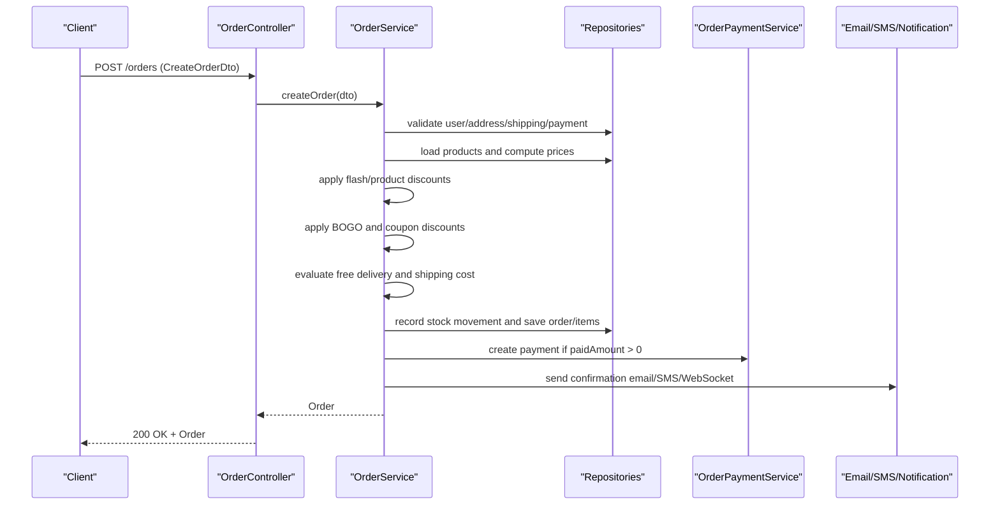
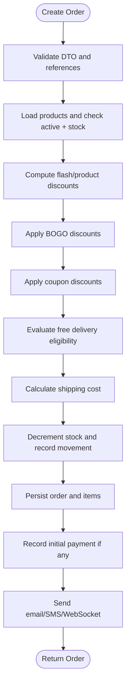
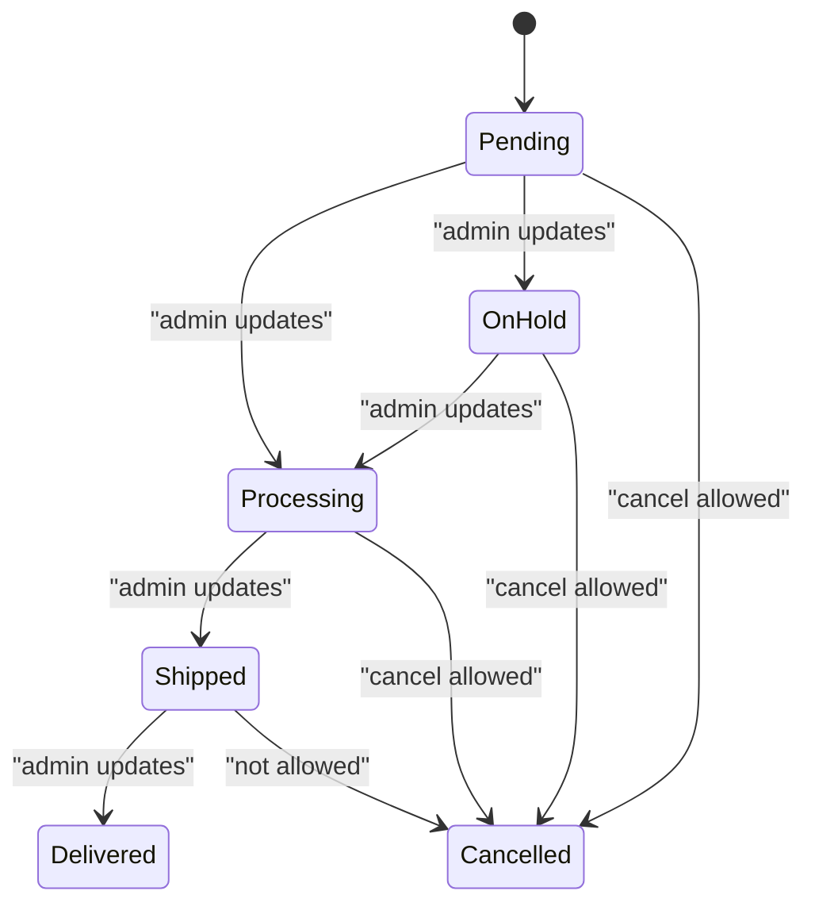
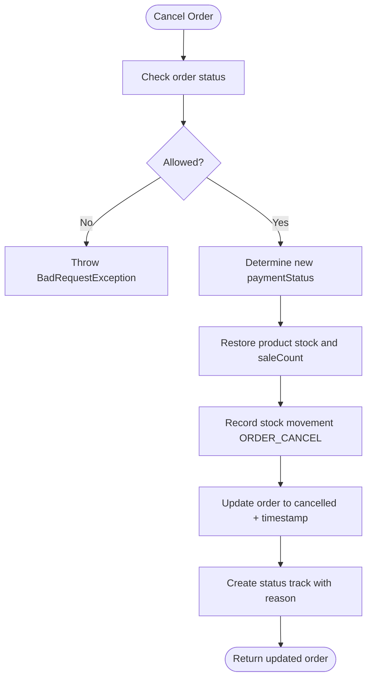
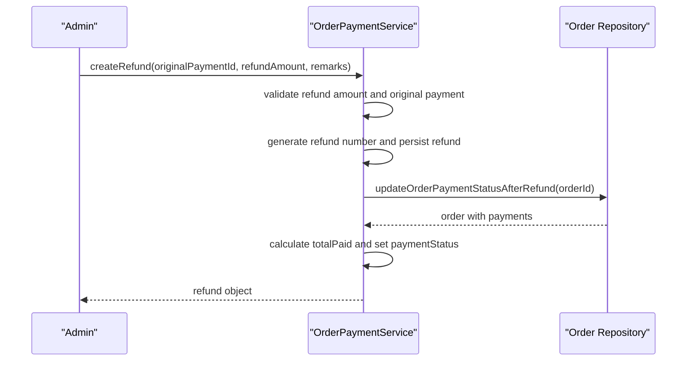
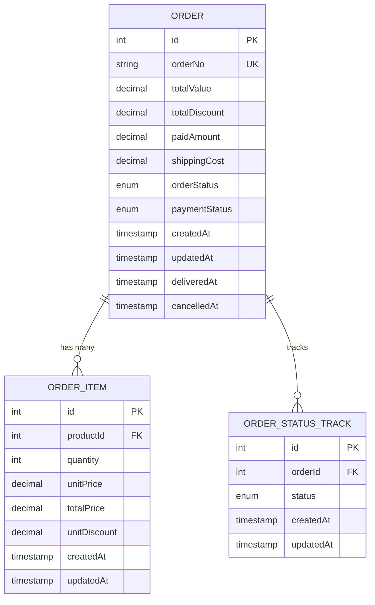
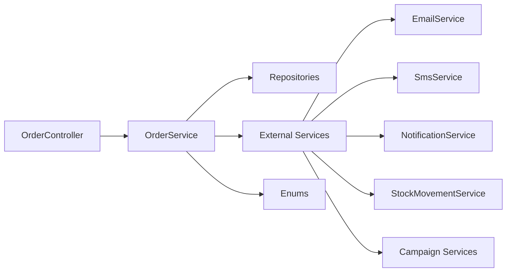

# Order Lifecycle Management

<cite>
**Referenced Files in This Document**
- [order.controller.ts](file://apps/backend/src/order/order.controller.ts)
- [order.service.ts](file://apps/backend/src/order/order.service.ts)
- [order.entity.ts](file://apps/backend/src/order/entities/order.entity.ts)
- [order-item.entity.ts](file://apps/backend/src/order/entities/order-item.entity.ts)
- [order-status-track.entity.ts](file://apps/backend/src/order/entities/order-status-track.entity.ts)
- [create-order.dto.ts](file://apps/backend/src/order/dto/create-order.dto.ts)
- [cancel-order.dto.ts](file://apps/backend/src/order/dto/cancel-order.dto.ts)
- [index.ts](file://apps/backend/src/common/enums/index.ts)
- [order-payment.service.ts](file://apps/backend/src/order-payment/order-payment.service.ts)
</cite>

## Table of Contents
1. [Introduction](#introduction)
2. [Project Structure](#project-structure)
3. [Core Components](#core-components)
4. [Architecture Overview](#architecture-overview)
5. [Detailed Component Analysis](#detailed-component-analysis)
6. [Dependency Analysis](#dependency-analysis)
7. [Performance Considerations](#performance-considerations)
8. [Troubleshooting Guide](#troubleshooting-guide)
9. [Conclusion](#conclusion)

## Introduction
This document provides comprehensive API documentation for order lifecycle management endpoints. It covers the complete workflow from order creation through delivery, including status transitions, validation rules, business constraints, pricing calculations, inventory reservation, cancellation and refund processing, audit trails, notifications, concurrency handling, transaction management, and data consistency considerations. The goal is to help developers and operators understand how orders are created, updated, tracked, cancelled, and refunded while maintaining data integrity and system reliability.

## Project Structure
The order lifecycle is implemented primarily in the backend NestJS application under the order module. Key files include:
- Controller exposing REST endpoints for listing, creating, updating, and reporting on orders.
- Service implementing business logic for order creation, pricing, discounts, shipping, stock updates, cancellations, and notifications.
- Entities defining the database schema for orders, items, and status tracking.
- DTOs validating input payloads for order creation and cancellation.
- Shared enums defining order statuses, payment statuses, discount types, and cancellation reasons.
- Payment service handling refunds and recalculating order payment status.

```mermaid
graph TB
Client["Client / Admin UI"] --> Controller["OrderController"]
Controller --> Service["OrderService"]
Service --> RepoOrder["Order Repository"]
Service --> RepoItem["OrderItem Repository"]
Service --> RepoProduct["Product Repository"]
Service --> RepoAddress["Address Repository"]
Service --> RepoShipping["ShippingMethod Repository"]
Service --> RepoPaymentMethod["OrderPaymentMethod Repository"]
Service --> RepoCoupon["Coupon Repository"]
Service --> RepoDeliveryMan["DeliveryMan Repository"]
Service --> RepoStatusTrack["OrderStatusTrack Repository"]
Service --> RepoNote["OrderNote Repository"]
Service --> PaymentSvc["OrderPaymentService"]
Service --> EmailSvc["EmailService"]
Service --> SmsSvc["SmsService"]
Service --> NotificationSvc["NotificationService"]
Service --> StockSvc["StockMovementService"]
Service --> BogoSvc["BogoCampaignsService"]
Service --> FlashSvc["FlashSaleCampaignsService"]
Service --> FreeDelSvc["FreeDeliveryCampaignsService"]
```

**Diagram sources**
- [order.controller.ts:39-44](file://apps/backend/src/order/order.controller.ts#L39-L44)
- [order.service.ts:59-101](file://apps/backend/src/order/order.service.ts#L59-L101)

**Section sources**
- [order.controller.ts:39-44](file://apps/backend/src/order/order.controller.ts#L39-L44)
- [order.service.ts:59-101](file://apps/backend/src/order/order.service.ts#L59-L101)

## Core Components
- OrderController: Exposes REST endpoints for order operations with authentication, authorization, throttling, and Swagger metadata.
- OrderService: Implements core order lifecycle logic including creation, validation, pricing, discounts, shipping cost calculation, stock reservation, status tracking, cancellation, and notifications.
- Order Entity: Defines order fields such as order number, status, payment status, totals, shipping cost, paid amount, timestamps, and relationships to address, user, shipping method, payment method, coupon, items, payments, notes, delivery man, and status tracks.
- OrderItem Entity: Captures per-item details including product reference, quantity, unit price, total price, and unit discount at time of order.
- OrderStatusTrack Entity: Records each status change with operator and optional note.
- CreateOrderDto and CancelOrderDto: Validate inputs for order creation and cancellation.
- Enums: Define OrderStatus, PaymentStatus, DiscountType, CancellationReason, and other shared constants.
- OrderPaymentService: Handles refund creation and recalculates order payment status after refunds.

**Section sources**
- [order.controller.ts:39-44](file://apps/backend/src/order/order.controller.ts#L39-L44)
- [order.service.ts:59-101](file://apps/backend/src/order/order.service.ts#L59-L101)
- [order.entity.ts:24-156](file://apps/backend/src/order/entities/order.entity.ts#L24-L156)
- [order-item.entity.ts:13-65](file://apps/backend/src/order/entities/order-item.entity.ts#L13-L65)
- [order-status-track.entity.ts:14-50](file://apps/backend/src/order/entities/order-status-track.entity.ts#L14-L50)
- [create-order.dto.ts:13-59](file://apps/backend/src/order/dto/create-order.dto.ts#L13-L59)
- [cancel-order.dto.ts:5-22](file://apps/backend/src/order/dto/cancel-order.dto.ts#L5-L22)
- [index.ts:12-31](file://apps/backend/src/common/enums/index.ts#L12-L31)
- [index.ts:38-41](file://apps/backend/src/common/enums/index.ts#L38-L41)
- [index.ts:89-98](file://apps/backend/src/common/enums/index.ts#L89-L98)

## Architecture Overview
The order lifecycle follows a clear sequence:
- Creation: Client submits an order with cart data; controller validates and delegates to service; service validates references (user, address, shipping, payment), checks product availability and stock, computes item prices with flash sale and product discounts, applies BOGO and coupon discounts, evaluates free delivery eligibility, calculates shipping cost, records stock movements, persists order and items, logs campaign usage, creates status track, sends notifications, and optionally records initial payment.
- Status Updates: Admins update order status and payment status via protected endpoints; status changes are recorded in status tracks.
- Cancellations: Orders can be cancelled if they are pending, processing, or on hold; stock is restored; payment status is set based on paid amounts; status track records cancellation reason.
- Refunds: Separate refund transactions are created; order payment status is recalculated to reflect full or partial refunds.

**Diagram sources**
- [order.controller.ts:159-181](file://apps/backend/src/order/order.controller.ts#L159-L181)
- [order.service.ts:103-694](file://apps/backend/src/order/order.service.ts#L103-L694)

## Detailed Component Analysis

### Order Creation Workflow
- Input Validation:
  - Required fields: addressId, userId, shippingMethodId, paymentMethodId, items array.
  - Optional fields: couponId, paidAmount.
  - Items validated via nested DTOs.
- Reference Validation:
  - User, address, shipping method, payment method must exist.
  - Shipping method may require online payment; cash-on-delivery is rejected when required.
- Product Validation and Pricing:
  - Each product must exist and be active.
  - Stock must be sufficient for requested quantity.
  - Flash sale campaigns override product discounts (no stacking).
  - Product-level percentage/fixed discounts applied within validity windows.
- Discount Calculations:
  - BOGO discounts applied after per-item pricing and before coupon discounts.
  - Coupon discounts applied to eligible subtotal excluding excluded items; supports fixed and percentage with max cap.
- Shipping Cost:
  - Free delivery evaluated against payable subtotal, total quantity, and item categories; some shipping methods are excluded.
  - If eligible and not excluded, shipping cost is waived; otherwise charged method cost is used.
- Inventory Reservation:
  - Product stock decremented and sale count incremented immediately upon order creation.
  - Stock movement recorded with type ORDER_SALE and reference to order number.
- Persistence:
  - Order saved with generated orderNo, totals, shipping cost, and default PENDING status.
  - Order items persisted with captured unitPrice, unitDiscount, totalPrice.
  - Initial payment recorded if paidAmount provided.
- Notifications:
  - Confirmation email sent with accurate shipping fee from order.
  - Admin notification email sent asynchronously.
  - SMS confirmation sent if mobile number exists.
  - WebSocket notification sent to admins about new order.
- Audit Trail:
  - Status track entry created with PENDING status and operator ID.

**Diagram sources**
- [order.service.ts:103-694](file://apps/backend/src/order/order.service.ts#L103-L694)

**Section sources**
- [create-order.dto.ts:13-59](file://apps/backend/src/order/dto/create-order.dto.ts#L13-L59)
- [order.service.ts:103-694](file://apps/backend/src/order/order.service.ts#L103-L694)

### Order Status Tracking and Transitions
- Statuses:
  - OrderStatus: pending, processing, on_hold, shipped, delivered, cancelled.
  - PaymentStatus: pending, completed, partial, paid, failed, refunded, need_refund, refund_complete, partial_refund.
- Status Update Endpoint:
  - Protected by JWT and permission guard.
  - Accepts status and optional note; records status track with updatedBy.
- Delivery Time Tracking:
  - deliveredAt timestamp set when order reaches delivered state; cleared when moving away from delivered.
- Cancellation Constraints:
  - Only orders in pending, processing, or on_hold can be cancelled.
  - Shipped orders cannot be cancelled; returns error directing to support for returns.
  - Cancellation sets orderStatus to cancelled and paymentStatus based on paid amounts.

**Diagram sources**
- [index.ts:12-19](file://apps/backend/src/common/enums/index.ts#L12-L19)
- [order.service.ts:2323-2390](file://apps/backend/src/order/order.service.ts#L2323-L2390)

**Section sources**
- [index.ts:12-31](file://apps/backend/src/common/enums/index.ts#L12-L31)
- [order.controller.ts:230-261](file://apps/backend/src/order/order.controller.ts#L230-L261)
- [order.entity.ts:49-57](file://apps/backend/src/order/entities/order.entity.ts#L49-L57)
- [order.entity.ts:142-155](file://apps/backend/src/order/entities/order.entity.ts#L142-L155)
- [order.service.ts:2323-2390](file://apps/backend/src/order/order.service.ts#L2323-L2390)

### Order Cancellation and Stock Restoration
- Cancellation Rules:
  - Allowed only for pending, processing, or on_hold orders.
  - Shipped orders return an error indicating returns process instead.
- Payment Status Determination:
  - Paid orders set to need_refund.
  - Partially paid orders set to partial_refund.
  - Unpaid orders set to failed.
- Stock Restoration:
  - For each item, product stock increased and saleCount decreased.
  - Stock movement recorded with type ORDER_CANCEL and note referencing cancellation reason.
- Audit Trail:
  - Status track entry created with cancelled status and cancellation reason plus optional notes.

**Diagram sources**
- [order.service.ts:2323-2390](file://apps/backend/src/order/order.service.ts#L2323-L2390)

**Section sources**
- [order.service.ts:2323-2390](file://apps/backend/src/order/order.service.ts#L2323-L2390)

### Refund Processing Workflow
- Refund Creation:
  - Refund transactions are created with negative amount and linked to original payment.
  - Refund numbers follow REF-{year}-{sequential}.
- Order Payment Status Recalculation:
  - Total paid includes positive payments and negative refunds.
  - If totalPaid <= 0: paymentStatus set to refund_complete.
  - Else if totalPaid < order.totalValue: paymentStatus set to partial_refund.
  - Else: paymentStatus set to paid.
- Concurrency Safety:
  - Atomic conditional UPDATE for campaign usage counters ensures safe increments even under concurrent requests.

**Diagram sources**
- [order-payment.service.ts:236-308](file://apps/backend/src/order-payment/order-payment.service.ts#L236-L308)

**Section sources**
- [order-payment.service.ts:236-308](file://apps/backend/src/order-payment/order-payment.service.ts#L236-L308)

### Complex Scenarios

#### Partial Cancellations
- Current implementation cancels entire orders; there is no endpoint to cancel individual items within an order.
- To support partial cancellations:
  - Introduce an endpoint to remove specific order items.
  - Validate that order is still cancellable (pending/processing/on_hold).
  - Restore stock for removed items and adjust order totals and discounts accordingly.
  - Re-evaluate BOGO and coupon applicability post-cancellation.
  - Record stock movement and status track entries for partial cancellation.
  - Update payment status if necessary (e.g., if paid amount exceeds new total).

[No sources needed since this section proposes future enhancements not present in current code]

#### Order Modifications
- Current implementation does not expose a general order modification endpoint beyond status and payment status updates.
- To support modifications:
  - Add endpoints to update shipping method, address, or add/remove items.
  - Re-validate product availability and stock.
  - Recompute pricing, discounts, and shipping costs.
  - Ensure idempotency and audit trail for each modification.
  - Handle concurrency with optimistic locking or versioning.

[No sources needed since this section proposes future enhancements not present in current code]

#### Bulk Order Operations
- No bulk creation endpoint is exposed; throttling limits protect against abuse.
- To support bulk operations:
  - Implement batch endpoints with transaction boundaries.
  - Validate all items across the batch and fail fast on errors.
  - Record stock movements and campaign usages atomically where possible.
  - Provide progress tracking and rollback strategies.

[No sources needed since this section proposes future enhancements not present in current code]

### Data Models and Relationships

**Diagram sources**
- [order.entity.ts:24-156](file://apps/backend/src/order/entities/order.entity.ts#L24-L156)
- [order-item.entity.ts:13-65](file://apps/backend/src/order/entities/order-item.entity.ts#L13-L65)
- [order-status-track.entity.ts:14-50](file://apps/backend/src/order/entities/order-status-track.entity.ts#L14-L50)

**Section sources**
- [order.entity.ts:24-156](file://apps/backend/src/order/entities/order.entity.ts#L24-L156)
- [order-item.entity.ts:13-65](file://apps/backend/src/order/entities/order-item.entity.ts#L13-L65)
- [order-status-track.entity.ts:14-50](file://apps/backend/src/order/entities/order-status-track.entity.ts#L14-L50)

## Dependency Analysis
- Controller Dependencies:
  - Uses JwtAuthGuard and PermissionGuard for security.
  - Uses Throttle decorator to limit order creation rate.
  - Delegates business logic to OrderService.
- Service Dependencies:
  - Multiple repositories for entities (Order, OrderItem, Product, Address, ShippingMethod, OrderPaymentMethod, Coupon, DeliveryMan, OrderStatusTrack, OrderNote).
  - External services: EmailService, SmsService, NotificationService, StockMovementService, BogoCampaignsService, FlashSaleCampaignsService, FreeDeliveryCampaignsService, CouponUsageLogService, FreeDeliveryUsageLogService, FlashSaleUsageLogService, BogoUsageLogService.
  - OrderPaymentService for payment recording and refund processing.
- Enum Usage:
  - OrderStatus and PaymentStatus define valid states.
  - DiscountType and CancellationReason constrain business logic.

**Diagram sources**
- [order.controller.ts:1-38](file://apps/backend/src/order/order.controller.ts#L1-L38)
- [order.service.ts:1-42](file://apps/backend/src/order/order.service.ts#L1-L42)
- [index.ts:12-41](file://apps/backend/src/common/enums/index.ts#L12-L41)
- [index.ts:89-98](file://apps/backend/src/common/enums/index.ts#L89-L98)

**Section sources**
- [order.controller.ts:1-38](file://apps/backend/src/order/order.controller.ts#L1-L38)
- [order.service.ts:1-42](file://apps/backend/src/order/order.service.ts#L1-L42)
- [index.ts:12-41](file://apps/backend/src/common/enums/index.ts#L12-L41)
- [index.ts:89-98](file://apps/backend/src/common/enums/index.ts#L89-L98)

## Performance Considerations
- Throttling:
  - Order creation endpoint uses short/medium/long throttle limits to prevent abuse.
- Database Queries:
  - Order retrieval uses relations to eagerly load related entities for display.
  - Report endpoints use SQL aggregations to minimize client-side computation.
- Asynchronous Notifications:
  - Email, SMS, and WebSocket notifications are fire-and-forget to avoid blocking order creation.
- Campaign Usage Increments:
  - Atomic conditional updates ensure safe increments under concurrency.
- Rounding:
  - Final totals are rounded to two decimal places to avoid floating-point drift.

[No sources needed since this section provides general guidance]

## Troubleshooting Guide
- Common Errors:
  - Product not found or inactive during order creation.
  - Insufficient stock for requested quantity.
  - Cash-on-delivery not available for shipping methods requiring online payment.
  - Invalid coupon ID or expired coupon.
  - Attempting to cancel non-cancellable orders (shipped or already delivered).
- Debugging Steps:
  - Verify DTO fields and nested items structure.
  - Check referenced entity IDs exist and are valid.
  - Review status transitions and allowed cancellation states.
  - Inspect stock movement logs for discrepancies.
  - Confirm campaign usage logs and free delivery evaluations.
- Logging:
  - Service logs errors for campaign evaluation failures and notification failures without failing order creation.

**Section sources**
- [order.service.ts:190-210](file://apps/backend/src/order/order.service.ts#L190-L210)
- [order.service.ts:163-170](file://apps/backend/src/order/order.service.ts#L163-L170)
- [order.service.ts:306-308](file://apps/backend/src/order/order.service.ts#L306-L308)
- [order.service.ts:377-381](file://apps/backend/src/order/order.service.ts#L377-L381)
- [order.service.ts:404-412](file://apps/backend/src/order/order.service.ts#L404-L412)
- [order.service.ts:416-426](file://apps/backend/src/order/order.service.ts#L416-L426)
- [order.service.ts:451-474](file://apps/backend/src/order/order.service.ts#L451-L474)
- [order.service.ts:477-492](file://apps/backend/src/order/order.service.ts#L477-L492)
- [order.service.ts:494-512](file://apps/backend/src/order/order.service.ts#L494-L512)
- [order.service.ts:514-535](file://apps/backend/src/order/order.service.ts#L514-L535)
- [order.service.ts:615-618](file://apps/backend/src/order/order.service.ts#L615-L618)
- [order.service.ts:688-691](file://apps/backend/src/order/order.service.ts#L688-L691)

## Conclusion
The order lifecycle management system provides robust endpoints for creating, tracking, updating, cancelling, and refunding orders. It enforces strict validation, computes complex pricing with multiple discount mechanisms, manages inventory reservations, and maintains comprehensive audit trails. Notifications are handled asynchronously to preserve performance. While partial cancellations and general order modifications are not currently supported, the architecture allows for extension. Operators should monitor throttling, logging, and campaign usage to ensure system stability and accuracy.