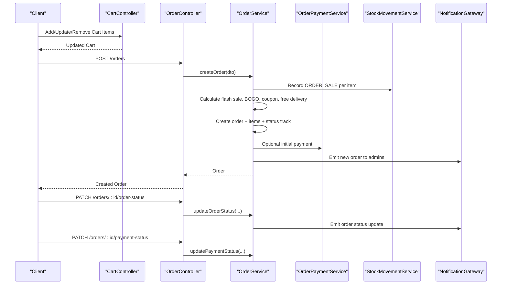
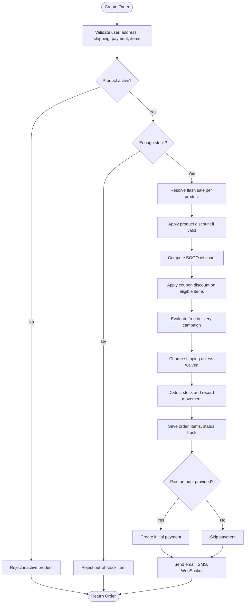
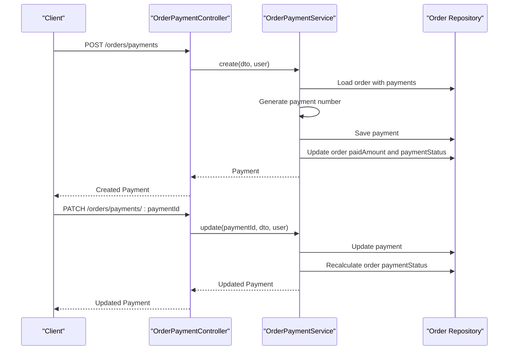
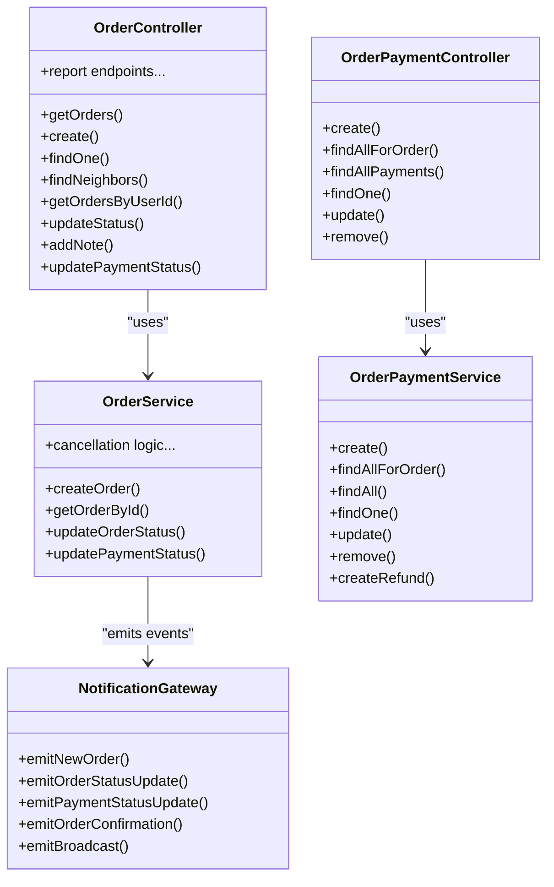

# Order Processing APIs

<cite>
**Referenced Files in This Document**
- [order.controller.ts](file://apps/backend/src/order/order.controller.ts)
- [order.service.ts](file://apps/backend/src/order/order.service.ts)
- [order.entity.ts](file://apps/backend/src/order/entities/order.entity.ts)
- [cart.controller.ts](file://apps/backend/src/cart/cart.controller.ts)
- [cart.service.ts](file://apps/backend/src/cart/cart.service.ts)
- [cart.entity.ts](file://apps/backend/src/cart/entities/cart.entity.ts)
- [order-payment.controller.ts](file://apps/backend/src/order-payment/order-payment.controller.ts)
- [order-payment.service.ts](file://apps/backend/src/order-payment/order-payment.service.ts)
- [order-payment.entity.ts](file://apps/backend/src/order-payment/entities/order-payment.entity.ts)
- [shipping-methods.controller.ts](file://apps/backend/src/shipping-methods/shipping-methods.controller.ts)
- [notification.gateway.ts](file://apps/backend/src/notification/notification.gateway.ts)
- [stock-movement.entity.ts](file://apps/backend/src/stock-movement/entities/stock-movement.entity.ts)
- [stock-movement.service.ts](file://apps/backend/src/stock-movement/stock-movement.service.ts)
</cite>

## Table of Contents
1. [Introduction](#introduction)
2. [Project Structure](#project-structure)
3. [Core Components](#core-components)
4. [Architecture Overview](#architecture-overview)
5. [Detailed Component Analysis](#detailed-component-analysis)
6. [Dependency Analysis](#dependency-analysis)
7. [Performance Considerations](#performance-considerations)
8. [Troubleshooting Guide](#troubleshooting-guide)
9. [Conclusion](#conclusion)

## Introduction
This document provides comprehensive API documentation for the order processing system. It covers the complete order lifecycle: cart management, order creation with discount and shipping calculations, payment processing, order status updates, cancellation and refund workflows, delivery tracking context, real-time WebSocket notifications, reporting endpoints, inventory reservation behavior, and concurrent access handling.

The backend is a NestJS application organized by feature modules. The primary order-related controllers are under `order`, `cart`, `order-payment`, and `shipping-methods`. Real-time updates use a Socket.IO-based notification gateway. Inventory movements are recorded through a stock movement ledger.

## Project Structure
The order processing domain spans several backend modules:

- Cart module: user-specific cart persistence, item operations, abandoned cart analytics.
- Order module: order listing, creation, status updates, notes, neighbor navigation, and extensive admin reports.
- Payment module: per-order payments, refunds, payment status derivation.
- Shipping methods: CRUD for shipping options used during checkout.
- Notification gateway: WebSocket events for new orders, order status changes, payment updates, and broadcasts.
- Stock movement: immutable ledger of product stock changes tied to orders and manual adjustments.

```mermaid
graph TB
Client["Client App"] --> CartAPI["Cart API"]
Client --> OrderAPI["Order API"]
Client --> PaymentAPI["Payment API"]
Client --> ShippingAPI["Shipping Methods API"]
Admin["Admin Dashboard"] --> OrderReports["Order Reports"]
Admin --> PaymentReports["Payment Reports"]
OrderService["Order Service"] --> ProductRepo["Product Repository"]
OrderService --> AddressRepo["Address Repository"]
OrderService --> ShippingRepo["Shipping Method Repository"]
OrderService --> CouponRepo["Coupon Repository"]
OrderService --> PaymentService["Order Payment Service"]
OrderService --> EmailService["Email Service"]
OrderService --> SmsService["SMS Service"]
OrderService --> NotificationService["Notification Service"]
OrderService --> StockMovement["Stock Movement Service"]
PaymentService --> OrderRepo["Order Repository"]
PaymentService --> PaymentMethodRepo["Payment Method Repository"]
NotificationGateway["WebSocket Gateway"] --> Clients["Connected Clients"]
```

**Diagram sources**
- [order.controller.ts:39-180](file://apps/backend/src/order/order.controller.ts#L39-L180)
- [order.service.ts:103-694](file://apps/backend/src/order/order.service.ts#L103-L694)
- [cart.controller.ts:35-167](file://apps/backend/src/cart/cart.controller.ts#L35-L167)
- [order-payment.controller.ts:33-175](file://apps/backend/src/order-payment/order-payment.controller.ts#L33-L175)
- [shipping-methods.controller.ts:28-113](file://apps/backend/src/shipping-methods/shipping-methods.controller.ts#L28-L113)
- [notification.gateway.ts:15-339](file://apps/backend/src/notification/notification.gateway.ts#L15-L339)

**Section sources**
- [order.controller.ts:39-180](file://apps/backend/src/order/order.controller.ts#L39-L180)
- [cart.controller.ts:35-167](file://apps/backend/src/cart/cart.controller.ts#L35-L167)
- [order-payment.controller.ts:33-175](file://apps/backend/src/order-payment/order-payment.controller.ts#L33-L175)
- [shipping-methods.controller.ts:28-113](file://apps/backend/src/shipping-methods/shipping-methods.controller.ts#L28-L113)
- [notification.gateway.ts:15-339](file://apps/backend/src/notification/notification.gateway.ts#L15-L339)

## Core Components
- CartController: manages user carts, items, quantity updates, removal, clearing, and abandoned cart reports.
- OrderController: lists orders, creates orders, retrieves single orders and neighbors, updates order and payment status, adds notes, and exposes many admin report endpoints.
- OrderPaymentController: creates, queries, updates, deletes payments; supports date-range filtering and order-status filtering.
- ShippingMethodsController: manages shipping method configuration.
- OrderService: orchestrates order creation, pricing, discounts (flash sale, BOGO, coupon), free delivery, stock deduction, email/SMS/WebSocket notifications, and cancellation logic.
- OrderPaymentService: handles payment records, refund transactions, and derives order payment status.
- NotificationGateway: emits WebSocket events for new orders, order status updates, payment status updates, order confirmation, and broadcast messages.
- StockMovementService and entity: record stock changes for order sales and cancellations.

**Section sources**
- [cart.controller.ts:35-167](file://apps/backend/src/cart/cart.controller.ts#L35-L167)
- [cart.service.ts:15-201](file://apps/backend/src/cart/cart.service.ts#L15-L201)
- [order.controller.ts:39-800](file://apps/backend/src/order/order.controller.ts#L39-L800)
- [order.service.ts:103-694](file://apps/backend/src/order/order.service.ts#L103-L694)
- [order-payment.controller.ts:33-175](file://apps/backend/src/order-payment/order-payment.controller.ts#L33-L175)
- [order-payment.service.ts:17-308](file://apps/backend/src/order-payment/order-payment.service.ts#L17-L308)
- [shipping-methods.controller.ts:28-113](file://apps/backend/src/shipping-methods/shipping-methods.controller.ts#L28-L113)
- [notification.gateway.ts:15-339](file://apps/backend/src/notification/notification.gateway.ts#L15-L339)
- [stock-movement.entity.ts:9-45](file://apps/backend/src/stock-movement/entities/stock-movement.entity.ts#L9-L45)
- [stock-movement.service.ts:54-79](file://apps/backend/src/stock-movement/stock-movement.service.ts#L54-L79)

## Architecture Overview
The order lifecycle flows from cart to order creation, then through payment and status updates. Discounts and shipping costs are calculated at order creation time. Payments update the order’s paid amount and payment status. Cancellations restore stock and set appropriate payment statuses. Real-time updates are emitted via WebSocket.

**Diagram sources**
- [cart.controller.ts:67-167](file://apps/backend/src/cart/cart.controller.ts#L67-L167)
- [order.controller.ts:159-312](file://apps/backend/src/order/order.controller.ts#L159-L312)
- [order.service.ts:103-694](file://apps/backend/src/order/order.service.ts#L103-L694)
- [order-payment.service.ts:28-73](file://apps/backend/src/order-payment/order-payment.service.ts#L28-L73)
- [notification.gateway.ts:148-202](file://apps/backend/src/notification/notification.gateway.ts#L148-L202)

## Detailed Component Analysis

### Cart Management APIs
Endpoints:
- GET /cart: Get current user cart.
- POST /cart/items: Add item to cart.
- PATCH /cart/items/:id: Update item quantity.
- DELETE /cart/items/:id: Remove item from cart.
- DELETE /cart: Clear cart.
- GET /cart/reports/abandoned-summary: Abandoned cart summary.
- GET /cart/reports/abandoned: Paginated abandoned carts report.

Behavior:
- Cart is created lazily if missing.
- Inactive products cannot be added.
- Adding an existing product increases its quantity.
- Flash sale and BOGO info are attached for display only.
- Abandoned carts are those untouched for over 24 hours without a subsequent order.

Complex scenarios:
- Bulk add: call the add endpoint multiple times or aggregate client-side before sending.
- Wishlist integration: move items from wishlist to cart by calling the add endpoint with wishlist product IDs.

Concurrency:
- Duplicate key errors when creating a cart are handled by fetching the existing cart.

Error handling:
- Not found for missing products or cart items.
- Bad request for inactive products.

**Section sources**
- [cart.controller.ts:40-167](file://apps/backend/src/cart/cart.controller.ts#L40-L167)
- [cart.service.ts:50-201](file://apps/backend/src/cart/cart.service.ts#L50-L201)
- [cart.entity.ts:16-78](file://apps/backend/src/cart/entities/cart.entity.ts#L16-L78)

### Order Creation and Pricing
Endpoint:
- POST /orders: Create order.

Inputs include items, userId, addressId, shippingMethodId, paymentMethodId, optional couponId, and optional paidAmount.

Pricing rules:
- Per-item price uses selling price unless a flash sale applies.
- Flash sale overrides product discount; no stacking.
- Product discount applied if within valid date range and not overridden by flash sale.
- BOGO discount applied after per-item pricing and before coupon discount.
- Coupon discount applied on eligible items, respecting excluded items and max discount cap.
- Free delivery campaign may waive shipping cost unless the shipping method is excluded.
- Final totals rounded to two decimals.

Inventory:
- Stock is decremented immediately during order creation.
- Stock movement records are created with type ORDER_SALE.

Notifications:
- Order confirmation email sent.
- Admin notification email sent.
- SMS confirmation sent if mobile number exists.
- WebSocket event emitted to admins for new order.

Validation:
- User, address, shipping method, payment method, and product existence checks.
- Inactive products rejected.
- Cash on delivery blocked for shipping methods requiring online payment.

Cancellation workflow:
- Only PENDING, PROCESSING, or ON_HOLD orders can be cancelled.
- SHIPPED orders cannot be cancelled.
- Cancellation restores stock and records ORDER_CANCEL movement.
- Payment status set based on paid amount: NEED_REFUND, PARTIAL_REFUND, or FAILED.

Reporting:
- Multiple admin report endpoints exist for dashboard metrics, date-range reports, daily summaries, refunds, deliveryman performance, area-wise orders, statistics, monthly reports, last-30-days delivered, and today snapshot.

**Section sources**
- [order.controller.ts:159-800](file://apps/backend/src/order/order.controller.ts#L159-L800)
- [order.service.ts:103-694](file://apps/backend/src/order/order.service.ts#L103-L694)
- [order.service.ts:2323-2452](file://apps/backend/src/order/order.service.ts#L2323-L2452)
- [stock-movement.entity.ts:9-45](file://apps/backend/src/stock-movement/entities/stock-movement.entity.ts#L9-L45)

#### Order Creation Flowchart

**Diagram sources**
- [order.service.ts:103-694](file://apps/backend/src/order/order.service.ts#L103-L694)

### Order Status Updates and Notes
Endpoints:
- PATCH /orders/:id/order-status: Update order status with optional note.
- POST /orders/:id/notes: Add an internal note to an order.

Authorization:
- Requires JWT and admin permissions.

Behavior:
- Status updates are persisted and tracked via status tracks.
- Notes require non-empty text.

Real-time updates:
- WebSocket events are emitted for order status changes.

**Section sources**
- [order.controller.ts:230-293](file://apps/backend/src/order/order.controller.ts#L230-L293)
- [notification.gateway.ts:168-178](file://apps/backend/src/notification/notification.gateway.ts#L168-L178)

### Payment Processing and Refunds
Endpoints:
- POST /orders/payments: Create payment for an order.
- GET /orders/payments?orderId=:orderId: List payments for an order.
- GET /orders/payments/all: List all payments with optional date range and order status filter.
- GET /orders/payments/:paymentId: Get single payment.
- PATCH /orders/payments/:paymentId: Update payment.
- DELETE /orders/payments/:paymentId: Delete payment.

Behavior:
- Creating a payment increments the order’s paid amount and recalculates payment status: PENDING, PARTIAL, COMPLETED.
- Refund transactions are supported with negative amounts and link to original payment.
- After refund, order payment status becomes REFUND_COMPLETE, PARTIAL_REFUND, or PAID depending on net paid amount.
- Date-range presets and order status filters are supported for bulk queries.

Errors:
- Cannot add payment to completed order.
- Cannot modify payment for completed order.
- Cannot refund a refund transaction.
- Refund amount cannot exceed original payment amount.

**Section sources**
- [order-payment.controller.ts:39-175](file://apps/backend/src/order-payment/order-payment.controller.ts#L39-L175)
- [order-payment.service.ts:28-308](file://apps/backend/src/order-payment/order-payment.service.ts#L28-L308)

#### Payment Lifecycle Sequence

**Diagram sources**
- [order-payment.controller.ts:39-157](file://apps/backend/src/order-payment/order-payment.controller.ts#L39-L157)
- [order-payment.service.ts:28-170](file://apps/backend/src/order-payment/order-payment.service.ts#L28-L170)

### Shipping Method Selection
Endpoints:
- GET /shipping-methods: List shipping methods with optional isActive filter.
- GET /shipping-methods/:id: Get single shipping method.
- POST /shipping-methods: Create shipping method (admin).
- PATCH /shipping-methods/:id: Update shipping method (admin).
- DELETE /shipping-methods/:id: Delete shipping method (admin).

Integration:
- Orders select a shipping method; some methods require online payment.
- Free delivery campaigns may waive shipping cost unless the method is excluded.

**Section sources**
- [shipping-methods.controller.ts:28-113](file://apps/backend/src/shipping-methods/shipping-methods.controller.ts#L28-L113)
- [order.service.ts:135-170](file://apps/backend/src/order/order.service.ts#L135-L170)
- [order.service.ts:357-400](file://apps/backend/src/order/order.service.ts#L357-L400)

### Real-Time Order Updates via WebSocket
Events:
- newOrder: Emitted to admin room when a new order is created.
- orderStatusUpdate: Emitted to specific user when order status changes.
- paymentStatusUpdate: Emitted to specific user when payment status changes.
- orderConfirmation: Emitted to specific user upon order confirmation.
- broadcast: Admin-initiated broadcast to all connected clients.

Connection:
- Clients connect to the notifications namespace.
- Clients join user-specific rooms and optionally admin room.

Usage:
- Frontend should subscribe to these events to update UI in real time.

**Section sources**
- [notification.gateway.ts:15-339](file://apps/backend/src/notification/notification.gateway.ts#L15-L339)
- [order.service.ts:668-691](file://apps/backend/src/order/order.service.ts#L668-L691)

### Inventory Reservation and Concurrent Access Handling
Behavior:
- Stock is decremented immediately during order creation, not reserved until payment.
- Stock movements are recorded for ORDER_SALE and ORDER_CANCEL.
- Cancellation restores stock and records ORDER_CANCEL movement.
- Concurrency risks are mitigated by database-level constraints and repository operations; however, there is no explicit distributed lock around stock decrement.
- Cart creation handles duplicate key race conditions gracefully.

Recommendations:
- For high-concurrency environments, consider adding optimistic locking or row-level locks around stock updates.
- Use idempotency keys for order creation to prevent duplicate orders under retries.

**Section sources**
- [order.service.ts:205-279](file://apps/backend/src/order/order.service.ts#L205-L279)
- [order.service.ts:2357-2382](file://apps/backend/src/order/order.service.ts#L2357-L2382)
- [stock-movement.entity.ts:9-45](file://apps/backend/src/stock-movement/entities/stock-movement.entity.ts#L9-L45)
- [stock-movement.service.ts:63-79](file://apps/backend/src/stock-movement/stock-movement.service.ts#L63-L79)
- [cart.service.ts:79-103](file://apps/backend/src/cart/cart.service.ts#L79-L103)

### Reporting and Analytics
Order reporting endpoints:
- GET /orders/reports/dashboard: Aggregated dashboard data.
- GET /orders/reports/date-range: Paginated orders with summary totals.
- GET /orders/reports/daily-summary: Day-by-day summary.
- GET /orders/reports/refunds: Cancelled/refunded orders with totals.
- GET /orders/reports/deliveryman-performance: Per-delivery-man stats.
- GET /orders/reports/area-wise-orders: Area-wise counts and values.
- GET /orders/reports/statistics: Order counts by status.
- GET /orders/reports/monthly: Monthly order statistics with optional year filter.
- GET /orders/reports/monthly/years: Available years for monthly report.
- GET /orders/reports/last-30-days-delivered: Last 30 days delivered series.
- GET /orders/reports/today: Today vs yesterday snapshot.

Payment reporting endpoints:
- GET /orders/payments/all: All payments with optional date range and order status filter.

Abandoned cart reporting:
- GET /cart/reports/abandoned-summary: Summary of abandoned carts.
- GET /cart/reports/abandoned: Paginated abandoned carts detail.

**Section sources**
- [order.controller.ts:316-800](file://apps/backend/src/order/order.controller.ts#L316-L800)
- [order-payment.controller.ts:70-118](file://apps/backend/src/order-payment/order-payment.controller.ts#L70-L118)
- [cart.controller.ts:169-212](file://apps/backend/src/cart/cart.controller.ts#L169-L212)

## Dependency Analysis
Key relationships:
- OrderController depends on OrderService for business logic.
- OrderService depends on repositories for Order, OrderItem, Product, Address, ShippingMethod, OrderPaymentMethod, User, Coupon, DeliveryMan, and services for email, SMS, notifications, coupons, flash sales, BOGO, free delivery, and stock movement.
- OrderPaymentController depends on OrderPaymentService for payment operations.
- NotificationGateway emits events used by OrderService and other services.

**Diagram sources**
- [order.controller.ts:39-800](file://apps/backend/src/order/order.controller.ts#L39-L800)
- [order.service.ts:103-694](file://apps/backend/src/order/order.service.ts#L103-L694)
- [order-payment.controller.ts:33-175](file://apps/backend/src/order-payment/order-payment.controller.ts#L33-L175)
- [order-payment.service.ts:17-308](file://apps/backend/src/order-payment/order-payment.service.ts#L17-L308)
- [notification.gateway.ts:148-339](file://apps/backend/src/notification/notification.gateway.ts#L148-L339)

**Section sources**
- [order.controller.ts:39-800](file://apps/backend/src/order/order.controller.ts#L39-L800)
- [order.service.ts:103-694](file://apps/backend/src/order/order.service.ts#L103-L694)
- [order-payment.controller.ts:33-175](file://apps/backend/src/order-payment/order-payment.controller.ts#L33-L175)
- [order-payment.service.ts:17-308](file://apps/backend/src/order-payment/order-payment.service.ts#L17-L308)
- [notification.gateway.ts:148-339](file://apps/backend/src/notification/notification.gateway.ts#L148-L339)

## Performance Considerations
- Order creation performs multiple service calls (flash sale, BOGO, coupon, free delivery) and writes stock movements; batch operations should be minimized.
- Report endpoints run complex SQL aggregations; use pagination and date presets to limit scope.
- WebSocket events are fire-and-forget in order creation to avoid blocking.
- Throttling is applied to order creation to mitigate abuse.

[No sources needed since this section provides general guidance]

## Troubleshooting Guide
Common issues:
- Inactive product added to cart or order: ensure product is active before checkout.
- Out-of-stock error during order creation: verify available stock or adjust quantities.
- Cash on delivery not allowed for certain shipping methods: switch to online payment.
- Cannot cancel shipped order: returns to support for returns instead.
- Cannot add payment to completed order: payment already finalized.
- Refund amount exceeds original payment: adjust refund amount.
- WebSocket connection failures: verify CORS origins and client credentials.

Operational tips:
- Inspect stock movement ledger to reconcile inventory discrepancies.
- Use abandoned cart reports to identify potential revenue loss.
- Monitor WebSocket logs for connection and broadcast errors.

**Section sources**
- [order.service.ts:199-209](file://apps/backend/src/order/order.service.ts#L199-L209)
- [order.service.ts:163-170](file://apps/backend/src/order/order.service.ts#L163-L170)
- [order.service.ts:2326-2340](file://apps/backend/src/order/order.service.ts#L2326-L2340)
- [order-payment.service.ts:34-37](file://apps/backend/src/order-payment/order-payment.service.ts#L34-L37)
- [order-payment.service.ts:232-235](file://apps/backend/src/order-payment/order-payment.service.ts#L232-L235)
- [notification.gateway.ts:15-27](file://apps/backend/src/notification/notification.gateway.ts#L15-L27)

## Conclusion
The order processing system provides a robust end-to-end flow from cart management through order creation, payment processing, status updates, and reporting. Discount engines support flash sales, BOGO, and coupons, while free delivery campaigns integrate with shipping methods. Real-time updates are delivered via WebSocket events. Inventory is tracked through a detailed stock movement ledger. Administrators have extensive reporting capabilities across orders, payments, deliveries, and abandoned carts. For high-concurrency deployments, consider additional locking and idempotency mechanisms to strengthen consistency guarantees.

[No sources needed since this section summarizes without analyzing specific files]