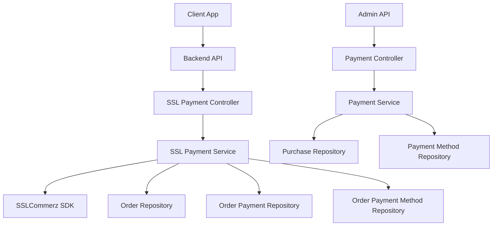
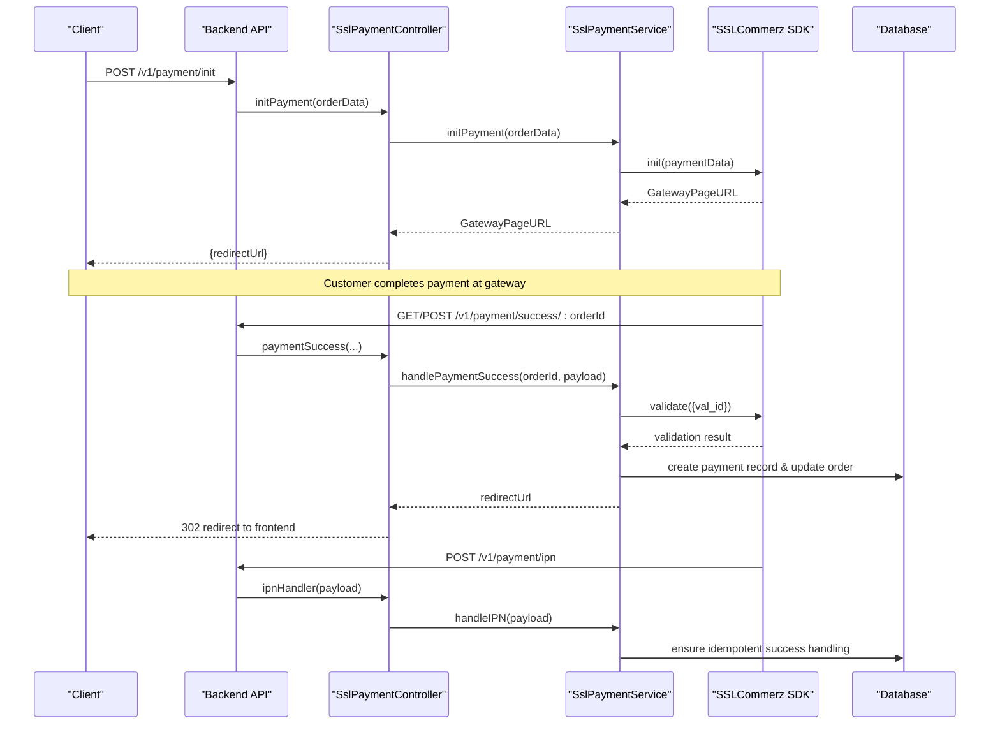
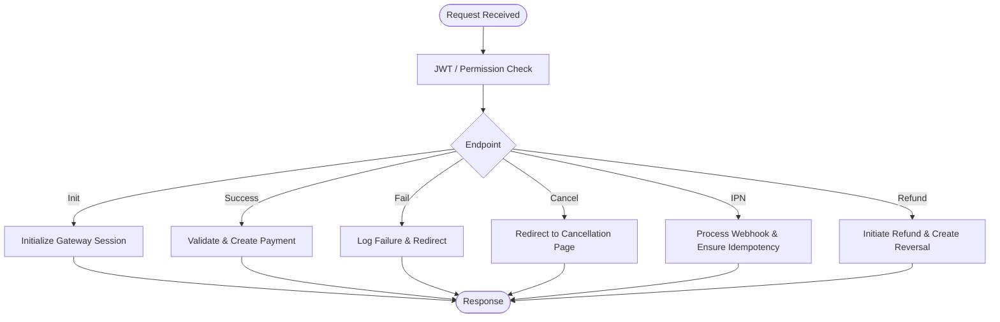
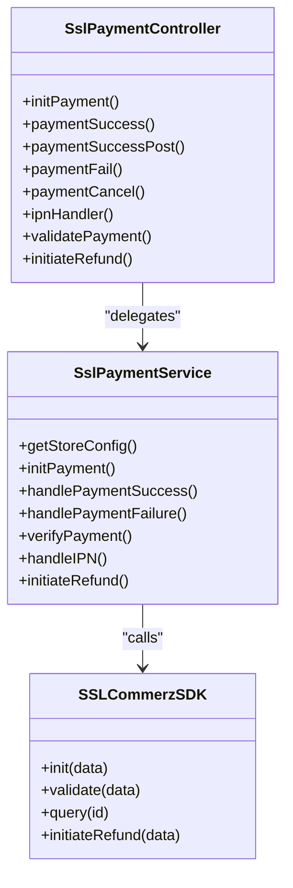
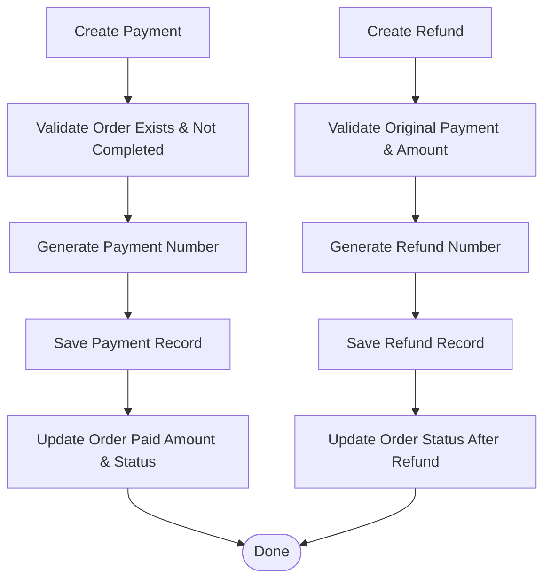
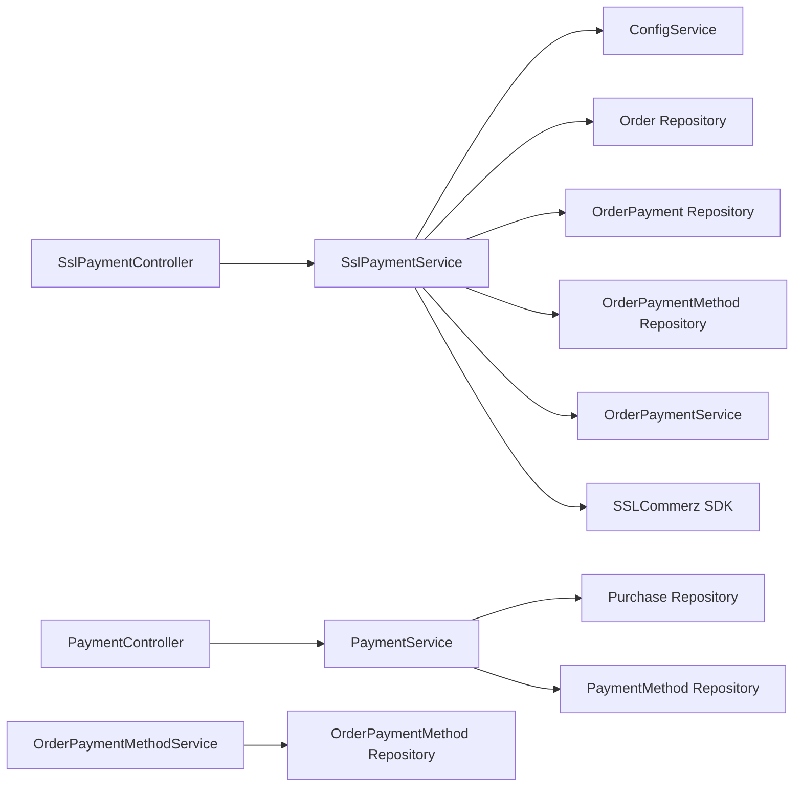

# Payment Integration

<cite>
**Referenced Files in This Document**
- [ssl-payment.controller.ts](file://apps/backend/src/ssl-payment/ssl-payment.controller.ts)
- [ssl-payment.service.ts](file://apps/backend/src/ssl-payment/ssl-payment.service.ts)
- [order-payment.service.ts](file://apps/backend/src/order-payment/order-payment.service.ts)
- [order-payment-method.service.ts](file://apps/backend/src/order-payment-method/order-payment-method.service.ts)
- [payment.controller.ts](file://apps/backend/src/payment/payment.controller.ts)
- [payment.service.ts](file://apps/backend/src/payment/payment.service.ts)
- [sslcommerz-lts.d.ts](file://apps/backend/src/types/sslcommerz-lts.d.ts)
</cite>

## Table of Contents
1. [Introduction](#introduction)
2. [Project Structure](#project-structure)
3. [Core Components](#core-components)
4. [Architecture Overview](#architecture-overview)
5. [Detailed Component Analysis](#detailed-component-analysis)
6. [Dependency Analysis](#dependency-analysis)
7. [Performance Considerations](#performance-considerations)
8. [Troubleshooting Guide](#troubleshooting-guide)
9. [Conclusion](#conclusion)

## Introduction
This document provides detailed API documentation for payment integration, focusing on:
- Payment method registration and configuration
- Payment initiation with SSLCommerz
- Payment confirmation via callback endpoints and IPN webhooks
- Payment status tracking and history management
- Refund processing
- Security considerations, validation rules, and sensitive data handling

The backend is a NestJS application that exposes REST endpoints for initiating payments, handling gateway callbacks, and managing order payments. It integrates with the SSLCommerz payment gateway through an SDK wrapper and TypeORM repositories for persistence.

## Project Structure
Payment-related functionality is organized into focused modules:
- SSLCommerz integration controller and service
- Order payment service for creating, querying, and refunding payments
- Payment method service for registering and toggling payment methods
- Legacy purchase-based payment controller and service (for non-order flows)

**Diagram sources**
- [ssl-payment.controller.ts:31-257](file://apps/backend/src/ssl-payment/ssl-payment.controller.ts#L31-L257)
- [ssl-payment.service.ts:17-413](file://apps/backend/src/ssl-payment/ssl-payment.service.ts#L17-L413)
- [order-payment.service.ts:18-309](file://apps/backend/src/order-payment/order-payment.service.ts#L18-L309)
- [order-payment-method.service.ts:9-64](file://apps/backend/src/order-payment-method/order-payment-method.service.ts#L9-L64)
- [payment.controller.ts:32-213](file://apps/backend/src/payment/payment.controller.ts#L32-L213)
- [payment.service.ts:11-138](file://apps/backend/src/payment/payment.service.ts#L11-L138)

**Section sources**
- [ssl-payment.controller.ts:31-257](file://apps/backend/src/ssl-payment/ssl-payment.controller.ts#L31-L257)
- [ssl-payment.service.ts:17-413](file://apps/backend/src/ssl-payment/ssl-payment.service.ts#L17-L413)
- [order-payment.service.ts:18-309](file://apps/backend/src/order-payment/order-payment.service.ts#L18-L309)
- [order-payment-method.service.ts:9-64](file://apps/backend/src/order-payment-method/order-payment-method.service.ts#L9-L64)
- [payment.controller.ts:32-213](file://apps/backend/src/payment/payment.controller.ts#L32-L213)
- [payment.service.ts:11-138](file://apps/backend/src/payment/payment.service.ts#L11-L138)

## Core Components
- SSL Payment Controller: Exposes endpoints to initiate payments, handle success/fail/cancel callbacks, process IPN webhooks, validate transactions, and initiate refunds.
- SSL Payment Service: Encapsulates SSLCommerz integration, including initialization, verification, success/failure handling, IPN processing, and refund initiation.
- Order Payment Service: Manages order payment records, calculates totals and statuses, supports refunds, and provides query capabilities.
- Order Payment Method Service: Registers and manages available payment methods.
- Legacy Payment Controller/Service: Records payments against purchases and updates purchase payment status.

Key responsibilities:
- Gateway communication: Initialize payment sessions, verify transactions, and process refunds.
- Callback handling: Process success/fail/cancel redirects and asynchronous IPN notifications.
- State management: Update order payment status based on accumulated payments and refunds.
- Auditability: Generate unique payment numbers and maintain creation/update metadata.

**Section sources**
- [ssl-payment.controller.ts:31-257](file://apps/backend/src/ssl-payment/ssl-payment.controller.ts#L31-L257)
- [ssl-payment.service.ts:17-413](file://apps/backend/src/ssl-payment/ssl-payment.service.ts#L17-L413)
- [order-payment.service.ts:18-309](file://apps/backend/src/order-payment/order-payment.service.ts#L18-L309)
- [order-payment-method.service.ts:9-64](file://apps/backend/src/order-payment-method/order-payment-method.service.ts#L9-L64)
- [payment.controller.ts:32-213](file://apps/backend/src/payment/payment.controller.ts#L32-L213)
- [payment.service.ts:11-138](file://apps/backend/src/payment/payment.service.ts#L11-L138)

## Architecture Overview
The payment flow involves client requests to the backend, which communicates with SSLCommerz and persists payment state.

**Diagram sources**
- [ssl-payment.controller.ts:35-206](file://apps/backend/src/ssl-payment/ssl-payment.controller.ts#L35-L206)
- [ssl-payment.service.ts:44-328](file://apps/backend/src/ssl-payment/ssl-payment.service.ts#L44-L328)
- [sslcommerz-lts.d.ts:89-111](file://apps/backend/src/types/sslcommerz-lts.d.ts#L89-L111)

## Detailed Component Analysis

### SSL Payment Endpoints
- POST /v1/payment/init
  - Purpose: Initialize a payment session with SSLCommerz.
  - Authentication: JWT required.
  - Request body: Order data including total value, items, user, address, shipping method, coupon code.
  - Response: Redirect URL to the gateway page.
  - Error handling: Returns error if credentials are missing or gateway initialization fails.

- GET /v1/payment/success/:orderId
  - Purpose: Handle successful payment redirection from the gateway.
  - Behavior: Validates the transaction, creates a payment record, updates order payment method and status, and redirects to the frontend success page.

- POST /v1/payment/success/:orderId
  - Purpose: Accept gateway POST callback for success.
  - Behavior: Same as GET success but accepts JSON body.

- POST /v1/payment/fail/:orderId
  - Purpose: Handle failed payment redirection.
  - Behavior: Logs failure details and redirects to the frontend failure page.

- POST /v1/payment/cancel/:orderId
  - Purpose: Handle canceled payment redirection.
  - Behavior: Redirects to the frontend cancellation page.

- POST /v1/payment/ipn
  - Purpose: Process asynchronous IPN webhook from SSLCommerz.
  - Behavior: Verifies IPN status and triggers success handling for valid IPNs.

- GET /v1/payment/validate/:tranId
  - Purpose: Manual validation endpoint placeholder.
  - Behavior: Placeholder response; actual implementation depends on requirements.

- POST /v1/payment/refund
  - Purpose: Initiate a refund for a completed payment.
  - Authentication: JWT + permission guard restricted to admin refund reports module.
  - Request body: Payment ID, refund amount, remarks, bank transaction ID, original transaction ID.
  - Behavior: Calls gateway refund API, checks IP whitelist errors, creates reversal posting on success, and returns response.

**Diagram sources**
- [ssl-payment.controller.ts:35-257](file://apps/backend/src/ssl-payment/ssl-payment.controller.ts#L35-L257)

**Section sources**
- [ssl-payment.controller.ts:35-257](file://apps/backend/src/ssl-payment/ssl-payment.controller.ts#L35-L257)

### SSLCommerz Integration Details
- Configuration:
  - Credentials loaded from environment variables: store ID, store password, live mode flag.
  - Base URL and IPN URL configured via environment variables.
  - Missing credentials throw an error during initialization.

- Initialization:
  - Builds payment data including amounts, currency, customer and shipping details, product info, and custom values for order reference.
  - Calls SDK init and returns the gateway page URL.

- Verification:
  - Uses SDK validate with val_id to confirm transaction validity.
  - Compares returned status, transaction ID, and amount with the callback payload.

- Success Handling:
  - Ensures idempotency by checking existing payment by SSL transaction ID.
  - Assigns SSLCOMMERZ payment method to the order.
  - Creates a payment record with generated payment number and stores SSL transaction identifiers.
  - Updates order totals and payment status.

- Failure Handling:
  - Logs minimal non-sensitive fields and redirects to failure page.

- IPN Processing:
  - Processes only VALID IPN payloads.
  - Extracts order ID from custom field and delegates to success handler.

- Refund Processing:
  - Validates input and calls gateway refund API.
  - Detects IP whitelist errors and throws actionable error.
  - On success, creates a reversal payment record and returns combined response.

**Diagram sources**
- [ssl-payment.controller.ts:31-257](file://apps/backend/src/ssl-payment/ssl-payment.controller.ts#L31-L257)
- [ssl-payment.service.ts:17-413](file://apps/backend/src/ssl-payment/ssl-payment.service.ts#L17-L413)
- [sslcommerz-lts.d.ts:89-111](file://apps/backend/src/types/sslcommerz-lts.d.ts#L89-L111)

**Section sources**
- [ssl-payment.service.ts:29-111](file://apps/backend/src/ssl-payment/ssl-payment.service.ts#L29-L111)
- [ssl-payment.service.ts:113-306](file://apps/backend/src/ssl-payment/ssl-payment.service.ts#L113-L306)
- [ssl-payment.service.ts:308-413](file://apps/backend/src/ssl-payment/ssl-payment.service.ts#L308-L413)
- [sslcommerz-lts.d.ts:1-127](file://apps/backend/src/types/sslcommerz-lts.d.ts#L1-L127)

### Payment Method Registration and Configuration
- Registration:
  - Payment methods can be created with unique code and name; duplicates are rejected.
  - Methods include isActive flags for enabling/disabling.

- Usage in Payments:
  - Orders associate a selected payment method.
  - For SSLCommerz success flows, the system assigns the SSLCOMMERZ method to the order when not already present.

- Querying:
  - List active payment methods without sensitive details.

**Section sources**
- [order-payment-method.service.ts:16-64](file://apps/backend/src/order-payment-method/order-payment-method.service.ts#L16-L64)
- [ssl-payment.service.ts:167-178](file://apps/backend/src/ssl-payment/ssl-payment.service.ts#L167-L178)

### Payment Status Tracking and History Management
- Creating Payments:
  - Generates sequential payment numbers per year (PAY-YYYY-NNNN).
  - Prevents adding payments to completed orders.
  - Updates order paid amount and payment status after each payment.

- Querying History:
  - Supports date range filters and order status filters.
  - Joins related entities for reporting (order, payment method, creators/updaters).

- Refunds:
  - Creates negative payment entries linked to original payments.
  - Prevents refunding refunds and ensures refund amount does not exceed original.
  - Updates order status to reflect partial/full refund states.

**Diagram sources**
- [order-payment.service.ts:28-73](file://apps/backend/src/order-payment/order-payment.service.ts#L28-L73)
- [order-payment.service.ts:213-307](file://apps/backend/src/order-payment/order-payment.service.ts#L213-L307)

**Section sources**
- [order-payment.service.ts:28-73](file://apps/backend/src/order-payment/order-payment.service.ts#L28-L73)
- [order-payment.service.ts:81-139](file://apps/backend/src/order-payment/order-payment.service.ts#L81-L139)
- [order-payment.service.ts:213-307](file://apps/backend/src/order-payment/order-payment.service.ts#L213-L307)

### Legacy Purchase-Based Payment Flow
- The legacy payment controller/service records payments against purchases and updates purchase payment status based on accumulated amounts.
- Provides CRUD operations for payments with authorization guards and Swagger annotations.

**Section sources**
- [payment.controller.ts:32-213](file://apps/backend/src/payment/payment.controller.ts#L32-L213)
- [payment.service.ts:23-138](file://apps/backend/src/payment/payment.service.ts#L23-L138)

## Dependency Analysis
- Controllers depend on services for business logic.
- SSL Payment Service depends on:
  - ConfigService for environment variables
  - Repositories for Order, OrderPayment, OrderPaymentMethod
  - OrderPaymentService for creating payments and refunds
  - SSLCommerz SDK for gateway communication
- Order Payment Service depends on:
  - Repositories for OrderPayment, Order, OrderPaymentMethod
  - Report utilities for date range resolution
- Payment Method Service depends on:
  - Repository for OrderPaymentMethod

**Diagram sources**
- [ssl-payment.controller.ts:31-257](file://apps/backend/src/ssl-payment/ssl-payment.controller.ts#L31-L257)
- [ssl-payment.service.ts:17-413](file://apps/backend/src/ssl-payment/ssl-payment.service.ts#L17-L413)
- [order-payment.service.ts:18-309](file://apps/backend/src/order-payment/order-payment.service.ts#L18-L309)
- [order-payment-method.service.ts:9-64](file://apps/backend/src/order-payment-method/order-payment-method.service.ts#L9-L64)
- [payment.controller.ts:32-213](file://apps/backend/src/payment/payment.controller.ts#L32-L213)
- [payment.service.ts:11-138](file://apps/backend/src/payment/payment.service.ts#L11-L138)

**Section sources**
- [ssl-payment.service.ts:17-413](file://apps/backend/src/ssl-payment/ssl-payment.service.ts#L17-L413)
- [order-payment.service.ts:18-309](file://apps/backend/src/order-payment/order-payment.service.ts#L18-L309)
- [order-payment-method.service.ts:9-64](file://apps/backend/src/order-payment-method/order-payment-method.service.ts#L9-L64)
- [payment.service.ts:11-138](file://apps/backend/src/payment/payment.service.ts#L11-L138)

## Performance Considerations
- Database queries use relations selectively to avoid N+1 issues in reporting endpoints.
- Payment number generation uses LIKE queries with ordering to find the last sequence efficiently.
- Logging is trimmed to non-sensitive fields to reduce log size and protect PII.
- Gateway calls are synchronous within request handlers; consider async job queues for heavy operations like refunds if needed.

[No sources needed since this section provides general guidance]

## Troubleshooting Guide
Common issues and resolutions:
- Missing SSLCommerz credentials:
  - Symptom: Initialization fails with credential error.
  - Resolution: Ensure environment variables for store ID, store password, and live mode are set.

- IP whitelist error during refunds:
  - Symptom: Refund API returns INVALID_SOURCE or REQUEST_FROM_INVALID_SOURCE.
  - Resolution: Whitelist server IP in SSLCommerz merchant panel.

- Invalid order ID in callbacks:
  - Symptom: Redirects to error pages due to invalid orderId parsing.
  - Resolution: Verify order exists and passes numeric ID to gateway URLs.

- Payment verification failures:
  - Symptom: Validation status not VALID or mismatched transaction ID/amount.
  - Resolution: Confirm gateway payload integrity and ensure correct val_id usage.

- Duplicate payment processing:
  - Symptom: Multiple payment records for same transaction.
  - Resolution: Idempotency check prevents duplicate creation; verify database constraints and logs.

**Section sources**
- [ssl-payment.service.ts:29-42](file://apps/backend/src/ssl-payment/ssl-payment.service.ts#L29-L42)
- [ssl-payment.service.ts:367-377](file://apps/backend/src/ssl-payment/ssl-payment.service.ts#L367-L377)
- [ssl-payment.controller.ts:76-80](file://apps/backend/src/ssl-payment/ssl-payment.controller.ts#L76-L80)
- [ssl-payment.service.ts:269-306](file://apps/backend/src/ssl-payment/ssl-payment.service.ts#L269-L306)
- [ssl-payment.service.ts:151-165](file://apps/backend/src/ssl-payment/ssl-payment.service.ts#L151-L165)

## Conclusion
The payment integration provides a robust workflow for initiating payments via SSLCommerz, validating and confirming transactions, and maintaining accurate payment histories. It includes secure callback handling, IPN processing, and comprehensive refund support. Proper configuration, validation, and logging practices help ensure reliability and security. Administrators can manage payment methods and review payment history with filtering capabilities.

[No sources needed since this section summarizes without analyzing specific files]