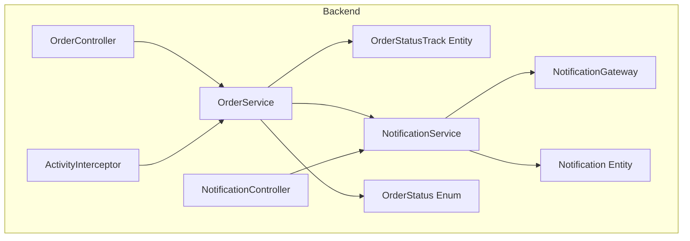
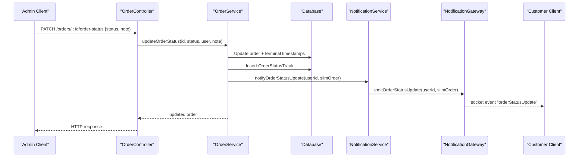
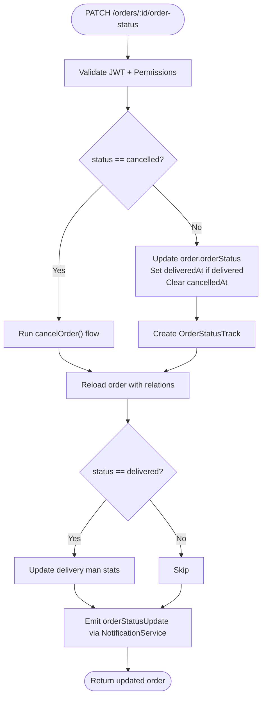
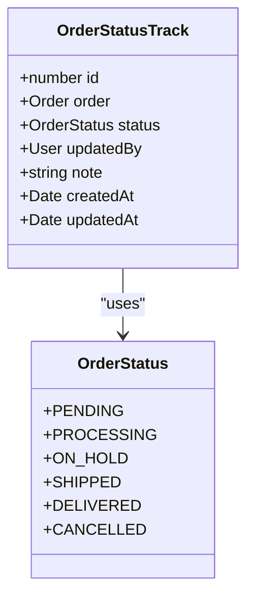
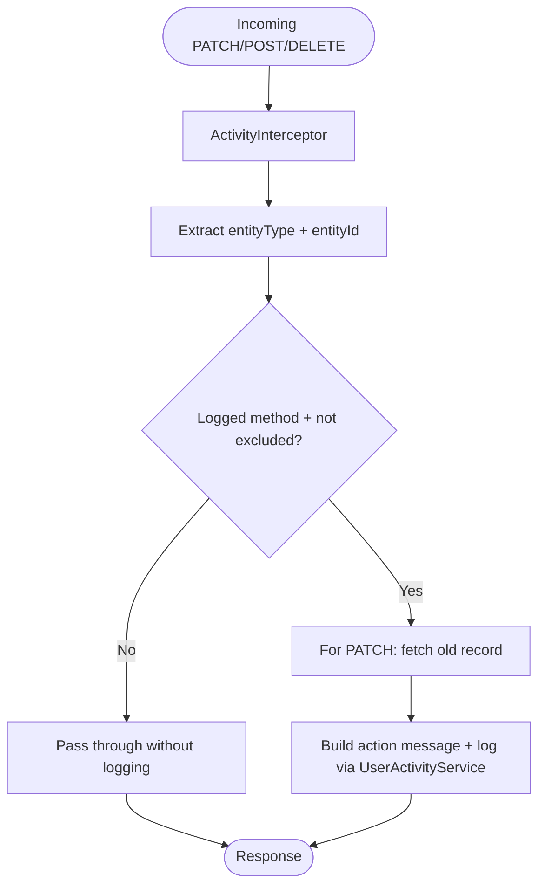
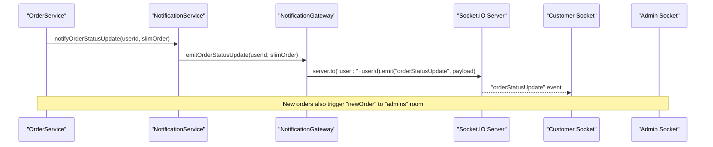
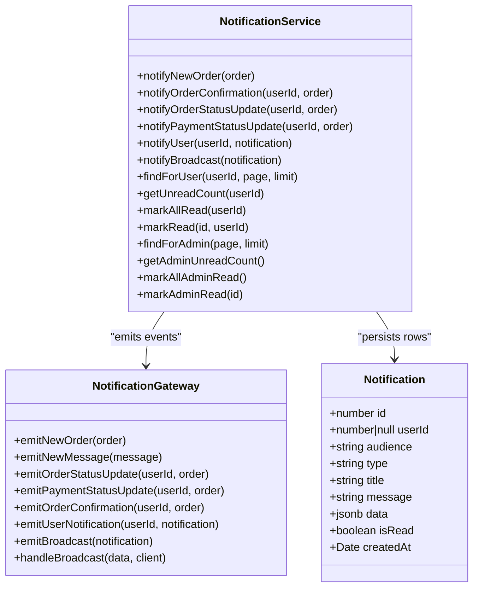
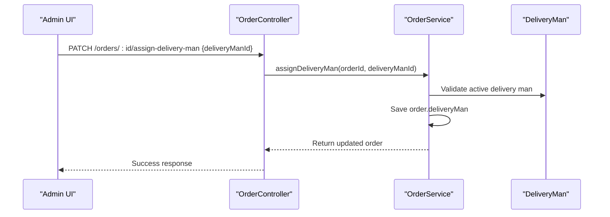
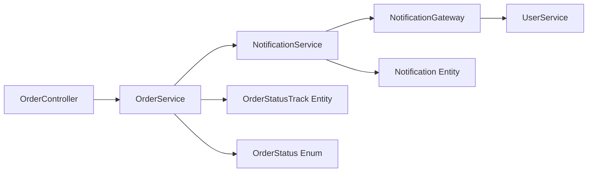

# Status Tracking & Notifications

<cite>
**Referenced Files in This Document**
- [order.controller.ts](file://apps/backend/src/order/order.controller.ts)
- [order.service.ts](file://apps/backend/src/order/order.service.ts)
- [order-status-track.entity.ts](file://apps/backend/src/order/entities/order-status-track.entity.ts)
- [notification.gateway.ts](file://apps/backend/src/notification/notification.gateway.ts)
- [notification.service.ts](file://apps/backend/src/notification/notification.service.ts)
- [notification.controller.ts](file://apps/backend/src/notification/notification.controller.ts)
- [notification.entity.ts](file://apps/backend/src/notification/entities/notification.entity.ts)
- [index.ts](file://apps/backend/src/common/enums/index.ts)
- [activity.interceptor.ts](file://apps/backend/src/interceptor/activity.interceptor.ts)
</cite>

## Table of Contents
1. [Introduction](#introduction)
2. [Project Structure](#project-structure)
3. [Core Components](#core-components)
4. [Architecture Overview](#architecture-overview)
5. [Detailed Component Analysis](#detailed-component-analysis)
6. [Dependency Analysis](#dependency-analysis)
7. [Performance Considerations](#performance-considerations)
8. [Troubleshooting Guide](#troubleshooting-guide)
9. [Conclusion](#conclusion)

## Introduction
This document explains the order status tracking and real-time notification system. It covers:
- Order status update endpoints and validation
- Audit trail generation through status tracks and activity logging
- WebSocket-based real-time notifications for order status changes, payment updates, new orders, and broadcasts
- Notification persistence, subscription management, and message routing
- Delivery tracking integration points
- Activity logging, user engagement tracking, and analytics collection hooks
- Scalability considerations for high-volume notifications and real-time performance

The backend is a NestJS application with REST controllers, services, TypeORM entities, and a Socket.IO gateway under the `notifications` namespace. The frontend consumes both REST APIs and WebSocket events to render live order timelines and notification panels.

## Project Structure
The relevant parts of the monorepo are:
- Backend order module: controller, service, entities, enums
- Backend notification module: gateway, service, controller, entity
- Interceptor for activity logging
- Frontend admin UI components that consume delivery assignment and timeline data

**Diagram sources**
- [order.controller.ts:230-261](file://apps/backend/src/order/order.controller.ts#L230-L261)
- [order.service.ts:1200-1299](file://apps/backend/src/order/order.service.ts#L1200-L1299)
- [order-status-track.entity.ts:14-50](file://apps/backend/src/order/entities/order-status-track.entity.ts#L14-L50)
- [notification.gateway.ts:15-37](file://apps/backend/src/notification/notification.gateway.ts#L15-L37)
- [notification.service.ts:21-58](file://apps/backend/src/notification/notification.service.ts#L21-L58)
- [notification.controller.ts:25-28](file://apps/backend/src/notification/notification.controller.ts#L25-L28)
- [notification.entity.ts:12-58](file://apps/backend/src/notification/entities/notification.entity.ts#L12-L58)
- [index.ts:12-19](file://apps/backend/src/common/enums/index.ts#L12-L19)
- [activity.interceptor.ts:20-35](file://apps/backend/src/interceptor/activity.interceptor.ts#L20-L35)

**Section sources**
- [order.controller.ts:1-44](file://apps/backend/src/order/order.controller.ts#L1-L44)
- [notification.gateway.ts:15-37](file://apps/backend/src/notification/notification.gateway.ts#L15-L37)
- [notification.service.ts:21-58](file://apps/backend/src/notification/notification.service.ts#L21-L58)
- [notification.controller.ts:25-28](file://apps/backend/src/notification/notification.controller.ts#L25-L28)
- [notification.entity.ts:12-58](file://apps/backend/src/notification/entities/notification.entity.ts#L12-L58)
- [order-status-track.entity.ts:14-50](file://apps/backend/src/order/entities/order-status-track.entity.ts#L14-L50)
- [index.ts:12-19](file://apps/backend/src/common/enums/index.ts#L12-L19)
- [activity.interceptor.ts:20-35](file://apps/backend/src/interceptor/activity.interceptor.ts#L20-L35)

## Core Components
- Order status tracking:
  - `OrderStatusTrack` records each status change with timestamp, author, and optional note.
  - `OrderService.updateOrderStatus` writes the order status, terminal timestamps, and a status track row.
  - `OrderStatus` enum defines allowed values: pending, processing, on_hold, shipped, delivered, cancelled.
- Real-time notifications:
  - `NotificationGateway` exposes Socket.IO events under the `notifications` namespace.
  - `NotificationService` emits events and persists notifications for both users and admins.
  - `NotificationController` provides paginated read and mark-as-read endpoints.
- Activity logging:
  - `ActivityInterceptor` captures audit trails for PATCH/POST/DELETE requests, including order status and payment status changes.

**Section sources**
- [order-status-track.entity.ts:14-50](file://apps/backend/src/order/entities/order-status-track.entity.ts#L14-L50)
- [order.service.ts:1200-1299](file://apps/backend/src/order/order.service.ts#L1200-L1299)
- [index.ts:12-19](file://apps/backend/src/common/enums/index.ts#L12-L19)
- [notification.gateway.ts:15-37](file://apps/backend/src/notification/notification.gateway.ts#L15-L37)
- [notification.service.ts:21-58](file://apps/backend/src/notification/notification.service.ts#L21-L58)
- [notification.controller.ts:25-28](file://apps/backend/src/notification/notification.controller.ts#L25-L28)
- [activity.interceptor.ts:20-35](file://apps/backend/src/interceptor/activity.interceptor.ts#L20-L35)

## Architecture Overview
The system combines REST APIs for state mutations with WebSocket events for real-time updates.

**Diagram sources**
- [order.controller.ts:230-261](file://apps/backend/src/order/order.controller.ts#L230-L261)
- [order.service.ts:1200-1299](file://apps/backend/src/order/order.service.ts#L1200-L1299)
- [notification.service.ts:112-123](file://apps/backend/src/notification/notification.service.ts#L112-L123)
- [notification.gateway.ts:168-178](file://apps/backend/src/notification/notification.gateway.ts#L168-L178)

## Detailed Component Analysis

### Order Status Update API
- Endpoint: `PATCH /orders/:id/order-status`
- Authorization: JWT + PermissionGuard + ModulePermissions `/admin/orders`
- Request body:
  - `status`: one of `OrderStatus` enum values
  - `note`: optional text attached to the status track
- Behavior:
  - If `status` is `cancelled`, the full cancellation flow runs (payment handling, stock restoration).
  - For other statuses, the order’s `orderStatus` is updated, `deliveredAt` is set when applicable, and `cancelledAt` is cleared.
  - A `OrderStatusTrack` row is created with the new status, author, and note.
  - When status becomes `delivered`, delivery man statistics are updated.
  - A WebSocket notification is emitted to the order owner.

**Diagram sources**
- [order.controller.ts:230-261](file://apps/backend/src/order/order.controller.ts#L230-L261)
- [order.service.ts:1200-1299](file://apps/backend/src/order/order.service.ts#L1200-L1299)

**Section sources**
- [order.controller.ts:230-261](file://apps/backend/src/order/order.controller.ts#L230-L261)
- [order.service.ts:1200-1299](file://apps/backend/src/order/order.service.ts#L1200-L1299)
- [index.ts:12-19](file://apps/backend/src/common/enums/index.ts#L12-L19)

### Status Transition Validation
- Allowed statuses are constrained by the `OrderStatus` enum.
- Special handling for `cancelled`:
  - Cancelling an already-cancelled order only appends a note via `recordStatusTrack`.
  - Otherwise, it delegates to the cancellation workflow which handles payments and stock.
- Terminal timestamps:
  - `deliveredAt` is set when transitioning to `delivered`.
  - `cancelledAt` is cleared when un-cancelling; backfill scripts exist to populate historical values.

**Diagram sources**
- [index.ts:12-19](file://apps/backend/src/common/enums/index.ts#L12-L19)
- [order-status-track.entity.ts:14-50](file://apps/backend/src/order/entities/order-status-track.entity.ts#L14-L50)

**Section sources**
- [index.ts:12-19](file://apps/backend/src/common/enums/index.ts#L12-L19)
- [order-status-track.entity.ts:14-50](file://apps/backend/src/order/entities/order-status-track.entity.ts#L14-L50)
- [order.service.ts:1200-1299](file://apps/backend/src/order/order.service.ts#L1200-L1299)

### Audit Trail Generation
- Status tracks:
  - Each status mutation creates a persistent `OrderStatusTrack` row with author and note.
- Activity interceptor:
  - Captures PATCH/POST/DELETE actions across the API.
  - For order routes, it generates human-readable messages such as “Updated order status to ...” or “Updated payment status to ...”.
  - Old/new values are aligned for PATCH payloads, including mapping DTO keys like `status` to `orderStatus`/`paymentStatus`.

**Diagram sources**
- [activity.interceptor.ts:37-73](file://apps/backend/src/interceptor/activity.interceptor.ts#L37-L73)
- [activity.interceptor.ts:273-312](file://apps/backend/src/interceptor/activity.interceptor.ts#L273-L312)
- [activity.interceptor.ts:399-439](file://apps/backend/src/interceptor/activity.interceptor.ts#L399-L439)

**Section sources**
- [order-status-track.entity.ts:14-50](file://apps/backend/src/order/entities/order-status-track.entity.ts#L14-L50)
- [activity.interceptor.ts:37-73](file://apps/backend/src/interceptor/activity.interceptor.ts#L37-L73)
- [activity.interceptor.ts:273-312](file://apps/backend/src/interceptor/activity.interceptor.ts#L273-L312)
- [activity.interceptor.ts:399-439](file://apps/backend/src/interceptor/activity.interceptor.ts#L399-L439)

### WebSocket-Based Real-Time Notifications
- Gateway configuration:
  - Namespace: `notifications`
  - CORS allows production domains and local development origins.
  - Connections carry `userId` and optional `isAdmin`; clients join `user:{userId}` rooms and optionally the `admins` room.
- Events:
  - `newOrder` to `admins`
  - `newMessage` to `admins`
  - `orderStatusUpdate` to `user:{userId}`
  - `paymentStatusUpdate` to `user:{userId}`
  - `orderConfirmation` to `user:{userId}`
  - `notification` to `user:{userId}`
  - `broadcast` to all clients
  - Admin broadcast request handler validates admin role and broadcasts promotional content.

**Diagram sources**
- [notification.gateway.ts:15-37](file://apps/backend/src/notification/notification.gateway.ts#L15-L37)
- [notification.gateway.ts:43-87](file://apps/backend/src/notification/notification.gateway.ts#L43-L87)
- [notification.gateway.ts:148-222](file://apps/backend/src/notification/notification.gateway.ts#L148-L222)
- [notification.service.ts:112-123](file://apps/backend/src/notification/notification.service.ts#L112-L123)
- [order.service.ts:668-691](file://apps/backend/src/order/order.service.ts#L668-L691)

**Section sources**
- [notification.gateway.ts:15-37](file://apps/backend/src/notification/notification.gateway.ts#L15-L37)
- [notification.gateway.ts:43-87](file://apps/backend/src/notification/notification.gateway.ts#L43-L87)
- [notification.gateway.ts:148-222](file://apps/backend/src/notification/notification.gateway.ts#L148-L222)
- [notification.service.ts:112-123](file://apps/backend/src/notification/notification.service.ts#L112-L123)
- [order.service.ts:668-691](file://apps/backend/src/order/order.service.ts#L668-L691)

### Notification System Architecture
- Event emission:
  - `NotificationService` emits events via `NotificationGateway` and persists a notification row.
  - Payloads are slimmed to avoid leaking sensitive relations and reduce bandwidth.
- Subscription management:
  - Clients connect with `userId` and optionally `isAdmin`.
  - The gateway maps `userId` to socket IDs and joins rooms for targeted messaging.
- Message routing:
  - Per-user events use `user:{userId}` rooms.
  - Admin-only events target the `admins` room.
  - Broadcasts target all connected sockets.
- Persistence:
  - `Notification` entity stores audience (`user` or `admin`), type, title, message, JSON payload, read flag, and creation time.
  - Admin feed and user feed are separated by `audience`.

**Diagram sources**
- [notification.service.ts:21-58](file://apps/backend/src/notification/notification.service.ts#L21-L58)
- [notification.service.ts:60-167](file://apps/backend/src/notification/notification.service.ts#L60-L167)
- [notification.service.ts:169-327](file://apps/backend/src/notification/notification.service.ts#L169-L327)
- [notification.gateway.ts:148-222](file://apps/backend/src/notification/notification.gateway.ts#L148-L222)
- [notification.entity.ts:12-58](file://apps/backend/src/notification/entities/notification.entity.ts#L12-L58)

**Section sources**
- [notification.service.ts:21-58](file://apps/backend/src/notification/notification.service.ts#L21-L58)
- [notification.service.ts:60-167](file://apps/backend/src/notification/notification.service.ts#L60-L167)
- [notification.service.ts:169-327](file://apps/backend/src/notification/notification.service.ts#L169-L327)
- [notification.gateway.ts:148-222](file://apps/backend/src/notification/notification.gateway.ts#L148-L222)
- [notification.entity.ts:12-58](file://apps/backend/src/notification/entities/notification.entity.ts#L12-L58)

### Delivery Tracking Integration
- Delivery man assignment:
  - `OrderService.assignDeliveryMan` assigns an active delivery man to an order.
  - Frontend admin UI includes a dedicated section and dialog to assign/unassign delivery men.
- Delivery performance:
  - When an order transitions to `delivered`, delivery man statistics (total deliveries and earnings) are updated.
- Operational notes:
  - Delivery man assignment is independent of order status but commonly used during processing/shipping workflows.

**Diagram sources**
- [order.service.ts:1326-1354](file://apps/backend/src/order/order.service.ts#L1326-L1354)

**Section sources**
- [order.service.ts:1326-1354](file://apps/backend/src/order/order.service.ts#L1326-L1354)

### Custom Status Workflows and Templates
- Custom status workflows:
  - Extend the `OrderStatus` enum and add transition rules in `OrderService.updateOrderStatus`.
  - Add corresponding UI validations and available options in the admin order form.
- Notification templates:
  - SMS templates are used for order confirmation; email templates are used for customer and admin emails.
  - WebSocket payloads are slimmed by `NotificationService.slimOrder` to include only fields needed by UIs.

**Section sources**
- [index.ts:12-19](file://apps/backend/src/common/enums/index.ts#L12-L19)
- [order.service.ts:1200-1299](file://apps/backend/src/order/order.service.ts#L1200-L1299)
- [notification.service.ts:31-58](file://apps/backend/src/notification/notification.service.ts#L31-L58)

### Activity Logging, User Engagement Tracking, and Analytics
- Activity logging:
  - `ActivityInterceptor` logs actions with IP, user agent, request ID, session ID, and typed messages for order-related routes.
- User engagement:
  - The interceptor determines user type (admin vs customer) and records structured activity entries.
- Analytics collection:
  - The codebase includes an analytics module and controller; while not detailed here, it can be extended to capture event-level metrics from order and notification flows.

**Section sources**
- [activity.interceptor.ts:37-73](file://apps/backend/src/interceptor/activity.interceptor.ts#L37-L73)
- [activity.interceptor.ts:184-251](file://apps/backend/src/interceptor/activity.interceptor.ts#L184-L251)
- [activity.interceptor.ts:399-439](file://apps/backend/src/interceptor/activity.interceptor.ts#L399-L439)

## Dependency Analysis
Key dependencies and relationships:
- `OrderController` depends on `OrderService` for business logic.
- `OrderService` depends on:
  - Repositories for orders, items, products, addresses, shipping methods, payment methods, coupons, delivery men
  - `NotificationService` for real-time events
  - `EmailService` and `SmsService` for outbound communications
  - Campaign services for discounts and free delivery
- `NotificationService` depends on `NotificationGateway` for event emission and `Notification` repository for persistence.
- `NotificationGateway` depends on `UserService` for admin broadcast authorization and user lookup.

**Diagram sources**
- [order.controller.ts:43-44](file://apps/backend/src/order/order.controller.ts#L43-L44)
- [order.service.ts:63-101](file://apps/backend/src/order/order.service.ts#L63-L101)
- [notification.service.ts:21-29](file://apps/backend/src/notification/notification.service.ts#L21-L29)
- [notification.gateway.ts:31-37](file://apps/backend/src/notification/notification.gateway.ts#L31-L37)
- [order-status-track.entity.ts:14-50](file://apps/backend/src/order/entities/order-status-track.entity.ts#L14-L50)
- [index.ts:12-19](file://apps/backend/src/common/enums/index.ts#L12-L19)

**Section sources**
- [order.controller.ts:43-44](file://apps/backend/src/order/order.controller.ts#L43-L44)
- [order.service.ts:63-101](file://apps/backend/src/order/order.service.ts#L63-L101)
- [notification.service.ts:21-29](file://apps/backend/src/notification/notification.service.ts#L21-L29)
- [notification.gateway.ts:31-37](file://apps/backend/src/notification/notification.gateway.ts#L31-L37)
- [order-status-track.entity.ts:14-50](file://apps/backend/src/order/entities/order-status-track.entity.ts#L14-L50)
- [index.ts:12-19](file://apps/backend/src/common/enums/index.ts#L12-L19)

## Performance Considerations
- Real-time scalability:
  - Use Socket.IO rooms (`user:{userId}`, `admins`) to minimize fan-out.
  - Slim payloads via `NotificationService.slimOrder` to reduce bandwidth and prevent relation bloat.
  - Fail-open persistence: notification persistence failures do not block realtime emission.
- Database efficiency:
  - Status tracks are lightweight append-only records; ensure indexes on `orderId` and `createdAt` for timeline queries.
  - Avoid loading heavy relations when emitting notifications; pass only necessary fields.
- Throttling:
  - Order creation endpoint uses throttler guards to protect against abuse.
- Connection management:
  - Clean up disconnected sockets and remove empty user mappings to prevent memory leaks.
- Broadcasting:
  - Admin broadcast handler validates roles and counts recipients before broadcasting; consider rate-limiting broadcasts at the gateway level for very large user bases.

[No sources needed since this section provides general guidance]

## Troubleshooting Guide
- Order status not updating:
  - Verify JWT and permissions; the endpoint requires `PermissionGuard` and `/admin/orders` module permission.
  - Check `OrderStatus` enum values; invalid values will fail validation.
  - Inspect `OrderStatusTrack` table for recent entries and confirm `updatedBy` and timestamps.
- WebSocket events not received:
  - Ensure client connects to the `notifications` namespace with `userId` query parameter.
  - Confirm CORS settings allow the client origin.
  - Check that the user is joined to `user:{userId}` room and that the gateway has a mapping for the socket ID.
- Notification persistence issues:
  - Review `Notification` table for audience separation (`user` vs `admin`).
  - Mark-read operations validate ownership for user-specific rows and shared broadcasts.
- Activity logs missing:
  - Confirm the request method is POST/PATCH/DELETE and not in excluded paths.
  - Verify the request carries authenticated user context.
  - Check message generation for order routes to ensure readable logs.

**Section sources**
- [order.controller.ts:230-261](file://apps/backend/src/order/order.controller.ts#L230-L261)
- [index.ts:12-19](file://apps/backend/src/common/enums/index.ts#L12-L19)
- [notification.gateway.ts:15-37](file://apps/backend/src/notification/notification.gateway.ts#L15-L37)
- [notification.service.ts:221-244](file://apps/backend/src/notification/notification.service.ts#L221-L244)
- [activity.interceptor.ts:37-73](file://apps/backend/src/interceptor/activity.interceptor.ts#L37-L73)

## Conclusion
The order status tracking and notification system provides robust, auditable state transitions with real-time feedback. Status changes are persisted as immutable tracks, while WebSocket events keep customers and admins informed instantly. The architecture separates concerns between REST controllers, services, gateways, and persistence layers, enabling extensibility for custom workflows, templates, and delivery integrations. With careful payload slimming, room-based routing, and fail-open persistence, the system scales toward high-volume scenarios while maintaining clarity and reliability.