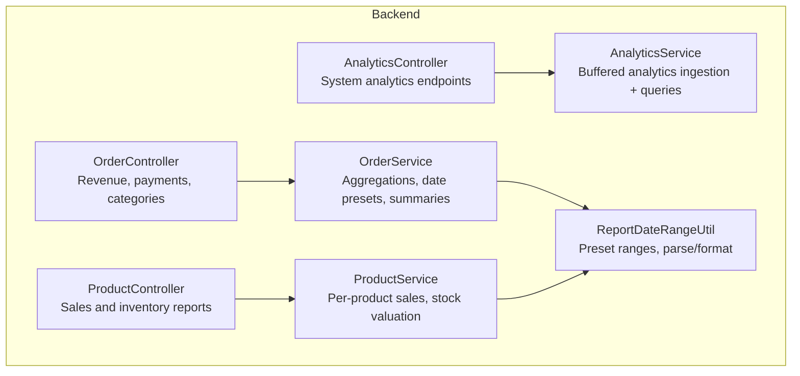
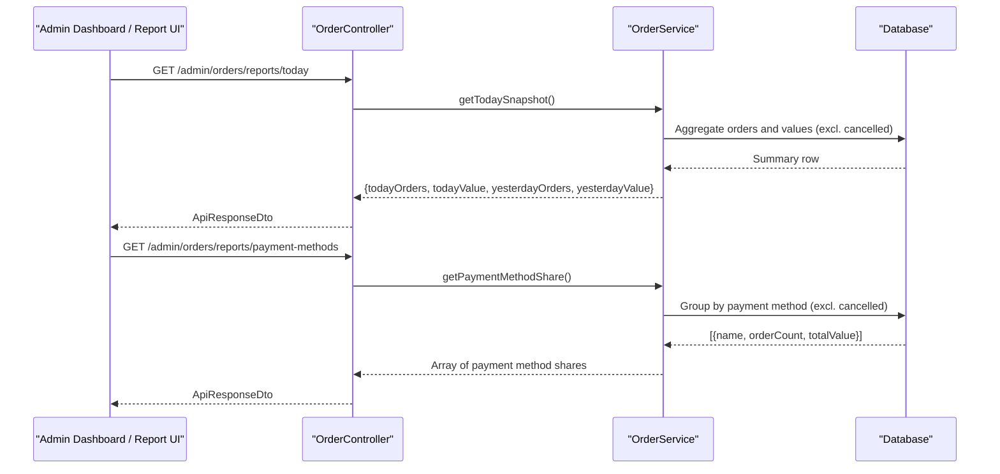
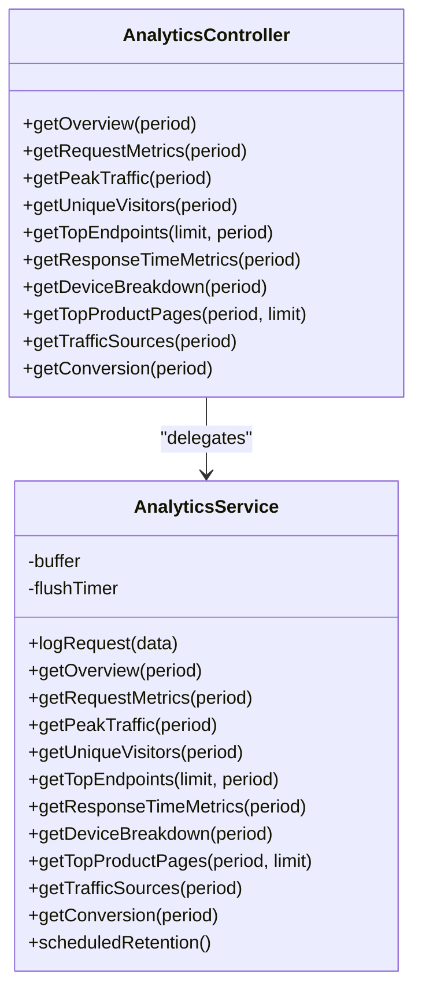
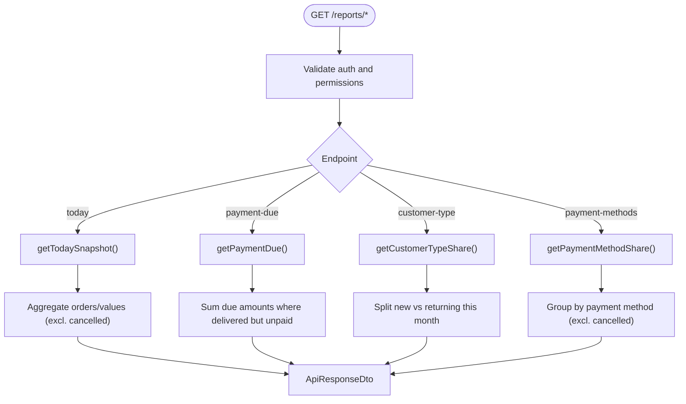
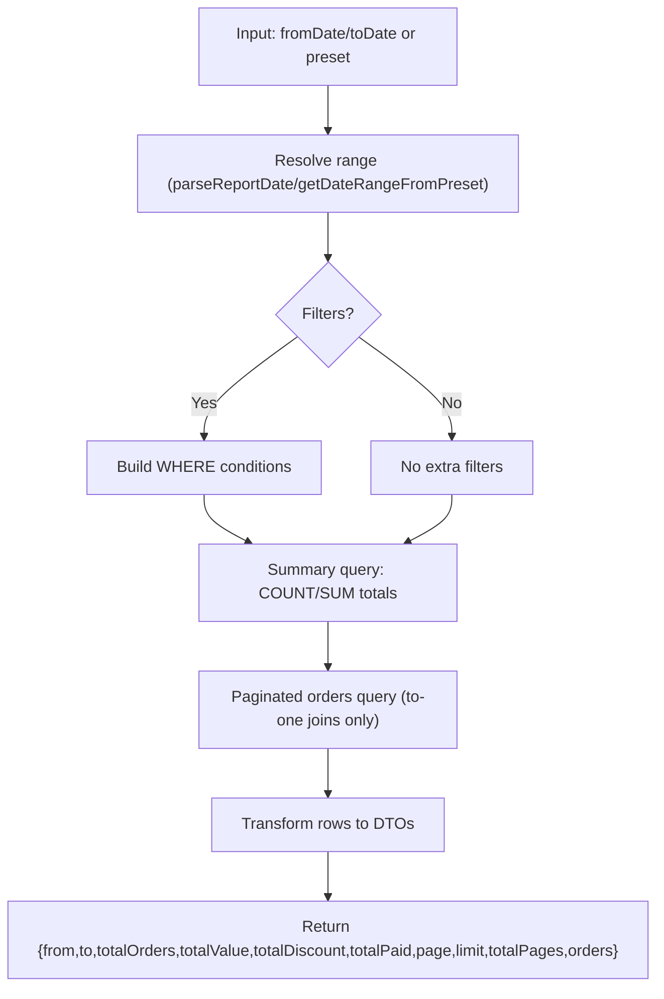
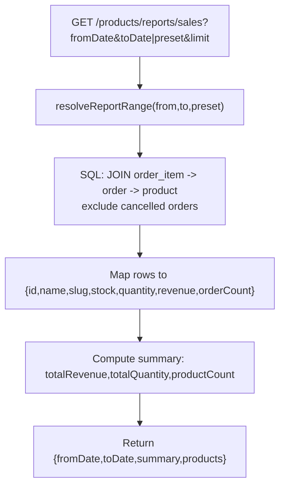
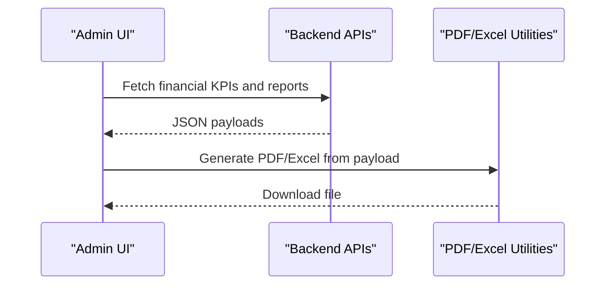
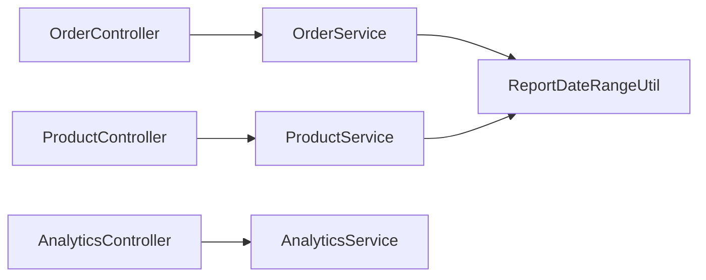

# Financial Reporting & Analytics

<cite>
**Referenced Files in This Document**
- [analytics.controller.ts](file://apps/backend/src/analytics/analytics.controller.ts)
- [analytics.service.ts](file://apps/backend/src/analytics/analytics.service.ts)
- [order.controller.ts](file://apps/backend/src/order/order.controller.ts)
- [order.service.ts](file://apps/backend/src/order/order.service.ts)
- [product.controller.ts](file://apps/backend/src/product/product.controller.ts)
- [product.service.ts](file://apps/backend/src/product/product.service.ts)
- [report-date-range.util.ts](file://apps/backend/src/common/utils/report-date-range.util.ts)
</cite>

## Table of Contents
1. [Introduction](#introduction)
2. [Project Structure](#project-structure)
3. [Core Components](#core-components)
4. [Architecture Overview](#architecture-overview)
5. [Detailed Component Analysis](#detailed-component-analysis)
6. [Dependency Analysis](#dependency-analysis)
7. [Performance Considerations](#performance-considerations)
8. [Troubleshooting Guide](#troubleshooting-guide)
9. [Conclusion](#conclusion)
10. [Appendices](#appendices)

## Introduction
This document describes the financial reporting and analytics endpoints that power dashboards, sales reports, payment analytics, and exportable reports. It covers:
- Revenue tracking and daily summaries
- Sales reports by product and category
- Payment method share and due amounts
- Date range presets and time zone handling
- Real-time system analytics (requests, visitors, response times)
- Data aggregation patterns, performance optimizations, and scheduled retention

The backend is a NestJS application with controllers exposing REST endpoints and services performing SQL aggregations over orders, products, and analytics tables. The frontend includes admin report pages and reusable PDF/Excel utilities for exporting data.

## Project Structure
Financial reporting and analytics are implemented primarily under:
- Backend analytics module: request-level metrics, conversion, traffic sources, device/browser breakdown
- Order module: revenue snapshots, payment due, payment method share, category sales, date-range order reports, daily summaries
- Product module: per-product sales report and inventory valuation
- Shared utilities: date parsing, preset ranges, and Dhaka time formatting

**Diagram sources**
- [analytics.controller.ts:27-33](file://apps/backend/src/analytics/analytics.controller.ts#L27-L33)
- [analytics.service.ts:38-57](file://apps/backend/src/analytics/analytics.service.ts#L38-L57)
- [order.controller.ts:782-883](file://apps/backend/src/order/order.controller.ts#L782-L883)
- [order.service.ts:1400-1650](file://apps/backend/src/order/order.service.ts#L1400-L1650)
- [product.controller.ts:658-718](file://apps/backend/src/product/product.controller.ts#L658-L718)
- [product.service.ts:1483-1594](file://apps/backend/src/product/product.service.ts#L1483-L1594)
- [report-date-range.util.ts:42-174](file://apps/backend/src/common/utils/report-date-range.util.ts#L42-L174)

**Section sources**
- [analytics.controller.ts:27-33](file://apps/backend/src/analytics/analytics.controller.ts#L27-L33)
- [order.controller.ts:782-883](file://apps/backend/src/order/order.controller.ts#L782-L883)
- [product.controller.ts:658-718](file://apps/backend/src/product/product.controller.ts#L658-L718)
- [report-date-range.util.ts:42-174](file://apps/backend/src/common/utils/report-date-range.util.ts#L42-L174)

## Core Components
- System analytics overview and metrics: requests per minute, unique visitors, peak hour, top endpoint, average response time, devices/browsers, top product pages, traffic sources, conversion rate
- Financial KPIs: today vs yesterday snapshot, delivered orders not fully paid, new vs returning customers this month
- Payment analytics: revenue share by payment method
- Category analytics: revenue share by product category
- Date-range reports: order list with totals, daily summary with status breakdowns
- Product sales report: per-product quantity, revenue, order count, current stock, plus range totals
- Inventory valuation: total units and value at cost and retail, low/out-of-stock lists

Key capabilities:
- Time period presets: today, this_week, last_week, this_month, last_month, last_3_months, last_6_months, last_year, this_year
- Date parsing and Dhaka time formatting for consistent reporting across UTC storage and local display
- Aggregation via single grouped SQL queries to avoid loading full datasets into memory

**Section sources**
- [analytics.controller.ts:36-311](file://apps/backend/src/analytics/analytics.controller.ts#L36-L311)
- [order.controller.ts:782-883](file://apps/backend/src/order/order.controller.ts#L782-L883)
- [order.service.ts:1400-1650](file://apps/backend/src/order/order.service.ts#L1400-L1650)
- [product.controller.ts:658-718](file://apps/backend/src/product/product.controller.ts#L658-L718)
- [product.service.ts:1483-1594](file://apps/backend/src/product/product.service.ts#L1483-L1594)
- [report-date-range.util.ts:42-174](file://apps/backend/src/common/utils/report-date-range.util.ts#L42-L174)

## Architecture Overview
The financial reporting stack combines real-time system analytics with business analytics derived from orders and products. Controllers accept authenticated requests, validate parameters, and delegate to services that perform efficient SQL aggregations. Reports return structured JSON suitable for dashboards and exports.

**Diagram sources**
- [order.controller.ts:782-883](file://apps/backend/src/order/order.controller.ts#L782-L883)
- [order.service.ts:1400-1650](file://apps/backend/src/order/order.service.ts#L1400-L1650)

## Detailed Component Analysis

### System Analytics Endpoints
Provides operational insights used by dashboards:
- Overview: requests/min, total requests, unique visitors, peak hour, top endpoint, avg response time
- Requests over time: hourly buckets with zero-fill gaps
- Peak traffic hours: top 24 busiest hours within period
- Unique visitors: daily counts aligned to local day boundaries
- Top endpoints: most accessed endpoints with avg response time
- Response time metrics: avg/min/max
- Device and browser breakdown: mobile/tablet/desktop and major browsers
- Top product pages: concrete paths resolved to product names
- Traffic sources: referer host grouping; missing referer counted as Direct
- Conversion: placed orders vs unique visitors and conversion rate

**Diagram sources**
- [analytics.controller.ts:27-329](file://apps/backend/src/analytics/analytics.controller.ts#L27-L329)
- [analytics.service.ts:38-616](file://apps/backend/src/analytics/analytics.service.ts#L38-L616)

**Section sources**
- [analytics.controller.ts:36-311](file://apps/backend/src/analytics/analytics.controller.ts#L36-L311)
- [analytics.service.ts:124-548](file://apps/backend/src/analytics/analytics.service.ts#L124-L548)

### Financial KPIs and Payment Analytics
- Today vs yesterday snapshot: excludes cancelled orders
- Delivered orders not fully paid: returns due order count and outstanding amount
- New vs returning customers this month: split based on first-ever order timing
- Payment method share: order count and total value by payment method (excludes cancelled)

**Diagram sources**
- [order.controller.ts:782-883](file://apps/backend/src/order/order.controller.ts#L782-L883)

**Section sources**
- [order.controller.ts:782-883](file://apps/backend/src/order/order.controller.ts#L782-L883)

### Date-Range Order Reports and Daily Summaries
- Order report by date range: supports explicit dates or presets, filters by order and payment status, returns paginated orders and aggregated totals
- Daily summary report: day-by-day counts and values by order status, plus paid/due totals

**Diagram sources**
- [order.service.ts:1400-1650](file://apps/backend/src/order/order.service.ts#L1400-L1650)
- [report-date-range.util.ts:42-174](file://apps/backend/src/common/utils/report-date-range.util.ts#L42-L174)

**Section sources**
- [order.service.ts:1400-1650](file://apps/backend/src/order/order.service.ts#L1400-L1650)
- [report-date-range.util.ts:42-174](file://apps/backend/src/common/utils/report-date-range.util.ts#L42-L174)

### Product Sales Report and Inventory Valuation
- Per-product sales report: aggregates sold quantity, revenue, order count, and current stock for each product in the selected range; returns range totals
- Inventory valuation: total units and value at purchase and selling price, plus low/out-of-stock lists

**Diagram sources**
- [product.controller.ts:658-701](file://apps/backend/src/product/product.controller.ts#L658-L701)
- [product.service.ts:1483-1544](file://apps/backend/src/product/product.service.ts#L1483-L1544)

**Section sources**
- [product.controller.ts:658-701](file://apps/backend/src/product/product.controller.ts#L658-L701)
- [product.service.ts:1483-1594](file://apps/backend/src/product/product.service.ts#L1483-L1594)

### Real-Time Metrics and Export Formats
- Real-time metrics: system analytics endpoints provide live views of traffic, response times, and conversion
- Export formats: the frontend provides reusable components for PDF generation and Excel download buttons for reports

Typical flow:
- Admin dashboard calls financial endpoints
- Frontend renders charts and tables
- User triggers export via PDF/Excel components

[No sources needed since this diagram shows conceptual workflow, not actual code structure]

## Dependency Analysis
- Controllers depend on services for business logic and SQL aggregation
- Services depend on shared date utilities for parsing, presets, and formatting
- Analytics service depends on repositories for analytics, orders, and products
- All financial endpoints rely on consistent date handling to ensure correct bucketing and totals

**Diagram sources**
- [order.controller.ts:782-883](file://apps/backend/src/order/order.controller.ts#L782-L883)
- [product.controller.ts:658-718](file://apps/backend/src/product/product.controller.ts#L658-L718)
- [analytics.controller.ts:27-33](file://apps/backend/src/analytics/analytics.controller.ts#L27-L33)
- [report-date-range.util.ts:42-174](file://apps/backend/src/common/utils/report-date-range.util.ts#L42-L174)

**Section sources**
- [order.controller.ts:782-883](file://apps/backend/src/order/order.controller.ts#L782-L883)
- [product.controller.ts:658-718](file://apps/backend/src/product/product.controller.ts#L658-L718)
- [analytics.controller.ts:27-33](file://apps/backend/src/analytics/analytics.controller.ts#L27-L33)
- [report-date-range.util.ts:42-174](file://apps/backend/src/common/utils/report-date-range.util.ts#L42-L174)

## Performance Considerations
- Single grouped SQL queries for summaries to avoid loading large datasets into memory
- Paginated order lists use to-one joins only to keep pagination safe and cheap
- Analytics ingestion uses buffered writes with configurable batch size, interval, and cap to reduce DB load and protect against outages
- Indexes on analytics timestamps are created concurrently at boot to prevent full table scans
- Zero-filling time series ensures consistent chart axes without additional client-side work
- Retention cleanup runs daily to purge old analytics rows and bound table growth

Recommendations:
- Keep date range presets narrow for heavy reports
- Use limits on product sales and top endpoints
- Monitor analytics buffer flush failures and adjust batch size/interval based on traffic
- Ensure database indexes exist in production environments

**Section sources**
- [order.service.ts:1443-1558](file://apps/backend/src/order/order.service.ts#L1443-L1558)
- [analytics.service.ts:59-117](file://apps/backend/src/analytics/analytics.service.ts#L59-L117)
- [analytics.service.ts:142-192](file://apps/backend/src/analytics/analytics.service.ts#L142-L192)
- [analytics.service.ts:587-615](file://apps/backend/src/analytics/analytics.service.ts#L587-L615)

## Troubleshooting Guide
Common issues and resolutions:
- Invalid date range preset: verify preset values and ensure they match supported options
- Missing timezone alignment: confirm that date parsing and formatting use Dhaka time consistently
- Slow analytics queries: check index creation logs and ensure concurrent index creation succeeded
- Analytics buffer overflow: monitor buffer cap behavior and flush timer configuration
- Export failures: verify payload shape matches expected fields for PDF/Excel generators

Operational checks:
- Review controller decorators for required permissions
- Validate query parameters for date ranges and limits
- Inspect service error handling and logging for aggregation failures

**Section sources**
- [order.service.ts:1427-1441](file://apps/backend/src/order/order.service.ts#L1427-L1441)
- [order.service.ts:1571-1583](file://apps/backend/src/order/order.service.ts#L1571-L1583)
- [analytics.service.ts:89-117](file://apps/backend/src/analytics/analytics.service.ts#L89-L117)
- [analytics.service.ts:163-192](file://apps/backend/src/analytics/analytics.service.ts#L163-L192)

## Conclusion
The financial reporting and analytics subsystem provides robust, efficient endpoints for revenue tracking, sales analysis, payment insights, and system performance monitoring. It leverages pre-defined date presets, careful timezone handling, and optimized SQL aggregations to deliver accurate dashboards and exportable reports. With buffered analytics ingestion, index management, and scheduled retention, the system scales well for large datasets while maintaining responsiveness.

## Appendices

### Supported Date Range Presets
- today
- this_week
- last_week
- this_month
- last_month
- last_3_months
- last_6_months
- last_year
- this_year

**Section sources**
- [order.service.ts:1427-1441](file://apps/backend/src/order/order.service.ts#L1427-L1441)
- [report-date-range.util.ts:42-174](file://apps/backend/src/common/utils/report-date-range.util.ts#L42-L174)