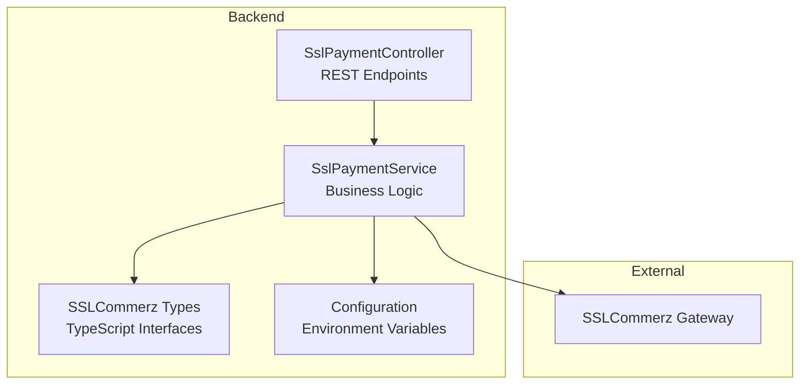
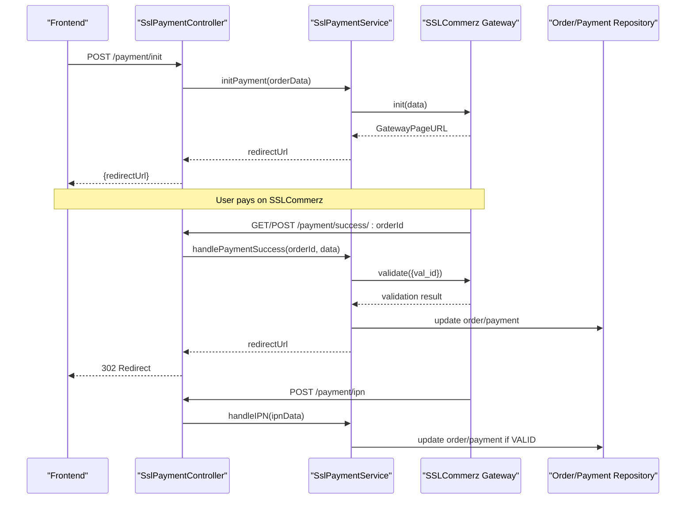
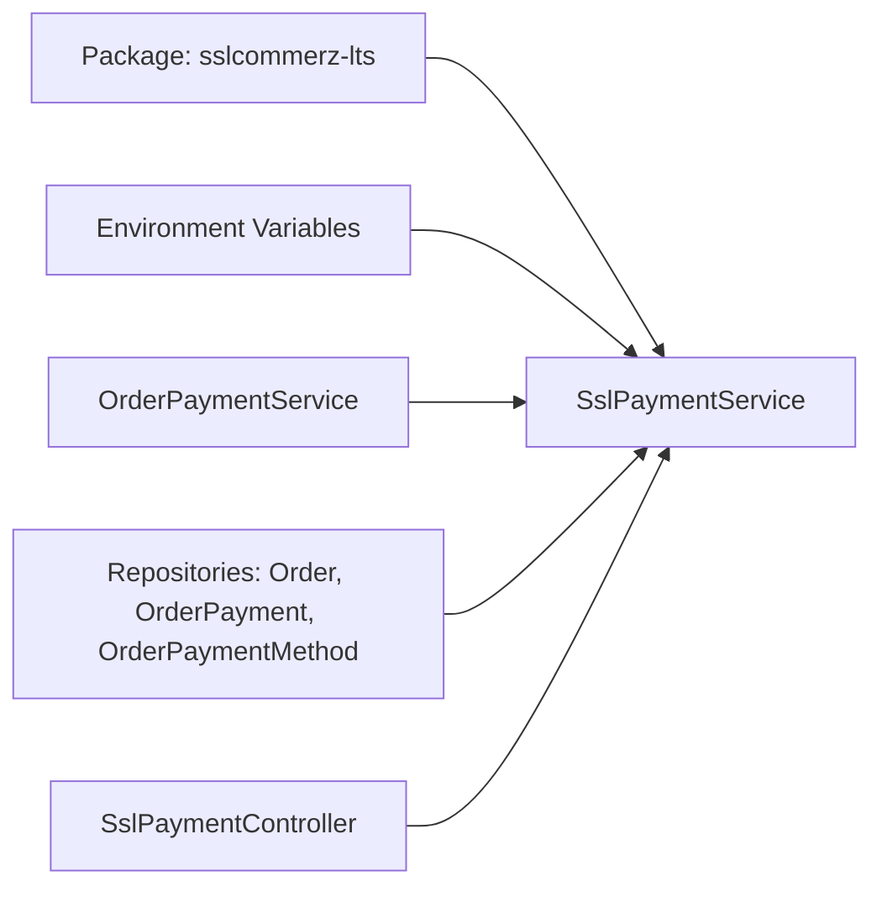

# Payment Gateway Integration

<cite>
**Referenced Files in This Document**
- [ssl-payment.controller.ts](file://apps/backend/src/ssl-payment/ssl-payment.controller.ts)
- [ssl-payment.service.ts](file://apps/backend/src/ssl-payment/ssl-payment.service.ts)
- [initiate-refund.dto.ts](file://apps/backend/src/ssl-payment/dto/initiate-refund.dto.ts)
- [configuration.ts](file://apps/backend/src/config/configuration.ts)
- [sslcommerz-lts.d.ts](file://apps/backend/src/types/sslcommerz-lts.d.ts)
- [package.json](file://apps/backend/package.json)
</cite>

## Table of Contents
1. [Introduction](#introduction)
2. [Project Structure](#project-structure)
3. [Core Components](#core-components)
4. [Architecture Overview](#architecture-overview)
5. [Detailed Component Analysis](#detailed-component-analysis)
6. [Dependency Analysis](#dependency-analysis)
7. [Performance Considerations](#performance-considerations)
8. [Troubleshooting Guide](#troubleshooting-guide)
9. [Conclusion](#conclusion)
10. [Appendices](#appendices)

## Introduction
This document provides comprehensive API documentation for integrating the SSLCommerz payment gateway within the backend application. It covers the complete payment flow, including payment initiation, callback handling, transaction verification, webhook processing, and refund operations. It also documents security measures such as server-side validation, environment configuration, and operational safeguards like IP whitelisting. The guide includes examples of request payloads, callback responses, error scenarios, and testing strategies using sandbox environments.

## Project Structure
The SSLCommerz integration is implemented under the backend NestJS application:
- Controller exposes REST endpoints for initiating payments, handling success/fail/cancel callbacks, processing IPN webhooks, validating transactions, and initiating refunds.
- Service encapsulates business logic for initializing payments with SSLCommerz, verifying transactions, handling success and failure flows, processing IPN, and initiating refunds.
- DTOs define input contracts for refund requests.
- Type definitions describe SSLCommerz SDK interfaces.
- Configuration maps environment variables for credentials and URLs.

**Diagram sources**
- [ssl-payment.controller.ts:31-258](file://apps/backend/src/ssl-payment/ssl-payment.controller.ts#L31-L258)
- [ssl-payment.service.ts:16-414](file://apps/backend/src/ssl-payment/ssl-payment.service.ts#L16-L414)
- [sslcommerz-lts.d.ts:1-127](file://apps/backend/src/types/sslcommerz-lts.d.ts#L1-L127)
- [configuration.ts:1-16](file://apps/backend/src/config/configuration.ts#L1-L16)

**Section sources**
- [ssl-payment.controller.ts:1-258](file://apps/backend/src/ssl-payment/ssl-payment.controller.ts#L1-L258)
- [ssl-payment.service.ts:1-414](file://apps/backend/src/ssl-payment/ssl-payment.service.ts#L1-L414)
- [sslcommerz-lts.d.ts:1-127](file://apps/backend/src/types/sslcommerz-lts.d.ts#L1-L127)
- [configuration.ts:1-16](file://apps/backend/src/config/configuration.ts#L1-L16)

## Core Components
- SslPaymentController: Exposes endpoints for payment initiation, callback handling (success, fail, cancel), IPN webhook, manual validation, and refund initiation.
- SslPaymentService: Implements payment initialization, success/failure handling, transaction verification via SSLCommerz validate, IPN processing, and refund initiation.
- InitiateRefundDto: Defines required fields for refund requests, including paymentId, refund_amount, bank_tran_id, tran_id, and optional remarks.
- SSLCommerz Types: TypeScript declarations for SDK methods and response shapes.
- Configuration: Maps environment variables for SSLCommerz credentials and payment URLs.

Key responsibilities:
- Initialize payment session with SSLCommerz and return a redirect URL to the frontend.
- Handle SSLCommerz callbacks and process them securely by verifying transactions.
- Process asynchronous IPN notifications to ensure reliable order state updates.
- Provide admin-only refund endpoint with proper validation and error handling.

**Section sources**
- [ssl-payment.controller.ts:31-258](file://apps/backend/src/ssl-payment/ssl-payment.controller.ts#L31-L258)
- [ssl-payment.service.ts:16-414](file://apps/backend/src/ssl-payment/ssl-payment.service.ts#L16-L414)
- [initiate-refund.dto.ts:1-39](file://apps/backend/src/ssl-payment/dto/initiate-refund.dto.ts#L1-L39)
- [sslcommerz-lts.d.ts:1-127](file://apps/backend/src/types/sslcommerz-lts.d.ts#L1-L127)
- [configuration.ts:1-16](file://apps/backend/src/config/configuration.ts#L1-L16)

## Architecture Overview
The payment architecture follows a standard e-commerce flow:
- Frontend calls backend to initiate payment.
- Backend initializes a payment session with SSLCommerz and returns a redirect URL.
- User completes payment on SSLCommerz’s gateway.
- SSLCommerz redirects to backend success/fail/cancel endpoints and sends an IPN webhook.
- Backend verifies the transaction and updates order/payment records accordingly.
- Admin can initiate refunds through a protected endpoint.

**Diagram sources**
- [ssl-payment.controller.ts:35-206](file://apps/backend/src/ssl-payment/ssl-payment.controller.ts#L35-L206)
- [ssl-payment.service.ts:44-328](file://apps/backend/src/ssl-payment/ssl-payment.service.ts#L44-L328)

## Detailed Component Analysis

### Payment Initiation
- Endpoint: POST /payment/init
- Authentication: JWT guard required
- Request body: Order data including id, totalValue, user, address, items, shippingMethod, paymentMethod, coupon
- Response: JSON containing redirectUrl and GatewayPageURL for frontend redirection
- Business logic:
  - Validates SSLCommerz credentials from environment
  - Builds payment payload with customer/shipping details and custom value fields
  - Calls SSLCommerz.init() and returns GatewayPageURL

Example request payload structure:
- id: number
- totalValue: number
- user.name, user.email, user.mobileNumber
- address.address, address.area, address.city, address.division, address.postalCode, address.country
- items[].product.name
- shippingMethod.name
- paymentMethod.name
- coupon.code

Example response:
- success: boolean
- data.redirectUrl: string
- data.GatewayPageURL: string
- data.orderId: number
- data.orderNo: string

Error scenarios:
- Missing SSLCommerz credentials: throws error during initialization
- Invalid order data: may cause failed initialization
- Network errors or invalid response from SSLCommerz: returns BadRequestException

Security considerations:
- Credentials are loaded from environment variables
- Logs only non-sensitive fields when debugging

**Section sources**
- [ssl-payment.controller.ts:35-64](file://apps/backend/src/ssl-payment/ssl-payment.controller.ts#L35-L64)
- [ssl-payment.service.ts:29-111](file://apps/backend/src/ssl-payment/ssl-payment.service.ts#L29-L111)
- [configuration.ts:1-16](file://apps/backend/src/config/configuration.ts#L1-L16)

### Callback Handling: Success
- Endpoints:
  - GET /payment/success/:orderId
  - POST /payment/success/:orderId
- Purpose: Handle SSLCommerz redirect after successful payment
- Flow:
  - Parse orderId and validate it
  - Call handlePaymentSuccess with SSL payment data
  - Verify payment via SSLCommerz.validate()
  - Update order payment method and create payment record
  - Return 302 redirect to frontend success page

Verification steps:
- Validate status equals 'VALID'
- Match transaction ID and amount between callback and validation response
- Prevent duplicate processing by checking existing payment record

Response:
- 302 redirect to FRONTEND_URL/payment/success/:orderId

Error scenarios:
- Invalid orderId: throws error and redirects to error page
- Verification fails: throws BadRequestException
- Order not found: throws NotFoundException

**Section sources**
- [ssl-payment.controller.ts:66-134](file://apps/backend/src/ssl-payment/ssl-payment.controller.ts#L66-L134)
- [ssl-payment.service.ts:113-234](file://apps/backend/src/ssl-payment/ssl-payment.service.ts#L113-L234)

### Callback Handling: Failure and Cancel
- Endpoints:
  - POST /payment/fail/:orderId
  - POST /payment/cancel/:orderId
- Purpose: Handle failed or cancelled payments
- Flow:
  - Log callback data (non-sensitive fields)
  - For failure: call handlePaymentFailure and redirect to error page
  - For cancel: redirect to cancellation page

Response:
- 302 redirect to appropriate frontend pages

Error scenarios:
- Invalid orderId: throws error and redirects to error page

**Section sources**
- [ssl-payment.controller.ts:136-185](file://apps/backend/src/ssl-payment/ssl-payment.controller.ts#L136-L185)
- [ssl-payment.service.ts:236-267](file://apps/backend/src/ssl-payment/ssl-payment.service.ts#L236-L267)

### Webhook Processing: IPN
- Endpoint: POST /payment/ipn
- Purpose: Process asynchronous IPN notifications from SSLCommerz
- Flow:
  - Log received IPN data (non-sensitive fields)
  - If status is 'VALID', extract orderId from value_a and call handlePaymentSuccess
  - Otherwise, log invalid status

Response:
- JSON with status and message indicating IPN processing result

Error scenarios:
- IPN processing failures are logged but do not throw exceptions to avoid disrupting SSLCommerz retries

**Section sources**
- [ssl-payment.controller.ts:187-206](file://apps/backend/src/ssl-payment/ssl-payment.controller.ts#L187-L206)
- [ssl-payment.service.ts:308-328](file://apps/backend/src/ssl-payment/ssl-payment.service.ts#L308-L328)

### Transaction Verification
- Method: verifyPayment(sslPaymentData)
- Purpose: Ensure payment authenticity and integrity
- Steps:
  - Construct SSLCommerz client with store credentials
  - Call validate({ val_id })
  - Compare validation.status, tran_id, and amount with callback data
  - Return boolean indicating validity

Security measures:
- Server-side validation prevents tampering
- Logs only non-sensitive fields to avoid PII exposure

**Section sources**
- [ssl-payment.service.ts:269-306](file://apps/backend/src/ssl-payment/ssl-payment.service.ts#L269-L306)

### Refund Processing
- Endpoint: POST /payment/refund
- Authentication: JWT guard + PermissionGuard with module permissions
- Request body: InitiateRefundDto
  - paymentId: number
  - refund_amount: number
  - refund_remarks?: string
  - bank_tran_id: string
  - tran_id: string
- Flow:
  - Validate that bank_tran_id and tran_id are different
  - Call SSLCommerz.initiateRefund()
  - Check for IP whitelist errors and throw specific exception
  - On success, create reversal posting via OrderPaymentService
  - Return response with reversal payment details

Error scenarios:
- IP whitelist error: throws BadRequestException with guidance
- Refund failure: throws BadRequestException with error reason
- General failures: wrapped in BadRequestException

**Section sources**
- [ssl-payment.controller.ts:229-256](file://apps/backend/src/ssl-payment/ssl-payment.controller.ts#L229-L256)
- [ssl-payment.service.ts:330-412](file://apps/backend/src/ssl-payment/ssl-payment.service.ts#L330-L412)
- [initiate-refund.dto.ts:1-39](file://apps/backend/src/ssl-payment/dto/initiate-refund.dto.ts#L1-L39)

### Manual Validation Endpoint
- Endpoint: GET /payment/validate/:tranId
- Purpose: Placeholder for manual transaction validation
- Current behavior: Returns success message with tranId
- Recommendation: Implement actual validation logic based on business needs

**Section sources**
- [ssl-payment.controller.ts:208-227](file://apps/backend/src/ssl-payment/ssl-payment.controller.ts#L208-L227)

## Dependency Analysis
The SSLCommerz integration depends on:
- External SDK: sslcommerz-lts package for payment initialization, validation, and refund operations
- Environment configuration: SSLCOMMERZ_STORE_ID, SSLCOMMERZ_STORE_PASSWORD, SSLCOMMERZ_IS_LIVE, BASE_URL, PAYMENT_IPN_URL, FRONTEND_URL
- Internal services: OrderPaymentService for creating payment records and refunds
- Database repositories: Order, OrderPayment, OrderPaymentMethod

**Diagram sources**
- [package.json:59-59](file://apps/backend/package.json#L59-L59)
- [configuration.ts:1-16](file://apps/backend/src/config/configuration.ts#L1-L16)
- [ssl-payment.service.ts:16-27](file://apps/backend/src/ssl-payment/ssl-payment.service.ts#L16-L27)
- [ssl-payment.controller.ts:31-33](file://apps/backend/src/ssl-payment/ssl-payment.controller.ts#L31-L33)

**Section sources**
- [package.json:23-64](file://apps/backend/package.json#L23-L64)
- [configuration.ts:1-16](file://apps/backend/src/config/configuration.ts#L1-L16)
- [ssl-payment.service.ts:16-27](file://apps/backend/src/ssl-payment/ssl-payment.service.ts#L16-L27)

## Performance Considerations
- Minimize logging of sensitive data: Only non-sensitive fields are logged in callbacks and validation responses
- Idempotency: Duplicate payment processing is prevented by checking existing payment records
- Efficient database queries: Relations are loaded selectively to reduce overhead
- Error handling: Specific exceptions provide clear feedback without exposing internal details

[No sources needed since this section provides general guidance]

## Troubleshooting Guide
Common issues and resolutions:
- Missing SSLCommerz credentials: Ensure SSLCOMMERZ_STORE_ID and SSLCOMMERZ_STORE_PASSWORD are set in environment variables
- IP whitelist errors: Configure your server IP in SSLCommerz merchant panel; the system throws a specific error when INVALID_SOURCE or REQUEST_FROM_INVALID_SOURCE is detected
- Invalid orderId: Validate orderId format before processing callbacks
- Payment verification failures: Check that val_id matches and amounts/tran_ids align between callback and validation response
- Refund failures: Verify bank_tran_id and tran_id are correct and different; check refund status and errorReason

Testing strategies:
- Use sandbox mode by setting SSLCOMMERZ_IS_LIVE to false
- Test all callback endpoints with mock data
- Verify IPN processing by simulating valid and invalid statuses
- Use manual validation endpoint as a placeholder for additional checks

**Section sources**
- [ssl-payment.service.ts:29-42](file://apps/backend/src/ssl-payment/ssl-payment.service.ts#L29-L42)
- [ssl-payment.service.ts:367-377](file://apps/backend/src/ssl-payment/ssl-payment.service.ts#L367-L377)
- [ssl-payment.controller.ts:76-80](file://apps/backend/src/ssl-payment/ssl-payment.controller.ts#L76-L80)
- [ssl-payment.service.ts:286-305](file://apps/backend/src/ssl-payment/ssl-payment.service.ts#L286-L305)

## Conclusion
The SSLCommerz integration provides a robust payment flow with secure transaction verification, reliable webhook processing, and comprehensive error handling. The implementation follows best practices for security, performance, and maintainability. By following the documented endpoints, payload structures, and troubleshooting steps, developers can successfully integrate and operate the payment gateway in both sandbox and production environments.

[No sources needed since this section summarizes without analyzing specific files]

## Appendices

### API Endpoints Summary
- POST /payment/init: Initialize payment session
- GET /payment/success/:orderId: Handle successful payment redirect
- POST /payment/success/:orderId: Handle successful payment POST callback
- POST /payment/fail/:orderId: Handle failed payment
- POST /payment/cancel/:orderId: Handle cancelled payment
- POST /payment/ipn: Process IPN webhook
- GET /payment/validate/:tranId: Manual validation placeholder
- POST /payment/refund: Initiate refund (admin only)

**Section sources**
- [ssl-payment.controller.ts:35-256](file://apps/backend/src/ssl-payment/ssl-payment.controller.ts#L35-L256)

### Security Measures
- Server-side transaction verification using SSLCommerz.validate()
- Environment-based credential management
- Non-sensitive field logging to prevent PII exposure
- IP whitelist enforcement for API access
- Admin-only protection for refund operations

**Section sources**
- [ssl-payment.service.ts:269-306](file://apps/backend/src/ssl-payment/ssl-payment.service.ts#L269-L306)
- [ssl-payment.controller.ts:229-232](file://apps/backend/src/ssl-payment/ssl-payment.controller.ts#L229-L232)

### Data Models
- SSLCommerzPaymentData: Payment initialization payload
- SSLCommerzInitResponse: Initialization response
- SSLCommerzIPNResponse: IPN notification structure
- SSLCommerzRefundResponse: Refund operation response
- SSLCommerzValidationResponse: Transaction validation response

**Section sources**
- [sslcommerz-lts.d.ts:2-127](file://apps/backend/src/types/sslcommerz-lts.d.ts#L2-L127)