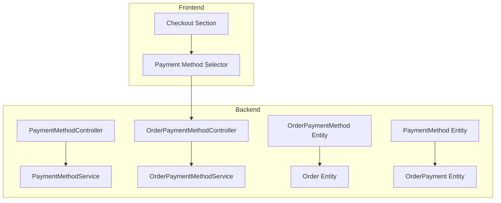
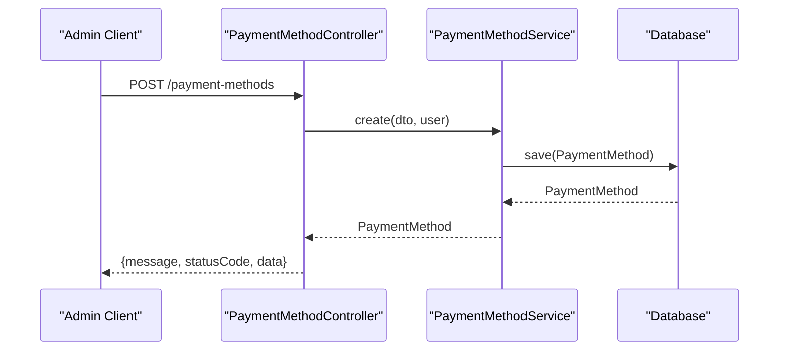
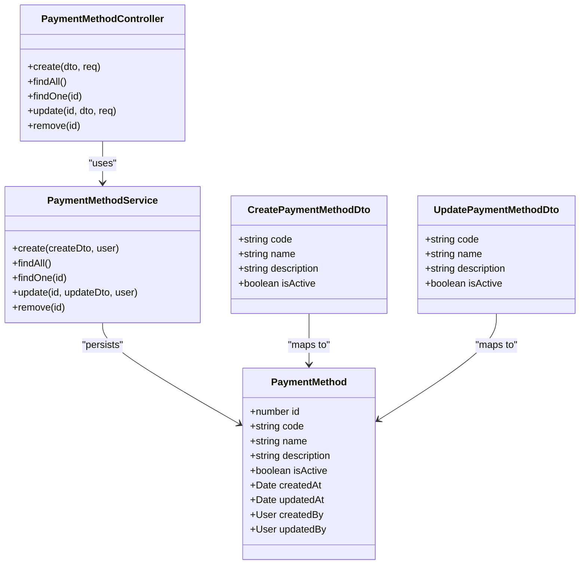
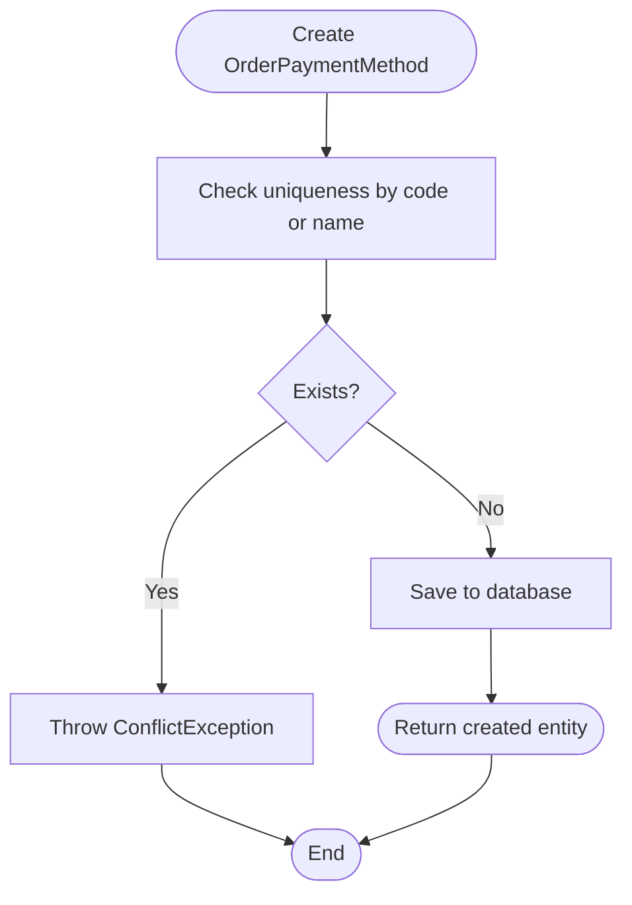
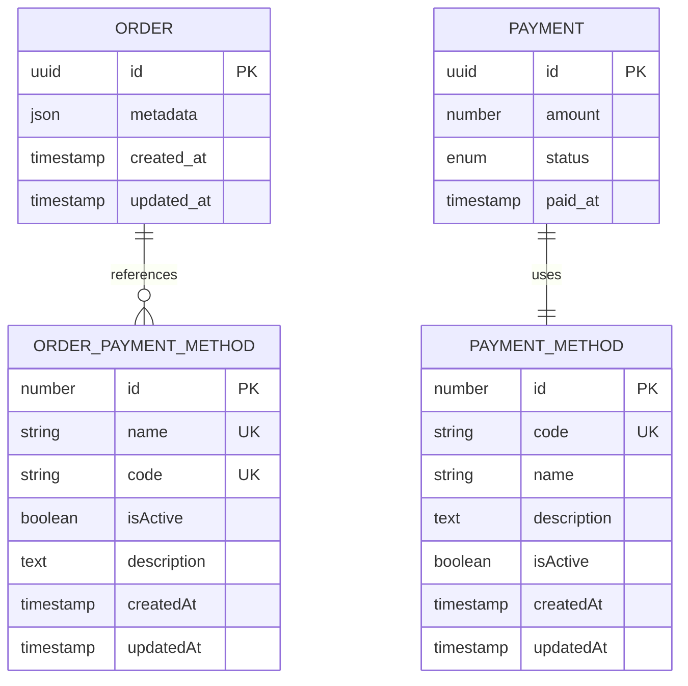
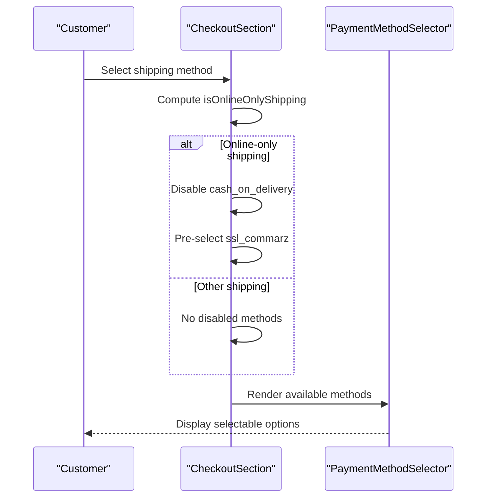
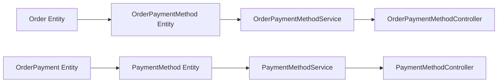

# Payment Methods Configuration

<cite>
**Referenced Files in This Document**
- [payment-method.entity.ts](file://apps/backend/src/payment-method/entities/payment-method.entity.ts)
- [create-payment-method.dto.ts](file://apps/backend/src/payment-method/dto/create-payment-method.dto.ts)
- [update-payment-method.dto.ts](file://apps/backend/src/payment-method/dto/update-payment-method.dto.ts)
- [payment-method.service.ts](file://apps/backend/src/payment-method/payment-method.service.ts)
- [payment-method.controller.ts](file://apps/backend/src/payment-method/payment-method.controller.ts)
- [order-payment-method.entity.ts](file://apps/backend/src/order-payment-method/entities/order-payment-method.entity.ts)
- [create-order-payment-method.dto.ts](file://apps/backend/src/order-payment-method/dto/create-order-payment-method.dto.ts)
- [order-payment-method.service.ts](file://apps/backend/src/order-payment-method/order-payment-method.service.ts)
- [order-payment-method.controller.ts](file://apps/backend/src/order-payment-method/order-payment-method.controller.ts)
- [order.entity.ts](file://apps/backend/src/order/entities/order.entity.ts)
- [order-payment.entity.ts](file://apps/backend/src/order-payment/entities/order-payment.entity.ts)
- [checkoutSection.tsx](file://apps/frontend/components/checkout/checkoutSection.tsx)
- [payment-method-selector.tsx](file://apps/frontend/components/checkout/payment-method-selector.tsx)
</cite>

## Table of Contents
1. [Introduction](#introduction)
2. [Project Structure](#project-structure)
3. [Core Components](#core-components)
4. [Architecture Overview](#architecture-overview)
5. [Detailed Component Analysis](#detailed-component-analysis)
6. [Dependency Analysis](#dependency-analysis)
7. [Performance Considerations](#performance-considerations)
8. [Troubleshooting Guide](#troubleshooting-guide)
9. [Conclusion](#conclusion)

## Introduction
This document explains how payment methods are configured and managed across the system, focusing on:
- CRUD operations for payment methods (cash, bank transfer, credit card, custom methods)
- Method-specific configuration and validation rules
- Business logic around method availability based on shipping constraints and checkout context
- Order selection and persistence of the chosen payment method
- Customer preference handling at checkout

The backend exposes two related but distinct concepts:
- Global payment method catalog used by administrative settings
- Order-scoped payment method records used when placing orders

The frontend provides a checkout UI that selects from available methods and enforces simple business rules such as disabling cash-on-delivery for online-only shipping options.

## Project Structure
Payment-related functionality is split between:
- Backend modules for global payment method management and order-scoped payment method records
- Frontend checkout components that render and validate payment method selection

**Diagram sources**
- [payment-method.entity.ts:16-93](file://apps/backend/src/payment-method/entities/payment-method.entity.ts#L16-L93)
- [order-payment-method.entity.ts:14-67](file://apps/backend/src/order-payment-method/entities/order-payment-method.entity.ts#L14-L67)
- [payment-method.controller.ts:34-38](file://apps/backend/src/payment-method/payment-method.controller.ts#L34-L38)
- [order-payment-method.controller.ts:33-39](file://apps/backend/src/order-payment-method/order-payment-method.controller.ts#L33-L39)
- [payment-method.service.ts:9-14](file://apps/backend/src/payment-method/payment-method.service.ts#L9-L14)
- [order-payment-method.service.ts:9-14](file://apps/backend/src/order-payment-method/order-payment-method.service.ts#L9-L14)
- [order.entity.ts:103-108](file://apps/backend/src/order/entities/order.entity.ts#L103-L108)
- [order-payment.entity.ts:3-44](file://apps/backend/src/order-payment/entities/order-payment.entity.ts#L3-L44)
- [checkoutSection.tsx:129-157](file://apps/frontend/components/checkout/checkoutSection.tsx#L129-L157)
- [payment-method-selector.tsx:11-33](file://apps/frontend/components/checkout/payment-method-selector.tsx#L11-L33)

**Section sources**
- [payment-method.controller.ts:34-38](file://apps/backend/src/payment-method/payment-method.controller.ts#L34-L38)
- [order-payment-method.controller.ts:33-39](file://apps/backend/src/order-payment-method/order-payment-method.controller.ts#L33-L39)
- [checkoutSection.tsx:129-157](file://apps/frontend/components/checkout/checkoutSection.tsx#L129-L157)
- [payment-method-selector.tsx:11-33](file://apps/frontend/components/checkout/payment-method-selector.tsx#L11-L33)

## Core Components
- Global payment method catalog entity and DTOs define the schema and input validation for creating and updating payment methods.
- Order-scoped payment method entity defines the record attached to an order with code, name, status, and description.
- Services implement CRUD and toggling logic; controllers expose REST endpoints with authentication and permission guards.
- Frontend checkout component computes disabled payment methods based on selected shipping method and renders selectable options.

Key responsibilities:
- Create, read, update, delete (or deactivate) global payment methods
- Manage order-scoped payment methods with unique constraints
- Enforce active/inactive states
- Provide API responses with consistent structure

**Section sources**
- [payment-method.entity.ts:16-93](file://apps/backend/src/payment-method/entities/payment-method.entity.ts#L16-L93)
- [create-payment-method.dto.ts:4-37](file://apps/backend/src/payment-method/dto/create-payment-method.dto.ts#L4-L37)
- [update-payment-method.dto.ts:1-5](file://apps/backend/src/payment-method/dto/update-payment-method.dto.ts#L1-L5)
- [order-payment-method.entity.ts:14-67](file://apps/backend/src/order-payment-method/entities/order-payment-method.entity.ts#L14-L67)
- [create-order-payment-method.dto.ts:5-23](file://apps/backend/src/order-payment-method/dto/create-order-payment-method.dto.ts#L5-L23)

## Architecture Overview
The payment method architecture separates configuration from order usage:
- Global payment methods are managed via a dedicated controller and service, with audit fields tracking who created or updated them.
- Orders reference an order-scoped payment method, ensuring historical accuracy even if global definitions change.
- The frontend checkout layer applies business rules to determine which methods are available to the customer at checkout time.

**Diagram sources**
- [payment-method.controller.ts:39-103](file://apps/backend/src/payment-method/payment-method.controller.ts#L39-L103)
- [payment-method.service.ts:16-23](file://apps/backend/src/payment-method/payment-method.service.ts#L16-L23)

## Detailed Component Analysis

### Global Payment Method Management
Global payment methods represent the system-wide catalog of accepted payment types. They include:
- Unique code and display name
- Optional description
- Active flag controlling visibility and usability
- Audit fields for creation and updates

CRUD endpoints:
- Create: requires admin permissions and validates required fields
- Read all: returns active methods by default
- Read one: returns details by ID
- Update: partial updates allowed
- Delete: removes the method (with conflict handling documented in controller responses)

Validation rules:
- Code and name are required strings
- Description is optional text
- isActive defaults to true

Business logic:
- Creation attaches current user as creator
- Listing filters to active methods only
- Update attaches current user as updater

**Diagram sources**
- [payment-method.entity.ts:16-93](file://apps/backend/src/payment-method/entities/payment-method.entity.ts#L16-L93)
- [create-payment-method.dto.ts:4-37](file://apps/backend/src/payment-method/dto/create-payment-method.dto.ts#L4-L37)
- [update-payment-method.dto.ts:1-5](file://apps/backend/src/payment-method/dto/update-payment-method.dto.ts#L1-L5)
- [payment-method.service.ts:9-52](file://apps/backend/src/payment-method/payment-method.service.ts#L9-L52)
- [payment-method.controller.ts:34-291](file://apps/backend/src/payment-method/payment-method.controller.ts#L34-L291)

**Section sources**
- [payment-method.entity.ts:16-93](file://apps/backend/src/payment-method/entities/payment-method.entity.ts#L16-L93)
- [create-payment-method.dto.ts:4-37](file://apps/backend/src/payment-method/dto/create-payment-method.dto.ts#L4-L37)
- [update-payment-method.dto.ts:1-5](file://apps/backend/src/payment-method/dto/update-payment-method.dto.ts#L1-L5)
- [payment-method.service.ts:16-52](file://apps/backend/src/payment-method/payment-method.service.ts#L16-L52)
- [payment-method.controller.ts:39-291](file://apps/backend/src/payment-method/payment-method.controller.ts#L39-L291)

### Order-Scoped Payment Method Management
Orders attach a specific payment method instance to preserve the exact choice made at checkout. The order-scoped entity includes:
- Unique name and code
- Active flag
- Optional description
- Audit timestamps

Operations:
- Create: enforces uniqueness on both code and name
- Read all: returns minimal fields suitable for listing
- Read one: retrieves by ID
- Update: updates fields and returns refreshed entity
- Toggle status: flips isActive and persists

**Diagram sources**
- [order-payment-method.service.ts:16-30](file://apps/backend/src/order-payment-method/order-payment-method.service.ts#L16-L30)

**Section sources**
- [order-payment-method.entity.ts:14-67](file://apps/backend/src/order-payment-method/entities/order-payment-method.entity.ts#L14-L67)
- [create-order-payment-method.dto.ts:5-23](file://apps/backend/src/order-payment-method/dto/create-order-payment-method.dto.ts#L5-L23)
- [order-payment-method.service.ts:16-62](file://apps/backend/src/order-payment-method/order-payment-method.service.ts#L16-L62)
- [order-payment-method.controller.ts:44-157](file://apps/backend/src/order-payment-method/order-payment-method.controller.ts#L44-L157)

### Order and Payment Relationships
Orders reference an order-scoped payment method, while payments also link back to the global payment method catalog. This dual linkage ensures:
- Historical fidelity of the chosen method per order
- Reporting and analytics can group by global method codes

**Diagram sources**
- [order.entity.ts:103-108](file://apps/backend/src/order/entities/order.entity.ts#L103-L108)
- [order-payment.entity.ts:3-44](file://apps/backend/src/order-payment/entities/order-payment.entity.ts#L3-L44)
- [payment-method.entity.ts:16-93](file://apps/backend/src/payment-method/entities/payment-method.entity.ts#L16-L93)
- [order-payment-method.entity.ts:14-67](file://apps/backend/src/order-payment-method/entities/order-payment-method.entity.ts#L14-L67)

**Section sources**
- [order.entity.ts:103-108](file://apps/backend/src/order/entities/order.entity.ts#L103-L108)
- [order-payment.entity.ts:3-44](file://apps/backend/src/order-payment/entities/order-payment.entity.ts#L3-L44)

### Checkout Selection Logic and Customer Preferences
At checkout, the frontend determines which payment methods are available:
- If the selected shipping method requires online payment, cash-on-delivery is disabled
- The selector UI shows available methods and highlights disabled ones with reasons
- When online-only shipping is selected, the system pre-selects the online gateway and prevents invalid selections

**Diagram sources**
- [checkoutSection.tsx:129-157](file://apps/frontend/components/checkout/checkoutSection.tsx#L129-L157)
- [payment-method-selector.tsx:11-33](file://apps/frontend/components/checkout/payment-method-selector.tsx#L11-L33)

**Section sources**
- [checkoutSection.tsx:129-157](file://apps/frontend/components/checkout/checkoutSection.tsx#L129-L157)
- [payment-method-selector.tsx:11-33](file://apps/frontend/components/checkout/payment-method-selector.tsx#L11-L33)

### Adding New Payment Methods
To add a new payment method:
- Use the global payment method creation endpoint with a unique code and display name
- Optionally provide a description and set isActive to true
- For order-scoped usage, ensure the corresponding order-scoped payment method exists or create it with unique constraints enforced

Examples:
- Add a bank transfer method with code "bank_transfer" and name "Bank Transfer"
- Add a credit card method with code "credit_card" and name "Credit Card"
- Add a custom method with a descriptive code and name

Validation considerations:
- Ensure code uniqueness globally
- Ensure name and code uniqueness for order-scoped methods
- Confirm isActive is set appropriately

**Section sources**
- [payment-method.controller.ts:39-103](file://apps/backend/src/payment-method/payment-method.controller.ts#L39-L103)
- [create-payment-method.dto.ts:4-37](file://apps/backend/src/payment-method/dto/create-payment-method.dto.ts#L4-L37)
- [order-payment-method.service.ts:16-30](file://apps/backend/src/order-payment-method/order-payment-method.service.ts#L16-L30)
- [create-order-payment-method.dto.ts:5-23](file://apps/backend/src/order-payment-method/dto/create-order-payment-method.dto.ts#L5-L23)

### Updating Existing Payment Methods
To update an existing payment method:
- Use the update endpoint with partial fields
- Change isActive to false to deactivate without deleting
- Update name or description as needed

Behavior:
- Partial updates are supported
- Audit fields reflect the last updater

**Section sources**
- [payment-method.controller.ts:185-248](file://apps/backend/src/payment-method/payment-method.controller.ts#L185-L248)
- [payment-method.service.ts:41-46](file://apps/backend/src/payment-method/payment-method.service.ts#L41-L46)

### Deactivating Payment Methods
Deactivation is achieved by setting isActive to false:
- Global methods become hidden from listings that filter by active status
- Order-scoped methods can be toggled using the toggle-status endpoint

Operational guidance:
- Prefer deactivation over deletion to maintain historical integrity
- Use toggle-status for quick activation/deactivation changes

**Section sources**
- [payment-method.service.ts:25-29](file://apps/backend/src/payment-method/payment-method.service.ts#L25-L29)
- [order-payment-method.service.ts:58-62](file://apps/backend/src/order-payment-method/order-payment-method.service.ts#L58-L62)
- [order-payment-method.controller.ts:110-131](file://apps/backend/src/order-payment-method/order-payment-method.controller.ts#L110-L131)

### Method Availability Based on Regions, Currencies, and Order Values
Current implementation focuses on shipping-based availability:
- Cash-on-delivery is disabled when the selected shipping method requires online payment
- There is no explicit region, currency, or order value gating in the analyzed files

Recommendations for extending availability rules:
- Introduce region and currency checks in the checkout flow before rendering methods
- Apply minimum/maximum order value constraints in the backend service or frontend validation
- Surface clear reasons for unavailability to customers

[No sources needed since this section provides general guidance]

### Payment Method Selection Logic and Customer Preferences
Selection logic:
- The checkout component computes disabled methods based on shipping requirements
- It pre-selects the online gateway when necessary
- The selector UI displays available methods and disables unavailable ones with reasons

Customer preferences:
- Persisting preferred methods per customer is not implemented in the analyzed files
- To support preferences, consider adding a customer profile field storing preferred method codes and validating selections against available methods

**Section sources**
- [checkoutSection.tsx:129-157](file://apps/frontend/components/checkout/checkoutSection.tsx#L129-L157)
- [payment-method-selector.tsx:11-33](file://apps/frontend/components/checkout/payment-method-selector.tsx#L11-L33)

## Dependency Analysis
The following diagram illustrates key dependencies among entities, services, and controllers:

**Diagram sources**
- [payment-method.entity.ts:16-93](file://apps/backend/src/payment-method/entities/payment-method.entity.ts#L16-L93)
- [payment-method.service.ts:9-52](file://apps/backend/src/payment-method/payment-method.service.ts#L9-L52)
- [payment-method.controller.ts:34-291](file://apps/backend/src/payment-method/payment-method.controller.ts#L34-L291)
- [order-payment-method.entity.ts:14-67](file://apps/backend/src/order-payment-method/entities/order-payment-method.entity.ts#L14-L67)
- [order-payment-method.service.ts:9-62](file://apps/backend/src/order-payment-method/order-payment-method.service.ts#L9-L62)
- [order-payment-method.controller.ts:33-157](file://apps/backend/src/order-payment-method/order-payment-method.controller.ts#L33-L157)
- [order.entity.ts:103-108](file://apps/backend/src/order/entities/order.entity.ts#L103-L108)
- [order-payment.entity.ts:3-44](file://apps/backend/src/order-payment/entities/order-payment.entity.ts#L3-L44)

**Section sources**
- [payment-method.controller.ts:34-291](file://apps/backend/src/payment-method/payment-method.controller.ts#L34-L291)
- [order-payment-method.controller.ts:33-157](file://apps/backend/src/order-payment-method/order-payment-method.controller.ts#L33-L157)
- [order.entity.ts:103-108](file://apps/backend/src/order/entities/order.entity.ts#L103-L108)
- [order-payment.entity.ts:3-44](file://apps/backend/src/order-payment/entities/order-payment.entity.ts#L3-L44)

## Performance Considerations
- Listing active payment methods uses a filtered query, reducing payload size for typical use cases
- Order-scoped listing selects a subset of fields to minimize overhead
- Avoid unnecessary eager loading of audit users in high-throughput endpoints unless required

[No sources needed since this section provides general guidance]

## Troubleshooting Guide
Common issues and resolutions:
- Duplicate code/name during creation:
  - Global methods enforce unique code; order-scoped methods enforce unique code and name
  - Resolve by choosing a different code or name
- Unauthorized or forbidden errors:
  - Ensure valid JWT token and sufficient module permissions
- Not found errors:
  - Verify the ID exists and is accessible
- Conflict when deleting:
  - A method may be in use; prefer deactivation instead of deletion

Operational tips:
- Use toggle-status for quick activation/deactivation
- Keep descriptions concise and informative for operators
- Validate inputs on the client side to reduce server errors

**Section sources**
- [order-payment-method.service.ts:16-30](file://apps/backend/src/order-payment-method/order-payment-method.service.ts#L16-L30)
- [payment-method.controller.ts:69-103](file://apps/backend/src/payment-method/payment-method.controller.ts#L69-L103)
- [payment-method.controller.ts:167-184](file://apps/backend/src/payment-method/payment-method.controller.ts#L167-L184)
- [payment-method.controller.ts:249-291](file://apps/backend/src/payment-method/payment-method.controller.ts#L249-L291)

## Conclusion
The system provides robust mechanisms to configure and manage payment methods:
- Global catalog supports creation, updates, and deactivation with audit trails
- Order-scoped records preserve the exact payment choice per order
- Checkout logic enforces basic business rules, such as disabling cash-on-delivery for online-only shipping
- Extensibility points exist to add region, currency, and order value constraints as needed

Adopt best practices:
- Prefer deactivation over deletion
- Maintain unique codes and names
- Clearly communicate unavailability reasons to customers
- Extend availability rules thoughtfully to meet regional and business requirements

[No sources needed since this section summarizes without analyzing specific files]