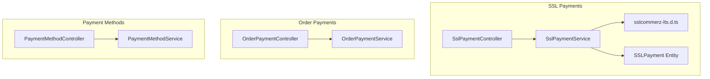
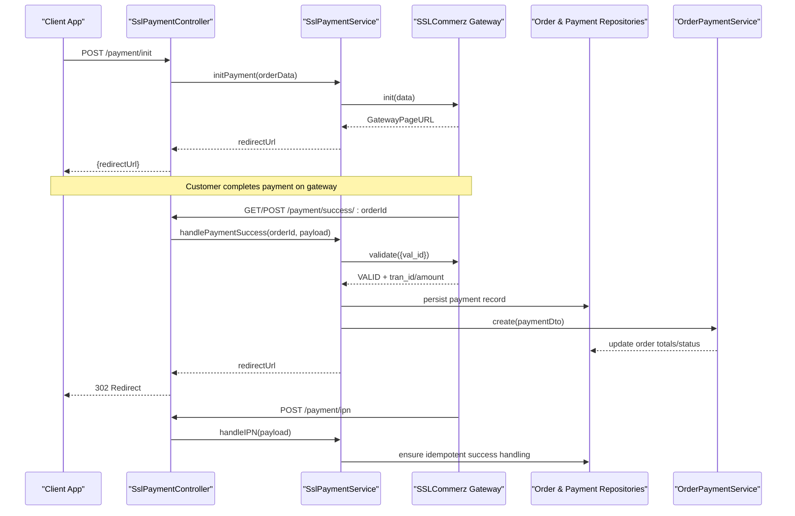
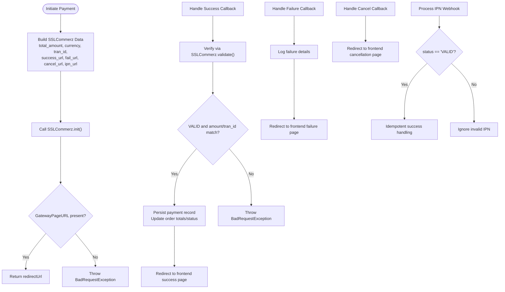
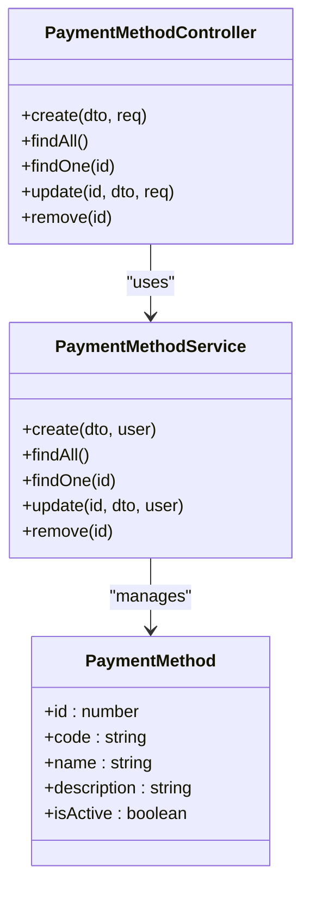
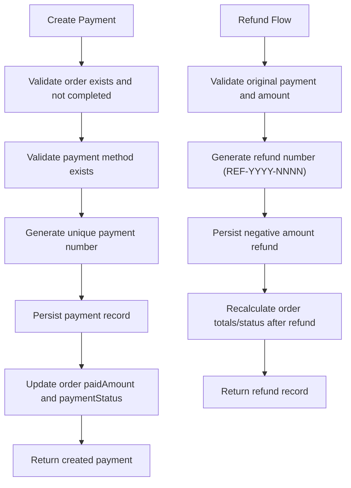
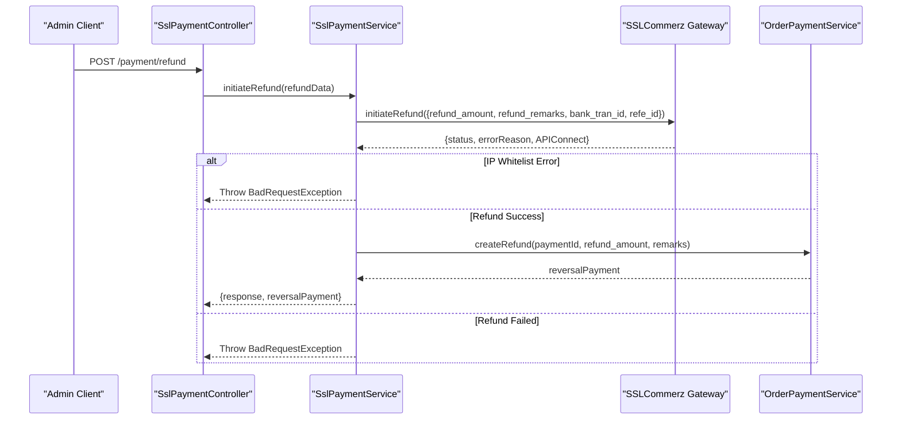
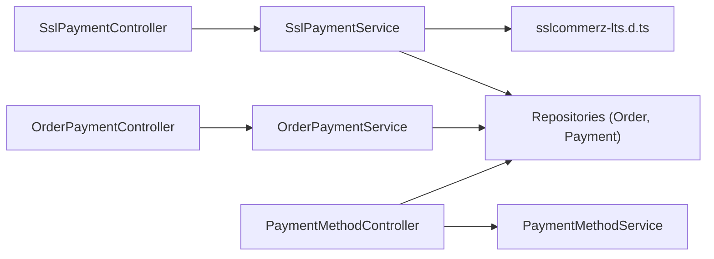

# Payment System APIs

<cite>
**Referenced Files in This Document**
- [ssl-payment.controller.ts](file://apps/backend/src/ssl-payment/ssl-payment.controller.ts)
- [ssl-payment.service.ts](file://apps/backend/src/ssl-payment/ssl-payment.service.ts)
- [sslcommerz-lts.d.ts](file://apps/backend/src/types/sslcommerz-lts.d.ts)
- [payment.entity.ts](file://apps/backend/src/ssl-payment/entities/payment.entity.ts)
- [order-payment.controller.ts](file://apps/backend/src/order-payment/order-payment.controller.ts)
- [order-payment.service.ts](file://apps/backend/src/order-payment/order-payment.service.ts)
- [payment-method.controller.ts](file://apps/backend/src/payment-method/payment-method.controller.ts)
- [payment-method.service.ts](file://apps/backend/src/payment-method/payment-method.service.ts)
- [create-payment-method.dto.ts](file://apps/backend/src/payment-method/dto/create-payment-method.dto.ts)
- [activity.interceptor.ts](file://apps/backend/src/interceptor/activity.interceptor.ts)
</cite>

## Table of Contents
1. [Introduction](#introduction)
2. [Project Structure](#project-structure)
3. [Core Components](#core-components)
4. [Architecture Overview](#architecture-overview)
5. [Detailed Component Analysis](#detailed-component-analysis)
6. [Dependency Analysis](#dependency-analysis)
7. [Performance Considerations](#performance-considerations)
8. [Troubleshooting Guide](#troubleshooting-guide)
9. [Conclusion](#conclusion)
10. [Appendices](#appendices)

## Introduction
This document provides comprehensive API documentation for the payment system, focusing on SSLCommerz integration, payment method management, transaction processing, and refund handling. It covers gateway callbacks, webhook (IPN) handling, transaction status synchronization, currency support, security measures, reconciliation/reporting endpoints, and testing strategies. The backend is a NestJS application exposing REST endpoints for initiating payments, handling success/failure/cancel callbacks, IPN webhooks, refunds, and payment records.

## Project Structure
The payment-related functionality is organized into focused modules:
- SSLCommerz integration: controller and service under ssl-payment
- Payment method configuration: controller and service under payment-method
- Order payment ledger and reporting: controller and service under order-payment
- Type definitions for SSLCommerz SDK: types module

**Diagram sources**
- [ssl-payment.controller.ts:31-257](file://apps/backend/src/ssl-payment/ssl-payment.controller.ts#L31-L257)
- [ssl-payment.service.ts:17-413](file://apps/backend/src/ssl-payment/ssl-payment.service.ts#L17-L413)
- [sslcommerz-lts.d.ts:1-127](file://apps/backend/src/types/sslcommerz-lts.d.ts#L1-L127)
- [payment.entity.ts:1-28](file://apps/backend/src/ssl-payment/entities/payment.entity.ts#L1-L28)
- [order-payment.controller.ts:33-176](file://apps/backend/src/order-payment/order-payment.controller.ts#L33-L176)
- [order-payment.service.ts:18-309](file://apps/backend/src/order-payment/order-payment.service.ts#L18-L309)
- [payment-method.controller.ts:34-292](file://apps/backend/src/payment-method/payment-method.controller.ts#L34-L292)
- [payment-method.service.ts:9-52](file://apps/backend/src/payment-method/payment-method.service.ts#L9-L52)

**Section sources**
- [ssl-payment.controller.ts:31-257](file://apps/backend/src/ssl-payment/ssl-payment.controller.ts#L31-L257)
- [ssl-payment.service.ts:17-413](file://apps/backend/src/ssl-payment/ssl-payment.service.ts#L17-L413)
- [order-payment.controller.ts:33-176](file://apps/backend/src/order-payment/order-payment.controller.ts#L33-L176)
- [order-payment.service.ts:18-309](file://apps/backend/src/order-payment/order-payment.service.ts#L18-L309)
- [payment-method.controller.ts:34-292](file://apps/backend/src/payment-method/payment-method.controller.ts#L34-L292)
- [payment-method.service.ts:9-52](file://apps/backend/src/payment-method/payment-method.service.ts#L9-L52)

## Core Components
- SSLCommerz Integration
  - Controller exposes endpoints to initialize payment, handle success/failure/cancel callbacks, process IPN webhooks, validate transactions, and initiate refunds.
  - Service encapsulates SSLCommerz SDK calls, payment verification, IPN handling, and refund initiation.
- Payment Method Management
  - CRUD endpoints for payment methods with admin permissions and JWT authentication.
- Order Payment Ledger and Reporting
  - Endpoints to create, list, update, delete payments; query all payments with date range and order status filters; compute order payment status based on aggregated amounts.

Key responsibilities:
- Initialize payment with SSLCommerz and return gateway URL.
- Validate callback payloads via SSLCommerz validation endpoint.
- Persist payment records and reconcile order totals/status.
- Support refunds with reversal postings and audit trails.
- Provide reporting endpoints for financial reconciliation.

**Section sources**
- [ssl-payment.controller.ts:31-257](file://apps/backend/src/ssl-payment/ssl-payment.controller.ts#L31-L257)
- [ssl-payment.service.ts:17-413](file://apps/backend/src/ssl-payment/ssl-payment.service.ts#L17-L413)
- [order-payment.controller.ts:33-176](file://apps/backend/src/order-payment/order-payment.controller.ts#L33-L176)
- [order-payment.service.ts:18-309](file://apps/backend/src/order-payment/order-payment.service.ts#L18-L309)
- [payment-method.controller.ts:34-292](file://apps/backend/src/payment-method/payment-method.controller.ts#L34-L292)
- [payment-method.service.ts:9-52](file://apps/backend/src/payment-method/payment-method.service.ts#L9-L52)

## Architecture Overview
The payment flow integrates client requests, SSLCommerz gateway, and internal ledgers:

**Diagram sources**
- [ssl-payment.controller.ts:35-206](file://apps/backend/src/ssl-payment/ssl-payment.controller.ts#L35-L206)
- [ssl-payment.service.ts:44-328](file://apps/backend/src/ssl-payment/ssl-payment.service.ts#L44-L328)
- [order-payment.service.ts:28-73](file://apps/backend/src/order-payment/order-payment.service.ts#L28-L73)

## Detailed Component Analysis

### SSLCommerz Integration Endpoints
- POST /payment/init
  - Purpose: Initialize an SSLCommerz payment session and return the gateway URL.
  - Authentication: JWT required.
  - Request body: Order data including items, user, address, shipping method, coupon, and total value.
  - Response: JSON with redirectUrl and orderId.
  - Error handling: Returns 400 if initialization fails or credentials are missing.

- GET /payment/success/:orderId
  - Purpose: Handle successful payment callback from SSLCommerz (GET).
  - Behavior: Validates payment, persists payment record, updates order totals/status, redirects to frontend success page.

- POST /payment/success/:orderId
  - Purpose: Handle successful payment callback from SSLCommerz (POST).
  - Behavior: Same as GET success but accepts JSON body.

- POST /payment/fail/:orderId
  - Purpose: Handle failed payment callback.
  - Behavior: Logs failure details and redirects to frontend failure page.

- POST /payment/cancel/:orderId
  - Purpose: Handle cancelled payment callback.
  - Behavior: Redirects to frontend cancellation page.

- POST /payment/ipn
  - Purpose: Process SSLCommerz Instant Payment Notification (webhook).
  - Behavior: If status is VALID, processes success logic idempotently using stored references.

- GET /payment/validate/:tranId
  - Purpose: Manual validation endpoint placeholder.
  - Behavior: Placeholder response; implementation depends on needs.

- POST /payment/refund
  - Purpose: Initiate refund for a specific payment.
  - Authentication: JWT + PermissionGuard (admin only).
  - Request body: paymentId, refund_amount, refund_remarks, bank_tran_id, tran_id.
  - Response: Refund result with optional reversal payment reference.
  - Error handling: Throws 400 for invalid source/IP whitelist errors or refund failures.

**Diagram sources**
- [ssl-payment.controller.ts:35-206](file://apps/backend/src/ssl-payment/ssl-payment.controller.ts#L35-L206)
- [ssl-payment.service.ts:44-328](file://apps/backend/src/ssl-payment/ssl-payment.service.ts#L44-L328)

**Section sources**
- [ssl-payment.controller.ts:35-206](file://apps/backend/src/ssl-payment/ssl-payment.controller.ts#L35-L206)
- [ssl-payment.service.ts:44-328](file://apps/backend/src/ssl-payment/ssl-payment.service.ts#L44-L328)

### Payment Method Management
- POST /payment-methods
  - Purpose: Create a new payment method.
  - Authentication: JWT + PermissionGuard (admin only).
  - Body fields: code, name, description (optional), isActive (default true).
  - Response: Created payment method object.

- GET /payment-methods
  - Purpose: List active payment methods.
  - Authentication: JWT required.
  - Query parameters: page, limit, isActive (filter by active status).
  - Response: Paginated list of payment methods.

- GET /payment-methods/:id
  - Purpose: Retrieve a specific payment method by ID.
  - Authentication: JWT required.
  - Response: Payment method details.

- PATCH /payment-methods/:id
  - Purpose: Update an existing payment method (partial updates allowed).
  - Authentication: JWT + PermissionGuard (admin only).
  - Body fields: Partial update DTO.
  - Response: Updated payment method object.

- DELETE /payment-methods/:id
  - Purpose: Delete a payment method (soft-delete behavior indicated).
  - Authentication: JWT + PermissionGuard (admin only).
  - Response: Deletion confirmation.

**Diagram sources**
- [payment-method.controller.ts:34-292](file://apps/backend/src/payment-method/payment-method.controller.ts#L34-L292)
- [payment-method.service.ts:9-52](file://apps/backend/src/payment-method/payment-method.service.ts#L9-L52)
- [create-payment-method.dto.ts:1-37](file://apps/backend/src/payment-method/dto/create-payment-method.dto.ts#L1-L37)

**Section sources**
- [payment-method.controller.ts:34-292](file://apps/backend/src/payment-method/payment-method.controller.ts#L34-L292)
- [payment-method.service.ts:9-52](file://apps/backend/src/payment-method/payment-method.service.ts#L9-L52)
- [create-payment-method.dto.ts:1-37](file://apps/backend/src/payment-method/dto/create-payment-method.dto.ts#L1-L37)

### Order Payment Ledger and Reporting
- POST /orders/payments
  - Purpose: Create a payment record for an order.
  - Authentication: JWT required.
  - Body: orderId, amount, paymentMethodId, referenceNumber, notes.
  - Behavior: Generates unique payment number, persists payment, updates order totals/status.

- GET /orders/payments?orderId=:orderId
  - Purpose: List all payments for a specific order.
  - Authentication: JWT required.
  - Response: Array of payment records.

- GET /orders/payments/all
  - Purpose: Get all payments across orders with optional filters.
  - Authentication: JWT required.
  - Query parameters: fromDate, toDate, preset (date range presets), orderStatus.
  - Response: Aggregated payment records with order and method details.

- GET /orders/payments/:paymentId
  - Purpose: Retrieve a single payment record.
  - Authentication: JWT required.
  - Response: Payment details.

- PATCH /orders/payments/:paymentId
  - Purpose: Update a payment record.
  - Authentication: JWT + PermissionGuard (admin only).
  - Body: Partial update DTO.
  - Behavior: Updates payment and recalculates order totals/status.

- DELETE /orders/payments/:paymentId
  - Purpose: Delete a payment record.
  - Authentication: JWT + PermissionGuard (admin only).
  - Behavior: Removes payment and recalculates order totals/status.

**Diagram sources**
- [order-payment.service.ts:28-73](file://apps/backend/src/order-payment/order-payment.service.ts#L28-L73)
- [order-payment.service.ts:213-307](file://apps/backend/src/order-payment/order-payment.service.ts#L213-L307)

**Section sources**
- [order-payment.controller.ts:33-176](file://apps/backend/src/order-payment/order-payment.controller.ts#L33-L176)
- [order-payment.service.ts:18-309](file://apps/backend/src/order-payment/order-payment.service.ts#L18-L309)

### Refund Handling
- POST /payment/refund
  - Purpose: Initiate a refund through SSLCommerz and create a reversal posting.
  - Authentication: JWT + PermissionGuard (admin only).
  - Request body: paymentId, refund_amount, refund_remarks, bank_tran_id, tran_id.
  - Behavior: Calls SSLCommerz.initiateRefund, checks for IP whitelist errors, creates reversal payment, returns refund result.
  - Error handling: Throws 400 for invalid source/IP whitelist or refund failures.

**Diagram sources**
- [ssl-payment.controller.ts:229-257](file://apps/backend/src/ssl-payment/ssl-payment.controller.ts#L229-L257)
- [ssl-payment.service.ts:330-412](file://apps/backend/src/ssl-payment/ssl-payment.service.ts#L330-L412)
- [order-payment.service.ts:213-307](file://apps/backend/src/order-payment/order-payment.service.ts#L213-L307)

**Section sources**
- [ssl-payment.controller.ts:229-257](file://apps/backend/src/ssl-payment/ssl-payment.controller.ts#L229-L257)
- [ssl-payment.service.ts:330-412](file://apps/backend/src/ssl-payment/ssl-payment.service.ts#L330-L412)
- [order-payment.service.ts:213-307](file://apps/backend/src/order-payment/order-payment.service.ts#L213-L307)

## Dependency Analysis
- Controllers depend on services for business logic.
- SSLCommerz SDK types define interfaces for payment data, responses, validation, and refunds.
- Order payment service interacts with repositories to persist payments and update order statuses.
- Activity interceptor logs payment-related actions for audit trails.

**Diagram sources**
- [ssl-payment.controller.ts:31-257](file://apps/backend/src/ssl-payment/ssl-payment.controller.ts#L31-L257)
- [ssl-payment.service.ts:17-413](file://apps/backend/src/ssl-payment/ssl-payment.service.ts#L17-L413)
- [order-payment.controller.ts:33-176](file://apps/backend/src/order-payment/order-payment.controller.ts#L33-L176)
- [order-payment.service.ts:18-309](file://apps/backend/src/order-payment/order-payment.service.ts#L18-L309)
- [payment-method.controller.ts:34-292](file://apps/backend/src/payment-method/payment-method.controller.ts#L34-L292)
- [payment-method.service.ts:9-52](file://apps/backend/src/payment-method/payment-method.service.ts#L9-L52)
- [sslcommerz-lts.d.ts:1-127](file://apps/backend/src/types/sslcommerz-lts.d.ts#L1-L127)

**Section sources**
- [ssl-payment.controller.ts:31-257](file://apps/backend/src/ssl-payment/ssl-payment.controller.ts#L31-L257)
- [ssl-payment.service.ts:17-413](file://apps/backend/src/ssl-payment/ssl-payment.service.ts#L17-L413)
- [order-payment.controller.ts:33-176](file://apps/backend/src/order-payment/order-payment.controller.ts#L33-L176)
- [order-payment.service.ts:18-309](file://apps/backend/src/order-payment/order-payment.service.ts#L18-L309)
- [payment-method.controller.ts:34-292](file://apps/backend/src/payment-method/payment-method.controller.ts#L34-L292)
- [payment-method.service.ts:9-52](file://apps/backend/src/payment-method/payment-method.service.ts#L9-L52)
- [sslcommerz-lts.d.ts:1-127](file://apps/backend/src/types/sslcommerz-lts.d.ts#L1-L127)

## Performance Considerations
- Avoid logging sensitive payloads; use trimmed logs for transaction identifiers and amounts.
- Use idempotent handling for callbacks and IPN to prevent duplicate processing.
- Leverage database queries with selective relations to minimize overhead.
- Implement retry logic at the client side for transient network errors when calling payment endpoints.

[No sources needed since this section provides general guidance]

## Troubleshooting Guide
Common issues and resolutions:
- Payment initialization fails:
  - Ensure SSLCommerz credentials are configured and environment variables are set correctly.
  - Check for network connectivity and SSLCommerz sandbox/live mode settings.

- Payment verification fails:
  - Validate that val_id, tran_id, and amount match between callback and SSLCommerz validation response.
  - Inspect logs for mismatched values and ensure consistent currency and amounts.

- IPN processing fails:
  - Confirm IPN URL is correctly configured and reachable.
  - Verify server IP is whitelisted in SSLCommerz merchant panel to avoid INVALID_SOURCE errors.

- Refund initiation fails:
  - Ensure bank_tran_id and tran_id are distinct and correct.
  - Check for IP whitelist errors and refund status codes; handle partial vs full refunds appropriately.

- Audit trail gaps:
  - Review activity interceptor logs for payment-related routes to ensure actions are recorded.

**Section sources**
- [ssl-payment.service.ts:29-42](file://apps/backend/src/ssl-payment/ssl-payment.service.ts#L29-L42)
- [ssl-payment.service.ts:269-306](file://apps/backend/src/ssl-payment/ssl-payment.service.ts#L269-L306)
- [ssl-payment.service.ts:330-412](file://apps/backend/src/ssl-payment/ssl-payment.service.ts#L330-L412)
- [activity.interceptor.ts:522-531](file://apps/backend/src/interceptor/activity.interceptor.ts#L522-L531)

## Conclusion
The payment system integrates SSLCommerz for secure online payments, provides robust payment method management, and maintains a detailed ledger for reconciliation and reporting. Security measures include JWT authentication, permission guards, and careful handling of sensitive data. The system supports multi-currency transactions (with current default BDT), webhook-based IPN processing, and comprehensive refund handling with audit trails. Testing strategies should cover sandbox environments, callback simulation, and idempotency checks.

[No sources needed since this section summarizes without analyzing specific files]

## Appendices

### API Reference Summary

#### SSLCommerz Integration
- POST /payment/init
  - Auth: JWT
  - Request: Order data (items, user, address, shipping, coupon, totalValue)
  - Response: { success, data: { redirectUrl, GatewayPageURL, orderId, orderNo }, message }
  - Errors: 400 on initialization failure

- GET /payment/success/:orderId
  - Auth: None (gateway callback)
  - Query: SSLCommerz callback params
  - Response: 302 redirect to frontend success page

- POST /payment/success/:orderId
  - Auth: None (gateway callback)
  - Body: SSLCommerz callback payload
  - Response: 302 redirect to frontend success page

- POST /payment/fail/:orderId
  - Auth: None (gateway callback)
  - Query: SSLCommerz callback params
  - Response: 302 redirect to frontend failure page

- POST /payment/cancel/:orderId
  - Auth: None (gateway callback)
  - Query: SSLCommerz callback params
  - Response: 302 redirect to frontend cancellation page

- POST /payment/ipn
  - Auth: None (webhook)
  - Body: SSLCommerz IPN payload
  - Response: { status, message }

- GET /payment/validate/:tranId
  - Auth: None
  - Response: Placeholder validation response

- POST /payment/refund
  - Auth: JWT + PermissionGuard
  - Body: { paymentId, refund_amount, refund_remarks, bank_tran_id, tran_id }
  - Response: { success, data: { ...refundResponse, reversalPayment }, message }
  - Errors: 400 for invalid source/IP whitelist or refund failures

**Section sources**
- [ssl-payment.controller.ts:35-257](file://apps/backend/src/ssl-payment/ssl-payment.controller.ts#L35-L257)
- [ssl-payment.service.ts:44-412](file://apps/backend/src/ssl-payment/ssl-payment.service.ts#L44-L412)

#### Payment Method Management
- POST /payment-methods
  - Auth: JWT + PermissionGuard
  - Body: { code, name, description?, isActive? }
  - Response: Created payment method

- GET /payment-methods
  - Auth: JWT
  - Query: page, limit, isActive
  - Response: List of payment methods

- GET /payment-methods/:id
  - Auth: JWT
  - Response: Payment method details

- PATCH /payment-methods/:id
  - Auth: JWT + PermissionGuard
  - Body: Partial update DTO
  - Response: Updated payment method

- DELETE /payment-methods/:id
  - Auth: JWT + PermissionGuard
  - Response: Deletion confirmation

**Section sources**
- [payment-method.controller.ts:34-292](file://apps/backend/src/payment-method/payment-method.controller.ts#L34-L292)
- [payment-method.service.ts:9-52](file://apps/backend/src/payment-method/payment-method.service.ts#L9-L52)
- [create-payment-method.dto.ts:1-37](file://apps/backend/src/payment-method/dto/create-payment-method.dto.ts#L1-L37)

#### Order Payment Ledger and Reporting
- POST /orders/payments
  - Auth: JWT
  - Body: { orderId, amount, paymentMethodId, referenceNumber, notes }
  - Response: Created payment record

- GET /orders/payments?orderId=:orderId
  - Auth: JWT
  - Response: List of payments for order

- GET /orders/payments/all
  - Auth: JWT
  - Query: fromDate, toDate, preset, orderStatus
  - Response: Aggregated payment records

- GET /orders/payments/:paymentId
  - Auth: JWT
  - Response: Single payment record

- PATCH /orders/payments/:paymentId
  - Auth: JWT + PermissionGuard
  - Body: Partial update DTO
  - Response: Updated payment record

- DELETE /orders/payments/:paymentId
  - Auth: JWT + PermissionGuard
  - Response: Deletion confirmation

**Section sources**
- [order-payment.controller.ts:33-176](file://apps/backend/src/order-payment/order-payment.controller.ts#L33-L176)
- [order-payment.service.ts:18-309](file://apps/backend/src/order-payment/order-payment.service.ts#L18-L309)

### Security and Compliance Notes
- All administrative endpoints require JWT authentication and appropriate permissions.
- Sensitive data (PII, card details) must not be logged; use trimmed logs for transaction identifiers and amounts.
- SSLCommerz IP whitelist must be configured to allow server IPs for IPN and refund operations.
- PCI compliance considerations: Avoid storing raw card data; rely on SSLCommerz for tokenization and vaulting.

**Section sources**
- [ssl-payment.controller.ts:21-29](file://apps/backend/src/ssl-payment/ssl-payment.controller.ts#L21-L29)
- [ssl-payment.service.ts:269-306](file://apps/backend/src/ssl-payment/ssl-payment.service.ts#L269-L306)
- [ssl-payment.service.ts:367-377](file://apps/backend/src/ssl-payment/ssl-payment.service.ts#L367-L377)

### Testing Strategies
- Sandbox Environment Setup:
  - Configure SSLCOMMERZ_IS_LIVE=false and provide sandbox credentials.
  - Use test order data and mock SSLCommerz responses where possible.

- Callback Simulation:
  - Simulate GET/POST /payment/success/:orderId with valid and invalid payloads.
  - Test idempotency by invoking callbacks multiple times.

- IPN Webhook Testing:
  - Send POST /payment/ipn with VALID and non-VALID statuses.
  - Verify order state updates and payment records.

- Refund Testing:
  - Initiate partial and full refunds; verify reversal postings and order status updates.
  - Test IP whitelist error handling and refund failure scenarios.

- Audit Trail Verification:
  - Confirm activity interceptor logs capture payment-related actions.

**Section sources**
- [ssl-payment.controller.ts:35-257](file://apps/backend/src/ssl-payment/ssl-payment.controller.ts#L35-L257)
- [ssl-payment.service.ts:44-412](file://apps/backend/src/ssl-payment/ssl-payment.service.ts#L44-L412)
- [activity.interceptor.ts:522-531](file://apps/backend/src/interceptor/activity.interceptor.ts#L522-L531)