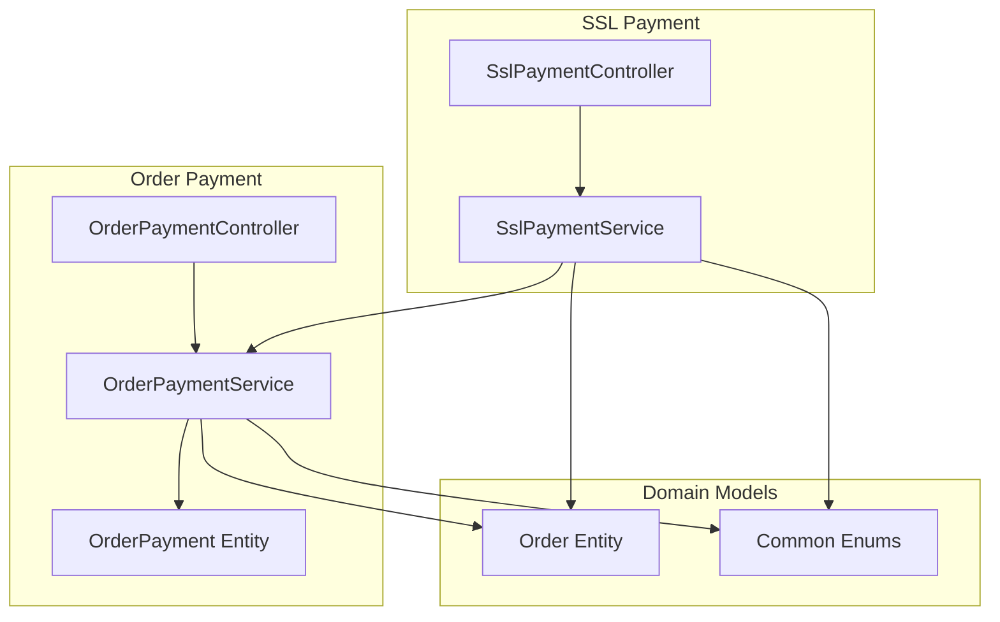
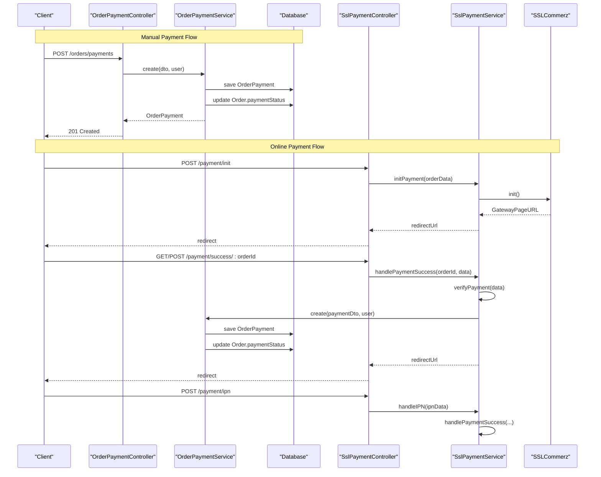
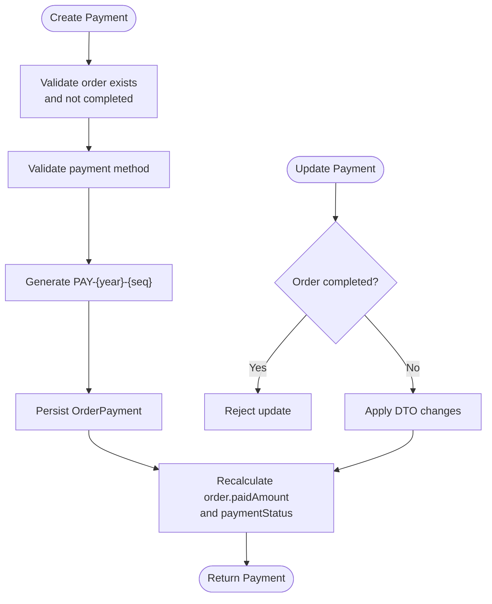
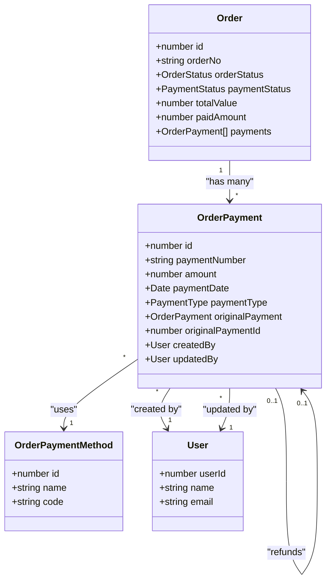
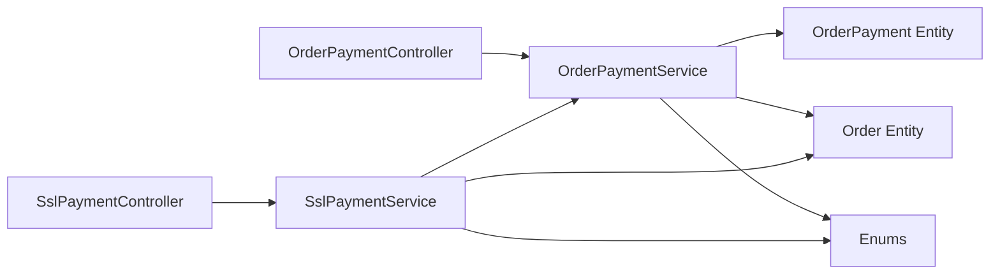

# Transaction Management

<cite>
**Referenced Files in This Document**
- [order-payment.service.ts](file://apps/backend/src/order-payment/order-payment.service.ts)
- [order-payment.controller.ts](file://apps/backend/src/order-payment/order-payment.controller.ts)
- [order-payment.entity.ts](file://apps/backend/src/order-payment/entities/order-payment.entity.ts)
- [create-order-payment.dto.ts](file://apps/backend/src/order-payment/dto/create-order-payment.dto.ts)
- [update-order-payment.dto.ts](file://apps/backend/src/order-payment/dto/update-order-payment.dto.ts)
- [ssl-payment.service.ts](file://apps/backend/src/ssl-payment/ssl-payment.service.ts)
- [ssl-payment.controller.ts](file://apps/backend/src/ssl-payment/ssl-payment.controller.ts)
- [enums/index.ts](file://apps/backend/src/common/enums/index.ts)
- [order.entity.ts](file://apps/backend/src/order/entities/order.entity.ts)
- [payment.service.ts](file://apps/backend/src/payment/payment.service.ts)
</cite>

## Table of Contents
1. [Introduction](#introduction)
2. [Project Structure](#project-structure)
3. [Core Components](#core-components)
4. [Architecture Overview](#architecture-overview)
5. [Detailed Component Analysis](#detailed-component-analysis)
6. [Dependency Analysis](#dependency-analysis)
7. [Performance Considerations](#performance-considerations)
8. [Troubleshooting Guide](#troubleshooting-guide)
9. [Conclusion](#conclusion)

## Introduction
This document explains order payment transaction management in the backend. It covers the full transaction lifecycle from creation to completion, including status transitions, validation, amount calculations, currency handling, query and filtering capabilities, reconciliation through refunds, audit trail fields, and concurrency considerations. The implementation is centered around order-level payments, an SSLCommerz gateway integration, and shared enums for order and payment states.

## Project Structure
The relevant backend modules are organized by feature:

- Order Payment module: manages manual and system-generated payment records linked to orders.
- SSL Payment module: integrates with SSLCommerz for online payment initiation, success/failure callbacks, IPN processing, and refund initiation.
- Shared enums: define order statuses, payment statuses, payment types, and date range presets used across reporting and filtering.
- Order entity: holds order totals, paid amounts, and payment status.
- Purchase payment service: a separate purchase payment flow that also recalculates payment status after changes.

**Diagram sources**
- [order-payment.controller.ts:33-176](file://apps/backend/src/order-payment/order-payment.controller.ts#L33-L176)
- [order-payment.service.ts:17-309](file://apps/backend/src/order-payment/order-payment.service.ts#L17-L309)
- [order-payment.entity.ts:17-127](file://apps/backend/src/order-payment/entities/order-payment.entity.ts#L17-L127)
- [ssl-payment.controller.ts:31-258](file://apps/backend/src/ssl-payment/ssl-payment.controller.ts#L31-L258)
- [ssl-payment.service.ts:16-414](file://apps/backend/src/ssl-payment/ssl-payment.service.ts#L16-L414)
- [order.entity.ts:24-157](file://apps/backend/src/order/entities/order.entity.ts#L24-L157)
- [enums/index.ts:12-36](file://apps/backend/src/common/enums/index.ts#L12-L36)

**Section sources**
- [order-payment.controller.ts:33-176](file://apps/backend/src/order-payment/order-payment.controller.ts#L33-L176)
- [order-payment.service.ts:17-309](file://apps/backend/src/order-payment/order-payment.service.ts#L17-L309)
- [ssl-payment.controller.ts:31-258](file://apps/backend/src/ssl-payment/ssl-payment.controller.ts#L31-L258)
- [ssl-payment.service.ts:16-414](file://apps/backend/src/ssl-payment/ssl-payment.service.ts#L16-L414)
- [order.entity.ts:24-157](file://apps/backend/src/order/entities/order.entity.ts#L24-L157)
- [enums/index.ts:12-36](file://apps/backend/src/common/enums/index.ts#L12-L36)

## Core Components
- OrderPaymentController: exposes REST endpoints for creating, listing, retrieving, updating, and deleting order payments; includes a global list endpoint with date and order-status filters.
- OrderPaymentService: implements payment creation, updates, deletion, refund creation, order payment status recalculation, and report-style queries.
- OrderPayment Entity: models individual payment transactions, including reference IDs, bank transaction identifiers, notes, type (payment/refund), and audit fields.
- SslPaymentController: handles payment initialization, success/failure/cancel redirects, IPN callback, manual validation, and refund initiation.
- SslPaymentService: orchestrates SSLCommerz API calls, validates callbacks, creates order payments on successful payments, and initiates refunds.
- Common Enums: define OrderStatus, PaymentStatus, PaymentType, and DateRangePreset.
- Order Entity: stores totalValue, paidAmount, and paymentStatus, which are updated when payments change.

Key responsibilities:
- Validation: DTOs enforce required fields, numeric precision, positive amounts, and safe reference formats.
- Amount calculation: total paid is recomputed from all payments per order; payment status is derived from paid vs total.
- Currency handling: SSLCommerz initialization uses BDT as currency.
- Reconciliation: refunds create negative payment entries and update order payment status accordingly.
- Auditability: createdBy/updatedBy users, timestamps, and optional notes provide basic audit trails.

**Section sources**
- [order-payment.controller.ts:33-176](file://apps/backend/src/order-payment/order-payment.controller.ts#L33-L176)
- [order-payment.service.ts:28-309](file://apps/backend/src/order-payment/order-payment.service.ts#L28-L309)
- [order-payment.entity.ts:17-127](file://apps/backend/src/order-payment/entities/order-payment.entity.ts#L17-L127)
- [ssl-payment.controller.ts:31-258](file://apps/backend/src/ssl-payment/ssl-payment.controller.ts#L31-L258)
- [ssl-payment.service.ts:44-414](file://apps/backend/src/ssl-payment/ssl-payment.service.ts#L44-L414)
- [enums/index.ts:12-36](file://apps/backend/src/common/enums/index.ts#L12-L36)
- [order.entity.ts:49-111](file://apps/backend/src/order/entities/order.entity.ts#L49-L111)

## Architecture Overview
The payment architecture separates concerns between administrative/manual payments and online gateway flows:

- Manual/admin payments: clients call order payment endpoints to record cash, bank transfer, or other non-gateway payments. The service generates unique payment numbers and recalculates order totals and status.
- Online payments: clients initialize SSLCommerz via the SSL payment controller; the service validates callbacks, ensures idempotency, persists payment records, and updates order state.
- Refunds: initiated through SSL payment controller/service, which calls the gateway and then creates a reversal posting via order payment service.

**Diagram sources**
- [order-payment.controller.ts:39-68](file://apps/backend/src/order-payment/order-payment.controller.ts#L39-L68)
- [order-payment.service.ts:28-73](file://apps/backend/src/order-payment/order-payment.service.ts#L28-L73)
- [ssl-payment.controller.ts:35-99](file://apps/backend/src/ssl-payment/ssl-payment.controller.ts#L35-L99)
- [ssl-payment.service.ts:44-111](file://apps/backend/src/ssl-payment/ssl-payment.service.ts#L44-L111)
- [ssl-payment.service.ts:113-234](file://apps/backend/src/ssl-payment/ssl-payment.service.ts#L113-L234)

## Detailed Component Analysis

### Order Payment Lifecycle and State Management
The order payment lifecycle consists of:
- Creation: validates order existence, prevents payments on completed orders, validates payment method, generates a yearly sequential payment number, persists the payment, and recalculates order totals and status.
- Updates: allows modifying non-completed order payments and recalculates status afterward.
- Deletion: removes a payment and recalculates order totals/status.
- Refunds: creates a negative payment entry referencing the original payment, enforces business rules, and updates order payment status based on net paid amount.

**Diagram sources**
- [order-payment.service.ts:28-73](file://apps/backend/src/order-payment/order-payment.service.ts#L28-L73)
- [order-payment.service.ts:151-171](file://apps/backend/src/order-payment/order-payment.service.ts#L151-L171)
- [order-payment.service.ts:187-211](file://apps/backend/src/order-payment/order-payment.service.ts#L187-L211)

Status transitions:
- PENDING: no payments recorded yet.
- PARTIAL: some payments recorded but less than total.
- COMPLETED: total paid equals or exceeds total value.
- PAID: used after partial/full refund scenarios where remaining paid amount remains positive.
- REFUND_COMPLETE: net paid becomes zero or less due to refunds.
- PARTIAL_REFUND: net paid is positive but less than total value after refunds.

These statuses are defined in the shared enums and applied by the order payment service.

**Section sources**
- [order-payment.service.ts:28-73](file://apps/backend/src/order-payment/order-payment.service.ts#L28-L73)
- [order-payment.service.ts:187-211](file://apps/backend/src/order-payment/order-payment.service.ts#L187-L211)
- [order-payment.service.ts:213-307](file://apps/backend/src/order-payment/order-payment.service.ts#L213-L307)
- [enums/index.ts:21-36](file://apps/backend/src/common/enums/index.ts#L21-L36)

### Transaction Validation and Amount Calculations
Validation rules:
- Required fields: orderId, amount, paymentMethodId.
- Amount constraints: positive number with up to two decimal places.
- Reference number: optional, alphanumeric with hyphens/underscores, max length 50.
- Notes: optional text, max length 500.

Amount calculations:
- Total paid is computed by summing all payment amounts for the order.
- Paid amount is clamped to zero minimum during refund processing.
- Payment status is derived from comparing total paid against total value.

Currency handling:
- SSLCommerz initialization sets currency to BDT.
- Order totals and paid amounts use decimal precision with scale 2.

**Section sources**
- [create-order-payment.dto.ts:13-63](file://apps/backend/src/order-payment/dto/create-order-payment.dto.ts#L13-L63)
- [order-payment.service.ts:187-211](file://apps/backend/src/order-payment/order-payment.service.ts#L187-L211)
- [order-payment.service.ts:278-307](file://apps/backend/src/order-payment/order-payment.service.ts#L278-L307)
- [ssl-payment.service.ts:44-111](file://apps/backend/src/ssl-payment/ssl-payment.service.ts#L44-L111)
- [order.entity.ts:68-92](file://apps/backend/src/order/entities/order.entity.ts#L68-L92)

### Querying, Filtering, and Pagination
Query capabilities:
- List all payments for a specific order.
- Global list of payments with optional filters:
  - fromDate/toDate: inclusive date range using a shared report date-range helper.
  - preset: predefined ranges such as today, this_week, last_month, etc.
  - orderStatus: filter by order status enum values.

Pagination:
- No built-in pagination parameters are exposed in the order payment controller’s global list endpoint. Consumers should implement client-side pagination or extend the endpoint if needed.

Example usage patterns:
- Retrieve payments for order ID 123.
- Retrieve payments between 2025-11-01 and 2025-11-10.
- Retrieve payments for “this_month” preset.
- Retrieve payments filtered by order status “delivered”.

**Section sources**
- [order-payment.controller.ts:54-118](file://apps/backend/src/order-payment/order-payment.controller.ts#L54-L118)
- [order-payment.service.ts:75-139](file://apps/backend/src/order-payment/order-payment.service.ts#L75-L139)
- [enums/index.ts:77-87](file://apps/backend/src/common/enums/index.ts#L77-L87)

### Reconciliation and Audit Trails
Reconciliation:
- Refunds are modeled as negative payment entries linked to the original payment.
- Refund creation enforces:
  - Original payment must exist.
  - Cannot refund a refund transaction.
  - Refund amount cannot exceed original payment amount.
- After refund, order paid amount is recalculated and payment status updated to reflect full or partial refund outcomes.

Audit trails:
- Each payment tracks createdBy/updatedBy users and timestamps.
- Optional notes capture context for manual payments.
- SSL payment callbacks log sanitized fields (transaction ID, status, amount) without exposing sensitive payloads.

Reporting:
- Global payment list supports date range and order status filters suitable for building reports.
- Separate order services include broader reporting utilities (e.g., refund reports), but order payment queries provide foundational data.

**Section sources**
- [order-payment.service.ts:213-307](file://apps/backend/src/order-payment/order-payment.service.ts#L213-L307)
- [order-payment.entity.ts:96-127](file://apps/backend/src/order-payment/entities/order-payment.entity.ts#L96-L127)
- [ssl-payment.service.ts:113-234](file://apps/backend/src/ssl-payment/ssl-payment.service.ts#L113-L234)
- [ssl-payment.controller.ts:21-29](file://apps/backend/src/ssl-payment/ssl-payment.controller.ts#L21-L29)

### Concurrent Transactions, Rollbacks, and Data Consistency
Concurrency model:
- Payment creation and updates are synchronous database operations within each request.
- Idempotency for online payments: duplicate SSL transaction IDs are detected and skipped to avoid double-posting.
- Status recalculation occurs after each mutation to keep order totals and payment status consistent.

Rollback behavior:
- Database transactions are managed by TypeORM repositories; exceptions during persistence will roll back the current operation.
- There is no explicit multi-step transactional boundary wrapping multiple cross-entity mutations beyond repository save operations.

Consistency guarantees:
- Order payment status is always recalculated from actual payment records.
- Refund logic ensures net paid does not go negative and updates payment status accordingly.
- SSL payment verification compares gateway-provided transaction ID and amount before persisting.

Potential risks and recommendations:
- Race conditions: concurrent payment updates could lead to inconsistent totals if not serialized at the application level. Consider adding optimistic locking or application-level locks keyed by order ID.
- Multi-step operations: wrap critical sequences (e.g., gateway verification + payment creation + order status update) in explicit database transactions to ensure atomicity.
- Idempotency keys: introduce explicit idempotency tokens for payment creation to guard against retries.

**Section sources**
- [ssl-payment.service.ts:151-165](file://apps/backend/src/ssl-payment/ssl-payment.service.ts#L151-L165)
- [ssl-payment.service.ts:269-306](file://apps/backend/src/ssl-payment/ssl-payment.service.ts#L269-L306)
- [order-payment.service.ts:187-211](file://apps/backend/src/order-payment/order-payment.service.ts#L187-L211)
- [order-payment.service.ts:278-307](file://apps/backend/src/order-payment/order-payment.service.ts#L278-L307)

### Class Relationships

**Diagram sources**
- [order.entity.ts:24-157](file://apps/backend/src/order/entities/order.entity.ts#L24-L157)
- [order-payment.entity.ts:17-127](file://apps/backend/src/order-payment/entities/order-payment.entity.ts#L17-L127)

## Dependency Analysis
- Controllers depend on services for business logic.
- Services depend on TypeORM repositories for entities.
- SSL payment service depends on order payment service to create payments and refunds.
- Shared enums are consumed by controllers, services, and entities for consistent state representation.

**Diagram sources**
- [order-payment.controller.ts:33-176](file://apps/backend/src/order-payment/order-payment.controller.ts#L33-L176)
- [order-payment.service.ts:17-309](file://apps/backend/src/order-payment/order-payment.service.ts#L17-L309)
- [ssl-payment.controller.ts:31-258](file://apps/backend/src/ssl-payment/ssl-payment.controller.ts#L31-L258)
- [ssl-payment.service.ts:16-414](file://apps/backend/src/ssl-payment/ssl-payment.service.ts#L16-L414)
- [enums/index.ts:12-36](file://apps/backend/src/common/enums/index.ts#L12-L36)

**Section sources**
- [order-payment.controller.ts:33-176](file://apps/backend/src/order-payment/order-payment.controller.ts#L33-L176)
- [order-payment.service.ts:17-309](file://apps/backend/src/order-payment/order-payment.service.ts#L17-L309)
- [ssl-payment.controller.ts:31-258](file://apps/backend/src/ssl-payment/ssl-payment.controller.ts#L31-L258)
- [ssl-payment.service.ts:16-414](file://apps/backend/src/ssl-payment/ssl-payment.service.ts#L16-L414)
- [enums/index.ts:12-36](file://apps/backend/src/common/enums/index.ts#L12-L36)

## Performance Considerations
- Query efficiency: global payment list uses join queries with selected columns to reduce payload size.
- Date filtering: relies on a shared report date-range helper; ensure indexes exist on paymentDate and order.orderStatus for large datasets.
- Avoid N+1 queries: relations are explicitly joined in the service’s query builder.
- Logging: sanitize logs to avoid excessive I/O and protect PII.

Recommendations:
- Add database indexes on frequently filtered columns (paymentDate, order.orderStatus).
- Implement server-side pagination for the global payment list endpoint.
- Use connection pooling and read replicas for heavy reporting queries.

[No sources needed since this section provides general guidance]

## Troubleshooting Guide
Common issues and resolutions:
- Payment initialization fails: check SSLCommerz credentials and environment configuration; ensure store ID and password are set.
- Payment verification fails: validate that gateway response status is VALID and transaction ID/amount match the callback.
- Duplicate payment posted: verify idempotency logic; existing sslPaymentId prevents reprocessing.
- Refund initiation errors: confirm bank_tran_id and tran_id are distinct; whitelist server IP if IP restriction errors occur.
- Order payment status incorrect: ensure all payments are persisted and recalculation methods are invoked after mutations.

Operational tips:
- Inspect sanitized logs for transaction IDs and statuses.
- Use the manual validation endpoint for diagnostics.
- Confirm that order totals and paid amounts are recalculated after every payment mutation.

**Section sources**
- [ssl-payment.service.ts:29-42](file://apps/backend/src/ssl-payment/ssl-payment.service.ts#L29-L42)
- [ssl-payment.service.ts:269-306](file://apps/backend/src/ssl-payment/ssl-payment.service.ts#L269-L306)
- [ssl-payment.service.ts:330-411](file://apps/backend/src/ssl-payment/ssl-payment.service.ts#L330-L411)
- [ssl-payment.controller.ts:208-227](file://apps/backend/src/ssl-payment/ssl-payment.controller.ts#L208-L227)

## Conclusion
The order payment transaction system provides robust support for both manual and online payments, with clear status transitions, validated amount handling, and reconciliation via refunds. While it currently lacks explicit transaction boundaries and pagination, its design offers a solid foundation for extending concurrency controls, audit depth, and reporting capabilities. For production reliability, consider implementing explicit database transactions for critical flows, adding idempotency tokens, indexing key query fields, and introducing server-side pagination.

[No sources needed since this section summarizes without analyzing specific files]