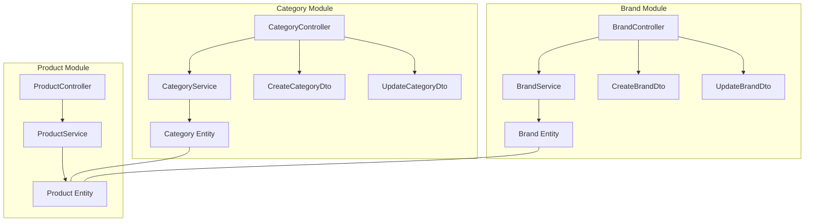
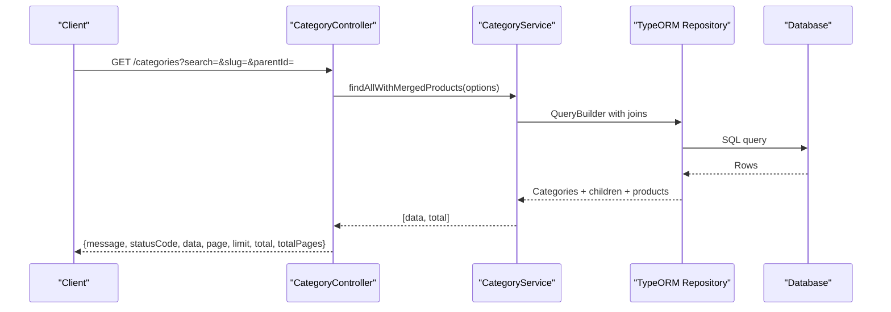
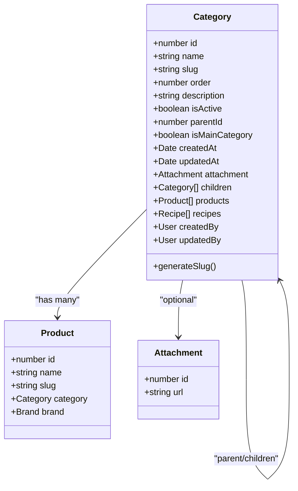
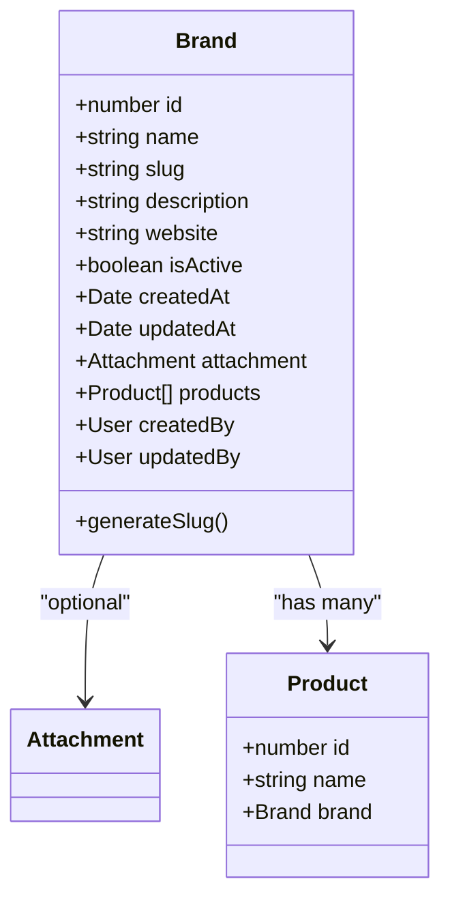
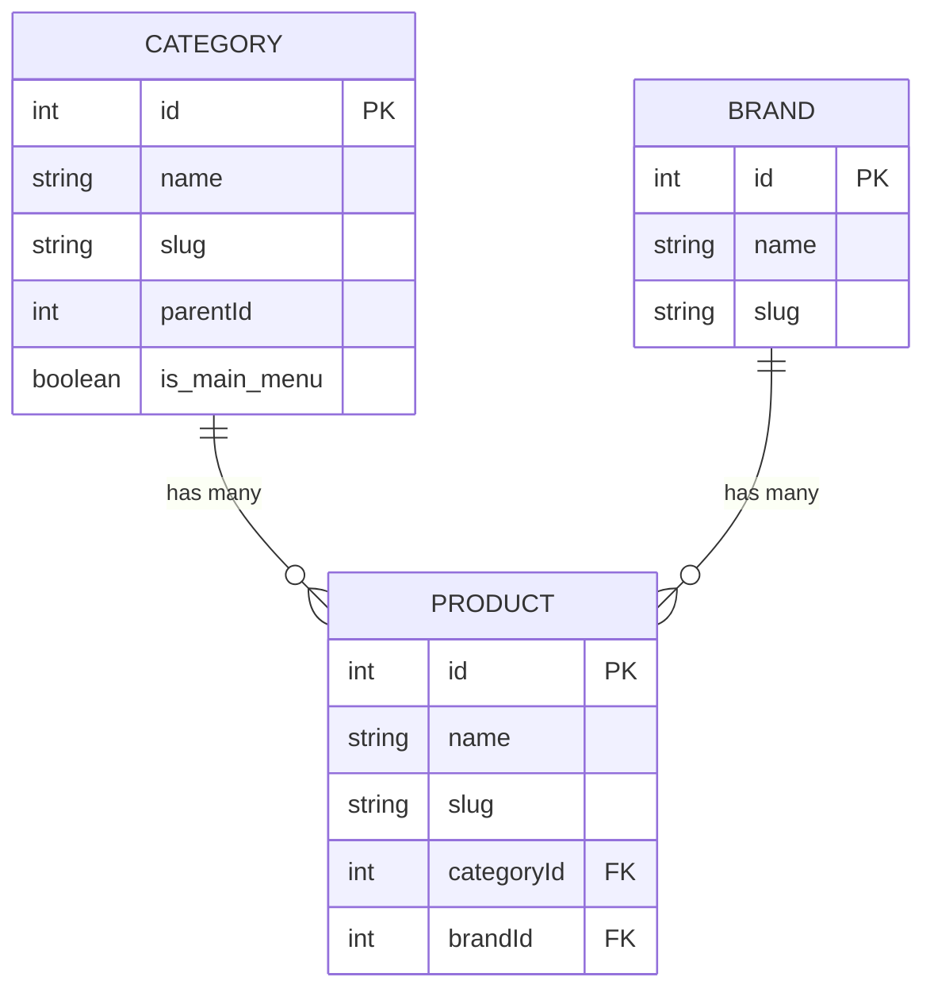
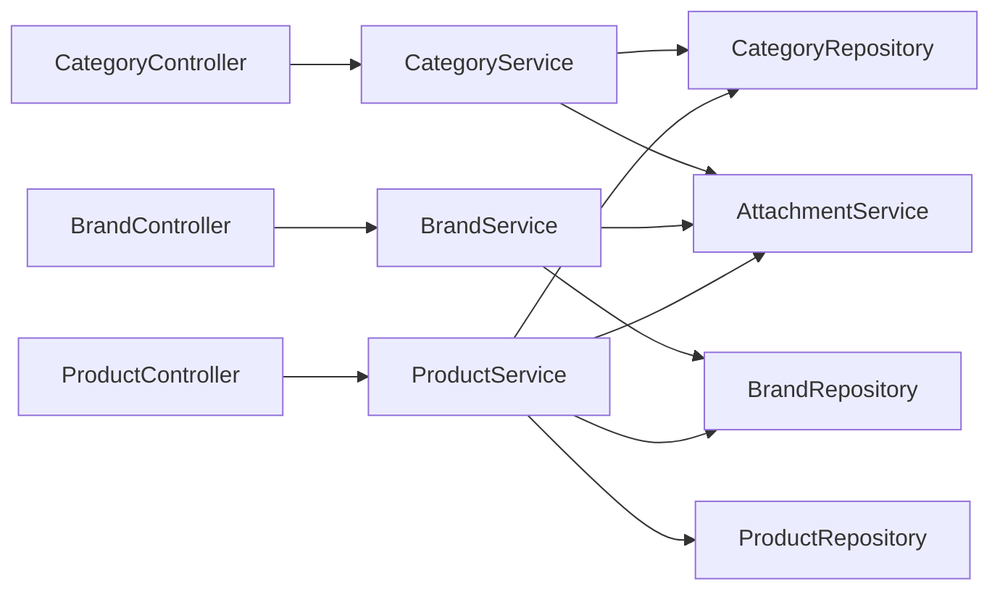

# Category & Brand Management

<cite>
**Referenced Files in This Document**
- [category.controller.ts](file://apps/backend/src/category/category.controller.ts)
- [category.service.ts](file://apps/backend/src/category/category.service.ts)
- [category.entity.ts](file://apps/backend/src/category/entities/category.entity.ts)
- [create-category.dto.ts](file://apps/backend/src/category/dto/create-category.dto.ts)
- [update-category.dto.ts](file://apps/backend/src/category/dto/update-category.dto.ts)
- [brand.controller.ts](file://apps/backend/src/brand/brand.controller.ts)
- [brand.service.ts](file://apps/backend/src/brand/brand.service.ts)
- [brand.entity.ts](file://apps/backend/src/brand/entities/brand.entity.ts)
- [create-brand.dto.ts](file://apps/backend/src/brand/dto/create-brand.dto.ts)
- [update-brand.dto.ts](file://apps/backend/src/brand/dto/update-brand.dto.ts)
- [product.controller.ts](file://apps/backend/src/product/product.controller.ts)
- [product.service.ts](file://apps/backend/src/product/product.service.ts)
- [product.entity.ts](file://apps/backend/src/product/entities/product.entity.ts)
- [database.dbml](file://apps/backend/database.dbml)
</cite>

## Table of Contents
1. Introduction
2. Project Structure
3. Core Components
4. Architecture Overview
5. Detailed Component Analysis
6. Dependency Analysis
7. Performance Considerations
8. Troubleshooting Guide
9. Conclusion

## Introduction
This document provides comprehensive API documentation for category and brand management endpoints, including:
- Category CRUD operations with hierarchical structure support, slug generation, and SEO-friendly URLs
- Brand management APIs for creating, updating, and managing brand information with logo attachments and descriptions
- Relationship management between categories, brands, and products
- Search and filtering capabilities for both categories and brands
- Performance considerations for large catalogs and caching strategies
- Referential integrity constraints between entities

The backend is a NestJS application using TypeORM with PostgreSQL. Categories and brands are core catalog entities that organize and enrich product data.

## Project Structure
The relevant modules are organized by feature under apps/backend/src:
- category: controller, service, entity, DTOs
- brand: controller, service, entity, DTOs
- product: controller, service, entity (used to demonstrate relationships)

**Diagram sources**
- [category.controller.ts:39-43](file://apps/backend/src/category/category.controller.ts#L39-L43)
- [category.service.ts:29-35](file://apps/backend/src/category/category.service.ts#L29-L35)
- [category.entity.ts:22-29](file://apps/backend/src/category/entities/category.entity.ts#L22-L29)
- [create-category.dto.ts:12-22](file://apps/backend/src/category/dto/create-category.dto.ts#L12-L22)
- [update-category.dto.ts:6-12](file://apps/backend/src/category/dto/update-category.dto.ts#L6-L12)
- [brand.controller.ts:39-43](file://apps/backend/src/brand/brand.controller.ts#L39-L43)
- [brand.service.ts:24-30](file://apps/backend/src/brand/brand.service.ts#L24-L30)
- [brand.entity.ts:20-28](file://apps/backend/src/brand/entities/brand.entity.ts#L20-L28)
- [create-brand.dto.ts:12-22](file://apps/backend/src/brand/dto/create-brand.dto.ts#L12-L22)
- [update-brand.dto.ts:4-13](file://apps/backend/src/brand/dto/update-brand.dto.ts#L4-L13)
- [product.controller.ts:49-58](file://apps/backend/src/product/product.controller.ts#L49-L58)
- [product.service.ts:56-82](file://apps/backend/src/product/product.service.ts#L56-L82)
- [product.entity.ts:41-51](file://apps/backend/src/product/entities/product.entity.ts#L41-L51)

**Section sources**
- [category.controller.ts:39-43](file://apps/backend/src/category/category.controller.ts#L39-L43)
- [brand.controller.ts:39-43](file://apps/backend/src/brand/brand.controller.ts#L39-L43)
- [product.controller.ts:49-58](file://apps/backend/src/product/product.controller.ts#L49-L58)

## Core Components
- CategoryController: REST endpoints for categories with pagination, search, hierarchy tree, and CRUD operations.
- CategoryService: Business logic for categories, including hierarchical queries, merging child products, and tree building.
- BrandController: REST endpoints for brands with pagination, search, sorting, and CRUD operations.
- BrandService: Business logic for brands, including filtering by product price ranges and attachment handling on delete.
- ProductController/ProductService: Demonstrate how products relate to categories and brands; includes extensive filtering and caching.
- Entities: Category, Brand, Product define schema, relations, and slug generation hooks.

Key responsibilities:
- Slug generation for SEO-friendly URLs
- Hierarchical category structures with parent/children
- Filtering and sorting by name, slug, status, and product prices
- Attachment-based logos/images for brands and categories
- Referential integrity via foreign keys

**Section sources**
- [category.controller.ts:45-309](file://apps/backend/src/category/category.controller.ts#L45-L309)
- [category.service.ts:37-483](file://apps/backend/src/category/category.service.ts#L37-L483)
- [brand.controller.ts:44-331](file://apps/backend/src/brand/brand.controller.ts#L44-L331)
- [brand.service.ts:32-157](file://apps/backend/src/brand/brand.service.ts#L32-L157)
- [product.controller.ts:87-250](file://apps/backend/src/product/product.controller.ts#L87-L250)
- [product.service.ts:175-302](file://apps/backend/src/product/product.service.ts#L175-L302)
- [category.entity.ts:22-138](file://apps/backend/src/category/entities/category.entity.ts#L22-L138)
- [brand.entity.ts:20-129](file://apps/backend/src/brand/entities/brand.entity.ts#L20-L129)
- [product.entity.ts:41-51](file://apps/backend/src/product/entities/product.entity.ts#L41-L51)

## Architecture Overview
The system exposes REST APIs for categories and brands, backed by services that interact with TypeORM repositories. Products reference categories and brands, enabling rich storefront experiences.

**Diagram sources**
- [category.controller.ts:79-182](file://apps/backend/src/category/category.controller.ts#L79-L182)
- [category.service.ts:253-379](file://apps/backend/src/category/category.service.ts#L253-L379)

**Section sources**
- [category.controller.ts:79-182](file://apps/backend/src/category/category.controller.ts#L79-L182)
- [category.service.ts:253-379](file://apps/backend/src/category/category.service.ts#L253-L379)

## Detailed Component Analysis

### Category Management API
Endpoints:
- POST /categories: Create a new category
- GET /categories: Paginated list with filters and sorting
- GET /categories/tree: Full hierarchical tree
- GET /categories/:id: Get category details with related data
- PATCH /categories/:id: Update category
- DELETE /categories/:id: Delete category

Filters and sorting:
- Pagination: page, limit
- Search: name (case-insensitive)
- Filter by slug, parentId, isActive, isMainCategory
- Sorting: name_asc, name_desc, price_asc, price_desc (applied to merged products)

Slug generation and SEO:
- Slugs are auto-generated from names if not provided
- Slugs are normalized to lowercase with hyphens
- Unique slugs ensure SEO-friendly URLs

Hierarchical structure:
- Parent-child relationships via parentId
- Tree endpoint returns nested children
- Product counts aggregated across subtrees

Relationships:
- One-to-many with products
- Optional attachment for images
- Audit fields createdBy/updatedBy

Security:
- Write endpoints protected by JWT and permission guards
- Read endpoints are public unless otherwise specified

Response format:
- Consistent envelope with message, statusCode, data, and pagination metadata

Example usage patterns:
- Retrieve top-level categories: GET /categories?isMainCategory=true
- List children of a category: GET /categories?parentId=1
- Build navigation tree: GET /categories/tree
- Find by slug: GET /categories?slug=electronics

**Section sources**
- [category.controller.ts:45-309](file://apps/backend/src/category/category.controller.ts#L45-L309)
- [category.service.ts:37-483](file://apps/backend/src/category/category.service.ts#L37-L483)
- [category.entity.ts:22-138](file://apps/backend/src/category/entities/category.entity.ts#L22-L138)
- [create-category.dto.ts:12-72](file://apps/backend/src/category/dto/create-category.dto.ts#L12-L72)
- [update-category.dto.ts:6-12](file://apps/backend/src/category/dto/update-category.dto.ts#L6-L12)

#### Category Class Diagram

**Diagram sources**
- [category.entity.ts:22-138](file://apps/backend/src/category/entities/category.entity.ts#L22-L138)
- [product.entity.ts:206-218](file://apps/backend/src/product/entities/product.entity.ts#L206-L218)

### Brand Management API
Endpoints:
- POST /brands: Create a new brand
- GET /brands: Paginated list with filters and sorting
- GET /brands/:id: Get brand details
- PATCH /brands/:id: Update brand
- DELETE /brands/:id: Delete brand

Filters and sorting:
- Pagination: page, limit
- Search: name (case-insensitive)
- Filter by slug, isActive
- Sorting: name_asc, name_desc, price_asc, price_desc (based on associated products)

Slug generation and SEO:
- Slugs are auto-generated from names if not provided
- Slugs are normalized to lowercase with hyphens
- Unique slugs ensure SEO-friendly URLs

Attachments:
- Logo stored via attachmentId or updated via logoUrl
- On delete, associated attachment file is removed

Relationships:
- One-to-many with products
- Audit fields createdBy/updatedBy

Security:
- Write endpoints protected by JWT and permission guards
- Read endpoints are public unless otherwise specified

Response format:
- Consistent envelope with message, statusCode, data, and pagination metadata

Example usage patterns:
- List active brands: GET /brands?isActive=true
- Find by slug: GET /brands?slug=nike-sportswear
- Filter brands by product price range: GET /brands?minPrice=10&maxPrice=100

**Section sources**
- [brand.controller.ts:44-331](file://apps/backend/src/brand/brand.controller.ts#L44-L331)
- [brand.service.ts:32-157](file://apps/backend/src/brand/brand.service.ts#L32-L157)
- [brand.entity.ts:20-129](file://apps/backend/src/brand/entities/brand.entity.ts#L20-L129)
- [create-brand.dto.ts:12-67](file://apps/backend/src/brand/dto/create-brand.dto.ts#L12-L67)
- [update-brand.dto.ts:4-40](file://apps/backend/src/brand/dto/update-brand.dto.ts#L4-L40)

#### Brand Class Diagram

**Diagram sources**
- [brand.entity.ts:20-129](file://apps/backend/src/brand/entities/brand.entity.ts#L20-L129)
- [product.entity.ts:213-218](file://apps/backend/src/product/entities/product.entity.ts#L213-L218)

### Category Tree Endpoint
Purpose:
- Returns the full hierarchical structure of categories with nested children
- Includes computed productCount per subtree

Behavior:
- Loads categories with relations
- Aggregates active product counts per category and sums across subtrees
- Builds recursive tree structure

Usage:
- GET /categories/tree

**Section sources**
- [category.controller.ts:184-219](file://apps/backend/src/category/category.controller.ts#L184-L219)
- [category.service.ts:380-423](file://apps/backend/src/category/category.service.ts#L380-L423)

### Relationships Between Categories, Brands, and Products
- Product references Category and Brand
- Category has ManyToMany with Product (OneToMany from Category side)
- Brand has OneToMany with Product
- Foreign key constraints enforce referential integrity at the database level

**Diagram sources**
- [database.dbml:77-90](file://apps/backend/database.dbml#L77-L90)
- [database.dbml:123-135](file://apps/backend/database.dbml#L123-L135)
- [database.dbml:92-121](file://apps/backend/database.dbml#L92-L121)
- [database.dbml:495-499](file://apps/backend/database.dbml#L495-L499)

**Section sources**
- [product.entity.ts:206-218](file://apps/backend/src/product/entities/product.entity.ts#L206-L218)
- [database.dbml:92-121](file://apps/backend/database.dbml#L92-L121)
- [database.dbml:495-499](file://apps/backend/database.dbml#L495-L499)

### Search and Filtering Capabilities

Categories:
- Name search (ILIKE)
- Slug filter
- Parent ID filter
- Active status filter
- Main category filter
- Sorting by name or product price

Brands:
- Name search (ILIKE)
- Slug filter
- Active status filter
- Sorting by name or product price
- Price-range filtering based on associated products

Products (for context):
- Extensive filtering by category, brand, supplier, featured, active, discount, tags
- Price range filters
- Sorting by name or price

**Section sources**
- [category.controller.ts:79-182](file://apps/backend/src/category/category.controller.ts#L79-L182)
- [category.service.ts:59-114](file://apps/backend/src/category/category.service.ts#L59-L114)
- [brand.controller.ts:95-204](file://apps/backend/src/brand/brand.controller.ts#L95-L204)
- [brand.service.ts:41-115](file://apps/backend/src/brand/brand.service.ts#L41-L115)
- [product.controller.ts:87-250](file://apps/backend/src/product/product.controller.ts#L87-L250)
- [product.service.ts:175-302](file://apps/backend/src/product/product.service.ts#L175-L302)

### Bulk Operations and Reordering
Current implementation:
- No explicit bulk update or reorder endpoints for categories or brands
- Reordering can be achieved by updating individual category order fields where supported
- Status management is available via isActive flags on create/update

Recommendations:
- Add bulk PATCH endpoints for status toggling
- Implement reorder endpoints accepting arrays of IDs with new positions
- Use transactions to maintain consistency during bulk updates

[No sources needed since this section provides general guidance]

### Examples of Nested Category Structures
- Top-level categories: Set isMainCategory=true and parentId=null
- Subcategories: Set parentId to the parent category ID
- Tree retrieval: Use GET /categories/tree to visualize hierarchy
- Product association: Assign products to leaf categories or parent categories; child products are included when querying parents

**Section sources**
- [category.controller.ts:184-219](file://apps/backend/src/category/category.controller.ts#L184-L219)
- [category.service.ts:380-423](file://apps/backend/src/category/category.service.ts#L380-L423)

### Examples of Brand Hierarchies
- Brands are flat entities without parent-child relationships
- Organize brands by attributes such as isActive, website, and slug
- Group brands conceptually via product associations and storefront filters

**Section sources**
- [brand.entity.ts:20-129](file://apps/backend/src/brand/entities/brand.entity.ts#L20-L129)

## Dependency Analysis
Component coupling:
- Controllers depend on services for business logic
- Services depend on TypeORM repositories and external services (e.g., AttachmentService)
- Entities define relations and lifecycle hooks (slug generation)

External dependencies:
- AttachmentService used for file deletion on category/brand removal
- CacheManager used in product listing for performance

Potential circular dependencies:
- None observed among category, brand, and product modules

Integration points:
- Product module integrates with category and brand entities
- Database constraints enforce referential integrity

**Diagram sources**
- [category.controller.ts:39-43](file://apps/backend/src/category/category.controller.ts#L39-L43)
- [category.service.ts:31-35](file://apps/backend/src/category/category.service.ts#L31-L35)
- [brand.controller.ts:39-43](file://apps/backend/src/brand/brand.controller.ts#L39-L43)
- [brand.service.ts:26-30](file://apps/backend/src/brand/brand.service.ts#L26-L30)
- [product.controller.ts:54-58](file://apps/backend/src/product/product.controller.ts#L54-L58)
- [product.service.ts:58-82](file://apps/backend/src/product/product.service.ts#L58-L82)

**Section sources**
- [category.service.ts:31-35](file://apps/backend/src/category/category.service.ts#L31-L35)
- [brand.service.ts:26-30](file://apps/backend/src/brand/brand.service.ts#L26-L30)
- [product.service.ts:58-82](file://apps/backend/src/product/product.service.ts#L58-L82)

## Performance Considerations
Caching strategies:
- Category list uses cache-manager decorators for short TTL caching
- Product lists use SWR-style caching with stale-while-revalidate to reduce DB load
- Best practice: cache read-heavy endpoints and invalidate caches on mutations

Query optimization:
- Separate count queries from payload queries to avoid expensive joins in counting
- Select only necessary fields for list endpoints
- Use ILIKE for case-insensitive searches judiciously; consider full-text indexes for large datasets

Indexing:
- Entities define indexes on slug, isActive, parentId, order, isMainCategory
- Ensure database indexes align with frequent filters and sorts

Large catalogs:
- Prefer pagination and minimal field selection
- Avoid eager loading heavy relations unless required
- Use subtree aggregation efficiently as implemented in category tree

**Section sources**
- [category.controller.ts:148-149](file://apps/backend/src/category/category.controller.ts#L148-L149)
- [product.service.ts:111-125](file://apps/backend/src/product/product.service.ts#L111-L125)
- [product.service.ts:175-302](file://apps/backend/src/product/product.service.ts#L175-L302)
- [category.entity.ts:22-28](file://apps/backend/src/category/entities/category.entity.ts#L22-L28)
- [brand.entity.ts:20-28](file://apps/backend/src/brand/entities/brand.entity.ts#L20-L28)
- [product.entity.ts:41-49](file://apps/backend/src/product/entities/product.entity.ts#L41-L49)

## Troubleshooting Guide
Common issues:
- Duplicate names: Creating categories or brands with existing names throws conflict errors
- Not found errors: Accessing non-existent IDs results in 404 responses
- Invalid input: Validation errors return 400 with detailed messages
- Attachment deletion failures: Deleting brands/categories may fail if attachment cleanup fails

Mitigations:
- Validate inputs at DTO layer
- Handle exceptions in services and map to appropriate HTTP statuses
- Log errors and provide actionable messages
- Test attachment service integration for file storage systems

**Section sources**
- [category.service.ts:37-57](file://apps/backend/src/category/category.service.ts#L37-L57)
- [category.service.ts:425-448](file://apps/backend/src/category/category.service.ts#L425-L448)
- [brand.service.ts:117-126](file://apps/backend/src/brand/brand.service.ts#L117-L126)
- [brand.service.ts:139-157](file://apps/backend/src/brand/brand.service.ts#L139-L157)

## Conclusion
The category and brand management APIs provide robust CRUD operations, hierarchical category support, SEO-friendly slugs, and strong relationships with products. The system leverages caching and optimized queries to handle large catalogs efficiently. For enhanced usability, consider adding bulk operations for reordering and status management, and expand search capabilities with advanced indexing.