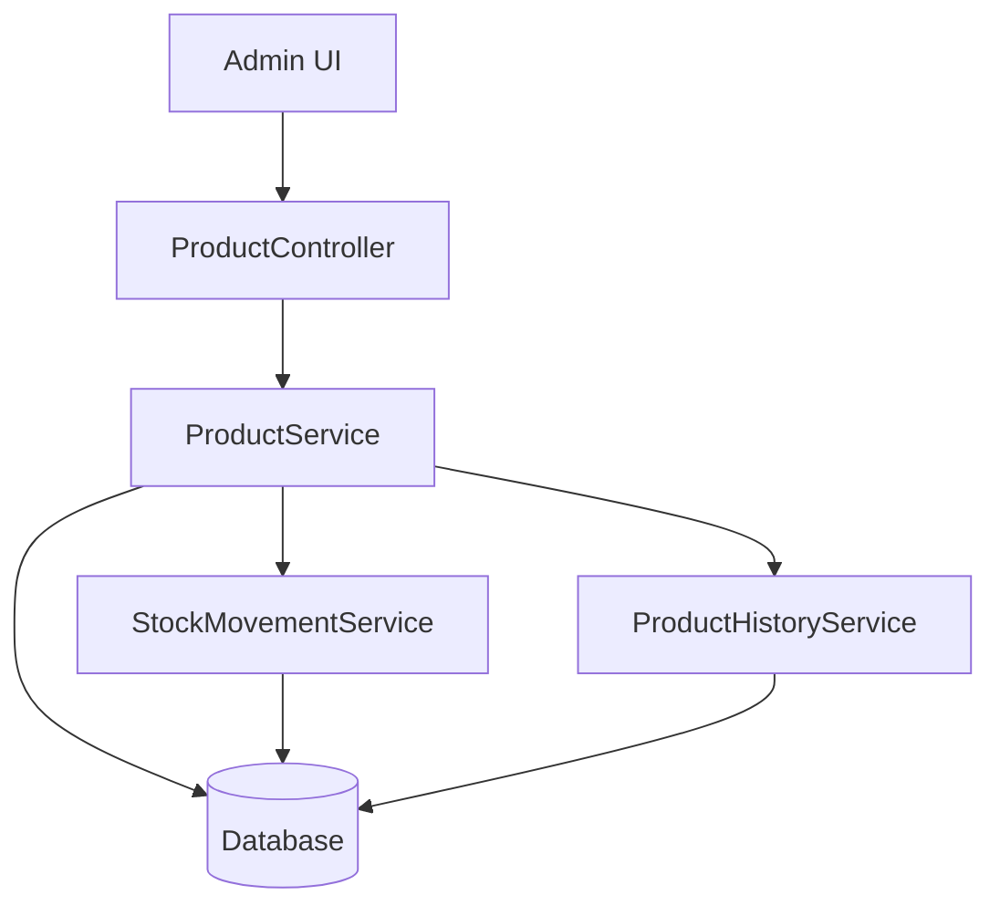
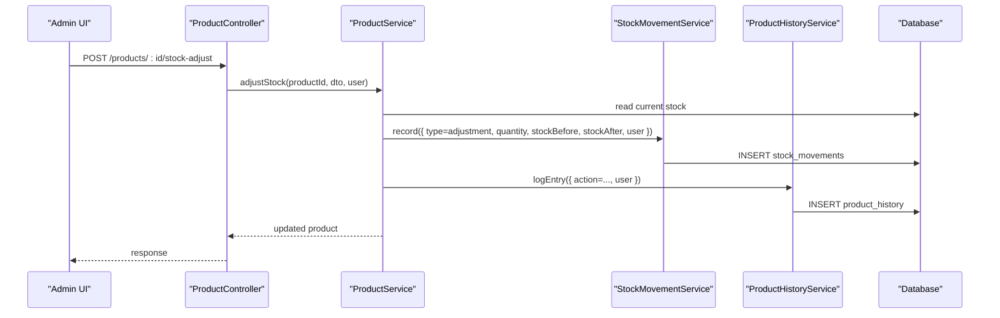
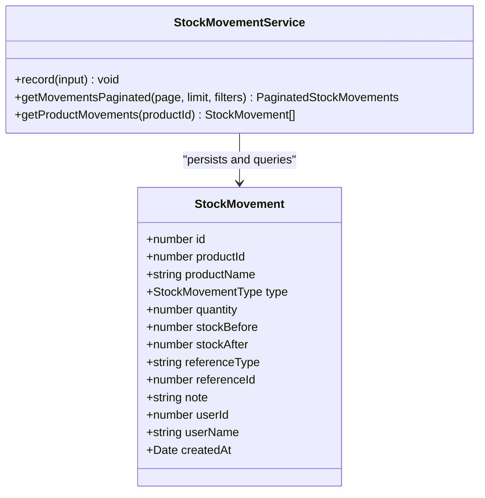
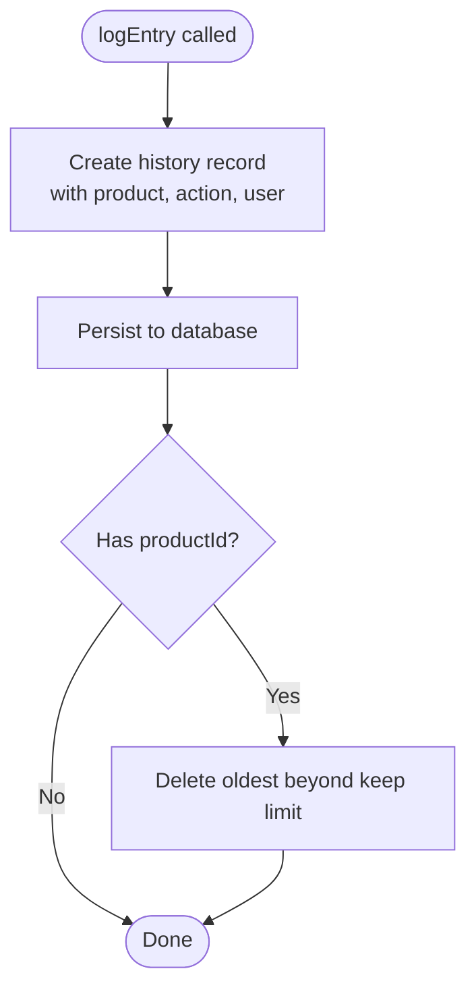
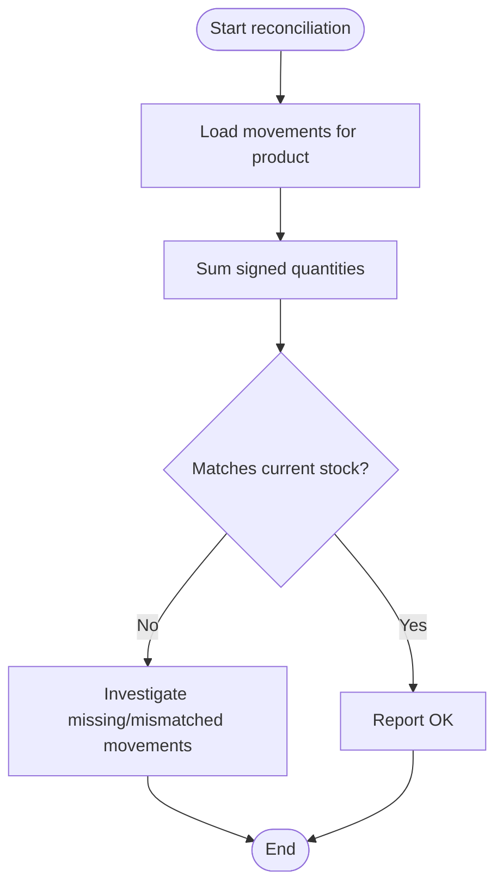
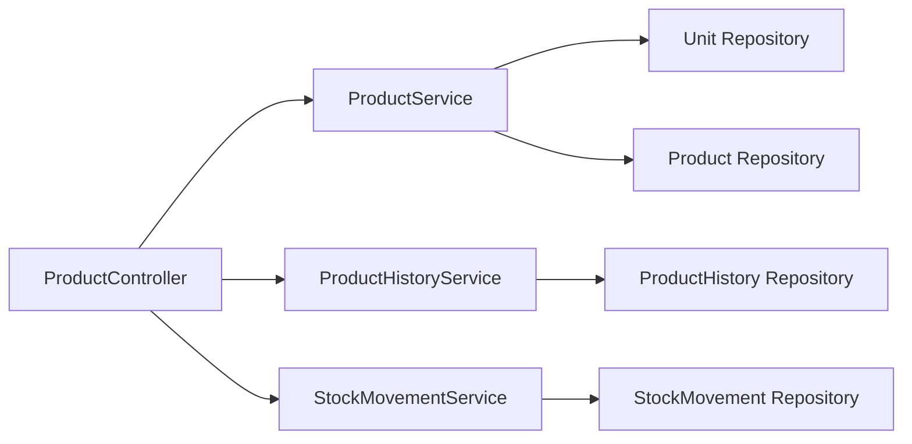

# Inventory & Stock Management

<cite>
**Referenced Files in This Document**
- [product.controller.ts](file://apps/backend/src/product/product.controller.ts)
- [product.service.ts](file://apps/backend/src/product/product.service.ts)
- [stock-adjust.dto.ts](file://apps/backend/src/product/dto/stock-adjust.dto.ts)
- [stock-movement.entity.ts](file://apps/backend/src/stock-movement/entities/stock-movement.entity.ts)
- [stock-movement.service.ts](file://apps/backend/src/stock-movement/stock-movement.service.ts)
- [unit.entity.ts](file://apps/backend/src/unit/entities/unit.entity.ts)
- [unit.service.ts](file://apps/backend/src/unit/unit.service.ts)
- [product-history.entity.ts](file://apps/backend/src/product-history/entities/product-history.entity.ts)
- [product-history.service.ts](file://apps/backend/src/product-history/product-history.service.ts)
- [page.tsx](file://apps/frontend/app/admin/products/stock-movements/page.tsx)
</cite>

## Table of Contents
1. [Introduction](#introduction)
2. [Project Structure](#project-structure)
3. [Core Components](#core-components)
4. [Architecture Overview](#architecture-overview)
5. [Detailed Component Analysis](#detailed-component-analysis)
6. [Dependency Analysis](#dependency-analysis)
7. [Performance Considerations](#performance-considerations)
8. [Troubleshooting Guide](#troubleshooting-guide)
9. [Conclusion](#conclusion)

## Introduction
This document describes the inventory and stock management capabilities exposed by the backend, focusing on:
- Manual stock adjustment with audit trail creation
- Unit of measurement management
- Product history tracking for lifecycle events
- Low stock alerts and inventory threshold reporting
- Stock movement ledgering for reconciliation
- Stock valuation and summary reporting
- Integration points with purchase and sales orders
- Concurrent update safety and transactional guarantees

The system separates three concerns:
- Product state and reports live under the product module
- Stock movements are recorded in a dedicated ledger
- Product lifecycle changes are tracked in a separate audit table

## Project Structure
Inventory-related functionality is implemented primarily in the backend NestJS application:
- Product controller exposes REST endpoints for stock adjustments and inventory reports
- Product service implements business logic, including low-stock and valuation queries
- Stock movement service records immutable stock change entries
- Unit service manages units of measurement
- Product history service tracks product lifecycle audit events
- The frontend includes an admin page that displays the stock movement ledger

**Diagram sources**
- [product.controller.ts:49-58](file://apps/backend/src/product/product.controller.ts#L49-L58)
- [product.service.ts:56-82](file://apps/backend/src/product/product.service.ts#L56-L82)
- [stock-movement.service.ts:54-61](file://apps/backend/src/stock-movement/stock-movement.service.ts#L54-L61)
- [product-history.service.ts:46-56](file://apps/backend/src/product-history/product-history.service.ts#L46-L56)

**Section sources**
- [product.controller.ts:49-58](file://apps/backend/src/product/product.controller.ts#L49-L58)
- [product.service.ts:56-82](file://apps/backend/src/product/product.service.ts#L56-L82)
- [page.tsx:1-33](file://apps/frontend/app/admin/products/stock-movements/page.tsx#L1-L33)

## Core Components
- Stock adjustment endpoint: manual stock correction with signed quantity and optional note
- Stock movement ledger: immutable per-change record with before/after snapshots
- Product history: audit trail for created/updated/activated/deactivated/deleted events
- Units of measurement: CRUD over unit definitions used by products
- Inventory reports: low stock, out of stock, stock valuation, and stock summary
- Frontend stock movement viewer: admin page listing chronological stock changes

Key responsibilities:
- ProductController defines API routes and request validation
- ProductService implements report queries and orchestrates side effects
- StockMovementService persists movement rows and provides filtered pagination
- ProductHistoryService persists lifecycle audit entries and trims old history
- UnitsService manages unit definitions and enforces uniqueness

**Section sources**
- [product.controller.ts:898-906](file://apps/backend/src/product/product.controller.ts#L898-L906)
- [stock-movement.entity.ts:9-75](file://apps/backend/src/stock-movement/entities/stock-movement.entity.ts#L9-L75)
- [stock-movement.service.ts:9-52](file://apps/backend/src/stock-movement/stock-movement.service.ts#L9-L52)
- [product-history.entity.ts:9-57](file://apps/backend/src/product-history/entities/product-history.entity.ts#L9-L57)
- [unit.entity.ts:17-78](file://apps/backend/src/unit/entities/unit.entity.ts#L17-L78)

## Architecture Overview
The inventory subsystem uses a ledger-first approach:
- Business operations (purchase delivery, order placement/cancellation, manual adjustment) compute new stock levels
- A stock movement row is appended with signed quantity and before/after snapshots
- Product history captures non-stock lifecycle events separately
- Reports read from product tables and movement aggregates

**Diagram sources**
- [product.controller.ts:898-906](file://apps/backend/src/product/product.controller.ts#L898-L906)
- [stock-movement.service.ts:63-87](file://apps/backend/src/stock-movement/stock-movement.service.ts#L63-L87)
- [product-history.service.ts:58-80](file://apps/backend/src/product-history/product-history.service.ts#L58-L80)

## Detailed Component Analysis

### Stock Adjustment API
Purpose:
- Allow administrators to add or remove stock outside normal purchase/order flows
- Record an adjustment movement with user attribution and optional reason

Endpoint:
- Method: POST
- Path: /products/:id/stock-adjust
- Authentication: JWT + permission guard
- Request body:
  - quantity: integer, signed (+ adds, - removes)
  - note: optional string, up to 255 characters

Behavior:
- Validates input using DTO rules
- Creates an adjustment-type stock movement
- Persists before/after stock snapshots
- Records user attribution

Response:
- Standardized success envelope containing updated product data

Error handling:
- Validation errors for invalid quantity or note length
- Authorization failures when missing required permissions

Usage example:
- Add 5 units: { quantity: 5 }
- Remove 2 damaged units: { quantity: -2, note: "Damaged items removed" }

**Section sources**
- [product.controller.ts:898-906](file://apps/backend/src/product/product.controller.ts#L898-L906)
- [stock-adjust.dto.ts:1-28](file://apps/backend/src/product/dto/stock-adjust.dto.ts#L1-L28)

### Stock Movement Ledger
Purpose:
- Provide an immutable, reconcilable history of every stock change
- Support filtering, pagination, and summary statistics

Data model highlights:
- Movement type enum: purchase, purchase_reversal, order_sale, order_cancel, adjustment
- Signed quantity change
- Before/after stock snapshots
- Reference type and ID linking to source event
- User snapshot (userId, userName)
- Timestamped createdAt

Ledger operations:
- record: append one movement; failures are logged but do not break the caller
- getMovementsPaginated: filter by product, type, search, date range; return paginated results and summary
- getProductMovements: list all movements for a product

Summary fields:
- byType: counts per movement type
- total: number of matching movements
- unitsIn: sum of positive quantities
- unitsOut: absolute sum of negative quantities

Frontend integration:
- Admin page titled “Stock Movements” lists chronological changes and links back to inventory

**Diagram sources**
- [stock-movement.entity.ts:9-75](file://apps/backend/src/stock-movement/entities/stock-movement.entity.ts#L9-L75)
- [stock-movement.service.ts:54-121](file://apps/backend/src/stock-movement/stock-movement.service.ts#L54-L121)

**Section sources**
- [stock-movement.entity.ts:9-75](file://apps/backend/src/stock-movement/entities/stock-movement.entity.ts#L9-L75)
- [stock-movement.service.ts:9-52](file://apps/backend/src/stock-movement/stock-movement.service.ts#L9-L52)
- [stock-movement.service.ts:63-121](file://apps/backend/src/stock-movement/stock-movement.service.ts#L63-L121)
- [page.tsx:1-33](file://apps/frontend/app/admin/products/stock-movements/page.tsx#L1-L33)

### Product History Audit Trail
Purpose:
- Track product lifecycle events independently of stock movements
- Retain readable history even after product deletion or renaming

Event types:
- created, updated, activated, deactivated, deleted

Record contents:
- Product identifier and name snapshot
- Action type
- Optional field-level changes JSON
- Optional full snapshot JSON
- User attribution snapshot
- Timestamp

Operations:
- logEntry: persist entry and trim older history per product
- getHistoryPaginated: filter by product, action, search, date range; return paginated results and summary
- getProductHistory: list all history entries for a product

Retention policy:
- Keeps the newest N entries per product; older entries are trimmed automatically

**Diagram sources**
- [product-history.service.ts:58-80](file://apps/backend/src/product-history/product-history.service.ts#L58-L80)
- [product-history.service.ts:217-234](file://apps/backend/src/product-history/product-history.service.ts#L217-L234)

**Section sources**
- [product-history.entity.ts:9-57](file://apps/backend/src/product-history/entities/product-history.entity.ts#L9-L57)
- [product-history.service.ts:46-80](file://apps/backend/src/product-history/product-history.service.ts#L46-L80)
- [product-history.service.ts:82-107](file://apps/backend/src/product-history/product-history.service.ts#L82-L107)
- [product-history.service.ts:210-234](file://apps/backend/src/product-history/product-history.service.ts#L210-L234)

### Units of Measurement
Purpose:
- Define reusable units such as kilogram, piece, liter
- Associate units with products

Entity attributes:
- Unique string identifier
- Name
- Active flag
- Created/updated timestamps
- Creator/updater user references
- One-to-many relationship with products

Service capabilities:
- Create with uniqueness enforcement
- List active units
- Find by ID
- Update metadata
- Soft delete by deactivating

Notes:
- No conversion rates are defined in the unit entity; conversions would require additional modeling if needed

**Section sources**
- [unit.entity.ts:17-78](file://apps/backend/src/unit/entities/unit.entity.ts#L17-L78)
- [unit.service.ts:26-49](file://apps/backend/src/unit/unit.service.ts#L26-L49)
- [unit.service.ts:51-80](file://apps/backend/src/unit/unit.service.ts#L51-L80)
- [unit.service.ts:82-104](file://apps/backend/src/unit/unit.service.ts#L82-L104)
- [unit.service.ts:112-128](file://apps/backend/src/unit/unit.service.ts#L112-L128)
- [unit.service.ts:134-156](file://apps/backend/src/unit/unit.service.ts#L134-L156)

### Low Stock Alerts and Thresholds
Endpoints:
- GET /products/reports/low-stock
  - Query parameters: page, limit, threshold (default 10)
  - Returns products with stock at or below the threshold
- GET /products/reports/out-of-stock
  - Returns all products with zero stock

Behavior:
- Uses product service aggregation to identify low/out-of-stock items
- Supports pagination for low-stock report

Use cases:
- Restock prioritization
- Alert generation for warehouse staff

**Section sources**
- [product.controller.ts:586-637](file://apps/backend/src/product/product.controller.ts#L586-L637)
- [product.controller.ts:639-656](file://apps/backend/src/product/product.controller.ts#L639-L656)
- [product.service.ts:1356-1395](file://apps/backend/src/product/product.service.ts#L1356-L1395)

### Stock Valuation and Summary Reporting
Endpoints:
- GET /products/reports/stock-valuation
  - Returns total units and stock value at purchase price and selling price across all products
  - Includes full product list sorted by lowest stock first
- GET /products/reports/stock-summary
  - Returns total count, out-of-stock count, and low-stock count in a single query

Use cases:
- Financial reporting
- Dashboard KPI cards

**Section sources**
- [product.controller.ts:703-718](file://apps/backend/src/product/product.controller.ts#L703-L718)
- [product.controller.ts:720-735](file://apps/backend/src/product/product.controller.ts#L720-L735)
- [product.service.ts:1471-1479](file://apps/backend/src/product/product.service.ts#L1471-L1479)
- [product.service.ts:1548-1572](file://apps/backend/src/product/product.service.ts#L1548-L1572)

### Stock Movement Tracking and Reconciliation
Concept:
- Every stock change produces a movement row with signed quantity and before/after snapshots
- Current stock can be reconciled by summing movements per product

Reconciliation flow:

**Diagram sources**
- [stock-movement.entity.ts:22-75](file://apps/backend/src/stock-movement/entities/stock-movement.entity.ts#L22-L75)
- [stock-movement.service.ts:89-121](file://apps/backend/src/stock-movement/stock-movement.service.ts#L89-L121)

**Section sources**
- [stock-movement.entity.ts:22-75](file://apps/backend/src/stock-movement/entities/stock-movement.entity.ts#L22-L75)
- [stock-movement.service.ts:89-121](file://apps/backend/src/stock-movement/stock-movement.service.ts#L89-L121)

### Bulk Stock Updates and Import/Export
Current implementation:
- Manual stock adjustment is available per product via the stock-adjust endpoint
- No explicit bulk adjustment endpoint is present in the analyzed files
- No import/export endpoints for inventory are present in the analyzed files

Recommended approach:
- Implement a bulk endpoint that accepts an array of product adjustments
- For each item, validate and call the same adjustment logic used by the single-product endpoint
- Persist a movement per item and aggregate results

Note:
- This section proposes future enhancements; no code was found implementing bulk or import/export in the analyzed scope.

**Section sources**
- [product.controller.ts:898-906](file://apps/backend/src/product/product.controller.ts#L898-L906)
- [stock-adjust.dto.ts:1-28](file://apps/backend/src/product/dto/stock-adjust.dto.ts#L1-L28)

### Integration with Purchase Orders and Sales Orders
Integration points:
- Movement types include purchase, purchase_reversal, order_sale, and order_cancel
- These types indicate automatic stock adjustments driven by purchase and order events
- The stock movement ledger stores referenceType and referenceId to link movements to source documents

Operational implications:
- When a purchase is delivered, a purchase movement increases stock
- If a purchase is reverted or deleted, a purchase_reversal decreases stock
- When an order is placed, an order_sale movement decreases stock
- When an order is cancelled, an order_cancel movement restores stock

**Section sources**
- [stock-movement.entity.ts:9-20](file://apps/backend/src/stock-movement/entities/stock-movement.entity.ts#L9-L20)
- [stock-movement.entity.ts:55-60](file://apps/backend/src/stock-movement/entities/stock-movement.entity.ts#L55-L60)

### Inventory Reporting Features and Monitoring
Available reports:
- Low stock report with configurable threshold
- Out of stock report
- Stock valuation report with purchase and selling price totals
- Stock summary for dashboard metrics

Monitoring recommendations:
- Use low-stock and out-of-stock endpoints to trigger alerts
- Periodically run stock valuation for financial close
- Monitor stock summary KPIs on dashboards

**Section sources**
- [product.controller.ts:586-637](file://apps/backend/src/product/product.controller.ts#L586-L637)
- [product.controller.ts:639-656](file://apps/backend/src/product/product.controller.ts#L639-L656)
- [product.controller.ts:703-735](file://apps/backend/src/product/product.controller.ts#L703-L735)

### Concurrent Stock Updates and Transaction Safety
Concurrency model:
- Stock movement recording is designed to be resilient: failures are logged and do not propagate to the caller
- This ensures the ledger does not break the operation it tracks

Safety considerations:
- Movement rows store before/after snapshots, enabling post-hoc reconciliation
- For strict atomicity of stock updates and movement creation, consider wrapping operations in database transactions at the service layer
- Avoid race conditions by ensuring stock reads and writes are serialized per product where necessary

**Section sources**
- [stock-movement.service.ts:63-87](file://apps/backend/src/stock-movement/stock-movement.service.ts#L63-L87)
- [stock-movement.entity.ts:22-75](file://apps/backend/src/stock-movement/entities/stock-movement.entity.ts#L22-L75)

## Dependency Analysis
Component relationships:
- ProductController depends on ProductService, ProductHistoryService, and StockMovementService
- ProductService depends on repositories for Product, Unit, Supplier, Category, Brand, Attachment, and services for campaigns and history
- StockMovementService depends on TypeORM repository for StockMovement
- ProductHistoryService depends on TypeORM repository for ProductHistory
- UnitsService depends on Unit and User repositories

**Diagram sources**
- [product.controller.ts:49-58](file://apps/backend/src/product/product.controller.ts#L49-L58)
- [product.service.ts:56-82](file://apps/backend/src/product/product.service.ts#L56-L82)
- [stock-movement.service.ts:54-61](file://apps/backend/src/stock-movement/stock-movement.service.ts#L54-L61)
- [product-history.service.ts:46-56](file://apps/backend/src/product-history/product-history.service.ts#L46-L56)
- [unit.service.ts:17-24](file://apps/backend/src/unit/unit.service.ts#L17-L24)

**Section sources**
- [product.controller.ts:49-58](file://apps/backend/src/product/product.controller.ts#L49-L58)
- [product.service.ts:56-82](file://apps/backend/src/product/product.service.ts#L56-L82)
- [stock-movement.service.ts:54-61](file://apps/backend/src/stock-movement/stock-movement.service.ts#L54-L61)
- [product-history.service.ts:46-56](file://apps/backend/src/product-history/product-history.service.ts#L46-L56)
- [unit.service.ts:17-24](file://apps/backend/src/unit/unit.service.ts#L17-L24)

## Performance Considerations
- Movement summaries use grouped SQL aggregations to avoid loading full datasets into memory
- Product list caching avoids repeated heavy joins and campaign resolution
- History trimming limits storage growth per product
- Pagination is applied consistently to movement and history listings

Recommendations:
- Keep movement queries filtered by date ranges for large datasets
- Use the stock-summary endpoint for dashboard KPIs instead of computing counts client-side
- Cache report outputs where appropriate, invalidating on stock mutations

**Section sources**
- [stock-movement.service.ts:163-209](file://apps/backend/src/stock-movement/stock-movement.service.ts#L163-L209)
- [product.service.ts:111-125](file://apps/backend/src/product/product.service.ts#L111-L125)
- [product-history.service.ts:217-234](file://apps/backend/src/product-history/product-history.service.ts#L217-L234)

## Troubleshooting Guide
Common issues and resolutions:
- Movement recording fails silently: check logs for movement recording errors; verify database connectivity and permissions
- History grows unbounded: ensure trimming is enabled and retention policy is configured
- Low stock report returns unexpected results: verify threshold parameter and product stock values
- Stock valuation totals mismatch: reconcile movements against current stock using the movement ledger

Debugging steps:
- Inspect recent movements for the affected product
- Review product history for recent lifecycle changes
- Validate unit associations and product stock fields

**Section sources**
- [stock-movement.service.ts:63-87](file://apps/backend/src/stock-movement/stock-movement.service.ts#L63-L87)
- [product-history.service.ts:58-80](file://apps/backend/src/product-history/product-history.service.ts#L58-L80)
- [product.controller.ts:586-637](file://apps/backend/src/product/product.controller.ts#L586-L637)
- [product.controller.ts:703-735](file://apps/backend/src/product/product.controller.ts#L703-L735)

## Conclusion
The inventory and stock management subsystem provides:
- A robust manual stock adjustment API with audit trails
- An immutable stock movement ledger for reconciliation
- Comprehensive product history tracking
- Unit of measurement management
- Inventory reports including low stock, out of stock, valuation, and summary
- Clear integration points for purchase and order-driven stock changes

Future enhancements could include:
- Bulk stock adjustment endpoint
- Import/export capabilities for inventory data
- Explicit unit conversion rates if multi-unit trading is required
- Strict transaction boundaries around stock updates and movement creation