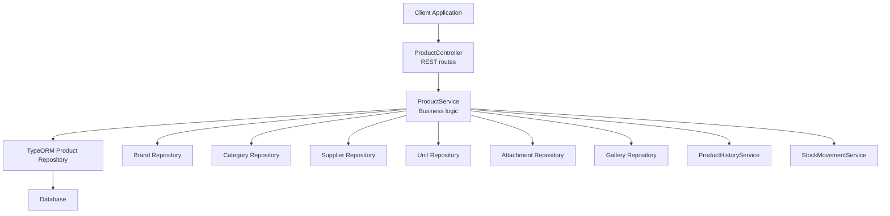
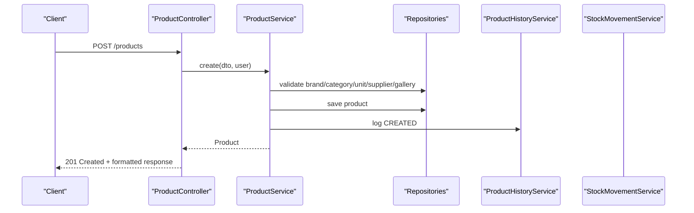
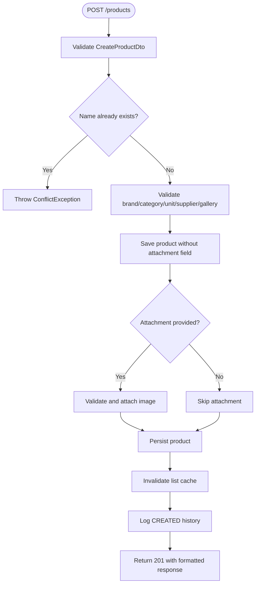
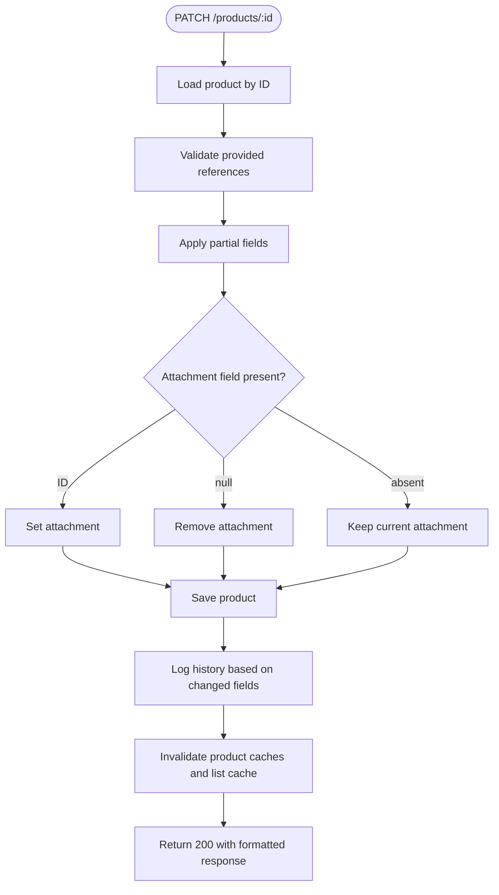
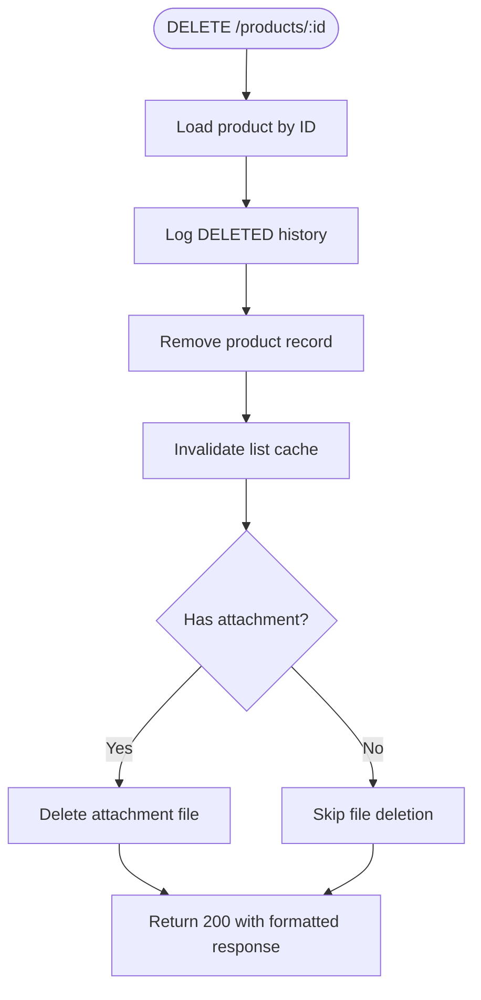
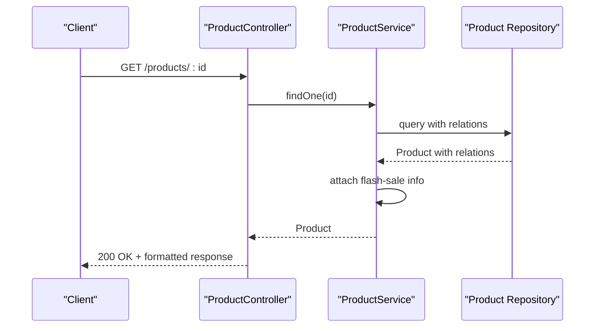
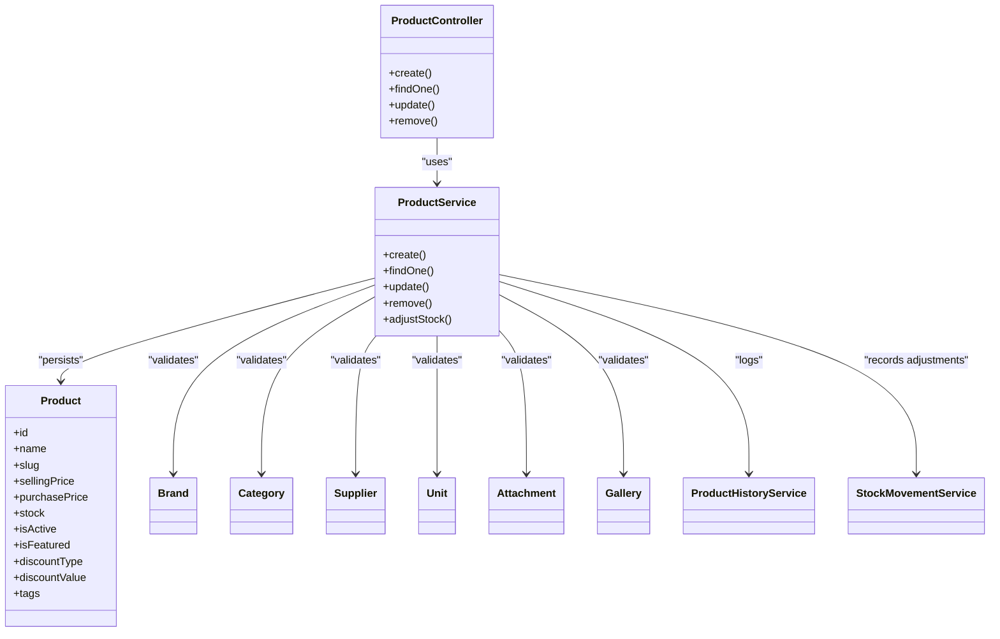

# Product CRUD Operations

<cite>
**Referenced Files in This Document**
- [product.controller.ts](file://apps/backend/src/product/product.controller.ts)
- [product.service.ts](file://apps/backend/src/product/product.service.ts)
- [create-product.dto.ts](file://apps/backend/src/product/dto/create-product.dto.ts)
- [update-product.dto.ts](file://apps/backend/src/product/dto/update-product.dto.ts)
- [product-response.dto.ts](file://apps/backend/src/product/dto/product-response.dto.ts)
- [product.entity.ts](file://apps/backend/src/product/entities/product.entity.ts)
</cite>

## Table of Contents
1. [Introduction](#introduction)
2. [Project Structure](#project-structure)
3. [Core Components](#core-components)
4. [Architecture Overview](#architecture-overview)
5. [Detailed Component Analysis](#detailed-component-analysis)
6. [Dependency Analysis](#dependency-analysis)
7. [Performance Considerations](#performance-considerations)
8. [Troubleshooting Guide](#troubleshooting-guide)
9. [Conclusion](#conclusion)

## Introduction
This document provides comprehensive API documentation for product CRUD operations exposed by the backend. It focuses on:

- Creating products through `POST /api/v1/products`.
- Updating existing products through `PATCH /api/v1/products/:id` with partial-update support.
- Removing products through `DELETE /api/v1/products/:id`.
- Retrieving individual product details through `GET /api/v1/products/:id`.
- Request and response schemas, validation rules, business constraints, error handling, status codes, image attachment handling, product visibility controls, and related entity behavior.

The endpoints are implemented using NestJS controllers and services, with TypeORM entities and DTOs defining data contracts.

## Project Structure
The product feature is organized under the backend application’s `product` module:

- Controller: routes, request/response formatting, authentication/authorization guards, and Swagger metadata.
- Service: business logic, database queries, relationship validation, caching, history logging, and stock adjustments.
- DTOs: input validation and OpenAPI schema definitions.
- Entity: persistent model, computed properties, lifecycle hooks, indexes, and relationships.

**Diagram sources**
- [product.controller.ts:49-58](file://apps/backend/src/product/product.controller.ts#L49-L58)
- [product.service.ts:56-82](file://apps/backend/src/product/product.service.ts#L56-L82)

**Section sources**
- [product.controller.ts:49-58](file://apps/backend/src/product/product.controller.ts#L49-L58)
- [product.service.ts:56-82](file://apps/backend/src/product/product.service.ts#L56-L82)

## Core Components
- `ProductController`: defines REST endpoints, applies JWT and permission guards, formats responses, and documents APIs via Swagger decorators.
- `ProductService`: implements create, find, update, remove, list, filtering, discount logic, bestseller logic, stock adjustment, and cache invalidation.
- `CreateProductDto`: validates creation payloads including name, pricing, stock, category, brand, supplier, unit, gallery, optional attachment, weight, visibility flags, discounts, and tags.
- `UpdateProductDto`: a partial version of `CreateProductDto`, enabling PATCH-style updates.
- `ProductResponseDto`: describes the standard product response shape used by Swagger.
- `Product` entity: persistent model with computed sale price, discount activation checks, inventory value calculations, slug generation, SKU generation, and audit fields.

**Section sources**
- [product.controller.ts:49-58](file://apps/backend/src/product/product.controller.ts#L49-L58)
- [product.service.ts:56-82](file://apps/backend/src/product/product.service.ts#L56-L82)
- [create-product.dto.ts:17-230](file://apps/backend/src/product/dto/create-product.dto.ts#L17-L230)
- [update-product.dto.ts:1-6](file://apps/backend/src/product/dto/update-product.dto.ts#L1-L6)
- [product-response.dto.ts:5-62](file://apps/backend/src/product/dto/product-response.dto.ts#L5-L62)
- [product.entity.ts:41-500](file://apps/backend/src/product/entities/product.entity.ts#L41-L500)

## Architecture Overview
The product API follows a layered architecture:

- HTTP layer: controller methods handle routing, parameter parsing, authentication, authorization, and response formatting.
- Business layer: service methods enforce validation, manage relationships, compute derived values, interact with repositories, and maintain audit/history records.
- Data layer: TypeORM repositories access the database; additional services handle attachments, galleries, campaigns, stock movements, and analytics.

**Diagram sources**
- [product.controller.ts:60-85](file://apps/backend/src/product/product.controller.ts#L60-L85)
- [product.service.ts:127-173](file://apps/backend/src/product/product.service.ts#L127-L173)

## Detailed Component Analysis

### POST /api/v1/products — Create Product
Creates a new product with required associations and optional media.

- Authentication: JWT guard and permission guard are applied.
- Authorization: requires `/admin/products` module permission.
- Request body: validated by `CreateProductDto`.
- Response: formatted object with message, statusCode, and data containing the created product.

#### Request Schema
Required fields:
- `name`: string, non-empty.
- `sellingPrice`: number, positive.
- `stock`: number, minimum zero.
- `unitId`: string, non-empty.
- `supplierId`: string, non-empty.
- `categoryId`: number, non-empty.
- `brandId`: number, non-empty.
- `galleryId`: string, non-empty.

Optional fields:
- `slug`: string, max length 255.
- `description`: string.
- `productDetails`: string.
- `purchasePrice`: number, positive.
- `productSku`: string, max length 50 (auto-generated if omitted).
- `attachment`: string (attachment ID), optional.
- `weight`: number, positive, maximum two decimal places.
- `isActive`: boolean, default true.
- `isFeatured`: boolean, default false.
- `discountType`: enum from `DiscountType`.
- `discountValue`: number, positive, maximum two decimal places; required when `discountType` is present.
- `discountStartDate`: date; `discountEndDate` required when start date is provided.
- `tags`: array of strings.

Validation highlights:
- Duplicate product names are rejected at creation time.
- Discount value is conditionally required when discount type is set.
- Discount end date cannot be before start date.
- Percentage discount cannot exceed 100%.
- Weight must be positive and limited to two decimal places.

#### Response Schema
The controller returns a standardized response envelope:
- `message`: success message.
- `statusCode`: HTTP status code.
- `data`: created product object.

Swagger declares the response type as `ProductResponseDto`, which includes product identity, descriptive fields, pricing, stock, image URL, active flag, category, brand, and timestamps.

#### Status Codes
- `201 Created`: product successfully created.
- `400 Bad Request`: validation errors or malformed payload.
- `401 Unauthorized`: missing or invalid JWT token.
- `403 Forbidden`: insufficient permissions.
- `409 Conflict`: product name already exists.
- `404 Not Found`: referenced brand, category, supplier, unit, gallery, or attachment does not exist.

#### Processing Flow

**Diagram sources**
- [product.controller.ts:60-85](file://apps/backend/src/product/product.controller.ts#L60-L85)
- [product.service.ts:127-173](file://apps/backend/src/product/product.service.ts#L127-L173)
- [create-product.dto.ts:17-230](file://apps/backend/src/product/dto/create-product.dto.ts#L17-L230)

**Section sources**
- [product.controller.ts:60-85](file://apps/backend/src/product/product.controller.ts#L60-L85)
- [product.service.ts:127-173](file://apps/backend/src/product/product.service.ts#L127-L173)
- [create-product.dto.ts:17-230](file://apps/backend/src/product/dto/create-product.dto.ts#L17-L230)
- [product.entity.ts:160-170](file://apps/backend/src/product/entities/product.entity.ts#L160-L170)
- [product.entity.ts:434-455](file://apps/backend/src/product/entities/product.entity.ts#L434-L455)

### PUT/PATCH /api/v1/products/:id — Update Product
Updates an existing product with partial updates. The controller uses `PATCH :id` with `UpdateProductDto`.

- Authentication: JWT guard and permission guard.
- Authorization: requires `/admin/products` module permission.
- Request body: any subset of `CreateProductDto` fields.
- Relationship fields (`brandId`, `categoryId`, `supplierId`, `unitId`, `galleryId`) are validated individually before assignment.
- Attachment can be updated or explicitly removed by passing `null`.
- Discount fields are updated independently and validated by entity lifecycle hooks.
- Cache entries for the product ID and slug are invalidated after update.

#### Partial Update Rules
- Only provided fields are applied.
- Relationship IDs are resolved and assigned only when present.
- Passing `attachment: null` removes the current attachment; omitting it leaves the current attachment unchanged.
- Discount changes trigger entity-level validation for consistency.

#### Status Codes
- `200 OK`: product successfully updated.
- `400 Bad Request`: validation errors or invalid business rule.
- `401 Unauthorized`: missing or invalid JWT token.
- `403 Forbidden`: insufficient permissions.
- `404 Not Found`: product or referenced reference entity not found.

#### Processing Flow

**Diagram sources**
- [product.controller.ts:1026-1050](file://apps/backend/src/product/product.controller.ts#L1026-L1050)
- [product.service.ts:1147-1198](file://apps/backend/src/product/product.service.ts#L1147-L1198)
- [update-product.dto.ts:1-6](file://apps/backend/src/product/dto/update-product.dto.ts#L1-L6)

**Section sources**
- [product.controller.ts:1026-1050](file://apps/backend/src/product/product.controller.ts#L1026-L1050)
- [product.service.ts:1147-1198](file://apps/backend/src/product/product.service.ts#L1147-L1198)
- [update-product.dto.ts:1-6](file://apps/backend/src/product/dto/update-product.dto.ts#L1-L6)

### DELETE /api/v1/products/:id — Remove Product
Removes a product permanently.

- Authentication: JWT guard and permission guard.
- Authorization: requires `/admin/products` module permission.
- Behavior: logs deletion history, removes the product record, invalidates list cache, and deletes the associated attachment file if present.

Note: The endpoint description says “permanently removes a product.” There is no soft-delete column or soft-delete implementation in the product entity or service. Deletion is hard delete.

#### Status Codes
- `200 OK`: product deleted successfully.
- `401 Unauthorized`: missing or invalid JWT token.
- `403 Forbidden`: insufficient permissions.
- `404 Not Found`: product not found.

#### Processing Flow

**Diagram sources**
- [product.controller.ts:1052-1067](file://apps/backend/src/product/product.controller.ts#L1052-L1067)
- [product.service.ts:1200-1215](file://apps/backend/src/product/product.service.ts#L1200-L1215)

**Section sources**
- [product.controller.ts:1052-1067](file://apps/backend/src/product/product.controller.ts#L1052-L1067)
- [product.service.ts:1200-1215](file://apps/backend/src/product/product.service.ts#L1200-L1215)

### GET /api/v1/products/:id — Retrieve Product Details
Retrieves a single product by ID with related entities.

- Public endpoint: no JWT or permission guard required.
- Response includes brand, category, parent category, supplier, unit, primary attachment, gallery, gallery attachments, and audit users.
- Flash-sale information is attached after retrieval.

#### Related Entities Included
- Brand
- Category and parent category
- Supplier
- Unit
- Primary attachment
- Gallery and its attachments
- Created-by and updated-by users

#### Status Codes
- `200 OK`: product retrieved successfully.
- `404 Not Found`: product not found.

#### Processing Flow

**Diagram sources**
- [product.controller.ts:942-955](file://apps/backend/src/product/product.controller.ts#L942-L955)
- [product.service.ts:838-937](file://apps/backend/src/product/product.service.ts#L838-L937)

**Section sources**
- [product.controller.ts:942-955](file://apps/backend/src/product/product.controller.ts#L942-L955)
- [product.service.ts:838-937](file://apps/backend/src/product/product.service.ts#L838-L937)

### File Upload Process for Product Images
The product API accepts an `attachment` field as an attachment ID rather than raw multipart image data. Image upload is handled by a separate attachment mechanism; the product controller/service validates the provided attachment ID and associates it with the product.

Key behaviors:
- Creation: if `attachment` is provided, it is validated and attached to the product.
- Update: if `attachment` is provided, it replaces the current attachment; if `attachment` is explicitly `null`, the attachment is removed; if absent, the current attachment remains unchanged.
- Deletion: when a product is removed, its associated attachment file is deleted via the attachment service.

There is no image optimization or storage management logic visible in the product controller or service. Image processing and storage are delegated to the attachment subsystem.

**Section sources**
- [product.service.ts:145-161](file://apps/backend/src/product/product.service.ts#L145-L161)
- [product.service.ts:1167-1173](file://apps/backend/src/product/product.service.ts#L1167-L1173)
- [product.service.ts:1212-1214](file://apps/backend/src/product/product.service.ts#L1212-L1214)

### Product Status Management and Visibility Controls
- `isActive`: boolean controlling whether the product is active and visible. Default is true.
- `isFeatured`: boolean marking featured products. Default is false.
- Storefront detail lookup by slug rejects inactive products, returning a not-found response to prevent stale links from exposing inactive items.
- List endpoints support filtering by `isActive`.

**Section sources**
- [product.entity.ts:190-204](file://apps/backend/src/product/entities/product.entity.ts#L190-L204)
- [product.service.ts:938-1043](file://apps/backend/src/product/product.service.ts#L938-L1043)
- [product.service.ts:330-333](file://apps/backend/src/product/product.service.ts#L330-L333)

### SEO Metadata Fields
The product entity and DTOs do not expose dedicated SEO fields such as meta title, meta description, or canonical URL. Visible SEO-related fields include:
- `name`
- `slug`
- `description`
- `productDetails`
- `productSku`
- `tags`

Slug generation is automatic when not provided, and slugs are normalized to lowercase letters, numbers, and hyphens.

**Section sources**
- [product.entity.ts:59-87](file://apps/backend/src/product/entities/product.entity.ts#L59-L87)
- [product.entity.ts:152-170](file://apps/backend/src/product/entities/product.entity.ts#L152-L170)
- [create-product.dto.ts:17-110](file://apps/backend/src/product/dto/create-product.dto.ts#L17-L110)

### Pricing, Discounts, and Effective Price
- `sellingPrice`: base selling price.
- `purchasePrice`: cost price.
- `discountType`: percentage or fixed discount.
- `discountValue`: discount amount or percentage.
- `discountStartDate` and `discountEndDate`: validity window.
- Computed `salePrice`: effective price after discount when active.
- Computed `isDiscountActive`: determines whether discount applies based on type, value, and dates.
- Inventory valuation fields are recalculated on insert/update.

**Section sources**
- [product.entity.ts:104-127](file://apps/backend/src/product/entities/product.entity.ts#L104-L127)
- [product.entity.ts:295-351](file://apps/backend/src/product/entities/product.entity.ts#L295-L351)
- [product.entity.ts:393-455](file://apps/backend/src/product/entities/product.entity.ts#L393-L455)
- [product.entity.ts:457-484](file://apps/backend/src/product/entities/product.entity.ts#L457-L484)

## Dependency Analysis
The product module depends on several external modules and services:

- Brand, Category, Supplier, Unit: reference entities validated during create/update.
- Attachment and Gallery: media resources linked to products.
- ProductHistoryService: audit trail for create, update, activate/deactivate, and delete events.
- StockMovementService: records manual stock adjustments.
- FlashSaleCampaignsService and BogoCampaignsService: enrich storefront reads with campaign data.
- CacheManager: invalidates cached product lists and detail views.

**Diagram sources**
- [product.controller.ts:49-58](file://apps/backend/src/product/product.controller.ts#L49-L58)
- [product.service.ts:56-82](file://apps/backend/src/product/product.service.ts#L56-L82)
- [product.entity.ts:41-500](file://apps/backend/src/product/entities/product.entity.ts#L41-L500)

**Section sources**
- [product.controller.ts:49-58](file://apps/backend/src/product/product.controller.ts#L49-L58)
- [product.service.ts:56-82](file://apps/backend/src/product/product.service.ts#L56-L82)

## Performance Considerations
- List endpoints use a custom SWR-style cache to avoid database herd effects under load.
- Detail endpoints cache product lookups by ID and slug.
- Campaign enrichment is performed after cache retrieval to keep storefront data fresh.
- Selective column selection reduces payload size for list and report endpoints.
- Tag filtering uses PostgreSQL array operators for efficient tag-based queries.

[No sources needed since this section provides general guidance]

## Troubleshooting Guide
Common errors and their causes:

- Validation errors:
  - Missing required fields such as `name`, `sellingPrice`, `stock`, `unitId`, `supplierId`, `categoryId`, `brandId`, `galleryId`.
  - Invalid numeric ranges: negative prices, negative stock, excessive decimal precision.
  - Invalid discount configuration: discount value missing when type is set, end date before start date, percentage over 100%.
  - Invalid slug format or exceeding maximum length.

- Reference entity not found:
  - Brand, category, supplier, unit, gallery, or attachment IDs do not exist.

- Duplicate product name:
  - Creating a product with a name that already exists.

- Stock adjustment errors:
  - Adjustment quantity is zero.
  - Adjustment would make stock negative.

- Not found errors:
  - Product ID or slug not found.
  - Inactive product accessed via slug returns not found.

Status codes summary:
- `200 OK`: successful read/update/delete.
- `201 Created`: successful creation.
- `400 Bad Request`: validation or business rule violations.
- `401 Unauthorized`: authentication failure.
- `403 Forbidden`: authorization failure.
- `404 Not Found`: resource or reference not found.
- `409 Conflict`: duplicate product name.

**Section sources**
- [product.service.ts:131-137](file://apps/backend/src/product/product.service.ts#L131-L137)
- [product.service.ts:1312-1353](file://apps/backend/src/product/product.service.ts#L1312-L1353)
- [product.service.ts:1224-1239](file://apps/backend/src/product/product.service.ts#L1224-L1239)
- [product.service.ts:931-933](file://apps/backend/src/product/product.service.ts#L931-L933)
- [product.service.ts:1031-1039](file://apps/backend/src/product/product.service.ts#L1031-L1039)
- [product.entity.ts:434-455](file://apps/backend/src/product/entities/product.entity.ts#L434-L455)

## Conclusion
The product CRUD API provides robust creation, partial updates, permanent deletion, and detailed retrieval with strong validation, relationship integrity, audit logging, and performance-oriented caching. While the API supports product visibility controls and discount mechanics, it does not implement soft delete or dedicated SEO metadata fields. Image handling is decoupled into an attachment system, and clients should provide attachment IDs rather than uploading images directly through the product endpoints.

[No sources needed since this section summarizes without analyzing specific files]