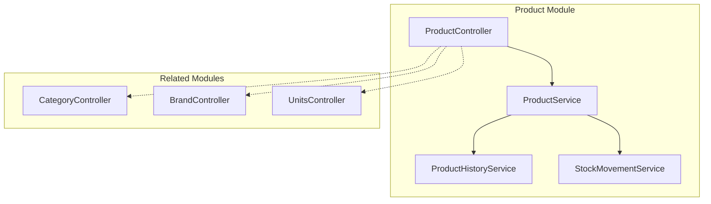
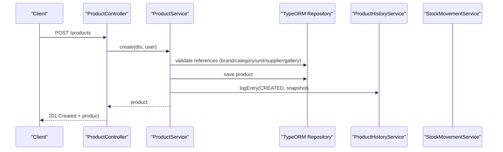
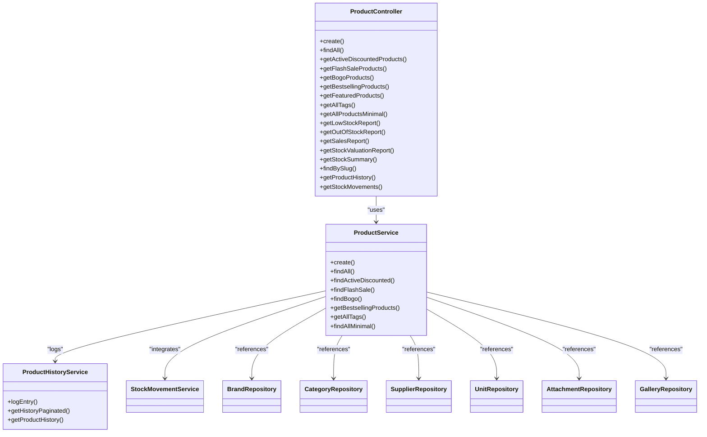

# Product Management APIs

<cite>
**Referenced Files in This Document**
- [product.controller.ts](file://apps/backend/src/product/product.controller.ts)
- [product.service.ts](file://apps/backend/src/product/product.service.ts)
- [category.controller.ts](file://apps/backend/src/category/category.controller.ts)
- [brand.controller.ts](file://apps/backend/src/brand/brand.controller.ts)
- [unit.controller.ts](file://apps/backend/src/unit/unit.controller.ts)
- [product-history.service.ts](file://apps/backend/src/product-history/product-history.service.ts)
</cite>

## Table of Contents
1. [Introduction](#introduction)
2. [Project Structure](#project-structure)
3. [Core Components](#core-components)
4. [Architecture Overview](#architecture-overview)
5. [Detailed Component Analysis](#detailed-component-analysis)
6. [Dependency Analysis](#dependency-analysis)
7. [Performance Considerations](#performance-considerations)
8. [Troubleshooting Guide](#troubleshooting-guide)
9. [Conclusion](#conclusion)

## Introduction
This document provides comprehensive API documentation for product management endpoints, including CRUD operations, filtering, sorting, pagination, category and brand associations, unit management, inventory tracking, search capabilities, stock adjustments, and product history. It also explains relationship management between products, categories, brands, and units, and includes performance optimization tips for large catalogs and bulk operations.

## Project Structure
The product management functionality is implemented in the backend NestJS application under the product module, with supporting modules for categories, brands, units, and product history. Controllers expose REST endpoints, while services implement business logic, data access, caching, and integration with related domains (campaigns, attachments, orders).

**Diagram sources**
- [product.controller.ts:49-58](file://apps/backend/src/product/product.controller.ts#L49-L58)
- [product.service.ts:56-82](file://apps/backend/src/product/product.service.ts#L56-L82)
- [category.controller.ts:39-43](file://apps/backend/src/category/category.controller.ts#L39-L43)
- [brand.controller.ts:39-43](file://apps/backend/src/brand/brand.controller.ts#L39-L43)
- [unit.controller.ts:35-39](file://apps/backend/src/unit/unit.controller.ts#L35-L39)

**Section sources**
- [product.controller.ts:49-58](file://apps/backend/src/product/product.controller.ts#L49-L58)
- [product.service.ts:56-82](file://apps/backend/src/product/product.service.ts#L56-L82)
- [category.controller.ts:39-43](file://apps/backend/src/category/category.controller.ts#L39-L43)
- [brand.controller.ts:39-43](file://apps/backend/src/brand/brand.controller.ts#L39-L43)
- [unit.controller.ts:35-39](file://apps/backend/src/unit/unit.controller.ts#L35-L39)

## Core Components
- Product Controller: Exposes endpoints for creating, listing, retrieving by slug, discounted/flash-sale/BOGO/bestsellers/featured lists, tags, minimal list, low-stock/out-of-stock reports, sales report, stock valuation/summary, product history, and stock movements.
- Product Service: Implements product queries, filters, sorting, pagination, campaign enrichment, bestseller aggregation, and report generation. Integrates with attachment, gallery, brand, category, supplier, unit repositories and services.
- Category Controller: Provides CRUD and tree/list endpoints for categories with pagination and filters.
- Brand Controller: Provides CRUD and list endpoints for brands with pagination and filters.
- Units Controller: Provides CRUD endpoints for measurement units.
- Product History Service: Records and retrieves product audit events with pagination and trimming policy.

**Section sources**
- [product.controller.ts:49-800](file://apps/backend/src/product/product.controller.ts#L49-L800)
- [product.service.ts:56-800](file://apps/backend/src/product/product.service.ts#L56-L800)
- [category.controller.ts:39-338](file://apps/backend/src/category/category.controller.ts#L39-L338)
- [brand.controller.ts:39-333](file://apps/backend/src/brand/brand.controller.ts#L39-L333)
- [unit.controller.ts:35-171](file://apps/backend/src/unit/unit.controller.ts#L35-L171)
- [product-history.service.ts:18-106](file://apps/backend/src/product-history/product-history.service.ts#L18-L106)

## Architecture Overview
The product API follows a layered architecture:
- Controllers handle HTTP requests, parameter validation, authorization, and response formatting.
- Services encapsulate business logic, query building, caching, and cross-domain integrations.
- Repositories interact with the database via TypeORM.
- Related entities (categories, brands, units, suppliers, attachments, galleries) are joined or referenced as needed.

**Diagram sources**
- [product.controller.ts:60-85](file://apps/backend/src/product/product.controller.ts#L60-L85)
- [product.service.ts:127-173](file://apps/backend/src/product/product.service.ts#L127-L173)
- [product-history.service.ts:30-52](file://apps/backend/src/product-history/product-history.service.ts#L30-L52)

## Detailed Component Analysis

### Products API
Base path: `/products`

Authentication and Authorization
- Most write endpoints require JWT and module permissions.
- Read endpoints may be public or protected depending on context.

Endpoints

- Create Product
  - Method: POST
  - Path: `/products`
  - Auth: JWT + PermissionGuard
  - Body: CreateProductDto
  - Response: 201 Created with ProductResponseDto
  - Notes: Validates brand, category, unit, supplier, gallery; handles optional attachment separately; logs CREATED event; invalidates list cache.

- List Products (filtered, sorted, paginated)
  - Method: GET
  - Path: `/products`
  - Query Parameters:
    - page: number (default 1)
    - limit: number (default 10)
    - search: string (name/description ILIKE)
    - category: number (filters by category id and child categories)
    - brand: number
    - supplier: number
    - featured: boolean
    - sort: enum ['price_asc','price_desc','name_asc','name_desc']
    - minPrice: number
    - maxPrice: number
    - isActive: boolean
    - hasDiscount: boolean
    - discountType: enum ['percentage','fixed']
    - discountActive: boolean
    - tags: string (comma-separated; stored as array and matched)
  - Response: 200 OK with message, statusCode, data array, total, page, limit, totalPages
  - Caching: HTTP cache decorator applied at controller level.

- Get Active Discounted Products
  - Method: GET
  - Path: `/products/discounted`
  - Query: page, limit, isActive
  - Response: 200 OK with paginated products
  - Caching: CacheKey 'products_discounted', TTL 60s

- Get Flash Sale Products
  - Method: GET
  - Path: `/products/flash-sale`
  - Query: page, limit, isActive
  - Response: 200 OK with paginated products covered by active flash sale campaigns (directly or via category)
  - Caching: CacheKey 'products_flash_sale', TTL 60s

- Get BOGO Products
  - Method: GET
  - Path: `/products/bogo`
  - Query: page, limit, isActive
  - Response: 200 OK with paginated products covered by active BOGO campaigns (directly or via category)
  - Caching: CacheKey 'products_bogo', TTL 60s

- Get Bestselling Products
  - Method: GET
  - Path: `/products/bestsellers`
  - Query: limit (default 10), isActive, timeFilter (enum ['this_month','last_3_months','last_6_months','last_year','this_year','all_time'])
  - Response: 200 OK with ranked products based on delivered order quantities within the selected window
  - Caching: CacheKey 'products_bestsellers', TTL 60s

- Get Featured Products
  - Method: GET
  - Path: `/products/featured`
  - Query: limit (default 10)
  - Response: 200 OK with featured and active products
  - Caching: CacheKey 'products_featured', TTL 60s

- Get All Tags
  - Method: GET
  - Path: `/products/tags`
  - Response: 200 OK with unique tag strings
  - Caching: CacheKey 'product_tags', TTL 5 minutes

- Get All Products (Minimal Fields)
  - Method: GET
  - Path: `/products/all`
  - Query: category (includes children), isActive, search, supplier
  - Response: 200 OK with lightweight product objects (id, name, sellingPrice, discount fields, weight, unitName, attachmentUrl, categoryId, categoryName)
  - Use Case: Lightweight pickers and lookups

- Low Stock Report
  - Method: GET
  - Path: `/products/reports/low-stock`
  - Auth: JWT + PermissionGuard
  - Query: page, limit, threshold (default 10)
  - Response: 200 OK with paginated low-stock products

- Out of Stock Report
  - Method: GET
  - Path: `/products/reports/out-of-stock`
  - Auth: JWT + PermissionGuard
  - Response: 200 OK with all zero-stock products

- Sales Report
  - Method: GET
  - Path: `/products/reports/sales`
  - Auth: JWT + PermissionGuard
  - Query: fromDate, toDate, preset, limit
  - Response: 200 OK with per-product sold quantity and revenue for the date range (top products by revenue), plus range totals

- Stock Valuation Report
  - Method: GET
  - Path: `/products/reports/stock-valuation`
  - Auth: JWT + PermissionGuard
  - Response: 200 OK with total units/value at purchase and selling price across all products, plus full product list with stock levels (lowest first)

- Stock Summary
  - Method: GET
  - Path: `/products/reports/stock-summary`
  - Auth: JWT + PermissionGuard
  - Response: 200 OK with counts: total, out-of-stock (stock = 0), low-stock (0 < stock < 5)

- Get Product by Slug
  - Method: GET
  - Path: `/products/slug/:slug`
  - Response: 200 OK with product details

- Get Product History
  - Method: GET
  - Path: `/products/history`
  - Auth: JWT + PermissionGuard
  - Query: page, limit, action (enum from ProductHistoryAction)
  - Response: 200 OK with paginated audit trail entries (newest first)

- Get Stock Movements
  - Method: GET
  - Path: `/products/stock-movements`
  - Auth: JWT + PermissionGuard
  - Query: page, limit, productId, type (enum from StockMovementType)
  - Response: 200 OK with ledger entries (purchase additions, reversals, cancelled-order restocks)

Validation Rules and Business Constraints
- Creation validates existence of referenced entities (brand, category, unit, supplier, gallery).
- Duplicate product names are rejected during creation.
- Tag filtering uses array containment matching.
- Discounted/FlashSale/BOGO endpoints enrich results with campaign info after retrieval to avoid stale cached campaign data.
- Bestseller ranking uses delivered orders only; time windows map to rolling months or calendar boundaries.

Error Handling
- ConflictException thrown when duplicate product name detected.
- Not found responses for slug lookup when product does not exist.
- Standardized ApiResponseDto envelope used across endpoints.

Request/Response Examples
- See endpoint annotations for example payloads and schemas. For concrete examples, refer to the Swagger/OpenAPI schema definitions generated from DTOs and decorators.

Relationship Management
- Products reference Category, Brand, Unit, Supplier, Attachment, Gallery.
- Category filter includes child categories automatically.
- Campaign eligibility can be resolved via product or category membership.

Performance Optimizations
- Selective field selection for list endpoints to reduce payload size.
- Separate count query without heavy joins.
- SWR-style in-memory cache for list queries with configurable fresh/stale TTLs.
- HTTP cache decorators for frequently accessed endpoints.
- Campaign enrichment performed post-cache to keep caches stable.

**Section sources**
- [product.controller.ts:49-800](file://apps/backend/src/product/product.controller.ts#L49-L800)
- [product.service.ts:127-800](file://apps/backend/src/product/product.service.ts#L127-L800)

### Categories API
Base path: `/categories`

Endpoints

- Create Category
  - Method: POST
  - Path: `/categories`
  - Auth: JWT + PermissionGuard
  - Body: CreateCategoryDto
  - Response: 201 Created with CategoryResponseDto

- List Categories
  - Method: GET
  - Path: `/categories`
  - Query: page, limit, search, slug, parentId, isMainCategory, sort (enum ['name_asc','name_desc']), minPrice, maxPrice
  - Response: 200 OK with paginated categories merged with product information where applicable

- Get Category Tree
  - Method: GET
  - Path: `/categories/tree`
  - Response: 200 OK with hierarchical category structure

- Get Category Details
  - Method: GET
  - Path: `/categories/:id`
  - Response: 200 OK with category details

- Update Category
  - Method: PATCH
  - Path: `/categories/:id`
  - Auth: JWT + PermissionGuard
  - Body: UpdateCategoryDto
  - Response: 200 OK with updated category

- Delete Category
  - Method: DELETE
  - Path: `/categories/:id`
  - Auth: JWT + PermissionGuard
  - Response: 200 OK confirmation

Caching
- List categories use CacheKey 'categories_key' with TTL 30 seconds.

**Section sources**
- [category.controller.ts:39-338](file://apps/backend/src/category/category.controller.ts#L39-L338)

### Brands API
Base path: `/brands`

Endpoints

- Create Brand
  - Method: POST
  - Path: `/brands`
  - Auth: JWT + PermissionGuard
  - Body: CreateBrandDto
  - Response: 201 Created with BrandResponseDto

- List Brands
  - Method: GET
  - Path: `/brands`
  - Query: page, limit, search, slug, isActive, sort (enum ['price_asc','price_desc','name_asc','name_desc']), minPrice, maxPrice
  - Response: 200 OK with paginated brands

- Get Brand Details
  - Method: GET
  - Path: `/brands/:id`
  - Response: 200 OK with brand details

- Update Brand
  - Method: PATCH
  - Path: `/brands/:id`
  - Auth: JWT + PermissionGuard
  - Body: UpdateBrandDto
  - Response: 200 OK with updated brand

- Delete Brand
  - Method: DELETE
  - Path: `/brands/:id`
  - Auth: JWT + PermissionGuard
  - Response: 204 No Content

**Section sources**
- [brand.controller.ts:39-333](file://apps/backend/src/brand/brand.controller.ts#L39-L333)

### Units API
Base path: `/units`

Endpoints

- Create Unit
  - Method: POST
  - Path: `/units`
  - Auth: JWT + PermissionGuard
  - Body: CreateUnitDto
  - Response: 201 Created with Unit entity

- List Units
  - Method: GET
  - Path: `/units`
  - Response: 200 OK with all units

- Get Unit by ID
  - Method: GET
  - Path: `/units/:id`
  - Response: 200 OK with unit entity

- Update Unit
  - Method: PATCH
  - Path: `/units/:id`
  - Auth: JWT + PermissionGuard
  - Body: UpdateUnitDto
  - Response: 200 OK with updated unit

- Delete Unit
  - Method: DELETE
  - Path: `/units/:id`
  - Auth: JWT + PermissionGuard
  - Response: 200 OK soft-deactivation confirmation

**Section sources**
- [unit.controller.ts:35-171](file://apps/backend/src/unit/unit.controller.ts#L35-L171)

### Product History API
Base path: `/products/history`

Endpoints

- Get Product History
  - Method: GET
  - Path: `/products/history`
  - Auth: JWT + PermissionGuard
  - Query: page, limit, action (enum from ProductHistoryAction)
  - Response: 200 OK with paginated audit entries (newest first)

Behavior
- History entries include product id/name, action, changes/snapshot, and user info.
- Per-product history trimming keeps the newest N entries (configurable constant).
- History logging failures are logged but do not break the originating operation.

**Section sources**
- [product-history.service.ts:18-106](file://apps/backend/src/product-history/product-history.service.ts#L18-L106)

## Dependency Analysis
Product service depends on multiple repositories and services:
- Brand, Category, Supplier, Unit, Attachment, Gallery repositories
- FlashSaleCampaignsService and BogoCampaignsService for campaign enrichment
- ProductHistoryService for audit logging
- StockMovementService for stock movement records

**Diagram sources**
- [product.service.ts:56-82](file://apps/backend/src/product/product.service.ts#L56-L82)
- [product.controller.ts:49-800](file://apps/backend/src/product/product.controller.ts#L49-L800)
- [product-history.service.ts:18-106](file://apps/backend/src/product-history/product-history.service.ts#L18-L106)

**Section sources**
- [product.service.ts:56-82](file://apps/backend/src/product/product.service.ts#L56-L82)
- [product.controller.ts:49-800](file://apps/backend/src/product/product.controller.ts#L49-L800)
- [product-history.service.ts:18-106](file://apps/backend/src/product-history/product-history.service.ts#L18-L106)

## Performance Considerations
- Use selective field selection in list queries to minimize payload size and DB load.
- Leverage SWR-style caching for product lists with short fresh TTL and longer stale TTL to reduce DB hits under concurrent load.
- Apply HTTP cache decorators for read-only endpoints that serve frequent traffic (discounted, flash-sale, BOGO, bestsellers, featured, tags).
- Avoid unnecessary joins in count queries; join only when filters require them.
- Enrich campaign data after cache retrieval to prevent cache staleness issues.
- For large catalogs, prefer minimal endpoints (`/products/all`) for lightweight UI components.
- Paginate all list endpoints and tune page/limit appropriately for client needs.
- Use precomputed reports (low-stock, out-of-stock, stock valuation, stock summary) to offload heavy aggregations from real-time queries.

[No sources needed since this section provides general guidance]

## Troubleshooting Guide
Common Issues and Resolutions
- Duplicate product name on creation: The service throws a conflict error when a product with the same name already exists. Ensure unique names or update existing products instead of creating duplicates.
- Invalid reference IDs: When creating or updating products, ensure brandId, categoryId, unitId, supplierId, and galleryId correspond to existing active entities.
- Tag filtering not returning expected results: Tags are stored as arrays; ensure the comma-separated input is correctly split and matches array elements.
- Stale campaign data in cached lists: Campaign enrichment occurs after cache retrieval to maintain consistency; if campaign eligibility seems incorrect, verify campaign status and cache TTL behavior.
- Bestseller ranking discrepancies: Rankings are based on delivered orders only; canceled orders are excluded. Time windows follow defined presets.

Error Codes
- 201 Created: Successful creation of resources (products, categories, brands, units).
- 200 OK: Successful retrieval/update/deletion confirmations.
- 400 Bad Request: Invalid input data (e.g., malformed parameters, invalid enums).
- 404 Not Found: Resource not found (e.g., slug lookup, category/brand/unit deletion).
- 409 Conflict: Duplicate product name during creation.

Operational Notes
- History logging failures are non-fatal and logged; they do not interrupt the primary operation.
- Soft delete for units deactivates rather than permanently removes records.

**Section sources**
- [product.service.ts:127-173](file://apps/backend/src/product/product.service.ts#L127-L173)
- [product-history.service.ts:30-52](file://apps/backend/src/product-history/product-history.service.ts#L30-L52)
- [unit.controller.ts:143-171](file://apps/backend/src/unit/unit.controller.ts#L143-L171)

## Conclusion
The product management APIs provide robust CRUD operations, rich filtering and sorting, efficient pagination, and specialized endpoints for discounts, campaigns, bestsellers, and reports. Relationships with categories, brands, units, and suppliers are well-supported, and product history ensures an audit trail. With built-in caching strategies and optimized queries, the system scales effectively for large catalogs. Use the provided endpoints and query parameters to build performant and reliable product experiences.