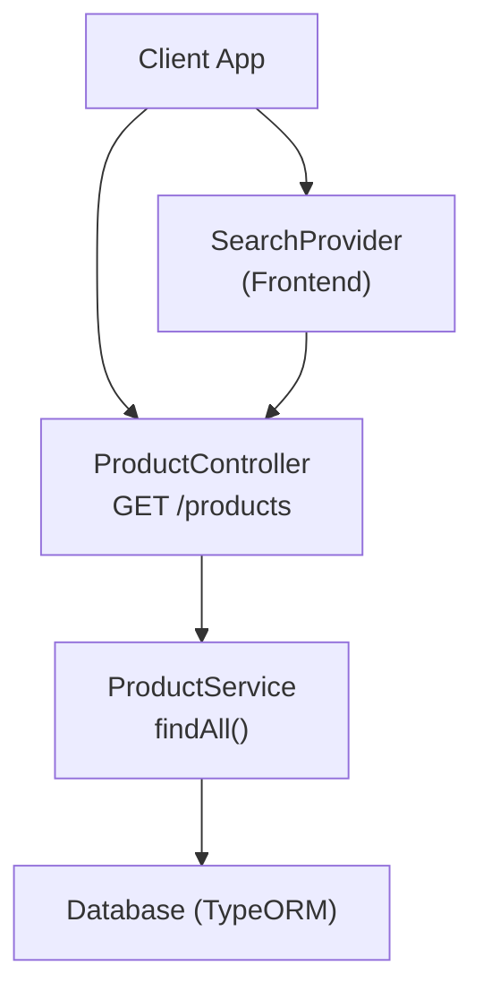
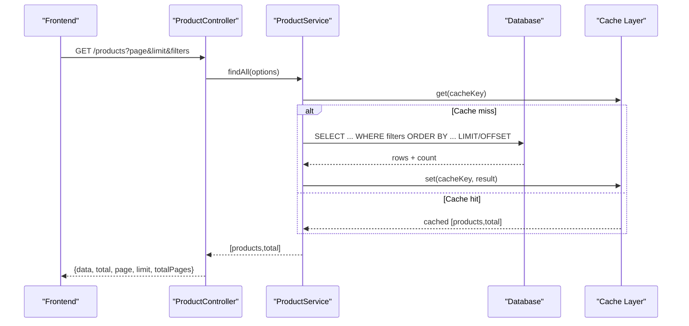
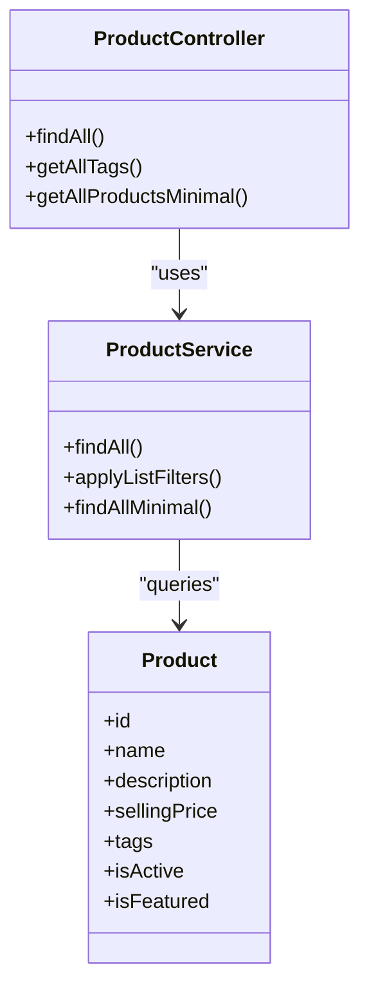

# Search & Filtering

<cite>
**Referenced Files in This Document**
- [product.controller.ts](file://apps/backend/src/product/product.controller.ts)
- [product.service.ts](file://apps/backend/src/product/product.service.ts)
- [product.entity.ts](file://apps/backend/src/product/entities/product.entity.ts)
- [search-provider.tsx](file://apps/frontend/providers/search-provider.tsx)
- [use-global-search.tsx](file://apps/frontend/hooks/use-global-search.tsx)
- [products page](file://apps/frontend/app/(main)/products/page.tsx)
</cite>

## Table of Contents
1. [Introduction](#introduction)
2. [Project Structure](#project-structure)
3. [Core Components](#core-components)
4. [Architecture Overview](#architecture-overview)
5. [Detailed Component Analysis](#detailed-component-analysis)
6. [Dependency Analysis](#dependency-analysis)
7. [Performance Considerations](#performance-considerations)
8. [Troubleshooting Guide](#troubleshooting-guide)
9. [Conclusion](#conclusion)

## Introduction
This document describes the product search and filtering capabilities exposed by the backend and used by the frontend. It covers query parameters for searching products by name, description, price range, category, brand, supplier, tags, and availability status; sorting options; pagination; faceted search via tags; full-text search behavior; caching and performance; and mobile/global search integration.

## Project Structure
The product search feature spans:
- Backend controller that exposes REST endpoints with Swagger-declared query parameters
- Service layer that builds optimized TypeORM queries, applies filters, sorts, paginates, and caches results
- Product entity defining indexed fields and tag arrays used for filtering
- Frontend global search provider that debounces input, calls the API, and updates UI state

**Diagram sources**
- [product.controller.ts:87-250](file://apps/backend/src/product/product.controller.ts#L87-L250)
- [product.service.ts:175-302](file://apps/backend/src/product/product.service.ts#L175-L302)
- [search-provider.tsx:46-87](file://apps/frontend/providers/search-provider.tsx#L46-L87)

**Section sources**
- [product.controller.ts:87-250](file://apps/backend/src/product/product.controller.ts#L87-L250)
- [product.service.ts:175-302](file://apps/backend/src/product/product.service.ts#L175-L302)
- [search-provider.tsx:46-87](file://apps/frontend/providers/search-provider.tsx#L46-L87)

## Core Components
- Product listing endpoint: GET /products with extensive query parameters for filtering, sorting, and pagination
- Minimal product list endpoint: GET /products/all for lightweight lookups and admin pickers
- Global search UI: Debounced client-side search calling GET /products?search=...&isActive=true
- Facets: Tags array on products enables tag-based filtering and a dedicated tags endpoint

Key responsibilities:
- Controller validates and documents query parameters
- Service constructs efficient queries, applies filters, sorts, paginates, and caches results
- Entity defines indexes and tag arrays to support fast filtering and searches

**Section sources**
- [product.controller.ts:87-250](file://apps/backend/src/product/product.controller.ts#L87-L250)
- [product.controller.ts:487-515](file://apps/backend/src/product/product.controller.ts#L487-L515)
- [product.controller.ts:517-584](file://apps/backend/src/product/product.controller.ts#L517-L584)
- [product.service.ts:175-302](file://apps/backend/src/product/product.service.ts#L175-L302)
- [product.service.ts:306-353](file://apps/backend/src/product/product.service.ts#L306-L353)
- [product.entity.ts:41-49](file://apps/backend/src/product/entities/product.entity.ts#L41-L49)
- [product.entity.ts:486-498](file://apps/backend/src/product/entities/product.entity.ts#L486-L498)
- [search-provider.tsx:46-87](file://apps/frontend/providers/search-provider.tsx#L46-L87)

## Architecture Overview
The product search flow uses a layered architecture:
- HTTP layer (controller) declares and parses query parameters
- Business layer (service) composes TypeORM queries with joins, filters, sorting, and pagination
- Data layer (database) leverages indexes and array operators for performance
- Caching is applied at multiple levels (HTTP cache headers, service-level SWR cache, and database query cache)

**Diagram sources**
- [product.controller.ts:87-250](file://apps/backend/src/product/product.controller.ts#L87-L250)
- [product.service.ts:175-302](file://apps/backend/src/product/product.service.ts#L175-L302)

## Detailed Component Analysis

### Product Listing API: GET /products
Purpose: Retrieve a filtered, sorted, and paginated list of products.

Query parameters:
- Pagination
  - page: Page number (default 1)
  - limit: Items per page (default 10)
- Filters
  - category: Filter by category ID (includes child categories)
  - brand: Filter by brand ID
  - supplier: Filter by supplier ID
  - featured: Boolean filter for featured products
  - isActive: Boolean filter for active products
  - hasDiscount: Boolean filter for any discount
  - discountType: Enum ["percentage","fixed"]
  - discountActive: Boolean filter for currently active discounts
  - minPrice: Numeric lower bound on sellingPrice
  - maxPrice: Numeric upper bound on sellingPrice
  - tags: Comma-separated string; matches product.tags array
  - search: Case-insensitive match on product.name or product.description
- Sorting
  - sort: Enum ["price_asc","price_desc","name_asc","name_desc"]; defaults to name ascending

Response shape:
- data: Array of product objects
- meta: total, page, limit, totalPages

Notes:
- The endpoint is decorated with HTTP cache headers for short-lived browser/CDN caching
- The service implements an internal SWR-style cache with stale-while-revalidate semantics

Example usage patterns:
- Price-range search within a category: ?category=1&minPrice=100&maxPrice=500
- Active discounted items: ?hasDiscount=true&discountActive=true
- Tag-based facet: ?tags=organic,fresh
- Full-text search: ?search=beef

**Section sources**
- [product.controller.ts:87-250](file://apps/backend/src/product/product.controller.ts#L87-L250)
- [product.service.ts:175-302](file://apps/backend/src/product/product.service.ts#L175-L302)
- [product.service.ts:306-353](file://apps/backend/src/product/product.service.ts#L306-L353)

### Minimal Products API: GET /products/all
Purpose: Lightweight product list for pickers and admin interfaces without pagination.

Query parameters:
- category: Filter by category ID (includes child categories)
- isActive: Boolean filter
- search: Case-insensitive match on product.name
- supplier: Filter by supplier ID

Response shape:
- Array of minimal product objects including id, name, slug, prices, weight, unitName, attachmentUrl, categoryId, categoryName

Use cases:
- Admin campaign builders selecting eligible products
- Dropdowns and autocomplete lists

**Section sources**
- [product.controller.ts:517-584](file://apps/backend/src/product/product.controller.ts#L517-L584)
- [product.service.ts:355-448](file://apps/backend/src/product/product.service.ts#L355-L448)

### Tags Facet API: GET /products/tags
Purpose: Return all unique product tags to power faceted navigation.

Behavior:
- Returns a list of strings representing distinct tags across products
- Cached for several minutes to reduce load

**Section sources**
- [product.controller.ts:487-515](file://apps/backend/src/product/product.controller.ts#L487-L515)
- [product.entity.ts:486-498](file://apps/backend/src/product/entities/product.entity.ts#L486-L498)

### Full-Text Search Behavior
Implementation:
- The search parameter performs case-insensitive substring matching against product.name and product.description using ILIKE
- No custom relevance scoring or highlighting is implemented in the current codebase

Implications:
- Results are not ranked by relevance score
- Clients can implement simple highlighting if needed based on matched substrings

**Section sources**
- [product.service.ts:336-341](file://apps/backend/src/product/product.service.ts#L336-L341)

### Sorting Options
Supported values:
- price_asc, price_desc: Sort by sellingPrice
- name_asc, name_desc: Sort by name
Default: name ascending when no sort is provided

Note:
- Additional sort keys such as rating, popularity, or date added are not supported by this endpoint

**Section sources**
- [product.controller.ts:149-155](file://apps/backend/src/product/product.controller.ts#L149-L155)
- [product.service.ts:259-278](file://apps/backend/src/product/product.service.ts#L259-L278)

### Pagination Strategy
Current implementation:
- Offset-based pagination using skip/take with page and limit parameters
- Response includes total, page, limit, and totalPages

Cursor-based pagination:
- Not implemented in the current codebase

Recommendation:
- For very large catalogs, consider adding cursor-based pagination endpoints alongside offset-based ones

**Section sources**
- [product.controller.ts:94-107](file://apps/backend/src/product/product.controller.ts#L94-L107)
- [product.service.ts:290-299](file://apps/backend/src/product/product.service.ts#L290-L299)

### Faceted Search via Tags
Mechanism:
- Products store tags as a text array
- The tags query parameter accepts comma-separated values and matches against the array
- A dedicated tags endpoint returns all available tags for building dynamic facets

Usage example:
- ?tags=organic,fresh

**Section sources**
- [product.service.ts:348-352](file://apps/backend/src/product/product.service.ts#L348-L352)
- [product.controller.ts:487-515](file://apps/backend/src/product/product.controller.ts#L487-L515)
- [product.entity.ts:486-498](file://apps/backend/src/product/entities/product.entity.ts#L486-L498)

### Complex Query Examples
- Category + brand + price range + active only:
  ?category=1&brand=2&minPrice=100&maxPrice=500&isActive=true
- Featured products with any discount:
  ?featured=true&hasDiscount=true
- Tag-based search with sorting:
  ?tags=organic&sort=price_asc
- Full-text search within a category:
  ?category=1&search=beef

**Section sources**
- [product.controller.ts:94-221](file://apps/backend/src/product/product.controller.ts#L94-L221)
- [product.service.ts:306-353](file://apps/backend/src/product/product.service.ts#L306-L353)

### Mobile and Global Search Integration
Global search:
- Frontend SearchProvider debounces user input, calls GET /products?search=...&isActive=true, and updates UI state
- URL sync supports sharing search queries via query string

Products page:
- Renders filters and sort controls, passing query parameters to the backend

Autocomplete suggestions:
- Implemented via the global search provider’s debounced fetch and result rendering

**Section sources**
- [search-provider.tsx:32-87](file://apps/frontend/providers/search-provider.tsx#L32-L87)
- [use-global-search.tsx:6-12](file://apps/frontend/hooks/use-global-search.tsx#L6-L12)
- [products page:105-148](file://apps/frontend/app/(main)/products/page.tsx#L105-L148)

## Dependency Analysis
Component relationships:
- ProductController depends on ProductService for business logic
- ProductService depends on TypeORM repositories for Product, Brand, Category, Supplier, Unit, Attachment
- Product entity defines indexes and relations consumed by queries
- Frontend SearchProvider consumes the same /products endpoint for global search

**Diagram sources**
- [product.controller.ts:87-250](file://apps/backend/src/product/product.controller.ts#L87-L250)
- [product.service.ts:175-302](file://apps/backend/src/product/product.service.ts#L175-L302)
- [product.entity.ts:41-49](file://apps/backend/src/product/entities/product.entity.ts#L41-L49)

**Section sources**
- [product.controller.ts:87-250](file://apps/backend/src/product/product.controller.ts#L87-L250)
- [product.service.ts:175-302](file://apps/backend/src/product/product.service.ts#L175-L302)
- [product.entity.ts:41-49](file://apps/backend/src/product/entities/product.entity.ts#L41-L49)

## Performance Considerations
Optimization techniques present in the codebase:
- Database indexing
  - Indexes on slug, isActive, isFeatured, saleCount, sellingPrice, createdAt, and composite indexes for common filters
- Query optimization
  - Selective joins only when filters require them
  - Separate count query without payload joins to reduce overhead
  - Use of ILIKE for case-insensitive search and array operators for tags
- Caching strategies
  - HTTP cache headers on endpoints for short-lived browser/CDN caching
  - Service-level SWR-style cache with fresh/stale TTLs for product lists
  - Database query cache for specific endpoints (e.g., minimal product list)

Recommendations:
- Add GIN index on tags array for faster tag-based filtering
- Introduce a dedicated full-text search column or external search engine for advanced relevance scoring and highlighting
- Implement cursor-based pagination for deep paging scenarios

**Section sources**
- [product.entity.ts:41-49](file://apps/backend/src/product/entities/product.entity.ts#L41-L49)
- [product.service.ts:111-125](file://apps/backend/src/product/product.service.ts#L111-L125)
- [product.service.ts:242-257](file://apps/backend/src/product/product.service.ts#L242-L257)
- [product.service.ts:424-431](file://apps/backend/src/product/product.service.ts#L424-L431)
- [product.controller.ts:87-93](file://apps/backend/src/product/product.controller.ts#L87-L93)

## Troubleshooting Guide
Common issues and resolutions:
- Empty results with complex filters
  - Verify parameter types and ranges (e.g., numeric minPrice/maxPrice)
  - Ensure category IDs include children as expected by the filter logic
- Slow search performance
  - Limit search terms length and avoid overly broad queries
  - Prefer exact tag filters over broad full-text searches where possible
- Stale data after mutations
  - The service invalidates its internal list cache on mutations; ensure clients respect cache headers and refresh appropriately

Validation and error handling:
- Controller ignores unknown enum values gracefully for some endpoints
- Service throws domain-specific exceptions for invalid operations (e.g., conflicts)

**Section sources**
- [product.controller.ts:149-155](file://apps/backend/src/product/product.controller.ts#L149-L155)
- [product.service.ts:131-137](file://apps/backend/src/product/product.service.ts#L131-L137)
- [product.service.ts:122-125](file://apps/backend/src/product/product.service.ts#L122-L125)

## Conclusion
The product search and filtering system provides robust, well-documented endpoints for filtering by category, brand, supplier, tags, price range, and availability, with flexible sorting and offset-based pagination. Full-text search is implemented via ILIKE without custom relevance scoring. Performance is improved through selective joins, targeted indexes, and multi-layered caching. The frontend integrates seamlessly with global search and faceted navigation. Future enhancements could include cursor-based pagination, advanced relevance scoring, and richer analytics around popular search terms.