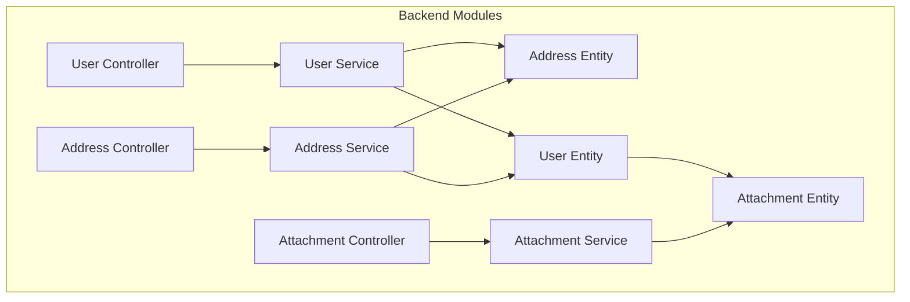
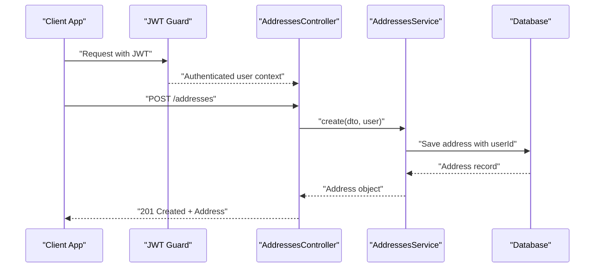
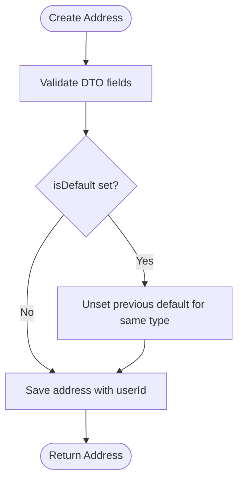
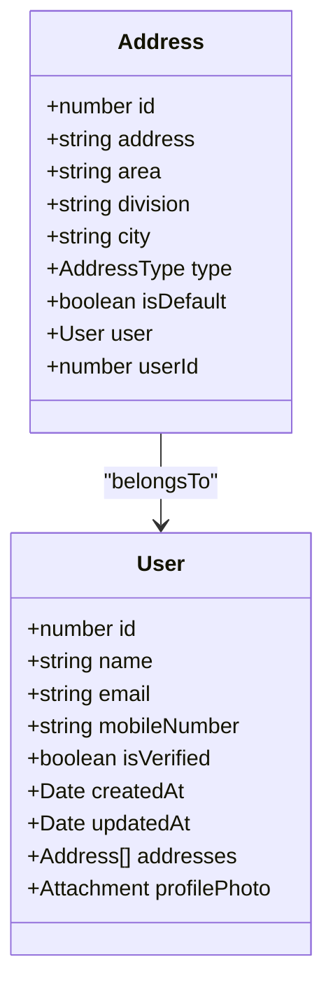
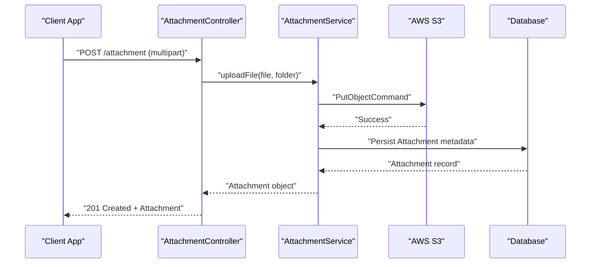
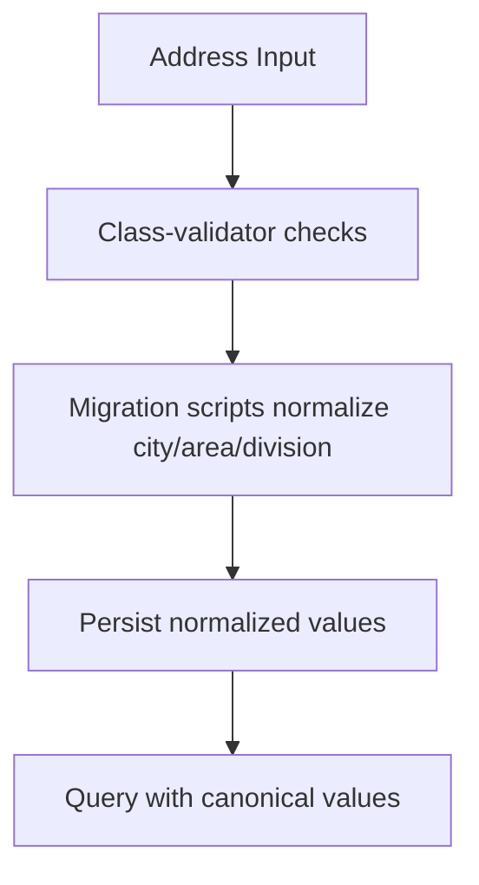
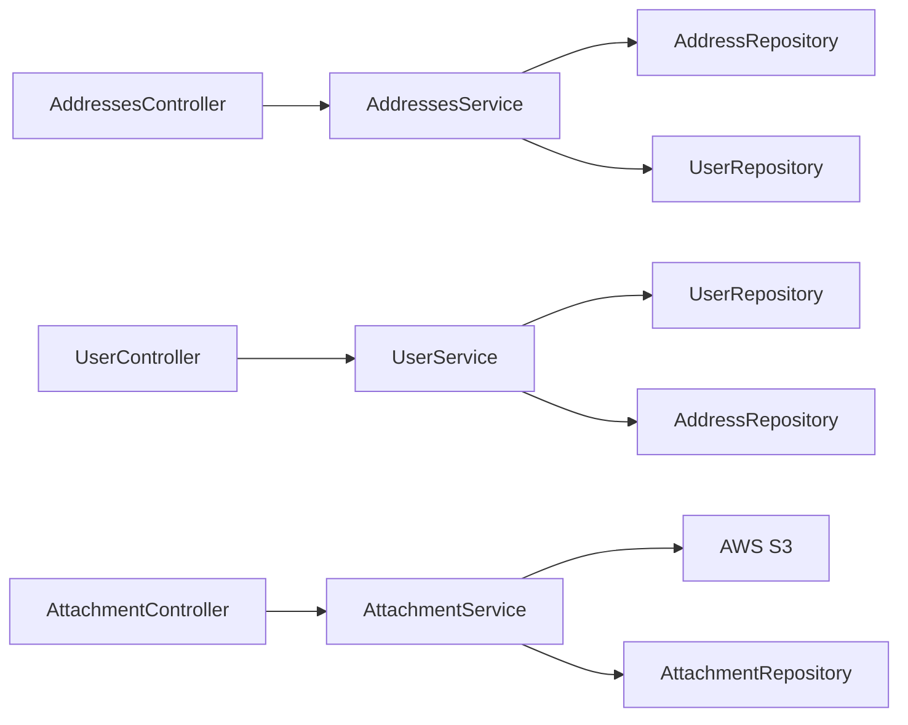

# Address & Profile Management

<cite>
**Referenced Files in This Document**
- [address.controller.ts](file://apps/backend/src/address/address.controller.ts)
- [address.service.ts](file://apps/backend/src/address/address.service.ts)
- [address.entity.ts](file://apps/backend/src/address/entities/address.entity.ts)
- [create-address.dto.ts](file://apps/backend/src/address/dto/create-address.dto.ts)
- [update-address.dto.ts](file://apps/backend/src/address/dto/update-address.dto.ts)
- [enums/index.ts](file://apps/backend/src/common/enums/index.ts)
- [user.controller.ts](file://apps/backend/src/user/user.controller.ts)
- [user.service.ts](file://apps/backend/src/user/user.service.ts)
- [user.entity.ts](file://apps/backend/src/user/entities/user.entity.ts)
- [attachment.controller.ts](file://apps/backend/src/attachment/attachment.controller.ts)
- [attachment.service.ts](file://apps/backend/src/attachment/attachment.service.ts)
- [attachment.entity.ts](file://apps/backend/src/attachment/entities/attachment.entity.ts)
- [migrate-address-locations.js](file://apps/backend/scripts/migrate-address-locations.js)
- [backfill-divisions.js](file://apps/backend/scripts/backfill-divisions.js)
</cite>

## Table of Contents
1. [Introduction](#introduction)
2. [Project Structure](#project-structure)
3. [Core Components](#core-components)
4. [Architecture Overview](#architecture-overview)
5. [Detailed Component Analysis](#detailed-component-analysis)
6. [Dependency Analysis](#dependency-analysis)
7. [Performance Considerations](#performance-considerations)
8. [Troubleshooting Guide](#troubleshooting-guide)
9. [Conclusion](#conclusion)

## Introduction
This document provides detailed API documentation for address and profile management in the backend. It covers:
- Address CRUD operations, default address handling, and filtering by type.
- Address validation rules and data model constraints.
- Profile picture upload, attachment storage, and user profile updates.
- Data normalization scripts that standardize city, area, and division values.
- Integration points with orders, shipping methods, and location-based queries.

The goal is to help frontend developers, integrators, and maintainers understand how addresses and profiles are created, updated, validated, stored, and consumed across the system.

## Project Structure
The relevant backend modules are organized under feature folders:
- `src/address` exposes address endpoints, DTOs, and entity definitions.
- `src/user` manages user accounts, including profile photo relations and administrative user queries.
- `src/attachment` handles file uploads to AWS S3 and stores metadata in the database.
- `scripts` contains migration utilities for normalizing address locations and divisions.

**Diagram sources**
- [address.controller.ts:1-221](file://apps/backend/src/address/address.controller.ts#L1-L221)
- [address.service.ts:1-158](file://apps/backend/src/address/address.service.ts#L1-L158)
- [address.entity.ts:1-48](file://apps/backend/src/address/entities/address.entity.ts#L1-L48)
- [user.controller.ts:1-399](file://apps/backend/src/user/user.controller.ts#L1-L399)
- [user.service.ts:1-800](file://apps/backend/src/user/user.service.ts#L1-L800)
- [user.entity.ts:1-183](file://apps/backend/src/user/entities/user.entity.ts#L1-L183)
- [attachment.controller.ts:1-113](file://apps/backend/src/attachment/attachment.controller.ts#L1-L113)
- [attachment.service.ts:1-196](file://apps/backend/src/attachment/attachment.service.ts#L1-L196)
- [attachment.entity.ts:1-118](file://apps/backend/src/attachment/entities/attachment.entity.ts#L1-L118)

**Section sources**
- [address.controller.ts:1-221](file://apps/backend/src/address/address.controller.ts#L1-L221)
- [user.controller.ts:1-399](file://apps/backend/src/user/user.controller.ts#L1-L399)
- [attachment.controller.ts:1-113](file://apps/backend/src/attachment/attachment.controller.ts#L1-L113)

## Core Components
- Address module:
  - Controller defines REST endpoints for creating, listing, retrieving, updating, deleting, and filtering addresses.
  - Service implements business logic, including default address enforcement and user-scoped access control.
  - Entity models the address fields and relationship to users.
- User module:
  - Controller exposes administrative endpoints for listing customers and other users.
  - Service includes user retrieval, top customer analytics, and profile photo relation handling.
  - Entity links a user to their addresses and profile photo attachment.
- Attachment module:
  - Controller accepts single or multiple file uploads with size validation.
  - Service uploads files to AWS S3 and persists metadata.
  - Entity represents uploaded assets and relationships to users, products, brands, categories, and galleries.

**Section sources**
- [address.controller.ts:45-219](file://apps/backend/src/address/address.controller.ts#L45-L219)
- [address.service.ts:24-156](file://apps/backend/src/address/address.service.ts#L24-L156)
- [address.entity.ts:13-46](file://apps/backend/src/address/entities/address.entity.ts#L13-L46)
- [user.controller.ts:42-346](file://apps/backend/src/user/user.controller.ts#L42-L346)
- [user.service.ts:118-713](file://apps/backend/src/user/user.service.ts#L118-L713)
- [user.entity.ts:59-154](file://apps/backend/src/user/entities/user.entity.ts#L59-L154)
- [attachment.controller.ts:36-111](file://apps/backend/src/attachment/attachment.controller.ts#L36-L111)
- [attachment.service.ts:38-194](file://apps/backend/src/attachment/attachment.service.ts#L38-L194)
- [attachment.entity.ts:19-117](file://apps/backend/src/attachment/entities/attachment.entity.ts#L19-L117)

## Architecture Overview
The address and profile management architecture follows a layered approach:
- Controllers handle HTTP requests, authentication, authorization, and Swagger metadata.
- Services encapsulate business rules, repository interactions, and cross-cutting concerns like default address management.
- Entities define persistent data structures and relationships.
- Attachments integrate with AWS S3 for scalable media storage.

**Diagram sources**
- [address.controller.ts:45-64](file://apps/backend/src/address/address.controller.ts#L45-L64)
- [address.service.ts:24-40](file://apps/backend/src/address/address.service.ts#L24-L40)

**Section sources**
- [address.controller.ts:1-221](file://apps/backend/src/address/address.controller.ts#L1-L221)
- [address.service.ts:1-158](file://apps/backend/src/address/address.service.ts#L1-L158)

## Detailed Component Analysis

### Address Endpoints
The address module exposes the following endpoints:
- Create address: POST `/addresses`
- List addresses: GET `/addresses` (admin sees all; regular users see own)
- Get default address: GET `/addresses/default?type=shipping|billing`
- Get address by ID: GET `/addresses/:id`
- Update address: PATCH `/addresses/:id`
- Delete address: DELETE `/addresses/:id`
- List addresses by user ID: GET `/addresses/user/:userId?type=shipping|billing`

Authentication and authorization:
- All endpoints require JWT authentication.
- Admins can list all addresses and access any user’s addresses via `/addresses/user/:userId`.
- Regular users can only access their own addresses.

Default address behavior:
- When setting an address as default for a given type, existing defaults for that type are unset before saving.
- Default addresses are ordered first when listing.

Validation rules:
- `address`: required string.
- `area`, `division`, `city`: optional strings.
- `type`: required enum value from `AddressType` (`shipping`, `billing`).
- `isDefault`: optional boolean.

International address support:
- The model uses generic fields (`address`, `area`, `division`, `city`) without country-specific formatting.
- Validation does not enforce international formats; it allows flexible text input.

Geocoding integration:
- No geocoding endpoint is implemented in the address service.
- Location normalization is performed by migration scripts rather than runtime geocoding.

Shipping preferences:
- Addresses include a `type` field to distinguish shipping vs billing.
- Default address per type supports quick selection during checkout.

Bulk operations and import/export:
- Bulk creation or bulk deletion endpoints are not exposed.
- Import/export functionality is not present in the address controller or service.

Location-based services:
- Address records include area, division, and city fields used by reports and analytics.
- Scripts normalize these fields to canonical values for consistent querying.

**Diagram sources**
- [address.service.ts:24-40](file://apps/backend/src/address/address.service.ts#L24-L40)

**Section sources**
- [address.controller.ts:45-219](file://apps/backend/src/address/address.controller.ts#L45-L219)
- [address.service.ts:24-156](file://apps/backend/src/address/address.service.ts#L24-L156)
- [create-address.dto.ts:11-44](file://apps/backend/src/address/dto/create-address.dto.ts#L11-L44)
- [update-address.dto.ts:1-5](file://apps/backend/src/address/dto/update-address.dto.ts#L1-L5)
- [enums/index.ts:1-4](file://apps/backend/src/common/enums/index.ts#L1-L4)

### Address Data Model
The address entity includes:
- `id`: primary key.
- `address`: free-form street address.
- `area`: neighborhood or locality.
- `division`: administrative region.
- `city`: city name.
- `type`: enum indicating shipping or billing.
- `isDefault`: flag for default selection within a type.
- `user`: many-to-one relation to the owning user.

Complexity considerations:
- Queries typically join with the user relation and order by `isDefault` descending.
- Filtering by type is supported at both controller and service layers.

**Diagram sources**
- [address.entity.ts:13-46](file://apps/backend/src/address/entities/address.entity.ts#L13-L46)
- [user.entity.ts:59-154](file://apps/backend/src/user/entities/user.entity.ts#L59-L154)

**Section sources**
- [address.entity.ts:13-46](file://apps/backend/src/address/entities/address.entity.ts#L13-L46)

### Profile Picture Management
Profile pictures are managed through the attachment module and linked to users:
- Upload single file: POST `/attachment`
- Upload multiple files: POST `/attachment/upload-multiple`
- List attachments: GET `/attachment`
- Get attachment by ID: GET `/attachment/:id`
- Delete attachment: DELETE `/attachment/:id`

Upload constraints:
- Single file upload validates maximum size of 5MB.
- Files are stored in AWS S3 with public-read ACL.
- Metadata includes filename, original name, MIME type, size, URL, and storage key.

Profile update flow:
- Frontend uploads an image to `/attachment`, receives an attachment ID.
- Frontend calls user update endpoint with `profilePhotoId`.
- Backend resolves the attachment relation and saves it on the user entity.
- Response excludes sensitive fields like password and OTP.

Image optimization:
- No server-side image resizing or compression is implemented in the attachment service.
- Frontend may use client-side optimization or CDN transformations.

Avatar handling:
- Users have a one-to-one relation to an attachment representing their profile photo.
- Updating or removing the profile photo involves setting or clearing the relation.

**Diagram sources**
- [attachment.controller.ts:36-66](file://apps/backend/src/attachment/attachment.controller.ts#L36-L66)
- [attachment.service.ts:38-71](file://apps/backend/src/attachment/attachment.service.ts#L38-L71)

**Section sources**
- [attachment.controller.ts:36-111](file://apps/backend/src/attachment/attachment.controller.ts#L36-L111)
- [attachment.service.ts:38-194](file://apps/backend/src/attachment/attachment.service.ts#L38-L194)
- [user.service.ts:630-713](file://apps/backend/src/user/user.service.ts#L630-L713)
- [user.entity.ts:123-154](file://apps/backend/src/user/entities/user.entity.ts#L123-L154)

### Address Validation and Formatting Standardization
Validation:
- Required fields: `address`, `type`.
- Optional fields: `area`, `division`, `city`, `isDefault`.
- Type must be one of the defined enums.

Formatting standardization:
- The API does not enforce strict formatting rules beyond basic string validation.
- Migration scripts normalize city and area values against known districts and areas.
- Division backfill aligns division values based on canonical city mappings.

International support:
- Fields are generic and do not encode country-specific structure.
- Clients should supply localized address components as needed.

**Diagram sources**
- [create-address.dto.ts:11-44](file://apps/backend/src/address/dto/create-address.dto.ts#L11-L44)
- [migrate-address-locations.js:592-700](file://apps/backend/scripts/migrate-address-locations.js#L592-L700)
- [backfill-divisions.js:49-113](file://apps/backend/scripts/backfill-divisions.js#L49-L113)

**Section sources**
- [create-address.dto.ts:11-44](file://apps/backend/src/address/dto/create-address.dto.ts#L11-L44)
- [migrate-address-locations.js:592-700](file://apps/backend/scripts/migrate-address-locations.js#L592-L700)
- [backfill-divisions.js:49-113](file://apps/backend/scripts/backfill-divisions.js#L49-L113)

### Address Book Organization and Shipping Preferences
Organization:
- Addresses are owned by users and can be filtered by type.
- Default address per type simplifies selection for shipping and billing.

Shipping preferences:
- Use `type=shipping` to retrieve shipping-related addresses.
- Default address lookup returns the most relevant address for a given type.

Multi-address scenarios:
- Users can store multiple addresses; ordering prioritizes default addresses.
- Admins can query addresses by user ID for support or auditing.

Address history tracking:
- There is no dedicated address history table; changes are reflected by updates to the address record.
- Order history references the address snapshot at order time, enabling historical delivery analysis.

**Section sources**
- [address.controller.ts:65-219](file://apps/backend/src/address/address.controller.ts#L65-L219)
- [address.service.ts:42-147](file://apps/backend/src/address/address.service.ts#L42-L147)
- [user.service.ts:118-355](file://apps/backend/src/user/user.service.ts#L118-L355)

### Delivery Zone Calculations and Verification Services
Delivery zone calculations:
- No explicit delivery zone calculation endpoint exists in the address module.
- Area, division, and city fields are available for external routing or zone mapping systems.

Address verification services:
- No third-party address verification integration is present in the address service.
- Normalization scripts provide internal consistency but do not validate deliverability.

**Section sources**
- [address.service.ts:42-147](file://apps/backend/src/address/address.service.ts#L42-L147)
- [migrate-address-locations.js:592-700](file://apps/backend/scripts/migrate-address-locations.js#L592-L700)

## Dependency Analysis
Key dependencies:
- Address controller depends on JWT guard and admin guard for authorization.
- Address service depends on TypeORM repositories for Address and User entities.
- User service joins addresses and profile photos in administrative queries.
- Attachment service depends on AWS SDK for S3 operations and config service for credentials.

Potential coupling:
- Address service directly manipulates default flags, which affects listing order.
- User service eagerly loads profile photo relations, impacting response payload size.

External integrations:
- AWS S3 for file storage.
- Database for persistence of addresses, users, and attachments.

**Diagram sources**
- [address.controller.ts:1-221](file://apps/backend/src/address/address.controller.ts#L1-L221)
- [address.service.ts:1-158](file://apps/backend/src/address/address.service.ts#L1-L158)
- [user.controller.ts:1-399](file://apps/backend/src/user/user.controller.ts#L1-L399)
- [user.service.ts:1-800](file://apps/backend/src/user/user.service.ts#L1-L800)
- [attachment.controller.ts:1-113](file://apps/backend/src/attachment/attachment.controller.ts#L1-L113)
- [attachment.service.ts:1-196](file://apps/backend/src/attachment/attachment.service.ts#L1-L196)

**Section sources**
- [address.service.ts:1-158](file://apps/backend/src/address/address.service.ts#L1-L158)
- [user.service.ts:1-800](file://apps/backend/src/user/user.service.ts#L1-L800)
- [attachment.service.ts:1-196](file://apps/backend/src/attachment/attachment.service.ts#L1-L196)

## Performance Considerations
- Default address unsetting performs an update query scoped by user and type; ensure indexes exist on `(user_id, type, is_default)` for performance.
- Listing addresses with user relations may increase payload size; consider selective relations in high-volume endpoints.
- Attachment uploads write to S3 and persist metadata; batch operations should avoid excessive concurrent uploads.
- Administrative user queries join multiple relations; paginate results and limit selected columns where possible.

[No sources needed since this section provides general guidance]

## Troubleshooting Guide
Common issues:
- 404 Not Found:
  - Address not found when fetching or updating by ID.
  - User not found when listing addresses by user ID.
- 403 Forbidden:
  - Non-admin users attempting to access another user’s addresses via `/addresses/user/:userId`.
- 400 Bad Request:
  - Invalid address type or missing required fields.
  - Invalid attachment ID when updating user profile photo.
- Internal Server Error:
  - Failed to retrieve addresses due to database errors.

Debugging tips:
- Verify JWT token validity and role claims.
- Confirm that `isDefault` transitions are applied correctly for the target type.
- Check AWS S3 configuration and permissions for attachment uploads.
- Review migration scripts if city/area/division values appear inconsistent.

**Section sources**
- [address.controller.ts:116-175](file://apps/backend/src/address/address.controller.ts#L116-L175)
- [address.service.ts:60-107](file://apps/backend/src/address/address.service.ts#L60-L107)
- [user.service.ts:630-713](file://apps/backend/src/user/user.service.ts#L630-L713)
- [attachment.service.ts:120-154](file://apps/backend/src/attachment/attachment.service.ts#L120-L154)

## Conclusion
The address and profile management system provides robust CRUD operations, default address handling, and secure file uploads. While geocoding and third-party verification are not implemented, internal normalization scripts improve data consistency. For advanced features such as delivery zone calculations, bulk operations, and address history tracking, additional endpoints and services would need to be introduced. Integrators should leverage the provided endpoints for address organization, profile picture management, and administrative reporting while considering performance and validation constraints outlined above.

[No sources needed since this section summarizes without analyzing specific files]