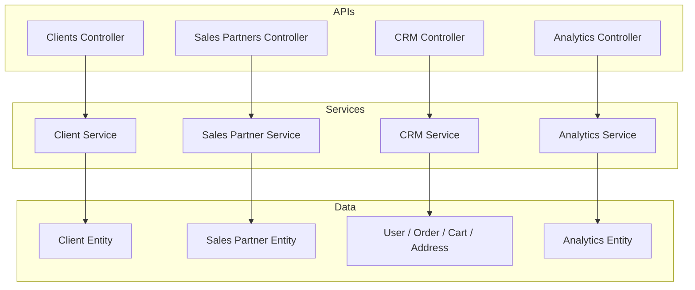
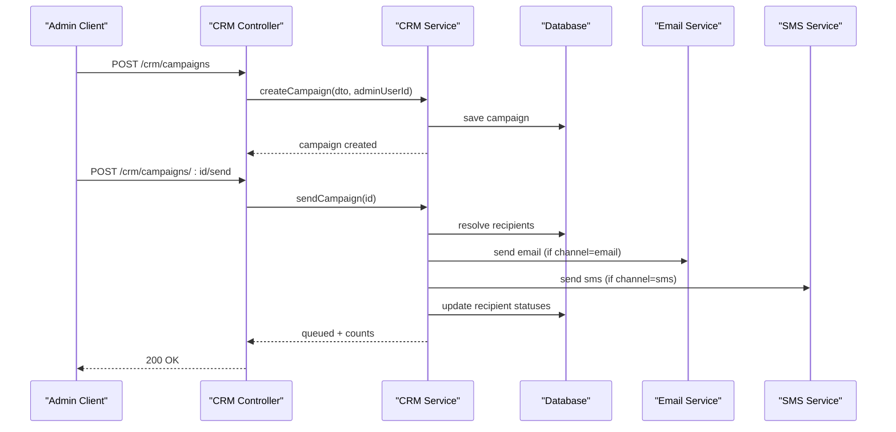
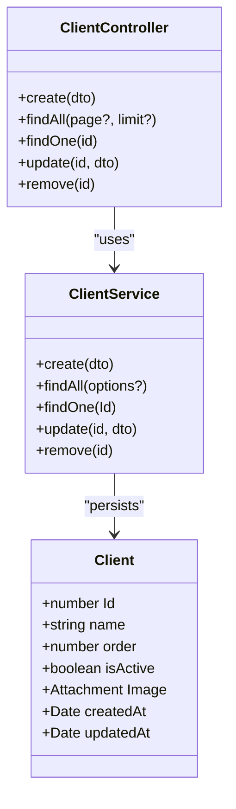
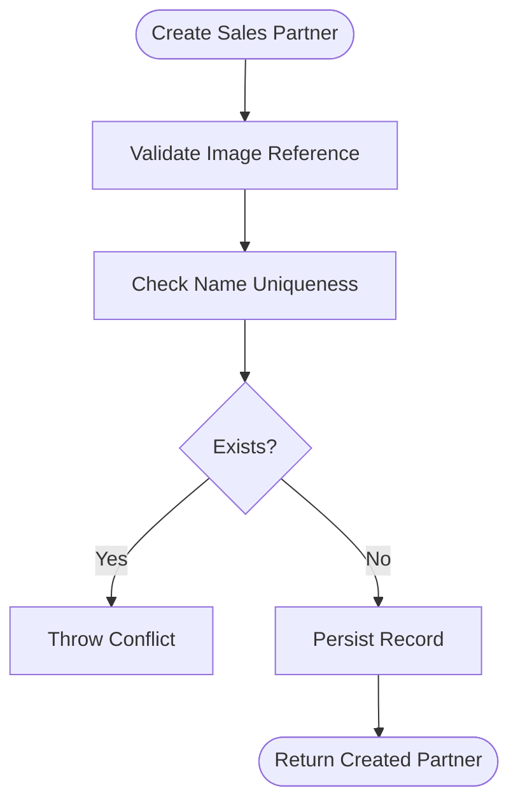
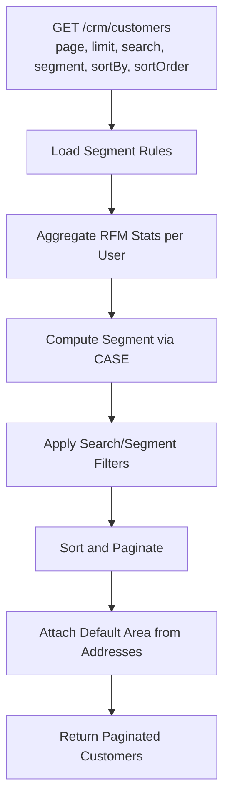
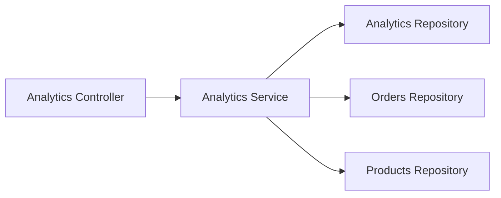
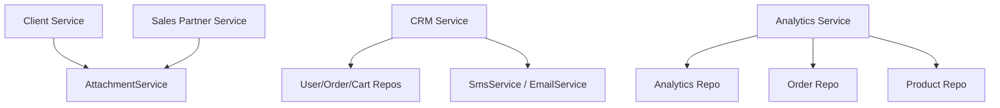

# Business Customer Management

<cite>
**Referenced Files in This Document**
- [client.controller.ts](file://apps/backend/src/client/client.controller.ts)
- [client.service.ts](file://apps/backend/src/client/client.service.ts)
- [client.entity.ts](file://apps/backend/src/client/entities/client.entity.ts)
- [create-client.dto.ts](file://apps/backend/src/client/dto/create-client.dto.ts)
- [sales-partner.controller.ts](file://apps/backend/src/sales-partner/sales-partner.controller.ts)
- [sales-partner.service.ts](file://apps/backend/src/sales-partner/sales-partner.service.ts)
- [crm.controller.ts](file://apps/backend/src/crm/crm.controller.ts)
- [crm.service.ts](file://apps/backend/src/crm/crm.service.ts)
- [analytics.controller.ts](file://apps/backend/src/analytics/analytics.controller.ts)
- [analytics.service.ts](file://apps/backend/src/analytics/analytics.service.ts)
</cite>

## Table of Contents
1. Introduction
2. Project Structure
3. Core Components
4. Architecture Overview
5. Detailed Component Analysis
6. Dependency Analysis
7. Performance Considerations
8. Troubleshooting Guide
9. Conclusion

## Introduction
This document provides detailed API documentation for business customer management endpoints, focusing on B2B client profiles and relationships, sales partner administration, CRM segmentation and outreach, and analytics reporting. It explains how to manage company profiles, contact information, and basic business relationships through the Client and Sales Partner modules; how to segment customers, run campaigns, and track activities via CRM; and how to consume analytics endpoints for performance and conversion insights. Where features such as tiered pricing, territory management, contract management, SLAs, multi-level sales organizations, and automated workflow integrations are not implemented in code, this document clearly marks them as out-of-scope and suggests integration points.

## Project Structure
The backend exposes REST APIs organized by domain:
- Clients: CRUD for static client profiles (e.g., showcase clients).
- Sales Partners: CRUD and status toggling for sales partners with image attachments.
- CRM: Customer segmentation, campaign orchestration, activity tracking, and CSV export.
- Analytics: System and traffic metrics over configurable periods.

**Diagram sources**
- [client.controller.ts:32-36](file://apps/backend/src/client/client.controller.ts#L32-L36)
- [client.service.ts:14-22](file://apps/backend/src/client/client.service.ts#L14-L22)
- [client.entity.ts:14-55](file://apps/backend/src/client/entities/client.entity.ts#L14-L55)
- [sales-partner.controller.ts:35-39](file://apps/backend/src/sales-partner/sales-partner.controller.ts#L35-L39)
- [sales-partner.service.ts:22-30](file://apps/backend/src/sales-partner/sales-partner.service.ts#L22-L30)
- [crm.controller.ts:29-35](file://apps/backend/src/crm/crm.controller.ts#L29-L35)
- [crm.service.ts:103-130](file://apps/backend/src/crm/crm.service.ts#L103-L130)
- [analytics.controller.ts:27-34](file://apps/backend/src/analytics/analytics.controller.ts#L27-L34)
- [analytics.service.ts:38-57](file://apps/backend/src/analytics/analytics.service.ts#L38-L57)

**Section sources**
- [client.controller.ts:32-36](file://apps/backend/src/client/client.controller.ts#L32-L36)
- [sales-partner.controller.ts:35-39](file://apps/backend/src/sales-partner/sales-partner.controller.ts#L35-L39)
- [crm.controller.ts:29-35](file://apps/backend/src/crm/crm.controller.ts#L29-L35)
- [analytics.controller.ts:27-34](file://apps/backend/src/analytics/analytics.controller.ts#L27-L34)

## Core Components
- Clients: Manage static client profiles with name, order, active state, and image attachment. Supports paginated listing and full list retrieval.
- Sales Partners: Manage sales partner records with name uniqueness validation, image attachment, active/inactive toggle, search, ordering, and count operations.
- CRM: Segment customers using RFM rules, list/export customers, create and send SMS/email campaigns, track activities per customer and globally, and provide a customer 360 view.
- Analytics: Provide system and traffic metrics including overview, request rates, peak hours, unique visitors, top endpoints, response times, device/browser breakdown, top product pages, traffic sources, and conversion proxy.

Key responsibilities:
- Controllers expose REST endpoints with Swagger metadata and guards.
- Services implement business logic, data access, and cross-entity workflows.
- Entities define database schema and relations.

**Section sources**
- [client.controller.ts:38-172](file://apps/backend/src/client/client.controller.ts#L38-L172)
- [client.service.ts:24-128](file://apps/backend/src/client/client.service.ts#L24-L128)
- [client.entity.ts:14-55](file://apps/backend/src/client/entities/client.entity.ts#L14-L55)
- [sales-partner.controller.ts:41-246](file://apps/backend/src/sales-partner/sales-partner.controller.ts#L41-L246)
- [sales-partner.service.ts:32-222](file://apps/backend/src/sales-partner/sales-partner.service.ts#L32-L222)
- [crm.controller.ts:37-258](file://apps/backend/src/crm/crm.controller.ts#L37-L258)
- [crm.service.ts:137-309](file://apps/backend/src/crm/crm.service.ts#L137-L309)
- [analytics.controller.ts:36-311](file://apps/backend/src/analytics/analytics.controller.ts#L36-L311)
- [analytics.service.ts:142-548](file://apps/backend/src/analytics/analytics.service.ts#L142-L548)

## Architecture Overview
The system follows a layered architecture:
- Controllers handle HTTP requests, authentication, authorization, and parameter binding.
- Services encapsulate business logic and coordinate repositories and external services.
- Repositories interact with TypeORM entities and the database.
- External integrations include SMS and email delivery for CRM campaigns.

**Diagram sources**
- [crm.controller.ts:54-93](file://apps/backend/src/crm/crm.controller.ts#L54-L93)
- [crm.service.ts:314-449](file://apps/backend/src/crm/crm.service.ts#L314-L449)

**Section sources**
- [crm.controller.ts:29-35](file://apps/backend/src/crm/crm.controller.ts#L29-L35)
- [crm.service.ts:103-130](file://apps/backend/src/crm/crm.service.ts#L103-L130)

## Detailed Component Analysis

### B2B Client Management (Company Profiles and Basic Relationships)
Endpoints:
- Create client: POST /clients
- List clients: GET /clients (with optional page/limit)
- Get client: GET /clients/:id
- Update client: PATCH /clients/:id
- Delete client: DELETE /clients/:id

Request/response highlights:
- Create body includes Name, Image reference, order, isActive.
- List returns either plain array or paginated envelope depending on query parameters.
- Update supports replacing image attachment.
- Delete removes client and associated file via attachment service.

Security:
- Mutating endpoints require JWT and module permissions.

**Diagram sources**
- [client.entity.ts:14-55](file://apps/backend/src/client/entities/client.entity.ts#L14-L55)
- [client.controller.ts:38-172](file://apps/backend/src/client/client.controller.ts#L38-L172)
- [client.service.ts:14-128](file://apps/backend/src/client/client.service.ts#L14-L128)

Operational notes:
- The Client entity is a simple profile model without direct links to orders or users. For complex B2B hierarchies, extend the model and add relations to User/Order/Address.
- Attachment deletion is handled during client removal.

**Section sources**
- [client.controller.ts:38-172](file://apps/backend/src/client/client.controller.ts#L38-L172)
- [client.service.ts:24-128](file://apps/backend/src/client/client.service.ts#L24-L128)
- [client.entity.ts:14-55](file://apps/backend/src/client/entities/client.entity.ts#L14-L55)
- [create-client.dto.ts:1-15](file://apps/backend/src/client/dto/create-client.dto.ts#L1-L15)

### Sales Partner Administration
Endpoints:
- Create sales partner: POST /sales-partners
- List sales partners: GET /sales-partners (filters: active, limit, offset)
- Active list: GET /sales-partners/active
- Get by ID: GET /sales-partners/:id
- Update: PATCH /sales-partners/:id
- Toggle status: PATCH /sales-partners/:id/toggle-status
- Delete: DELETE /sales-partners/:id

Business rules:
- Name uniqueness enforced at creation and update.
- Image attachment required and validated.
- Ordering and search by name supported.

**Diagram sources**
- [sales-partner.service.ts:32-76](file://apps/backend/src/sales-partner/sales-partner.service.ts#L32-L76)

**Section sources**
- [sales-partner.controller.ts:41-246](file://apps/backend/src/sales-partner/sales-partner.controller.ts#L41-L246)
- [sales-partner.service.ts:32-222](file://apps/backend/src/sales-partner/sales-partner.service.ts#L32-L222)

### Customer Segmentation, Tiered Pricing Structures, and Bulk Orders
Segmentation:
- CRM endpoint GET /crm/customers returns paginated customers with RFM stats and computed segment.
- Segment rules are configurable via Business Settings and exposed at GET /crm/segment-rules.
- Export filtered customers as CSV via GET /crm/customers/export.

Tiered pricing structures:
- Not implemented as a dedicated feature in the analyzed code. Product discount logic exists in CRM SQL mirrors but does not define tiers per customer group. To implement tiered pricing, integrate with the product catalog and apply price overrides based on CRM segments.

Bulk order processing:
- No bulk order endpoint found. Integrate with the existing order module to process multiple orders per client or segment.

**Diagram sources**
- [crm.service.ts:137-309](file://apps/backend/src/crm/crm.service.ts#L137-L309)

**Section sources**
- [crm.controller.ts:37-52](file://apps/backend/src/crm/crm.controller.ts#L37-L52)
- [crm.service.ts:137-309](file://apps/backend/src/crm/crm.service.ts#L137-L309)

### Client Onboarding Workflows, Contract Management, and SLAs
- Client onboarding: Use CRM activities to log onboarding steps per customer. Activities can be tasks with due dates and statuses.
- Contract management: Not implemented. Extend CRM or introduce a Contract entity linked to clients and users.
- SLAs: Not implemented. Model SLA policies and monitor fulfillment via activities and custom metrics.

Integration points:
- Create activities for onboarding milestones via POST /crm/customers/:id/activities.
- Track SLA breaches as overdue activities.

**Section sources**
- [crm.controller.ts:204-247](file://apps/backend/src/crm/crm.controller.ts#L204-L247)
- [crm.service.ts:728-789](file://apps/backend/src/crm/crm.service.ts#L728-L789)

### Sales Partner Recruitment, Approval Processes, and Payout Calculations
- Recruitment and approval: Not implemented. Add fields like applicationStatus, approvedAt, and approval workflow in the Sales Partner entity and controller/service.
- Payout calculations: Not implemented. Integrate with payment/order data to compute commissions based on sales attributed to partners.

Suggested extension:
- Add application and approval endpoints under /sales-partners/applications.
- Compute payouts using order attribution and commission rules.

**Section sources**
- [sales-partner.controller.ts:41-246](file://apps/backend/src/sales-partner/sales-partner.controller.ts#L41-L246)
- [sales-partner.service.ts:32-222](file://apps/backend/src/sales-partner/sales-partner.service.ts#L32-L222)

### Business Analytics, Customer Lifetime Value Tracking, and Sales Performance Reporting
Analytics endpoints:
- Overview: GET /analytics/overview
- Request metrics: GET /analytics/requests
- Peak traffic: GET /analytics/peak-traffic
- Unique visitors: GET /analytics/visitors
- Top endpoints: GET /analytics/top-endpoints
- Response times: GET /analytics/response-times
- Device/browser breakdown: GET /analytics/devices
- Top product pages: GET /analytics/top-pages
- Traffic sources: GET /analytics/traffic-sources
- Conversion proxy: GET /analytics/conversion

Customer lifetime value:
- Use CRM RFM totalSpent and orderCount to approximate CLV per customer.
- Combine with CRM dashboard and top VIP customers for strategic insights.

Sales performance reporting:
- Not directly provided. Combine CRM customer lists and analytics conversion metrics to derive performance indicators.

**Diagram sources**
- [analytics.controller.ts:36-311](file://apps/backend/src/analytics/analytics.controller.ts#L36-L311)
- [analytics.service.ts:142-548](file://apps/backend/src/analytics/analytics.service.ts#L142-L548)

**Section sources**
- [analytics.controller.ts:36-311](file://apps/backend/src/analytics/analytics.controller.ts#L36-L311)
- [analytics.service.ts:142-548](file://apps/backend/src/analytics/analytics.service.ts#L142-L548)
- [crm.service.ts:167-309](file://apps/backend/src/crm/crm.service.ts#L167-L309)

### Complex Business Hierarchies, Multi-Level Sales Organizations, and Automated Workflow Integrations
- Complex hierarchies: Not modeled. Extend Client/SalesPartner/User models to support parent-child relationships and territories.
- Multi-level sales org: Not implemented. Introduce levels and attribution chains in sales partner data and order attribution logic.
- Automated workflows: Use CRM campaigns and activities to automate reminders, follow-ups, and notifications.

Integration suggestions:
- Add territory and hierarchy fields to Sales Partner and Client.
- Build background jobs to attribute orders to multi-level partners and calculate commissions.
- Trigger automated emails/SMS via CRM campaigns based on events.

**Section sources**
- [crm.controller.ts:54-93](file://apps/backend/src/crm/crm.controller.ts#L54-L93)
- [crm.service.ts:314-535](file://apps/backend/src/crm/crm.service.ts#L314-L535)

## Dependency Analysis
Key dependencies:
- Client and Sales Partner modules depend on AttachmentService for image handling.
- CRM depends on User, Order, Cart, Address, Wishlist, ProductReview, ContactMessage, SmsService, EmailService.
- Analytics depends on Analytics repository, Order, Product, and ConfigService.

**Diagram sources**
- [client.service.ts:14-22](file://apps/backend/src/client/client.service.ts#L14-L22)
- [sales-partner.service.ts:22-30](file://apps/backend/src/sales-partner/sales-partner.service.ts#L22-L30)
- [crm.service.ts:103-130](file://apps/backend/src/crm/crm.service.ts#L103-L130)
- [analytics.service.ts:49-57](file://apps/backend/src/analytics/analytics.service.ts#L49-L57)

**Section sources**
- [client.service.ts:14-22](file://apps/backend/src/client/client.service.ts#L14-L22)
- [sales-partner.service.ts:22-30](file://apps/backend/src/sales-partner/sales-partner.service.ts#L22-L30)
- [crm.service.ts:103-130](file://apps/backend/src/crm/crm.service.ts#L103-L130)
- [analytics.service.ts:49-57](file://apps/backend/src/analytics/analytics.service.ts#L49-L57)

## Performance Considerations
- CRM customer list aggregates all customers in memory then filters/sorts/paginates in JS for simplicity and stability.
- Campaign delivery serializes sends with per-SMS pauses to respect gateway rate limits.
- Analytics uses buffered writes with periodic flushes and scheduled retention cleanup to control storage growth.
- Indexes are created concurrently at boot to optimize queries when synchronize is disabled.

Recommendations:
- For large datasets, consider server-side pagination and aggregation for CRM lists.
- Offload heavy campaign delivery to a worker queue.
- Monitor analytics buffer size and flush intervals under load.

**Section sources**
- [crm.service.ts:167-179](file://apps/backend/src/crm/crm.service.ts#L167-L179)
- [crm.service.ts:465-535](file://apps/backend/src/crm/crm.service.ts#L465-L535)
- [analytics.service.ts:142-192](file://apps/backend/src/analytics/analytics.service.ts#L142-L192)
- [analytics.service.ts:593-615](file://apps/backend/src/analytics/analytics.service.ts#L593-L615)

## Troubleshooting Guide
Common issues and resolutions:
- Invalid input data: Controllers validate DTOs; ensure required fields are present and correctly typed.
- Unauthorized access: Ensure JWT token and module permissions are configured for protected endpoints.
- Attachment not found: Verify image references exist before creating/updating clients or sales partners.
- Duplicate names: Sales partner creation/update enforces name uniqueness; adjust names accordingly.
- Campaign errors: Only draft campaigns can be sent; check campaign status and recipient contact details.

**Section sources**
- [client.controller.ts:41-61](file://apps/backend/src/client/client.controller.ts#L41-L61)
- [client.service.ts:24-47](file://apps/backend/src/client/client.service.ts#L24-L47)
- [sales-partner.controller.ts:41-70](file://apps/backend/src/sales-partner/sales-partner.controller.ts#L41-L70)
- [sales-partner.service.ts:32-76](file://apps/backend/src/sales-partner/sales-partner.service.ts#L32-L76)
- [crm.controller.ts:88-93](file://apps/backend/src/crm/crm.controller.ts#L88-L93)
- [crm.service.ts:404-449](file://apps/backend/src/crm/crm.service.ts#L404-L449)

## Conclusion
The system provides robust foundations for managing B2B clients and sales partners, advanced CRM segmentation and outreach, and comprehensive analytics. While some advanced features like tiered pricing, territory management, contracts, SLAs, and multi-level sales organizations are not implemented, the modular design allows straightforward extensions. Use CRM activities and campaigns to automate workflows, and leverage analytics endpoints to drive performance and conversion insights.