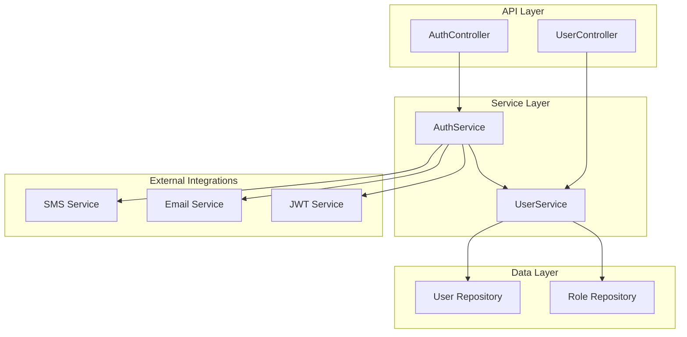
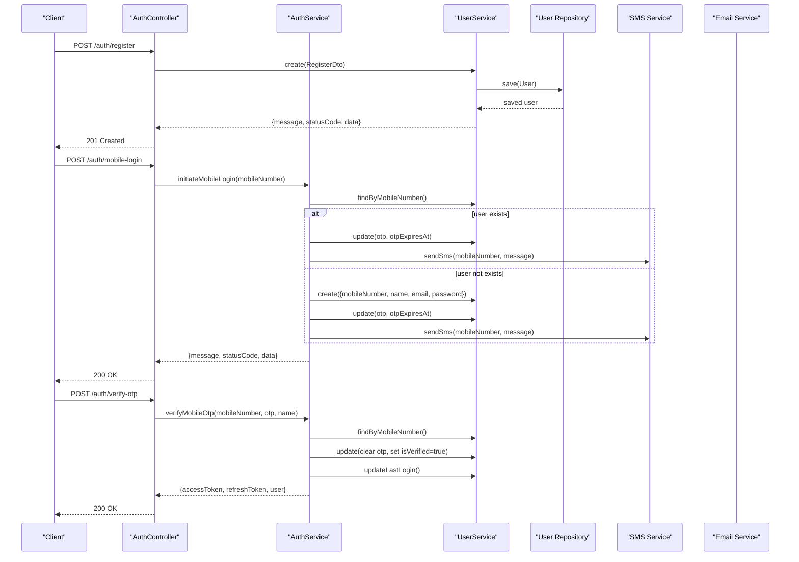
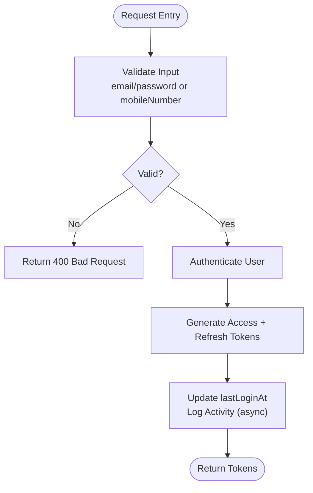
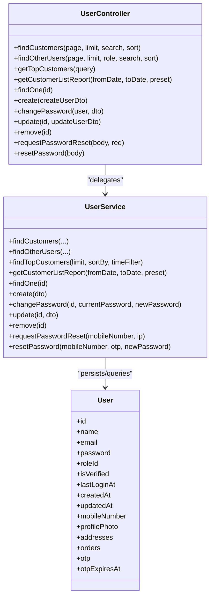
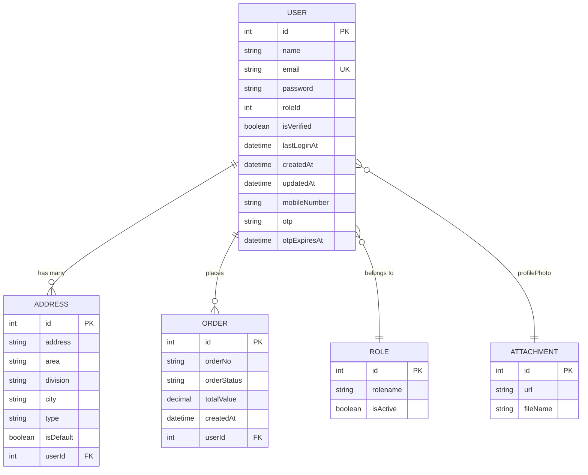
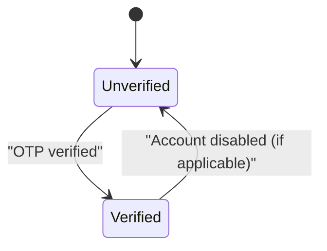
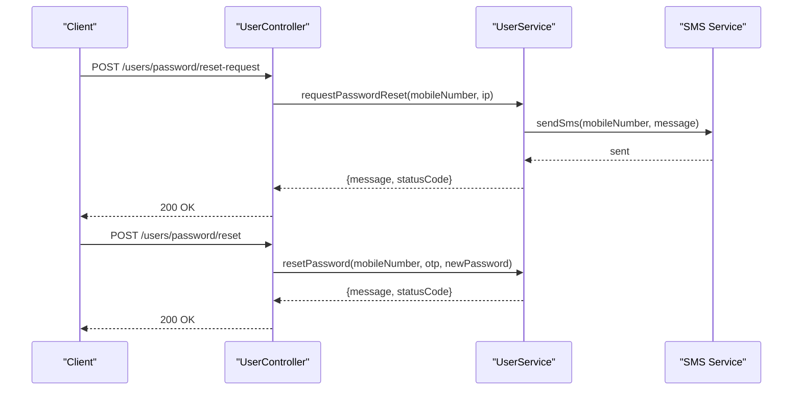
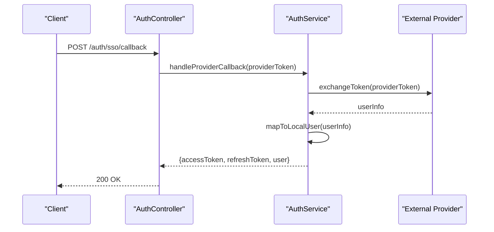
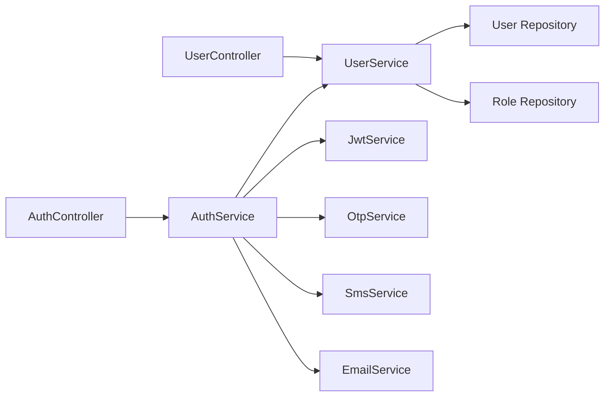

# Core User Operations

<cite>
**Referenced Files in This Document**
- [user.controller.ts](file://apps/backend/src/user/user.controller.ts)
- [user.service.ts](file://apps/backend/src/user/user.service.ts)
- [user.entity.ts](file://apps/backend/src/user/entities/user.entity.ts)
- [create-user.dto.ts](file://apps/backend/src/user/dto/create-user.dto.ts)
- [update-user.dto.ts](file://apps/backend/src/user/dto/update-user.dto.ts)
- [auth.controller.ts](file://apps/backend/src/auth/auth.controller.ts)
- [auth.service.ts](file://apps/backend/src/auth/auth.service.ts)
- [register.dto.ts](file://apps/backend/src/auth/dto/register.dto.ts)
- [login.dto.ts](file://apps/backend/src/auth/dto/login.dto.ts)
- [mobile-login.dto.ts](file://apps/backend/src/auth/dto/mobile-login.dto.ts)
</cite>

## Table of Contents
1. [Introduction](#introduction)
2. [Project Structure](#project-structure)
3. [Core Components](#core-components)
4. [Architecture Overview](#architecture-overview)
5. [Detailed Component Analysis](#detailed-component-analysis)
6. [Dependency Analysis](#dependency-analysis)
7. [Performance Considerations](#performance-considerations)
8. [Troubleshooting Guide](#troubleshooting-guide)
9. [Conclusion](#conclusion)

## Introduction
This document provides comprehensive API documentation for core user operations, including registration, authentication, profile management, and account lifecycle endpoints. It covers user CRUD operations, search and filtering with pagination, status management, activation workflows, and password reset flows. It also outlines integration patterns for external authentication systems and single sign-on scenarios.

## Project Structure
The user-related functionality is implemented in the backend NestJS application:
- Controllers expose REST endpoints under /users and /auth.
- Services implement business logic for user management, OTP-based login, and token handling.
- DTOs define request validation rules for registration, login, mobile login, and user updates.
- The User entity models the data schema and relationships (role, addresses, orders, etc.).

**Diagram sources**
- [user.controller.ts:37-39](file://apps/backend/src/user/user.controller.ts#L37-L39)
- [auth.controller.ts:29-36](file://apps/backend/src/auth/auth.controller.ts#L29-L36)
- [user.service.ts:29-42](file://apps/backend/src/user/user.service.ts#L29-L42)
- [auth.service.ts:21-32](file://apps/backend/src/auth/auth.service.ts#L21-L32)

**Section sources**
- [user.controller.ts:37-39](file://apps/backend/src/user/user.controller.ts#L37-L39)
- [auth.controller.ts:29-36](file://apps/backend/src/auth/auth.controller.ts#L29-L36)
- [user.service.ts:29-42](file://apps/backend/src/user/user.service.ts#L29-L42)
- [auth.service.ts:21-32](file://apps/backend/src/auth/auth.service.ts#L21-L32)

## Core Components
- Authentication endpoints: register, login, refresh tokens, logout, validate token, mobile login initiation, OTP verification.
- User management endpoints: list customers, list non-customer users, get top customers, customer list report, get user by ID, create user, update user, change password, delete user, password reset request/reset.
- Data models: User entity with fields like name, email, mobileNumber, isVerified, lastLoginAt, role, profilePhoto, addresses, orders, otp, otpExpiresAt.
- Validation: DTOs enforce email format, phone number format, password strength, and optional fields.

Key responsibilities:
- AuthController handles authentication flows and delegates to AuthService.
- UserService implements user CRUD, OTP flows, reporting, and integrates with SMS/Email services.
- DTOs provide input validation and OpenAPI metadata.

**Section sources**
- [auth.controller.ts:38-307](file://apps/backend/src/auth/auth.controller.ts#L38-L307)
- [user.controller.ts:42-397](file://apps/backend/src/user/user.controller.ts#L42-L397)
- [user.service.ts:118-784](file://apps/backend/src/user/user.service.ts#L118-L784)
- [user.entity.ts:22-181](file://apps/backend/src/user/entities/user.entity.ts#L22-L181)
- [register.dto.ts:13-62](file://apps/backend/src/auth/dto/register.dto.ts#L13-L62)
- [login.dto.ts:4-26](file://apps/backend/src/auth/dto/login.dto.ts#L4-L26)
- [mobile-login.dto.ts:5-39](file://apps/backend/src/auth/dto/mobile-login.dto.ts#L5-L39)
- [create-user.dto.ts:15-80](file://apps/backend/src/user/dto/create-user.dto.ts#L15-L80)
- [update-user.dto.ts:12-94](file://apps/backend/src/user/dto/update-user.dto.ts#L12-L94)

## Architecture Overview
The system follows a layered architecture:
- Controllers receive HTTP requests, apply guards and decorators, and delegate to services.
- Services orchestrate business logic, interact with repositories, and coordinate external services (SMS, Email).
- Repositories access the database via TypeORM.
- DTOs validate inputs; entities model persistent data.

**Diagram sources**
- [auth.controller.ts:38-307](file://apps/backend/src/auth/auth.controller.ts#L38-L307)
- [auth.service.ts:75-358](file://apps/backend/src/auth/auth.service.ts#L75-L358)
- [user.service.ts:561-784](file://apps/backend/src/user/user.service.ts#L561-L784)

## Detailed Component Analysis

### Authentication Endpoints
- Register: Creates a new user and returns tokens. Validates email, name, password strength, and optional mobile number.
- Login: Authenticates user by email/password and returns access and refresh tokens. Updates last login timestamp asynchronously and logs activity.
- Refresh Tokens: Uses a valid refresh token to issue new tokens.
- Logout: Invalidates session on client side and logs logout activity.
- Validate Token: Checks if current access token is valid.
- Mobile Login Initiation: Sends OTP to mobile number; supports auto-creation of user if not found; enforces per-number cooldown.
- Verify OTP: Validates OTP, marks user verified, optionally sets name, issues tokens, updates last login, and logs activity.

**Diagram sources**
- [auth.controller.ts:81-114](file://apps/backend/src/auth/auth.controller.ts#L81-L114)
- [auth.service.ts:75-100](file://apps/backend/src/auth/auth.service.ts#L75-L100)

**Section sources**
- [auth.controller.ts:38-307](file://apps/backend/src/auth/auth.controller.ts#L38-L307)
- [auth.service.ts:75-358](file://apps/backend/src/auth/auth.service.ts#L75-L358)
- [register.dto.ts:13-62](file://apps/backend/src/auth/dto/register.dto.ts#L13-L62)
- [login.dto.ts:4-26](file://apps/backend/src/auth/dto/login.dto.ts#L4-L26)
- [mobile-login.dto.ts:5-39](file://apps/backend/src/auth/dto/mobile-login.dto.ts#L5-L39)

### User Management Endpoints
- List Customers: Paginated list of customer users with search by name/email/mobile and sort order.
- List Other Users: Paginated list of non-customer users with role filter, search, and sort.
- Get Top Customers: Returns top customers ranked by total orders or spending with time filters.
- Customer List Report: Aggregated report with date range presets or custom dates.
- Get User by ID: Retrieves a specific user with related roles, addresses, and delivered orders.
- Create User: Creates a new user with validated input; ensures unique email/mobile; assigns default role if invalid.
- Update User: Updates user fields; validates uniqueness of email; hashes password if provided; manages profile photo attachment reference.
- Change Password: Verifies current password and updates to a new one; sends security notification email.
- Delete User: Permanently removes a user by ID.
- Password Reset Request: Sends OTP via SMS for password reset; rate-limited.
- Reset Password: Resets password using OTP and mobile number.

**Diagram sources**
- [user.controller.ts:42-397](file://apps/backend/src/user/user.controller.ts#L42-L397)
- [user.service.ts:118-784](file://apps/backend/src/user/user.service.ts#L118-L784)
- [user.entity.ts:22-181](file://apps/backend/src/user/entities/user.entity.ts#L22-L181)

**Section sources**
- [user.controller.ts:42-397](file://apps/backend/src/user/user.controller.ts#L42-L397)
- [user.service.ts:118-784](file://apps/backend/src/user/user.service.ts#L118-L784)
- [user.entity.ts:22-181](file://apps/backend/src/user/entities/user.entity.ts#L22-L181)

### Data Models and Relationships
- User entity includes identity fields, verification flags, timestamps, role association, profile photo attachment, addresses, orders, and OTP-related fields.
- Roles are associated via ManyToOne relationship; addresses and orders via OneToMany.
- Profile photo uses an eager-loaded Attachment relation; updating via profilePhotoId requires resolving the attachment reference.

**Diagram sources**
- [user.entity.ts:22-181](file://apps/backend/src/user/entities/user.entity.ts#L22-L181)

**Section sources**
- [user.entity.ts:22-181](file://apps/backend/src/user/entities/user.entity.ts#L22-L181)

### Data Validation Rules
- Registration:
  - Email: required, valid email format.
  - Name: required, string, min 2, max 100 characters.
  - Password: required, min 8 characters, must include uppercase, lowercase, digit, special character.
  - Mobile Number: optional, valid international phone number.
- Login:
  - Email: required, valid email format.
  - Password: required, min 6 characters.
- Mobile Login:
  - Mobile Number: required, valid international phone number.
  - OTP: required, exactly 6 digits.
  - Name: optional, string.
- Create User:
  - Name: optional, string, min 2, max 100.
  - Email: optional, valid email.
  - Password: optional, min 8, max 100.
  - Mobile Number: optional, valid phone number.
  - isVerified: optional, boolean.
  - roleId: optional, number.
- Update User:
  - Name: optional, string, min 2, max 100.
  - Email: optional, valid email.
  - Password: optional, min 8, max 100.
  - Mobile Number: optional, valid phone number.
  - otp: optional, string.
  - otpExpiresAt: optional, date.
  - isVerified: optional, boolean.
  - profilePhotoId: optional, string.

**Section sources**
- [register.dto.ts:13-62](file://apps/backend/src/auth/dto/register.dto.ts#L13-L62)
- [login.dto.ts:4-26](file://apps/backend/src/auth/dto/login.dto.ts#L4-L26)
- [mobile-login.dto.ts:5-39](file://apps/backend/src/auth/dto/mobile-login.dto.ts#L5-L39)
- [create-user.dto.ts:15-80](file://apps/backend/src/user/dto/create-user.dto.ts#L15-L80)
- [update-user.dto.ts:12-94](file://apps/backend/src/user/dto/update-user.dto.ts#L12-L94)

### Search, Filtering, and Pagination
- Customers listing supports:
  - page: page number (default 1)
  - limit: items per page (default 10)
  - search: substring match on name, email, mobileNumber
  - sort: ASC or DESC by creation date
- Non-customer users listing supports:
  - page, limit, search, sort
  - role: filter by role name
- Top customers endpoint supports:
  - limit: number of results (1-100, default 10)
  - sortBy: orders or spending
  - timeFilter: predefined periods (e.g., this_month, last_3_months, all_time)
- Customer list report supports:
  - fromDate/toDate: custom date range
  - preset: predefined ranges (today, this_week, last_week, this_month, last_month, last_3_months, last_6_months, last_year, this_year)

**Section sources**
- [user.controller.ts:44-82](file://apps/backend/src/user/user.controller.ts#L44-L82)
- [user.controller.ts:83-131](file://apps/backend/src/user/user.controller.ts#L83-L131)
- [user.controller.ts:132-195](file://apps/backend/src/user/user.controller.ts#L132-L195)
- [user.controller.ts:197-258](file://apps/backend/src/user/user.controller.ts#L197-L258)
- [user.service.ts:118-258](file://apps/backend/src/user/user.service.ts#L118-L258)
- [user.service.ts:357-479](file://apps/backend/src/user/user.service.ts#L357-L479)
- [user.service.ts:481-559](file://apps/backend/src/user/user.service.ts#L481-L559)

### Account Lifecycle and Status Management
- Verification:
  - Mobile OTP flow sets isVerified to true upon successful verification.
  - OTP stored temporarily and cleared after verification.
- Activation:
  - Auto-creation of user during mobile login if not present; subsequent OTP verification activates the account.
- Last Login Tracking:
  - Asynchronously updated on login and mobile login success.
- Role Assignment:
  - Default role assigned for new users if invalid role ID provided.

**Diagram sources**
- [auth.service.ts:301-358](file://apps/backend/src/auth/auth.service.ts#L301-L358)
- [user.entity.ts:79-85](file://apps/backend/src/user/entities/user.entity.ts#L79-L85)

**Section sources**
- [auth.service.ts:172-358](file://apps/backend/src/auth/auth.service.ts#L172-L358)
- [user.service.ts:630-713](file://apps/backend/src/user/user.service.ts#L630-L713)
- [user.entity.ts:79-85](file://apps/backend/src/user/entities/user.entity.ts#L79-L85)

### Password Reset Workflow
- Request Password Reset:
  - Rate-limited endpoint that triggers OTP generation and SMS delivery.
- Reset Password:
  - Validates OTP and mobile number; updates password securely.

**Diagram sources**
- [user.controller.ts:347-397](file://apps/backend/src/user/user.controller.ts#L347-L397)

**Section sources**
- [user.controller.ts:347-397](file://apps/backend/src/user/user.controller.ts#L347-L397)

### Bulk Operations, Import/Export, and Reporting
- Bulk user operations:
  - No dedicated bulk endpoints are exposed; batch processing can be implemented by iterating over create/update/delete calls.
- Import/Export:
  - No explicit import/export endpoints are defined in the user module.
- Reporting:
  - Customer list report aggregates registration date, order counts, and order amounts with date range support.
  - Top customers endpoint provides analytics-style aggregation with time filters.

**Section sources**
- [user.controller.ts:197-258](file://apps/backend/src/user/user.controller.ts#L197-L258)
- [user.service.ts:481-559](file://apps/backend/src/user/user.service.ts#L481-L559)

### Privacy, GDPR Compliance, and Data Retention
- Sensitive fields:
  - Password, OTP, and OTP expiration are excluded from responses and marked write-only where applicable.
- Data minimization:
  - Responses avoid returning credentials and internal verification fields.
- GDPR considerations:
  - No explicit deletion/export endpoints for personal data are exposed in the user module; additional endpoints would be needed to fulfill data portability and erasure rights.
- Retention policies:
  - Not explicitly enforced at the API layer; retention strategies should be implemented in background jobs or database-level policies.

**Section sources**
- [user.entity.ts:49-58](file://apps/backend/src/user/entities/user.entity.ts#L49-L58)
- [user.entity.ts:148-177](file://apps/backend/src/user/entities/user.entity.ts#L148-L177)
- [user.service.ts:705-712](file://apps/backend/src/user/user.service.ts#L705-L712)

### Integration Patterns for External Authentication and SSO
- External authentication:
  - The system currently supports email/password and mobile OTP flows.
  - To integrate external providers (OAuth/OIDC), extend AuthService with provider-specific strategies and map external identities to local User records.
- Single Sign-On (SSO):
  - Implement an SSO callback endpoint that exchanges provider tokens for local JWTs, linking external accounts to existing users or creating new ones based on policy.
- Token handling:
  - Access and refresh tokens are generated via JWT service; ensure secure storage and rotation practices on clients.

[No diagram sources since this section shows conceptual integration patterns]

## Dependency Analysis
- Controller-to-service coupling:
  - UserController depends on UserService for all user operations.
  - AuthController depends on AuthService for authentication flows.
- Service dependencies:
  - UserService depends on User and Role repositories, OtpService, SmsService, EmailService.
  - AuthService depends on JwtService, ConfigService, OtpService, SmsService, UserActivityService.
- External integrations:
  - SMS and Email services are used for OTP delivery and notifications.
  - JWT service issues access and refresh tokens.

**Diagram sources**
- [user.controller.ts:40-41](file://apps/backend/src/user/user.controller.ts#L40-L41)
- [auth.controller.ts:33-36](file://apps/backend/src/auth/auth.controller.ts#L33-L36)
- [user.service.ts:33-42](file://apps/backend/src/user/user.service.ts#L33-L42)
- [auth.service.ts:25-32](file://apps/backend/src/auth/auth.service.ts#L25-L32)

**Section sources**
- [user.controller.ts:40-41](file://apps/backend/src/user/user.controller.ts#L40-L41)
- [auth.controller.ts:33-36](file://apps/backend/src/auth/auth.controller.ts#L33-L36)
- [user.service.ts:33-42](file://apps/backend/src/user/user.service.ts#L33-L42)
- [auth.service.ts:25-32](file://apps/backend/src/auth/auth.service.ts#L25-L32)

## Performance Considerations
- Pagination:
  - Use page and limit parameters to avoid large result sets.
- Query optimization:
  - Select only necessary fields in queries to reduce payload size.
- Asynchronous operations:
  - Logging and last login updates are performed asynchronously to avoid blocking responses.
- Rate limiting:
  - Throttling applied to sensitive endpoints (register, login, mobile login, OTP verification, password reset) to mitigate abuse.

[No sources needed since this section provides general guidance]

## Troubleshooting Guide
Common issues and resolutions:
- Duplicate email/mobile:
  - Ensure uniqueness constraints are respected; return appropriate error messages.
- Invalid OTP:
  - Validate OTP length and expiration; handle resend cooldowns.
- Unauthorized access:
  - Verify JWT validity and permissions; ensure proper guards are applied.
- Missing attachments:
  - Validate profilePhotoId before assignment; handle not found cases gracefully.

**Section sources**
- [user.service.ts:588-610](file://apps/backend/src/user/user.service.ts#L588-L610)
- [auth.service.ts:269-299](file://apps/backend/src/auth/auth.service.ts#L269-L299)
- [user.service.ts:675-687](file://apps/backend/src/user/user.service.ts#L675-L687)

## Conclusion
The core user operations are implemented through well-defined controllers and services with robust validation, OTP-based authentication, and reporting capabilities. While basic CRUD, search, filtering, and pagination are supported, advanced features such as bulk operations, import/export, and GDPR compliance endpoints require additional implementation. Integration patterns for external authentication and SSO can be extended by leveraging the existing JWT and service architecture.