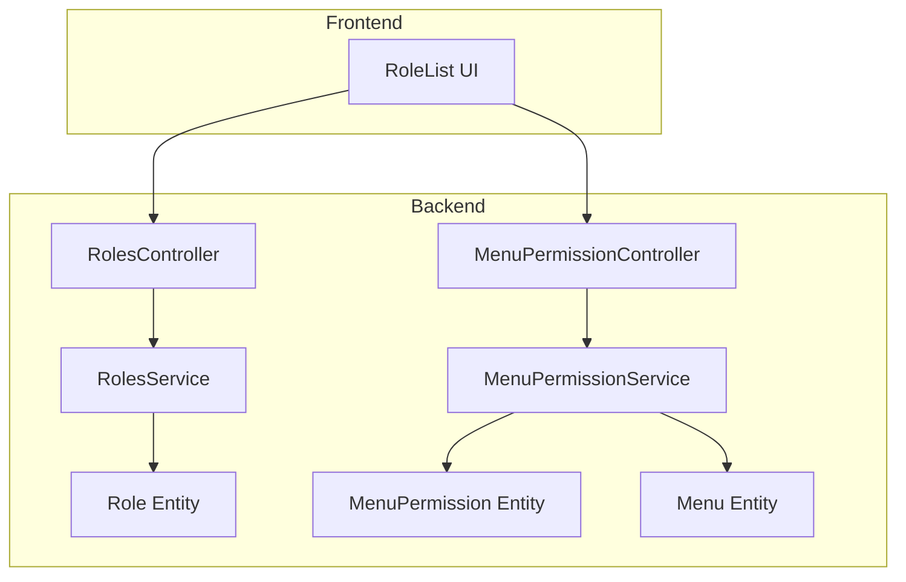
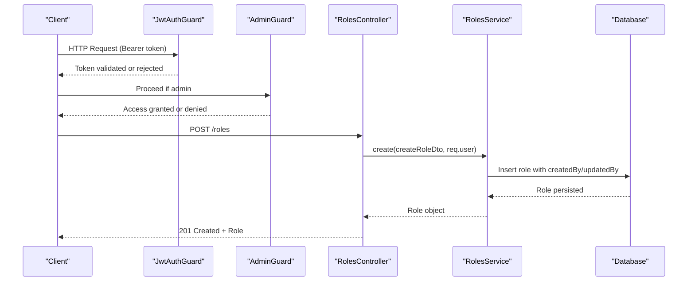
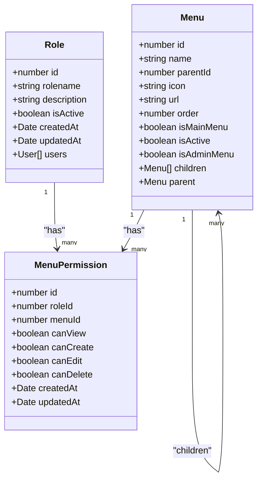
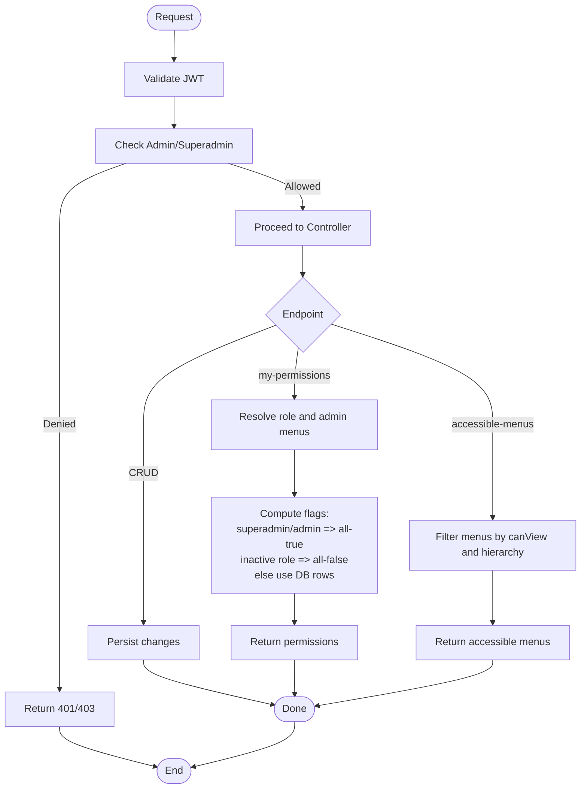
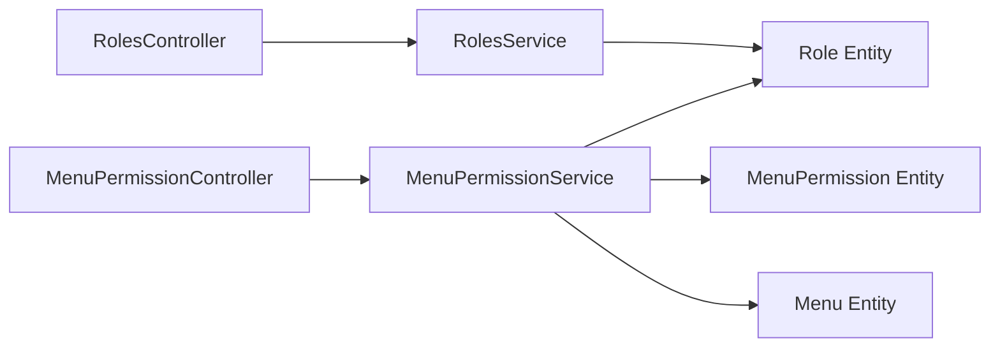

# Role & Permission System

<cite>
**Referenced Files in This Document**
- [roles.controller.ts](file://apps/backend/src/roles/roles.controller.ts)
- [roles.service.ts](file://apps/backend/src/roles/roles.service.ts)
- [role.entity.ts](file://apps/backend/src/roles/entities/role.entity.ts)
- [menu-permission.controller.ts](file://apps/backend/src/menu-permission/menu-permission.controller.ts)
- [menu-permission.service.ts](file://apps/backend/src/menu-permission/menu-permission.service.ts)
- [menu-permission.entity.ts](file://apps/backend/src/menu-permission/entities/menu-permission.entity.ts)
- [menu.entity.ts](file://apps/backend/src/menu/entities/menu.entity.ts)
- [bulk-save-permissions.dto.ts](file://apps/backend/src/menu-permission/dto/bulk-save-permissions.dto.ts)
- [create-menu-permission.dto.ts](file://apps/backend/src/menu-permission/dto/create-menu-permission.dto.ts)
- [role-list.tsx](file://apps/frontend/components/admin/role/role-list.tsx)
</cite>

## Table of Contents
1. Introduction
2. Project Structure
3. Core Components
4. Architecture Overview
5. Detailed Component Analysis
6. Dependency Analysis
7. Performance Considerations
8. Troubleshooting Guide
9. Conclusion

## Introduction
This document provides comprehensive API documentation for the role and permission system. It covers:
- Role management endpoints (create, read, update, delete)
- Menu-based permissions (view, create, edit, delete)
- Permission assignment and retrieval
- Hierarchical menu structures and accessible menus
- Dynamic permission evaluation for the current user
- Bulk operations for permissions
- Security considerations, caching strategies, and performance optimization
- Examples of complex permission hierarchies and custom logic patterns

The backend is implemented with NestJS and TypeORM; the frontend includes a role list component that integrates with the APIs.

## Project Structure
The role and permission system spans two main areas:
- Roles module: CRUD for roles
- Menu-permission module: CRUD for menu-level permissions per role, plus endpoints to compute effective permissions for users and accessible menus

**Diagram sources**
- [roles.controller.ts:32-138](file://apps/backend/src/roles/roles.controller.ts#L32-L138)
- [roles.service.ts:13-92](file://apps/backend/src/roles/roles.service.ts#L13-L92)
- [role.entity.ts:14-78](file://apps/backend/src/roles/entities/role.entity.ts#L14-L78)
- [menu-permission.controller.ts:37-275](file://apps/backend/src/menu-permission/menu-permission.controller.ts#L37-L275)
- [menu-permission.service.ts:9-179](file://apps/backend/src/menu-permission/menu-permission.service.ts#L9-L179)
- [menu-permission.entity.ts:12-71](file://apps/backend/src/menu-permission/entities/menu-permission.entity.ts#L12-L71)
- [menu.entity.ts:12-114](file://apps/backend/src/menu/entities/menu.entity.ts#L12-L114)
- [role-list.tsx:59-84](file://apps/frontend/components/admin/role/role-list.tsx#L59-L84)

**Section sources**
- [roles.controller.ts:32-138](file://apps/backend/src/roles/roles.controller.ts#L32-L138)
- [menu-permission.controller.ts:37-275](file://apps/backend/src/menu-permission/menu-permission.controller.ts#L37-L275)
- [role-list.tsx:59-84](file://apps/frontend/components/admin/role/role-list.tsx#L59-L84)

## Core Components
- RolesController: Exposes REST endpoints for role lifecycle management under /roles, protected by JWT and admin guard.
- RolesService: Implements role queries and mutations, including audit fields (createdBy/updatedBy).
- MenuPermissionController: Exposes endpoints for managing menu-level permissions per role and computing effective permissions for users.
- MenuPermissionService: Handles upserts, bulk saves, and permission resolution against the database.
- Entities: Role, MenuPermission, and Menu define the data model and relationships.

Key responsibilities:
- Role CRUD: Create, list, get-by-id, update, delete
- Permission matrix: Per-role, per-menu flags (canView, canCreate, canEdit, canDelete)
- Effective permissions: Compute per-user permissions and accessible menus based on role and menu hierarchy

**Section sources**
- [roles.controller.ts:32-138](file://apps/backend/src/roles/roles.controller.ts#L32-L138)
- [roles.service.ts:13-92](file://apps/backend/src/roles/roles.service.ts#L13-L92)
- [menu-permission.controller.ts:37-275](file://apps/backend/src/menu-permission/menu-permission.controller.ts#L37-L275)
- [menu-permission.service.ts:9-179](file://apps/backend/src/menu-permission/menu-permission.service.ts#L9-L179)
- [role.entity.ts:14-78](file://apps/backend/src/roles/entities/role.entity.ts#L14-L78)
- [menu-permission.entity.ts:12-71](file://apps/backend/src/menu-permission/entities/menu-permission.entity.ts#L12-L71)
- [menu.entity.ts:12-114](file://apps/backend/src/menu/entities/menu.entity.ts#L12-L114)

## Architecture Overview
The system enforces access control at multiple layers:
- Authentication via JWT
- Authorization via guards (AdminGuard, RolesGuard)
- Fine-grained authorization via menu-level permissions
- Dynamic computation of effective permissions per user

**Diagram sources**
- [roles.controller.ts:37-57](file://apps/backend/src/roles/roles.controller.ts#L37-L57)
- [roles.service.ts:57-64](file://apps/backend/src/roles/roles.service.ts#L57-L64)

## Detailed Component Analysis

### Role Management API
Endpoints:
- POST /roles: Create a new role
- GET /roles: List active roles
- GET /roles/:id: Get role by ID
- PATCH /roles/:id: Update a role
- DELETE /roles/:id: Delete a role

Security:
- All endpoints require valid JWT and admin privileges via guards.

Behavior:
- Create/Update set createdBy/updatedBy from the authenticated user.
- List returns only active roles sorted by name.
- Delete removes the role record.

Request/Response:
- Responses follow a standard ApiResponseDto envelope with message, statusCode, and data.

Error handling:
- Not found errors are thrown when a role does not exist.
- Internal server error wraps repository failures.

**Section sources**
- [roles.controller.ts:37-138](file://apps/backend/src/roles/roles.controller.ts#L37-L138)
- [roles.service.ts:20-92](file://apps/backend/src/roles/roles.service.ts#L20-L92)

### Menu Permissions API
Endpoints:
- POST /menu-permissions: Create or update a single menu permission for a role
- PATCH /menu-permissions/:roleId/:menuId: Update specific flags for a role-menu pair
- PUT /menu-permissions/role/:roleId: Bulk save permissions for a role (upsert)
- GET /menu-permissions/my-permissions: Get effective permissions for the logged-in user across all admin menus
- GET /menu-permissions/role/:roleId: Get all permissions for a role
- GET /menu-permissions/user/:userId: Get all permissions for a user
- GET /menu-permissions/accessible-menus/:userId: Get hierarchical menus accessible to a user
- DELETE /menu-permissions/:id: Delete a permission row

Security:
- Most mutation endpoints require superadmin role via @Roles('superadmin').
- Read endpoints may be open depending on use case; my-permissions requires authentication.

Bulk Save:
- Accepts an array of permission entries with optional boolean flags.
- Upserts rows for provided menuIds; leaves other rows unchanged.

Effective Permissions:
- my-permissions computes fresh permissions from the database for the current user’s role.
- Superadmin/admin roles receive all-true flags without requiring explicit rows.
- Inactive roles receive all-false flags.

Accessible Menus:
- Computes top-level menus where canView is true, then filters children accordingly and sorts by order.

**Section sources**
- [menu-permission.controller.ts:44-275](file://apps/backend/src/menu-permission/menu-permission.controller.ts#L44-L275)
- [menu-permission.service.ts:20-179](file://apps/backend/src/menu-permission/menu-permission.service.ts#L20-L179)
- [bulk-save-permissions.dto.ts:13-47](file://apps/backend/src/menu-permission/dto/bulk-save-permissions.dto.ts#L13-L47)
- [create-menu-permission.dto.ts:5-86](file://apps/backend/src/menu-permission/dto/create-menu-permission.dto.ts#L5-L86)

### Data Models and Relationships

**Diagram sources**
- [role.entity.ts:14-78](file://apps/backend/src/roles/entities/role.entity.ts#L14-L78)
- [menu-permission.entity.ts:12-71](file://apps/backend/src/menu-permission/entities/menu-permission.entity.ts#L12-L71)
- [menu.entity.ts:12-114](file://apps/backend/src/menu/entities/menu.entity.ts#L12-L114)

### Permission Evaluation Flow

**Diagram sources**
- [menu-permission.service.ts:130-179](file://apps/backend/src/menu-permission/menu-permission.service.ts#L130-L179)
- [menu-permission.service.ts:66-88](file://apps/backend/src/menu-permission/menu-permission.service.ts#L66-L88)

### Frontend Integration
The role list UI fetches roles via a protected helper and renders role information. It also uses a permissions hook to conditionally render features based on permissions.

**Section sources**
- [role-list.tsx:59-84](file://apps/frontend/components/admin/role/role-list.tsx#L59-L84)

## Dependency Analysis
- RolesController depends on RolesService and uses JwtAuthGuard and AdminGuard.
- MenuPermissionController depends on MenuPermissionService and uses JwtAuthGuard and RolesGuard.
- MenuPermissionService depends on repositories for MenuPermission, Role, and Menu.
- Entities define relationships between Role, Menu, and MenuPermission.

**Diagram sources**
- [roles.controller.ts:32-138](file://apps/backend/src/roles/roles.controller.ts#L32-L138)
- [roles.service.ts:13-92](file://apps/backend/src/roles/roles.service.ts#L13-L92)
- [menu-permission.controller.ts:37-275](file://apps/backend/src/menu-permission/menu-permission.controller.ts#L37-L275)
- [menu-permission.service.ts:9-179](file://apps/backend/src/menu-permission/menu-permission.service.ts#L9-L179)
- [role.entity.ts:14-78](file://apps/backend/src/roles/entities/role.entity.ts#L14-L78)
- [menu-permission.entity.ts:12-71](file://apps/backend/src/menu-permission/entities/menu-permission.entity.ts#L12-L71)
- [menu.entity.ts:12-114](file://apps/backend/src/menu/entities/menu.entity.ts#L12-L114)

**Section sources**
- [roles.controller.ts:32-138](file://apps/backend/src/roles/roles.controller.ts#L32-L138)
- [menu-permission.controller.ts:37-275](file://apps/backend/src/menu-permission/menu-permission.controller.ts#L37-L275)

## Performance Considerations
- Database-backed permission evaluation: The my-permissions endpoint reads directly from the database to ensure fresh results, avoiding stale cache issues.
- Bulk operations: Use PUT /menu-permissions/role/:roleId to batch upsert many permissions in a transaction, reducing round-trips and ensuring consistency.
- Query efficiency:
  - List roles filters by isActive and orders by name to minimize client-side processing.
  - Accessible menus query only required menu IDs and filters children efficiently.
- Caching strategy recommendations:
  - Cache computed permissions per userId for short-lived sessions to reduce repeated DB reads.
  - Invalidate caches on permission changes (create/update/delete/bulk save).
  - Consider Redis or in-process cache with TTL for high-throughput scenarios.
- Large permission sets:
  - Paginate or limit the number of admin menus returned if necessary.
  - Precompute and store derived views for frequently accessed aggregates (e.g., accessible menus) and refresh on changes.

[No sources needed since this section provides general guidance]

## Troubleshooting Guide
Common issues and resolutions:
- Unauthorized or Forbidden responses:
  - Ensure requests include a valid Bearer token.
  - Verify the caller has required roles (admin for roles endpoints; superadmin for most menu-permission mutations).
- Not Found errors:
  - Role or permission records may not exist; verify IDs and existence before mutating.
- Unexpected permissions:
  - Confirm the user’s role is active.
  - For superadmin/admin roles, permissions are implicitly all-true; explicit rows are not required.
  - For inactive roles, all flags are false.
- Bulk save behavior:
  - Only provided menuId entries are upserted; others remain unchanged.
  - Validate payload size and structure to avoid validation errors.

Operational tips:
- Use GET /menu-permissions/my-permissions to inspect effective permissions after changes.
- Use GET /menu-permissions/accessible-menus/:userId to validate menu visibility.

**Section sources**
- [roles.controller.ts:37-138](file://apps/backend/src/roles/roles.controller.ts#L37-L138)
- [menu-permission.controller.ts:44-275](file://apps/backend/src/menu-permission/menu-permission.controller.ts#L44-L275)
- [menu-permission.service.ts:130-179](file://apps/backend/src/menu-permission/menu-permission.service.ts#L130-L179)

## Conclusion
The role and permission system provides robust, database-backed authorization with:
- Clear role management APIs
- Flexible menu-level permissions
- Efficient bulk operations
- Dynamic permission evaluation tailored to role semantics
- Hierarchical menu support for accessible navigation

Adopt recommended caching strategies and validation practices to maintain performance and security at scale.

[No sources needed since this section summarizes without analyzing specific files]