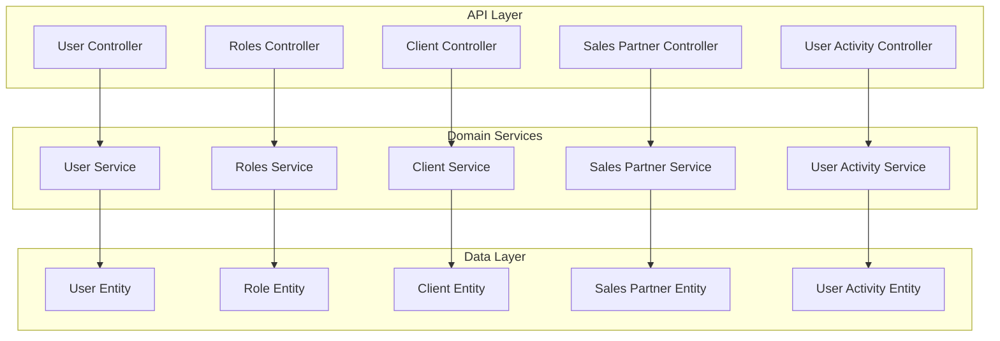
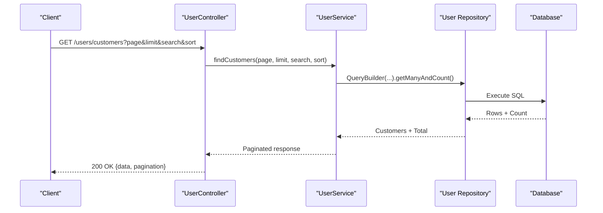
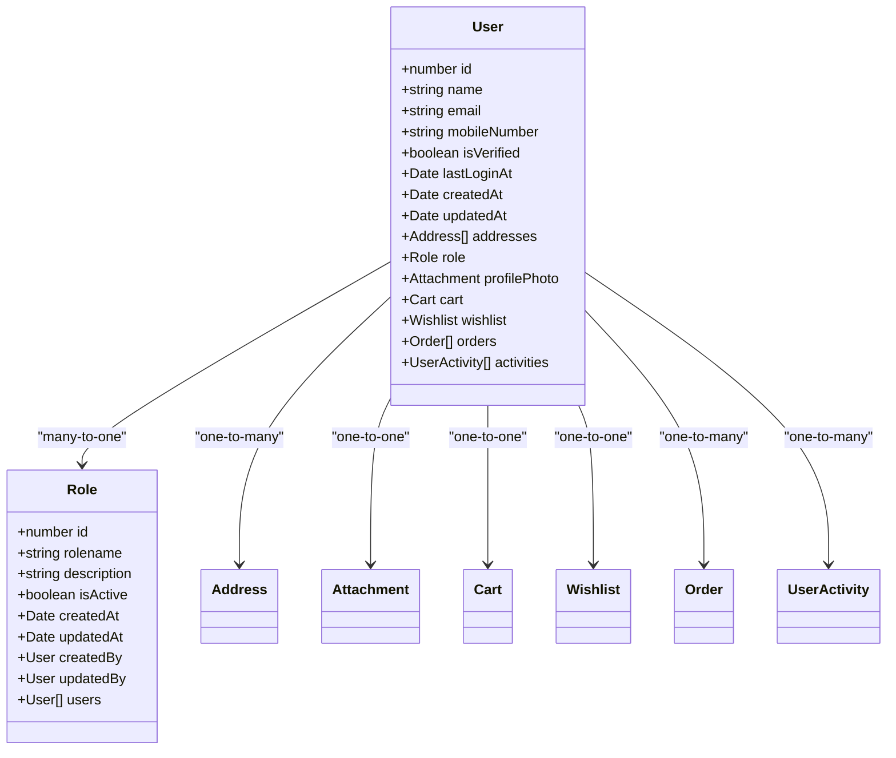
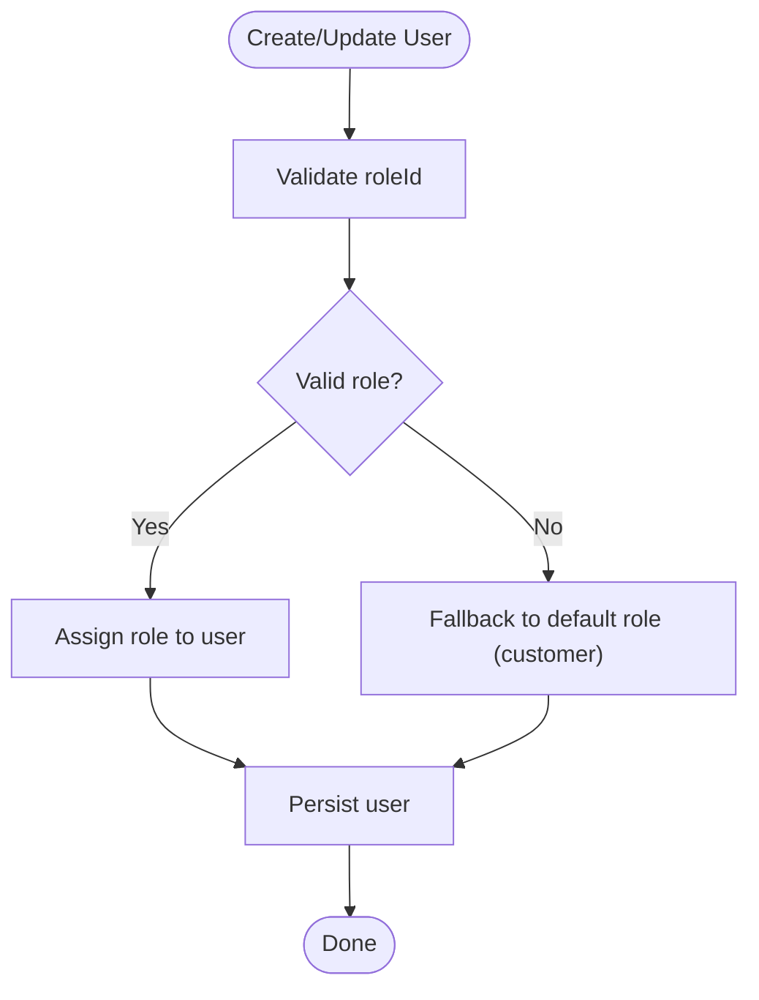
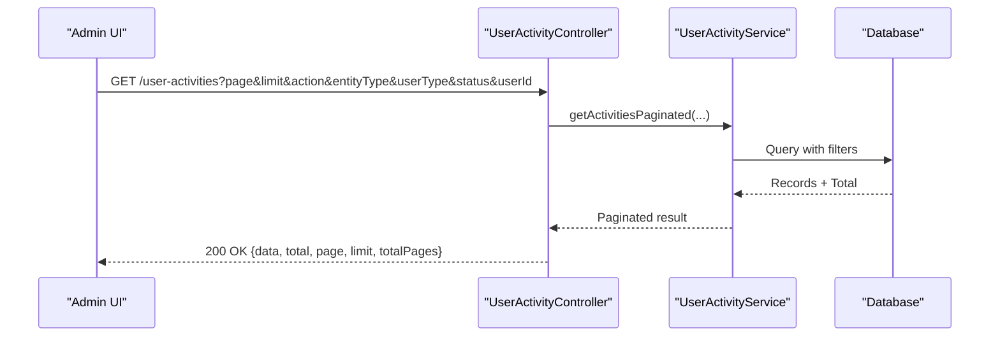
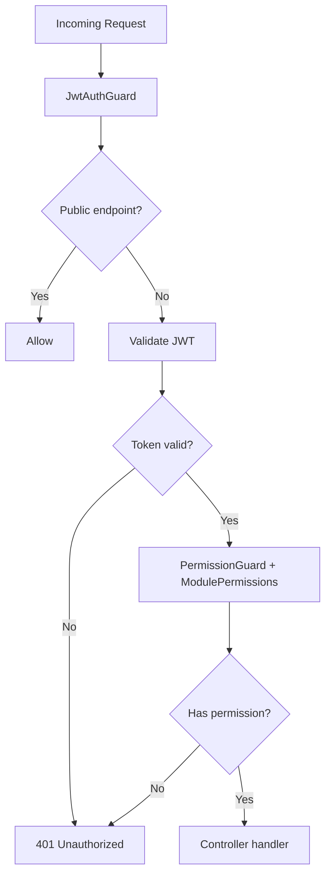
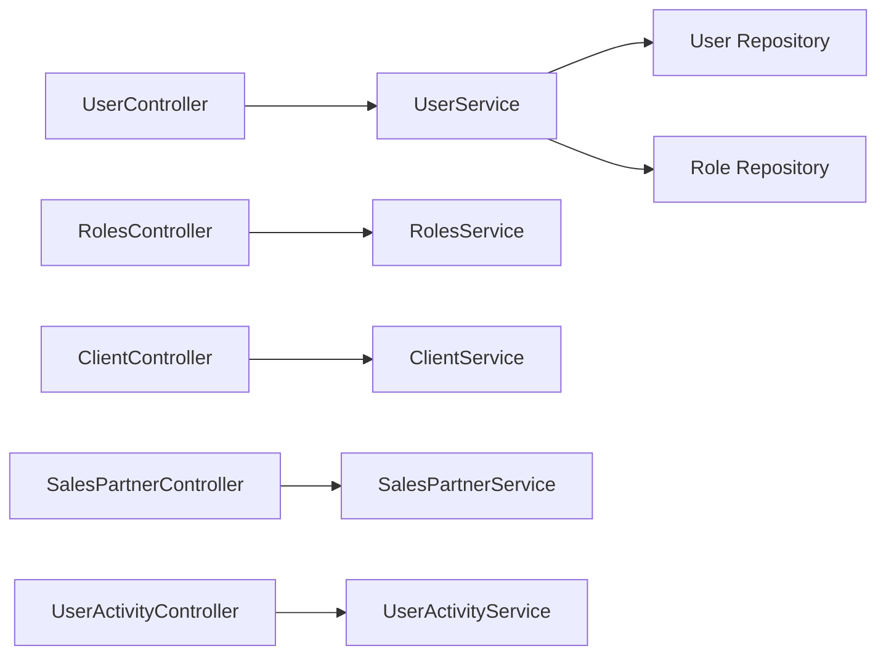

# User Management APIs

<cite>
**Referenced Files in This Document**
- [user.controller.ts](file://apps/backend/src/user/user.controller.ts)
- [user.service.ts](file://apps/backend/src/user/user.service.ts)
- [user.entity.ts](file://apps/backend/src/user/entities/user.entity.ts)
- [roles.controller.ts](file://apps/backend/src/roles/roles.controller.ts)
- [role.entity.ts](file://apps/backend/src/roles/entities/role.entity.ts)
- [client.controller.ts](file://apps/backend/src/client/client.controller.ts)
- [client.entity.ts](file://apps/backend/src/client/entities/client.entity.ts)
- [sales-partner.controller.ts](file://apps/backend/src/sales-partner/sales-partner.controller.ts)
- [sales-partner.entity.ts](file://apps/backend/src/sales-partner/entities/sales-partner.entity.ts)
- [user-activity.controller.ts](file://apps/backend/src/user-activity/user-activity.controller.ts)
- [user-activity.entity.ts](file://apps/backend/src/user-activity/entities/user-activity.entity.ts)
- [jwt-auth.guard.ts](file://apps/backend/src/auth/guards/jwt-auth.guard.ts)
</cite>

## Table of Contents
1. Introduction
2. Project Structure
3. Core Components
4. Architecture Overview
5. Detailed Component Analysis
6. Dependency Analysis
7. Performance Considerations
8. Troubleshooting Guide
9. Conclusion

## Introduction
This document provides detailed API documentation for user management capabilities, including:
- User profile operations (CRUD, password change, reset flows)
- Address management references and order history associations
- Role assignment and role administration
- Customer segmentation via top customers and customer list reports
- B2B client management endpoints
- Sales partner administration endpoints
- User activity tracking and audit logging with retention controls
- Security and compliance considerations (authentication, authorization, data privacy)

Where applicable, examples are provided as request/response outlines and diagrams to illustrate workflows.

## Project Structure
The user management features are implemented under the backend NestJS application with dedicated modules:
- User module: controllers, services, DTOs, and entities for users
- Roles module: role CRUD and administration
- Client module: B2B client records
- Sales Partner module: sales partner records
- User Activity module: audit trail and analytics
- Auth guards: JWT-based authentication and permission enforcement

**Diagram sources**
- [user.controller.ts:37-399](file://apps/backend/src/user/user.controller.ts#L37-L399)
- [user.service.ts:29-800](file://apps/backend/src/user/user.service.ts#L29-L800)
- [user.entity.ts:22-183](file://apps/backend/src/user/entities/user.entity.ts#L22-L183)
- [roles.controller.ts:32-139](file://apps/backend/src/roles/roles.controller.ts#L32-L139)
- [role.entity.ts:14-79](file://apps/backend/src/roles/entities/role.entity.ts#L14-L79)
- [client.controller.ts:32-174](file://apps/backend/src/client/client.controller.ts#L32-L174)
- [client.entity.ts:14-56](file://apps/backend/src/client/entities/client.entity.ts#L14-L56)
- [sales-partner.controller.ts:35-248](file://apps/backend/src/sales-partner/sales-partner.controller.ts#L35-L248)
- [sales-partner.entity.ts:14-70](file://apps/backend/src/sales-partner/entities/sales-partner.entity.ts#L14-L70)
- [user-activity.controller.ts:25-395](file://apps/backend/src/user-activity/user-activity.controller.ts#L25-L395)
- [user-activity.entity.ts:23-88](file://apps/backend/src/user-activity/entities/user-activity.entity.ts#L23-L88)

**Section sources**
- [user.controller.ts:37-399](file://apps/backend/src/user/user.controller.ts#L37-L399)
- [roles.controller.ts:32-139](file://apps/backend/src/roles/roles.controller.ts#L32-L139)
- [client.controller.ts:32-174](file://apps/backend/src/client/client.controller.ts#L32-L174)
- [sales-partner.controller.ts:35-248](file://apps/backend/src/sales-partner/sales-partner.controller.ts#L35-L248)
- [user-activity.controller.ts:25-395](file://apps/backend/src/user-activity/user-activity.controller.ts#L25-L395)

## Core Components
- Users: Create, read, update, delete; list customers and non-customer users; top customers report; customer list report; password change and reset flows.
- Roles: Create, read, update, delete roles; used to assign permissions to users.
- Clients: B2B client records with CRUD and optional pagination.
- Sales Partners: Sales partner records with CRUD, active status toggle, and listing filters.
- User Activities: Audit trail retrieval, filtering, per-entity audit trails, entity type enumeration, retention cleanup, and stats.

Key security:
- JWT authentication via JwtAuthGuard
- PermissionGuard and ModulePermissions decorators enforce RBAC on admin endpoints

**Section sources**
- [user.controller.ts:37-399](file://apps/backend/src/user/user.controller.ts#L37-L399)
- [roles.controller.ts:32-139](file://apps/backend/src/roles/roles.controller.ts#L32-L139)
- [client.controller.ts:32-174](file://apps/backend/src/client/client.controller.ts#L32-L174)
- [sales-partner.controller.ts:35-248](file://apps/backend/src/sales-partner/sales-partner.controller.ts#L35-L248)
- [user-activity.controller.ts:25-395](file://apps/backend/src/user-activity/user-activity.controller.ts#L25-L395)
- [jwt-auth.guard.ts:10-46](file://apps/backend/src/auth/guards/jwt-auth.guard.ts#L10-L46)

## Architecture Overview
The system follows a layered architecture:
- Controllers expose REST endpoints with Swagger annotations
- Services implement business logic and orchestrate repositories
- Entities define database schema and relationships
- Guards and decorators enforce authentication and authorization

**Diagram sources**
- [user.controller.ts:42-82](file://apps/backend/src/user/user.controller.ts#L42-L82)
- [user.service.ts:118-187](file://apps/backend/src/user/user.service.ts#L118-L187)

## Detailed Component Analysis

### User Management Endpoints
- List customers: GET /users/customers
  - Query params: page, limit, search, sort
  - Response: paginated list of customers with role, addresses, and profile photo
- List non-customer users: GET /users/users
  - Query params: page, limit, role, search, sort
  - Response: paginated list of staff/admin users
- Top customers: GET /users/customers/top
  - Query params: limit, sortBy (orders|spending), timeFilter (last_month|this_month|last_3_months|last_6_months|last_year|this_year|all_time)
  - Response: ranked customers with statistics (totalOrders, totalSpent, averageOrderValue, completedOrders, pendingOrders)
- Customer list report: GET /users/reports/customer-list
  - Query params: fromDate, toDate, preset (DateRangePreset)
  - Response: summary totals and customer rows with registration date, order count, and total order amount
- Get user by ID: GET /users/:id
  - Returns user details with role, addresses, orders (delivered), shipping/payment methods, and order items
- Create user: POST /users
  - Body: CreateUserDto (email, name, password, mobileNumber, optional roleId)
  - Behavior: validates email/mobile uniqueness, hashes password, assigns default role if invalid
- Update user: PATCH /users/:id
  - Body: UpdateUserDto (supports profilePhotoId mapping to Attachment)
  - Behavior: validates unique email, hashes password if provided, updates relationally linked profile photo
- Change password: PATCH /users/password/change
  - Requires authenticated user; verifies current password and prevents reuse
- Delete user: DELETE /users/:id
- Password reset flow:
  - Request OTP: POST /users/password/reset-request (throttled)
  - Reset password: POST /users/password/reset (mobileNumber, otp, newPassword)

Security and access control:
- Most admin endpoints require JwtAuthGuard and PermissionGuard with ModulePermissions('/admin/user')
- Public endpoints include password reset requests/resets and get user by ID (JWT required for some)

Data model highlights:
- User has many-to-one Role, one-to-many Address, one-to-one Cart/Wishlist, one-to-many Order, one-to-many UserActivity
- Sensitive fields (password, otp, otpExpiresAt) are excluded from responses

**Diagram sources**
- [user.entity.ts:22-183](file://apps/backend/src/user/entities/user.entity.ts#L22-L183)
- [role.entity.ts:14-79](file://apps/backend/src/roles/entities/role.entity.ts#L14-L79)

**Section sources**
- [user.controller.ts:42-399](file://apps/backend/src/user/user.controller.ts#L42-L399)
- [user.service.ts:118-800](file://apps/backend/src/user/user.service.ts#L118-L800)
- [user.entity.ts:22-183](file://apps/backend/src/user/entities/user.entity.ts#L22-L183)

### Role Assignment and Administration
- Create role: POST /roles (AdminGuard required)
- List roles: GET /roles
- Get role by ID: GET /roles/:id
- Update role: PATCH /roles/:id (AdminGuard required)
- Delete role: DELETE /roles/:id (AdminGuard required)

Role usage:
- Users can be assigned a role (roleId) during creation or update
- Default role is applied when invalid or missing

**Diagram sources**
- [user.service.ts:561-629](file://apps/backend/src/user/user.service.ts#L561-L629)
- [role.entity.ts:14-79](file://apps/backend/src/roles/entities/role.entity.ts#L14-L79)

**Section sources**
- [roles.controller.ts:32-139](file://apps/backend/src/roles/roles.controller.ts#L32-L139)
- [user.service.ts:561-629](file://apps/backend/src/user/user.service.ts#L561-L629)
- [role.entity.ts:14-79](file://apps/backend/src/roles/entities/role.entity.ts#L14-L79)

### B2B Client Management
- Create client: POST /clients (requires auth and permissions)
- List clients: GET /clients (optional pagination via page/limit)
- Get client by ID: GET /clients/:id
- Update client: PATCH /clients/:id (requires auth and permissions)
- Delete client: DELETE /clients/:id (requires auth and permissions)

Client entity includes name, order, image attachment, isActive flag, timestamps.

**Section sources**
- [client.controller.ts:32-174](file://apps/backend/src/client/client.controller.ts#L32-L174)
- [client.entity.ts:14-56](file://apps/backend/src/client/entities/client.entity.ts#L14-L56)

### Sales Partner Administration
- Create sales partner: POST /sales-partners (requires auth and permissions)
- List sales partners: GET /sales-partners (filters: active, limit, offset)
- Active sales partners: GET /sales-partners/active
- Get sales partner by ID: GET /sales-partners/:id
- Update sales partner: PATCH /sales-partners/:id (requires auth and permissions)
- Toggle status: PATCH /sales-partners/:id/toggle-status (requires auth and permissions)
- Delete sales partner: DELETE /sales-partners/:id (requires auth and permissions)

Sales partner entity includes name, description, website, order, image attachment, isActive flag, timestamps.

**Section sources**
- [sales-partner.controller.ts:35-248](file://apps/backend/src/sales-partner/sales-partner.controller.ts#L35-L248)
- [sales-partner.entity.ts:14-70](file://apps/backend/src/sales-partner/entities/sales-partner.entity.ts#L14-L70)

### User Activity Tracking and Audit Logging
- List activities: GET /user-activities
  - Filters: action, entityType, userType, status, userId
  - Pagination: page, limit
- Audit trail for entity: GET /user-activities/audit-trail/:entityType/:entityId
- Distinct entity types: GET /user-activities/entity-types
- Activity by ID: GET /user-activities/details/:id
- Activities by user: GET /user-activities/:userId
- Retention cleanup: POST /user-activities/retention/cleanup?days=90
- Retention stats: GET /user-activities/retention/stats?days=90

UserActivity entity captures action, entityType, entityId, oldValue/newValue JSON, IP, user agent, requestId/sessionId, userType, status, message, createdAt.

**Diagram sources**
- [user-activity.controller.ts:31-140](file://apps/backend/src/user-activity/user-activity.controller.ts#L31-L140)

**Section sources**
- [user-activity.controller.ts:25-395](file://apps/backend/src/user-activity/user-activity.controller.ts#L25-L395)
- [user-activity.entity.ts:23-88](file://apps/backend/src/user-activity/entities/user-activity.entity.ts#L23-L88)

### Authentication and Authorization
- JWT guard enforces bearer token validation and supports public override
- PermissionGuard and ModulePermissions restrict admin endpoints to authorized roles

**Diagram sources**
- [jwt-auth.guard.ts:10-46](file://apps/backend/src/auth/guards/jwt-auth.guard.ts#L10-L46)

**Section sources**
- [jwt-auth.guard.ts:10-46](file://apps/backend/src/auth/guards/jwt-auth.guard.ts#L10-L46)

## Dependency Analysis
- UserController depends on UserService and uses DTOs for input validation
- UserService depends on TypeORM repositories for User and Role, and integrates OTP/SMS/Email services for password reset and notifications
- RolesController depends on RolesService for role CRUD
- ClientController and SalesPartnerController depend on their respective services and entities
- UserActivityController depends on UserActivityService for audit queries and retention operations

**Diagram sources**
- [user.controller.ts:37-399](file://apps/backend/src/user/user.controller.ts#L37-L399)
- [user.service.ts:29-800](file://apps/backend/src/user/user.service.ts#L29-L800)
- [roles.controller.ts:32-139](file://apps/backend/src/roles/roles.controller.ts#L32-L139)
- [client.controller.ts:32-174](file://apps/backend/src/client/client.controller.ts#L32-L174)
- [sales-partner.controller.ts:35-248](file://apps/backend/src/sales-partner/sales-partner.controller.ts#L35-L248)
- [user-activity.controller.ts:25-395](file://apps/backend/src/user-activity/user-activity.controller.ts#L25-L395)

**Section sources**
- [user.controller.ts:37-399](file://apps/backend/src/user/user.controller.ts#L37-L399)
- [user.service.ts:29-800](file://apps/backend/src/user/user.service.ts#L29-L800)
- [roles.controller.ts:32-139](file://apps/backend/src/roles/roles.controller.ts#L32-L139)
- [client.controller.ts:32-174](file://apps/backend/src/client/client.controller.ts#L32-L174)
- [sales-partner.controller.ts:35-248](file://apps/backend/src/sales-partner/sales-partner.controller.ts#L35-L248)
- [user-activity.controller.ts:25-395](file://apps/backend/src/user-activity/user-activity.controller.ts#L25-L395)

## Performance Considerations
- Pagination: All list endpoints support page/limit to avoid large payloads
- Filtering: Use query parameters (search, role, active, entityType, userType, status) to reduce dataset size
- Aggregations: Top customers and customer list reports compute aggregates efficiently using SQL aggregations and grouped results
- Eager loading: Profile photos and related entities are eagerly loaded where needed; ensure selective field selection to minimize payload size
- Throttling: Password reset request endpoint is rate-limited to prevent abuse

[No sources needed since this section provides general guidance]

## Troubleshooting Guide
Common issues and resolutions:
- Unauthorized errors (401): Ensure valid JWT token is included in Authorization header; verify token expiration
- Forbidden errors (403): Confirm the user’s role has the required module permissions; check ModulePermissions decorator paths
- Validation errors (400): Verify DTO fields match expected formats (e.g., email pattern, mobile number format); ensure profilePhotoId references a valid attachment
- Not found (404): Confirm resource IDs exist; verify user deletion/update targets existing records
- Rate limiting: Excessive password reset requests will be throttled; wait before retrying

Compliance and data privacy:
- Sensitive fields (password, otp, otpExpiresAt) are excluded from responses
- Audit logs capture changes with old/new values and metadata (IP, user agent, request/session IDs)
- Retention policy: Use cleanup endpoint to remove old audit logs; review stats to plan retention windows

**Section sources**
- [user.controller.ts:260-399](file://apps/backend/src/user/user.controller.ts#L260-L399)
- [user.service.ts:561-800](file://apps/backend/src/user/user.service.ts#L561-L800)
- [user-activity.controller.ts:312-395](file://apps/backend/src/user-activity/user-activity.controller.ts#L312-L395)

## Conclusion
The User Management APIs provide comprehensive functionality for managing users, roles, clients, and sales partners, along with robust audit logging and reporting. The system emphasizes secure access through JWT and permission guards, efficient data handling via pagination and filtering, and compliance-friendly design with sensitive data exclusion and retention controls. For integration scenarios such as external user systems or single sign-on, extend the authentication layer with additional strategies while preserving the existing permission and audit mechanisms.

[No sources needed since this section summarizes without analyzing specific files]