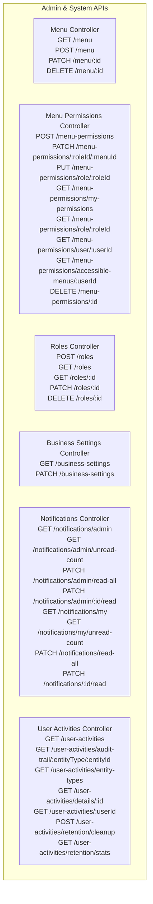
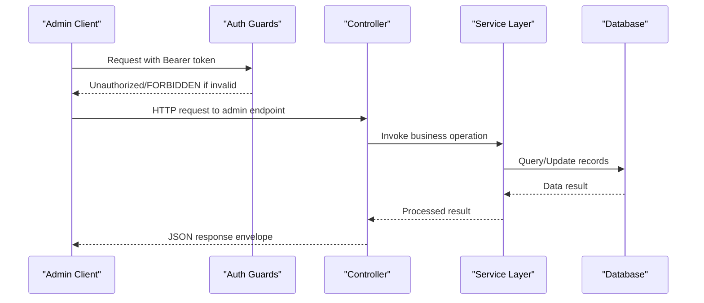
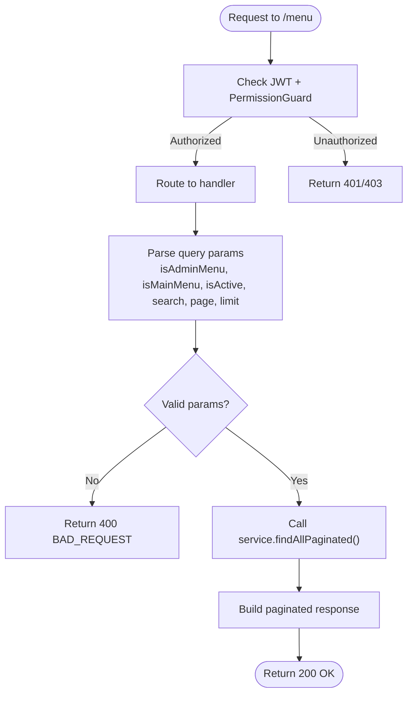
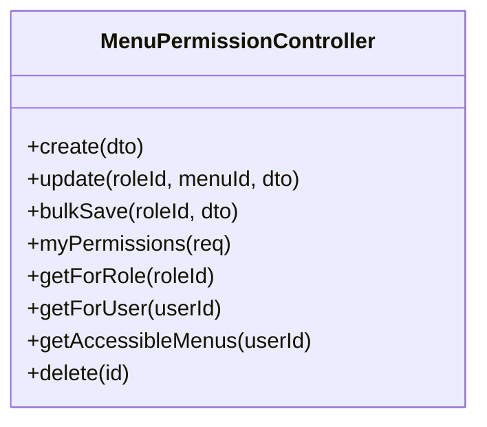
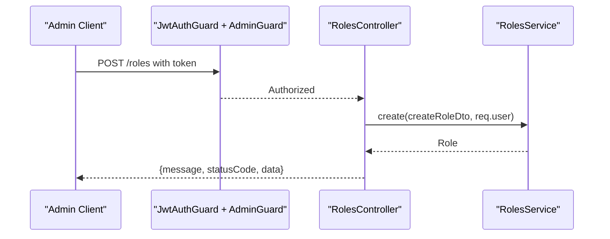
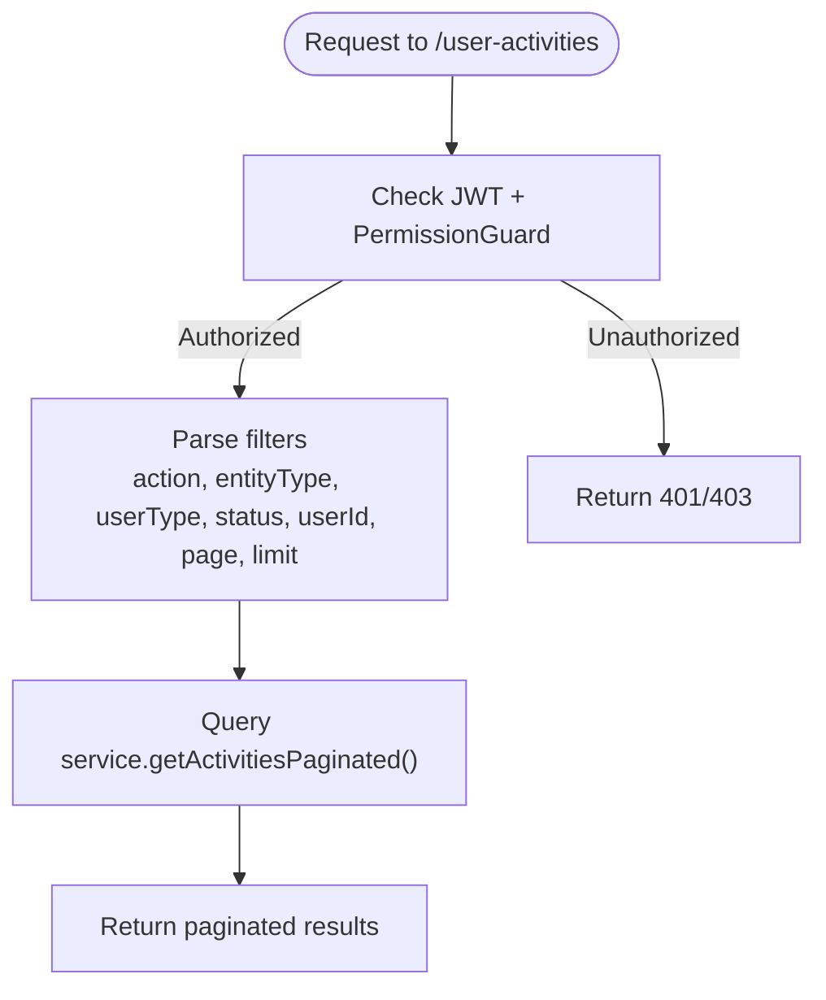
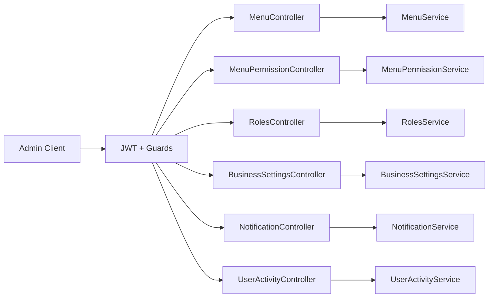

# Admin & System APIs

<cite>
**Referenced Files in This Document**
- [menu.controller.ts](file://apps/backend/src/menu/menu.controller.ts)
- [menu-permission.controller.ts](file://apps/backend/src/menu-permission/menu-permission.controller.ts)
- [roles.controller.ts](file://apps/backend/src/roles/roles.controller.ts)
- [business-settings.controller.ts](file://apps/backend/src/business-settings/business-settings.controller.ts)
- [notification.controller.ts](file://apps/backend/src/notification/notification.controller.ts)
- [user-activity.controller.ts](file://apps/backend/src/user-activity/user-activity.controller.ts)
</cite>

## Table of Contents
1. [Introduction](#introduction)
2. [Project Structure](#project-structure)
3. [Core Components](#core-components)
4. [Architecture Overview](#architecture-overview)
5. [Detailed Component Analysis](#detailed-component-analysis)
6. [Dependency Analysis](#dependency-analysis)
7. [Performance Considerations](#performance-considerations)
8. [Troubleshooting Guide](#troubleshooting-guide)
9. [Conclusion](#conclusion)

## Introduction
This document provides comprehensive API documentation for administrative and system management endpoints. It covers:
- Menu management, including navigation structure, permissions, and access control
- Role-based access control for roles, permissions, and authorization
- Business settings configuration for system-wide parameters and operational preferences
- Notification system endpoints for admin alerts and user-facing notifications
- Audit logging endpoints for tracking system changes and user activities
- Security considerations for admin endpoints and access control mechanisms

The backend is a NestJS application exposing REST endpoints documented with Swagger decorators. Authentication is primarily JWT-based, with role-based and permission-based guards protecting sensitive operations.

## Project Structure
The relevant administrative APIs are implemented as NestJS controllers under the backend application. Each controller groups related endpoints by domain:
- Menu management: `menu`
- Menu permissions: `menu-permissions`
- Roles: `roles`
- Business settings: `business-settings`
- Notifications: `notifications`
- Audit logs: `user-activities`

**Diagram sources**
- [menu.controller.ts:35-446](file://apps/backend/src/menu/menu.controller.ts#L35-L446)
- [menu-permission.controller.ts:37-275](file://apps/backend/src/menu-permission/menu-permission.controller.ts#L37-L275)
- [roles.controller.ts:32-138](file://apps/backend/src/roles/roles.controller.ts#L32-L138)
- [business-settings.controller.ts:19-54](file://apps/backend/src/business-settings/business-settings.controller.ts#L19-L54)
- [notification.controller.ts:25-137](file://apps/backend/src/notification/notification.controller.ts#L25-L137)
- [user-activity.controller.ts:25-394](file://apps/backend/src/user-activity/user-activity.controller.ts#L25-L394)

**Section sources**
- [menu.controller.ts:35-446](file://apps/backend/src/menu/menu.controller.ts#L35-L446)
- [menu-permission.controller.ts:37-275](file://apps/backend/src/menu-permission/menu-permission.controller.ts#L37-L275)
- [roles.controller.ts:32-138](file://apps/backend/src/roles/roles.controller.ts#L32-L138)
- [business-settings.controller.ts:19-54](file://apps/backend/src/business-settings/business-settings.controller.ts#L19-L54)
- [notification.controller.ts:25-137](file://apps/backend/src/notification/notification.controller.ts#L25-L137)
- [user-activity.controller.ts:25-394](file://apps/backend/src/user-activity/user-activity.controller.ts#L25-L394)

## Core Components
- Menu Management: Provides CRUD operations for menu items, hierarchical tree retrieval, and main menu listing. Supports filtering by admin/main menu flags and active status, plus pagination and search.
- Menu Permissions: Manages per-role and per-user menu access, bulk permission updates, and accessible menu discovery.
- Roles: Standard CRUD for roles, protected by admin guard.
- Business Settings: Public read endpoint for storefront settings; protected update endpoint for administrators.
- Notifications: Admin and user notification feeds, unread counts, and mark-as-read operations.
- User Activities (Audit Logs): Paginated audit log queries, entity-specific audit trails, retention cleanup, and statistics.

**Section sources**
- [menu.controller.ts:35-446](file://apps/backend/src/menu/menu.controller.ts#L35-L446)
- [menu-permission.controller.ts:37-275](file://apps/backend/src/menu-permission/menu-permission.controller.ts#L37-L275)
- [roles.controller.ts:32-138](file://apps/backend/src/roles/roles.controller.ts#L32-L138)
- [business-settings.controller.ts:19-54](file://apps/backend/src/business-settings/business-settings.controller.ts#L19-L54)
- [notification.controller.ts:25-137](file://apps/backend/src/notification/notification.controller.ts#L25-L137)
- [user-activity.controller.ts:25-394](file://apps/backend/src/user-activity/user-activity.controller.ts#L25-L394)

## Architecture Overview
Administrative endpoints follow a consistent pattern:
- Authentication via JWT bearer tokens
- Authorization via role guards or module-level permissions
- Service layer encapsulation for business logic
- Consistent response envelopes with message, statusCode, and data fields

**Diagram sources**
- [menu.controller.ts:41-446](file://apps/backend/src/menu/menu.controller.ts#L41-L446)
- [roles.controller.ts:37-138](file://apps/backend/src/roles/roles.controller.ts#L37-L138)
- [business-settings.controller.ts:28-54](file://apps/backend/src/business-settings/business-settings.controller.ts#L28-L54)
- [notification.controller.ts:30-137](file://apps/backend/src/notification/notification.controller.ts#L30-L137)
- [user-activity.controller.ts:31-394](file://apps/backend/src/user-activity/user-activity.controller.ts#L31-L394)

## Detailed Component Analysis

### Menu Management API
Endpoints:
- POST /menu: Create a new menu item
- GET /menu: List all menu items with filters and pagination
- GET /menu/tree: Retrieve hierarchical menu tree with optional admin filter and pagination
- GET /menu/main: Get main menu items with optional admin filter
- GET /menu/:id: Get a specific menu item
- PATCH /menu/:id: Update a menu item
- DELETE /menu/:id: Delete a menu item

Access Control:
- Read endpoints are open unless otherwise guarded
- Write endpoints require JWT authentication and module-level permissions for `/admin/menu`

Query Parameters:
- isAdminMenu: Filter by admin menu flag
- isMainMenu: Filter by main menu flag
- isActive: Filter by active status
- search: Search by menu name
- page, limit: Pagination

Response Envelope:
- message, statusCode, data, page, limit, total, totalPages

Error Handling:
- NOT_FOUND when resource does not exist
- INTERNAL_SERVER_ERROR on unexpected failures

**Diagram sources**
- [menu.controller.ts:67-184](file://apps/backend/src/menu/menu.controller.ts#L67-L184)
- [menu.controller.ts:186-294](file://apps/backend/src/menu/menu.controller.ts#L186-L294)
- [menu.controller.ts:296-334](file://apps/backend/src/menu/menu.controller.ts#L296-L334)
- [menu.controller.ts:336-446](file://apps/backend/src/menu/menu.controller.ts#L336-L446)

**Section sources**
- [menu.controller.ts:35-446](file://apps/backend/src/menu/menu.controller.ts#L35-L446)

### Menu Permissions API
Endpoints:
- POST /menu-permissions: Create a menu permission for a role and menu
- PATCH /menu-permissions/:roleId/:menuId: Update a menu permission
- PUT /menu-permissions/role/:roleId: Bulk save permissions for a role
- GET /menu-permissions/my-permissions: Get current user’s permissions across admin menus
- GET /menu-permissions/role/:roleId: Get permissions for a specific role
- GET /menu-permissions/user/:userId: Get permissions for a specific user
- GET /menu-permissions/accessible-menus/:userId: Get menus accessible to a user
- DELETE /menu-permissions/:id: Delete a permission

Access Control:
- Most mutation endpoints require superadmin role
- Some read endpoints are available to authenticated users

Response Envelope:
- message, statusCode, data

Error Handling:
- UNAUTHORIZED for missing/invalid JWT
- FORBIDDEN when required role is missing
- NOT_FOUND for missing resources

**Diagram sources**
- [menu-permission.controller.ts:37-275](file://apps/backend/src/menu-permission/menu-permission.controller.ts#L37-L275)

**Section sources**
- [menu-permission.controller.ts:37-275](file://apps/backend/src/menu-permission/menu-permission.controller.ts#L37-L275)

### Roles API
Endpoints:
- POST /roles: Create a new role
- GET /roles: Get all roles
- GET /roles/:id: Get a role by ID
- PATCH /roles/:id: Update a role
- DELETE /roles/:id: Delete a role

Access Control:
- All endpoints require JWT authentication and admin guard

Response Envelope:
- message, statusCode, data

Error Handling:
- NOT_FOUND when role does not exist

**Diagram sources**
- [roles.controller.ts:37-57](file://apps/backend/src/roles/roles.controller.ts#L37-L57)
- [roles.controller.ts:58-138](file://apps/backend/src/roles/roles.controller.ts#L58-L138)

**Section sources**
- [roles.controller.ts:32-138](file://apps/backend/src/roles/roles.controller.ts#L32-L138)

### Business Settings API
Endpoints:
- GET /business-settings: Public read of business settings (storefront header/footer, live chat, invoices)
- PATCH /business-settings: Update business settings (requires JWT + module-level permissions for `/admin/settings/business-info`)

Access Control:
- Read is public
- Update requires authentication and permission guard

Response Envelope:
- message, statusCode, data

Use Cases:
- Configure maintenance mode, contact info, delivery coverage, CRM thresholds, and branding assets

**Section sources**
- [business-settings.controller.ts:19-54](file://apps/backend/src/business-settings/business-settings.controller.ts#L19-L54)

### Notifications API
Endpoints:
- GET /notifications/admin: Paginated admin notifications
- GET /notifications/admin/unread-count: Admin unread count
- PATCH /notifications/admin/read-all: Mark all admin notifications as read
- PATCH /notifications/admin/:id/read: Mark one admin notification as read
- GET /notifications/my: Paginated notifications for the authenticated user
- GET /notifications/my/unread-count: Unread count for the authenticated user
- PATCH /notifications/read-all: Mark all my notifications as read
- PATCH /notifications/:id/read: Mark one notification as read

Access Control:
- Admin endpoints require JWT + admin guard
- User endpoints require JWT

Response Envelope:
- message, statusCode, data

Operational Notes:
- Supports pagination via page and limit
- Includes broadcast notifications in user feed

**Section sources**
- [notification.controller.ts:25-137](file://apps/backend/src/notification/notification.controller.ts#L25-L137)

### Audit Logging (User Activities) API
Endpoints:
- GET /user-activities: Paginated list of user activities with filters
- GET /user-activities/audit-trail/:entityType/:entityId: Full audit trail for an entity
- GET /user-activities/entity-types: Distinct entity types present in logs
- GET /user-activities/details/:id: Detail view of a single activity
- GET /user-activities/:userId: Activities for a specific user
- POST /user-activities/retention/cleanup: Cleanup old audit logs by days
- GET /user-activities/retention/stats: Statistics about old audit logs

Filters:
- action: POST, PATCH, DELETE
- entityType: table/resource affected
- userType: admin, customer, system
- status: success, failure
- userId: specific user

Access Control:
- Admin endpoints require JWT + module-level permissions for `/admin/audit-log`
- User-specific read endpoint requires JWT

Retention:
- Manual cleanup endpoint deletes records older than specified days
- Stats endpoint returns count, cutoff date, oldest record, and estimated size

**Diagram sources**
- [user-activity.controller.ts:31-140](file://apps/backend/src/user-activity/user-activity.controller.ts#L31-L140)
- [user-activity.controller.ts:142-207](file://apps/backend/src/user-activity/user-activity.controller.ts#L142-L207)
- [user-activity.controller.ts:209-310](file://apps/backend/src/user-activity/user-activity.controller.ts#L209-L310)
- [user-activity.controller.ts:312-394](file://apps/backend/src/user-activity/user-activity.controller.ts#L312-L394)

**Section sources**
- [user-activity.controller.ts:25-394](file://apps/backend/src/user-activity/user-activity.controller.ts#L25-L394)

## Dependency Analysis
- Authentication:
  - JWT bearer tokens are required for most admin endpoints
  - Guards enforce authentication and authorization at the controller level
- Authorization:
  - Role-based access via AdminGuard and RolesGuard
  - Module-level permissions via PermissionGuard and ModulePermissions decorator
- Controllers:
  - Thin controllers delegating to services
  - Swagger decorators used for API documentation
- Services:
  - Encapsulate business logic and database interactions
- Entities:
  - Domain models such as Menu, Role, BusinessSetting, UserActivity

**Diagram sources**
- [menu.controller.ts:35-446](file://apps/backend/src/menu/menu.controller.ts#L35-L446)
- [menu-permission.controller.ts:37-275](file://apps/backend/src/menu-permission/menu-permission.controller.ts#L37-L275)
- [roles.controller.ts:32-138](file://apps/backend/src/roles/roles.controller.ts#L32-L138)
- [business-settings.controller.ts:19-54](file://apps/backend/src/business-settings/business-settings.controller.ts#L19-L54)
- [notification.controller.ts:25-137](file://apps/backend/src/notification/notification.controller.ts#L25-L137)
- [user-activity.controller.ts:25-394](file://apps/backend/src/user-activity/user-activity.controller.ts#L25-L394)

**Section sources**
- [menu.controller.ts:35-446](file://apps/backend/src/menu/menu.controller.ts#L35-L446)
- [menu-permission.controller.ts:37-275](file://apps/backend/src/menu-permission/menu-permission.controller.ts#L37-L275)
- [roles.controller.ts:32-138](file://apps/backend/src/roles/roles.controller.ts#L32-L138)
- [business-settings.controller.ts:19-54](file://apps/backend/src/business-settings/business-settings.controller.ts#L19-L54)
- [notification.controller.ts:25-137](file://apps/backend/src/notification/notification.controller.ts#L25-L137)
- [user-activity.controller.ts:25-394](file://apps/backend/src/user-activity/user-activity.controller.ts#L25-L394)

## Performance Considerations
- Pagination:
  - Menu and audit log endpoints support page and limit parameters to reduce payload sizes
- Filtering:
  - Use targeted filters (isAdminMenu, isActive, entityType, action) to minimize database scans
- Tree Structures:
  - Hierarchical menu tree retrieval should be paginated at the top level to avoid large payloads
- Retention Policies:
  - Use audit log retention stats and cleanup endpoints to manage storage growth
- Caching:
  - Consider caching frequently accessed settings and menu trees where appropriate

[No sources needed since this section provides general guidance]

## Troubleshooting Guide
Common Issues:
- Unauthorized Access:
  - Ensure valid JWT bearer token is included in requests
  - Verify required roles or module permissions are assigned
- Forbidden Access:
  - Superadmin role may be required for certain menu permission operations
  - Admin guard may be required for roles and notifications admin endpoints
- Not Found Errors:
  - Verify IDs for menu items, roles, permissions, and audit records exist
- Validation Errors:
  - Ensure query parameters like isAdminMenu are boolean strings ("true"/"false")
  - Confirm DTOs match expected structures for create/update operations

Operational Tips:
- Use audit log retention stats to plan cleanup before running cleanup operations
- For menu permissions, use bulk save to efficiently update multiple permissions for a role
- For notifications, mark read operations to keep UI state synchronized

**Section sources**
- [menu.controller.ts:246-294](file://apps/backend/src/menu/menu.controller.ts#L246-L294)
- [menu-permission.controller.ts:44-149](file://apps/backend/src/menu-permission/menu-permission.controller.ts#L44-L149)
- [roles.controller.ts:37-138](file://apps/backend/src/roles/roles.controller.ts#L37-L138)
- [notification.controller.ts:30-137](file://apps/backend/src/notification/notification.controller.ts#L30-L137)
- [user-activity.controller.ts:312-394](file://apps/backend/src/user-activity/user-activity.controller.ts#L312-L394)

## Conclusion
The administrative and system management APIs provide robust capabilities for managing navigation menus, enforcing role-based and permission-based access, configuring system-wide business settings, handling notifications, and auditing user activities. The design emphasizes secure access through JWT and guards, clear separation of concerns via controllers and services, and scalable operations through pagination and filtering. Administrators should leverage these endpoints to maintain system integrity, visibility, and operational efficiency while adhering to security best practices.

[No sources needed since this section summarizes without analyzing specific files]