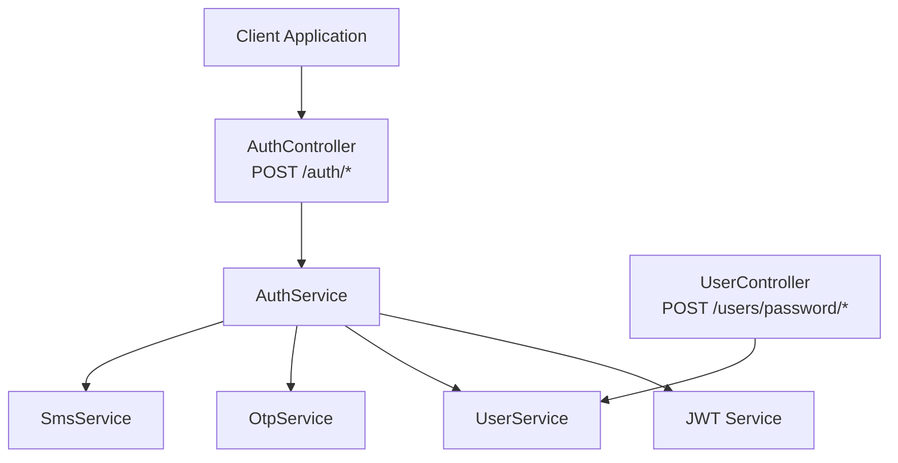
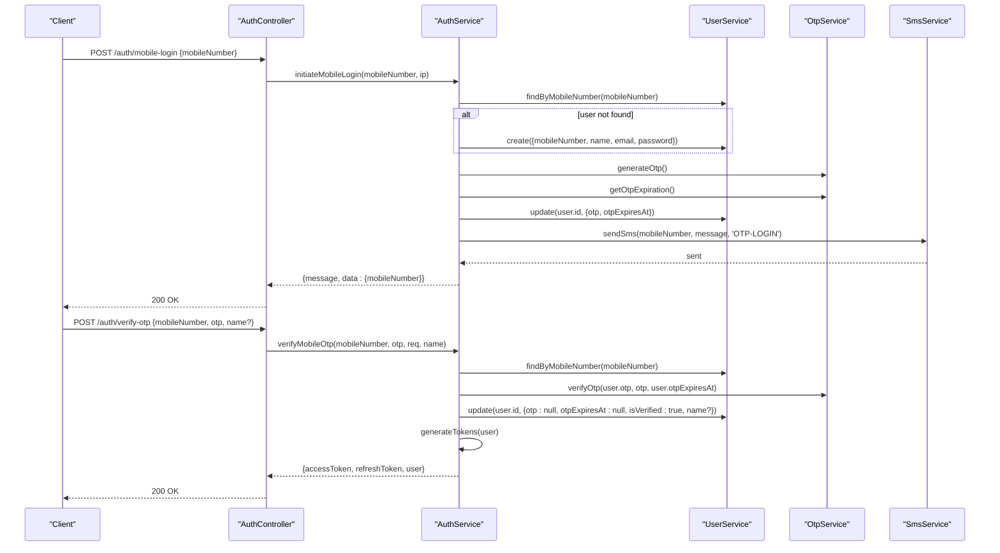
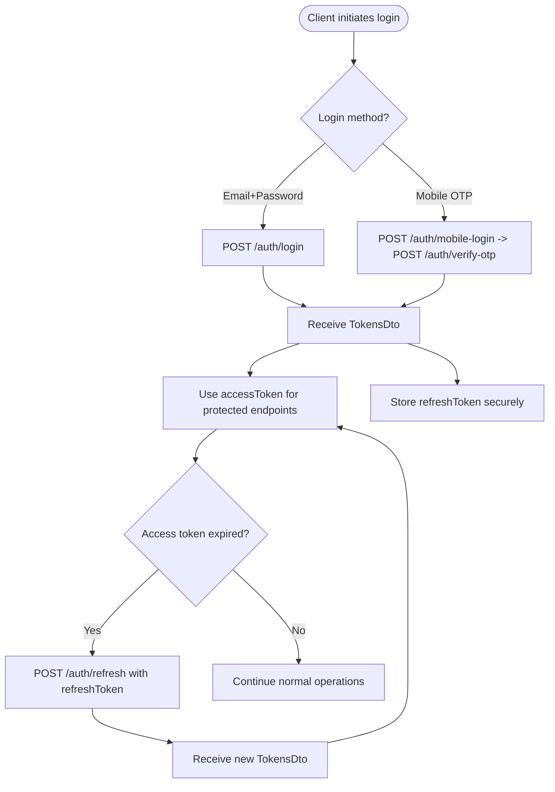
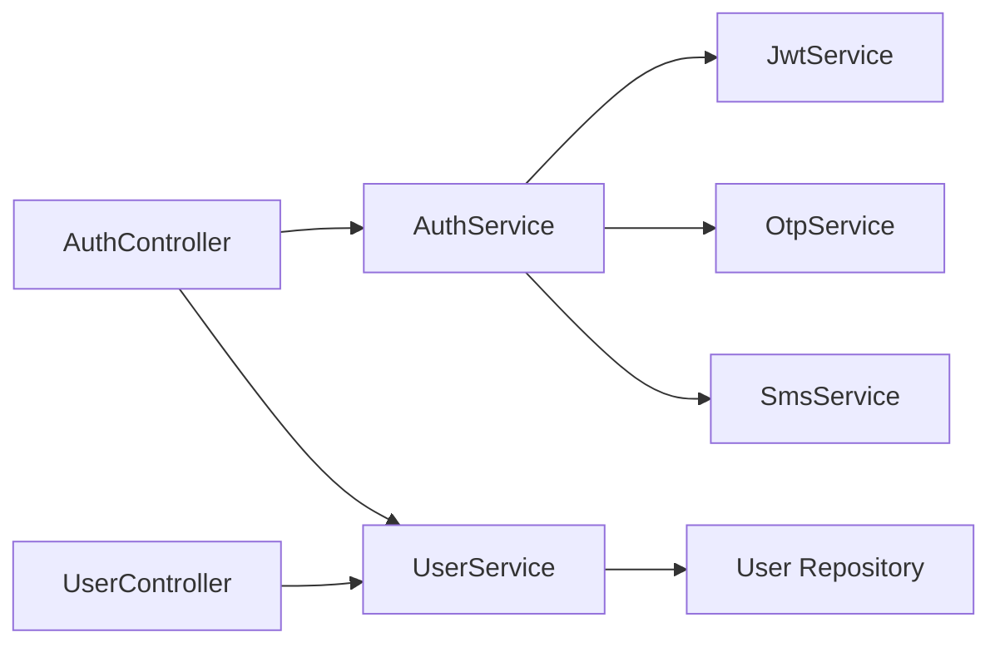

# Authentication APIs

<cite>
**Referenced Files in This Document**
- [auth.controller.ts](file://apps/backend/src/auth/auth.controller.ts)
- [auth.service.ts](file://apps/backend/src/auth/auth.service.ts)
- [otp.service.ts](file://apps/backend/src/auth/otp.service.ts)
- [login.dto.ts](file://apps/backend/src/auth/dto/login.dto.ts)
- [register.dto.ts](file://apps/backend/src/auth/dto/register.dto.ts)
- [mobile-login.dto.ts](file://apps/backend/src/auth/dto/mobile-login.dto.ts)
- [tokens.dto.ts](file://apps/backend/src/auth/dto/tokens.dto.ts)
- [jwt-auth.guard.ts](file://apps/backend/src/auth/guards/jwt-auth.guard.ts)
- [jwt-refresh.guard.ts](file://apps/backend/src/auth/guards/jwt-refresh.guard.ts)
- [user.controller.ts](file://apps/backend/src/user/user.controller.ts)
- [user.service.ts](file://apps/backend/src/user/user.service.ts)
</cite>

## Table of Contents
1. [Introduction](#introduction)
2. [Project Structure](#project-structure)
3. [Core Components](#core-components)
4. [Architecture Overview](#architecture-overview)
5. [Detailed Component Analysis](#detailed-component-analysis)
6. [Dependency Analysis](#dependency-analysis)
7. [Performance Considerations](#performance-considerations)
8. [Troubleshooting Guide](#troubleshooting-guide)
9. [Conclusion](#conclusion)
10. [Appendices](#appendices)

## Introduction
This document provides comprehensive API documentation for authentication endpoints, including user registration, email login, mobile OTP login, logout, token refresh, token validation, password reset request, and password reset completion. It explains request/response schemas, authentication flow, token refresh mechanism, session management, security considerations, rate limiting, account lockout behavior, and common integration patterns.

## Project Structure
Authentication is implemented in the backend NestJS application under the auth module, with supporting DTOs, guards, and OTP utilities. Password reset flows are exposed via the user module controller and service.

**Diagram sources**
- [auth.controller.ts:31-307](file://apps/backend/src/auth/auth.controller.ts#L31-L307)
- [auth.service.ts:21-433](file://apps/backend/src/auth/auth.service.ts#L21-L433)
- [user.controller.ts:348-397](file://apps/backend/src/user/user.controller.ts#L348-L397)

**Section sources**
- [auth.controller.ts:31-307](file://apps/backend/src/auth/auth.controller.ts#L31-L307)
- [user.controller.ts:348-397](file://apps/backend/src/user/user.controller.ts#L348-L397)

## Core Components
- AuthController: Exposes public and protected authentication endpoints (register, login, refresh, logout, validate, mobile-login, verify-otp).
- AuthService: Implements core authentication logic, token generation/validation, mobile OTP login, and audit logging.
- OtpService: Generates OTP codes, validity windows, and verification.
- Guards: JwtAuthGuard protects access-token endpoints; JwtRefreshGuard protects refresh-token endpoints.
- DTOs: Strongly typed request/response schemas for login, registration, mobile login, OTP verification, and tokens.
- User module: Provides password reset request and reset endpoints using OTP.

**Section sources**
- [auth.controller.ts:31-307](file://apps/backend/src/auth/auth.controller.ts#L31-L307)
- [auth.service.ts:21-433](file://apps/backend/src/auth/auth.service.ts#L21-L433)
- [otp.service.ts:1-35](file://apps/backend/src/auth/otp.service.ts#L1-L35)
- [jwt-auth.guard.ts:1-46](file://apps/backend/src/auth/guards/jwt-auth.guard.ts#L1-L46)
- [jwt-refresh.guard.ts:1-62](file://apps/backend/src/auth/guards/jwt-refresh.guard.ts#L1-L62)
- [login.dto.ts:1-27](file://apps/backend/src/auth/dto/login.dto.ts#L1-L27)
- [register.dto.ts:1-63](file://apps/backend/src/auth/dto/register.dto.ts#L1-L63)
- [mobile-login.dto.ts:1-40](file://apps/backend/src/auth/dto/mobile-login.dto.ts#L1-L40)
- [tokens.dto.ts:1-28](file://apps/backend/src/auth/dto/tokens.dto.ts#L1-L28)

## Architecture Overview
The authentication system uses stateless JWTs for access and refresh tokens. Access tokens protect sensitive endpoints; refresh tokens are used to obtain new access tokens without re-authentication. Mobile login uses a two-step OTP flow: send OTP then verify OTP to receive tokens. Password reset is a separate flow that issues an OTP to mobile and optionally email, followed by a password update.

**Diagram sources**
- [auth.controller.ts:231-307](file://apps/backend/src/auth/auth.controller.ts#L231-L307)
- [auth.service.ts:172-358](file://apps/backend/src/auth/auth.service.ts#L172-L358)
- [otp.service.ts:8-33](file://apps/backend/src/auth/otp.service.ts#L8-L33)

## Detailed Component Analysis

### Endpoints Reference

#### Register
- Method: POST
- Path: /auth/register
- Rate limit: 5 requests per minute
- Request body: RegisterDto
- Response: Created user object and tokens
- Notes: Email uniqueness enforced at service layer; password must meet complexity rules

Request schema (RegisterDto):
- email: string, required, valid email format
- name: string, required, length 2–100
- password: string, required, min 8 chars, must include uppercase, lowercase, digit, special character
- mobileNumber: string, optional, phone number format

Response schema:
- message: string
- statusCode: number
- data.user: object with id, email, name, mobileNumber
- data.tokens: TokensDto

Error scenarios:
- 400 Bad Request: Email already exists or invalid payload

**Section sources**
- [auth.controller.ts:38-79](file://apps/backend/src/auth/auth.controller.ts#L38-L79)
- [register.dto.ts:13-62](file://apps/backend/src/auth/dto/register.dto.ts#L13-L62)

#### Login (Email + Password)
- Method: POST
- Path: /auth/login
- Rate limit: 10 requests per minute
- Request body: LoginDto
- Response: TokensDto

Request schema (LoginDto):
- email: string, required, valid email format
- password: string, required, min 6 characters

Response schema:
- message: string
- statusCode: number
- data: TokensDto

Error scenarios:
- 401 Unauthorized: Invalid credentials

**Section sources**
- [auth.controller.ts:81-114](file://apps/backend/src/auth/auth.controller.ts#L81-L114)
- [login.dto.ts:4-26](file://apps/backend/src/auth/dto/login.dto.ts#L4-L26)
- [auth.service.ts:54-100](file://apps/backend/src/auth/auth.service.ts#L54-L100)

#### Refresh Tokens
- Method: POST
- Path: /auth/refresh
- Guard: JwtRefreshGuard (requires refresh token)
- Request: Authorization header with Bearer refresh token
- Response: New TokensDto

Behavior:
- Verifies refresh token using dedicated secret
- Validates payload contains numeric sub
- Fetches user and generates new access and refresh tokens

Error scenarios:
- 401 Unauthorized: Invalid or expired refresh token

**Section sources**
- [auth.controller.ts:116-150](file://apps/backend/src/auth/auth.controller.ts#L116-L150)
- [auth.service.ts:107-144](file://apps/backend/src/auth/auth.service.ts#L107-L144)
- [jwt-refresh.guard.ts:10-62](file://apps/backend/src/auth/guards/jwt-refresh.guard.ts#L10-L62)

#### Logout
- Method: POST
- Path: /auth/logout
- Guard: JwtAuthGuard (requires access token)
- Response: Success message

Behavior:
- Logs logout activity asynchronously
- Does not invalidate server-side tokens (stateless); client should discard tokens

Error scenarios:
- 401 Unauthorized: Missing or invalid access token

**Section sources**
- [auth.controller.ts:152-195](file://apps/backend/src/auth/auth.controller.ts#L152-L195)
- [auth.service.ts:364-380](file://apps/backend/src/auth/auth.service.ts#L364-L380)
- [jwt-auth.guard.ts:10-46](file://apps/backend/src/auth/guards/jwt-auth.guard.ts#L10-L46)

#### Validate Token
- Method: POST
- Path: /auth/validate
- Guard: JwtAuthGuard (requires access token)
- Response: Success message if token is valid

Error scenarios:
- 401 Unauthorized: Invalid or expired token

**Section sources**
- [auth.controller.ts:197-229](file://apps/backend/src/auth/auth.controller.ts#L197-L229)
- [jwt-auth.guard.ts:10-46](file://apps/backend/src/auth/guards/jwt-auth.guard.ts#L10-L46)

#### Mobile Login Initiation
- Method: POST
- Path: /auth/mobile-login
- Rate limits: short/medium/long throttling applied
- Request body: MobileLoginDto
- Response: Acknowledgment with mobileNumber

Behavior:
- Validates international mobile number format
- Creates user if not existing
- Enforces 60-second resend cooldown per mobile number
- Generates OTP, stores it with expiration, sends SMS
- Returns success or rate-limited response

Error scenarios:
- 400 Bad Request: Invalid mobile number or failed user creation
- 429 Too Many Requests: Resend cooldown active
- 503 Service Unavailable: SMS provider failure

**Section sources**
- [auth.controller.ts:231-267](file://apps/backend/src/auth/auth.controller.ts#L231-L267)
- [auth.service.ts:172-250](file://apps/backend/src/auth/auth.service.ts#L172-L250)
- [mobile-login.dto.ts:5-13](file://apps/backend/src/auth/dto/mobile-login.dto.ts#L5-L13)
- [otp.service.ts:8-26](file://apps/backend/src/auth/otp.service.ts#L8-L26)

#### Verify OTP
- Method: POST
- Path: /auth/verify-otp
- Rate limits: short/medium/long throttling applied
- Request body: VerifyOtpDto
- Response: TokensDto plus minimal user profile

Behavior:
- Validates mobile number and OTP format
- Retrieves user and verifies OTP against stored value and expiration
- Clears OTP fields, marks user verified, updates name if provided
- Generates tokens and returns them along with sanitized user info

Error scenarios:
- 400 Bad Request: Invalid mobile number or OTP format
- 401 Unauthorized: Mobile number not registered, no OTP requested, or invalid OTP

**Section sources**
- [auth.controller.ts:269-307](file://apps/backend/src/auth/auth.controller.ts#L269-L307)
- [auth.service.ts:252-358](file://apps/backend/src/auth/auth.service.ts#L252-L358)
- [mobile-login.dto.ts:15-40](file://apps/backend/src/auth/dto/mobile-login.dto.ts#L15-L40)
- [otp.service.ts:28-33](file://apps/backend/src/auth/otp.service.ts#L28-L33)

#### Password Reset Request
- Method: POST
- Path: /users/password/reset-request
- Rate limits: strict throttling applied
- Request body: { mobileNumber: string }
- Response: Success message

Behavior:
- Finds user by mobile number
- Enforces 60-second resend cooldown per mobile number
- Generates OTP, stores with expiration, sends SMS and email
- Returns success or rate-limited response

Error scenarios:
- 404 Not Found: User not found
- 429 Too Many Requests: Resend cooldown active

**Section sources**
- [user.controller.ts:348-369](file://apps/backend/src/user/user.controller.ts#L348-L369)
- [user.service.ts:830-881](file://apps/backend/src/user/user.service.ts#L830-L881)
- [otp.service.ts:8-26](file://apps/backend/src/auth/otp.service.ts#L8-L26)

#### Password Reset Completion
- Method: POST
- Path: /users/password/reset
- Request body: { mobileNumber: string, otp: string, newPassword: string }
- Response: Success message

Behavior:
- Validates user existence and OTP presence/expiry
- Verifies OTP
- Hashes new password and clears OTP fields
- Sends confirmation notifications via email and SMS

Error scenarios:
- 404 Not Found: User not found
- 400 Bad Request: OTP not generated or invalid/expired

**Section sources**
- [user.controller.ts:370-397](file://apps/backend/src/user/user.controller.ts#L370-L397)
- [user.service.ts:883-938](file://apps/backend/src/user/user.service.ts#L883-L938)

### Data Models

#### LoginDto
- email: string, required, validated as email
- password: string, required, min 6 characters

**Section sources**
- [login.dto.ts:4-26](file://apps/backend/src/auth/dto/login.dto.ts#L4-L26)

#### RegisterDto
- email: string, required, validated as email
- name: string, required, length 2–100
- password: string, required, min 8 characters, complex pattern
- mobileNumber: string, optional, phone number format

**Section sources**
- [register.dto.ts:13-62](file://apps/backend/src/auth/dto/register.dto.ts#L13-L62)

#### MobileLoginDto
- mobileNumber: string, required, phone number format

**Section sources**
- [mobile-login.dto.ts:5-13](file://apps/backend/src/auth/dto/mobile-login.dto.ts#L5-L13)

#### VerifyOtpDto
- mobileNumber: string, required, phone number format
- otp: string, required, exactly 6 digits
- name: string, optional

**Section sources**
- [mobile-login.dto.ts:15-40](file://apps/backend/src/auth/dto/mobile-login.dto.ts#L15-L40)

#### TokensDto
- accessToken: string, required, JWT format
- refreshToken: string, required, JWT format

**Section sources**
- [tokens.dto.ts:4-27](file://apps/backend/src/auth/dto/tokens.dto.ts#L4-L27)

### Authentication Flow

**Diagram sources**
- [auth.controller.ts:81-150](file://apps/backend/src/auth/auth.controller.ts#L81-L150)
- [auth.service.ts:107-170](file://apps/backend/src/auth/auth.service.ts#L107-L170)

### Token Management and Security

- Access tokens:
  - Used in Authorization: Bearer <accessToken> headers
  - Short-lived; sufficient for typical API calls
- Refresh tokens:
  - Used only on /auth/refresh
  - Longer-lived; rotate on each refresh
- Token payload includes:
  - sub (user id), name, email, mobileNumber, roles
- Secrets:
  - Separate secrets for access and refresh tokens via configuration
- Validation:
  - JwtAuthGuard enforces access token validation
  - JwtRefreshGuard enforces refresh token validation and attaches token to request

**Section sources**
- [auth.service.ts:146-170](file://apps/backend/src/auth/auth.service.ts#L146-L170)
- [jwt-auth.guard.ts:10-46](file://apps/backend/src/auth/guards/jwt-auth.guard.ts#L10-L46)
- [jwt-refresh.guard.ts:10-62](file://apps/backend/src/auth/guards/jwt-refresh.guard.ts#L10-L62)

### Session Management
- The system is stateless regarding sessions; there is no server-side session store for authentication.
- Logout does not invalidate tokens server-side; clients should clear stored tokens.
- Audit logs record login/logout events for observability.

**Section sources**
- [auth.controller.ts:152-195](file://apps/backend/src/auth/auth.controller.ts#L152-L195)
- [auth.service.ts:382-431](file://apps/backend/src/auth/auth.service.ts#L382-L431)

### Rate Limiting and Account Lockout Policies
- Throttling:
  - /auth/register: 5 requests per minute
  - /auth/login: 10 requests per minute
  - /auth/mobile-login and /auth/verify-otp: short/medium/long global limits
  - /users/password/reset-request: strict short/medium/long limits
- Per-number cooldown:
  - Mobile login OTP resend blocked within 60 seconds of last send
  - Password reset OTP resend blocked within 60 seconds of last send
- No explicit account lockout policy is implemented beyond OTP cooldown and throttling.

**Section sources**
- [auth.controller.ts:38-40](file://apps/backend/src/auth/auth.controller.ts#L38-L40)
- [auth.controller.ts:81-83](file://apps/backend/src/auth/auth.controller.ts#L81-L83)
- [auth.controller.ts:231-240](file://apps/backend/src/auth/auth.controller.ts#L231-L240)
- [auth.controller.ts:269-276](file://apps/backend/src/auth/auth.controller.ts#L269-L276)
- [user.controller.ts:358-363](file://apps/backend/src/user/user.controller.ts#L358-L363)
- [auth.service.ts:204-218](file://apps/backend/src/auth/auth.service.ts#L204-L218)
- [user.service.ts:842-855](file://apps/backend/src/user/user.service.ts#L842-L855)

### Error Scenarios and Responses
Common error shapes:
- 400 Bad Request: Invalid input, OTP not generated, failed operations
- 401 Unauthorized: Invalid credentials, invalid/expired tokens, missing OTP
- 404 Not Found: User not found
- 429 Too Many Requests: Rate limited or OTP resend cooldown active
- 503 Service Unavailable: SMS provider failure

Examples:
- Login failure: 401 with message indicating invalid credentials
- Refresh failure: 401 with message indicating invalid refresh token
- OTP resend cooldown: 429 with message instructing to wait before resending

**Section sources**
- [auth.controller.ts:88-114](file://apps/backend/src/auth/auth.controller.ts#L88-L114)
- [auth.controller.ts:125-150](file://apps/backend/src/auth/auth.controller.ts#L125-L150)
- [auth.controller.ts:247-267](file://apps/backend/src/auth/auth.controller.ts#L247-L267)
- [auth.service.ts:172-250](file://apps/backend/src/auth/auth.service.ts#L172-L250)
- [user.service.ts:830-881](file://apps/backend/src/user/user.service.ts#L830-L881)

### Common Integration Patterns
- Client-side token handling:
  - Store accessToken and refreshToken securely (e.g., httpOnly cookies or secure storage)
  - Attach accessToken to all protected requests
  - On 401 from protected endpoints, attempt refresh using refreshToken
  - If refresh fails, redirect to login
- Mobile OTP flow:
  - Call /auth/mobile-login with mobileNumber
  - Prompt user for OTP received via SMS
  - Call /auth/verify-otp with mobileNumber, otp, and optional name
  - Store returned tokens and use accessToken for subsequent requests
- Password reset flow:
  - Call /users/password/reset-request with mobileNumber
  - Prompt user for OTP received via SMS/email
  - Call /users/password/reset with mobileNumber, otp, newPassword

[No sources needed since this section aggregates previously analyzed flows]

## Dependency Analysis

**Diagram sources**
- [auth.controller.ts:31-307](file://apps/backend/src/auth/auth.controller.ts#L31-L307)
- [auth.service.ts:21-433](file://apps/backend/src/auth/auth.service.ts#L21-L433)
- [user.controller.ts:348-397](file://apps/backend/src/user/user.controller.ts#L348-L397)

**Section sources**
- [auth.controller.ts:31-307](file://apps/backend/src/auth/auth.controller.ts#L31-L307)
- [auth.service.ts:21-433](file://apps/backend/src/auth/auth.service.ts#L21-L433)
- [user.controller.ts:348-397](file://apps/backend/src/user/user.controller.ts#L348-L397)

## Performance Considerations
- Non-critical audit writes (lastLoginAt, activity logs) are fire-and-forget to avoid blocking authentication responses.
- OTP resend cooldown prevents excessive SMS usage and reduces load.
- Separate secrets for access and refresh tokens allow independent rotation and shorter lifetimes for access tokens.

[No sources needed since this section provides general guidance]

## Troubleshooting Guide
- Invalid credentials on login:
  - Ensure email and password match stored values; check password hashing and minimum length constraints.
- Refresh token failures:
  - Confirm refresh token is present and valid; ensure correct secret and payload structure.
- OTP resend cooldown:
  - Wait at least 60 seconds between OTP requests for the same mobile number.
- SMS delivery issues:
  - Check SMS provider status; endpoint may return 503 when sending fails.
- Password reset OTP not received:
  - Verify both SMS and email channels; OTP is sent to both when email is available.

**Section sources**
- [auth.service.ts:54-73](file://apps/backend/src/auth/auth.service.ts#L54-L73)
- [auth.service.ts:107-144](file://apps/backend/src/auth/auth.service.ts#L107-L144)
- [auth.service.ts:204-218](file://apps/backend/src/auth/auth.service.ts#L204-L218)
- [user.service.ts:842-855](file://apps/backend/src/user/user.service.ts#L842-L855)

## Conclusion
The authentication system provides robust, stateless JWT-based authentication with mobile OTP support and a secure password reset flow. Rate limiting and per-number cooldowns mitigate abuse, while separate secrets and guarded endpoints enforce token security. Clients should implement token refresh strategies and handle errors gracefully to ensure a smooth user experience.

[No sources needed since this section summarizes without analyzing specific files]

## Appendices

### Endpoint Summary Table

- POST /auth/register
  - Body: RegisterDto
  - Success: 201 with user and tokens
  - Errors: 400 (email exists, invalid payload)

- POST /auth/login
  - Body: LoginDto
  - Success: 200 with TokensDto
  - Errors: 401 (invalid credentials)

- POST /auth/refresh
  - Header: Authorization: Bearer <refreshToken>
  - Success: 200 with new TokensDto
  - Errors: 401 (invalid refresh token)

- POST /auth/logout
  - Header: Authorization: Bearer <accessToken>
  - Success: 200 success message
  - Errors: 401 (invalid access token)

- POST /auth/validate
  - Header: Authorization: Bearer <accessToken>
  - Success: 200 success message
  - Errors: 401 (invalid access token)

- POST /auth/mobile-login
  - Body: MobileLoginDto
  - Success: 200 acknowledgment
  - Errors: 400 (invalid mobile), 429 (cooldown), 503 (SMS failure)

- POST /auth/verify-otp
  - Body: VerifyOtpDto
  - Success: 200 with TokensDto and user
  - Errors: 400 (invalid inputs), 401 (invalid OTP)

- POST /users/password/reset-request
  - Body: { mobileNumber }
  - Success: 200 success message
  - Errors: 404 (user not found), 429 (cooldown)

- POST /users/password/reset
  - Body: { mobileNumber, otp, newPassword }
  - Success: 200 success message
  - Errors: 404 (user not found), 400 (invalid/expired OTP)

**Section sources**
- [auth.controller.ts:38-307](file://apps/backend/src/auth/auth.controller.ts#L38-L307)
- [user.controller.ts:348-397](file://apps/backend/src/user/user.controller.ts#L348-L397)