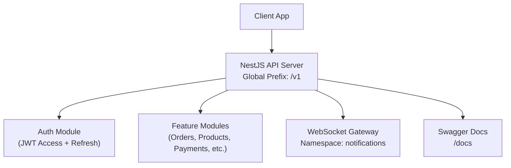
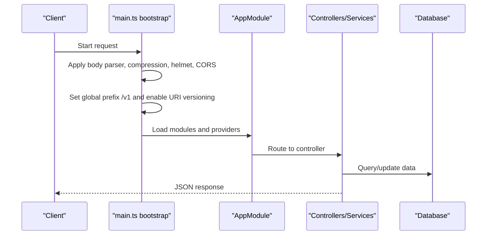
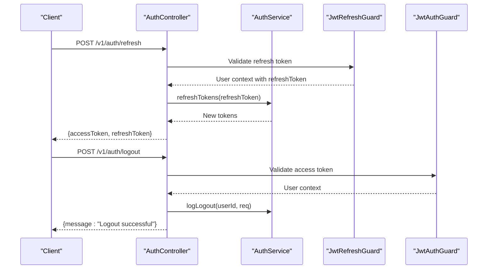
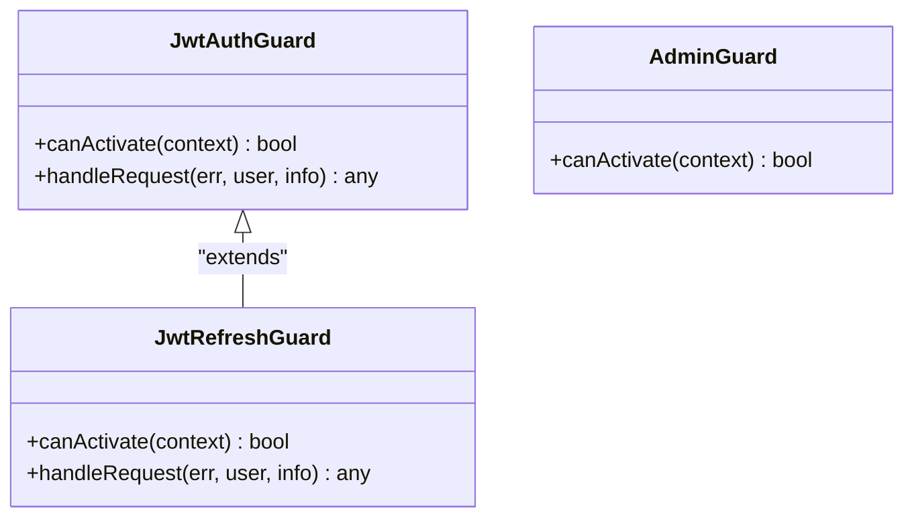
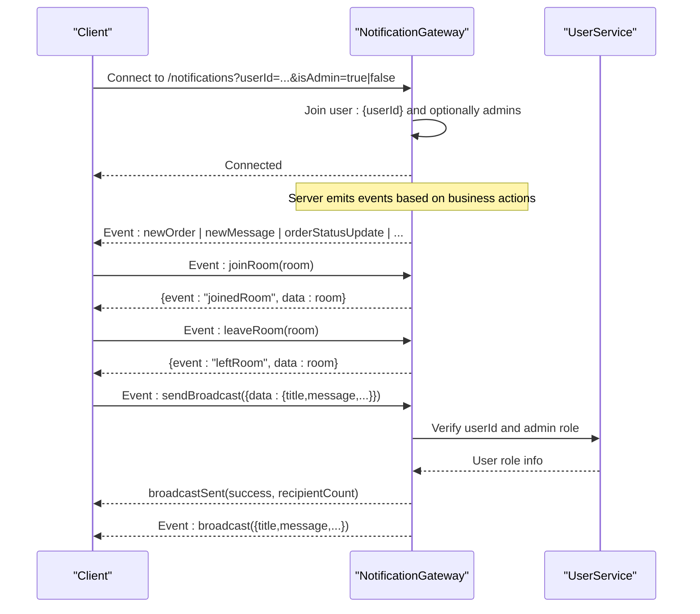
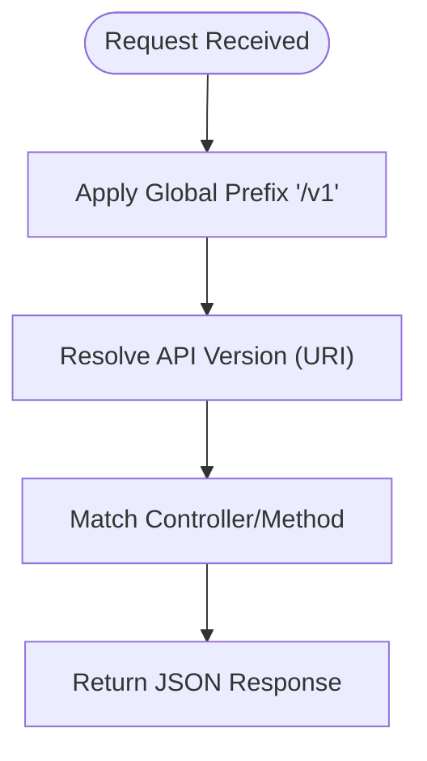
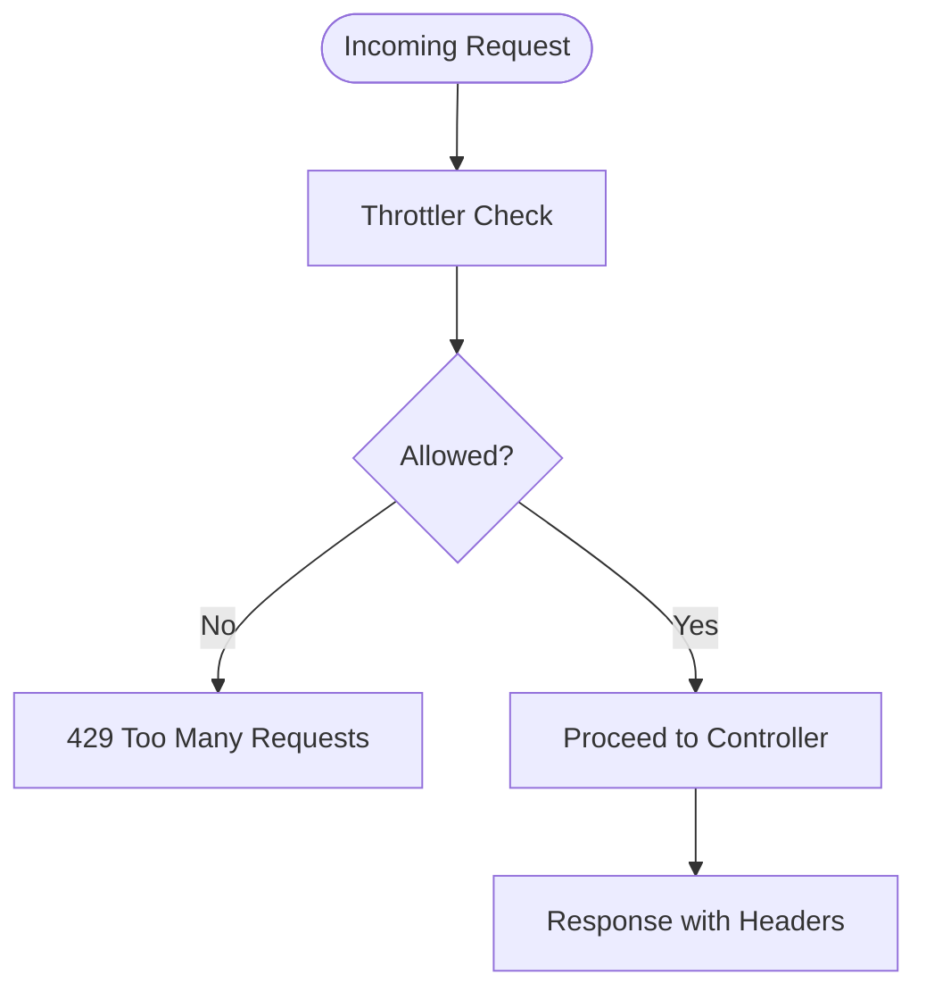
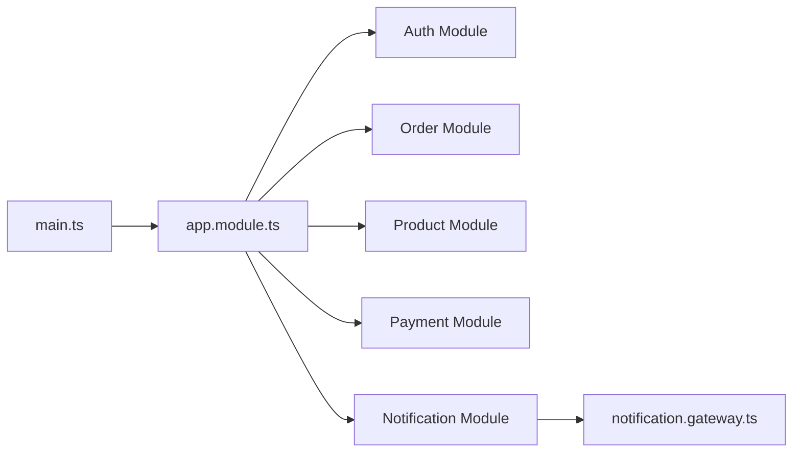

# Complete API Reference

<cite>
**Referenced Files in This Document**
- [main.ts](file://apps/backend/src/main.ts)
- [app.module.ts](file://apps/backend/src/app.module.ts)
- [auth.controller.ts](file://apps/backend/src/auth/auth.controller.ts)
- [jwt-auth.guard.ts](file://apps/backend/src/auth/guards/jwt-auth.guard.ts)
- [jwt-refresh.guard.ts](file://apps/backend/src/auth/guards/jwt-refresh.guard.ts)
- [admin.guard.ts](file://apps/backend/src/auth/guards/admin.guard.ts)
- [notification.gateway.ts](file://apps/backend/src/notification/notification.gateway.ts)
- [README.md](file://README.md)
</cite>

## Table of Contents
1. [Introduction](#introduction)
2. [Project Structure](#project-structure)
3. [Core Components](#core-components)
4. [Architecture Overview](#architecture-overview)
5. [Detailed Component Analysis](#detailed-component-analysis)
6. [Dependency Analysis](#dependency-analysis)
7. [Performance Considerations](#performance-considerations)
8. [Troubleshooting Guide](#troubleshooting-guide)
9. [Conclusion](#conclusion)
10. [Appendices](#appendices)

## Introduction
This document provides a comprehensive API reference for the German Butcher platform, focusing on REST endpoints and WebSocket APIs exposed by the NestJS backend. It covers authentication, versioning, rate limiting, error handling patterns, and real-time features. The backend is configured with:
- Global API prefix v1
- URI-based API versioning
- JWT-based authentication (access and refresh tokens)
- Role-based authorization (including admin guard)
- Throttling/rate limiting via NestJS Throttler
- Swagger/OpenAPI documentation at /docs
- WebSocket gateway under namespace notifications for real-time events

Where specific endpoint definitions are not present in the analyzed files, this document outlines the available capabilities and points to the relevant implementation sources.

## Project Structure
The backend exposes feature modules organized under apps/backend/src. Key areas include:
- Authentication and Authorization
- Orders, Payments, Products, Categories, Brands, Banners, etc.
- Real-time Notifications via WebSockets
- Admin-facing controllers and services

**Diagram sources**
- [main.ts:37-40](file://apps/backend/src/main.ts#L37-L40)
- [main.ts:47-86](file://apps/backend/src/main.ts#L47-L86)
- [app.module.ts:117-165](file://apps/backend/src/app.module.ts#L117-L165)
- [notification.gateway.ts:15-27](file://apps/backend/src/notification/notification.gateway.ts#L15-L27)

**Section sources**
- [README.md:224-229](file://README.md#L224-L229)
- [main.ts:37-40](file://apps/backend/src/main.ts#L37-L40)
- [main.ts:47-86](file://apps/backend/src/main.ts#L47-L86)
- [app.module.ts:117-165](file://apps/backend/src/app.module.ts#L117-L165)

## Core Components
- Authentication:
  - JWT access token guard for protected routes
  - Refresh token guard for token renewal
  - Admin role guard for admin-only endpoints
- Versioning and Prefix:
  - All endpoints are under /v1
  - URI-based versioning enabled
- Rate Limiting:
  - Three throttler policies (short, medium, long) configured globally
- Documentation:
  - Swagger UI at /docs when enabled

**Section sources**
- [jwt-auth.guard.ts:10-45](file://apps/backend/src/auth/guards/jwt-auth.guard.ts#L10-L45)
- [jwt-refresh.guard.ts:10-46](file://apps/backend/src/auth/guards/jwt-refresh.guard.ts#L10-L46)
- [admin.guard.ts:5-15](file://apps/backend/src/auth/guards/admin.guard.ts#L5-L15)
- [main.ts:37-40](file://apps/backend/src/main.ts#L37-L40)
- [app.module.ts:70-92](file://apps/backend/src/app.module.ts#L70-L92)
- [main.ts:47-86](file://apps/backend/src/main.ts#L47-L86)

## Architecture Overview
The API server bootstraps global middleware, security headers, compression, CORS, validation, serialization, and analytics interceptors. It enables Swagger when allowed and sets up the global prefix and versioning. Feature modules are registered in the application module.

**Diagram sources**
- [main.ts:16-40](file://apps/backend/src/main.ts#L16-L40)
- [main.ts:89-125](file://apps/backend/src/main.ts#L89-L125)
- [app.module.ts:60-92](file://apps/backend/src/app.module.ts#L60-L92)

**Section sources**
- [main.ts:16-40](file://apps/backend/src/main.ts#L16-L40)
- [main.ts:89-125](file://apps/backend/src/main.ts#L89-L125)
- [app.module.ts:60-92](file://apps/backend/src/app.module.ts#L60-L92)

## Detailed Component Analysis

### Authentication Endpoints
- Base path: /v1/auth
- Methods and behaviors observed:
  - POST /v1/auth/refresh
    - Requires refresh token (Bearer scheme documented via ApiBearerAuth('refresh-token'))
    - Returns new tokens or an unauthorized error if invalid/expired
  - POST /v1/auth/logout
    - Requires access token (Bearer scheme documented via ApiBearerAuth('token'))
    - Invalidates session and logs logout activity
- Error responses:
  - Unauthorized errors include statusCode, message, and error fields

**Diagram sources**
- [auth.controller.ts:137-188](file://apps/backend/src/auth/auth.controller.ts#L137-L188)
- [jwt-refresh.guard.ts:10-46](file://apps/backend/src/auth/guards/jwt-refresh.guard.ts#L10-L46)
- [jwt-auth.guard.ts:10-45](file://apps/backend/src/auth/guards/jwt-auth.guard.ts#L10-L45)

**Section sources**
- [auth.controller.ts:137-188](file://apps/backend/src/auth/auth.controller.ts#L137-L188)
- [jwt-refresh.guard.ts:10-46](file://apps/backend/src/auth/guards/jwt-refresh.guard.ts#L10-L46)
- [jwt-auth.guard.ts:10-45](file://apps/backend/src/auth/guards/jwt-auth.guard.ts#L10-L45)

### Authorization Guards
- JwtAuthGuard:
  - Validates access token; supports public route override via reflector
  - Standardizes unauthorized error shape
- JwtRefreshGuard:
  - Validates refresh token; enforces presence of Authorization header
  - Customizes unauthorized error for refresh flows
- AdminGuard:
  - Restricts access to superadmin or admin roles

**Diagram sources**
- [jwt-auth.guard.ts:10-45](file://apps/backend/src/auth/guards/jwt-auth.guard.ts#L10-L45)
- [jwt-refresh.guard.ts:10-46](file://apps/backend/src/auth/guards/jwt-refresh.guard.ts#L10-L46)
- [admin.guard.ts:5-15](file://apps/backend/src/auth/guards/admin.guard.ts#L5-L15)

**Section sources**
- [jwt-auth.guard.ts:10-45](file://apps/backend/src/auth/guards/jwt-auth.guard.ts#L10-L45)
- [jwt-refresh.guard.ts:10-46](file://apps/backend/src/auth/guards/jwt-refresh.guard.ts#L10-L46)
- [admin.guard.ts:5-15](file://apps/backend/src/auth/guards/admin.guard.ts#L5-L15)

### WebSocket API (Real-time Notifications)
- Namespace: /notifications
- Connection:
  - Handshake query parameters: userId, isAdmin
  - Clients join rooms:
    - user:{userId} for user-specific events
    - admins for admin-wide events
- Events emitted by server:
  - newOrder (to admins room)
  - newMessage (to admins room)
  - orderStatusUpdate (to user:{userId})
  - paymentStatusUpdate (to user:{userId})
  - orderConfirmation (to user:{userId})
  - notification (to user:{userId})
  - broadcast (to all clients)
- Client-to-server events:
  - joinRoom(room)
  - leaveRoom(room)
  - sendBroadcast(data) — restricted to admins

**Diagram sources**
- [notification.gateway.ts:15-27](file://apps/backend/src/notification/notification.gateway.ts#L15-L27)
- [notification.gateway.ts:43-87](file://apps/backend/src/notification/notification.gateway.ts#L43-L87)
- [notification.gateway.ts:128-146](file://apps/backend/src/notification/notification.gateway.ts#L128-L146)
- [notification.gateway.ts:148-222](file://apps/backend/src/notification/notification.gateway.ts#L148-L222)
- [notification.gateway.ts:228-338](file://apps/backend/src/notification/notification.gateway.ts#L228-L338)

**Section sources**
- [notification.gateway.ts:15-27](file://apps/backend/src/notification/notification.gateway.ts#L15-L27)
- [notification.gateway.ts:43-87](file://apps/backend/src/notification/notification.gateway.ts#L43-L87)
- [notification.gateway.ts:128-146](file://apps/backend/src/notification/notification.gateway.ts#L128-L146)
- [notification.gateway.ts:148-222](file://apps/backend/src/notification/notification.gateway.ts#L148-L222)
- [notification.gateway.ts:228-338](file://apps/backend/src/notification/notification.gateway.ts#L228-L338)

### API Versioning and Prefix Strategy
- Global prefix: /v1
- Versioning type: URI
- Documentation: Swagger UI at /docs when enabled

**Diagram sources**
- [main.ts:37-40](file://apps/backend/src/main.ts#L37-L40)

**Section sources**
- [main.ts:37-40](file://apps/backend/src/main.ts#L37-L40)

### Rate Limiting and Security
- Throttler policies:
  - short: 3000 requests per minute
  - medium: 10000 requests per 5 minutes
  - long: 50000 requests per hour
- Security:
  - Helmet headers enabled
  - CORS configured from environment
  - ValidationPipe and ClassSerializerInterceptor applied globally

**Diagram sources**
- [app.module.ts:70-92](file://apps/backend/src/app.module.ts#L70-L92)
- [main.ts:28-29](file://apps/backend/src/main.ts#L28-L29)
- [main.ts:89-109](file://apps/backend/src/main.ts#L89-L109)
- [main.ts:111-125](file://apps/backend/src/main.ts#L111-L125)

**Section sources**
- [app.module.ts:70-92](file://apps/backend/src/app.module.ts#L70-L92)
- [main.ts:28-29](file://apps/backend/src/main.ts#L28-L29)
- [main.ts:89-109](file://apps/backend/src/main.ts#L89-L109)
- [main.ts:111-125](file://apps/backend/src/main.ts#L111-L125)

## Dependency Analysis
The application composes multiple feature modules and global providers. The following diagram shows key dependencies among core components.

**Diagram sources**
- [app.module.ts:117-165](file://apps/backend/src/app.module.ts#L117-L165)
- [notification.gateway.ts:15-27](file://apps/backend/src/notification/notification.gateway.ts#L15-L27)

**Section sources**
- [app.module.ts:117-165](file://apps/backend/src/app.module.ts#L117-L165)

## Performance Considerations
- Compression enabled for JSON responses
- Body size limits increased to accommodate large payloads
- Database connection pool settings configured
- Global serialization interceptor strips sensitive fields from responses

[No sources needed since this section provides general guidance]

## Troubleshooting Guide
- Authentication issues:
  - Ensure access token is provided for protected endpoints
  - Use refresh endpoint to obtain new tokens when expired
- WebSocket connectivity:
  - Confirm correct namespace (/notifications)
  - Provide userId and optional isAdmin in handshake query
- Rate limiting:
  - If receiving 429 errors, reduce request frequency or adjust throttler configuration
- Swagger docs:
  - Access at /docs when enabled; verify environment variables

**Section sources**
- [jwt-auth.guard.ts:10-45](file://apps/backend/src/auth/guards/jwt-auth.guard.ts#L10-L45)
- [jwt-refresh.guard.ts:10-46](file://apps/backend/src/auth/guards/jwt-refresh.guard.ts#L10-L46)
- [notification.gateway.ts:43-87](file://apps/backend/src/notification/notification.gateway.ts#L43-L87)
- [main.ts:47-86](file://apps/backend/src/main.ts#L47-L86)

## Conclusion
The German Butcher backend provides a robust, secure, and scalable API surface with:
- Clear API versioning and global prefix
- JWT-based authentication with refresh support
- Role-based guards including admin restrictions
- Comprehensive rate limiting and security headers
- Real-time notifications via Socket.IO under a dedicated namespace
- Interactive API documentation through Swagger

For full endpoint catalogs beyond those analyzed here, consult the running instance’s Swagger UI at /docs.

[No sources needed since this section summarizes without analyzing specific files]

## Appendices

### API Versioning and Deprecation Policy
- Versioning strategy: URI-based versioning with global prefix /v1
- Deprecation policy: Not explicitly defined in the analyzed files; follow standard practices such as maintaining backward compatibility and announcing deprecations via changelogs and API headers

[No sources needed since this section provides general guidance]

### Error Handling Patterns
- Unauthorized responses include structured fields: statusCode, message, error
- Refresh token flow returns explicit messages for invalid/expired tokens
- WebSocket broadcast handler validates input and returns error events for unauthorized or malformed requests

**Section sources**
- [jwt-refresh.guard.ts:10-46](file://apps/backend/src/auth/guards/jwt-refresh.guard.ts#L10-L46)
- [notification.gateway.ts:228-338](file://apps/backend/src/notification/notification.gateway.ts#L228-L338)

### SDK Examples and Client Integration Patterns
- REST:
  - Use HTTP client libraries (e.g., fetch, axios) to call /v1 endpoints
  - Include Authorization: Bearer <accessToken> for protected routes
  - Use /v1/auth/refresh to renew tokens
- WebSocket:
  - Connect to ws(s)://host/notifications
  - Pass userId and isAdmin in handshake query
  - Subscribe to events like newOrder, orderStatusUpdate, broadcast
  - Send joinRoom/leaveRoom/sendBroadcast events as needed

[No sources needed since this section provides general guidance]

### API Testing Approaches, Sandbox Environments, and Developer Tools
- Interactive testing via Swagger UI at /docs
- Backend test scripts available (unit, e2e, coverage)
- Local development endpoints:
  - Backend: http://localhost:3000/v1
  - Docs: http://localhost:3000/docs

**Section sources**
- [README.md:224-229](file://README.md#L224-L229)
- [README.md:168-177](file://README.md#L168-L177)