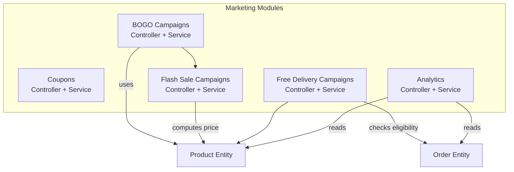
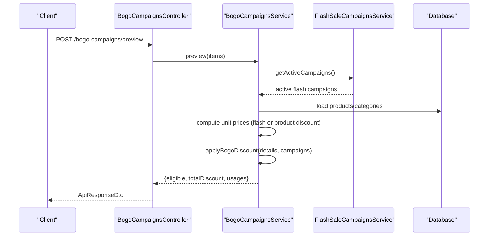
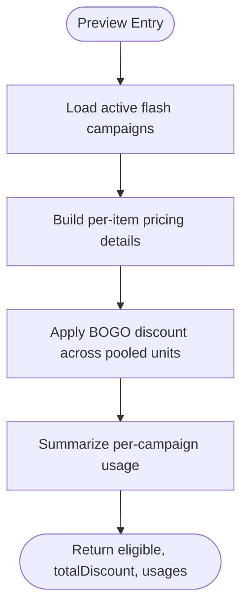
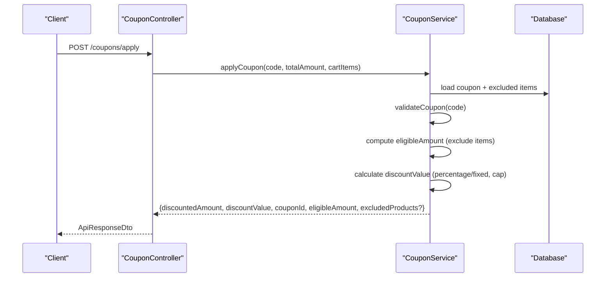
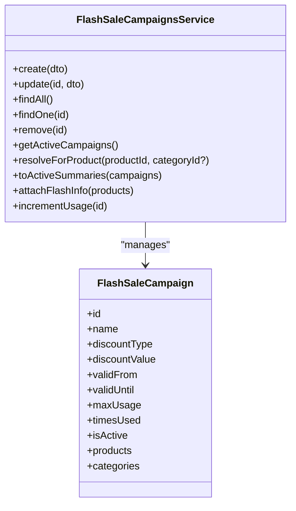
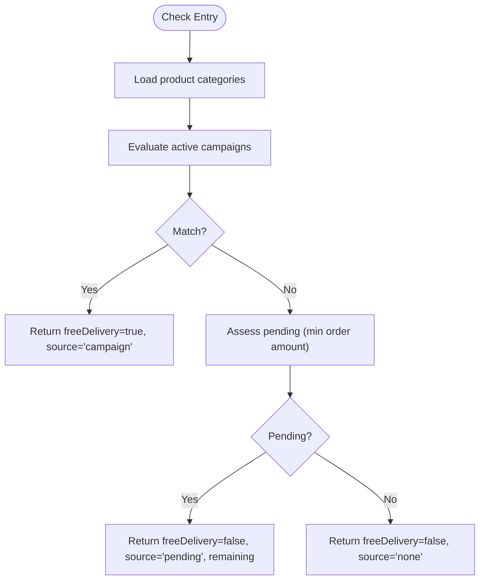
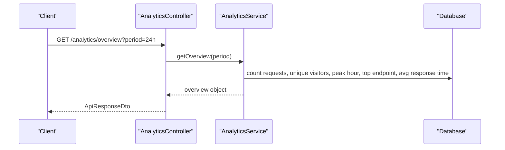
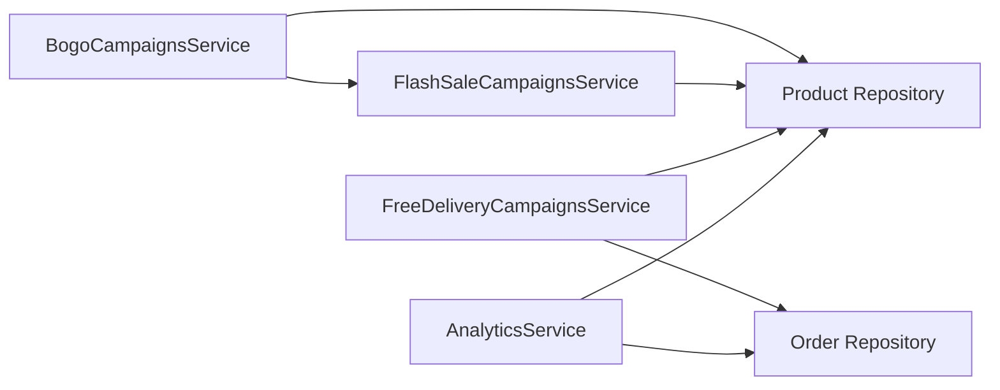

# Marketing & Promotions APIs

<cite>
**Referenced Files in This Document**
- [bogo-campaigns.controller.ts](file://apps/backend/src/bogo-campaigns/bogo-campaigns.controller.ts)
- [bogo-campaigns.service.ts](file://apps/backend/src/bogo-campaigns/bogo-campaigns.service.ts)
- [coupon.controller.ts](file://apps/backend/src/coupon/coupon.controller.ts)
- [coupon.service.ts](file://apps/backend/src/coupon/coupon.service.ts)
- [flash-sale-campaigns.controller.ts](file://apps/backend/src/flash-sale-campaigns/flash-sale-campaigns.controller.ts)
- [flash-sale-campaigns.service.ts](file://apps/backend/src/flash-sale-campaigns/flash-sale-campaigns.service.ts)
- [free-delivery-campaigns.controller.ts](file://apps/backend/src/free-delivery-campaigns/free-delivery-campaigns.controller.ts)
- [free-delivery-campaigns.service.ts](file://apps/backend/src/free-delivery-campaigns/free-delivery-campaigns.service.ts)
- [analytics.controller.ts](file://apps/backend/src/analytics/analytics.controller.ts)
- [analytics.service.ts](file://apps/backend/src/analytics/analytics.service.ts)
</cite>

## Table of Contents
1. [Introduction](#introduction)
2. [Project Structure](#project-structure)
3. [Core Components](#core-components)
4. [Architecture Overview](#architecture-overview)
5. [Detailed Component Analysis](#detailed-component-analysis)
6. [Dependency Analysis](#dependency-analysis)
7. [Performance Considerations](#performance-considerations)
8. [Troubleshooting Guide](#troubleshooting-guide)
9. [Conclusion](#conclusion)

## Introduction
This document provides comprehensive API documentation for marketing and promotional endpoints, covering:
- BOGO campaign management (creation, product/category assignment, preview, usage tracking)
- Coupon system (code creation, validation, application, cart eligibility, usage analytics)
- Flash sale campaigns (scheduling, discount calculation, active listing)
- Free delivery campaigns (configuration, eligibility checking, pending progress)
- Analytics endpoints (traffic, conversion, performance metrics)

The backend is a NestJS application organized by feature modules. Each module exposes REST endpoints through controllers and implements business logic in services. Responses are wrapped in a standard ApiResponseDto envelope with message, statusCode, and data fields.

## Project Structure
Marketing and promotions are implemented as separate feature modules under apps/backend/src:
- bogo-campaigns: BOGO rules, preview, admin CRUD, usage increment
- coupon: coupon lifecycle, validation, application, cart eligibility
- flash-sale-campaigns: flash pricing, scheduling, active listing
- free-delivery-campaigns: free delivery rules, cart check, pending progress
- analytics: request logging, traffic, conversion, device/browser breakdown

**Diagram sources**
- [bogo-campaigns.controller.ts:28-129](file://apps/backend/src/bogo-campaigns/bogo-campaigns.controller.ts#L28-L129)
- [bogo-campaigns.service.ts:177-519](file://apps/backend/src/bogo-campaigns/bogo-campaigns.service.ts#L177-L519)
- [coupon.controller.ts:37-325](file://apps/backend/src/coupon/coupon.controller.ts#L37-L325)
- [coupon.service.ts:16-393](file://apps/backend/src/coupon/coupon.service.ts#L16-L393)
- [flash-sale-campaigns.controller.ts:27-120](file://apps/backend/src/flash-sale-campaigns/flash-sale-campaigns.controller.ts#L27-L120)
- [flash-sale-campaigns.service.ts:82-375](file://apps/backend/src/flash-sale-campaigns/flash-sale-campaigns.service.ts#L82-L375)
- [free-delivery-campaigns.controller.ts:30-146](file://apps/backend/src/free-delivery-campaigns/free-delivery-campaigns.controller.ts#L30-L146)
- [free-delivery-campaigns.service.ts:84-418](file://apps/backend/src/free-delivery-campaigns/free-delivery-campaigns.service.ts#L84-L418)
- [analytics.controller.ts:27-329](file://apps/backend/src/analytics/analytics.controller.ts#L27-L329)
- [analytics.service.ts:38-617](file://apps/backend/src/analytics/analytics.service.ts#L38-L617)

**Section sources**
- [bogo-campaigns.controller.ts:28-129](file://apps/backend/src/bogo-campaigns/bogo-campaigns.controller.ts#L28-L129)
- [coupon.controller.ts:37-325](file://apps/backend/src/coupon/coupon.controller.ts#L37-L325)
- [flash-sale-campaigns.controller.ts:27-120](file://apps/backend/src/flash-sale-campaigns/flash-sale-campaigns.controller.ts#L27-L120)
- [free-delivery-campaigns.controller.ts:30-146](file://apps/backend/src/free-delivery-campaigns/free-delivery-campaigns.controller.ts#L30-L146)
- [analytics.controller.ts:27-329](file://apps/backend/src/analytics/analytics.controller.ts#L27-L329)

## Core Components
- BOGO Campaigns: Admin CRUD, public preview, active campaign resolution, per-order discount application, usage increment.
- Coupons: Admin CRUD, code validation, application to cart totals, cart eligibility checks with excluded products.
- Flash Sale Campaigns: Admin CRUD, active listing, discount computation, product-level effective price attachment.
- Free Delivery Campaigns: Admin CRUD, active listing, cart eligibility evaluation, pending progress reporting.
- Analytics: Request logging, overview, peak traffic, unique visitors, top endpoints, response times, device/browser breakdown, top product pages, traffic sources, conversion rate.

**Section sources**
- [bogo-campaigns.service.ts:95-175](file://apps/backend/src/bogo-campaigns/bogo-campaigns.service.ts#L95-L175)
- [coupon.service.ts:135-306](file://apps/backend/src/coupon/coupon.service.ts#L135-L306)
- [flash-sale-campaigns.service.ts:69-80](file://apps/backend/src/flash-sale-campaigns/flash-sale-campaigns.service.ts#L69-L80)
- [free-delivery-campaigns.service.ts:269-340](file://apps/backend/src/free-delivery-campaigns/free-delivery-campaigns.service.ts#L269-L340)
- [analytics.service.ts:194-548](file://apps/backend/src/analytics/analytics.service.ts#L194-L548)

## Architecture Overview
The marketing subsystem follows a controller-service pattern:
- Controllers expose REST endpoints and enforce authentication/permissions.
- Services implement business rules, interact with repositories, and return typed summaries.
- Public endpoints provide storefront-friendly summaries; admin endpoints return trimmed but richer summaries.

**Diagram sources**
- [bogo-campaigns.controller.ts:35-54](file://apps/backend/src/bogo-campaigns/bogo-campaigns.controller.ts#L35-L54)
- [bogo-campaigns.service.ts:419-494](file://apps/backend/src/bogo-campaigns/bogo-campaigns.service.ts#L419-L494)
- [flash-sale-campaigns.service.ts:247-265](file://apps/backend/src/flash-sale-campaigns/flash-sale-campaigns.service.ts#L247-L265)

## Detailed Component Analysis

### BOGO Campaigns API
Endpoints:
- POST /bogo-campaigns/preview (public): estimate BOGO discount for cart items
- GET /bogo-campaigns (admin): list all campaigns
- GET /bogo-campaigns/:id (admin): get one campaign
- POST /bogo-campaigns (admin): create campaign
- PATCH /bogo-campaigns/:id (admin): update campaign
- DELETE /bogo-campaigns/:id (admin): delete campaign

Request/response highlights:
- Preview returns eligible flag, totalDiscount, and per-campaign usage details including discount and freeUnits.
- Admin responses include trimmed product/category relations to avoid leaking sensitive data.

Key behaviors:
- Active campaigns are resolved from database with isActive, date range, and maxUsage checks.
- Discount application pools eligible units across lines/products and assigns cheapest units as free.
- Per-order cap via maxGroupsPerOrder limits free groups per order.
- Usage increment is atomic and safe against mid-order exhaustion.

**Diagram sources**
- [bogo-campaigns.service.ts:419-494](file://apps/backend/src/bogo-campaigns/bogo-campaigns.service.ts#L419-L494)
- [bogo-campaigns.service.ts:95-175](file://apps/backend/src/bogo-campaigns/bogo-campaigns.service.ts#L95-L175)

Response schemas (described):
- Preview response:
  - eligible: boolean
  - totalDiscount: number
  - usages: array of { campaign: ActiveBogoCampaignSummary, discount: number, freeUnits: number }
- ActiveBogoCampaignSummary: campaign fields minus full product/category relations; includes minimal product and category lists.
- AdminBogoCampaignSummary: campaign fields with trimmed product and category lists suitable for admin UI.

Error handling:
- Date range validation throws BadRequestException when validUntil < validFrom.
- Not found errors for invalid IDs.

Security:
- Admin endpoints require JWT and module permissions.

**Section sources**
- [bogo-campaigns.controller.ts:35-129](file://apps/backend/src/bogo-campaigns/bogo-campaigns.controller.ts#L35-L129)
- [bogo-campaigns.service.ts:191-311](file://apps/backend/src/bogo-campaigns/bogo-campaigns.service.ts#L191-L311)
- [bogo-campaigns.service.ts:322-340](file://apps/backend/src/bogo-campaigns/bogo-campaigns.service.ts#L322-L340)
- [bogo-campaigns.service.ts:419-494](file://apps/backend/src/bogo-campaigns/bogo-campaigns.service.ts#L419-L494)
- [bogo-campaigns.service.ts:506-517](file://apps/backend/src/bogo-campaigns/bogo-campaigns.service.ts#L506-L517)

### Coupon System API
Endpoints:
- POST /coupons (admin): create coupon
- GET /coupons (admin): list coupons
- GET /coupons/:code (admin): get coupon by code
- PATCH /coupons/:id (admin): update coupon
- DELETE /coupons/:id (admin): delete coupon
- POST /coupons/validate (public): validate coupon code
- POST /coupons/apply (public): apply coupon to cart
- POST /coupons/validate-cart (public): validate coupon for specific cart items

Request/response highlights:
- Validation returns valid flag and message; expired coupons return HTTP 410 Gone.
- Apply returns discountedAmount, discountValue, couponId, eligibleAmount, and optional excludedProducts.
- Cart validation returns valid flag, message, optional excludedProducts, and warning if some items are excluded.

Key behaviors:
- Excluded items reduce eligible amount before discount calculation.
- Percentage discounts can be capped by maxDiscountAmount.
- Minimum eligible order amount enforced against eligibleAmount.

**Diagram sources**
- [coupon.controller.ts:224-266](file://apps/backend/src/coupon/coupon.controller.ts#L224-L266)
- [coupon.service.ts:180-306](file://apps/backend/src/coupon/coupon.service.ts#L180-L306)

Response schemas (described):
- Validate response: { valid: boolean, message: string }
- Apply response: { discountedAmount: number, discountValue: number, couponId: string, eligibleAmount: number, excludedProducts?: [{ id: number, name: string }] }
- Validate-cart response: { valid: boolean, message: string, excludedProducts?: [{ id: number, name: string }], warning?: string }

Error handling:
- Conflict on duplicate code creation.
- Not found for missing codes.
- Bad request for inactive, not yet valid, or usage limit exceeded.
- Gone for expired coupons.

Security:
- Admin endpoints require JWT and module permissions.

**Section sources**
- [coupon.controller.ts:43-325](file://apps/backend/src/coupon/coupon.controller.ts#L43-L325)
- [coupon.service.ts:25-133](file://apps/backend/src/coupon/coupon.service.ts#L25-L133)
- [coupon.service.ts:135-306](file://apps/backend/src/coupon/coupon.service.ts#L135-L306)
- [coupon.service.ts:313-391](file://apps/backend/src/coupon/coupon.service.ts#L313-L391)

### Flash Sale Campaigns API
Endpoints:
- GET /flash-sale-campaigns/active (public): list active flash sale campaigns
- GET /flash-sale-campaigns (admin): list all campaigns
- GET /flash-sale-campaigns/:id (admin): get one campaign
- POST /flash-sale-campaigns (admin): create campaign
- PATCH /flash-sale-campaigns/:id (admin): update campaign
- DELETE /flash-sale-campaigns/:id (admin): delete campaign

Key behaviors:
- Active campaigns filtered by isActive, date range, and maxUsage.
- Discount computation supports percentage and fixed values; result floored at zero.
- Product-level effective price attachment aligns with order-time pricing precedence.

**Diagram sources**
- [flash-sale-campaigns.service.ts:82-375](file://apps/backend/src/flash-sale-campaigns/flash-sale-campaigns.service.ts#L82-L375)

Response schemas (described):
- ActiveCampaignSummary: campaign fields with minimal product/category lists.
- AdminCampaignSummary: campaign fields with trimmed product/category lists for admin UI.

Error handling:
- Date range validation throws BadRequestException when validUntil < validFrom.
- Percentage discount > 100% rejected.
- Not found for invalid IDs.

Security:
- Admin endpoints require JWT and module permissions.

**Section sources**
- [flash-sale-campaigns.controller.ts:34-120](file://apps/backend/src/flash-sale-campaigns/flash-sale-campaigns.controller.ts#L34-L120)
- [flash-sale-campaigns.service.ts:93-236](file://apps/backend/src/flash-sale-campaigns/flash-sale-campaigns.service.ts#L93-L236)
- [flash-sale-campaigns.service.ts:247-375](file://apps/backend/src/flash-sale-campaigns/flash-sale-campaigns.service.ts#L247-L375)

### Free Delivery Campaigns API
Endpoints:
- GET /free-delivery-campaigns/active (public): list active free delivery campaigns
- POST /free-delivery-campaigns/check (public, optional auth): evaluate cart eligibility
- GET /free-delivery-campaigns (admin): list all campaigns
- GET /free-delivery-campaigns/:id (admin): get one campaign
- POST /free-delivery-campaigns (admin): create campaign
- PATCH /free-delivery-campaigns/:id (admin): update campaign
- DELETE /free-delivery-campaigns/:id (admin): delete campaign

Key behaviors:
- Eligibility considers days of week, time window, product/category scope, minimum quantity, new customers only, and minimum order amount.
- Check endpoint returns source: 'campaign' (matched), 'pending' (only min order amount missing), or 'none'.
- Pending response includes remaining amount needed.

**Diagram sources**
- [free-delivery-campaigns.service.ts:346-410](file://apps/backend/src/free-delivery-campaigns/free-delivery-campaigns.service.ts#L346-L410)
- [free-delivery-campaigns.service.ts:269-340](file://apps/backend/src/free-delivery-campaigns/free-delivery-campaigns.service.ts#L269-L340)

Response schemas (described):
- FreeDeliveryCheckResult: { freeDelivery: boolean, source: 'campaign'|'pending'|'none', campaignName?: string, minOrderAmount?: number, remaining?: number }

Error handling:
- Date range validation throws BadRequestException when validUntil < validFrom.
- Not found for invalid IDs.

Security:
- Admin endpoints require JWT and module permissions.
- Check endpoint accepts optional JWT for newCustomersOnly checks.

**Section sources**
- [free-delivery-campaigns.controller.ts:37-146](file://apps/backend/src/free-delivery-campaigns/free-delivery-campaigns.controller.ts#L37-L146)
- [free-delivery-campaigns.service.ts:97-220](file://apps/backend/src/free-delivery-campaigns/free-delivery-campaigns.service.ts#L97-L220)
- [free-delivery-campaigns.service.ts:224-340](file://apps/backend/src/free-delivery-campaigns/free-delivery-campaigns.service.ts#L224-L340)
- [free-delivery-campaigns.service.ts:346-410](file://apps/backend/src/free-delivery-campaigns/free-delivery-campaigns.service.ts#L346-L410)

### Analytics Endpoints
Endpoints:
- GET /analytics/overview (admin): overall metrics (requests/min, total requests, unique visitors, peak hour, top endpoint, avg response time)
- GET /analytics/requests (admin): request metrics over time
- GET /analytics/peak-traffic (admin): peak traffic hours
- GET /analytics/visitors (admin): unique visitors per day
- GET /analytics/top-endpoints (admin): most accessed endpoints with counts and avg response time
- GET /analytics/response-times (admin): average, min, max response times
- GET /analytics/devices (admin): device and browser breakdown
- GET /analytics/top-pages (admin): most viewed product pages
- GET /analytics/traffic-sources (admin): traffic sources by referer host
- GET /analytics/conversion (admin): visitor-to-order conversion rate

Key behaviors:
- Buffered analytics rows are flushed periodically to the database.
- Time buckets align to Bangladesh time (Asia/Dhaka).
- Conversion proxies placed orders vs unique visitors in the period.

**Diagram sources**
- [analytics.controller.ts:36-62](file://apps/backend/src/analytics/analytics.controller.ts#L36-L62)
- [analytics.service.ts:194-252](file://apps/backend/src/analytics/analytics.service.ts#L194-L252)

Response schemas (described):
- Overview: { requestsPerMinute, totalRequests, uniqueVisitors, peakHour, topEndpoint, avgResponseTime, period }
- Requests: array of { time, count }
- PeakTraffic: array of { hour, requestCount }
- Visitors: array of { date, count }
- TopEndpoints: array of { endpoint, method, count, avgResponseTime }
- ResponseTimes: { avg, min, max }
- Devices: { devices: [{ name, count }], browsers: [{ name, count }] }
- TopPages: array of { path, productName, count }
- TrafficSources: array of { source, count }
- Conversion: { orders, visitors, conversionRate }

Security:
- All analytics endpoints require JWT and module permissions.

**Section sources**
- [analytics.controller.ts:36-329](file://apps/backend/src/analytics/analytics.controller.ts#L36-L329)
- [analytics.service.ts:194-548](file://apps/backend/src/analytics/analytics.service.ts#L194-L548)

## Dependency Analysis
- BOGO depends on FlashSaleCampaignsService for active flash campaigns and product repository for item pricing.
- FlashSaleCampaignsService computes discount independently and attaches effective price to products.
- FreeDeliveryCampaignsService depends on Product and Order repositories for eligibility checks.
- AnalyticsService depends on Order and Product repositories for conversion and top pages.

**Diagram sources**
- [bogo-campaigns.service.ts:177-187](file://apps/backend/src/bogo-campaigns/bogo-campaigns.service.ts#L177-L187)
- [flash-sale-campaigns.service.ts:82-89](file://apps/backend/src/flash-sale-campaigns/flash-sale-campaigns.service.ts#L82-L89)
- [free-delivery-campaigns.service.ts:84-93](file://apps/backend/src/free-delivery-campaigns/free-delivery-campaigns.service.ts#L84-L93)
- [analytics.service.ts:49-57](file://apps/backend/src/analytics/analytics.service.ts#L49-L57)

**Section sources**
- [bogo-campaigns.service.ts:177-187](file://apps/backend/src/bogo-campaigns/bogo-campaigns.service.ts#L177-L187)
- [flash-sale-campaigns.service.ts:82-89](file://apps/backend/src/flash-sale-campaigns/flash-sale-campaigns.service.ts#L82-L89)
- [free-delivery-campaigns.service.ts:84-93](file://apps/backend/src/free-delivery-campaigns/free-delivery-campaigns.service.ts#L84-L93)
- [analytics.service.ts:49-57](file://apps/backend/src/analytics/analytics.service.ts#L49-L57)

## Performance Considerations
- Active campaign queries use caching with a 30-second TTL to reduce DB load while ensuring order-time pricing remains authoritative.
- Analytics uses buffered inserts with configurable batch size and flush interval to minimize round trips.
- Database indexes are created concurrently at startup to optimize dashboard queries.
- Retention cleanup runs daily to prevent unbounded growth of analytics data.

[No sources needed since this section provides general guidance]

## Troubleshooting Guide
Common issues and resolutions:
- BOGO preview returns no discount:
  - Ensure campaigns are active, within date range, and have available usage.
  - Verify product/category scoping matches cart items.
  - Check per-order caps (maxGroupsPerOrder) and unit pricing precedence (flash sale vs product discount).
- Coupon validation fails:
  - Confirm coupon is active, within validFrom/validUntil, and has remaining usage.
  - For apply, ensure eligibleAmount meets minOrderAmount after excluding items.
- Flash sale not applied:
  - Verify campaign isActive, date range, and that it covers the product or category.
  - Check discount type/value constraints (percentage <= 100%).
- Free delivery not granted:
  - Check daysOfWeek, startTime/endTime, product/category scope, minQuantity, newCustomersOnly, and minOrderAmount.
  - Use check endpoint to determine if status is 'pending' and how much more is needed.
- Analytics charts show gaps:
  - Buffer flush cadence may delay writes; verify flush timer and DB connectivity.
  - Ensure indexes exist; service attempts to create them at startup.

**Section sources**
- [bogo-campaigns.service.ts:322-340](file://apps/backend/src/bogo-campaigns/bogo-campaigns.service.ts#L322-L340)
- [bogo-campaigns.service.ts:419-494](file://apps/backend/src/bogo-campaigns/bogo-campaigns.service.ts#L419-L494)
- [coupon.service.ts:135-306](file://apps/backend/src/coupon/coupon.service.ts#L135-L306)
- [flash-sale-campaigns.service.ts:203-221](file://apps/backend/src/flash-sale-campaigns/flash-sale-campaigns.service.ts#L203-L221)
- [free-delivery-campaigns.service.ts:269-340](file://apps/backend/src/free-delivery-campaigns/free-delivery-campaigns.service.ts#L269-L340)
- [analytics.service.ts:89-117](file://apps/backend/src/analytics/analytics.service.ts#L89-L117)
- [analytics.service.ts:593-615](file://apps/backend/src/analytics/analytics.service.ts#L593-L615)

## Conclusion
The marketing and promotions subsystem provides robust endpoints for BOGO campaigns, coupons, flash sales, and free delivery, along with comprehensive analytics for performance and conversion insights. The design emphasizes secure admin access, storefront-friendly summaries, and reliable pricing calculations aligned with order-time semantics. Proper configuration of campaign scopes, dates, and limits ensures predictable behavior across the customer journey.

[No sources needed since this section summarizes without analyzing specific files]