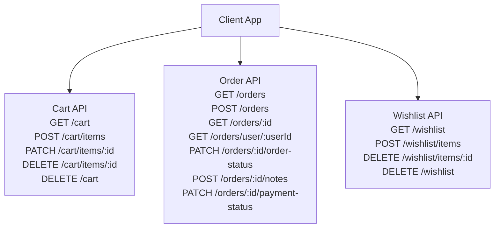
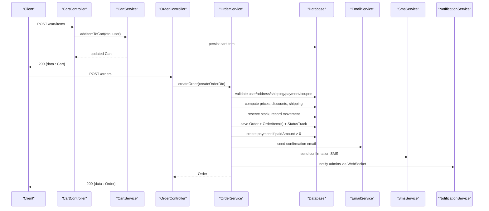
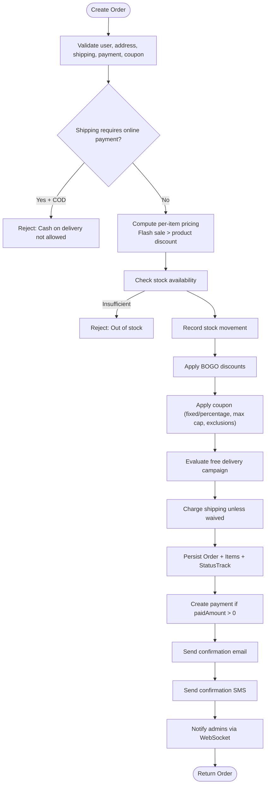
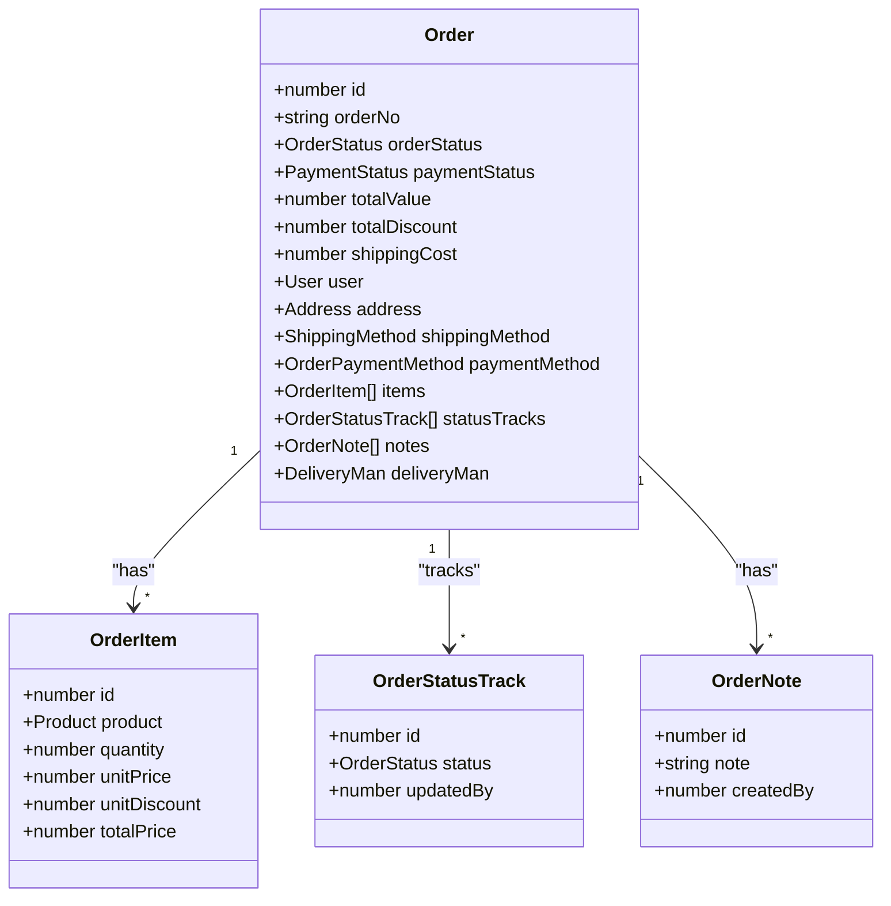
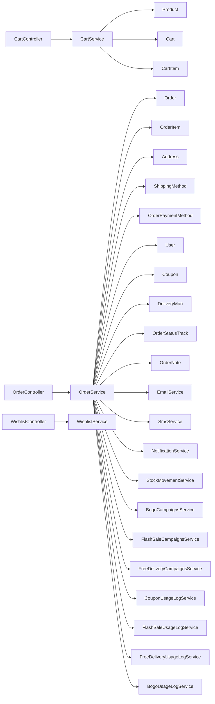

# Order APIs

<cite>
**Referenced Files in This Document**
- [order.controller.ts](file://apps/backend/src/order/order.controller.ts)
- [order.service.ts](file://apps/backend/src/order/order.service.ts)
- [cart.controller.ts](file://apps/backend/src/cart/cart.controller.ts)
- [cart.service.ts](file://apps/backend/src/cart/cart.service.ts)
- [wishlist.controller.ts](file://apps/backend/src/wishlist/wishlist.controller.ts)
- [wishlist.service.ts](file://apps/backend/src/wishlist/wishlist.service.ts)
</cite>

## Table of Contents
1. [Introduction](#introduction)
2. [Project Structure](#project-structure)
3. [Core Components](#core-components)
4. [Architecture Overview](#architecture-overview)
5. [Detailed Component Analysis](#detailed-component-analysis)
6. [Dependency Analysis](#dependency-analysis)
7. [Performance Considerations](#performance-considerations)
8. [Troubleshooting Guide](#troubleshooting-guide)
9. [Conclusion](#conclusion)

## Introduction
This document provides comprehensive API documentation for order management endpoints, including cart operations, the complete order creation workflow from cart to completed order, order tracking and history, and wishlist functionality. It covers request/response schemas, status transitions, error handling scenarios, and operational constraints such as authentication, authorization, throttling, and business rules around shipping and payment methods.

## Project Structure
The backend exposes REST endpoints organized by feature:
- Cart: user-scoped cart persistence and item management
- Orders: order lifecycle, tracking, notes, and reporting
- Wishlist: saving and managing favorite products

**Diagram sources**
- [cart.controller.ts:40-167](file://apps/backend/src/cart/cart.controller.ts#L40-L167)
- [order.controller.ts:59-312](file://apps/backend/src/order/order.controller.ts#L59-L312)
- [wishlist.controller.ts:34-140](file://apps/backend/src/wishlist/wishlist.controller.ts#L34-L140)

**Section sources**
- [cart.controller.ts:40-167](file://apps/backend/src/cart/cart.controller.ts#L40-L167)
- [order.controller.ts:59-312](file://apps/backend/src/order/order.controller.ts#L59-L312)
- [wishlist.controller.ts:34-140](file://apps/backend/src/wishlist/wishlist.controller.ts#L34-L140)

## Core Components
- CartController: Manages per-user cart persistence and item operations (add, update quantity, remove, clear).
- OrderController: Creates orders, retrieves orders, updates order and payment statuses, adds notes, and exposes admin reports.
- WishlistController: Manages per-user wishlists (add/remove/clear).
- Services: Implement business logic, validation, pricing/discount application, stock updates, notifications, and data access.

Key responsibilities:
- CartService: Ensures a cart exists per user, attaches flash-sale and BOGO display info, and persists items.
- OrderService: Validates inputs, computes totals with discounts and shipping, records stock movements, logs campaign usage, creates order items/status tracks, sends emails/SMS/WebSocket notifications, and integrates payments.
- WishlistService: Lazily creates a wishlist per user and manages product references.

**Section sources**
- [cart.controller.ts:40-167](file://apps/backend/src/cart/cart.controller.ts#L40-L167)
- [cart.service.ts:15-201](file://apps/backend/src/cart/cart.service.ts#L15-L201)
- [order.controller.ts:59-312](file://apps/backend/src/order/order.controller.ts#L59-L312)
- [order.service.ts:103-694](file://apps/backend/src/order/order.service.ts#L103-L694)
- [wishlist.controller.ts:34-140](file://apps/backend/src/wishlist/wishlist.controller.ts#L34-L140)
- [wishlist.service.ts:10-123](file://apps/backend/src/wishlist/wishlist.service.ts#L10-L123)

## Architecture Overview
The order flow starts with a client building a cart, then placing an order that includes address, shipping method, payment method, optional coupon, and optionally paid amount. The server validates entities, applies promotions, reserves stock, persists the order and its items, records status tracks, and triggers notifications.

**Diagram sources**
- [cart.controller.ts:67-84](file://apps/backend/src/cart/cart.controller.ts#L67-L84)
- [cart.service.ts:121-158](file://apps/backend/src/cart/cart.service.ts#L121-L158)
- [order.controller.ts:159-181](file://apps/backend/src/order/order.controller.ts#L159-L181)
- [order.service.ts:103-694](file://apps/backend/src/order/order.service.ts#L103-L694)

## Detailed Component Analysis

### Cart Endpoints
All cart endpoints require JWT authentication. Responses are wrapped in a standard envelope containing message, statusCode, and data.

- GET /cart
  - Description: Retrieve the authenticated user’s cart. If none exists, one is created automatically.
  - Auth: JWT
  - Response: ApiResponseDto<Cart>

- POST /cart/items
  - Description: Add a product to the cart. If the product already exists, quantity is increased.
  - Auth: JWT
  - Request Body: productId, quantity
  - Response: ApiResponseDto<Cart>

- PATCH /cart/items/:id
  - Description: Update the quantity of a specific cart item.
  - Auth: JWT
  - Path Param: id (item ID)
  - Request Body: quantity
  - Response: ApiResponseDto<Cart>

- DELETE /cart/items/:id
  - Description: Remove a specific cart item.
  - Auth: JWT
  - Path Param: id (item ID)
  - Response: ApiResponseDto<Cart>

- DELETE /cart
  - Description: Clear all items from the cart.
  - Auth: JWT
  - Response: ApiResponseDto<Cart>

Behavioral notes:
- A cart is lazily created on first access for a user.
- Product validation ensures inactive products cannot be added.
- Flash sale and BOGO display information is attached to returned carts for UI consistency.

Error scenarios:
- Product not found or inactive
- Cart item not found for update/remove
- User not found when creating a cart

**Section sources**
- [cart.controller.ts:40-167](file://apps/backend/src/cart/cart.controller.ts#L40-L167)
- [cart.service.ts:50-201](file://apps/backend/src/cart/cart.service.ts#L50-L201)

### Order Endpoints
Orders are protected by JWT; some endpoints additionally require admin permissions.

- GET /orders
  - Description: List orders with pagination and filters (status, payment status, payment method, shipping method, area/division/city, search by order number, sort by date).
  - Auth: JWT
  - Query Params: page, limit, search, sort, orderStatus, paymentStatus, paymentMethodId, shippingMethodId, area, division, city
  - Response: ApiResponseDto<Order[]> with total, page, limit, totalPages

- POST /orders
  - Description: Create an order from validated inputs including items, user, address, shipping method, payment method, optional coupon, and optional paid amount. Throttled to prevent abuse.
  - Auth: JWT
  - Request Body: CreateOrderDto (items[], userId, addressId, shippingMethodId, paymentMethodId, couponId?, paidAmount?)
  - Response: ApiResponseDto<Order>

- GET /orders/:id
  - Description: Retrieve a single order by ID. Customers can only view their own orders; staff/admins can view any order.
  - Auth: JWT
  - Path Param: id
  - Response: ApiResponseDto<Order>

- GET /orders/user/:userId
  - Description: Retrieve all orders for a given user. Authorization enforced similarly to single-order retrieval.
  - Auth: JWT
  - Path Param: userId
  - Response: ApiResponseDto<Order[]>

- PATCH /orders/:id/order-status
  - Description: Update order status (admin-only).
  - Auth: JWT + PermissionGuard
  - Path Param: id
  - Request Body: status, note
  - Response: ApiResponseDto<Order>

- POST /orders/:id/notes
  - Description: Add a note to an order (admin-only).
  - Auth: JWT + PermissionGuard
  - Path Param: id
  - Request Body: note
  - Response: ApiResponseDto<OrderNote>

- PATCH /orders/:id/payment-status
  - Description: Update payment status (admin-only).
  - Auth: JWT + PermissionGuard
  - Path Param: id
  - Request Body: status
  - Response: ApiResponseDto<Order>

Additional endpoints:
- GET /orders/:id/neighbors
  - Description: Get previous and next order IDs for navigation.
  - Auth: JWT
  - Path Param: id
  - Response: ApiResponseDto<{ prevId: number | null; nextId: number | null }>

Admin report endpoints (require appropriate module permissions):
- GET /orders/reports/dashboard
- GET /orders/reports/date-range
- GET /orders/reports/daily-summary
- GET /orders/reports/refunds
- GET /orders/reports/deliveryman-performance
- GET /orders/reports/area-wise-orders
- GET /orders/reports/delivery-performance-summary
- GET /orders/reports/statistics
- GET /orders/reports/monthly
- GET /orders/reports/monthly/years
- GET /orders/reports/last-30-days-delivered
- GET /orders/reports/today

**Section sources**
- [order.controller.ts:59-312](file://apps/backend/src/order/order.controller.ts#L59-L312)
- [order.controller.ts:314-800](file://apps/backend/src/order/order.controller.ts#L314-L800)

### Order Creation Workflow
The order creation process performs end-to-end validation and business processing:

Business rules:
- Order numbers are generated per year (e.g., ORD-YYYY-NNNN).
- Flash sale pricing overrides product discount; they do not stack.
- BOGO applies after per-item pricing and before coupon discount.
- Free delivery may waive shipping cost unless the selected shipping method is excluded.
- Coupon usage is logged and the coupon timesUsed counter is incremented.
- Stock is decremented and recorded via stock movement service.
- Notifications (email, SMS, WebSocket) are fire-and-forget and do not fail order creation.

Error handling:
- Not found errors for missing user, address, shipping method, payment method, coupon, or product.
- Bad request for invalid combinations (e.g., COD with shipping requiring online payment), inactive products, insufficient stock.
- Non-fatal failures in external services (emails, SMS, notifications) are logged but do not abort order creation.

**Section sources**
- [order.service.ts:103-694](file://apps/backend/src/order/order.service.ts#L103-L694)

### Order Tracking and History
- Single order retrieval returns full relations including user, address, shipping/payment methods, payments, items, status tracks, notes, and delivery man where applicable.
- Neighbor order IDs endpoint supports sequential navigation.
- Admin endpoints allow updating order status and payment status, and adding notes.
- Status tracking is persisted for auditability.

**Diagram sources**
- [order.service.ts:696-735](file://apps/backend/src/order/order.service.ts#L696-L735)

**Section sources**
- [order.controller.ts:182-213](file://apps/backend/src/order/order.controller.ts#L182-L213)
- [order.controller.ts:230-312](file://apps/backend/src/order/order.controller.ts#L230-L312)
- [order.service.ts:696-735](file://apps/backend/src/order/order.service.ts#L696-L735)

### Wishlist Endpoints
All wishlist endpoints require JWT authentication. Responses are wrapped in a standard envelope.

- GET /wishlist
  - Description: Retrieve the authenticated user’s wishlist. If none exists, one is created automatically.
  - Auth: JWT
  - Response: ApiResponseDto<Wishlist>

- POST /wishlist/items
  - Description: Add a product to the wishlist. Duplicate additions are ignored.
  - Auth: JWT
  - Request Body: productId
  - Response: ApiResponseDto<Wishlist>

- DELETE /wishlist/items/:id
  - Description: Remove a specific wishlist item.
  - Auth: JWT
  - Path Param: id (wishlist item ID)
  - Response: ApiResponseDto<Wishlist>

- DELETE /wishlist
  - Description: Clear all items from the wishlist.
  - Auth: JWT
  - Response: ApiResponseDto<Wishlist>

Behavioral notes:
- A wishlist is lazily created on first access for a user.
- Adding a product that already exists does nothing.
- Product validation ensures referenced products exist.

Error scenarios:
- Product not found
- Wishlist item not found for removal
- User not found when creating a wishlist

**Section sources**
- [wishlist.controller.ts:34-140](file://apps/backend/src/wishlist/wishlist.controller.ts#L34-L140)
- [wishlist.service.ts:20-123](file://apps/backend/src/wishlist/wishlist.service.ts#L20-L123)

## Dependency Analysis
The following diagram shows how controllers depend on services and how services interact with domain entities and external services.

**Diagram sources**
- [cart.controller.ts:38-39](file://apps/backend/src/cart/cart.controller.ts#L38-L39)
- [cart.service.ts:15-25](file://apps/backend/src/cart/cart.service.ts#L15-L25)
- [order.controller.ts:43-44](file://apps/backend/src/order/order.controller.ts#L43-L44)
- [order.service.ts:63-101](file://apps/backend/src/order/order.service.ts#L63-L101)
- [wishlist.controller.ts:32-33](file://apps/backend/src/wishlist/wishlist.controller.ts#L32-L33)
- [wishlist.service.ts:12-18](file://apps/backend/src/wishlist/wishlist.service.ts#L12-L18)

**Section sources**
- [cart.service.ts:15-25](file://apps/backend/src/cart/cart.service.ts#L15-L25)
- [order.service.ts:63-101](file://apps/backend/src/order/order.service.ts#L63-L101)
- [wishlist.service.ts:12-18](file://apps/backend/src/wishlist/wishlist.service.ts#L12-L18)

## Performance Considerations
- Order creation is throttled at the controller level to mitigate abuse.
- External notifications (email, SMS, WebSocket) are fire-and-forget to avoid blocking order creation.
- Campaign usage increments are wrapped in try/catch to ensure non-critical failures do not impact order placement.
- Abandoned cart queries use raw SQL for efficient aggregation and filtering.

Recommendations:
- Ensure database indexes support frequent filters (order status, payment status, dates, areas).
- Monitor external service latency and consider retry/backoff strategies for notifications.
- Use pagination and limits consistently on list endpoints.

[No sources needed since this section provides general guidance]

## Troubleshooting Guide
Common issues and resolutions:
- Invalid shipping/payment combination:
  - Symptom: Rejects cash on delivery when shipping method requires online payment.
  - Resolution: Choose an online payment method or a different shipping method.
- Product unavailable:
  - Symptom: Inactive products cannot be added to cart or ordered.
  - Resolution: Verify product activation status and availability.
- Insufficient stock:
  - Symptom: Order creation fails due to out-of-stock items.
  - Resolution: Reduce quantity or wait for restocking.
- Missing references:
  - Symptom: Not found errors for user, address, shipping method, payment method, or coupon.
  - Resolution: Ensure all referenced IDs are valid and active.
- Note validation:
  - Symptom: Empty or whitespace-only notes are rejected.
  - Resolution: Provide meaningful note text.

External service failures:
- Email/SMS/WebSocket failures are logged and do not block order creation. Investigate logs to diagnose transient issues.

**Section sources**
- [order.controller.ts:165-181](file://apps/backend/src/order/order.controller.ts#L165-L181)
- [order.service.ts:163-172](file://apps/backend/src/order/order.service.ts#L163-L172)
- [order.service.ts:190-210](file://apps/backend/src/order/order.service.ts#L190-L210)
- [order.service.ts:450-535](file://apps/backend/src/order/order.service.ts#L450-L535)
- [order.service.ts:570-694](file://apps/backend/src/order/order.service.ts#L570-L694)

## Conclusion
The Order APIs provide a robust, secure, and extensible foundation for e-commerce order management. Cart and wishlist features offer persistent, user-scoped state with promotional display enhancements. Order creation enforces strict validation, accurate pricing and discount application, stock reservation, and comprehensive auditing through status tracks and notes. Admin endpoints enable full control over order lifecycle and rich reporting capabilities. Proper error handling and performance safeguards ensure reliability under real-world conditions.