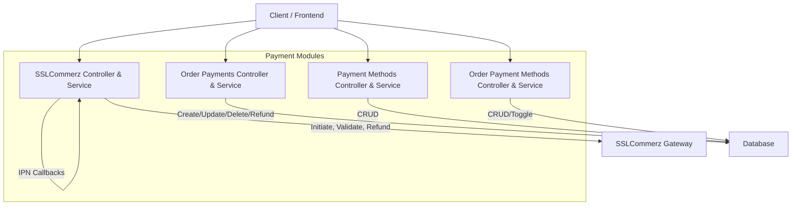
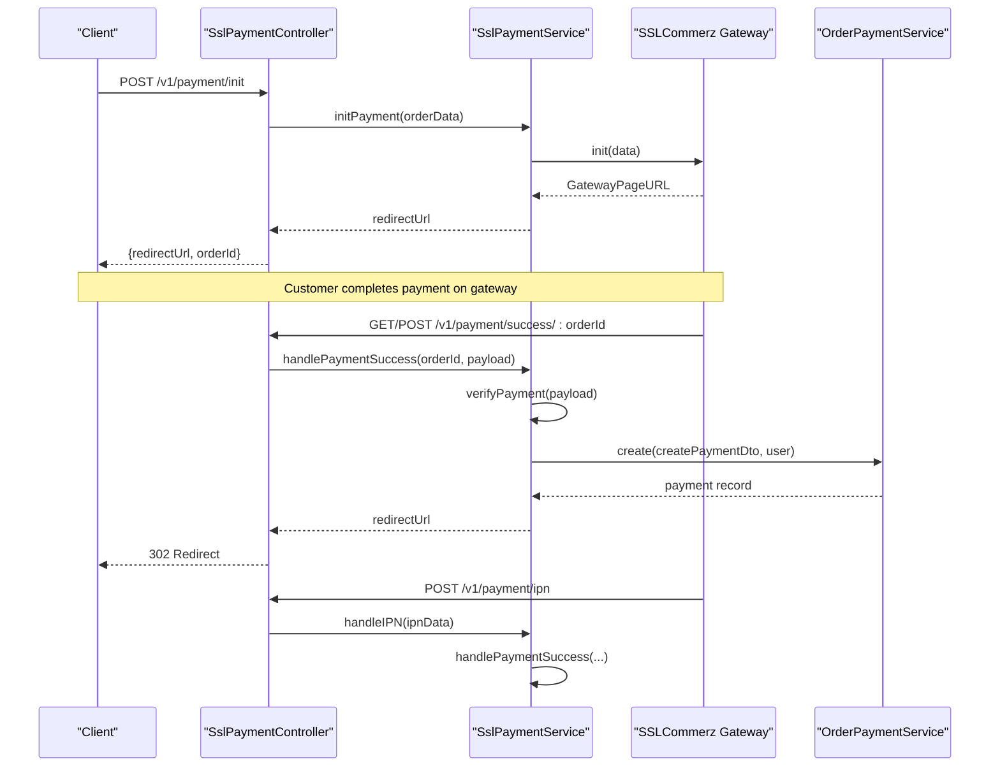
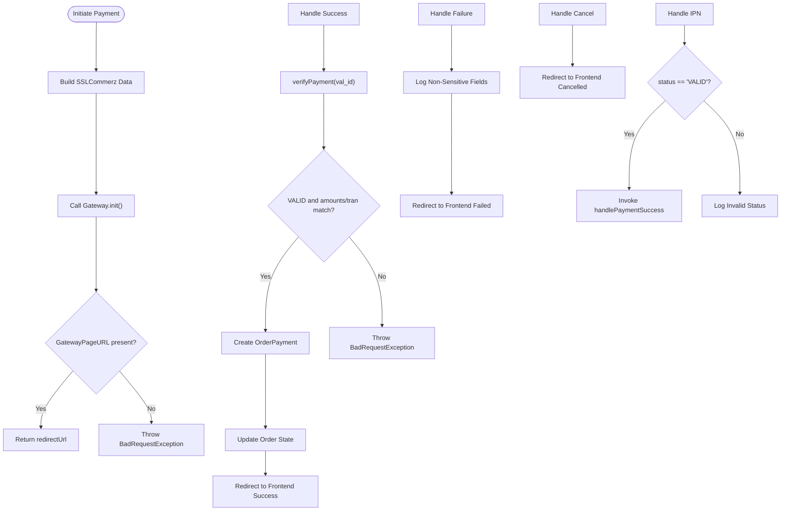
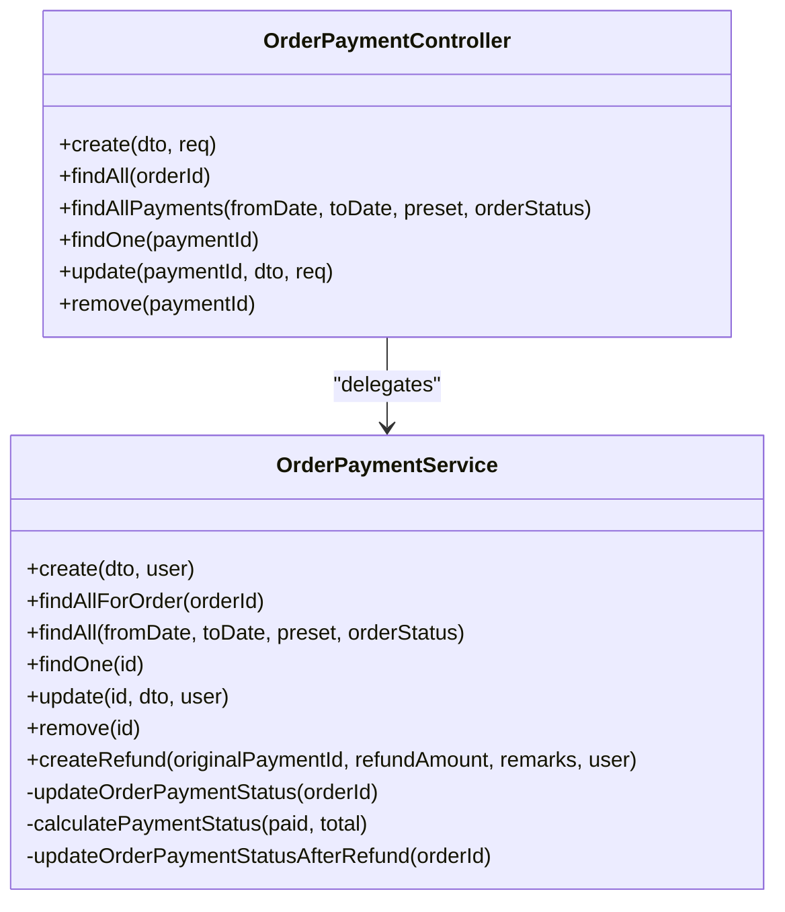
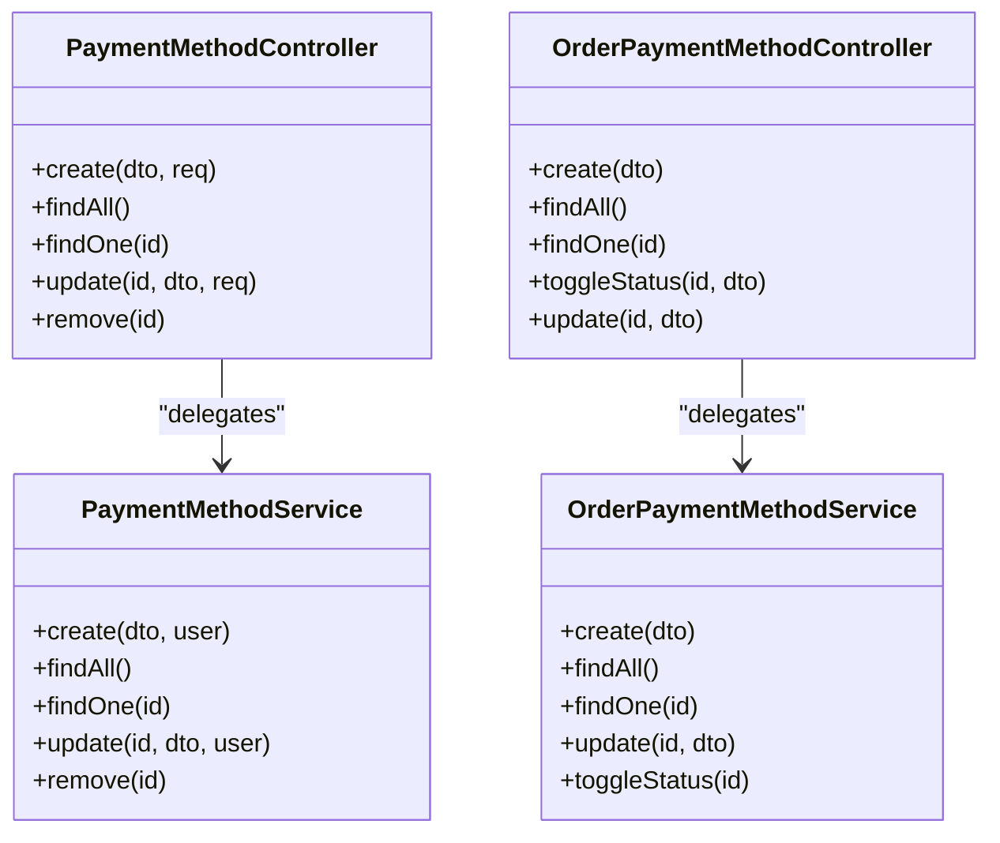
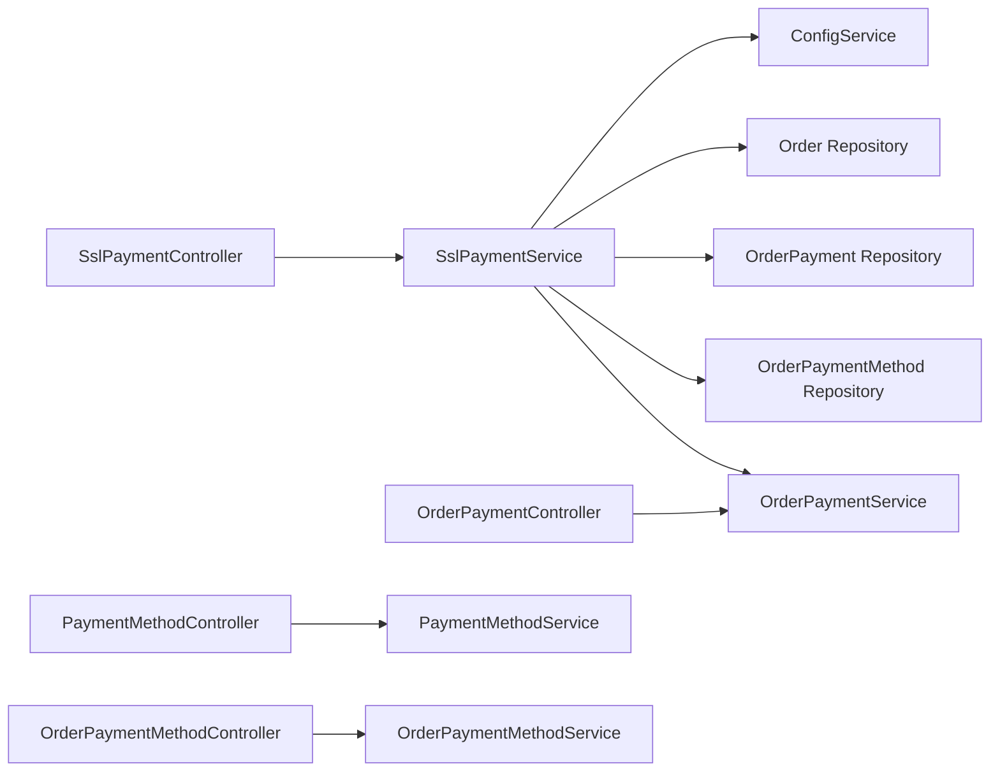

# Payment APIs

<cite>
**Referenced Files in This Document**
- [ssl-payment.controller.ts](file://apps/backend/src/ssl-payment/ssl-payment.controller.ts)
- [ssl-payment.service.ts](file://apps/backend/src/ssl-payment/ssl-payment.service.ts)
- [order-payment.controller.ts](file://apps/backend/src/order-payment/order-payment.controller.ts)
- [order-payment.service.ts](file://apps/backend/src/order-payment/order-payment.service.ts)
- [payment-method.controller.ts](file://apps/backend/src/payment-method/payment-method.controller.ts)
- [payment-method.service.ts](file://apps/backend/src/payment-method/payment-method.service.ts)
- [order-payment-method.controller.ts](file://apps/backend/src/order-payment-method/order-payment-method.controller.ts)
- [order-payment-method.service.ts](file://apps/backend/src/order-payment-method/order-payment-method.service.ts)
</cite>

## Table of Contents
1. [Introduction](#introduction)
2. [Project Structure](#project-structure)
3. [Core Components](#core-components)
4. [Architecture Overview](#architecture-overview)
5. [Detailed Component Analysis](#detailed-component-analysis)
6. [Dependency Analysis](#dependency-analysis)
7. [Performance Considerations](#performance-considerations)
8. [Troubleshooting Guide](#troubleshooting-guide)
9. [Security and PCI Compliance](#security-and-pci-compliance)
10. [Conclusion](#conclusion)

## Introduction
This document provides comprehensive API documentation for payment processing endpoints, focusing on SSLCommerz integration, order payment tracking, payment method management, webhook handling, refund processing, error handling, and security considerations. It is intended for developers integrating with the backend’s payment subsystem and for operators managing payment methods and transactions.

## Project Structure
The payment-related functionality is organized into distinct modules:
- SSLCommerz integration (initiation, callbacks, IPN, validation, refunds)
- Order payments (creation, listing, updates, deletions, refunds)
- Payment methods (global and order-scoped CRUD and toggling)

**Diagram sources**
- [ssl-payment.controller.ts:31-257](file://apps/backend/src/ssl-payment/ssl-payment.controller.ts#L31-L257)
- [ssl-payment.service.ts:44-412](file://apps/backend/src/ssl-payment/ssl-payment.service.ts#L44-L412)
- [order-payment.controller.ts:33-175](file://apps/backend/src/order-payment/order-payment.controller.ts#L33-L175)
- [order-payment.service.ts:28-309](file://apps/backend/src/order-payment/order-payment.service.ts#L28-L309)
- [payment-method.controller.ts:34-291](file://apps/backend/src/payment-method/payment-method.controller.ts#L34-L291)
- [payment-method.service.ts:16-51](file://apps/backend/src/payment-method/payment-method.service.ts#L16-L51)
- [order-payment-method.controller.ts:33-158](file://apps/backend/src/order-payment-method/order-payment-method.controller.ts#L33-L158)
- [order-payment-method.service.ts:16-62](file://apps/backend/src/order-payment-method/order-payment-method.service.ts#L16-L62)

**Section sources**
- [ssl-payment.controller.ts:31-257](file://apps/backend/src/ssl-payment/ssl-payment.controller.ts#L31-L257)
- [order-payment.controller.ts:33-175](file://apps/backend/src/order-payment/order-payment.controller.ts#L33-L175)
- [payment-method.controller.ts:34-291](file://apps/backend/src/payment-method/payment-method.controller.ts#L34-L291)
- [order-payment-method.controller.ts:33-158](file://apps/backend/src/order-payment-method/order-payment-method.controller.ts#L33-L158)

## Core Components
- SSLCommerz Integration
  - Initiate payment to gateway
  - Handle success/fail/cancel redirects
  - Process asynchronous IPN webhooks
  - Validate transactions
  - Initiate refunds
- Order Payments
  - Create, read, update, delete payments per order
  - Query all payments across orders with date range and order status filters
  - Generate unique payment numbers
  - Update order payment totals and statuses
  - Create reversal postings for refunds
- Payment Methods
  - Global payment method management (create, list, get, update, delete)
  - Order-scoped payment method management (create, list, get, update, toggle active)

**Section sources**
- [ssl-payment.controller.ts:31-257](file://apps/backend/src/ssl-payment/ssl-payment.controller.ts#L31-L257)
- [ssl-payment.service.ts:44-412](file://apps/backend/src/ssl-payment/ssl-payment.service.ts#L44-L412)
- [order-payment.controller.ts:33-175](file://apps/backend/src/order-payment/order-payment.controller.ts#L33-L175)
- [order-payment.service.ts:28-309](file://apps/backend/src/order-payment/order-payment.service.ts#L28-L309)
- [payment-method.controller.ts:34-291](file://apps/backend/src/payment-method/payment-method.controller.ts#L34-L291)
- [payment-method.service.ts:16-51](file://apps/backend/src/payment-method/payment-method.service.ts#L16-L51)
- [order-payment-method.controller.ts:33-158](file://apps/backend/src/order-payment-method/order-payment-method.controller.ts#L33-L158)
- [order-payment-method.service.ts:16-62](file://apps/backend/src/order-payment-method/order-payment-method.service.ts#L16-L62)

## Architecture Overview
The payment flow integrates client requests, internal controllers/services, and the external SSLCommerz gateway. Webhooks (success/fail/cancel/IPN) are handled by dedicated endpoints that validate and persist transaction data, then update order states.

**Diagram sources**
- [ssl-payment.controller.ts:35-206](file://apps/backend/src/ssl-payment/ssl-payment.controller.ts#L35-L206)
- [ssl-payment.service.ts:44-328](file://apps/backend/src/ssl-payment/ssl-payment.service.ts#L44-L328)
- [order-payment.service.ts:28-73](file://apps/backend/src/order-payment/order-payment.service.ts#L28-L73)

## Detailed Component Analysis

### SSLCommerz Integration Endpoints
- Initiate Payment
  - Method: POST
  - Path: /v1/payment/init
  - Auth: JWT required
  - Request Body: Order context including items, user, address, shippingMethod, coupon, totalValue
  - Response: redirectUrl, orderId, orderNo
  - Error Handling: Returns failure message when initialization fails or credentials are missing
- Payment Success
  - Methods: GET/POST
  - Path: /v1/payment/success/:orderId
  - Behavior: Validates callback, verifies payment via gateway, creates order payment, updates order state, redirects to frontend success page
- Payment Failure
  - Method: POST
  - Path: /v1/payment/fail/:orderId
  - Behavior: Logs failure details and redirects to frontend failed page
- Payment Cancel
  - Method: POST
  - Path: /v1/payment/cancel/:orderId
  - Behavior: Redirects to frontend cancelled page
- IPN Handler
  - Method: POST
  - Path: /v1/payment/ipn
  - Behavior: Processes asynchronous IPN; if VALID, processes success flow
- Validate Payment
  - Method: GET
  - Path: /v1/payment/validate/:tranId
  - Behavior: Placeholder endpoint for manual validation
- Refund
  - Method: POST
  - Path: /v1/payment/refund
  - Auth: JWT + PermissionGuard (admin-only)
  - Request Body: paymentId, refund_amount, refund_remarks, bank_tran_id, tran_id
  - Behavior: Calls gateway refund API, logs non-sensitive fields, creates reversal posting on success, handles IP whitelist errors

**Diagram sources**
- [ssl-payment.controller.ts:35-206](file://apps/backend/src/ssl-payment/ssl-payment.controller.ts#L35-L206)
- [ssl-payment.service.ts:44-328](file://apps/backend/src/ssl-payment/ssl-payment.service.ts#L44-L328)

**Section sources**
- [ssl-payment.controller.ts:35-257](file://apps/backend/src/ssl-payment/ssl-payment.controller.ts#L35-L257)
- [ssl-payment.service.ts:44-412](file://apps/backend/src/ssl-payment/ssl-payment.service.ts#L44-L412)

### Order Payment Tracking and History
- Create Payment for Order
  - Method: POST
  - Path: /v1/orders/payments
  - Auth: JWT required
  - Request Body: orderId, amount, paymentMethodId, referenceNumber, notes
  - Behavior: Generates unique payment number, persists payment, updates order totals/status
- List Payments for Order
  - Method: GET
  - Path: /v1/orders/payments?orderId=:orderId
  - Auth: JWT + PermissionGuard (admin-only)
  - Response: Array of payments with relations
- List All Payments Across Orders
  - Method: GET
  - Path: /v1/orders/payments/all
  - Auth: JWT required
  - Query Params: fromDate, toDate, preset, orderStatus
  - Behavior: Applies date range and order status filters using shared report utilities
- Get Single Payment
  - Method: GET
  - Path: /v1/orders/payments/:paymentId
  - Response: Payment details with relations
- Update Payment
  - Method: PATCH
  - Path: /v1/orders/payments/:paymentId
  - Auth: JWT + PermissionGuard (admin-only)
  - Behavior: Updates payment and recalculates order payment status
- Delete Payment
  - Method: DELETE
  - Path: /v1/orders/payments/:paymentId
  - Auth: JWT + PermissionGuard (admin-only)
  - Behavior: Removes payment and recalculates order payment status

**Diagram sources**
- [order-payment.controller.ts:33-175](file://apps/backend/src/order-payment/order-payment.controller.ts#L33-L175)
- [order-payment.service.ts:28-309](file://apps/backend/src/order-payment/order-payment.service.ts#L28-L309)

**Section sources**
- [order-payment.controller.ts:33-175](file://apps/backend/src/order-payment/order-payment.controller.ts#L33-L175)
- [order-payment.service.ts:28-309](file://apps/backend/src/order-payment/order-payment.service.ts#L28-L309)

### Payment Method Management
- Global Payment Methods
  - Create: POST /v1/payment-methods (JWT + PermissionGuard)
  - List: GET /v1/payment-methods (JWT)
  - Get: GET /v1/payment-methods/:id (JWT)
  - Update: PATCH /v1/payment-methods/:id (JWT + PermissionGuard)
  - Delete: DELETE /v1/payment-methods/:id (JWT + PermissionGuard)
- Order Payment Methods
  - Create: POST /v1/order-payment-methods (JWT + PermissionGuard)
  - List: GET /v1/order-payment-methods (JWT)
  - Get: GET /v1/order-payment-methods/:id (JWT)
  - Toggle Active: PATCH /v1/order-payment-methods/:id/toggle-status (JWT + PermissionGuard)
  - Update: PATCH /v1/order-payment-methods/:id (JWT + PermissionGuard)

**Diagram sources**
- [payment-method.controller.ts:34-291](file://apps/backend/src/payment-method/payment-method.controller.ts#L34-L291)
- [payment-method.service.ts:16-51](file://apps/backend/src/payment-method/payment-method.service.ts#L16-L51)
- [order-payment-method.controller.ts:33-158](file://apps/backend/src/order-payment-method/order-payment-method.controller.ts#L33-L158)
- [order-payment-method.service.ts:16-62](file://apps/backend/src/order-payment-method/order-payment-method.service.ts#L16-L62)

**Section sources**
- [payment-method.controller.ts:34-291](file://apps/backend/src/payment-method/payment-method.controller.ts#L34-L291)
- [payment-method.service.ts:16-51](file://apps/backend/src/payment-method/payment-method.service.ts#L16-L51)
- [order-payment-method.controller.ts:33-158](file://apps/backend/src/order-payment-method/order-payment-method.controller.ts#L33-L158)
- [order-payment-method.service.ts:16-62](file://apps/backend/src/order-payment-method/order-payment-method.service.ts#L16-L62)

## Dependency Analysis
Key dependencies and relationships:
- SslPaymentController depends on SslPaymentService for business logic and gateway interactions
- SslPaymentService uses:
  - ConfigService for SSLCommerz credentials and URLs
  - TypeORM repositories for Order, OrderPayment, OrderPaymentMethod
  - OrderPaymentService for creating payments and refunds
- OrderPaymentController depends on OrderPaymentService for CRUD operations and reporting
- PaymentMethodController and OrderPaymentMethodController manage configuration entities for available payment options

**Diagram sources**
- [ssl-payment.controller.ts:31-257](file://apps/backend/src/ssl-payment/ssl-payment.controller.ts#L31-L257)
- [ssl-payment.service.ts:16-412](file://apps/backend/src/ssl-payment/ssl-payment.service.ts#L16-L412)
- [order-payment.controller.ts:33-175](file://apps/backend/src/order-payment/order-payment.controller.ts#L33-L175)
- [order-payment.service.ts:17-309](file://apps/backend/src/order-payment/order-payment.service.ts#L17-L309)
- [payment-method.controller.ts:34-291](file://apps/backend/src/payment-method/payment-method.controller.ts#L34-L291)
- [payment-method.service.ts:16-51](file://apps/backend/src/payment-method/payment-method.service.ts#L16-L51)
- [order-payment-method.controller.ts:33-158](file://apps/backend/src/order-payment-method/order-payment-method.controller.ts#L33-L158)
- [order-payment-method.service.ts:16-62](file://apps/backend/src/order-payment-method/order-payment-method.service.ts#L16-L62)

**Section sources**
- [ssl-payment.service.ts:16-412](file://apps/backend/src/ssl-payment/ssl-payment.service.ts#L16-L412)
- [order-payment.service.ts:17-309](file://apps/backend/src/order-payment/order-payment.service.ts#L17-L309)

## Performance Considerations
- Minimize logging of sensitive payloads; only log non-sensitive identifiers and status fields
- Use efficient queries with selective relations to avoid N+1 issues
- Leverage shared report date-range utilities for consistent filtering
- Avoid redundant database writes; batch updates where possible
- Ensure gateway calls are idempotent and handle retries gracefully

[No sources needed since this section provides general guidance]

## Troubleshooting Guide
Common issues and resolutions:
- Payment Initialization Fails
  - Cause: Missing SSLCommerz credentials or invalid response from gateway
  - Resolution: Verify environment variables and gateway configuration; check error messages
- Payment Verification Fails
  - Cause: Mismatched transaction ID or amount during validation
  - Resolution: Ensure callback payload matches expected values; re-check gateway settings
- IPN Processing Errors
  - Cause: Invalid IPN status or network issues
  - Resolution: Inspect logs for status and value_a; ensure IPN URL is reachable and whitelisted
- Refund Initiation Fails
  - Cause: Server IP not whitelisted in SSLCommerz merchant panel
  - Resolution: Whitelist server IP; review error messages for INVALID_SOURCE or REQUEST_FROM_INVALID_SOURCE
- Cannot Modify Completed Order Payments
  - Cause: Business rule prevents changes after completion
  - Resolution: Adjust workflow to allow modifications before completion or use appropriate admin permissions

**Section sources**
- [ssl-payment.service.ts:29-42](file://apps/backend/src/ssl-payment/ssl-payment.service.ts#L29-L42)
- [ssl-payment.service.ts:269-305](file://apps/backend/src/ssl-payment/ssl-payment.service.ts#L269-L305)
- [ssl-payment.service.ts:308-328](file://apps/backend/src/ssl-payment/ssl-payment.service.ts#L308-L328)
- [ssl-payment.service.ts:330-412](file://apps/backend/src/ssl-payment/ssl-payment.service.ts#L330-L412)
- [order-payment.service.ts:151-171](file://apps/backend/src/order-payment/order-payment.service.ts#L151-L171)

## Security and PCI Compliance
- Authentication and Authorization
  - Require JWT authentication for sensitive endpoints
  - Enforce permission guards for administrative actions (e.g., refunds, analytics)
- Data Protection
  - Do not log full callback payloads containing PII; log only minimal identifiers and status
  - Avoid storing sensitive card data; rely on gateway tokens and references
- Input Validation
  - Validate order IDs and transaction parameters before processing
  - Reject malformed or inconsistent payloads early
- Secure Configuration
  - Store SSLCommerz credentials securely via environment variables
  - Ensure IP whitelisting for server-to-gateway communication
- Auditability
  - Record creation/update metadata (createdBy, updatedBy) for traceability
  - Maintain unique payment numbers and reference numbers for reconciliation

**Section sources**
- [ssl-payment.controller.ts:21-29](file://apps/backend/src/ssl-payment/ssl-payment.controller.ts#L21-L29)
- [ssl-payment.controller.ts:35-257](file://apps/backend/src/ssl-payment/ssl-payment.controller.ts#L35-L257)
- [ssl-payment.service.ts:29-42](file://apps/backend/src/ssl-payment/ssl-payment.service.ts#L29-L42)
- [order-payment.service.ts:28-73](file://apps/backend/src/order-payment/order-payment.service.ts#L28-L73)

## Conclusion
The payment subsystem provides robust endpoints for initiating and tracking payments through SSLCommerz, managing payment methods, and handling refunds. It emphasizes secure handling of sensitive data, clear error responses, and comprehensive audit trails. Operators can configure and toggle payment methods, while clients benefit from reliable redirection flows and asynchronous webhook support. Adhering to the security guidelines and troubleshooting steps will help maintain a stable and compliant payment experience.

[No sources needed since this section summarizes without analyzing specific files]