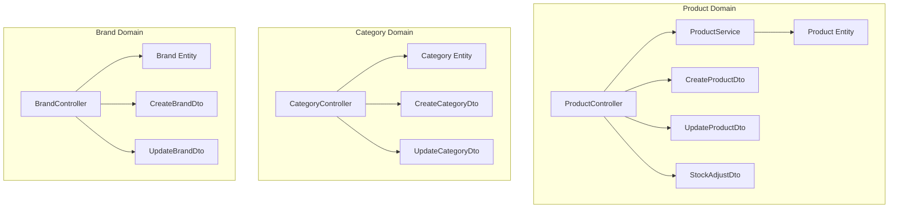
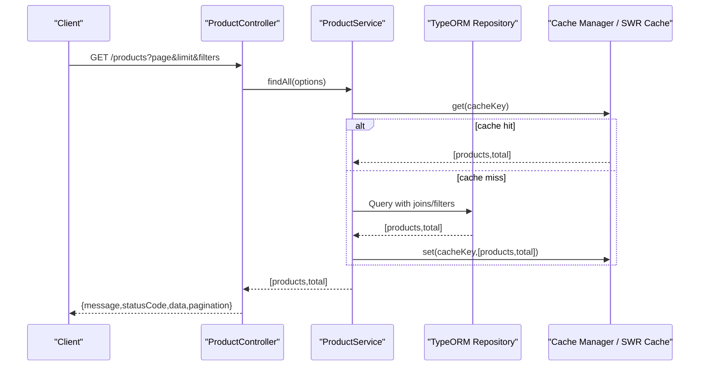
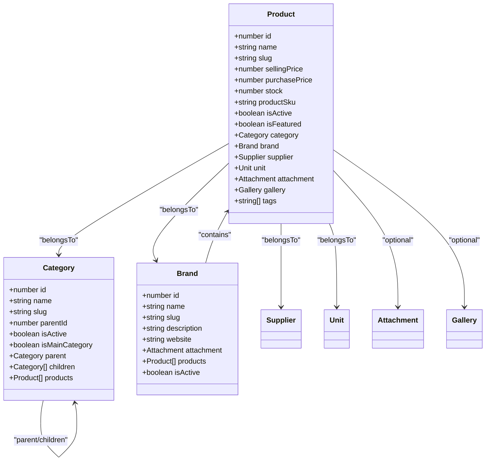

# Product APIs

<cite>
**Referenced Files in This Document**
- [product.controller.ts](file://apps/backend/src/product/product.controller.ts)
- [product.service.ts](file://apps/backend/src/product/product.service.ts)
- [product.entity.ts](file://apps/backend/src/product/entities/product.entity.ts)
- [create-product.dto.ts](file://apps/backend/src/product/dto/create-product.dto.ts)
- [update-product.dto.ts](file://apps/backend/src/product/dto/update-product.dto.ts)
- [stock-adjust.dto.ts](file://apps/backend/src/product/dto/stock-adjust.dto.ts)
- [category.controller.ts](file://apps/backend/src/category/category.controller.ts)
- [category.entity.ts](file://apps/backend/src/category/entities/category.entity.ts)
- [create-category.dto.ts](file://apps/backend/src/category/dto/create-category.dto.ts)
- [update-category.dto.ts](file://apps/backend/src/category/dto/update-category.dto.ts)
- [brand.controller.ts](file://apps/backend/src/brand/brand.controller.ts)
- [brand.entity.ts](file://apps/backend/src/brand/entities/brand.entity.ts)
- [create-brand.dto.ts](file://apps/backend/src/brand/dto/create-brand.dto.ts)
- [update-brand.dto.ts](file://apps/backend/src/brand/dto/update-brand.dto.ts)
</cite>

## Table of Contents
1. [Introduction](#introduction)
2. [Project Structure](#project-structure)
3. [Core Components](#core-components)
4. [Architecture Overview](#architecture-overview)
5. [Detailed Component Analysis](#detailed-component-analysis)
6. [Dependency Analysis](#dependency-analysis)
7. [Performance Considerations](#performance-considerations)
8. [Troubleshooting Guide](#troubleshooting-guide)
9. [Conclusion](#conclusion)

## Introduction
This document provides comprehensive API documentation for product management endpoints, including CRUD operations for products, categories, and brands. It covers search and filtering capabilities with query parameters for price ranges, categories, brands, availability, sorting options, tags, discounts, and more. It also documents inventory-related endpoints such as stock adjustments and reports, plus image attachment handling via the product’s attachment and gallery relationships. Pagination, caching strategies, and performance optimizations are explained to help you build efficient integrations.

## Project Structure
The product domain is implemented under the backend NestJS application:
- Controllers expose REST endpoints and Swagger metadata.
- Services implement business logic, queries, and caching.
- Entities define database models and validation rules.
- DTOs define request/response schemas used by controllers.

**Diagram sources**
- [product.controller.ts:49-85](file://apps/backend/src/product/product.controller.ts#L49-L85)
- [product.service.ts:56-82](file://apps/backend/src/product/product.service.ts#L56-L82)
- [product.entity.ts:41-50](file://apps/backend/src/product/entities/product.entity.ts#L41-L50)
- [create-product.dto.ts:17-230](file://apps/backend/src/product/dto/create-product.dto.ts#L17-L230)
- [update-product.dto.ts:1-6](file://apps/backend/src/product/dto/update-product.dto.ts#L1-L6)
- [stock-adjust.dto.ts:9-27](file://apps/backend/src/product/dto/stock-adjust.dto.ts#L9-L27)
- [category.controller.ts:39-77](file://apps/backend/src/category/category.controller.ts#L39-L77)
- [category.entity.ts:22-105](file://apps/backend/src/category/entities/category.entity.ts#L22-L105)
- [create-category.dto.ts:12-72](file://apps/backend/src/category/dto/create-category.dto.ts#L12-L72)
- [update-category.dto.ts:1-13](file://apps/backend/src/category/dto/update-category.dto.ts#L1-L13)
- [brand.controller.ts:39-93](file://apps/backend/src/brand/brand.controller.ts#L39-L93)
- [brand.entity.ts:20-88](file://apps/backend/src/brand/entities/brand.entity.ts#L20-L88)
- [create-brand.dto.ts:12-67](file://apps/backend/src/brand/dto/create-brand.dto.ts#L12-L67)
- [update-brand.dto.ts:1-41](file://apps/backend/src/brand/dto/update-brand.dto.ts#L1-L41)

**Section sources**
- [product.controller.ts:49-85](file://apps/backend/src/product/product.controller.ts#L49-L85)
- [category.controller.ts:39-77](file://apps/backend/src/category/category.controller.ts#L39-L77)
- [brand.controller.ts:39-93](file://apps/backend/src/brand/brand.controller.ts#L39-L93)

## Core Components
- Product Controller: Exposes product listing, creation, slug lookup, discounted/flash-sale/BOGO/bestseller/featured lists, tags, minimal list, and inventory/sales reports.
- Product Service: Implements filtering, pagination, SWR-style caching, discount/flash sale/BOGO enrichment, and report generation.
- Category Controller: Provides category CRUD, tree retrieval, and filtered/paginated listing with optional product price filters.
- Brand Controller: Provides brand CRUD and filtered/paginated listing with optional product price filters.
- DTOs: Define request payloads for creating/updating products, categories, brands, and stock adjustments.
- Entities: Define data models and constraints for products, categories, and brands.

**Section sources**
- [product.controller.ts:87-250](file://apps/backend/src/product/product.controller.ts#L87-L250)
- [product.service.ts:175-302](file://apps/backend/src/product/product.service.ts#L175-L302)
- [category.controller.ts:79-182](file://apps/backend/src/category/category.controller.ts#L79-L182)
- [brand.controller.ts:95-204](file://apps/backend/src/brand/brand.controller.ts#L95-L204)

## Architecture Overview
The product API follows a layered architecture:
- Controllers handle HTTP routing, parameter binding, authorization, and response formatting.
- Services encapsulate business logic, data access, and caching.
- Repositories (via TypeORM) interact with the database.
- DTOs validate and describe request/response shapes.
- Entities model persistence and computed properties.

**Diagram sources**
- [product.controller.ts:87-250](file://apps/backend/src/product/product.controller.ts#L87-L250)
- [product.service.ts:175-302](file://apps/backend/src/product/product.service.ts#L175-L302)

## Detailed Component Analysis

### Products API
Base path: `/products`

Authentication:
- Public endpoints: GET `/products`, GET `/products/discounted`, GET `/products/flash-sale`, GET `/products/bogo`, GET `/products/bestsellers`, GET `/products/featured`, GET `/products/tags`, GET `/products/all`, GET `/products/slug/:slug`.
- Admin endpoints: POST `/products`, PATCH/PUT (not shown here), DELETE (not shown here), GET `/products/reports/*`, GET `/products/history`. These require JWT and module permissions.

Common response envelope:
- `message`: string
- `statusCode`: number
- `data`: object or array
- Optional pagination fields: `page`, `limit`, `total`, `totalPages`

#### List Products
- Method: GET
- Path: `/products`
- Description: Paginated, filterable product listing. Supports search, category, brand, supplier, featured flag, active status, discount flags, tags, and sorting.
- Query parameters:
  - `page`: number (default 1)
  - `limit`: number (default 10)
  - `search`: string (name or description)
  - `category`: number (category ID; includes child categories)
  - `brand`: number (brand ID)
  - `supplier`: number (supplier ID)
  - `featured`: boolean
  - `sort`: enum `price_asc | price_desc | name_asc | name_desc`
  - `minPrice`: number
  - `maxPrice`: number
  - `isActive`: boolean
  - `hasDiscount`: boolean
  - `discountType`: enum `percentage | fixed`
  - `discountActive`: boolean
  - `tags`: string (comma-separated)
- Response: Array of product objects with pagination metadata.

Caching:
- HTTP cache header enabled for up to 15 seconds at browser/CDN level.
- Server-side SWR cache with fresh TTL of 60s and stale-while-revalidate up to 10 minutes.

Sorting behavior:
- Defaults to ascending by product name when no sort is provided.

Filtering details:
- Category filter includes children.
- Tags filter uses array containment.
- Price range filters apply to selling price.

**Section sources**
- [product.controller.ts:87-250](file://apps/backend/src/product/product.controller.ts#L87-L250)
- [product.service.ts:175-302](file://apps/backend/src/product/product.service.ts#L175-L302)
- [product.service.ts:306-353](file://apps/backend/src/product/product.service.ts#L306-L353)

#### Create Product
- Method: POST
- Path: `/products`
- Authentication: Required (JWT + permission guard).
- Request body schema: See CreateProductDto.
- Behavior:
  - Validates references (brand, category, unit, supplier, gallery).
  - Optionally attaches an image via attachment reference.
  - Generates SKU if not provided.
  - Logs creation in product history.
  - Invalidates product list caches.
- Response: Created product object.

**Section sources**
- [product.controller.ts:60-85](file://apps/backend/src/product/product.controller.ts#L60-L85)
- [product.service.ts:127-173](file://apps/backend/src/product/product.service.ts#L127-L173)
- [create-product.dto.ts:17-230](file://apps/backend/src/product/dto/create-product.dto.ts#L17-L230)

#### Get Product by Slug
- Method: GET
- Path: `/products/slug/:slug`
- Description: Retrieves a single product by its URL-friendly slug.
- Response: Single product object.

**Section sources**
- [product.controller.ts:737-751](file://apps/backend/src/product/product.controller.ts#L737-L751)

#### Discounted Products
- Method: GET
- Path: `/products/discounted`
- Query parameters:
  - `page`, `limit`, `isActive`
- Description: Lists products with currently active discounts.
- Caching: HTTP cache and server-side cache keys applied.

**Section sources**
- [product.controller.ts:252-306](file://apps/backend/src/product/product.controller.ts#L252-L306)
- [product.service.ts:568-642](file://apps/backend/src/product/product.service.ts#L568-L642)

#### Flash Sale Products
- Method: GET
- Path: `/products/flash-sale`
- Query parameters:
  - `page`, `limit`, `isActive`
- Description: Lists products covered by an active flash sale campaign (directly or via category).
- Caching: HTTP cache and server-side cache keys applied.

**Section sources**
- [product.controller.ts:307-362](file://apps/backend/src/product/product.controller.ts#L307-L362)
- [product.service.ts:644-741](file://apps/backend/src/product/product.service.ts#L644-L741)

#### BOGO Products
- Method: GET
- Path: `/products/bogo`
- Query parameters:
  - `page`, `limit`, `isActive`
- Description: Lists products covered by an active BOGO campaign (directly or via category).
- Caching: HTTP cache and server-side cache keys applied.

**Section sources**
- [product.controller.ts:363-418](file://apps/backend/src/product/product.controller.ts#L363-L418)
- [product.service.ts:743-800](file://apps/backend/src/product/product.service.ts#L743-L800)

#### Bestselling Products
- Method: GET
- Path: `/products/bestsellers`
- Query parameters:
  - `limit` (default 10)
  - `isActive` (optional)
  - `timeFilter`: enum `this_month | last_3_months | last_6_months | last_year | this_year | all_time`
- Description: Returns top-selling products based on delivered orders within the selected time window.
- Caching: Server-side cache keys applied.

**Section sources**
- [product.controller.ts:419-459](file://apps/backend/src/product/product.controller.ts#L419-L459)
- [product.service.ts:512-566](file://apps/backend/src/product/product.service.ts#L512-L566)

#### Featured Products
- Method: GET
- Path: `/products/featured`
- Query parameters:
  - `limit` (default 10)
- Description: Returns featured and active products for homepage display.
- Caching: HTTP cache and server-side cache keys applied.

**Section sources**
- [product.controller.ts:461-485](file://apps/backend/src/product/product.controller.ts#L461-L485)

#### All Tags
- Method: GET
- Path: `/products/tags`
- Description: Returns all unique product tags.
- Caching: Server-side cache key applied.

**Section sources**
- [product.controller.ts:487-515](file://apps/backend/src/product/product.controller.ts#L487-L515)

#### Minimal Product List
- Method: GET
- Path: `/products/all`
- Query parameters:
  - `category` (includes child categories)
  - `isActive`
  - `search`
  - `supplier`
- Description: Lightweight list returning id/name, category info, prices, discount type/value, weight, unit name, attachment URL. No pagination.
- Caching: Short-lived cache applied in service.

**Section sources**
- [product.controller.ts:517-584](file://apps/backend/src/product/product.controller.ts#L517-L584)
- [product.service.ts:355-448](file://apps/backend/src/product/product.service.ts#L355-L448)

#### Inventory Reports
- Low Stock Report
  - Method: GET
  - Path: `/products/reports/low-stock`
  - Query parameters: `page`, `limit`, `threshold` (default 10)
  - Description: Products with stock at or below threshold.
- Out of Stock Report
  - Method: GET
  - Path: `/products/reports/out-of-stock`
  - Description: Products with zero stock.
- Sales Report
  - Method: GET
  - Path: `/products/reports/sales`
  - Query parameters: `fromDate`, `toDate`, `preset`, `limit`
  - Description: Per-product sold quantity and revenue for a date range (delivered orders only).
- Stock Valuation Report
  - Method: GET
  - Path: `/products/reports/stock-valuation`
  - Description: Total units and stock value at purchase and selling price across all products, plus full product list with stock levels.
- Stock Summary
  - Method: GET
  - Path: `/products/reports/stock-summary`
  - Description: Counts of total, out-of-stock, and low-stock products.

**Section sources**
- [product.controller.ts:586-735](file://apps/backend/src/product/product.controller.ts#L586-L735)

#### Product History
- Method: GET
- Path: `/products/history`
- Authentication: Required (JWT + permission guard).
- Query parameters:
  - `page`, `limit`, `action`, `productId`, `search`, `dateFrom`, `dateTo`
- Description: Audit trail for product lifecycle events (created, edited, activated/deactivated, deleted).

**Section sources**
- [product.controller.ts:752-800](file://apps/backend/src/product/product.controller.ts#L752-L800)

#### Stock Adjustments
- Endpoint: Not exposed directly in the controller snippet reviewed. The DTO exists for signed adjustments and optional notes.
- Usage pattern: Use a PATCH/POST endpoint that accepts `StockAdjustDto` to adjust stock and record movements. Ensure audit logging and cache invalidation after mutations.

Request schema:
- `quantity`: integer (signed; positive adds, negative removes)
- `note`: string (optional, max length 255)

**Section sources**
- [stock-adjust.dto.ts:9-27](file://apps/backend/src/product/dto/stock-adjust.dto.ts#L9-L27)

#### Image Uploads and Media Assets
- Product images are represented by an Attachment entity linked to Product.
- Creation payload supports an `attachment` field referencing an existing attachment ID.
- Galleries are linked one-to-one to Product via Gallery entity.
- For uploading images, use the attachment endpoints (outside the scope of this document) to obtain an attachment ID, then associate it during product creation or update.

**Section sources**
- [create-product.dto.ts:112-118](file://apps/backend/src/product/dto/create-product.dto.ts#L112-L118)
- [product.entity.ts:172-185](file://apps/backend/src/product/entities/product.entity.ts#L172-L185)

### Categories API
Base path: `/categories`

CRUD Operations:
- Create: POST `/categories`
- List: GET `/categories` (paginated, filterable)
- Tree: GET `/categories/tree`
- Get One: GET `/categories/:id`
- Update: PATCH `/categories/:id`
- Delete: DELETE `/categories/:id`

List Query Parameters:
- `page`, `limit`, `search`, `slug`, `parentId`, `isMainCategory`, `sort` (`name_asc | name_desc`), `minPrice`, `maxPrice`
- Note: `minPrice`/`maxPrice` are documented but may be intended for product-scoped category listings.

Response Envelope:
- Standard message/statusCode/data with pagination metadata.

**Section sources**
- [category.controller.ts:45-77](file://apps/backend/src/category/category.controller.ts#L45-L77)
- [category.controller.ts:79-182](file://apps/backend/src/category/category.controller.ts#L79-L182)
- [category.controller.ts:184-219](file://apps/backend/src/category/category.controller.ts#L184-L219)
- [category.controller.ts:221-256](file://apps/backend/src/category/category.controller.ts#L221-L256)
- [category.controller.ts:258-309](file://apps/backend/src/category/category.controller.ts#L258-L309)

### Brands API
Base path: `/brands`

CRUD Operations:
- Create: POST `/brands`
- List: GET `/brands` (paginated, filterable)
- Get One: GET `/brands/:id`
- Update: PATCH `/brands/:id`
- Delete: DELETE `/brands/:id`

List Query Parameters:
- `page`, `limit`, `search`, `slug`, `sort` (`price_asc | price_desc | name_asc | name_desc`), `minPrice`, `maxPrice`, `isActive`

Response Envelope:
- Standard message/statusCode/data with pagination metadata.

**Section sources**
- [brand.controller.ts:44-93](file://apps/backend/src/brand/brand.controller.ts#L44-L93)
- [brand.controller.ts:95-204](file://apps/backend/src/brand/brand.controller.ts#L95-L204)
- [brand.controller.ts:206-255](file://apps/backend/src/brand/brand.controller.ts#L206-L255)
- [brand.controller.ts:256-331](file://apps/backend/src/brand/brand.controller.ts#L256-L331)

## Dependency Analysis
Relationships between core entities:
- Product belongs to Category, Brand, Supplier, Unit, and optionally links to an Attachment and a Gallery.
- Category has parent-child hierarchy and can contain multiple Products and Recipes.
- Brand contains multiple Products.

**Diagram sources**
- [product.entity.ts:145-225](file://apps/backend/src/product/entities/product.entity.ts#L145-L225)
- [category.entity.ts:68-105](file://apps/backend/src/category/entities/category.entity.ts#L68-L105)
- [brand.entity.ts:75-88](file://apps/backend/src/brand/entities/brand.entity.ts#L75-L88)

**Section sources**
- [product.entity.ts:41-225](file://apps/backend/src/product/entities/product.entity.ts#L41-L225)
- [category.entity.ts:22-105](file://apps/backend/src/category/entities/category.entity.ts#L22-L105)
- [brand.entity.ts:20-88](file://apps/backend/src/brand/entities/brand.entity.ts#L20-L88)

## Performance Considerations
- HTTP-level caching: Many product endpoints use short-lived HTTP cache headers (e.g., 15 seconds) to allow browsers/CDNs to serve cached responses.
- Server-side SWR caching: Product list queries use a custom SWR cache with a fresh TTL of 60 seconds and stale-while-revalidate up to 10 minutes to avoid DB thundering herds.
- Efficient queries:
  - Select only necessary columns for list endpoints.
  - Separate count queries from joined payload queries to reduce overhead.
  - Conditional joins only when filters require them.
- Campaign enrichment: Flash sale and BOGO information is attached post-cache to ensure storefront reads reflect current campaigns without freezing campaign state in cache.
- Tag filtering: Uses array containment for efficient tag-based filtering.
- Sorting defaults: Default ordering avoids expensive randomization.

Recommendations:
- Always paginate large lists using `page` and `limit`.
- Prefer minimal endpoints like `/products/all` for lightweight pickers.
- Leverage tags and discount filters to narrow result sets.
- Use HTTP caching headers where available to reduce server load.

**Section sources**
- [product.controller.ts:87-93](file://apps/backend/src/product/product.controller.ts#L87-L93)
- [product.service.ts:111-125](file://apps/backend/src/product/product.service.ts#L111-L125)
- [product.service.ts:175-302](file://apps/backend/src/product/product.service.ts#L175-L302)
- [product.service.ts:306-353](file://apps/backend/src/product/product.service.ts#L306-L353)

## Troubleshooting Guide
Common issues and resolutions:
- Duplicate product names: Creating a product with an existing name throws a conflict error. Ensure unique names or manage slugs carefully.
- Invalid discount configuration: Setting a discount type without a value or setting an end date before start date will fail validation.
- Percentage discount exceeding 100%: Validation prevents invalid percentage discounts.
- Missing required references: Creating a product requires valid IDs for category, brand, unit, supplier, and gallery. Validate these before submission.
- Cache staleness: After mutating products, list caches are invalidated automatically. If you see stale data, verify mutation endpoints and cache invalidation paths.

Error types to watch for:
- ConflictException for duplicate product names.
- Validation errors from DTOs and entity hooks.
- Not Found responses for missing resources (categories, brands, products).

**Section sources**
- [product.service.ts:127-173](file://apps/backend/src/product/product.service.ts#L127-L173)
- [product.entity.ts:434-455](file://apps/backend/src/product/entities/product.entity.ts#L434-L455)

## Conclusion
The product management APIs provide robust CRUD operations for products, categories, and brands, along with powerful search and filtering capabilities. Inventory reporting and product history support operational needs, while caching strategies and optimized queries ensure high performance. By following the documented schemas and query parameters, clients can build efficient integrations for storefronts and admin interfaces alike.