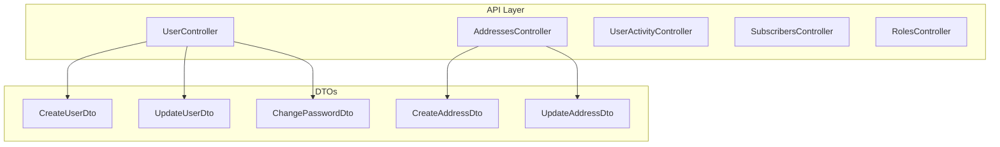
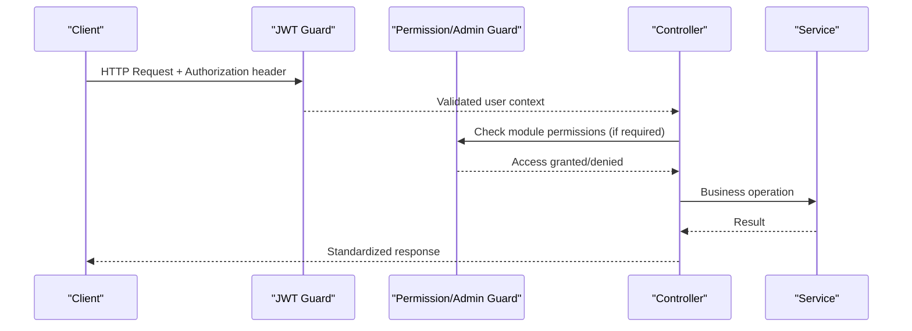
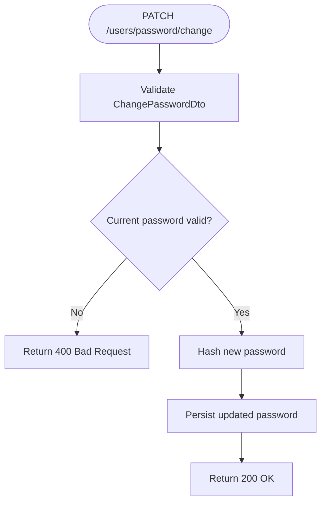
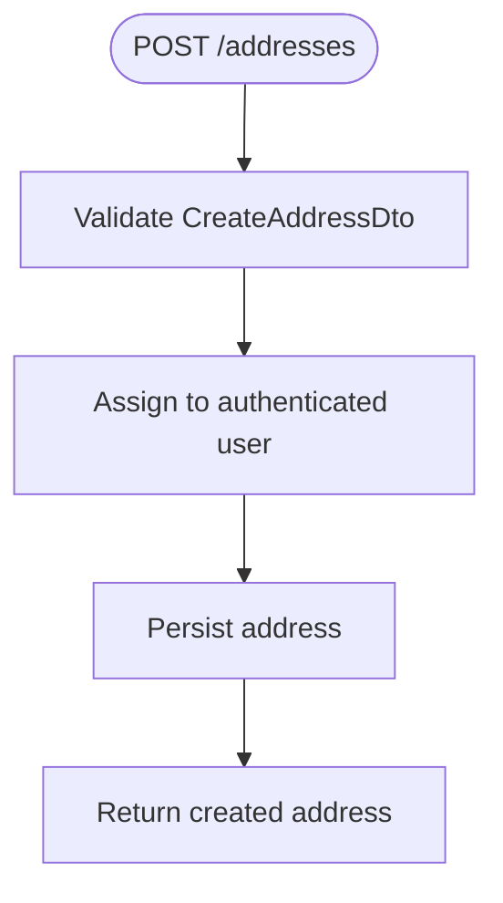
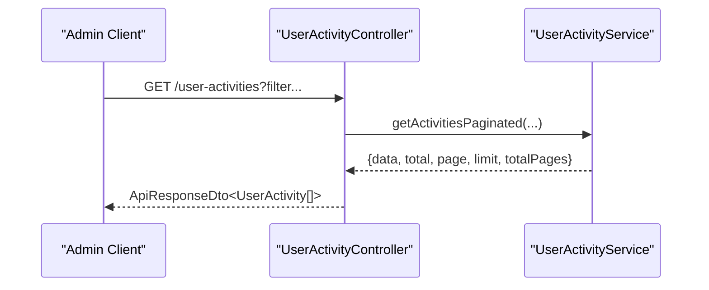
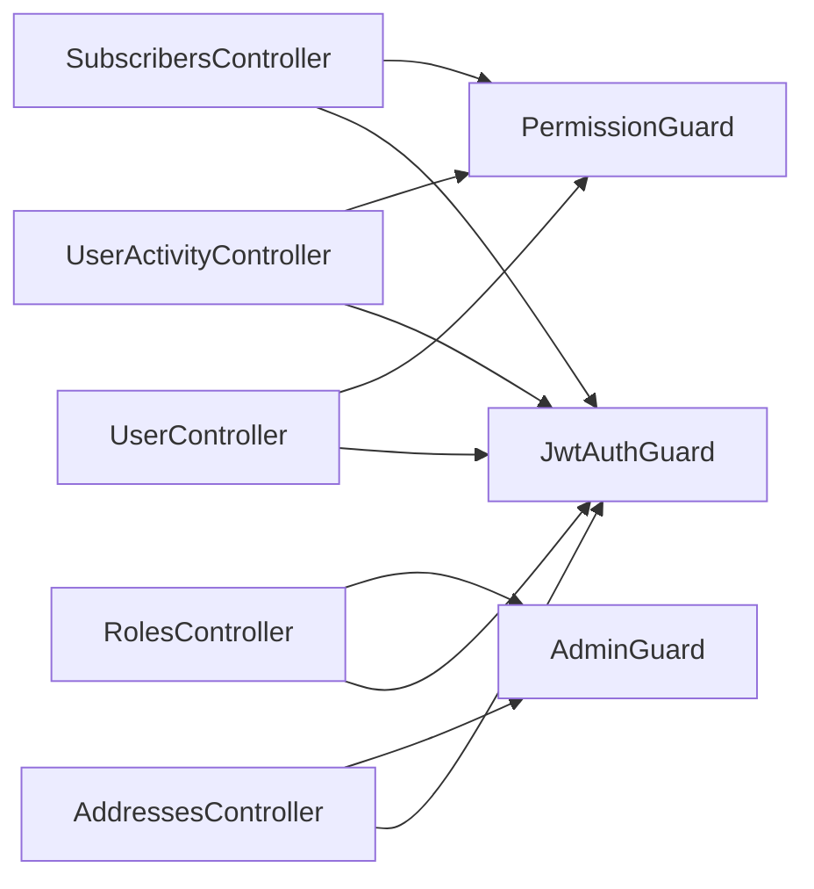

# User APIs

<cite>
**Referenced Files in This Document**
- [user.controller.ts](file://apps/backend/src/user/user.controller.ts)
- [create-user.dto.ts](file://apps/backend/src/user/dto/create-user.dto.ts)
- [update-user.dto.ts](file://apps/backend/src/user/dto/update-user.dto.ts)
- [change-password.dto.ts](file://apps/backend/src/user/dto/change-password.dto.ts)
- [address.controller.ts](file://apps/backend/src/address/address.controller.ts)
- [create-address.dto.ts](file://apps/backend/src/address/dto/create-address.dto.ts)
- [update-address.dto.ts](file://apps/backend/src/address/dto/update-address.dto.ts)
- [user-activity.controller.ts](file://apps/backend/src/user-activity/user-activity.controller.ts)
- [subscribers.controller.ts](file://apps/backend/src/subscribers/subscribers.controller.ts)
- [roles.controller.ts](file://apps/backend/src/roles/roles.controller.ts)
</cite>

## Table of Contents
1. [Introduction](#introduction)
2. [Project Structure](#project-structure)
3. [Core Components](#core-components)
4. [Architecture Overview](#architecture-overview)
5. [Detailed Component Analysis](#detailed-component-analysis)
6. [Dependency Analysis](#dependency-analysis)
7. [Performance Considerations](#performance-considerations)
8. [Troubleshooting Guide](#troubleshooting-guide)
9. [Conclusion](#conclusion)

## Introduction
This document provides comprehensive API documentation for user management endpoints, including:
- User profile operations (profile updates, password changes, account preferences)
- Address management (create, update, delete shipping addresses)
- User activity tracking and audit trails
- Subscriber management
- Notification preferences (via subscriber list)
- Role and permission endpoints for administrative access control

It also includes request/response schemas for validation, address formats, preference structures, privacy considerations, and data protection measures.

## Project Structure
The user-related APIs are implemented as NestJS controllers with associated DTOs for input validation and Swagger documentation. Key modules include:
- Users: profile CRUD, password change/reset, customer reports
- Addresses: per-user address management with admin overrides
- User Activities: audit logging and retention management
- Subscribers: subscription list management
- Roles: role CRUD for RBAC

**Diagram sources**
- [user.controller.ts:37-398](file://apps/backend/src/user/user.controller.ts#L37-L398)
- [address.controller.ts:38-220](file://apps/backend/src/address/address.controller.ts#L38-L220)
- [user-activity.controller.ts:25-394](file://apps/backend/src/user-activity/user-activity.controller.ts#L25-L394)
- [subscribers.controller.ts:30-160](file://apps/backend/src/subscribers/subscribers.controller.ts#L30-L160)
- [roles.controller.ts:32-138](file://apps/backend/src/roles/roles.controller.ts#L32-L138)
- [create-user.dto.ts:15-80](file://apps/backend/src/user/dto/create-user.dto.ts#L15-L80)
- [update-user.dto.ts:12-94](file://apps/backend/src/user/dto/update-user.dto.ts#L12-L94)
- [change-password.dto.ts:4-23](file://apps/backend/src/user/dto/change-password.dto.ts#L4-L23)
- [create-address.dto.ts:11-44](file://apps/backend/src/address/dto/create-address.dto.ts#L11-L44)
- [update-address.dto.ts:1-4](file://apps/backend/src/address/dto/update-address.dto.ts#L1-L4)

**Section sources**
- [user.controller.ts:37-398](file://apps/backend/src/user/user.controller.ts#L37-L398)
- [address.controller.ts:38-220](file://apps/backend/src/address/address.controller.ts#L38-L220)
- [user-activity.controller.ts:25-394](file://apps/backend/src/user-activity/user-activity.controller.ts#L25-L394)
- [subscribers.controller.ts:30-160](file://apps/backend/src/subscribers/subscribers.controller.ts#L30-L160)
- [roles.controller.ts:32-138](file://apps/backend/src/roles/roles.controller.ts#L32-L138)

## Core Components
- User Management Controller: Provides endpoints to list customers/users, retrieve top customers, generate customer reports, get user by ID, create/update/delete users, change password, and manage password reset flows.
- Address Management Controller: Provides endpoints to create, read, update, and delete addresses; supports default address retrieval and filtering by type; enforces user-scoped access with admin override.
- User Activity Controller: Provides endpoints to query activities with filters, view audit trails per entity, list distinct entity types, get details by ID, and manage retention cleanup/stats.
- Subscribers Controller: Provides endpoints to subscribe via email, list subscribers with pagination, get a subscriber by ID, and delete subscribers (admin).
- Roles Controller: Provides endpoints to create, list, get, update, and delete roles (admin-only).

**Section sources**
- [user.controller.ts:37-398](file://apps/backend/src/user/user.controller.ts#L37-L398)
- [address.controller.ts:38-220](file://apps/backend/src/address/address.controller.ts#L38-L220)
- [user-activity.controller.ts:25-394](file://apps/backend/src/user-activity/user-activity.controller.ts#L25-L394)
- [subscribers.controller.ts:30-160](file://apps/backend/src/subscribers/subscribers.controller.ts#L30-L160)
- [roles.controller.ts:32-138](file://apps/backend/src/roles/roles.controller.ts#L32-L138)

## Architecture Overview
The API layer uses JWT authentication and optional admin/permission guards. DTOs enforce input validation rules and Swagger metadata. Controllers delegate business logic to services (not shown here), and responses follow a consistent structure.

**Diagram sources**
- [user.controller.ts:42-43](file://apps/backend/src/user/user.controller.ts#L42-L43)
- [address.controller.ts:41-41](file://apps/backend/src/address/address.controller.ts#L41-L41)
- [user-activity.controller.ts:31-32](file://apps/backend/src/user-activity/user-activity.controller.ts#L31-L32)
- [subscribers.controller.ts:69-70](file://apps/backend/src/subscribers/subscribers.controller.ts#L69-L70)
- [roles.controller.ts:37-37](file://apps/backend/src/roles/roles.controller.ts#L37-L37)

## Detailed Component Analysis

### User Management Endpoints
- Authentication: Bearer token required where specified; some endpoints require additional permission guard.
- Endpoints:
  - GET /users/customers: List customers with pagination and search.
  - GET /users/users: List non-customer users with role filter and search.
  - GET /users/customers/top: Top customers by orders or spending with time filters.
  - GET /users/reports/customer-list: Customer list report with date range/preset.
  - GET /users/:id: Get user by ID.
  - POST /users: Create user (requires CreateUserDto).
  - PATCH /users/password/change: Change authenticated user’s password (requires ChangePasswordDto).
  - PATCH /users/:id: Update user (requires UpdateUserDto).
  - DELETE /users/:id: Delete user.
  - POST /users/password/reset-request: Request password reset by mobile number (rate-limited).
  - POST /users/password/reset: Reset password using mobile number, OTP, and new password.

Request/Response Schemas:
- CreateUserDto fields: name, email, password, mobileNumber, isVerified, roleId.
- UpdateUserDto fields: name, email, password, mobileNumber, otp, otpExpiresAt, isVerified, profilePhotoId.
- ChangePasswordDto fields: currentPassword, newPassword.

Security and Validation:
- Password fields are write-only in DTOs.
- Mobile numbers validated via phone validator.
- Email format validated.
- Rate limiting applied to password reset requests.

**Diagram sources**
- [user.controller.ts:292-315](file://apps/backend/src/user/user.controller.ts#L292-L315)
- [change-password.dto.ts:4-23](file://apps/backend/src/user/dto/change-password.dto.ts#L4-L23)

**Section sources**
- [user.controller.ts:37-398](file://apps/backend/src/user/user.controller.ts#L37-L398)
- [create-user.dto.ts:15-80](file://apps/backend/src/user/dto/create-user.dto.ts#L15-L80)
- [update-user.dto.ts:12-94](file://apps/backend/src/user/dto/update-user.dto.ts#L12-L94)
- [change-password.dto.ts:4-23](file://apps/backend/src/user/dto/change-password.dto.ts#L4-L23)

### Address Management Endpoints
- Authentication: Bearer token required; admin endpoints use AdminGuard.
- Endpoints:
  - POST /addresses: Create address (requires CreateAddressDto).
  - GET /addresses: List addresses (all for admins, own for users); optional type filter.
  - GET /addresses/default: Get default address by type.
  - GET /addresses/:id: Get address by ID.
  - PATCH /addresses/:id: Update address by ID (requires UpdateAddressDto).
  - DELETE /addresses/:id: Delete address by ID.
  - GET /addresses/user/:userId: Get addresses by user ID (users can only access their own; admins any user's).

Request/Response Schemas:
- CreateAddressDto fields: address, area, division, city, type (enum), isDefault.
- UpdateAddressDto: Partial of CreateAddressDto.

Access Control:
- Non-admin users restricted to their own addresses; admin users can access any.
- Default address retrieval scoped appropriately.

**Diagram sources**
- [address.controller.ts:45-64](file://apps/backend/src/address/address.controller.ts#L45-L64)
- [create-address.dto.ts:11-44](file://apps/backend/src/address/dto/create-address.dto.ts#L11-L44)

**Section sources**
- [address.controller.ts:38-220](file://apps/backend/src/address/address.controller.ts#L38-L220)
- [create-address.dto.ts:11-44](file://apps/backend/src/address/dto/create-address.dto.ts#L11-L44)
- [update-address.dto.ts:1-4](file://apps/backend/src/address/dto/update-address.dto.ts#L1-L4)

### User Activity Tracking Endpoints
- Authentication: Bearer token required; most endpoints require PermissionGuard and module permissions.
- Endpoints:
  - GET /user-activities: Paginated list with filters (action, entityType, userType, status, userId).
  - GET /user-activities/audit-trail/:entityType/:entityId: Full audit trail for an entity.
  - GET /user-activities/entity-types: Distinct entity types from logs.
  - GET /user-activities/details/:id: Details of a specific activity record.
  - GET /user-activities/:userId: Activities for a specific user.
  - POST /user-activities/retention/cleanup: Manually trigger cleanup of old records (days parameter).
  - GET /user-activities/retention/stats: Statistics about old records (days parameter).

Notes:
- Only POST, PATCH, DELETE operations are logged; GET requests are not tracked.
- Retention policies help manage database size.

**Diagram sources**
- [user-activity.controller.ts:31-140](file://apps/backend/src/user-activity/user-activity.controller.ts#L31-L140)

**Section sources**
- [user-activity.controller.ts:25-394](file://apps/backend/src/user-activity/user-activity.controller.ts#L25-L394)

### Subscriber Management Endpoints
- Authentication: Public endpoint for subscribing; admin endpoints require JWT and permissions.
- Endpoints:
  - POST /subscribers: Add subscriber by email (rate-limited).
  - GET /subscribers: List all subscribers with pagination (admin).
  - GET /subscribers/:id: Get subscriber by ID.
  - DELETE /subscribers/:id: Delete subscriber (admin).

Privacy Considerations:
- Email-based subscriptions; duplicate emails are rejected.
- Rate limiting prevents abuse.

**Section sources**
- [subscribers.controller.ts:30-160](file://apps/backend/src/subscribers/subscribers.controller.ts#L30-L160)

### Role and Permission Endpoints
- Authentication: Admin-only endpoints require JWT and AdminGuard.
- Endpoints:
  - POST /roles: Create role.
  - GET /roles: List roles.
  - GET /roles/:id: Get role by ID.
  - PATCH /roles/:id: Update role.
  - DELETE /roles/:id: Delete role.

Use Cases:
- Define roles for RBAC across the application.
- Combine with permission guards to restrict access to modules.

**Section sources**
- [roles.controller.ts:32-138](file://apps/backend/src/roles/roles.controller.ts#L32-L138)

## Dependency Analysis
Controllers depend on:
- Guards: JwtAuthGuard, PermissionGuard, AdminGuard.
- DTOs: For input validation and Swagger metadata.
- Services: Business logic delegation (not detailed here).

**Diagram sources**
- [user.controller.ts:42-43](file://apps/backend/src/user/user.controller.ts#L42-L43)
- [address.controller.ts:41-41](file://apps/backend/src/address/address.controller.ts#L41-L41)
- [user-activity.controller.ts:31-32](file://apps/backend/src/user-activity/user-activity.controller.ts#L31-L32)
- [subscribers.controller.ts:69-70](file://apps/backend/src/subscribers/subscribers.controller.ts#L69-L70)
- [roles.controller.ts:37-37](file://apps/backend/src/roles/roles.controller.ts#L37-L37)

**Section sources**
- [user.controller.ts:37-398](file://apps/backend/src/user/user.controller.ts#L37-L398)
- [address.controller.ts:38-220](file://apps/backend/src/address/address.controller.ts#L38-L220)
- [user-activity.controller.ts:25-394](file://apps/backend/src/user-activity/user-activity.controller.ts#L25-L394)
- [subscribers.controller.ts:30-160](file://apps/backend/src/subscribers/subscribers.controller.ts#L30-L160)
- [roles.controller.ts:32-138](file://apps/backend/src/roles/roles.controller.ts#L32-L138)

## Performance Considerations
- Pagination: Use page and limit parameters for large datasets (users, activities, subscribers).
- Filtering: Apply filters (role, action, entityType, userType, status, userId) to reduce payload sizes.
- Rate Limiting: Password reset and subscriber creation endpoints are rate-limited to prevent abuse.
- Indexing: Ensure database indexes on frequently filtered columns (e.g., createdAt, userId, entityType).
- Audit Retention: Use retention stats and cleanup endpoints to manage log volume.

[No sources needed since this section provides general guidance]

## Troubleshooting Guide
Common issues and resolutions:
- Unauthorized (401): Missing or invalid Bearer token; ensure proper authorization headers.
- Forbidden (403): Insufficient permissions; verify module permissions and role assignments.
- Not Found (404): Resource does not exist; check IDs and scoping rules (e.g., addresses).
- Bad Request (400): Invalid DTO fields; validate against schema (email, phone, password length).
- Conflict (409): Duplicate resources (e.g., email already exists for subscribers).

Operational tips:
- Use audit trail endpoints to investigate changes and errors.
- Monitor retention stats to proactively manage storage.

**Section sources**
- [user-activity.controller.ts:142-178](file://apps/backend/src/user-activity/user-activity.controller.ts#L142-L178)
- [subscribers.controller.ts:52-68](file://apps/backend/src/subscribers/subscribers.controller.ts#L52-L68)

## Conclusion
The User APIs provide robust capabilities for managing user profiles, addresses, activity tracking, subscriber lists, and roles. They incorporate strong security through JWT and permission guards, input validation via DTOs, and operational controls like rate limiting and audit retention. Adhering to the documented schemas and access controls ensures reliable and secure interactions across client applications.

[No sources needed since this section summarizes without analyzing specific files]