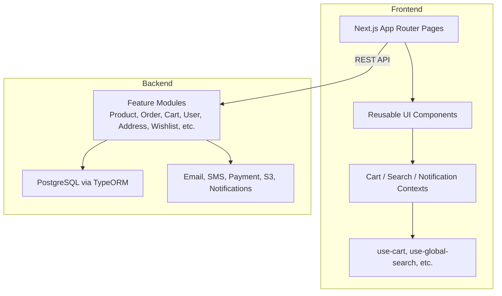
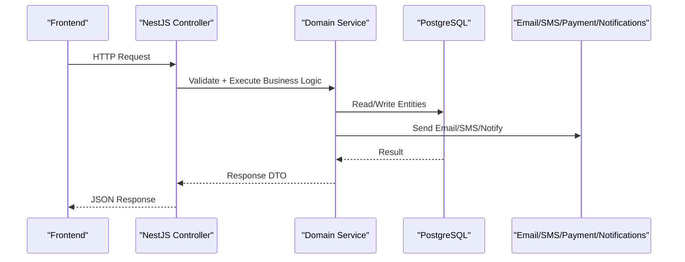
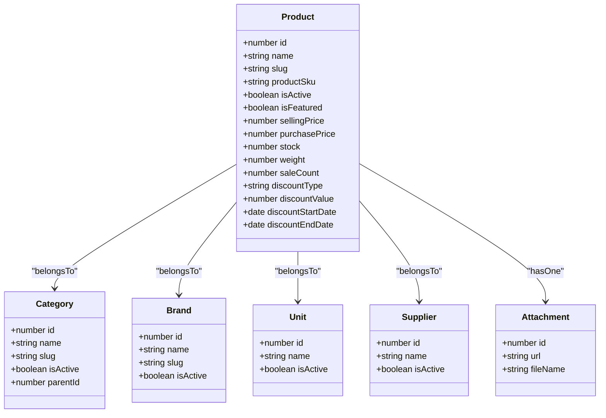
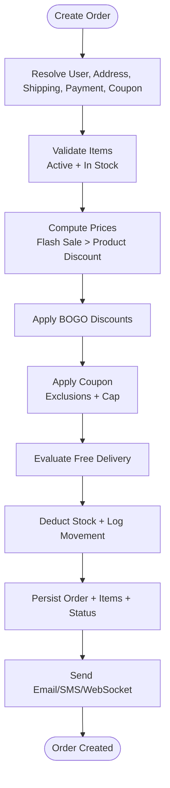
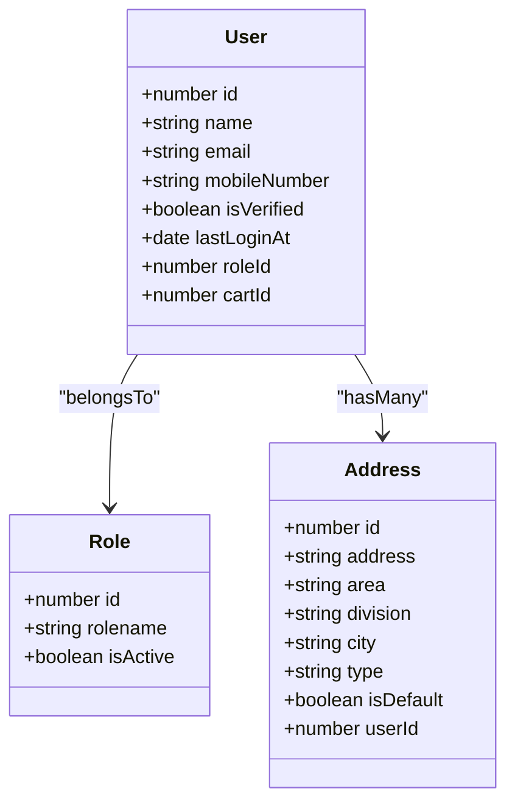
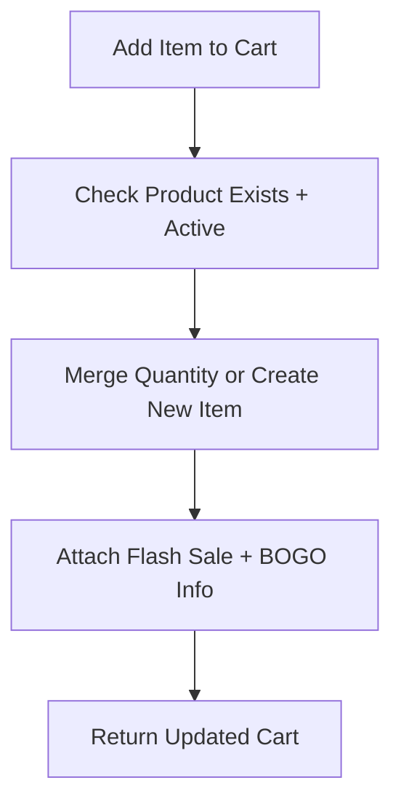
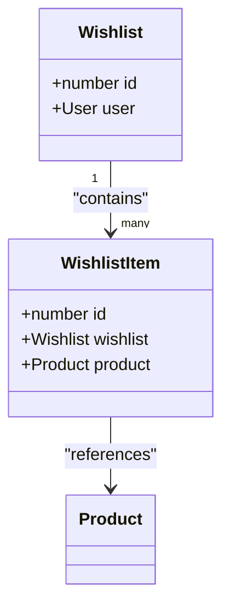
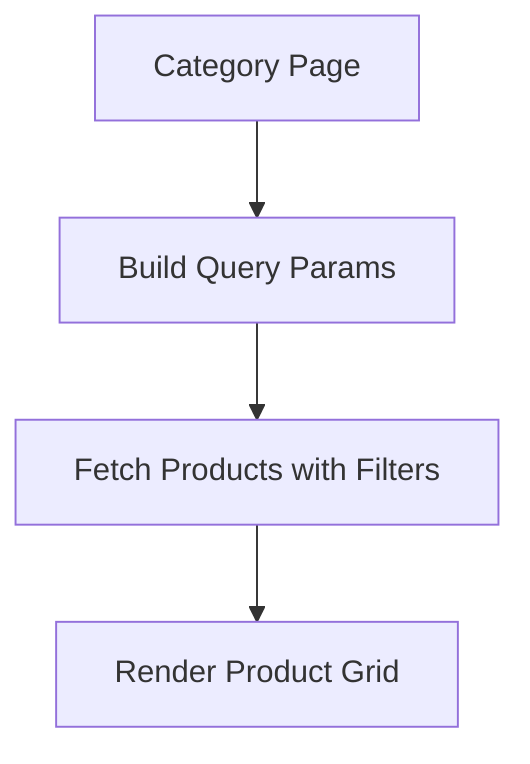
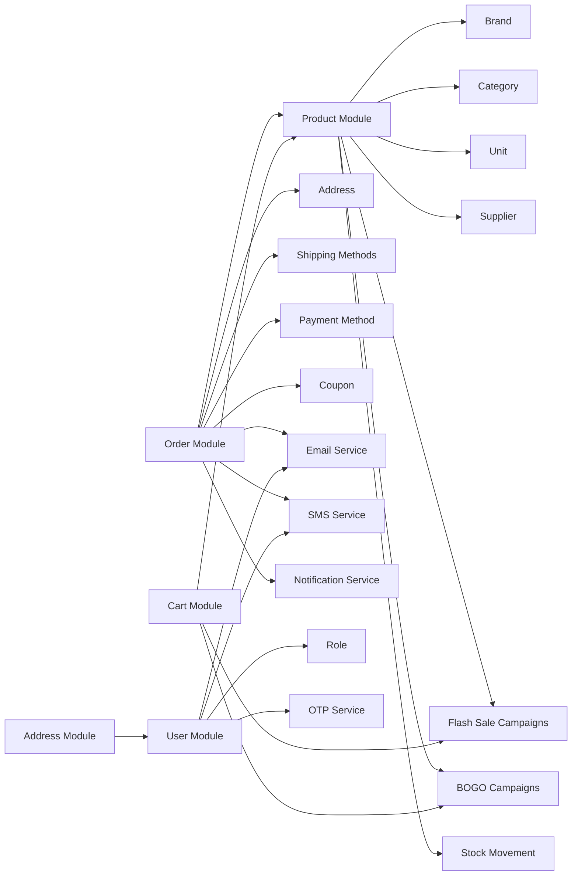

# Core Business Features

<cite>
**Referenced Files in This Document**   
- [README.md](file://README.md)
- [app.module.ts](file://apps/backend/src/app.module.ts)
- [database.dbml](file://apps/backend/database.dbml)
- [product.service.ts](file://apps/backend/src/product/product.service.ts)
- [order.service.ts](file://apps/backend/src/order/order.service.ts)
- [cart.service.ts](file://apps/backend/src/cart/cart.service.ts)
- [user.service.ts](file://apps/backend/src/user/user.service.ts)
- [address.controller.ts](file://apps/backend/src/address/address.controller.ts)
- [address.service.ts](file://apps/backend/src/address/address.service.ts)
- [wishlist.service.ts](file://apps/backend/src/wishlist/wishlist.service.ts)
- [wishlist.module.ts](file://apps/backend/src/wishlist/wishlist.module.ts)
- [add-to-wishlist-button.tsx](file://apps/frontend/components/wishlist/add-to-wishlist-button.tsx)
- [wishlist.tsx](file://apps/frontend/components/wishlist/wishlist.tsx)
- [contact-message.service.ts](file://apps/backend/src/contact-message/contact-message.service.ts)
- [order-note.entity.ts](file://apps/backend/src/order/entities/order-note.entity.ts)
- [page.tsx](file://apps/frontend/app/(main)/(brand-category)/categories/[slug]/page.tsx)
- [page.tsx](file://apps/frontend/app/(main)/how-to-order/page.tsx)
- [page.tsx](file://apps/frontend/app/(main)/user/(account)/[id]/addresses/page.tsx)
</cite>

## Table of Contents
1. [Introduction](#introduction)
2. [Project Structure](#project-structure)
3. [Core Components](#core-components)
4. [Architecture Overview](#architecture-overview)
5. [Detailed Component Analysis](#detailed-component-analysis)
6. [Dependency Analysis](#dependency-analysis)
7. [Performance Considerations](#performance-considerations)
8. [Troubleshooting Guide](#troubleshooting-guide)
9. [Conclusion](#conclusion)

## Introduction
This document explains the core business features of the German Butcher e-commerce platform. It covers the product catalog, order processing, user management, and shopping experience features such as cart, wishlist, reviews, and search. It also documents domain models, entity relationships, business rules, implementation examples, data flow between frontend and backend, integration points with external services, common business scenarios, and performance considerations for large catalogs and high-volume transactions.

The platform is a monorepo with a Next.js 16 frontend and a NestJS 11 backend. The backend uses PostgreSQL with TypeORM, JWT-based authentication, caching, rate limiting, email, SMS, real-time notifications, and payment integrations.

**Section sources**
- [README.md:1-66](file://README.md#L1-L66)

## Project Structure
The repository organizes features by domain modules under `apps/backend/src`. Each feature typically includes controllers, services, DTOs, entities, and tests. The frontend follows Next.js App Router conventions with pages, components, contexts, hooks, providers, and utilities.

**Diagram sources**
- [app.module.ts:60-183](file://apps/backend/src/app.module.ts#L60-L183)
- [README.md:34-66](file://README.md#L34-L66)

**Section sources**
- [README.md:1-32](file://README.md#L1-L32)
- [app.module.ts:60-183](file://apps/backend/src/app.module.ts#L60-L183)

## Core Components
This section summarizes the main business domains and their responsibilities.

- Product Catalog: Product management, categories, brands, units, suppliers, attachments, discounts, flash sales, BOGO campaigns, stock tracking, and search/filtering.
- Order Processing: Cart-to-order conversion, pricing calculations, coupon application, shipping cost logic, payment recording, stock deduction, campaign usage logging, status tracking, and notifications.
- User Management: Registration, profile updates, password changes, roles, addresses, and customer reporting.
- Shopping Experience: Cart operations, wishlist management, product reviews, search, sorting, and category browsing.
- Support and Operations: Contact messages, order notes, abandoned carts, analytics, CRM, delivery man, sales points, and marketing campaigns.

**Section sources**
- [app.module.ts:117-165](file://apps/backend/src/app.module.ts#L117-L165)
- [database.dbml:60-538](file://apps/backend/database.dbml#L60-L538)

## Architecture Overview
The system follows a layered architecture:

- Frontend pages call REST endpoints exposed by NestJS controllers.
- Controllers delegate to services that enforce business rules.
- Services interact with TypeORM repositories and external services (email, SMS, payment, notifications).
- Database schema defines entities and relationships.

**Diagram sources**
- [app.module.ts:60-183](file://apps/backend/src/app.module.ts#L60-L183)
- [database.dbml:60-538](file://apps/backend/database.dbml#L60-L538)

## Detailed Component Analysis

### Product Catalog System
The product catalog supports product creation, listing, filtering, searching, discounting, flash sales, BOGO promotions, and inventory tracking.

Key capabilities:
- Create products with brand, category, unit, supplier, attachment, and gallery references.
- List products with pagination, filters (category, brand, supplier, featured, active, discount), price range, tags, and sorting.
- Attach flash sale and BOGO information without persisting it into the cart or order rows.
- Track stock and sale counts; record stock movements on sales.
- Provide minimal product lists for pickers and lightweight lookups.

**Diagram sources**
- [database.dbml:77-135](file://apps/backend/database.dbml#L77-L135)
- [database.dbml:137-148](file://apps/backend/database.dbml#L137-L148)
- [database.dbml:168-176](file://apps/backend/database.dbml#L168-L176)
- [database.dbml:198-210](file://apps/backend/database.dbml#L198-L210)

Business rules:
- Inactive products cannot be added to cart or ordered.
- Discounts can be fixed or percentage-based with start/end dates.
- Flash sale pricing overrides product discount per item; stacking is not allowed.
- BOGO campaigns free eligible units based on buy/get rules.
- Stock is decremented and sale count incremented when an order is created.

Implementation highlights:
- Product list uses optimized queries, selective joins, and SWR-style cache for fast responses.
- Campaign info is attached after cache retrieval so cached lists remain stable while live deals are applied at request time.
- Minimal product queries support admin pickers and lightweight UI elements.

Common scenarios:
- Bulk product imports should validate brand/category/unit/supplier/gallery references and avoid duplicate names where required.
- Discount scheduling requires checking current time against discount windows.
- Inventory adjustments should log stock movements and update sale counts only through order processing or explicit adjustment flows.

**Section sources**
- [product.service.ts:127-173](file://apps/backend/src/product/product.service.ts#L127-L173)
- [product.service.ts:175-302](file://apps/backend/src/product/product.service.ts#L175-L302)
- [product.service.ts:306-353](file://apps/backend/src/product/product.service.ts#L306-L353)
- [product.service.ts:359-448](file://apps/backend/src/product/product.service.ts#L359-L448)
- [product.service.ts:512-566](file://apps/backend/src/product/product.service.ts#L512-L566)
- [product.service.ts:568-642](file://apps/backend/src/product/product.service.ts#L568-L642)
- [product.service.ts:644-741](file://apps/backend/src/product/product.service.ts#L644-L741)
- [product.service.ts:743-800](file://apps/backend/src/product/product.service.ts#L743-L800)
- [database.dbml:92-121](file://apps/backend/database.dbml#L92-L121)

### Order Processing Workflow
Order processing converts cart items into orders, applies pricing rules, validates stock, records payments, tracks status, and sends notifications.

End-to-end flow:
1. Client submits order details including items, address, shipping method, payment method, and optional coupon.
2. Backend resolves user, address, shipping method, payment method, and coupon.
3. For each item:
   - Validates product existence and active status.
   - Checks stock availability.
   - Computes final price considering flash sale and product discount.
   - Deducts stock and increments sale count.
   - Records stock movement.
4. Applies BOGO discounts if eligible.
5. Applies coupon discount with exclusions and caps.
6. Evaluates free delivery eligibility and adjusts shipping cost.
7. Increments campaign usage logs for flash sale, BOGO, and free delivery.
8. Creates order, order items, status track, and optional payment record.
9. Sends confirmation email, admin notification, SMS, and WebSocket event.

**Diagram sources**
- [order.service.ts:103-694](file://apps/backend/src/order/order.service.ts#L103-L694)

Business rules:
- Cash on delivery may be restricted by shipping method requirements.
- Flash sale pricing takes precedence over product discount; no stacking.
- BOGO frees cheapest eligible units per campaign rule.
- Coupon excludes specified products and may cap maximum discount.
- Free delivery may waive shipping unless excluded by method.
- Order number format is year-padded sequence.
- Status tracking and internal notes support operational workflows.

Integration points:
- Email service sends order confirmation and admin alerts.
- SMS service sends order confirmation when mobile number exists.
- Notification service emits WebSocket events for real-time admin updates.
- Campaign usage logs capture flash sale, BOGO, and free delivery usage.

Common scenarios:
- Order modifications should preserve auditability via status tracks and order notes.
- Partial payments are supported through order payment records.
- Cancellation and refund workflows should update payment status and notify customers.

**Section sources**
- [order.service.ts:103-694](file://apps/backend/src/order/order.service.ts#L103-L694)
- [order.service.ts:696-735](file://apps/backend/src/order/order.service.ts#L696-L735)
- [order.service.ts:737-826](file://apps/backend/src/order/order.service.ts#L737-L826)
- [order-note.entity.ts:14-57](file://apps/backend/src/order/entities/order-note.entity.ts#L14-L57)
- [database.dbml:381-405](file://apps/backend/database.dbml#L381-L405)

### User Management System
User management covers registration, profile updates, password changes, role assignment, and address management.

Key capabilities:
- Register users with email, name, password, and mobile number; default role assigned if invalid.
- Update profiles including profile photo reference.
- Change password with current password verification and security email notification.
- Query customers and other users with pagination and search.
- Generate top customers and customer list reports with aggregated order statistics.
- Manage user addresses with type, default flag, and ownership.

**Diagram sources**
- [database.dbml:60-75](file://apps/backend/database.dbml#L60-L75)
- [database.dbml:178-187](file://apps/backend/database.dbml#L178-L187)
- [database.dbml:285-294](file://apps/backend/database.dbml#L285-L294)

Business rules:
- Email and mobile number must be unique during registration.
- Passwords are hashed before storage.
- Profile photo updates require valid attachment references.
- Default address behavior ensures only one default per type per user.

Implementation highlights:
- Customer queries join roles, profile photos, addresses, and orders for rich admin views.
- Top customers aggregation considers delivered orders within configurable time windows.
- Address management enforces uniqueness and default constraints.

Common scenarios:
- Customer support workflows can view user profiles, orders, and addresses.
- Address changes should update default flags appropriately.
- Security-sensitive actions like password changes should trigger confirmation emails.

**Section sources**
- [user.service.ts:561-629](file://apps/backend/src/user/user.service.ts#L561-L629)
- [user.service.ts:630-713](file://apps/backend/src/user/user.service.ts#L630-L713)
- [user.service.ts:718-770](file://apps/backend/src/user/user.service.ts#L718-L770)
- [user.service.ts:118-187](file://apps/backend/src/user/user.service.ts#L118-L187)
- [user.service.ts:357-479](file://apps/backend/src/user/user.service.ts#L357-L479)
- [address.controller.ts:38-52](file://apps/backend/src/address/address.controller.ts#L38-L52)
- [address.service.ts:138-157](file://apps/backend/src/address/address.service.ts#L138-L157)

### Shopping Experience Features

#### Cart Functionality
Cart operations include adding items, updating quantities, removing items, clearing the cart, and retrieving user carts with campaign-enhanced pricing.

Behavior:
- Automatically creates a cart for a user if missing.
- Prevents adding inactive products.
- Merges quantities for existing items.
- Attaches flash sale and BOGO info for display without persisting deal metadata.
- Provides abandoned cart summaries and reports for admin analysis.

**Diagram sources**
- [cart.service.ts:121-158](file://apps/backend/src/cart/cart.service.ts#L121-L158)
- [cart.service.ts:27-48](file://apps/backend/src/cart/cart.service.ts#L27-L48)

Business rules:
- Only active products can be added.
- Display-only deal properties do not affect persisted cart state.
- Abandoned cart definition excludes empty carts and carts converted to orders.

**Section sources**
- [cart.service.ts:50-119](file://apps/backend/src/cart/cart.service.ts#L50-L119)
- [cart.service.ts:121-201](file://apps/backend/src/cart/cart.service.ts#L121-L201)
- [cart.service.ts:203-298](file://apps/backend/src/cart/cart.service.ts#L203-L298)

#### Wishlist Management
Wishlist allows users to save favorite products and remove them later.

Behavior:
- Add/remove wishlist items tied to the authenticated user.
- Clear entire wishlist.
- Frontend provides add-to-wishlist buttons and a dedicated wishlist page.

**Diagram sources**
- [wishlist.module.ts:10-15](file://apps/backend/src/wishlist/wishlist.module.ts#L10-L15)
- [wishlist.service.ts:85-124](file://apps/backend/src/wishlist/wishlist.service.ts#L85-L124)

Business rules:
- Wishlist items are scoped to the authenticated user.
- Removing an item returns the updated wishlist.
- Clearing removes all items for the user.

Implementation examples:
- Frontend calls `/wishlist/items` to add items and renders the wishlist grid with remove controls.

**Section sources**
- [wishlist.service.ts:85-124](file://apps/backend/src/wishlist/wishlist.service.ts#L85-L124)
- [add-to-wishlist-button.tsx:160-189](file://apps/frontend/components/wishlist/add-to-wishlist-button.tsx#L160-L189)
- [wishlist.tsx:15-82](file://apps/frontend/components/wishlist/wishlist.tsx#L15-L82)

#### Product Reviews
Product reviews enable customers to rate and comment on products. The module structure indicates controller, service, DTOs, and entities exist for managing review content and associations.

Business rules:
- Reviews should be associated with products and users.
- Moderation workflows may involve approval states and admin controls.

**Section sources**
- [database.dbml:349-355](file://apps/backend/database.dbml#L349-L355)

#### Search and Browsing
Search and browsing allow users to explore products by category, brand, price range, tags, and sorting options.

Behavior:
- Category pages pass query parameters for sort, price filters, featured, and tags.
- Product service applies ILIKE search on name/description and tag array matching.
- Sorting supports price ascending/descending and name ascending/descending.

**Diagram sources**
- [page.tsx:8-43](file://apps/frontend/app/(main)/(brand-category)/categories/[slug]/page.tsx#L8-L43)
- [product.service.ts:306-353](file://apps/backend/src/product/product.service.ts#L306-L353)

**Section sources**
- [page.tsx:8-43](file://apps/frontend/app/(main)/(brand-category)/categories/[slug]/page.tsx#L8-L43)
- [product.service.ts:175-302](file://apps/backend/src/product/product.service.ts#L175-L302)

## Dependency Analysis
The backend composes many feature modules. Key dependencies include:

- Product depends on brand, category, unit, supplier, attachment, gallery, flash sale, BOGO, stock movement, and product history.
- Order depends on product, address, shipping method, payment method, coupon, delivery man, email, SMS, notifications, and multiple campaign usage logs.
- Cart depends on product, flash sale, and BOGO for enriched pricing.
- User depends on role, OTP, SMS, and email services.
- Address is managed independently but linked to users.

**Diagram sources**
- [app.module.ts:117-165](file://apps/backend/src/app.module.ts#L117-L165)
- [product.service.ts:58-82](file://apps/backend/src/product/product.service.ts#L58-L82)
- [order.service.ts:63-101](file://apps/backend/src/order/order.service.ts#L63-L101)
- [cart.service.ts:17-25](file://apps/backend/src/cart/cart.service.ts#L17-L25)
- [user.service.ts:33-42](file://apps/backend/src/user/user.service.ts#L33-L42)

**Section sources**
- [app.module.ts:117-165](file://apps/backend/src/app.module.ts#L117-L165)

## Performance Considerations
- Product list caching: Uses a custom SWR-style cache with short TTL and stale-while-revalidate to reduce database load under concurrent requests.
- Selective joins: Product list queries select only necessary columns and relations to minimize payload size.
- Separate count queries: Count shares filters but avoids expensive joins used for payload selection.
- Campaign enrichment after cache: Flash sale and BOGO info are attached post-cache to keep cached lists stable while displaying live deals.
- Minimal product queries: Lightweight lookups for admin pickers use cached raw results.
- Rate limiting: Global throttling guards protect endpoints from abuse.
- Database pool configuration: Connection pool size and timeouts are configured for production workloads.

Recommendations:
- Index frequently filtered columns such as product slug, SKU, category, brand, and timestamps.
- Use pagination consistently across large datasets.
- Avoid N+1 queries by selecting only needed relations.
- Monitor campaign evaluation costs and cache campaign lists where appropriate.
- Offload heavy analytics to background jobs or materialized views.

**Section sources**
- [product.service.ts:84-125](file://apps/backend/src/product/product.service.ts#L84-L125)
- [product.service.ts:175-302](file://apps/backend/src/product/product.service.ts#L175-L302)
- [product.service.ts:359-448](file://apps/backend/src/product/product.service.ts#L359-L448)
- [app.module.ts:70-114](file://apps/backend/src/app.module.ts#L70-L114)

## Troubleshooting Guide
Common issues and resolutions:

- Duplicate key errors during cart creation: Handled by catching unique constraint violations and fetching the existing cart.
- Inactive products in cart or order attempts: Backend rejects adding or ordering inactive products.
- Missing references: Validation throws not found exceptions for missing user, address, shipping method, payment method, or coupon.
- Campaign evaluation failures: Errors are logged but do not block order creation; fallback behavior preserves order integrity.
- Email/SMS/Notification failures: Non-critical failures are logged; order creation continues.
- Address default conflicts: Unsetting previous defaults ensures only one default per type per user.

Operational tips:
- Use order status tracks and order notes to document modifications and internal communications.
- Review abandoned cart reports to identify potential conversions and outreach opportunities.
- Monitor campaign usage logs to detect misconfigurations or unexpected spikes.
- Validate environment variables for database, email, SMS, and payment services.

**Section sources**
- [cart.service.ts:79-103](file://apps/backend/src/cart/cart.service.ts#L79-L103)
- [order.service.ts:190-210](file://apps/backend/src/order/order.service.ts#L190-L210)
- [order.service.ts:296-308](file://apps/backend/src/order/order.service.ts#L296-L308)
- [order.service.ts:578-694](file://apps/backend/src/order/order.service.ts#L578-L694)
- [address.service.ts:148-157](file://apps/backend/src/address/address.service.ts#L148-L157)
- [contact-message.service.ts:22-33](file://apps/backend/src/contact-message/contact-message.service.ts#L22-L33)

## Conclusion
The German Butcher platform implements a robust e-commerce system with clear separation of concerns across product catalog, order processing, user management, and shopping experience features. The backend enforces strong business rules around pricing, discounts, stock, and campaign eligibility while providing rich admin reporting and operational tools. The frontend delivers a modern shopping interface with cart, wishlist, category browsing, and account management. Performance optimizations such as selective joins, caching, and rate limiting help scale the system for large catalogs and high-volume transactions. Future enhancements should focus on indexing strategies, background processing for heavy analytics, and expanded moderation workflows for reviews and contact messages.