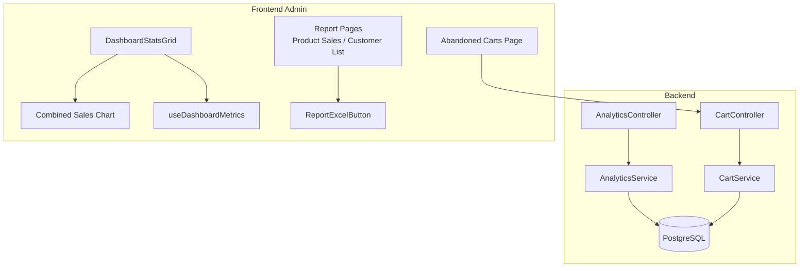
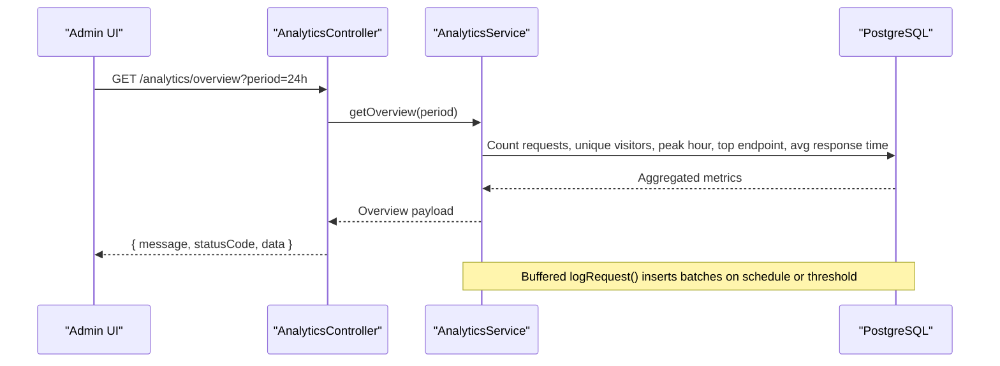
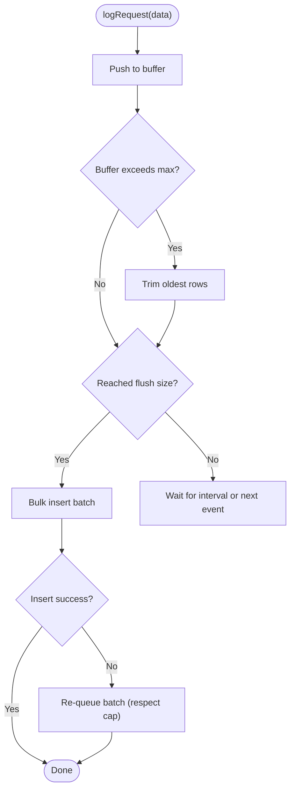
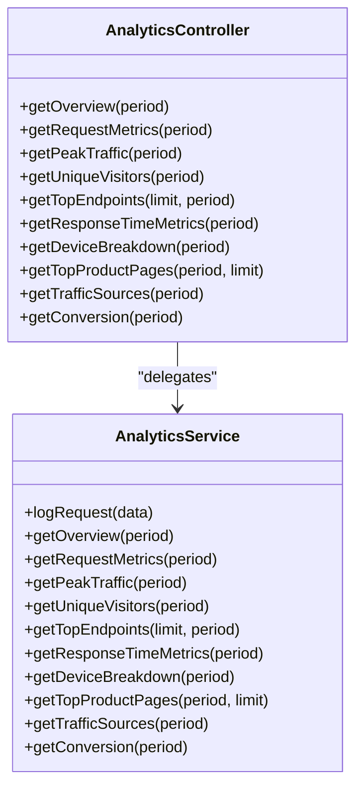
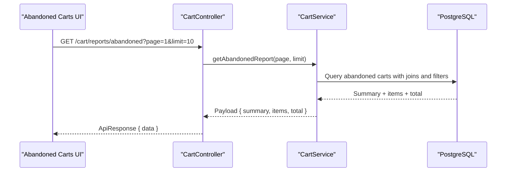
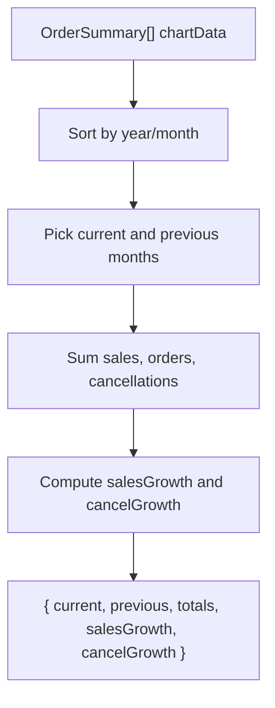
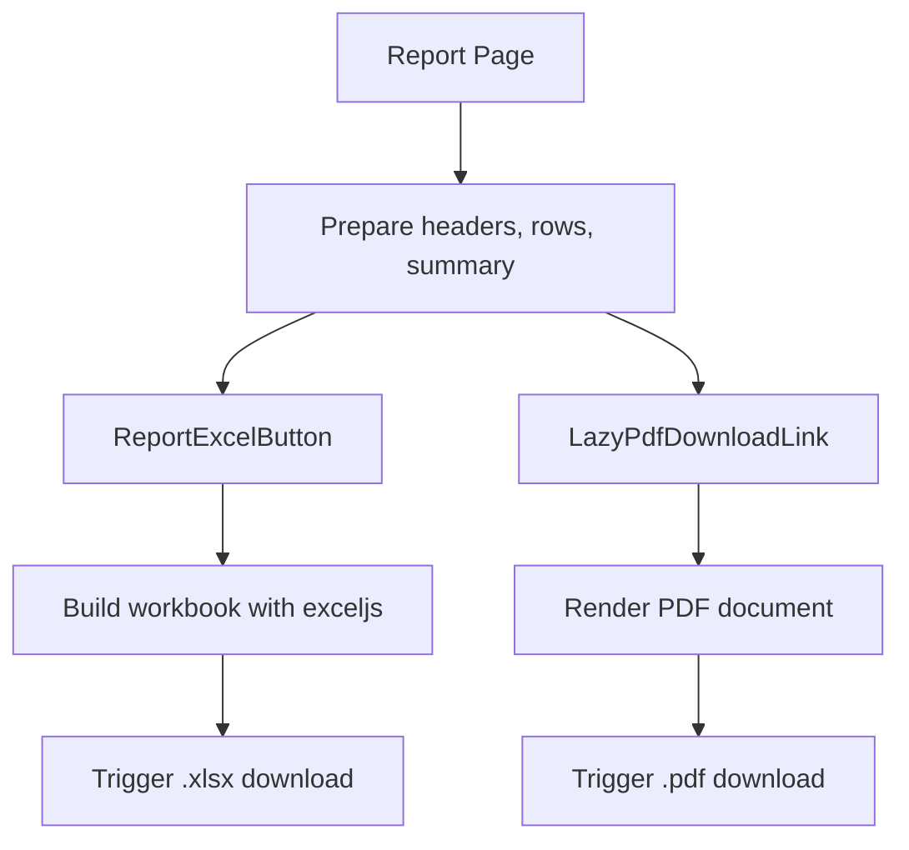
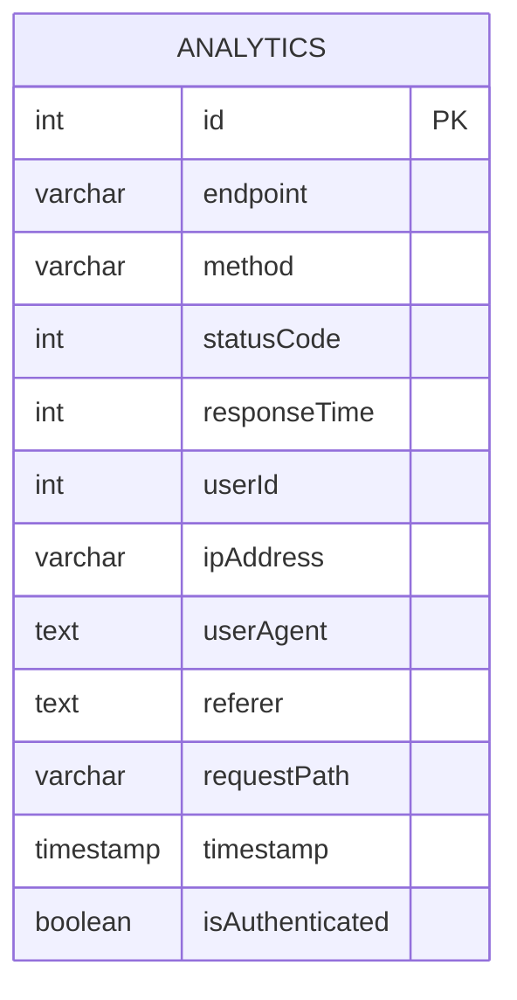
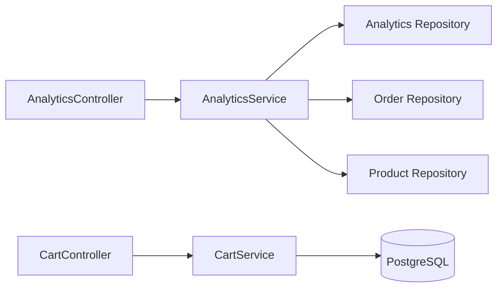
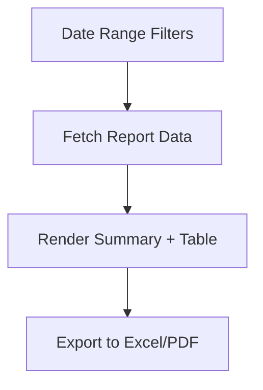

# Order Analytics & Reporting

<cite>
**Referenced Files in This Document**
- [analytics.service.ts](file://apps/backend/src/analytics/analytics.service.ts)
- [analytics.controller.ts](file://apps/backend/src/analytics/analytics.controller.ts)
- [analytics.entity.ts](file://apps/backend/src/analytics/entities/analytics.entity.ts)
- [cart.controller.ts](file://apps/backend/src/cart/cart.controller.ts)
- [cart.service.ts](file://apps/backend/src/cart/cart.service.ts)
- [use-dashboard-metrics.ts](file://apps/frontend/hooks/use-dashboard-metrics.ts)
- [DashboardStatsGrid.tsx](file://apps/frontend/components/admin/dashboard/DashboardStatsGrid.tsx)
- [combined-order-saleschart.tsx](file://apps/frontend/components/admin/dashboard/combined-order-saleschart.tsx)
- [product-sales-list.tsx](file://apps/frontend/components/admin/reports/product-sales/product-sales-list.tsx)
- [download-excel-button.tsx](file://apps/frontend/components/admin/reports/download-excel-button.tsx)
- [abandoned-carts-list.tsx](file://apps/frontend/components/admin/reports/abandoned-carts-list.tsx)
- [abandoned-carts page.tsx](file://apps/frontend/app/admin/analytics/abandoned-carts/page.tsx)
</cite>

## Table of Contents
1. [Introduction](#introduction)
2. [Project Structure](#project-structure)
3. [Core Components](#core-components)
4. [Architecture Overview](#architecture-overview)
5. [Detailed Component Analysis](#detailed-component-analysis)
6. [Dependency Analysis](#dependency-analysis)
7. [Performance Considerations](#performance-considerations)
8. [Troubleshooting Guide](#troubleshooting-guide)
9. [Conclusion](#conclusion)
10. [Appendices](#appendices)

## Introduction
This document explains the order analytics and reporting capabilities across the backend and frontend:
- Data collection for request-level analytics, conversion metrics, device/browser breakdown, traffic sources, and top product pages.
- Reporting dashboards with charts and KPIs for sales trends, revenue analysis, and performance indicators.
- Export functionality to generate PDF and Excel reports from report pages.
- Advanced analytics such as abandoned cart analysis.
- Real-time updates via periodic flushing and scheduled retention.
- Privacy considerations including anonymization techniques and data retention policies.

## Project Structure
The analytics system spans both backend and frontend:
- Backend NestJS module provides endpoints for analytics aggregation and abandoned cart reporting.
- Frontend admin dashboard renders charts, KPIs, and report pages with export options.

**Diagram sources**
- [analytics.controller.ts:33-34](file://apps/backend/src/analytics/analytics.controller.ts#L33-L34)
- [analytics.service.ts:39-57](file://apps/backend/src/analytics/analytics.service.ts#L39-L57)
- [cart.controller.ts:169-213](file://apps/backend/src/cart/cart.controller.ts#L169-L213)
- [cart.service.ts:206-285](file://apps/backend/src/cart/cart.service.ts#L206-L285)
- [DashboardStatsGrid.tsx:69-81](file://apps/frontend/components/admin/dashboard/DashboardStatsGrid.tsx#L69-L81)
- [combined-order-saleschart.tsx:45-87](file://apps/frontend/components/admin/dashboard/combined-order-saleschart.tsx#L45-L87)
- [use-dashboard-metrics.ts:31-64](file://apps/frontend/hooks/use-dashboard-metrics.ts#L31-L64)
- [product-sales-list.tsx:87-134](file://apps/frontend/components/admin/reports/product-sales/product-sales-list.tsx#L87-L134)
- [download-excel-button.tsx:50-72](file://apps/frontend/components/admin/reports/download-excel-button.tsx#L50-L72)
- [abandoned-carts-list.tsx:35-56](file://apps/frontend/components/admin/reports/abandoned-carts-list.tsx#L35-L56)
- [abandoned-carts page.tsx:8-19](file://apps/frontend/app/admin/analytics/abandoned-carts/page.tsx#L8-L19)

**Section sources**
- [analytics.controller.ts:27-34](file://apps/backend/src/analytics/analytics.controller.ts#L27-L34)
- [analytics.service.ts:39-57](file://apps/backend/src/analytics/analytics.service.ts#L39-L57)
- [cart.controller.ts:169-213](file://apps/backend/src/cart/cart.controller.ts#L169-L213)
- [cart.service.ts:206-285](file://apps/backend/src/cart/cart.service.ts#L206-L285)
- [DashboardStatsGrid.tsx:69-81](file://apps/frontend/components/admin/dashboard/DashboardStatsGrid.tsx#L69-L81)
- [combined-order-saleschart.tsx:45-87](file://apps/frontend/components/admin/dashboard/combined-order-saleschart.tsx#L45-L87)
- [use-dashboard-metrics.ts:31-64](file://apps/frontend/hooks/use-dashboard-metrics.ts#L31-L64)
- [product-sales-list.tsx:87-134](file://apps/frontend/components/admin/reports/product-sales/product-sales-list.tsx#L87-L134)
- [download-excel-button.tsx:50-72](file://apps/frontend/components/admin/reports/download-excel-button.tsx#L50-L72)
- [abandoned-carts-list.tsx:35-56](file://apps/frontend/components/admin/reports/abandoned-carts-list.tsx#L35-L56)
- [abandoned-carts page.tsx:8-19](file://apps/frontend/app/admin/analytics/abandoned-carts/page.tsx#L8-L19)

## Core Components
- Analytics ingestion and aggregation service:
  - Buffered logging with batch flush and periodic timer.
  - Aggregation endpoints for overview, requests over time, peak traffic, unique visitors, top endpoints, response times, device/browser breakdown, top product pages, traffic sources, and conversion rate.
  - Scheduled retention cleanup to purge old records.
- Abandoned carts analytics:
  - Summary and paginated list endpoints returning counts, values, and per-cart details.
- Frontend dashboard and reports:
  - Dashboard KPIs and charts using aggregated metrics.
  - Report pages with summary tiles, tables, and export buttons for PDF and Excel.

Key responsibilities:
- Backend: collect, aggregate, and serve analytics; compute conversion; provide abandoned cart insights.
- Frontend: visualize metrics, render reports, and generate downloadable exports.

**Section sources**
- [analytics.service.ts:142-192](file://apps/backend/src/analytics/analytics.service.ts#L142-L192)
- [analytics.service.ts:194-548](file://apps/backend/src/analytics/analytics.service.ts#L194-L548)
- [analytics.service.ts:593-615](file://apps/backend/src/analytics/analytics.service.ts#L593-L615)
- [cart.controller.ts:169-213](file://apps/backend/src/cart/cart.controller.ts#L169-L213)
- [cart.service.ts:206-285](file://apps/backend/src/cart/cart.service.ts#L206-L285)
- [DashboardStatsGrid.tsx:69-81](file://apps/frontend/components/admin/dashboard/DashboardStatsGrid.tsx#L69-L81)
- [product-sales-list.tsx:87-134](file://apps/frontend/components/admin/reports/product-sales/product-sales-list.tsx#L87-L134)

## Architecture Overview
The analytics pipeline collects request events into a buffered queue, periodically flushes them to the database, and exposes aggregated views through REST endpoints. The frontend consumes these endpoints to render dashboards and reports.

**Diagram sources**
- [analytics.controller.ts:36-62](file://apps/backend/src/analytics/analytics.controller.ts#L36-L62)
- [analytics.service.ts:194-252](file://apps/backend/src/analytics/analytics.service.ts#L194-L252)
- [analytics.service.ts:142-192](file://apps/backend/src/analytics/analytics.service.ts#L142-L192)

## Detailed Component Analysis

### Analytics Ingestion and Aggregation (Backend)
- Buffering strategy:
  - Requests are queued in memory and flushed either when the buffer reaches a configured size or at a fixed interval.
  - On failure, rows are re-queued up to a maximum buffer cap to prevent unbounded memory growth.
- Index management:
  - Ensures indexes exist for timestamp-based queries to avoid full table scans.
- Aggregation methods:
  - Overview: total requests, unique visitors, peak hour, top endpoint, average response time.
  - Request metrics: hourly buckets with zero-filled gaps.
  - Peak traffic: busiest hours across the period.
  - Unique visitors: daily counts aligned to local timezone.
  - Top endpoints: most accessed endpoints with average response time.
  - Response times: min/avg/max.
  - Device/browser breakdown: derived from user-agent strings.
  - Top product pages: resolves product names by id/slug.
  - Traffic sources: grouped by referer host; missing referer counted as Direct.
  - Conversion: orders vs unique visitors in the selected period.
- Retention:
  - Daily cron deletes records older than a configurable retention window.

**Diagram sources**
- [analytics.service.ts:142-192](file://apps/backend/src/analytics/analytics.service.ts#L142-L192)

**Section sources**
- [analytics.service.ts:16-23](file://apps/backend/src/analytics/analytics.service.ts#L16-L23)
- [analytics.service.ts:59-80](file://apps/backend/src/analytics/analytics.service.ts#L59-L80)
- [analytics.service.ts:89-117](file://apps/backend/src/analytics/analytics.service.ts#L89-L117)
- [analytics.service.ts:142-192](file://apps/backend/src/analytics/analytics.service.ts#L142-L192)
- [analytics.service.ts:194-548](file://apps/backend/src/analytics/analytics.service.ts#L194-L548)
- [analytics.service.ts:593-615](file://apps/backend/src/analytics/analytics.service.ts#L593-L615)

### Analytics API Endpoints (Backend Controller)
- Protected endpoints under JWT and permission guards.
- Query parameters support periods like 1h, 24h, 7d, 15d, 30d.
- Endpoints include overview, requests, peak-traffic, visitors, top-endpoints, response-times, devices, top-pages, traffic-sources, and conversion.

**Diagram sources**
- [analytics.controller.ts:33-311](file://apps/backend/src/analytics/analytics.controller.ts#L33-L311)
- [analytics.service.ts:142-548](file://apps/backend/src/analytics/analytics.service.ts#L142-L548)

**Section sources**
- [analytics.controller.ts:27-34](file://apps/backend/src/analytics/analytics.controller.ts#L27-L34)
- [analytics.controller.ts:36-311](file://apps/backend/src/analytics/analytics.controller.ts#L36-L311)

### Abandoned Carts Analytics
- Summary endpoint returns count and value of abandoned carts (items present, no checkout within 24+ hours).
- Paginated report endpoint returns per-cart details including customer name/mobile, item count, value, and last updated time.
- Frontend displays summary cards and a paginated table.

**Diagram sources**
- [cart.controller.ts:189-213](file://apps/backend/src/cart/cart.controller.ts#L189-L213)
- [cart.service.ts:237-285](file://apps/backend/src/cart/cart.service.ts#L237-L285)

**Section sources**
- [cart.controller.ts:169-213](file://apps/backend/src/cart/cart.controller.ts#L169-L213)
- [cart.service.ts:206-285](file://apps/backend/src/cart/cart.service.ts#L206-L285)
- [abandoned-carts-list.tsx:35-56](file://apps/frontend/components/admin/reports/abandoned-carts-list.tsx#L35-L56)
- [abandoned-carts page.tsx:8-19](file://apps/frontend/app/admin/analytics/abandoned-carts/page.tsx#L8-L19)

### Dashboard Metrics and Charts (Frontend)
- useDashboardMetrics computes current vs previous month totals, sales growth, and cancel growth.
- DashboardStatsGrid renders KPIs (today’s sales, average order value), pie/donut charts for payment method share, category sales, and order distribution.
- Combined sales chart sorts monthly data chronologically and adapts visible range for mobile.

**Diagram sources**
- [use-dashboard-metrics.ts:31-64](file://apps/frontend/hooks/use-dashboard-metrics.ts#L31-L64)

**Section sources**
- [use-dashboard-metrics.ts:31-64](file://apps/frontend/hooks/use-dashboard-metrics.ts#L31-L64)
- [DashboardStatsGrid.tsx:69-81](file://apps/frontend/components/admin/dashboard/DashboardStatsGrid.tsx#L69-L81)
- [combined-order-saleschart.tsx:45-87](file://apps/frontend/components/admin/dashboard/combined-order-saleschart.tsx#L45-L87)

### Reporting and Exports (PDF and Excel)
- Report pages show summary tiles and tabular data.
- Excel export uses an on-demand loaded library to build styled workbooks with headers, rows, and optional summaries.
- PDF export is provided via lazy-loaded components that render formatted documents and trigger downloads.

**Diagram sources**
- [product-sales-list.tsx:87-134](file://apps/frontend/components/admin/reports/product-sales/product-sales-list.tsx#L87-L134)
- [download-excel-button.tsx:50-72](file://apps/frontend/components/admin/reports/download-excel-button.tsx#L50-L72)

**Section sources**
- [product-sales-list.tsx:87-134](file://apps/frontend/components/admin/reports/product-sales/product-sales-list.tsx#L87-L134)
- [download-excel-button.tsx:50-72](file://apps/frontend/components/admin/reports/download-excel-button.tsx#L50-L72)

### Data Model for Analytics Events
- Stores endpoint, HTTP method, status code, response time, user identity (userId), IP address, user agent, referer, concrete request path, timestamp, and authentication flag.
- Indexed fields optimize query performance for time-based aggregations.

**Diagram sources**
- [analytics.entity.ts:12-58](file://apps/backend/src/analytics/entities/analytics.entity.ts#L12-L58)

**Section sources**
- [analytics.entity.ts:12-58](file://apps/backend/src/analytics/entities/analytics.entity.ts#L12-L58)

## Dependency Analysis
- Controller-to-service coupling:
  - AnalyticsController depends on AnalyticsService for all aggregation logic.
- Service-to-repository dependencies:
  - AnalyticsService uses repositories for Analytics, Order, and Product entities.
- Frontend-to-backend integration:
  - Dashboard and report components call protected endpoints to fetch metrics and report data.
- Abandoned carts flow:
  - CartController delegates to CartService which executes SQL queries against cart, product, and user tables.

**Diagram sources**
- [analytics.controller.ts:33-34](file://apps/backend/src/analytics/analytics.controller.ts#L33-L34)
- [analytics.service.ts:49-57](file://apps/backend/src/analytics/analytics.service.ts#L49-L57)
- [cart.controller.ts:169-213](file://apps/backend/src/cart/cart.controller.ts#L169-L213)
- [cart.service.ts:206-285](file://apps/backend/src/cart/cart.service.ts#L206-L285)

**Section sources**
- [analytics.controller.ts:33-34](file://apps/backend/src/analytics/analytics.controller.ts#L33-L34)
- [analytics.service.ts:49-57](file://apps/backend/src/analytics/analytics.service.ts#L49-L57)
- [cart.controller.ts:169-213](file://apps/backend/src/cart/cart.controller.ts#L169-L213)
- [cart.service.ts:206-285](file://apps/backend/src/cart/cart.service.ts#L206-L285)

## Performance Considerations
- Buffered ingestion:
  - Batch inserts reduce database round trips; configurable batch size and flush interval balance throughput and latency.
  - Buffer capping prevents memory pressure during outages.
- Database indexing:
  - Automatic index creation ensures efficient time-range queries and avoids full scans.
- Timezone alignment:
  - Hourly and daily aggregations align to local timezone to produce consistent chart labels.
- Retention policy:
  - Scheduled deletion of old analytics rows keeps the table size manageable.

Recommendations:
- Tune ANALYTICS_FLUSH_BATCH_SIZE, ANALYTICS_FLUSH_INTERVAL_MS, and ANALYTICS_MAX_BUFFER_SIZE based on traffic patterns.
- Monitor retention days to balance storage costs and analytical depth.

**Section sources**
- [analytics.service.ts:16-23](file://apps/backend/src/analytics/analytics.service.ts#L16-L23)
- [analytics.service.ts:59-80](file://apps/backend/src/analytics/analytics.service.ts#L59-L80)
- [analytics.service.ts:89-117](file://apps/backend/src/analytics/analytics.service.ts#L89-L117)
- [analytics.service.ts:254-286](file://apps/backend/src/analytics/analytics.service.ts#L254-L286)
- [analytics.service.ts:593-615](file://apps/backend/src/analytics/analytics.service.ts#L593-L615)

## Troubleshooting Guide
Common issues and mitigations:
- Missing or slow dashboard data:
  - Verify that analytics logs are being flushed and indexes exist.
  - Confirm period parameters match expected ranges.
- Incorrect chart labels:
  - Ensure timezone alignment is applied consistently in aggregation functions.
- High memory usage:
  - Check buffer cap settings and ensure flush intervals are active.
- Retention not deleting old rows:
  - Validate cron job execution and retention configuration.

Operational checks:
- Inspect logs for flush failures and index creation warnings.
- Validate environment variables for flush batch size, interval, max buffer, and retention days.

**Section sources**
- [analytics.service.ts:178-192](file://apps/backend/src/analytics/analytics.service.ts#L178-L192)
- [analytics.service.ts:89-117](file://apps/backend/src/analytics/analytics.service.ts#L89-L117)
- [analytics.service.ts:593-615](file://apps/backend/src/analytics/analytics.service.ts#L593-L615)

## Conclusion
The analytics and reporting system provides robust data collection, aggregation, visualization, and export capabilities:
- Backend services deliver comprehensive metrics and advanced analytics like abandoned carts.
- Frontend dashboards and reports present actionable insights with visual charts and downloadable exports.
- Performance optimizations and privacy-aware design ensure scalability and responsible data handling.

## Appendices

### Example: Custom Report Generation Flow
- Select date range presets or custom dates.
- Fetch filtered data from backend endpoints.
- Render summary tiles and tables.
- Generate Excel or PDF using shared components.

[No sources needed since this diagram shows conceptual workflow, not actual code structure]

### Data Privacy and Anonymization
- Analytics events may include userId and ipAddress; however, many aggregations rely on identifiers only when necessary and can be computed without exposing sensitive details.
- Device/browser breakdown uses user-agent strings without linking to personal identities.
- Retention policy limits how long raw analytics data is stored.

Best practices:
- Limit exposure of personally identifiable information in reports.
- Use aggregated views where possible.
- Configure retention windows appropriate to compliance requirements.

**Section sources**
- [analytics.entity.ts:18-57](file://apps/backend/src/analytics/entities/analytics.entity.ts#L18-L57)
- [analytics.service.ts:382-439](file://apps/backend/src/analytics/analytics.service.ts#L382-L439)
- [analytics.service.ts:593-615](file://apps/backend/src/analytics/analytics.service.ts#L593-L615)