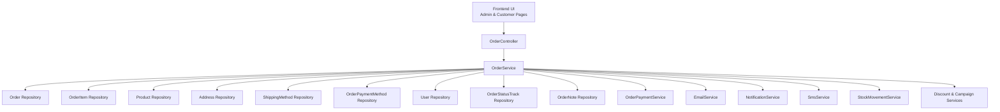
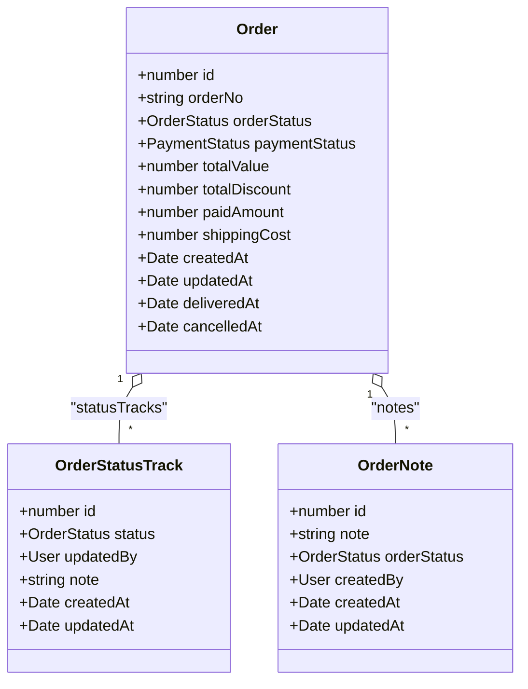
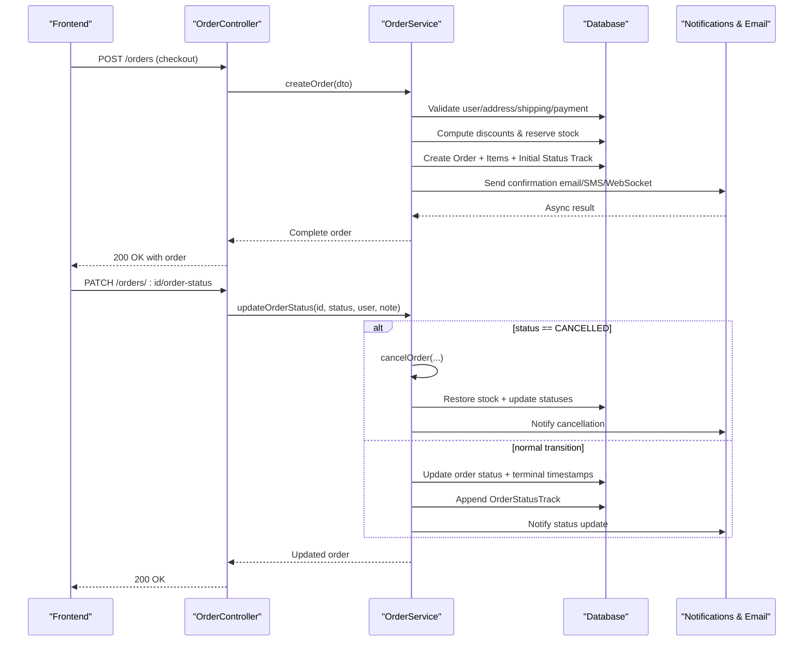
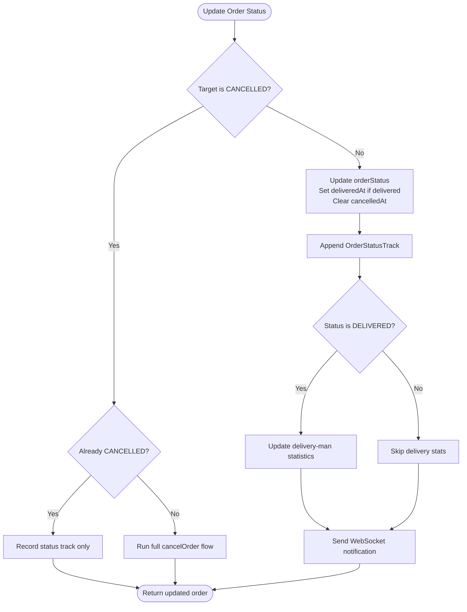
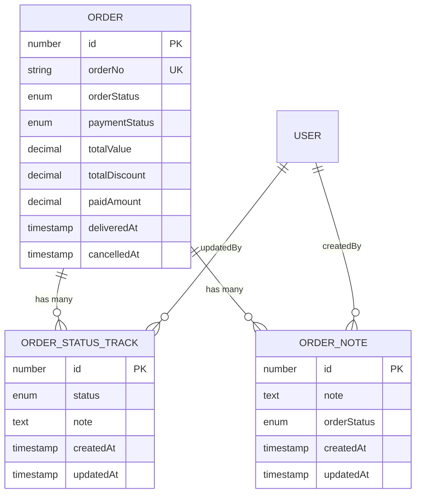
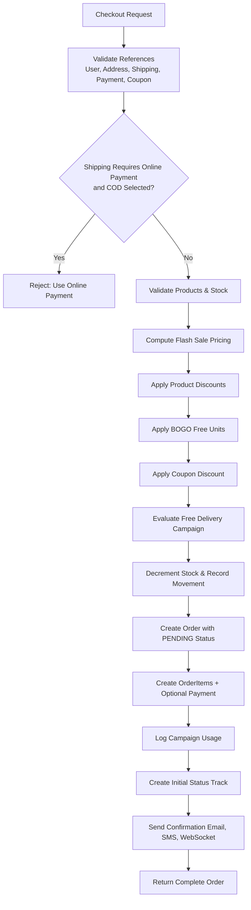
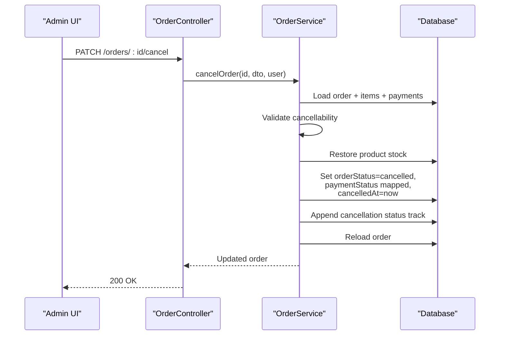
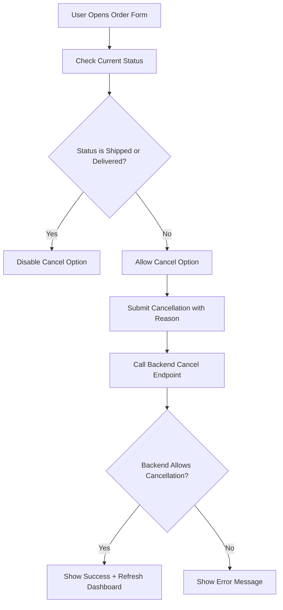
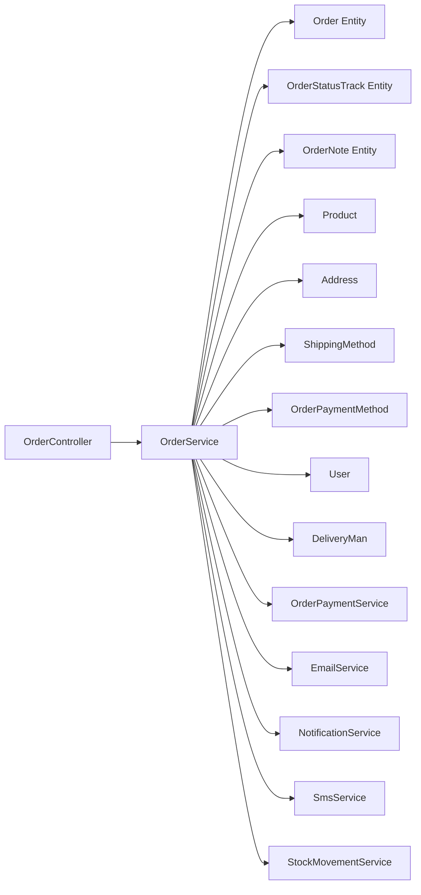

# Order Lifecycle Management

<cite>
**Referenced Files in This Document**
- [order.entity.ts](file://apps/backend/src/order/entities/order.entity.ts)
- [order-status-track.entity.ts](file://apps/backend/src/order/entities/order-status-track.entity.ts)
- [order-note.entity.ts](file://apps/backend/src/order/entities/order-note.entity.ts)
- [enums/index.ts](file://apps/backend/src/common/enums/index.ts)
- [create-order.dto.ts](file://apps/backend/src/order/dto/create-order.dto.ts)
- [cancel-order.dto.ts](file://apps/backend/src/order/dto/cancel-order.dto.ts)
- [order.controller.ts](file://apps/backend/src/order/order.controller.ts)
- [order.service.ts](file://apps/backend/src/order/order.service.ts)
- [index.ts](file://apps/frontend/common/enums/index.ts)
- [order-form.tsx](file://apps/frontend/components/admin/orders/order-form.tsx)
- [cancel-order-modal.tsx](file://apps/frontend/components/admin/orders/cancel-order-modal.tsx)
- [user-orderlist.tsx](file://apps/frontend/components/user-account/user-orderlist.tsx)
</cite>

## Table of Contents
1. [Introduction](#introduction)
2. [Project Structure](#project-structure)
3. [Core Components](#core-components)
4. [Architecture Overview](#architecture-overview)
5. [Detailed Component Analysis](#detailed-component-analysis)
6. [Dependency Analysis](#dependency-analysis)
7. [Performance Considerations](#performance-considerations)
8. [Troubleshooting Guide](#troubleshooting-guide)
9. [Conclusion](#conclusion)

## Introduction
This document explains the order lifecycle management system implemented in the backend and frontend. It covers:
- The supported order states: pending, processing, on-hold, shipped, delivered, and cancelled.
- How state transitions are validated and recorded.
- The `OrderStatusTrack` entity used for audit-style tracking of every status change.
- The order creation flow from cart checkout through confirmation.
- Order modification workflows including cancellation, note addition, delivery-man assignment, and payment-status updates.
- Error handling for invalid transitions and data-consistency safeguards such as stock restoration and terminal timestamps.

The documentation is designed to be useful both for developers implementing new order logic and for business users who need to understand how orders move through the system.

## Project Structure
The order lifecycle spans several backend modules and a small set of frontend components:

**Diagram sources**
- [order.controller.ts:170-181](file://apps/backend/src/order/order.controller.ts#L170-L181)
- [order.controller.ts:230-261](file://apps/backend/src/order/order.controller.ts#L230-L261)
- [order.controller.ts:914-980](file://apps/backend/src/order/order.controller.ts#L914-L980)
- [order.service.ts:63-101](file://apps/backend/src/order/order.service.ts#L63-L101)
- [order.service.ts:103-694](file://apps/backend/src/order/order.service.ts#L103-L694)
- [order.service.ts:1194-1275](file://apps/backend/src/order/order.service.ts#L1194-L1275)
- [order.service.ts:2288-2450](file://apps/backend/src/order/order.service.ts#L2288-L2450)

**Section sources**
- [order.controller.ts:170-181](file://apps/backend/src/order/order.controller.ts#L170-L181)
- [order.controller.ts:230-261](file://apps/backend/src/order/order.controller.ts#L230-L261)
- [order.controller.ts:914-980](file://apps/backend/src/order/order.controller.ts#L914-L980)
- [order.service.ts:63-101](file://apps/backend/src/order/order.service.ts#L63-L101)

## Core Components
The core domain model centers on three entities and shared enums:

| Component | Purpose | Key Fields / Behavior |
|---|---|---|
| `Order` | Represents a customer purchase with pricing, shipping, payment, and lifecycle state. | `orderNo`, `orderStatus`, `paymentStatus`, `totalValue`, `totalDiscount`, `paidAmount`, `shippingCost`, `deliveredAt`, `cancelledAt`, relations to address, user, shipping method, payment method, items, payments, status tracks, notes, and delivery man. |
| `OrderStatusTrack` | Records each status-change event for an order. | `order`, `status`, `updatedBy`, `note`, timestamps. |
| `OrderNote` | Stores free-form internal notes independent of status changes. | `order`, `note`, snapshot of `orderStatus` at note time, `createdBy`, timestamps. |
| `OrderStatus` enum | Defines allowed order lifecycle states. | `pending`, `processing`, `on_hold`, `shipped`, `delivered`, `cancelled`. |
| `CancellationReason` enum | Documents why an order was cancelled. | Includes customer request, out-of-stock, payment failure, fraud, shipping delay, price error, duplicate order, other. |

**Diagram sources**
- [order.entity.ts:24-156](file://apps/backend/src/order/entities/order.entity.ts#L24-L156)
- [order-status-track.entity.ts:14-50](file://apps/backend/src/order/entities/order-status-track.entity.ts#L14-L50)
- [order-note.entity.ts:19-57](file://apps/backend/src/order/entities/order-note.entity.ts#L19-L57)

**Section sources**
- [order.entity.ts:24-156](file://apps/backend/src/order/entities/order.entity.ts#L24-L156)
- [order-status-track.entity.ts:14-50](file://apps/backend/src/order/entities/order-status-track.entity.ts#L14-L50)
- [order-note.entity.ts:19-57](file://apps/backend/src/order/entities/order-note.entity.ts#L19-L57)
- [enums/index.ts:12-19](file://apps/backend/src/common/enums/index.ts#L12-L19)
- [enums/index.ts:89-98](file://apps/backend/src/common/enums/index.ts#L89-L98)

## Architecture Overview
The order lifecycle has two major flows:

1. **Order Creation Flow**: The client submits a checkout payload; the backend validates references, computes discounts, reserves stock, creates the order, records the initial `pending` status track, logs campaign usage, sends notifications, and returns the complete order.
2. **Order Status Change Flow**: Admins update order status or cancel orders. Non-cancel transitions update the order row and append a status track. Cancel transitions validate eligibility, restore stock, update payment status, record cancellation details, and notify stakeholders.

**Diagram sources**
- [order.controller.ts:170-181](file://apps/backend/src/order/order.controller.ts#L170-L181)
- [order.controller.ts:230-261](file://apps/backend/src/order/order.controller.ts#L230-L261)
- [order.controller.ts:914-980](file://apps/backend/src/order/order.controller.ts#L914-L980)
- [order.service.ts:103-694](file://apps/backend/src/order/order.service.ts#L103-L694)
- [order.service.ts:1194-1275](file://apps/backend/src/order/order.service.ts#L1194-L1275)
- [order.service.ts:2288-2450](file://apps/backend/src/order/order.service.ts#L2288-L2450)

## Detailed Component Analysis

### Order States and Transition Rules

#### Supported States
The backend defines the following order states:
- `pending`
- `processing`
- `on_hold`
- `shipped`
- `delivered`
- `cancelled`

These values are enforced by the `OrderStatus` enum and stored in the `order.orderStatus` column.

#### Allowed Transitions
The current implementation does not enforce a strict finite-state machine in `updateOrderStatus`. Instead, it applies targeted rules:

| Current State | Target State | Rule / Behavior |
|---|---|---|
| Any non-cancelled state | `delivered` | Updates `orderStatus`, sets `deliveredAt` to now, clears `cancelledAt`, appends a status track, updates delivery-man statistics if assigned, and notifies the user. |
| Any non-cancelled state | `pending`, `processing`, `on_hold`, `shipped` | Updates `orderStatus`, clears `cancelledAt`, appends a status track, and notifies the user. |
| Any cancellable state | `cancelled` | Uses the dedicated cancellation flow instead of a simple status update. |
| Already `cancelled` | `cancelled` via status update | Idempotent: records another status track without re-running cancellation logic. |

Cancellability is explicitly enforced in the cancellation service method:
- Already `cancelled`: rejected.
- `shipped` or `delivered`: rejected.
- Only `pending`, `processing`, or `on_hold` are considered cancellable.

**Diagram sources**
- [order.service.ts:1194-1275](file://apps/backend/src/order/order.service.ts#L1194-L1275)
- [order.service.ts:2288-2450](file://apps/backend/src/order/order.service.ts#L2288-L2450)

#### Validation Rules Summary
- Invalid target states are not explicitly blocked by a central state-machine validator; callers should use the admin UI constraints and backend cancellation validation.
- Cancellation is the most heavily validated transition:
  - Cannot cancel already cancelled orders.
  - Cannot cancel shipped or delivered orders.
  - Only pending, processing, and on-hold orders can be cancelled.
- Terminal timestamps:
  - `deliveredAt` is set when transitioning to delivered.
  - `cancelledAt` is set during cancellation.
  - When moving away from delivered, `deliveredAt` remains set; when moving away from cancelled, `cancelledAt` is cleared.

**Section sources**
- [enums/index.ts:12-19](file://apps/backend/src/common/enums/index.ts#L12-L19)
- [order.service.ts:1194-1275](file://apps/backend/src/order/order.service.ts#L1194-L1275)
- [order.service.ts:2288-2450](file://apps/backend/src/order/order.service.ts#L2288-L2450)

### Order Status Tracking Mechanism

Every meaningful status change is recorded in `OrderStatusTrack`:
- Each track links to the parent `Order`.
- It stores the new `status`, optional `note`, and the user who performed the change.
- Timestamps capture when the track was created and last updated.
- Deleting an order cascades to its status tracks.

The creation flow records an initial `pending` status track. The status-update flow appends a new track after updating the order row. The cancellation flow appends a cancellation track containing the reason and optional notes.

**Diagram sources**
- [order.entity.ts:113-118](file://apps/backend/src/order/entities/order.entity.ts#L113-L118)
- [order-status-track.entity.ts:19-33](file://apps/backend/src/order/entities/order-status-track.entity.ts#L19-L33)
- [order-note.entity.ts:24-36](file://apps/backend/src/order/entities/order-note.entity.ts#L24-L36)

**Section sources**
- [order-status-track.entity.ts:14-50](file://apps/backend/src/order/entities/order-status-track.entity.ts#L14-L50)
- [order-note.entity.ts:14-57](file://apps/backend/src/order/entities/order-note.entity.ts#L14-L57)
- [order.service.ts:537-544](file://apps/backend/src/order/order.service.ts#L537-L544)
- [order.service.ts:1231-1237](file://apps/backend/src/order/order.service.ts#L1231-L1237)
- [order.service.ts:2391-2400](file://apps/backend/src/order/order.service.ts#L2391-L2400)

### Order Creation Process

The order creation process handles:
1. Generating a unique yearly order number.
2. Validating user, address, shipping method, payment method, coupon, and product references.
3. Enforcing shipping-method payment requirements.
4. Computing per-item pricing with flash-sale precedence over product discounts.
5. Applying BOGO discounts before coupons.
6. Applying coupon discounts with exclusion rules and caps.
7. Evaluating free-delivery campaigns and waiving shipping when eligible.
8. Recording stock movements and decrementing product stock.
9. Creating the order with `orderStatus = pending`.
10. Logging campaign usage and creating the initial status track.
11. Creating order items and optional initial payment.
12. Sending confirmation email, admin alert, SMS, and WebSocket notification.

**Diagram sources**
- [order.service.ts:103-694](file://apps/backend/src/order/order.service.ts#L103-L694)
- [create-order.dto.ts:13-59](file://apps/backend/src/order/dto/create-order.dto.ts#L13-L59)

**Section sources**
- [order.service.ts:103-694](file://apps/backend/src/order/order.service.ts#L103-L694)
- [create-order.dto.ts:13-59](file://apps/backend/src/order/dto/create-order.dto.ts#L13-L59)

### Order Modification Workflows

#### Status Updates
Admins update order status through the `/orders/:id/order-status` endpoint. The controller delegates to `updateOrderStatus`, which:
- Routes cancellation requests to the full cancellation flow.
- Updates the order status and terminal timestamps.
- Appends an `OrderStatusTrack`.
- Updates delivery-man statistics when the order becomes delivered.
- Sends a WebSocket notification about the status change.

#### Notes
Notes are separate from status changes. The `/orders/:id/notes` endpoint allows adding free-form notes that include a snapshot of the order’s current status at note time.

#### Delivery-Man Assignment
The `/orders/:id/assign-delivery-man` endpoint assigns an active delivery man to an order. It validates that both the order and delivery man exist and that the delivery man is active.

#### Payment-Status Updates
The `/orders/:id/payment-status` endpoint updates `paymentStatus` independently of `orderStatus`. It also triggers a WebSocket notification about the payment status change.

#### Cancellation Workflow
The `/orders/:id/cancel` endpoint enforces:
- Eligibility based on current order status.
- Payment-status mapping:
  - Paid or fully paid: marks payment as needing refund.
  - Partially paid: marks payment as partial refund.
  - Unpaid: marks payment as failed.
- Stock restoration for all items.
- Setting `orderStatus = cancelled`, `paymentStatus` accordingly, and `cancelledAt`.
- Recording a cancellation status track with reason and optional notes.
- Notifying the user via WebSocket.

**Diagram sources**
- [order.controller.ts:914-980](file://apps/backend/src/order/order.controller.ts#L914-L980)
- [order.service.ts:2288-2450](file://apps/backend/src/order/order.service.ts#L2288-L2450)

**Section sources**
- [order.controller.ts:230-261](file://apps/backend/src/order/order.controller.ts#L230-L261)
- [order.controller.ts:263-293](file://apps/backend/src/order/order.controller.ts#L263-L293)
- [order.controller.ts:295-312](file://apps/backend/src/order/order.controller.ts#L295-L312)
- [order.controller.ts:885-912](file://apps/backend/src/order/order.controller.ts#L885-L912)
- [order.controller.ts:914-980](file://apps/backend/src/order/order.controller.ts#L914-L980)
- [order.service.ts:1194-1275](file://apps/backend/src/order/order.service.ts#L1194-L1275)
- [order.service.ts:1301-1324](file://apps/backend/src/order/order.service.ts#L1301-L1324)
- [order.service.ts:1326-1354](file://apps/backend/src/order/order.service.ts#L1326-L1354)
- [order.service.ts:1373-1398](file://apps/backend/src/order/order.service.ts#L1373-L1398)
- [order.service.ts:2288-2450](file://apps/backend/src/order/order.service.ts#L2288-L2450)

### Examples of Order State Transitions and Database Operations

#### Example 1: Pending → Processing
- API call: PATCH `/orders/:id/order-status` with status `processing`.
- Database operations:
  - Update `order.orderStatus` to `processing`.
  - Clear `cancelledAt`.
  - Insert one row into `order_status_track` with `status = processing`.
- Side effects:
  - WebSocket notification sent to the order owner.

#### Example 2: Processing → Shipped
- API call: PATCH `/orders/:id/order-status` with status `shipped`.
- Database operations:
  - Update `order.orderStatus` to `shipped`.
  - Clear `cancelledAt`.
  - Insert one row into `order_status_track` with `status = shipped`.
- Side effects:
  - WebSocket notification sent to the order owner.

#### Example 3: Shipped → Delivered
- API call: PATCH `/orders/:id/order-status` with status `delivered`.
- Database operations:
  - Update `order.orderStatus` to `delivered`.
  - Set `deliveredAt` to current timestamp.
  - Clear `cancelledAt`.
  - Insert one row into `order_status_track` with `status = delivered`.
  - If a delivery man is assigned, increment their delivery count and earnings.
- Side effects:
  - WebSocket notification sent to the order owner.

#### Example 4: Pending → Cancelled
- API call: PATCH `/orders/:id/cancel` with a cancellation reason.
- Database operations:
  - Restore product stock for each item.
  - Record stock movement for cancellation.
  - Update `order.orderStatus` to `cancelled`.
  - Map `paymentStatus` based on paid amount and existing payment status.
  - Set `cancelledAt` to current timestamp.
  - Insert one row into `order_status_track` with `status = cancelled` and cancellation note.
- Side effects:
  - WebSocket notification sent to the order owner.
  - Frontend may prompt refund processing for paid orders.

**Section sources**
- [order.service.ts:1194-1275](file://apps/backend/src/order/order.service.ts#L1194-L1275)
- [order.service.ts:2288-2450](file://apps/backend/src/order/order.service.ts#L2288-L2450)

### Frontend Integration and Business Rules

The frontend mirrors some business rules for better UX:
- The admin order form disables cancellation for shipped and delivered orders.
- The cancellation modal requires a cancellation reason and warns that cancellation cannot be undone.
- The customer order list displays status badges for pending, processing, shipped, delivered, cancelled, and related payment statuses.
- The frontend also defines its own `OrderStatus` enum for display and routing purposes.

**Diagram sources**
- [order-form.tsx:81-110](file://apps/frontend/components/admin/orders/order-form.tsx#L81-L110)
- [cancel-order-modal.tsx:72-114](file://apps/frontend/components/admin/orders/cancel-order-modal.tsx#L72-L114)
- [user-orderlist.tsx:49-68](file://apps/frontend/components/user-account/user-orderlist.tsx#L49-L68)
- [index.ts:13-21](file://apps/frontend/common/enums/index.ts#L13-L21)

**Section sources**
- [order-form.tsx:81-110](file://apps/frontend/components/admin/orders/order-form.tsx#L81-L110)
- [cancel-order-modal.tsx:72-114](file://apps/frontend/components/admin/orders/cancel-order-modal.tsx#L72-L114)
- [user-orderlist.tsx:49-68](file://apps/frontend/components/user-account/user-orderlist.tsx#L49-L68)
- [index.ts:13-21](file://apps/frontend/common/enums/index.ts#L13-L21)

## Dependency Analysis

### Component Coupling
- `OrderController` depends on `OrderService` for all order-related business logic.
- `OrderService` depends on multiple repositories and services:
  - Data persistence: `Order`, `OrderItem`, `OrderStatusTrack`, `OrderNote`.
  - External entities: `User`, `Address`, `ShippingMethod`, `OrderPaymentMethod`, `Product`, `DeliveryMan`.
  - Cross-cutting services: `OrderPaymentService`, `EmailService`, `NotificationService`, `SmsService`, `StockMovementService`, discount and campaign services.
- `OrderStatusTrack` and `OrderNote` provide auditability but do not introduce circular dependencies because they are leaf entities referenced by `Order`.

### Direct and Indirect Dependencies
- Direct:
  - Controller → Service.
  - Service → Repositories and external services.
- Indirect:
  - Order creation indirectly affects product stock, sale counts, campaign usage logs, and notification systems.
  - Cancellation indirectly affects product stock, sale counts, stock movement logs, and payment status.

### Potential Circular Dependencies
- No obvious circular imports are visible between the order entities and services.
- The main risk is future growth of cross-module side effects; keeping side effects inside `OrderService` helps maintain cohesion.

**Diagram sources**
- [order.controller.ts:43-44](file://apps/backend/src/order/order.controller.ts#L43-L44)
- [order.service.ts:63-101](file://apps/backend/src/order/order.service.ts#L63-L101)
- [order.entity.ts:24-156](file://apps/backend/src/order/entities/order.entity.ts#L24-L156)

**Section sources**
- [order.controller.ts:43-44](file://apps/backend/src/order/order.controller.ts#L43-L44)
- [order.service.ts:63-101](file://apps/backend/src/order/order.service.ts#L63-L101)

## Performance Considerations
- Order creation performs multiple database writes: product stock updates, stock movement logging, order and item creation, campaign usage logging, and notifications. These are intentionally separated so failures in async notifications do not block order creation.
- Listing orders uses a lean query that avoids loading heavy relations like items, status tracks, and full product details. Full detail is loaded only for single-order endpoints.
- Dashboard reports aggregate data using SQL queries and parallel execution where possible.
- Status updates trigger WebSocket notifications; these are wrapped in try-catch blocks to avoid failing the primary operation if notification delivery fails.

[No sources needed since this section provides general guidance]

## Troubleshooting Guide

### Common Errors and Resolutions

| Symptom | Likely Cause | Resolution |
|---|---|---|
| Cannot cancel a delivered order | Cancellation is blocked for delivered orders. | Use return/refund workflow instead of cancellation. |
| Cannot cancel a shipped order | Cancellation is blocked for shipped orders. | Contact support for returns or refunds. |
| Cannot cancel order with status: ... | Order is not in a cancellable state. | Move order to pending, processing, or on-hold first, or handle outside cancellation flow. |
| Order status changed but no notification received | Notification service failed or user not reachable. | Check WebSocket connection and notification service logs; the order update itself still succeeds. |
| Stock appears incorrect after cancellation | Cancellation did not run or failed mid-way. | Verify cancellation endpoint was called successfully and check stock movement logs. |
| Delivered timestamp missing | Order never transitioned to delivered. | Ensure delivered status is applied through the status update endpoint. |
| Cancelled timestamp missing | Order was not cancelled through the cancellation flow. | Use the cancellation endpoint or ensure `cancelledAt` is set when manually updating status. |

### Error Handling Patterns
- Missing entities throw `NotFoundException`.
- Invalid business actions throw `BadRequestException`.
- Notification and email failures are logged but do not fail order creation or status updates.
- Cancellation validates eligibility before mutating stock or payment status.

**Section sources**
- [order.service.ts:152-172](file://apps/backend/src/order/order.service.ts#L152-L172)
- [order.service.ts:194-210](file://apps/backend/src/order/order.service.ts#L194-L210)
- [order.service.ts:615-618](file://apps/backend/src/order/order.service.ts#L615-L618)
- [order.service.ts:1252-1272](file://apps/backend/src/order/order.service.ts#L1252-L1272)
- [order.service.ts:2312-2340](file://apps/backend/src/order/order.service.ts#L2312-L2340)
- [order.service.ts:2406-2429](file://apps/backend/src/order/order.service.ts#L2406-L2429)

## Conclusion
The order lifecycle management system models orders as persistent entities with explicit lifecycle states and an audit trail through `OrderStatusTrack`. The strongest guarantees are around cancellation: eligibility checks, stock restoration, payment-status mapping, and terminal timestamps. Normal status updates are flexible and rely on caller discipline and admin UI constraints.

For future enhancements, consider introducing a centralized state-machine validator in `OrderService` to make invalid transitions impossible at the service layer, while preserving the flexibility currently provided by the status-update endpoint. This would strengthen data consistency without changing the existing API surface.

[No sources needed since this section summarizes without analyzing specific files]