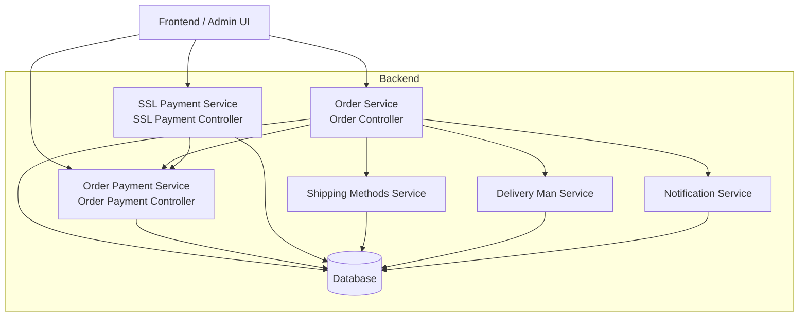
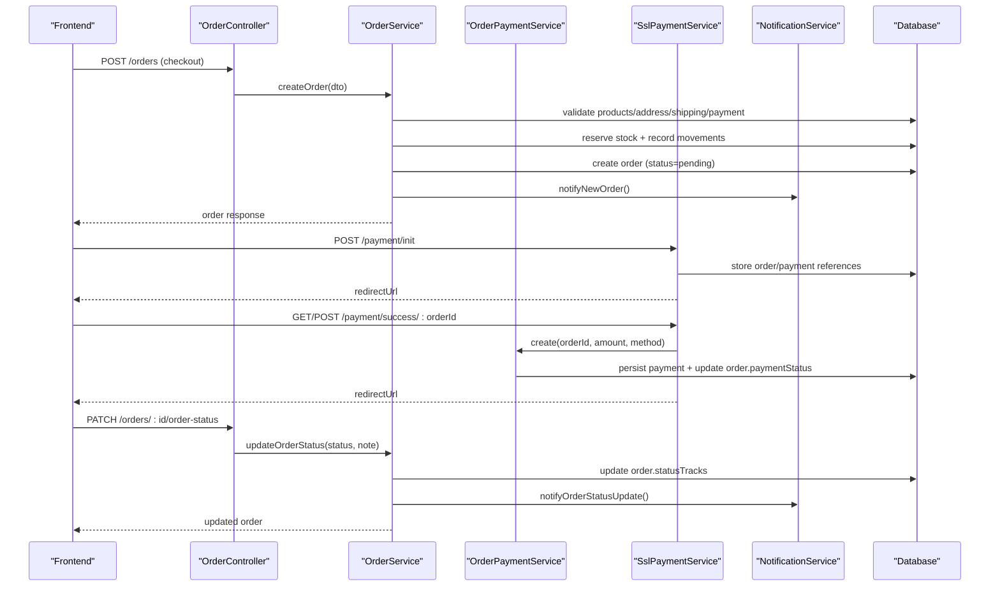
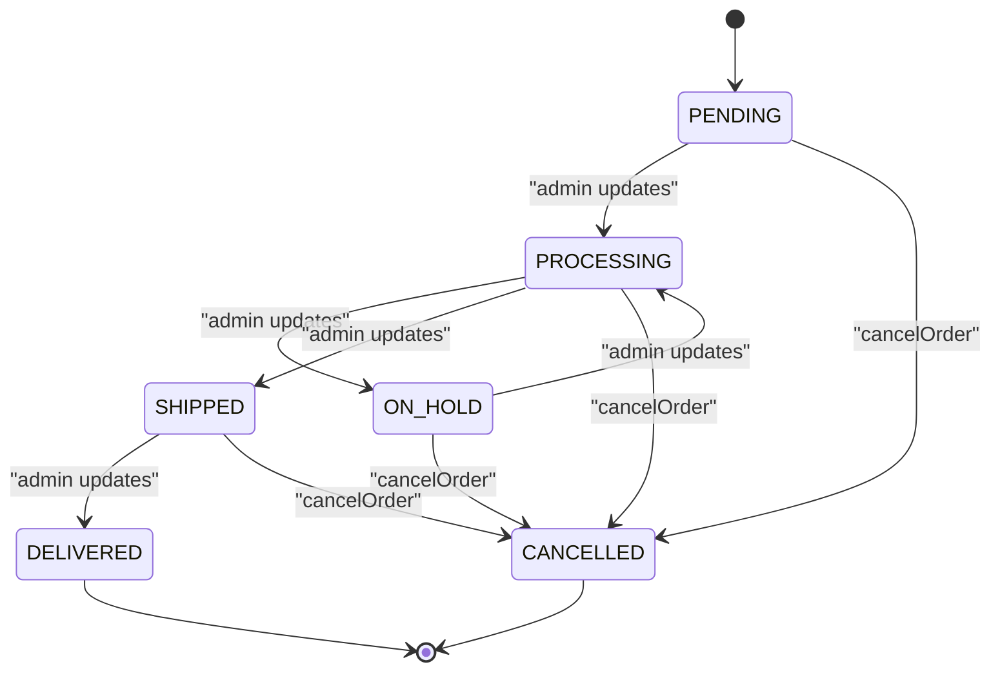
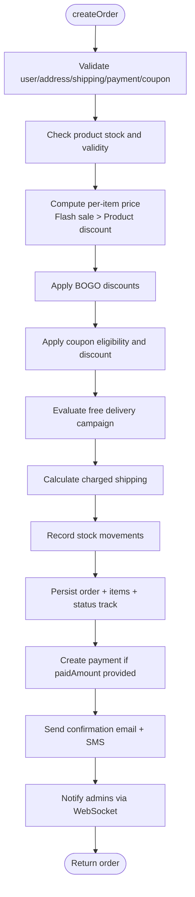
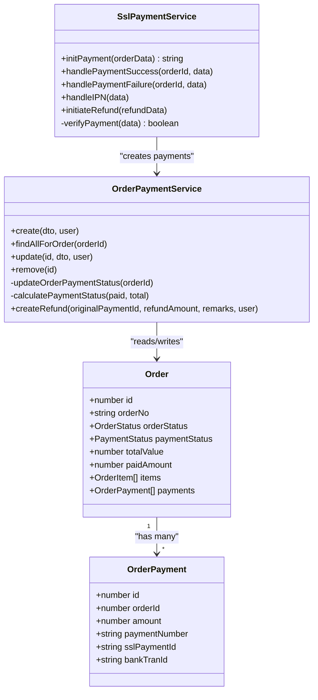
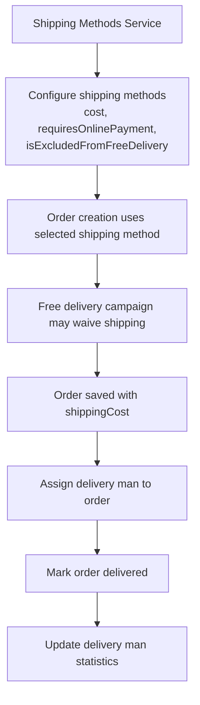
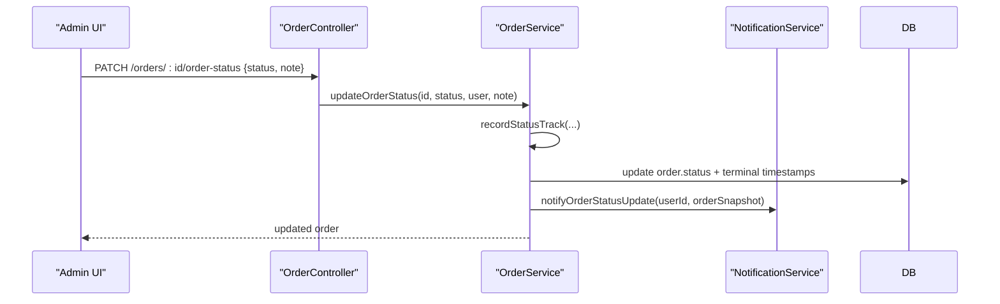
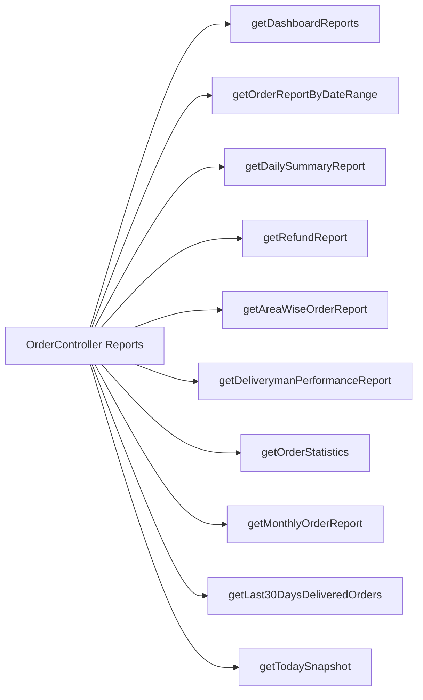
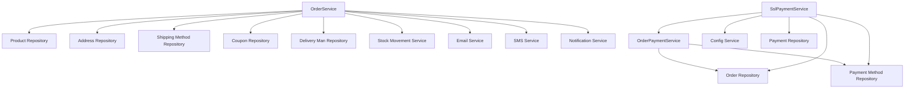

# Order Processing

<cite>
**Referenced Files in This Document**
- [order.service.ts](file://apps/backend/src/order/order.service.ts)
- [order.controller.ts](file://apps/backend/src/order/order.controller.ts)
- [order.entity.ts](file://apps/backend/src/order/entities/order.entity.ts)
- [enums/index.ts](file://apps/backend/src/common/enums/index.ts)
- [order-payment.service.ts](file://apps/backend/src/order-payment/order-payment.service.ts)
- [order-payment.controller.ts](file://apps/backend/src/order-payment/order-payment.controller.ts)
- [ssl-payment.service.ts](file://apps/backend/src/ssl-payment/ssl-payment.service.ts)
- [ssl-payment.controller.ts](file://apps/backend/src/ssl-payment/ssl-payment.controller.ts)
- [shipping-methods.service.ts](file://apps/backend/src/shipping-methods/shipping-methods.service.ts)
- [delivery-man.service.ts](file://apps/backend/src/delivery-man/delivery-man.service.ts)
- [notification.service.ts](file://apps/backend/src/notification/notification.service.ts)
- [activity.interceptor.ts](file://apps/backend/src/interceptor/activity.interceptor.ts)
</cite>

## Table of Contents
1. [Introduction](#introduction)
2. [Project Structure](#project-structure)
3. [Core Components](#core-components)
4. [Architecture Overview](#architecture-overview)
5. [Detailed Component Analysis](#detailed-component-analysis)
6. [Dependency Analysis](#dependency-analysis)
7. [Performance Considerations](#performance-considerations)
8. [Troubleshooting Guide](#troubleshooting-guide)
9. [Conclusion](#conclusion)

## Introduction
This document explains the order processing workflow for the German Butcher e-commerce platform. It covers the complete lifecycle from cart checkout through order creation, payment processing, fulfillment, delivery assignment, and status tracking. It also documents state management rules, payment integrations including SSLCommerz, shipping configuration, order modification capabilities, analytics endpoints, error handling, and the notification system used for customer and admin communications.

## Project Structure
The order processing logic is implemented primarily in the backend NestJS application under `apps/backend/src`. The main areas involved are:

- **Order domain**: order entity, service, controller, DTOs, and related entities such as order items, notes, and status tracks.
- **Payment domain**: generic order payments and SSLCommerz gateway integration.
- **Shipping and delivery**: shipping method configuration and delivery man assignment/statistics.
- **Notifications**: WebSocket-based real-time notifications and persisted notification records.
- **Analytics and reporting**: dashboard, date-range reports, refund reports, and delivery performance metrics.

**Diagram sources**
- [order.service.ts:103-694](file://apps/backend/src/order/order.service.ts#L103-L694)
- [order-payment.service.ts:28-211](file://apps/backend/src/order-payment/order-payment.service.ts#L28-L211)
- [ssl-payment.service.ts:44-328](file://apps/backend/src/ssl-payment/ssl-payment.service.ts#L44-L328)
- [shipping-methods.service.ts:17-72](file://apps/backend/src/shipping-methods/shipping-methods.service.ts#L17-L72)
- [delivery-man.service.ts:30-228](file://apps/backend/src/delivery-man/delivery-man.service.ts#L30-L228)
- [notification.service.ts:60-153](file://apps/backend/src/notification/notification.service.ts#L60-L153)

**Section sources**
- [order.service.ts:103-694](file://apps/backend/src/order/order.service.ts#L103-L694)
- [order-payment.service.ts:28-211](file://apps/backend/src/order-payment/order-payment.service.ts#L28-L211)
- [ssl-payment.service.ts:44-328](file://apps/backend/src/ssl-payment/ssl-payment.service.ts#L44-L328)
- [shipping-methods.service.ts:17-72](file://apps/backend/src/shipping-methods/shipping-methods.service.ts#L17-L72)
- [delivery-man.service.ts:30-228](file://apps/backend/src/delivery-man/delivery-man.service.ts#L30-L228)
- [notification.service.ts:60-153](file://apps/backend/src/notification/notification.service.ts#L60-L153)

## Core Components
- **OrderService**: Creates orders, calculates pricing/discounts, manages stock reservations, updates order status, assigns delivery men, adds notes, and exposes analytics/reporting methods.
- **OrderPaymentService**: Records payments/refunds, computes paid totals, and derives order-level payment status.
- **SslPaymentService**: Initializes SSLCommerz payments, handles success/failure/cancel callbacks, validates transactions, processes IPN, and initiates refunds.
- **ShippingMethodsService**: CRUD for shipping methods with ordering and filtering.
- **DeliveryManService**: CRUD for delivery personnel, statistics computation, and active delivery man retrieval.
- **NotificationService**: Emits real-time events via WebSocket and persists user/admin notifications.

Key responsibilities and interactions are described in the detailed component analysis below.

**Section sources**
- [order.service.ts:60-101](file://apps/backend/src/order/order.service.ts#L60-L101)
- [order-payment.service.ts:17-26](file://apps/backend/src/order-payment/order-payment.service.ts#L17-L26)
- [ssl-payment.service.ts:16-27](file://apps/backend/src/ssl-payment/ssl-payment.service.ts#L16-L27)
- [shipping-methods.service.ts:10-15](file://apps/backend/src/shipping-methods/shipping-methods.service.ts#L10-L15)
- [delivery-man.service.ts:20-28](file://apps/backend/src/delivery-man/delivery-man.service.ts#L20-L28)
- [notification.service.ts:21-29](file://apps/backend/src/notification/notification.service.ts#L21-L29)

## Architecture Overview
The order lifecycle flows through several services and external systems:

1. **Checkout and order creation**: The frontend submits a checkout payload to the order controller, which delegates to `OrderService.createOrder`. Stock checks, discount calculations (flash sale, product discount, BOGO, coupon), free delivery evaluation, shipping cost calculation, and inventory movement recording occur here. An order is created with status `pending`, and confirmation emails/SMS/WebSocket notifications are sent.
2. **Payment processing**: For online payments, the frontend calls the SSL payment controller to initialize a payment. After the customer completes the gateway flow, the backend receives success/failure/cancel callbacks and IPN messages. Successful payments create an `OrderPayment` record and update the order’s payment status.
3. **Fulfillment and delivery**: Admins update order status (`processing`, `on_hold`, `shipped`, `delivered`) and assign delivery men. When delivered, delivery man statistics are updated.
4. **Reporting and analytics**: Dashboard and report endpoints aggregate order data by status, month, area, delivery performance, and more.

**Diagram sources**
- [order.controller.ts:159-181](file://apps/backend/src/order/order.controller.ts#L159-L181)
- [order.service.ts:103-694](file://apps/backend/src/order/order.service.ts#L103-L694)
- [ssl-payment.controller.ts:35-64](file://apps/backend/src/ssl-payment/ssl-payment.controller.ts#L35-L64)
- [ssl-payment.service.ts:44-234](file://apps/backend/src/ssl-payment/ssl-payment.service.ts#L44-L234)
- [order-payment.service.ts:28-73](file://apps/backend/src/order-payment/order-payment.service.ts#L28-L73)
- [notification.service.ts:60-123](file://apps/backend/src/notification/notification.service.ts#L60-L123)

## Detailed Component Analysis

### Order Lifecycle and State Management
The order entity defines core fields including `orderNo`, `orderStatus`, `paymentStatus`, `totalValue`, `paidAmount`, `shippingCost`, `deliveryMan`, `deliveredAt`, and `cancelledAt`. Statuses are defined in the shared enums module.

**Diagram sources**
- [order.entity.ts:49-155](file://apps/backend/src/order/entities/order.entity.ts#L49-L155)
- [enums/index.ts:12-19](file://apps/backend/src/common/enums/index.ts#L12-L19)

Key behaviors:
- Order creation sets `orderStatus = pending` and creates a status track entry.
- Status updates write a new status track, set terminal timestamps (`deliveredAt` or clear `cancelledAt`), and emit notifications.
- Cancellation routes through a dedicated cancellation path that stamps `cancelledAt` and logs reasons.

**Section sources**
- [order.entity.ts:49-155](file://apps/backend/src/order/entities/order.entity.ts#L49-L155)
- [enums/index.ts:12-19](file://apps/backend/src/common/enums/index.ts#L12-L19)
- [order.service.ts:1213-1299](file://apps/backend/src/order/order.service.ts#L1213-L1299)

### Order Creation Workflow
Order creation performs validation, pricing, discounts, stock reservation, shipping cost calculation, campaign usage logging, persistence, and notifications.

**Diagram sources**
- [order.service.ts:103-694](file://apps/backend/src/order/order.service.ts#L103-L694)

Important details:
- Stock is decremented and recorded via stock movement service during order creation.
- Campaign usage counters are incremented atomically where possible; failures are logged but do not block order creation.
- Confirmation emails include itemized pricing, shipping fee actually charged, and optional BOGO/coupon details.
- WebSocket notifications inform admins of new orders.

**Section sources**
- [order.service.ts:103-694](file://apps/backend/src/order/order.service.ts#L103-L694)

### Payment Integration System
The system supports multiple payment methods through `OrderPaymentMethod` and records individual payments against orders. SSLCommerz is integrated as an online gateway.

**Diagram sources**
- [order.entity.ts:24-155](file://apps/backend/src/order/entities/order.entity.ts#L24-L155)
- [order-payment.service.ts:17-309](file://apps/backend/src/order-payment/order-payment.service.ts#L17-L309)
- [ssl-payment.service.ts:16-414](file://apps/backend/src/ssl-payment/ssl-payment.service.ts#L16-L414)

Payment behavior:
- `OrderPaymentService.create` generates a payment number, persists the payment, and recalculates order payment status based on cumulative paid amounts.
- Payment status derivation: completed when paid >= total; partial when paid > 0; pending otherwise. Refunds introduce negative amounts and statuses like `refund_complete` or `partial_refund`.
- SSLCommerz initialization returns a gateway URL; success/failure/cancel handlers process callbacks and IPN. Success creates a payment and updates order payment status. Refunds call the gateway and then create reversal postings.

**Section sources**
- [order-payment.service.ts:28-211](file://apps/backend/src/order-payment/order-payment.service.ts#L28-L211)
- [order-payment.service.ts:213-309](file://apps/backend/src/order-payment/order-payment.service.ts#L213-L309)
- [ssl-payment.service.ts:44-111](file://apps/backend/src/ssl-payment/ssl-payment.service.ts#L44-L111)
- [ssl-payment.service.ts:113-234](file://apps/backend/src/ssl-payment/ssl-payment.service.ts#L113-L234)
- [ssl-payment.service.ts:269-328](file://apps/backend/src/ssl-payment/ssl-payment.service.ts#L269-L328)
- [ssl-payment.service.ts:330-414](file://apps/backend/src/ssl-payment/ssl-payment.service.ts#L330-L414)

### Shipping and Delivery Management
Shipping methods are configured independently and referenced by orders. Free delivery campaigns can waive shipping costs unless the method is excluded. Delivery men can be assigned to orders, and their statistics are updated upon delivery.

**Diagram sources**
- [shipping-methods.service.ts:17-72](file://apps/backend/src/shipping-methods/shipping-methods.service.ts#L17-L72)
- [order.service.ts:357-428](file://apps/backend/src/order/order.service.ts#L357-L428)
- [delivery-man.service.ts:196-228](file://apps/backend/src/delivery-man/delivery-man.service.ts#L196-L228)

Notes:
- If a shipping method requires online payment, cash-on-delivery is rejected at order creation.
- Free delivery eligibility depends on payable subtotal, quantity, items, and user context; excluded methods always pay full shipping.
- Delivery man statistics compute total deliveries and earnings from delivered orders.

**Section sources**
- [shipping-methods.service.ts:17-72](file://apps/backend/src/shipping-methods/shipping-methods.service.ts#L17-L72)
- [order.service.ts:163-170](file://apps/backend/src/order/order.service.ts#L163-L170)
- [order.service.ts:357-428](file://apps/backend/src/order/order.service.ts#L357-L428)
- [delivery-man.service.ts:196-228](file://apps/backend/src/delivery-man/delivery-man.service.ts#L196-L228)

### Order Modification Capabilities
- **Status updates**: Admins can transition order status using the order controller endpoint. Each update writes a status track and emits a notification. Terminal timestamps are managed appropriately.
- **Notes**: Free-form notes can be appended to orders independent of status changes.
- **Delivery assignment**: Delivery men can be assigned to orders; assignment is reflected in the order entity and used for statistics.
- **Cancellation**: Dedicated cancellation logic stamps `cancelledAt` and records reasons.

**Diagram sources**
- [order.controller.ts:230-261](file://apps/backend/src/order/order.controller.ts#L230-L261)
- [order.service.ts:1213-1299](file://apps/backend/src/order/order.service.ts#L1213-L1299)
- [notification.service.ts:112-123](file://apps/backend/src/notification/notification.service.ts#L112-L123)

**Section sources**
- [order.controller.ts:230-261](file://apps/backend/src/order/order.controller.ts#L230-L261)
- [order.service.ts:1301-1329](file://apps/backend/src/order/order.service.ts#L1301-L1329)
- [order.service.ts:1213-1299](file://apps/backend/src/order/order.service.ts#L1213-L1299)

### Order Analytics and Reporting
The order service provides comprehensive reporting endpoints exposed via the order controller:

- Dashboard aggregation: statistics, monthly orders, last 30 days delivered, payment method share, category sales, customer type share, today snapshot, payment due, and delivery performance summary.
- Date-range reports: full order list with summaries, daily summaries, refund reports, area-wise orders, and deliveryman performance.
- Statistics endpoints: order statistics by status, monthly reports, years available, last 30 days delivered, and today snapshot.

**Diagram sources**
- [order.controller.ts:316-800](file://apps/backend/src/order/order.controller.ts#L316-L800)
- [order.service.ts:891-933](file://apps/backend/src/order/order.service.ts#L891-L933)

**Section sources**
- [order.controller.ts:316-800](file://apps/backend/src/order/order.controller.ts#L316-L800)
- [order.service.ts:891-933](file://apps/backend/src/order/order.service.ts#L891-L933)

### Implementation Examples
- **Order creation**: Call the order controller POST endpoint with checkout data (items, user, address, shipping method, payment method, optional coupon). The service validates inputs, reserves stock, applies discounts, calculates totals, persists the order, and sends notifications.
- **Payment processing**: Initialize SSLCommerz via the payment controller POST `/payment/init`. On success, the backend creates a payment record and updates order payment status. Failure/cancel routes redirect users accordingly.
- **Status updates**: Use PATCH `/orders/:id/order-status` to transition order states. The service records status tracks and notifies customers/admins.

These examples map directly to the controller/service implementations referenced above.

**Section sources**
- [order.controller.ts:159-181](file://apps/backend/src/order/order.controller.ts#L159-L181)
- [ssl-payment.controller.ts:35-64](file://apps/backend/src/ssl-payment/ssl-payment.controller.ts#L35-L64)
- [order.controller.ts:230-261](file://apps/backend/src/order/order.controller.ts#L230-L261)

## Dependency Analysis
The order processing pipeline has clear dependencies:

- `OrderService` depends on product, address, shipping method, coupon, delivery man, stock movement, email, SMS, and notification services.
- `OrderPaymentService` depends on order and payment method repositories and updates order payment status after payment mutations.
- `SslPaymentService` depends on config, order repository, payment repository, payment method repository, and `OrderPaymentService`.
- `NotificationService` depends on WebSocket gateway and notification repository.

Potential coupling points:
- Order creation tightly couples discount/campaign logic; failures in campaign usage logging are intentionally non-blocking.
- Payment success relies on SSLCommerz callback integrity and IPN reliability.
- Delivery statistics depend on delivered orders being correctly marked.

**Diagram sources**
- [order.service.ts:60-101](file://apps/backend/src/order/order.service.ts#L60-L101)
- [order-payment.service.ts:17-26](file://apps/backend/src/order-payment/order-payment.service.ts#L17-L26)
- [ssl-payment.service.ts:16-27](file://apps/backend/src/ssl-payment/ssl-payment.service.ts#L16-L27)

**Section sources**
- [order.service.ts:60-101](file://apps/backend/src/order/order.service.ts#L60-L101)
- [order-payment.service.ts:17-26](file://apps/backend/src/order-payment/order-payment.service.ts#L17-L26)
- [ssl-payment.service.ts:16-27](file://apps/backend/src/ssl-payment/ssl-payment.service.ts#L16-L27)

## Performance Considerations
- Order creation batches discount evaluations and campaign usage increments; failures are logged to avoid blocking checkout.
- Report endpoints use SQL aggregations and parallel queries for dashboard data to reduce round trips.
- Notification persistence is fail-open to prevent realtime emission failures from breaking order flows.
- Stock movements are recorded immediately on order creation to maintain accurate inventory.

[No sources needed since this section provides general guidance]

## Troubleshooting Guide
Common issues and handling strategies:

- **Failed payments**: SSLCommerz success/failure handlers log non-sensitive fields and redirect users to appropriate pages. Verification ensures transaction ID and amount match. IPN processing handles asynchronous confirmations.
- **Inventory conflicts**: Order creation validates product stock before decrementing; out-of-stock items throw errors early. Stock movements are recorded with before/after values for auditability.
- **Delivery issues**: Delivery man assignment and statistics rely on correct order status transitions; ensure delivered status is set only after successful delivery.
- **Notification failures**: Persistence failures are caught and logged without failing the primary operation; realtime events still emit.

Operational tips:
- Monitor SSLCommerz IP whitelist errors during refunds; server IP must be whitelisted.
- Review activity interceptor logs for payment and order status changes to trace admin actions.
- Use report endpoints to reconcile discrepancies between order totals, paid amounts, and refunds.

**Section sources**
- [ssl-payment.service.ts:113-234](file://apps/backend/src/ssl-payment/ssl-payment.service.ts#L113-L234)
- [ssl-payment.service.ts:269-328](file://apps/backend/src/ssl-payment/ssl-payment.service.ts#L269-L328)
- [ssl-payment.service.ts:330-414](file://apps/backend/src/ssl-payment/ssl-payment.service.ts#L330-L414)
- [order.service.ts:103-694](file://apps/backend/src/order/order.service.ts#L103-L694)
- [notification.service.ts:304-327](file://apps/backend/src/notification/notification.service.ts#L304-L327)
- [activity.interceptor.ts:404-429](file://apps/backend/src/interceptor/activity.interceptor.ts#L404-L429)

## Conclusion
The German Butcher platform implements a robust order processing workflow with clear state management, flexible payment integrations, configurable shipping and delivery, comprehensive analytics, and resilient notifications. Order creation enforces inventory accuracy and discount correctness, while payment flows integrate SSLCommerz with verification and refund support. Admin operations allow precise control over order status and delivery assignments, and reporting endpoints provide actionable business intelligence. Error handling is designed to keep critical paths stable while preserving auditability and observability.

[No sources needed since this section summarizes without analyzing specific files]