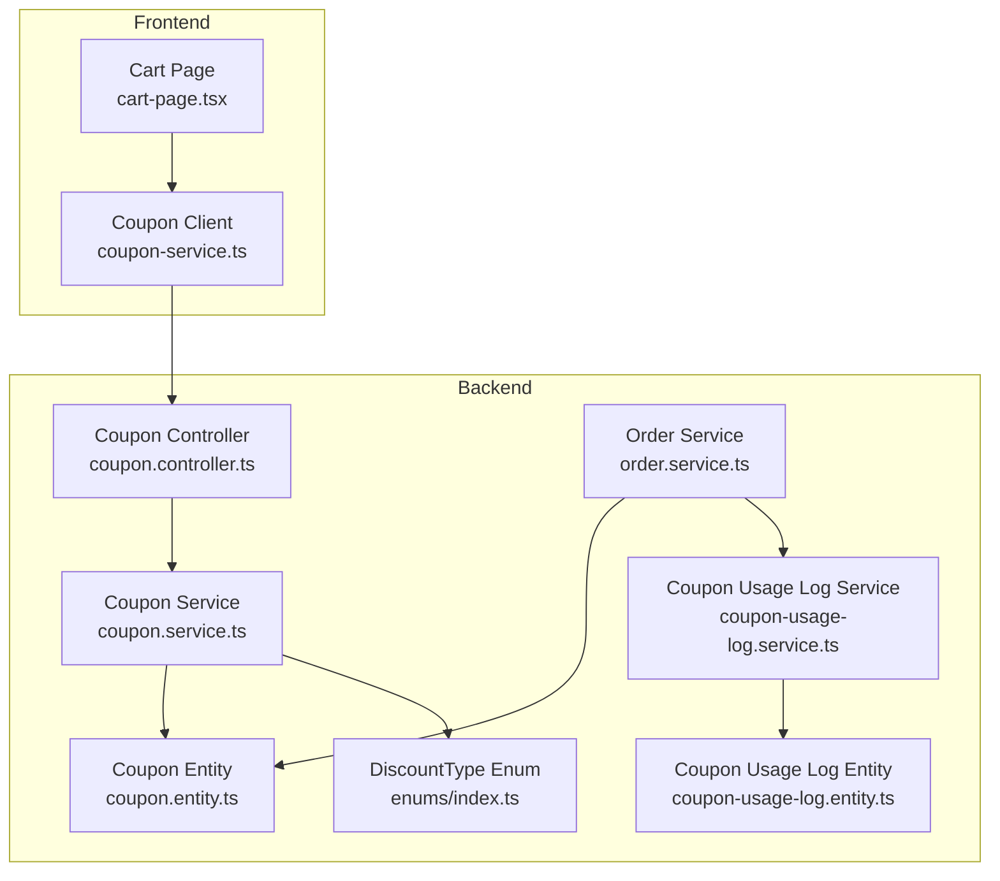
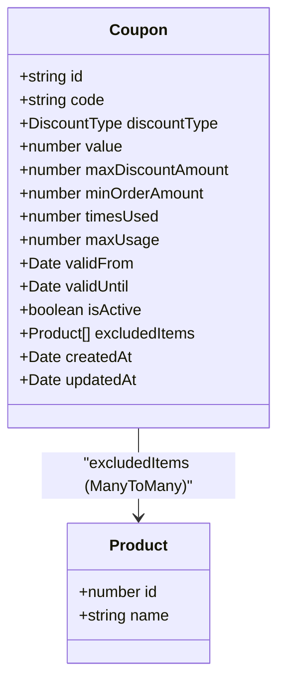
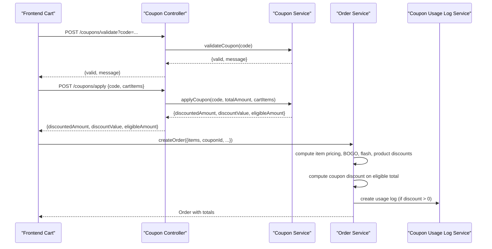
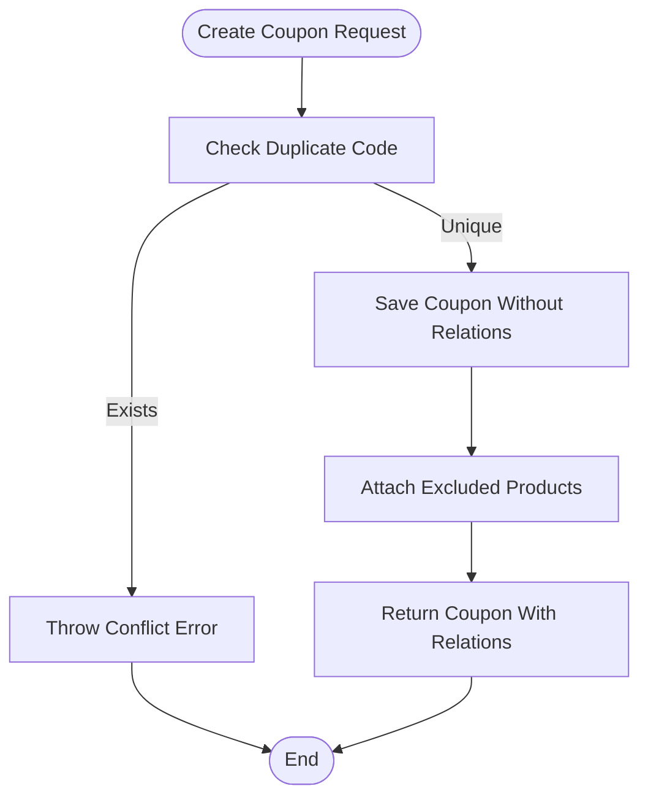
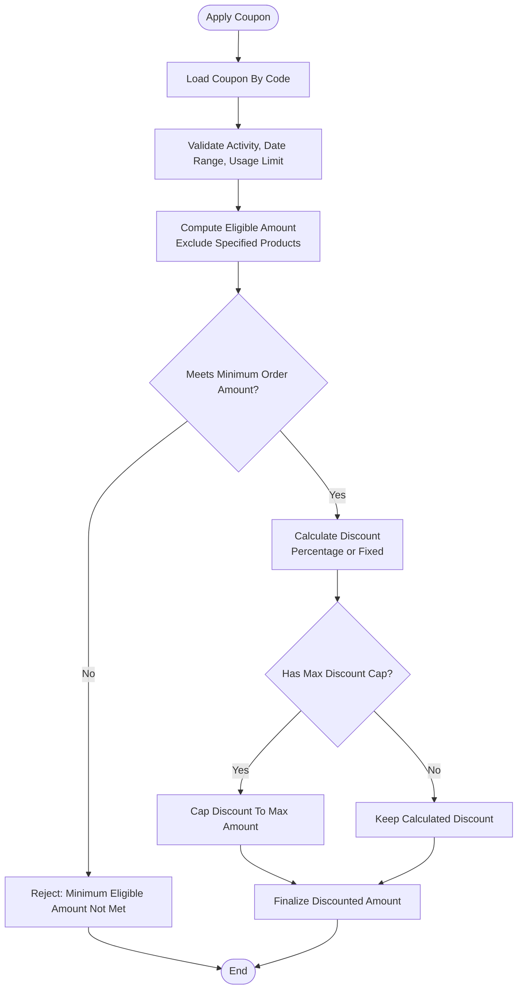
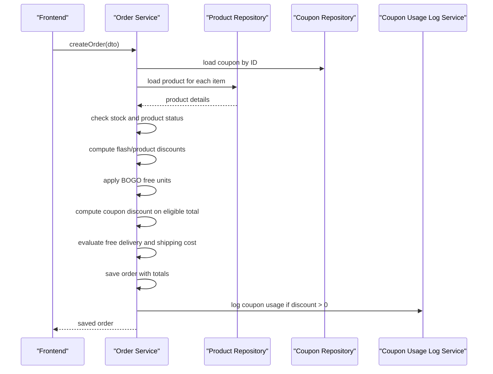
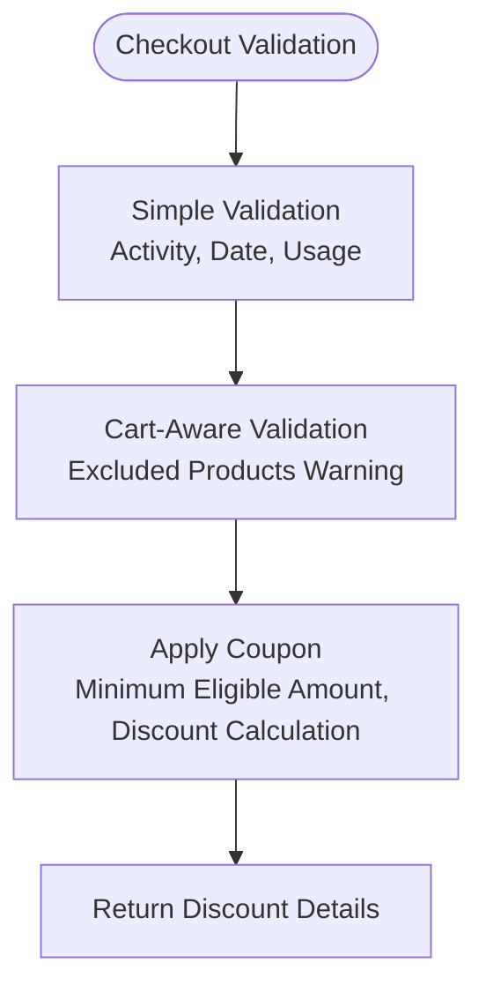
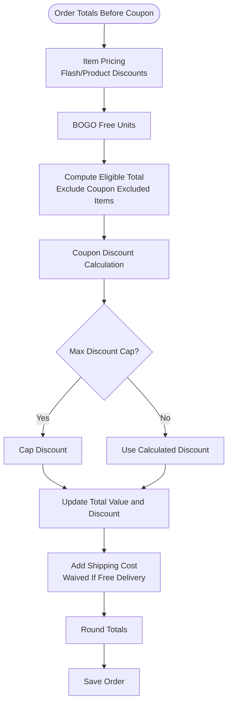
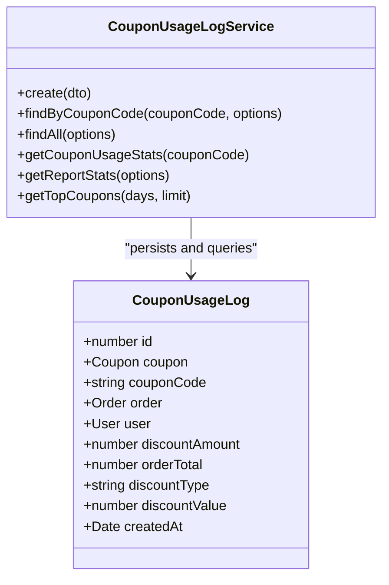
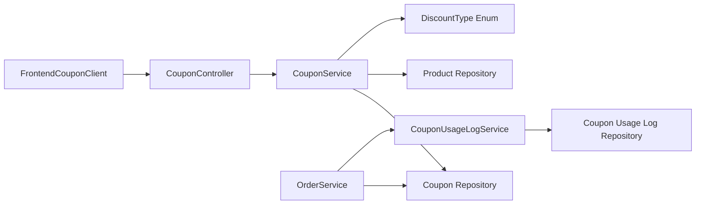

# Coupon & Discount System

<cite>
**Referenced Files in This Document**   
- [coupon.service.ts](file://apps/backend/src/coupon/coupon.service.ts)
- [coupon.controller.ts](file://apps/backend/src/coupon/coupon.controller.ts)
- [coupon.entity.ts](file://apps/backend/src/coupon/entities/coupon.entity.ts)
- [create-coupon.dto.ts](file://apps/backend/src/coupon/dto/create-coupon.dto.ts)
- [apply-coupon.dto.ts](file://apps/backend/src/coupon/dto/apply-coupon.dto.ts)
- [coupon-usage-log.service.ts](file://apps/backend/src/coupon-usage-log/coupon-usage-log.service.ts)
- [coupon-usage-log.entity.ts](file://apps/backend/src/coupon-usage-log/entities/coupon-usage-log.entity.ts)
- [create-coupon-usage-log.dto.ts](file://apps/backend/src/coupon-usage-log/dto/create-coupon-usage-log.dto.ts)
- [order.service.ts](file://apps/backend/src/order/order.service.ts)
- [enums/index.ts](file://apps/backend/src/common/enums/index.ts)
- [coupon-service.ts](file://apps/frontend/lib/coupon-service.ts)
- [cart-page.tsx](file://apps/frontend/components/cart/cart-page.tsx)
</cite>

## Table of Contents
1. [Introduction](#introduction)
2. [Project Structure](#project-structure)
3. [Core Components](#core-components)
4. [Architecture Overview](#architecture-overview)
5. [Detailed Component Analysis](#detailed-component-analysis)
6. [Dependency Analysis](#dependency-analysis)
7. [Performance Considerations](#performance-considerations)
8. [Troubleshooting Guide](#troubleshooting-guide)
9. [Conclusion](#conclusion)
10. [Appendices](#appendices)

## Introduction
This document explains the coupon and discount system integrated with order creation and payment processing. It covers:

- How coupons are created, configured, and managed.
- Supported discount types: percentage and fixed amount.
- Usage limits, validity periods, minimum order requirements, and product exclusions.
- The validation flow during checkout, including stock checks, eligibility, and minimum order rules.
- Discount calculation logic and how it integrates with order totals.
- Coupon usage tracking, audit logging, and reporting capabilities.
- Examples of creating coupons, applying discounts programmatically, and handling errors.
- Coupon usage statistics and reporting endpoints.

The implementation is a NestJS backend with a Next.js frontend that calls coupon APIs during cart and checkout flows.

## Project Structure
The coupon feature spans several backend modules and a small set of frontend helpers:

- Backend coupon domain: controller, service, entity, DTOs.
- Backend coupon usage log domain: service, entity, DTO.
- Order service integration: applies coupon logic when an order is created.
- Frontend coupon client: validates and applies coupons against cart data.

**Diagram sources**
- [cart-page.tsx:43-80](file://apps/frontend/components/cart/cart-page.tsx#L43-L80)
- [coupon-service.ts:36-80](file://apps/frontend/lib/coupon-service.ts#L36-L80)
- [coupon.controller.ts:177-325](file://apps/backend/src/coupon/coupon.controller.ts#L177-L325)
- [coupon.service.ts:135-392](file://apps/backend/src/coupon/coupon.service.ts#L135-L392)
- [coupon.entity.ts:13-66](file://apps/backend/src/coupon/entities/coupon.entity.ts#L13-L66)
- [coupon-usage-log.service.ts:20-253](file://apps/backend/src/coupon-usage-log/coupon-usage-log.service.ts#L20-L253)
- [coupon-usage-log.entity.ts:14-74](file://apps/backend/src/coupon-usage-log/entities/coupon-usage-log.entity.ts#L14-L74)
- [order.service.ts:103-694](file://apps/backend/src/order/order.service.ts#L103-L694)
- [enums/index.ts:38-41](file://apps/backend/src/common/enums/index.ts#L38-L41)

**Section sources**
- [cart-page.tsx:43-80](file://apps/frontend/components/cart/cart-page.tsx#L43-L80)
- [coupon-service.ts:36-80](file://apps/frontend/lib/coupon-service.ts#L36-L80)
- [coupon.controller.ts:177-325](file://apps/backend/src/coupon/coupon.controller.ts#L177-L325)
- [coupon.service.ts:135-392](file://apps/backend/src/coupon/coupon.service.ts#L135-L392)
- [coupon.entity.ts:13-66](file://apps/backend/src/coupon/entities/coupon.entity.ts#L13-L66)
- [coupon-usage-log.service.ts:20-253](file://apps/backend/src/coupon-usage-log/coupon-usage-log.service.ts#L20-L253)
- [coupon-usage-log.entity.ts:14-74](file://apps/backend/src/coupon-usage-log/entities/coupon-usage-log.entity.ts#L14-L74)
- [order.service.ts:103-694](file://apps/backend/src/order/order.service.ts#L103-L694)
- [enums/index.ts:38-41](file://apps/backend/src/common/enums/index.ts#L38-L41)

## Core Components
This section summarizes the core building blocks of the coupon and discount system.

### Coupon Entity
The `Coupon` entity defines the configuration for a discount campaign.

Key fields:
- Unique code.
- Discount type: percentage or fixed.
- Value: numeric discount value.
- Optional maximum discount cap.
- Optional minimum order amount.
- Usage counters: times used and optional max usage.
- Validity window: valid from and valid until.
- Active flag.
- Excluded products: many-to-many relationship to products.

**Diagram sources**
- [coupon.entity.ts:13-66](file://apps/backend/src/coupon/entities/coupon.entity.ts#L13-L66)

**Section sources**
- [coupon.entity.ts:13-66](file://apps/backend/src/coupon/entities/coupon.entity.ts#L13-L66)

### Coupon DTOs
- Create coupon DTO defines required and optional fields for creating a coupon, including discount type, value, caps, minimum order amount, usage limit, dates, active state, and excluded product IDs.
- Apply coupon DTO carries the code and cart items for calculating eligible amounts and discounts.

**Section sources**
- [create-coupon.dto.ts:6-89](file://apps/backend/src/coupon/dto/create-coupon.dto.ts#L6-L89)
- [apply-coupon.dto.ts](file://apps/backend/src/coupon/dto/apply-coupon.dto.ts)

### Coupon Service
The coupon service implements:
- CRUD operations for coupons.
- Validation of coupon codes.
- Application of coupons to cart totals.
- Cart-aware validation that reports excluded products.

Important behaviors:
- Validates activity, date range, and usage limits.
- Calculates eligible amount by excluding specified products.
- Supports percentage and fixed discounts.
- Applies optional maximum discount cap.
- Enforces minimum eligible order amount.
- Returns detailed results including excluded product names.

**Section sources**
- [coupon.service.ts:25-54](file://apps/backend/src/coupon/coupon.service.ts#L25-L54)
- [coupon.service.ts:135-178](file://apps/backend/src/coupon/coupon.service.ts#L135-L178)
- [coupon.service.ts:180-306](file://apps/backend/src/coupon/coupon.service.ts#L180-L306)
- [coupon.service.ts:313-392](file://apps/backend/src/coupon/coupon.service.ts#L313-L392)

### Coupon Controller
The coupon controller exposes:
- Admin endpoints for creating, listing, updating, and deleting coupons.
- Public validation endpoint for checking a coupon code.
- Cart-aware validation endpoint returning warnings about excluded products.
- Apply endpoint that calculates discounted amount and eligible amount.

**Section sources**
- [coupon.controller.ts:43-62](file://apps/backend/src/coupon/coupon.controller.ts#L43-L62)
- [coupon.controller.ts:64-91](file://apps/backend/src/coupon/coupon.controller.ts#L64-L91)
- [coupon.controller.ts:93-120](file://apps/backend/src/coupon/coupon.controller.ts#L93-L120)
- [coupon.controller.ts:122-149](file://apps/backend/src/coupon/coupon.controller.ts#L122-L149)
- [coupon.controller.ts:151-175](file://apps/backend/src/coupon/coupon.controller.ts#L151-L175)
- [coupon.controller.ts:177-222](file://apps/backend/src/coupon/coupon.controller.ts#L177-L222)
- [coupon.controller.ts:224-266](file://apps/backend/src/coupon/coupon.controller.ts#L224-L266)
- [coupon.controller.ts:268-325](file://apps/backend/src/coupon/coupon.controller.ts#L268-L325)

### Coupon Usage Log
The coupon usage log tracks each successful application of a coupon during order creation.

Key fields:
- Associated coupon and coupon code.
- Associated order and user.
- Discount amount applied.
- Order total before discount.
- Discount type and value used.
- Timestamp.

Reporting methods include:
- Paginated usage logs.
- Per-coupon usage stats.
- Aggregated report stats across coupons.
- Top coupons by usage over a time window.

**Section sources**
- [coupon-usage-log.entity.ts:14-74](file://apps/backend/src/coupon-usage-log/entities/coupon-usage-log.entity.ts#L14-L74)
- [create-coupon-usage-log.dto.ts:5-14](file://apps/backend/src/coupon-usage-log/dto/create-coupon-usage-log.dto.ts#L5-L14)
- [coupon-usage-log.service.ts:29-40](file://apps/backend/src/coupon-usage-log/coupon-usage-log.service.ts#L29-L40)
- [coupon-usage-log.service.ts:42-105](file://apps/backend/src/coupon-usage-log/coupon-usage-log.service.ts#L42-L105)
- [coupon-usage-log.service.ts:160-177](file://apps/backend/src/coupon-usage-log/coupon-usage-log.service.ts#L160-L177)
- [coupon-usage-log.service.ts:181-215](file://apps/backend/src/coupon-usage-log/coupon-usage-log.service.ts#L181-L215)
- [coupon-usage-log.service.ts:217-251](file://apps/backend/src/coupon-usage-log/coupon-usage-log.service.ts#L217-L251)

### Order Integration
During order creation, the order service:
- Loads the coupon if provided.
- Checks stock for each item.
- Computes per-item pricing, flash sale prices, product discounts, BOGO free units, and then coupon discounts.
- Applies shipping cost and free delivery campaigns.
- Persists the order with final totals.
- Logs coupon usage and increments the coupon’s usage counter.

**Section sources**
- [order.service.ts:103-173](file://apps/backend/src/order/order.service.ts#L103-L173)
- [order.service.ts:174-290](file://apps/backend/src/order/order.service.ts#L174-L290)
- [order.service.ts:292-355](file://apps/backend/src/order/order.service.ts#L292-L355)
- [order.service.ts:357-432](file://apps/backend/src/order/order.service.ts#L357-L432)
- [order.service.ts:434-475](file://apps/backend/src/order/order.service.ts#L434-L475)

### Frontend Coupon Client
The frontend provides helper functions to:
- Validate a coupon code.
- Validate a coupon against cart product IDs.
- Apply a coupon using cart items with product IDs and prices.

These helpers call backend endpoints exposed by the coupon controller.

**Section sources**
- [coupon-service.ts:36-80](file://apps/frontend/lib/coupon-service.ts#L36-L80)
- [cart-page.tsx:43-80](file://apps/frontend/components/cart/cart-page.tsx#L43-L80)

## Architecture Overview
The coupon system follows a layered architecture:

- Frontend components trigger validation and application of coupons.
- The coupon controller handles HTTP requests and delegates to the coupon service.
- The coupon service performs business logic: validation, eligibility, and discount calculation.
- The order service integrates coupon discounts into the final order total and records usage.
- The coupon usage log service persists audit data and provides analytics.

**Diagram sources**
- [coupon.controller.ts:177-266](file://apps/backend/src/coupon/coupon.controller.ts#L177-L266)
- [coupon.service.ts:135-306](file://apps/backend/src/coupon/coupon.service.ts#L135-L306)
- [order.service.ts:103-475](file://apps/backend/src/order/order.service.ts#L103-L475)
- [coupon-usage-log.service.ts:29-40](file://apps/backend/src/coupon-usage-log/coupon-usage-log.service.ts#L29-L40)

## Detailed Component Analysis

### Coupon Creation Workflow
Admins create coupons through the protected `/coupons` endpoint. The workflow:

1. Receive `CreateCouponDto`.
2. Check for duplicate code.
3. Save coupon without relations first.
4. Attach excluded products via relation builder.
5. Return full coupon with relations.

Validation rules enforced by DTO:
- Code must be unique.
- Discount type must be one of the supported enums.
- Value must be non-negative.
- Minimum order amount and maximum discount amount are optional but validated when present.
- Maximum usage is optional.
- Dates must be valid.
- Active flag defaults to true.

**Diagram sources**
- [coupon.service.ts:25-54](file://apps/backend/src/coupon/coupon.service.ts#L25-L54)
- [create-coupon.dto.ts:6-89](file://apps/backend/src/coupon/dto/create-coupon.dto.ts#L6-L89)

**Section sources**
- [coupon.service.ts:25-54](file://apps/backend/src/coupon/coupon.service.ts#L25-L54)
- [create-coupon.dto.ts:6-89](file://apps/backend/src/coupon/dto/create-coupon.dto.ts#L6-L89)

### Discount Types and Limits
Supported discount types:
- Percentage: discount equals a percentage of the eligible amount.
- Fixed: discount equals a fixed monetary value.

Limits and constraints:
- Maximum discount cap can reduce both percentage and fixed discounts.
- Minimum order amount is checked against the eligible amount after excluding specified products.
- Usage limits: global coupon usage count and optional maximum usage.
- Validity window: coupon must be active and within the valid-from and valid-until dates.

**Diagram sources**
- [coupon.service.ts:180-306](file://apps/backend/src/coupon/coupon.service.ts#L180-L306)
- [enums/index.ts:38-41](file://apps/backend/src/common/enums/index.ts#L38-L41)

**Section sources**
- [coupon.service.ts:180-306](file://apps/backend/src/coupon/coupon.service.ts#L180-L306)
- [enums/index.ts:38-41](file://apps/backend/src/common/enums/index.ts#L38-L41)

### Checkout Validation and Stock Checks
When an order is created, the order service performs comprehensive checks:

- Loads the coupon if provided.
- Validates user, address, shipping method, and payment method.
- Ensures shipping method compatibility with payment method.
- For each item:
  - Loads product.
  - Rejects inactive products.
  - Checks stock availability.
  - Computes product-level discount or flash sale price.
  - Records stock movement.
- Applies BOGO free-unit logic.
- Applies coupon discount on eligible total.
- Evaluates free delivery campaign.
- Adds shipping cost unless waived.
- Rounds totals and saves order.
- Logs coupon usage and increments usage counter.

**Diagram sources**
- [order.service.ts:103-475](file://apps/backend/src/order/order.service.ts#L103-L475)

**Section sources**
- [order.service.ts:103-475](file://apps/backend/src/order/order.service.ts#L103-L475)

### Coupon Validation During Checkout
There are two validation paths:

1. Simple validation: checks activity, date range, and usage limit.
2. Cart-aware validation: returns whether the coupon is valid and lists excluded products, plus a warning that discount will not apply to those products.

The apply endpoint also enforces minimum eligible order amount and computes the exact discount based on eligible amount.

**Diagram sources**
- [coupon.service.ts:135-178](file://apps/backend/src/coupon/coupon.service.ts#L135-L178)
- [coupon.service.ts:313-392](file://apps/backend/src/coupon/coupon.service.ts#L313-L392)
- [coupon.controller.ts:177-325](file://apps/backend/src/coupon/coupon.controller.ts#L177-L325)

**Section sources**
- [coupon.service.ts:135-178](file://apps/backend/src/coupon/coupon.service.ts#L135-L178)
- [coupon.service.ts:313-392](file://apps/backend/src/coupon/coupon.service.ts#L313-L392)
- [coupon.controller.ts:177-325](file://apps/backend/src/coupon/coupon.controller.ts#L177-L325)

### Discount Calculation Logic and Order Total Integration
The order service integrates multiple discount layers:

- Product-level discount or flash sale price.
- BOGO free-unit discount.
- Coupon discount applied only to eligible items.
- Shipping cost added unless waived by free delivery campaign.
- Final totals rounded to two decimal places.

Coupon discount calculation:
- If discount type is fixed, use the coupon value.
- If discount type is percentage, calculate percentage of eligible total.
- Apply maximum discount cap if configured.
- Subtract coupon discount from total value and add to total discount.
- Ensure total value does not go below zero.

**Diagram sources**
- [order.service.ts:174-432](file://apps/backend/src/order/order.service.ts#L174-L432)

**Section sources**
- [order.service.ts:174-432](file://apps/backend/src/order/order.service.ts#L174-L432)

### Coupon Usage Tracking and Audit Logging
After saving an order with a coupon discount greater than zero, the order service:

- Creates a coupon usage log entry with coupon code, order, user, discount amount, order total before discount, discount type, and discount value.
- Increments the coupon’s `timesUsed` counter.
- Logs errors without failing the order creation.

The coupon usage log service supports:
- Creating usage entries.
- Paginated queries with filters by coupon code and date range.
- Per-coupon statistics: total uses, total discount given, average discount, total order value.
- Aggregated report statistics across coupons.
- Top coupons by usage over a configurable number of days.

**Diagram sources**
- [coupon-usage-log.entity.ts:14-74](file://apps/backend/src/coupon-usage-log/entities/coupon-usage-log.entity.ts#L14-L74)
- [coupon-usage-log.service.ts:20-253](file://apps/backend/src/coupon-usage-log/coupon-usage-log.service.ts#L20-L253)

**Section sources**
- [order.service.ts:450-475](file://apps/backend/src/order/order.service.ts#L450-L475)
- [coupon-usage-log.service.ts:29-40](file://apps/backend/src/coupon-usage-log/coupon-usage-log.service.ts#L29-L40)
- [coupon-usage-log.service.ts:42-105](file://apps/backend/src/coupon-usage-log/coupon-usage-log.service.ts#L42-L105)
- [coupon-usage-log.service.ts:160-177](file://apps/backend/src/coupon-usage-log/coupon-usage-log.service.ts#L160-L177)
- [coupon-usage-log.service.ts:181-215](file://apps/backend/src/coupon-usage-log/coupon-usage-log.service.ts#L181-L215)
- [coupon-usage-log.service.ts:217-251](file://apps/backend/src/coupon-usage-log/coupon-usage-log.service.ts#L217-L251)

### Examples

#### Creating a Coupon
To create a coupon:
- Call the protected admin endpoint to create a coupon.
- Provide a unique code, discount type, value, optional caps, minimum order amount, usage limit, validity dates, active flag, and excluded product IDs.
- The backend validates uniqueness and saves the coupon, attaching excluded products.

Reference paths:
- Admin create endpoint: [coupon.controller.ts:43-62](file://apps/backend/src/coupon/coupon.controller.ts#L43-L62)
- Create DTO fields: [create-coupon.dto.ts:6-89](file://apps/backend/src/coupon/dto/create-coupon.dto.ts#L6-L89)
- Creation logic: [coupon.service.ts:25-54](file://apps/backend/src/coupon/coupon.service.ts#L25-L54)

#### Applying a Discount Programmatically
To apply a discount:
- Send cart items with product IDs and prices to the apply endpoint.
- The backend calculates eligible amount, enforces minimum order amount, computes discount, and returns discounted amount and eligible amount.

Reference paths:
- Apply endpoint: [coupon.controller.ts:224-266](file://apps/backend/src/coupon/coupon.controller.ts#L224-L266)
- Apply logic: [coupon.service.ts:180-306](file://apps/backend/src/coupon/coupon.service.ts#L180-L306)
- Frontend client: [coupon-service.ts:66-80](file://apps/frontend/lib/coupon-service.ts#L66-L80)

#### Handling Coupon-Related Errors
Common error scenarios:
- Duplicate coupon code during creation.
- Coupon not found.
- Coupon not active.
- Coupon expired.
- Coupon not yet valid.
- Usage limit exceeded.
- Minimum eligible order amount not met.
- Internal server error during validation or application.

Error handling locations:
- Duplicate code: [coupon.service.ts:25-32](file://apps/backend/src/coupon/coupon.service.ts#L25-L32)
- Validation errors: [coupon.service.ts:135-178](file://apps/backend/src/coupon/coupon.service.ts#L135-L178)
- Apply errors: [coupon.service.ts:180-306](file://apps/backend/src/coupon/coupon.service.ts#L180-L306)
- Controller error propagation: [coupon.controller.ts:224-266](file://apps/backend/src/coupon/coupon.controller.ts#L224-L266)

**Section sources**
- [coupon.controller.ts:43-62](file://apps/backend/src/coupon/coupon.controller.ts#L43-L62)
- [create-coupon.dto.ts:6-89](file://apps/backend/src/coupon/dto/create-coupon.dto.ts#L6-L89)
- [coupon.service.ts:25-54](file://apps/backend/src/coupon/coupon.service.ts#L25-L54)
- [coupon.controller.ts:224-266](file://apps/backend/src/coupon/coupon.controller.ts#L224-L266)
- [coupon.service.ts:180-306](file://apps/backend/src/coupon/coupon.service.ts#L180-L306)
- [coupon-service.ts:66-80](file://apps/frontend/lib/coupon-service.ts#L66-L80)
- [coupon.service.ts:135-178](file://apps/backend/src/coupon/coupon.service.ts#L135-L178)

### Coupon Usage Statistics and Reporting
The coupon usage log service provides:

- Per-coupon statistics:
  - Total uses.
  - Total discount given.
  - Average discount amount.
  - Total order value associated with coupon usage.

- Aggregated report statistics:
  - Total uses across coupons.
  - Total discount given.
  - Total order value.
  - Average discount amount.
  - Number of unique coupon codes used.

- Top coupons by usage:
  - Groups by coupon code.
  - Counts uses.
  - Sums discount given and order value.
  - Orders by usage descending.
  - Supports configurable time window and limit.

Reference paths:
- Per-coupon stats: [coupon-usage-log.service.ts:160-177](file://apps/backend/src/coupon-usage-log/coupon-usage-log.service.ts#L160-L177)
- Report stats: [coupon-usage-log.service.ts:181-215](file://apps/backend/src/coupon-usage-log/coupon-usage-log.service.ts#L181-L215)
- Top coupons: [coupon-usage-log.service.ts:217-251](file://apps/backend/src/coupon-usage-log/coupon-usage-log.service.ts#L217-L251)

**Section sources**
- [coupon-usage-log.service.ts:160-177](file://apps/backend/src/coupon-usage-log/coupon-usage-log.service.ts#L160-L177)
- [coupon-usage-log.service.ts:181-215](file://apps/backend/src/coupon-usage-log/coupon-usage-log.service.ts#L181-L215)
- [coupon-usage-log.service.ts:217-251](file://apps/backend/src/coupon-usage-log/coupon-usage-log.service.ts#L217-L251)

## Dependency Analysis
The coupon system has clear dependencies:

- Coupon controller depends on coupon service.
- Coupon service depends on coupon repository, product repository, and discount type enum.
- Order service depends on coupon repository, coupon usage log service, and other campaign services.
- Coupon usage log service depends on coupon usage log repository.
- Frontend coupon client depends on backend coupon endpoints.

**Diagram sources**
- [coupon.controller.ts:37-41](file://apps/backend/src/coupon/coupon.controller.ts#L37-L41)
- [coupon.service.ts:16-23](file://apps/backend/src/coupon/coupon.service.ts#L16-L23)
- [order.service.ts:63-101](file://apps/backend/src/order/order.service.ts#L63-L101)
- [coupon-usage-log.service.ts:20-27](file://apps/backend/src/coupon-usage-log/coupon-usage-log.service.ts#L20-L27)
- [coupon-service.ts:1-80](file://apps/frontend/lib/coupon-service.ts#L1-L80)

**Section sources**
- [coupon.controller.ts:37-41](file://apps/backend/src/coupon/coupon.controller.ts#L37-L41)
- [coupon.service.ts:16-23](file://apps/backend/src/coupon/coupon.service.ts#L16-L23)
- [order.service.ts:63-101](file://apps/backend/src/order/order.service.ts#L63-L101)
- [coupon-usage-log.service.ts:20-27](file://apps/backend/src/coupon-usage-log/coupon-usage-log.service.ts#L20-L27)
- [coupon-service.ts:1-80](file://apps/frontend/lib/coupon-service.ts#L1-L80)

## Performance Considerations
- Coupon validation and application should be cached where appropriate to avoid repeated database reads for frequently checked codes.
- Excluded product lookups during apply and cart validation can be optimized by batching product queries.
- Usage log pagination uses skip/take; consider indexing `createdAt` and `couponCode` for large datasets.
- Aggregated report queries run directly on the database; ensure indexes exist on `createdAt` and `couponCode`.
- Order creation logs coupon usage asynchronously where possible to avoid blocking checkout latency.

[No sources needed since this section provides general guidance]

## Troubleshooting Guide
Common issues and resolutions:

- Duplicate coupon code:
  - Cause: Attempting to create a coupon with an existing code.
  - Resolution: Use a unique code or update the existing coupon.
  - Reference: [coupon.service.ts:25-32](file://apps/backend/src/coupon/coupon.service.ts#L25-L32)

- Coupon not found:
  - Cause: Invalid or deleted coupon code.
  - Resolution: Verify the code exists and is active.
  - Reference: [coupon.service.ts:60-68](file://apps/backend/src/coupon/coupon.service.ts#L60-L68)

- Coupon not active:
  - Cause: `isActive` is false.
  - Resolution: Activate the coupon or create a new one.
  - Reference: [coupon.service.ts:141-143](file://apps/backend/src/coupon/coupon.service.ts#L141-L143)

- Coupon expired or not yet valid:
  - Cause: Current time outside `validFrom` and `validUntil`.
  - Resolution: Adjust validity dates.
  - Reference: [coupon.service.ts:145-158](file://apps/backend/src/coupon/coupon.service.ts#L145-L158)

- Usage limit exceeded:
  - Cause: `timesUsed` reached `maxUsage`.
  - Resolution: Increase `maxUsage` or create a new coupon.
  - Reference: [coupon.service.ts:160-163](file://apps/backend/src/coupon/coupon.service.ts#L160-L163)

- Minimum eligible order amount not met:
  - Cause: Eligible amount after exclusions is below `minOrderAmount`.
  - Resolution: Add eligible items or lower the minimum requirement.
  - Reference: [coupon.service.ts:251-260](file://apps/backend/src/coupon/coupon.service.ts#L251-L260)

- Excluded products warning:
  - Cause: Cart contains products marked as excluded by the coupon.
  - Resolution: Remove excluded products or choose another coupon.
  - Reference: [coupon.service.ts:379-382](file://apps/backend/src/coupon/coupon.service.ts#L379-L382)

- Coupon usage logging failure:
  - Cause: Database or service error while logging usage.
  - Resolution: Check logs; order creation continues despite logging failure.
  - Reference: [order.service.ts:468-473](file://apps/backend/src/order/order.service.ts#L468-L473)

**Section sources**
- [coupon.service.ts:25-32](file://apps/backend/src/coupon/coupon.service.ts#L25-L32)
- [coupon.service.ts:60-68](file://apps/backend/src/coupon/coupon.service.ts#L60-L68)
- [coupon.service.ts:141-163](file://apps/backend/src/coupon/coupon.service.ts#L141-L163)
- [coupon.service.ts:251-260](file://apps/backend/src/coupon/coupon.service.ts#L251-L260)
- [coupon.service.ts:379-382](file://apps/backend/src/coupon/coupon.service.ts#L379-L382)
- [order.service.ts:468-473](file://apps/backend/src/order/order.service.ts#L468-L473)

## Conclusion
The coupon and discount system provides a robust mechanism for managing promotional discounts across orders. It supports percentage and fixed discounts, configurable limits, validity windows, minimum order requirements, and product exclusions. The order service integrates coupon logic with other discount layers such as product discounts, flash sales, and BOGO promotions. Coupon usage is tracked and reported for analytics, enabling administrators to measure campaign effectiveness. Proper error handling ensures that failures in validation or logging do not break the checkout flow.

[No sources needed since this section summarizes without analyzing specific files]

## Appendices

### API Endpoints Summary
- Create coupon: Protected admin endpoint.
- Get all coupons: Protected admin endpoint.
- Get coupon by code: Protected admin endpoint.
- Update coupon: Protected admin endpoint.
- Delete coupon: Protected admin endpoint.
- Validate coupon: Public endpoint returning validity and message.
- Apply coupon: Endpoint accepting cart items and returning discount details.
- Validate coupon for cart: Endpoint returning validity, excluded products, and warning.

Reference paths:
- [coupon.controller.ts:43-62](file://apps/backend/src/coupon/coupon.controller.ts#L43-L62)
- [coupon.controller.ts:64-91](file://apps/backend/src/coupon/coupon.controller.ts#L64-L91)
- [coupon.controller.ts:93-120](file://apps/backend/src/coupon/coupon.controller.ts#L93-L120)
- [coupon.controller.ts:122-149](file://apps/backend/src/coupon/coupon.controller.ts#L122-L149)
- [coupon.controller.ts:151-175](file://apps/backend/src/coupon/coupon.controller.ts#L151-L175)
- [coupon.controller.ts:177-222](file://apps/backend/src/coupon/coupon.controller.ts#L177-L222)
- [coupon.controller.ts:224-266](file://apps/backend/src/coupon/coupon.controller.ts#L224-L266)
- [coupon.controller.ts:268-325](file://apps/backend/src/coupon/coupon.controller.ts#L268-L325)

**Section sources**
- [coupon.controller.ts:43-62](file://apps/backend/src/coupon/coupon.controller.ts#L43-L62)
- [coupon.controller.ts:64-91](file://apps/backend/src/coupon/coupon.controller.ts#L64-L91)
- [coupon.controller.ts:93-120](file://apps/backend/src/coupon/coupon.controller.ts#L93-L120)
- [coupon.controller.ts:122-149](file://apps/backend/src/coupon/coupon.controller.ts#L122-L149)
- [coupon.controller.ts:151-175](file://apps/backend/src/coupon/coupon.controller.ts#L151-L175)
- [coupon.controller.ts:177-222](file://apps/backend/src/coupon/coupon.controller.ts#L177-L222)
- [coupon.controller.ts:224-266](file://apps/backend/src/coupon/coupon.controller.ts#L224-L266)
- [coupon.controller.ts:268-325](file://apps/backend/src/coupon/coupon.controller.ts#L268-L325)