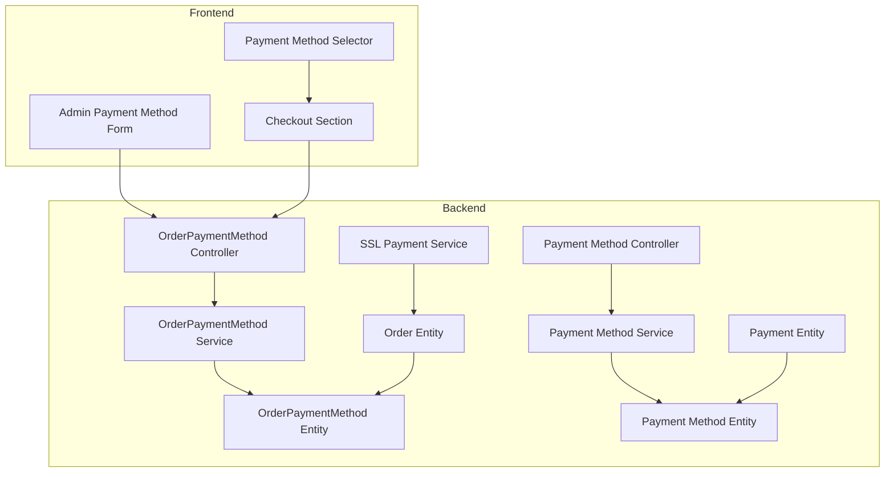
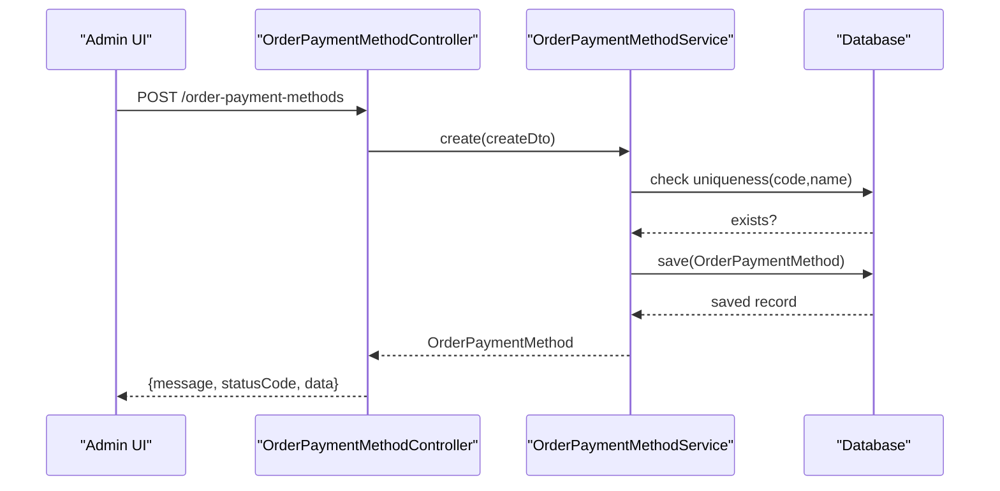
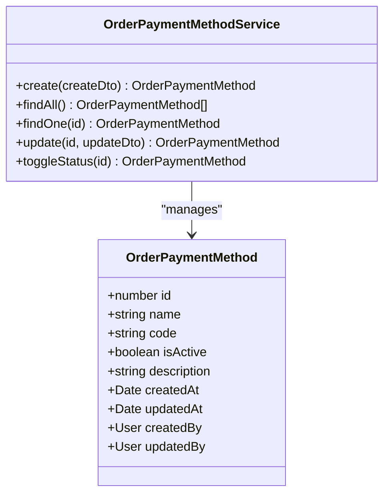
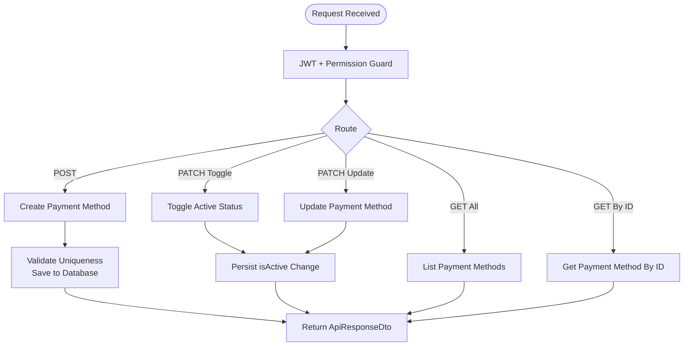
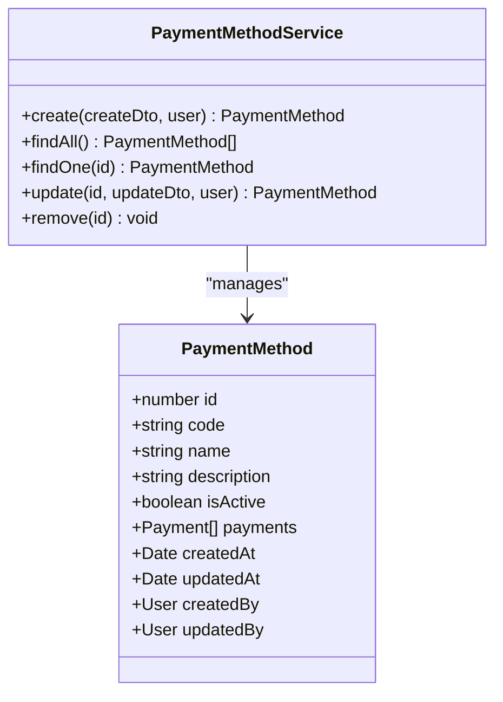
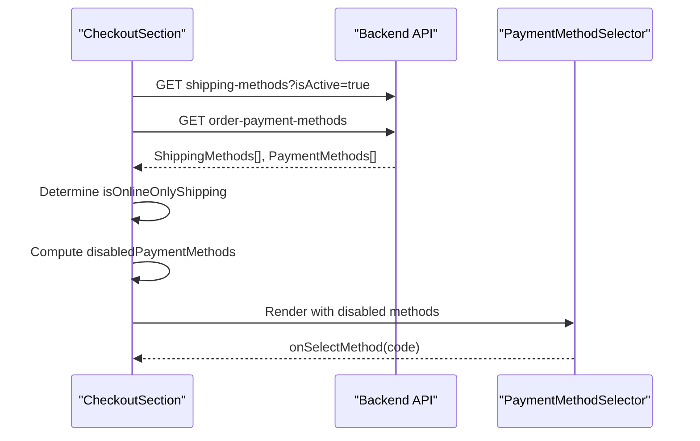
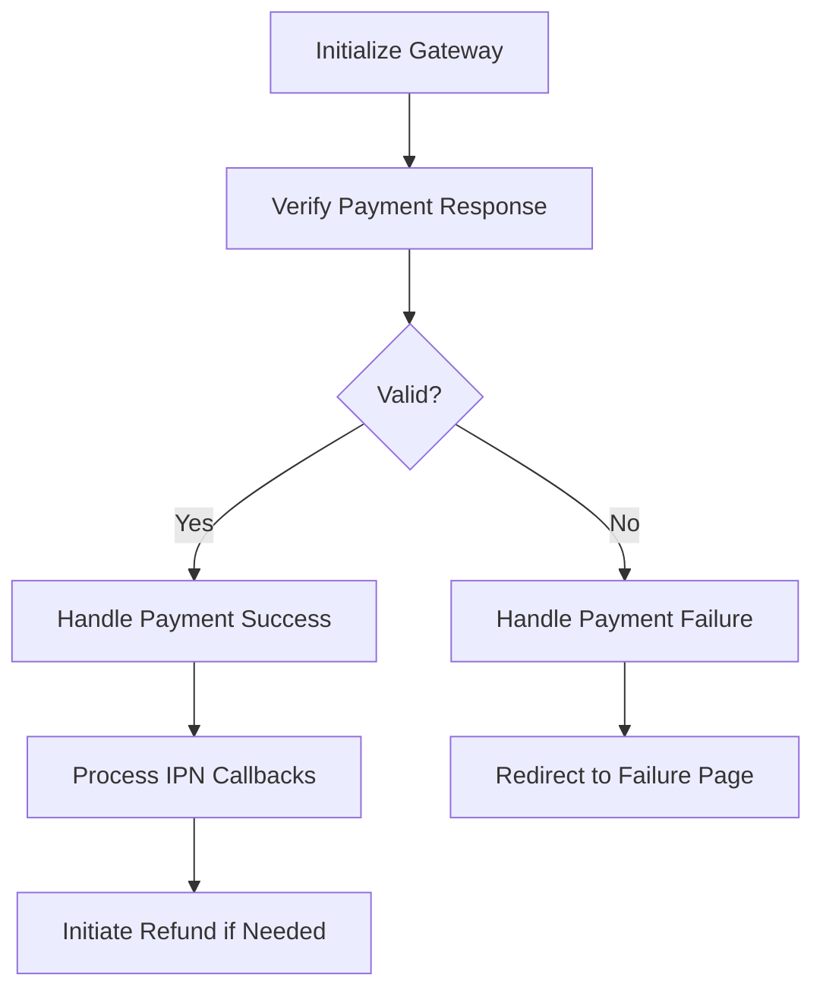
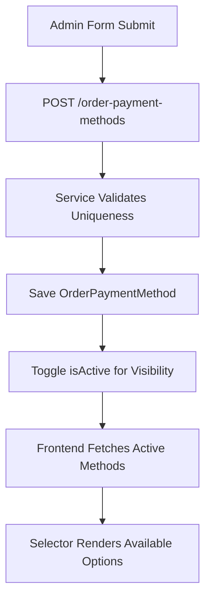
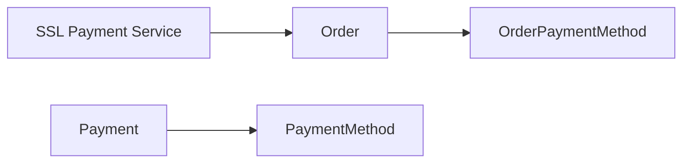

# Payment Methods Management

<cite>
**Referenced Files in This Document**
- [payment-method.entity.ts](file://apps/backend/src/payment-method/entities/payment-method.entity.ts)
- [create-payment-method.dto.ts](file://apps/backend/src/payment-method/dto/create-payment-method.dto.ts)
- [payment-method.service.ts](file://apps/backend/src/payment-method/payment-method.service.ts)
- [payment-method.controller.ts](file://apps/backend/src/payment-method/payment-method.controller.ts)
- [order-payment-method.entity.ts](file://apps/backend/src/order-payment-method/entities/order-payment-method.entity.ts)
- [order-payment-method.service.ts](file://apps/backend/src/order-payment-method/order-payment-method.service.ts)
- [order-payment-method.controller.ts](file://apps/backend/src/order-payment-method/order-payment-method.controller.ts)
- [order.entity.ts](file://apps/backend/src/order/entities/order.entity.ts)
- [payment.entity.ts](file://apps/backend/src/payment/entities/payment.entity.ts)
- [ssl-payment.service.ts](file://apps/backend/src/ssl-payment/ssl-payment.service.ts)
- [checkoutSection.tsx](file://apps/frontend/components/checkout/checkoutSection.tsx)
- [payment-method-selector.tsx](file://apps/frontend/components/checkout/payment-method-selector.tsx)
- [payment-method-form.tsx](file://apps/frontend/components/admin/payment-method/payment-method-form.tsx)
</cite>

## Table of Contents
1. [Introduction](#introduction)
2. [Project Structure](#project-structure)
3. [Core Components](#core-components)
4. [Architecture Overview](#architecture-overview)
5. [Detailed Component Analysis](#detailed-component-analysis)
6. [Dependency Analysis](#dependency-analysis)
7. [Performance Considerations](#performance-considerations)
8. [Troubleshooting Guide](#troubleshooting-guide)
9. [Conclusion](#conclusion)

## Introduction
This document explains the dynamic payment methods management system used by the application. It covers how different payment providers are configured and managed through the admin interface, the entity structures for payment methods, configuration options, activation/deactivation workflows, order association and selection logic during checkout, validation and compatibility checks, and examples for adding new payment methods and managing visibility.

The system separates:
- Order-level payment method definitions used at checkout (OrderPaymentMethod).
- Historical or accounting-level payment records linked to purchases (Payment), which reference a separate PaymentMethod entity.

## Project Structure
The payment-related functionality is implemented across backend modules and frontend components:
- Backend entities define data models for order payment methods and payments.
- Backend services implement CRUD operations and business rules such as status toggling and conflict detection.
- Backend controllers expose REST endpoints with authentication and permission guards.
- Frontend checkout UI fetches available payment methods and applies selection rules based on shipping method constraints.
- Admin UI provides forms to create, update, and toggle payment methods.

**Diagram sources**
- [order-payment-method.entity.ts:14-67](file://apps/backend/src/order-payment-method/entities/order-payment-method.entity.ts#L14-L67)
- [order-payment-method.service.ts:9-63](file://apps/backend/src/order-payment-method/order-payment-method.service.ts#L9-L63)
- [order-payment-method.controller.ts:33-158](file://apps/backend/src/order-payment-method/order-payment-method.controller.ts#L33-L158)
- [payment-method.entity.ts:16-93](file://apps/backend/src/payment-method/entities/payment-method.entity.ts#L16-L93)
- [payment-method.service.ts:9-52](file://apps/backend/src/payment-method/payment-method.service.ts#L9-L52)
- [payment-method.controller.ts:34-291](file://apps/backend/src/payment-method/payment-method.controller.ts#L34-L291)
- [order.entity.ts:24-108](file://apps/backend/src/order/entities/order.entity.ts#L24-L108)
- [payment.entity.ts:17-70](file://apps/backend/src/payment/entities/payment.entity.ts#L17-L70)
- [ssl-payment.service.ts:113-306](file://apps/backend/src/ssl-payment/ssl-payment.service.ts#L113-L306)
- [checkoutSection.tsx:129-223](file://apps/frontend/components/checkout/checkoutSection.tsx#L129-L223)
- [payment-method-selector.tsx:11-33](file://apps/frontend/components/checkout/payment-method-selector.tsx#L11-L33)
- [payment-method-form.tsx:43-78](file://apps/frontend/components/admin/payment-method/payment-method-form.tsx#L43-L78)

**Section sources**
- [order-payment-method.entity.ts:14-67](file://apps/backend/src/order-payment-method/entities/order-payment-method.entity.ts#L14-L67)
- [order-payment-method.service.ts:9-63](file://apps/backend/src/order-payment-method/order-payment-method.service.ts#L9-L63)
- [order-payment-method.controller.ts:33-158](file://apps/backend/src/order-payment-method/order-payment-method.controller.ts#L33-L158)
- [payment-method.entity.ts:16-93](file://apps/backend/src/payment-method/entities/payment-method.entity.ts#L16-L93)
- [payment-method.service.ts:9-52](file://apps/backend/src/payment-method/payment-method.service.ts#L9-L52)
- [payment-method.controller.ts:34-291](file://apps/backend/src/payment-method/payment-method.controller.ts#L34-L291)
- [order.entity.ts:24-108](file://apps/backend/src/order/entities/order.entity.ts#L24-L108)
- [payment.entity.ts:17-70](file://apps/backend/src/payment/entities/payment.entity.ts#L17-L70)
- [ssl-payment.service.ts:113-306](file://apps/backend/src/ssl-payment/ssl-payment.service.ts#L113-L306)
- [checkoutSection.tsx:129-223](file://apps/frontend/components/checkout/checkoutSection.tsx#L129-L223)
- [payment-method-selector.tsx:11-33](file://apps/frontend/components/checkout/payment-method-selector.tsx#L11-L33)
- [payment-method-form.tsx:43-78](file://apps/frontend/components/admin/payment-method/payment-method-form.tsx#L43-L78)

## Core Components
- OrderPaymentMethod: Defines payment methods available for orders at checkout, including name, code, description, and isActive flag.
- OrderPaymentMethodService: Provides CRUD operations, conflict detection for unique code/name, and status toggling.
- OrderPaymentMethodController: Exposes REST endpoints for creating, listing, retrieving, updating, and toggling payment methods; protected by JWT and permissions where required.
- PaymentMethod: Represents historical or accounting-level payment methods linked to Purchase/Payment records.
- PaymentMethodService: Manages creation, retrieval, updates, and deletion of PaymentMethod entries with audit fields.
- PaymentMethodController: Exposes endpoints for PaymentMethod management with Swagger documentation and error responses.
- Order: Associates an order with an OrderPaymentMethod and tracks payment status and related payments.
- Payment: Records individual payments tied to Purchases and references PaymentMethod.
- SSL Payment Service: Handles online gateway initialization, verification, success/failure handling, IPN processing, and refund initiation.

**Section sources**
- [order-payment-method.entity.ts:14-67](file://apps/backend/src/order-payment-method/entities/order-payment-method.entity.ts#L14-L67)
- [order-payment-method.service.ts:9-63](file://apps/backend/src/order-payment-method/order-payment-method.service.ts#L9-L63)
- [order-payment-method.controller.ts:33-158](file://apps/backend/src/order-payment-method/order-payment-method.controller.ts#L33-L158)
- [payment-method.entity.ts:16-93](file://apps/backend/src/payment-method/entities/payment-method.entity.ts#L16-L93)
- [payment-method.service.ts:9-52](file://apps/backend/src/payment-method/payment-method.service.ts#L9-L52)
- [payment-method.controller.ts:34-291](file://apps/backend/src/payment-method/payment-method.controller.ts#L34-L291)
- [order.entity.ts:24-108](file://apps/backend/src/order/entities/order.entity.ts#L24-L108)
- [payment.entity.ts:17-70](file://apps/backend/src/payment/entities/payment.entity.ts#L17-L70)
- [ssl-payment.service.ts:113-306](file://apps/backend/src/ssl-payment/ssl-payment.service.ts#L113-L306)

## Architecture Overview
The architecture follows a layered approach:
- Controllers handle HTTP requests, enforce authentication and permissions, and delegate to services.
- Services encapsulate business logic, repository interactions, and validation.
- Entities model database tables and relationships.
- Frontend components interact with backend APIs to manage and select payment methods.

**Diagram sources**
- [order-payment-method.controller.ts:44-63](file://apps/backend/src/order-payment-method/order-payment-method.controller.ts#L44-L63)
- [order-payment-method.service.ts:16-29](file://apps/backend/src/order-payment-method/order-payment-method.service.ts#L16-L29)

## Detailed Component Analysis

### OrderPaymentMethod Entity and Service
- Entity fields: id, name, code, isActive, description, timestamps, createdBy, updatedBy.
- Service methods:
  - create: validates uniqueness of code and name before saving.
  - findAll: returns all payment methods with selected fields.
  - findOne: retrieves by ID.
  - update: updates fields by ID.
  - toggleStatus: flips isActive and persists.

**Diagram sources**
- [order-payment-method.entity.ts:14-67](file://apps/backend/src/order-payment-method/entities/order-payment-method.entity.ts#L14-L67)
- [order-payment-method.service.ts:9-63](file://apps/backend/src/order-payment-method/order-payment-method.service.ts#L9-L63)

**Section sources**
- [order-payment-method.entity.ts:14-67](file://apps/backend/src/order-payment-method/entities/order-payment-method.entity.ts#L14-L67)
- [order-payment-method.service.ts:9-63](file://apps/backend/src/order-payment-method/order-payment-method.service.ts#L9-L63)

### OrderPaymentMethod Controller Endpoints
- POST /order-payment-methods: Create a new payment method (requires JWT and module permissions).
- GET /order-payment-methods: List all payment methods.
- GET /order-payment-methods/:id: Retrieve a single payment method.
- PATCH /order-payment-methods/:id/toggle-status: Toggle active status (requires JWT and module permissions).
- PATCH /order-payment-methods/:id: Update an existing payment method (requires JWT and module permissions).

**Diagram sources**
- [order-payment-method.controller.ts:44-158](file://apps/backend/src/order-payment-method/order-payment-method.controller.ts#L44-L158)
- [order-payment-method.service.ts:16-63](file://apps/backend/src/order-payment-method/order-payment-method.service.ts#L16-L63)

**Section sources**
- [order-payment-method.controller.ts:33-158](file://apps/backend/src/order-payment-method/order-payment-method.controller.ts#L33-L158)

### PaymentMethod Entity and Service
- Entity fields: id, code, name, description, isActive, payments relation, timestamps, createdBy, updatedBy.
- Service methods:
  - create: creates a PaymentMethod with audit fields.
  - findAll: returns only active payment methods.
  - findOne: retrieves by ID with not-found handling.
  - update: merges update DTO and sets updatedBy.
  - remove: deletes by ID after existence check.

**Diagram sources**
- [payment-method.entity.ts:16-93](file://apps/backend/src/payment-method/entities/payment-method.entity.ts#L16-L93)
- [payment-method.service.ts:9-52](file://apps/backend/src/payment-method/payment-method.service.ts#L9-L52)

**Section sources**
- [payment-method.entity.ts:16-93](file://apps/backend/src/payment-method/entities/payment-method.entity.ts#L16-L93)
- [payment-method.service.ts:9-52](file://apps/backend/src/payment-method/payment-method.service.ts#L9-L52)

### PaymentMethod Controller Endpoints
- POST /payment-methods: Create a new payment method (admin privileges).
- GET /payment-methods: List all payment methods (supports pagination and isActive filter).
- GET /payment-methods/:id: Retrieve details.
- PATCH /payment-methods/:id: Update fields partially.
- DELETE /payment-methods/:id: Soft-delete with conflict handling if in use.

**Section sources**
- [payment-method.controller.ts:34-291](file://apps/backend/src/payment-method/payment-method.controller.ts#L34-L291)

### Order Association and Selection Logic During Checkout
- The Order entity associates with an OrderPaymentMethod via ManyToOne relationship.
- The frontend checkout component fetches active shipping methods and order payment methods concurrently.
- If a shipping method requires online payment, the frontend disables cash-on-delivery and forces selection of the online gateway code.
- The PaymentMethodSelector renders available methods, supports disabled states with reasons, and maps provider logos by name/code.

**Diagram sources**
- [order.entity.ts:102-108](file://apps/backend/src/order/entities/order.entity.ts#L102-L108)
- [checkoutSection.tsx:129-223](file://apps/frontend/components/checkout/checkoutSection.tsx#L129-L223)
- [payment-method-selector.tsx:11-33](file://apps/frontend/components/checkout/payment-method-selector.tsx#L11-L33)

**Section sources**
- [order.entity.ts:102-108](file://apps/backend/src/order/entities/order.entity.ts#L102-L108)
- [checkoutSection.tsx:129-223](file://apps/frontend/components/checkout/checkoutSection.tsx#L129-L223)
- [payment-method-selector.tsx:11-33](file://apps/frontend/components/checkout/payment-method-selector.tsx#L11-L33)

### Payment Validation and Compatibility Checks
- SSL Payment Service initializes the gateway, verifies payment responses, handles success/failure, processes IPN callbacks, and initiates refunds.
- Verification compares validation status, transaction ID, and amount against provided data.
- Failure paths return appropriate redirect URLs and log non-sensitive details.

**Diagram sources**
- [ssl-payment.service.ts:113-306](file://apps/backend/src/ssl-payment/ssl-payment.service.ts#L113-L306)

**Section sources**
- [ssl-payment.service.ts:113-306](file://apps/backend/src/ssl-payment/ssl-payment.service.ts#L113-L306)

### Examples: Adding New Payment Methods, Configuring Provider Settings, Managing Visibility
- Adding a new payment method:
  - Use the admin form to submit name, code, description, and isActive to the backend endpoint.
  - The service ensures uniqueness of code and name before persisting.
- Configuring provider-specific settings:
  - For online gateways like SSL Commerz, initialize the gateway and verify responses using the SSL Payment Service.
- Managing visibility:
  - Toggle isActive to enable/disable availability in checkout.
  - The frontend filters active payment methods and applies shipping-based restrictions.

**Diagram sources**
- [payment-method-form.tsx:43-78](file://apps/frontend/components/admin/payment-method/payment-method-form.tsx#L43-L78)
- [order-payment-method.service.ts:16-29](file://apps/backend/src/order-payment-method/order-payment-method.service.ts#L16-L29)
- [order-payment-method.controller.ts:44-63](file://apps/backend/src/order-payment-method/order-payment-method.controller.ts#L44-L63)
- [checkoutSection.tsx:212-223](file://apps/frontend/components/checkout/checkoutSection.tsx#L212-L223)

**Section sources**
- [payment-method-form.tsx:43-78](file://apps/frontend/components/admin/payment-method/payment-method-form.tsx#L43-L78)
- [order-payment-method.service.ts:16-29](file://apps/backend/src/order-payment-method/order-payment-method.service.ts#L16-L29)
- [order-payment-method.controller.ts:44-63](file://apps/backend/src/order-payment-method/order-payment-method.controller.ts#L44-L63)
- [checkoutSection.tsx:212-223](file://apps/frontend/components/checkout/checkoutSection.tsx#L212-L223)

## Dependency Analysis
Key relationships:
- Order depends on OrderPaymentMethod to record which payment method was used.
- Payment depends on PaymentMethod to record historical payment details.
- SSL Payment Service interacts with Order lifecycle and payment verification.

**Diagram sources**
- [order.entity.ts:102-108](file://apps/backend/src/order/entities/order.entity.ts#L102-L108)
- [payment.entity.ts:62-70](file://apps/backend/src/payment/entities/payment.entity.ts#L62-L70)
- [ssl-payment.service.ts:113-306](file://apps/backend/src/ssl-payment/ssl-payment.service.ts#L113-L306)

**Section sources**
- [order.entity.ts:102-108](file://apps/backend/src/order/entities/order.entity.ts#L102-L108)
- [payment.entity.ts:62-70](file://apps/backend/src/payment/entities/payment.entity.ts#L62-L70)
- [ssl-payment.service.ts:113-306](file://apps/backend/src/ssl-payment/ssl-payment.service.ts#L113-L306)

## Performance Considerations
- Use selective field projection when listing payment methods to reduce payload size.
- Cache frequently accessed active payment methods on the frontend to minimize repeated API calls.
- Avoid eager loading unnecessary relations in list endpoints; load relations only when needed.
- Ensure database indexes on frequently queried fields like code and isActive.

[No sources needed since this section provides general guidance]

## Troubleshooting Guide
Common issues and resolutions:
- Conflict on creation:
  - Occurs when code or name already exists; ensure unique values before submitting.
- Unauthorized access:
  - Ensure valid JWT token and sufficient permissions for protected endpoints.
- Not found errors:
  - Verify IDs exist before attempting updates or deletions.
- Payment verification failures:
  - Check validation response status, transaction ID, and amount consistency.

**Section sources**
- [order-payment-method.service.ts:16-29](file://apps/backend/src/order-payment-method/order-payment-method.service.ts#L16-L29)
- [order-payment-method.controller.ts:44-63](file://apps/backend/src/order-payment-method/order-payment-method.controller.ts#L44-L63)
- [payment-method.service.ts:31-38](file://apps/backend/src/payment-method/payment-method.service.ts#L31-L38)
- [ssl-payment.service.ts:269-306](file://apps/backend/src/ssl-payment/ssl-payment.service.ts#L269-L306)

## Conclusion
The dynamic payment methods management system provides a robust foundation for configuring and managing payment providers through the admin interface. It enforces uniqueness and visibility controls, integrates with order processing workflows, and supports validation and compatibility checks for online gateways. The separation between order-level payment methods and historical payment records ensures clarity in both checkout flows and accounting processes.

[No sources needed since this section summarizes without analyzing specific files]