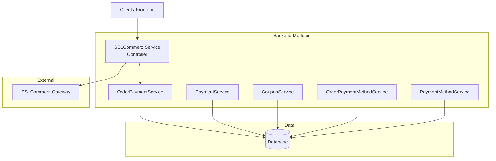
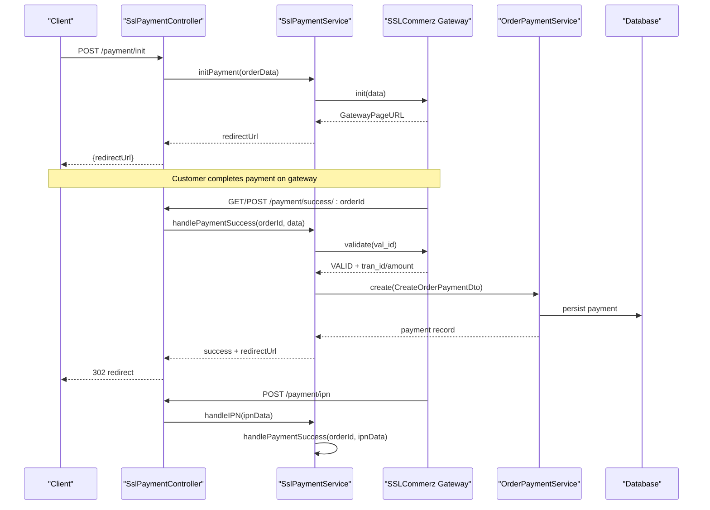
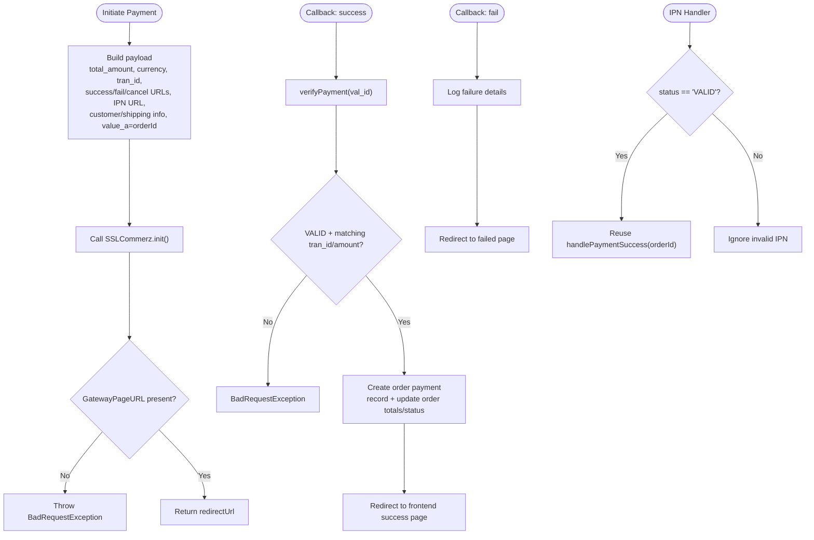
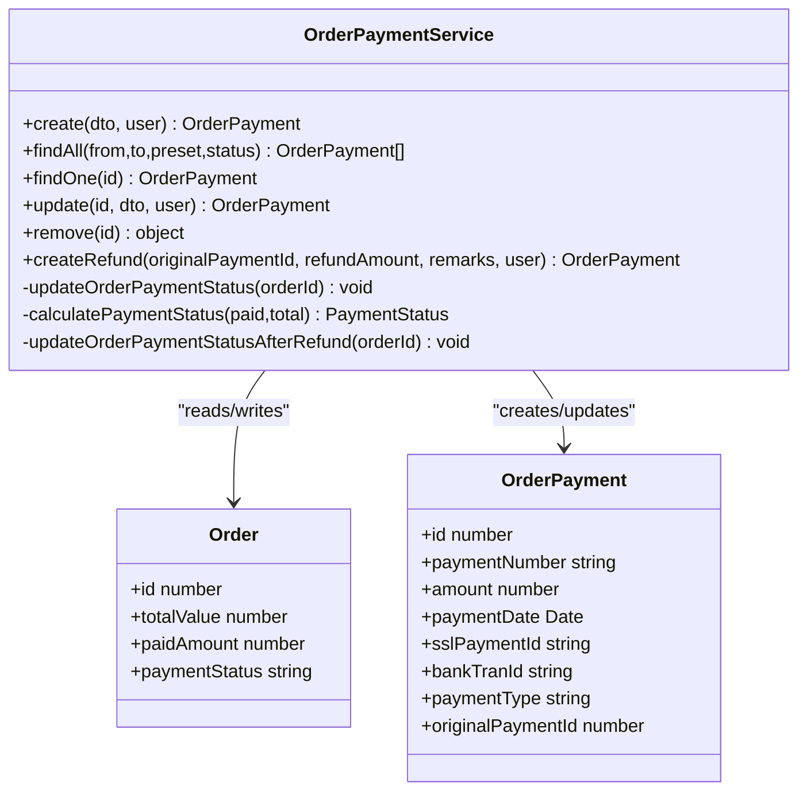
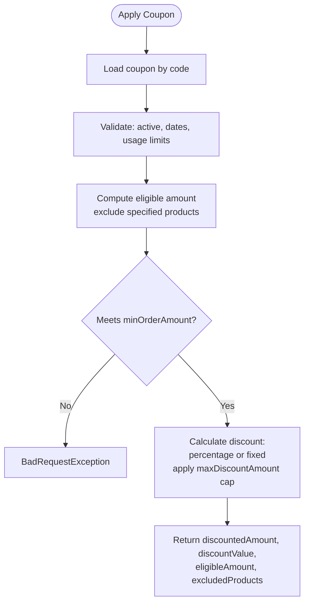
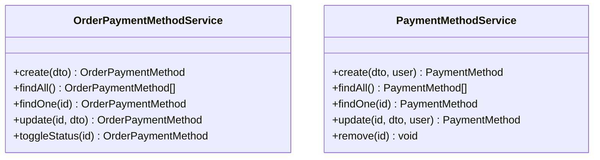
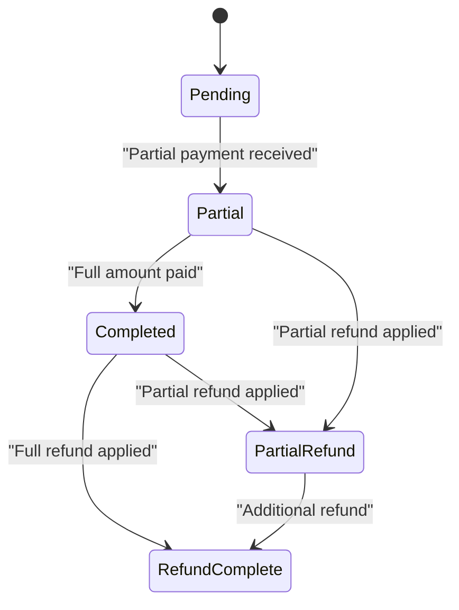
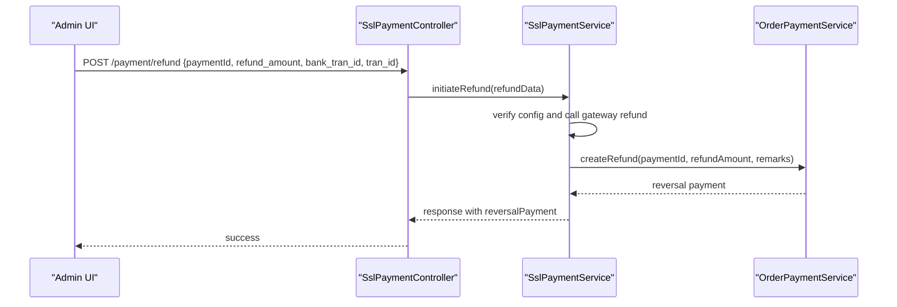
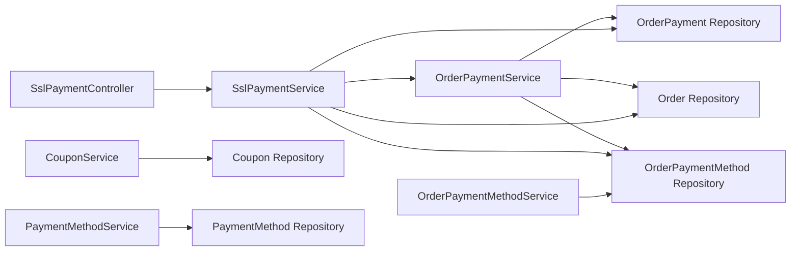

# Payment Processing & Integration

<cite>
**Referenced Files in This Document**
- [ssl-payment.service.ts](file://apps/backend/src/ssl-payment/ssl-payment.service.ts)
- [ssl-payment.controller.ts](file://apps/backend/src/ssl-payment/ssl-payment.controller.ts)
- [order-payment.service.ts](file://apps/backend/src/order-payment/order-payment.service.ts)
- [payment.service.ts](file://apps/backend/src/payment/payment.service.ts)
- [coupon.service.ts](file://apps/backend/src/coupon/coupon.service.ts)
- [order-payment-method.service.ts](file://apps/backend/src/order-payment-method/order-payment-method.service.ts)
- [payment-method.service.ts](file://apps/backend/src/payment-method/payment-method.service.ts)
- [index.ts](file://apps/backend/src/common/enums/index.ts)
- [database.dbml](file://apps/backend/database.dbml)
</cite>

## Table of Contents
1. [Introduction](#introduction)
2. [Project Structure](#project-structure)
3. [Core Components](#core-components)
4. [Architecture Overview](#architecture-overview)
5. [Detailed Component Analysis](#detailed-component-analysis)
6. [Dependency Analysis](#dependency-analysis)
7. [Performance Considerations](#performance-considerations)
8. [Troubleshooting Guide](#troubleshooting-guide)
9. [Conclusion](#conclusion)

## Introduction
This document explains the payment processing system that supports multiple payment methods, with a focus on SSLCommerz gateway integration. It covers payment initiation, callback handling, IPN processing, refund processing, coupon and discount application, validation and security measures, transaction verification, status tracking, reconciliation, error handling, and auditability. The goal is to provide both high-level understanding and code-mapped details for developers and operators.

## Project Structure
The payment-related backend logic is organized into feature modules:
- SSLCommerz gateway integration: controller and service under ssl-payment
- Order payments and refunds: order-payment module
- Purchase payments (legacy): payment module
- Coupon and discount application: coupon module
- Payment method configuration: order-payment-method and payment-method modules
- Shared enums and database schema definitions

**Diagram sources**
- [ssl-payment.controller.ts:35-64](file://apps/backend/src/ssl-payment/ssl-payment.controller.ts#L35-L64)
- [ssl-payment.service.ts:44-110](file://apps/backend/src/ssl-payment/ssl-payment.service.ts#L44-L110)
- [order-payment.service.ts:28-73](file://apps/backend/src/order-payment/order-payment.service.ts#L28-L73)
- [payment.service.ts:23-51](file://apps/backend/src/payment/payment.service.ts#L23-L51)
- [coupon.service.ts:180-306](file://apps/backend/src/coupon/coupon.service.ts#L180-L306)
- [order-payment-method.service.ts:16-30](file://apps/backend/src/order-payment-method/order-payment-method.service.ts#L16-L30)
- [payment-method.service.ts:16-23](file://apps/backend/src/payment-method/payment-method.service.ts#L16-L23)

**Section sources**
- [ssl-payment.controller.ts:35-64](file://apps/backend/src/ssl-payment/ssl-payment.controller.ts#L35-L64)
- [ssl-payment.service.ts:44-110](file://apps/backend/src/ssl-payment/ssl-payment.service.ts#L44-L110)
- [order-payment.service.ts:28-73](file://apps/backend/src/order-payment/order-payment.service.ts#L28-L73)
- [payment.service.ts:23-51](file://apps/backend/src/payment/payment.service.ts#L23-L51)
- [coupon.service.ts:180-306](file://apps/backend/src/coupon/coupon.service.ts#L180-L306)
- [order-payment-method.service.ts:16-30](file://apps/backend/src/order-payment-method/order-payment-method.service.ts#L16-L30)
- [payment-method.service.ts:16-23](file://apps/backend/src/payment-method/payment-method.service.ts#L16-L23)

## Core Components
- SSLCommerz Gateway Integration
  - Payment initiation returns a redirect URL to the gateway.
  - Success/failure/cancel endpoints handle callbacks and redirect users.
  - IPN endpoint processes asynchronous notifications.
  - Refund endpoint initiates reversals and records reversal postings.
- Order Payments and Refunds
  - Creates payments with unique payment numbers and updates order totals/status.
  - Supports full/partial refunds with negative amounts and status transitions.
- Coupons and Discounts
  - Validates coupons (active, date range, usage limits).
  - Applies percentage or fixed discounts with caps and exclusions.
- Payment Method Configuration
  - CRUD for order-level payment methods with active toggles.
  - Legacy payment method management for purchases.
- Shared Enums and Data Model
  - Enumerations for order/payment statuses and types.
  - Database schema for purchase/payment entities.

**Section sources**
- [ssl-payment.controller.ts:35-64](file://apps/backend/src/ssl-payment/ssl-payment.controller.ts#L35-L64)
- [ssl-payment.service.ts:44-110](file://apps/backend/src/ssl-payment/ssl-payment.service.ts#L44-L110)
- [order-payment.service.ts:28-73](file://apps/backend/src/order-payment/order-payment.service.ts#L28-L73)
- [coupon.service.ts:135-178](file://apps/backend/src/coupon/coupon.service.ts#L135-L178)
- [order-payment-method.service.ts:16-30](file://apps/backend/src/order-payment-method/order-payment-method.service.ts#L16-L30)
- [payment-method.service.ts:16-23](file://apps/backend/src/payment-method/payment-method.service.ts#L16-L23)
- [index.ts:21-36](file://apps/backend/src/common/enums/index.ts#L21-L36)
- [database.dbml:212-238](file://apps/backend/database.dbml#L212-L238)

## Architecture Overview
End-to-end flow from order creation to payment completion and optional refund.

**Diagram sources**
- [ssl-payment.controller.ts:35-64](file://apps/backend/src/ssl-payment/ssl-payment.controller.ts#L35-L64)
- [ssl-payment.controller.ts:66-99](file://apps/backend/src/ssl-payment/ssl-payment.controller.ts#L66-L99)
- [ssl-payment.controller.ts:187-206](file://apps/backend/src/ssl-payment/ssl-payment.controller.ts#L187-L206)
- [ssl-payment.service.ts:44-110](file://apps/backend/src/ssl-payment/ssl-payment.service.ts#L44-L110)
- [ssl-payment.service.ts:113-233](file://apps/backend/src/ssl-payment/ssl-payment.service.ts#L113-L233)
- [order-payment.service.ts:28-73](file://apps/backend/src/order-payment/order-payment.service.ts#L28-L73)

## Detailed Component Analysis

### SSLCommerz Gateway Integration
Responsibilities:
- Initialize payment and return gateway URL.
- Handle success/failure/cancel callbacks.
- Validate transactions against gateway.
- Process IPN asynchronously.
- Initiate refunds and record reversal postings.

Key behaviors:
- Credentials are loaded from configuration; missing credentials throw an error.
- Success path verifies amount and transaction ID via gateway validation before recording payment.
- IPN handler reuses success logic when status is valid.
- Refund calls gateway API and creates a negative payment entry upon success.

**Diagram sources**
- [ssl-payment.service.ts:44-110](file://apps/backend/src/ssl-payment/ssl-payment.service.ts#L44-L110)
- [ssl-payment.service.ts:113-233](file://apps/backend/src/ssl-payment/ssl-payment.service.ts#L113-L233)
- [ssl-payment.service.ts:269-306](file://apps/backend/src/ssl-payment/ssl-payment.service.ts#L269-L306)
- [ssl-payment.service.ts:308-328](file://apps/backend/src/ssl-payment/ssl-payment.service.ts#L308-L328)

Security and validation:
- Transaction verification compares gateway validation response’s status, transaction ID, and amount.
- Callbacks log only non-sensitive fields to avoid PII exposure.
- IPN handler requires VALID status before processing.

Error handling:
- Initialization failures and verification failures raise bad request exceptions.
- IPN errors are logged without failing the caller.

Refund processing:
- Requires original payment ID, bank transaction ID, and gateway transaction ID.
- Detects IP whitelist issues and surfaces actionable errors.
- On successful refund, creates a reversal payment with a REF number and updates order payment status accordingly.

**Section sources**
- [ssl-payment.service.ts:29-42](file://apps/backend/src/ssl-payment/ssl-payment.service.ts#L29-L42)
- [ssl-payment.service.ts:44-110](file://apps/backend/src/ssl-payment/ssl-payment.service.ts#L44-L110)
- [ssl-payment.service.ts:113-233](file://apps/backend/src/ssl-payment/ssl-payment.service.ts#L113-L233)
- [ssl-payment.service.ts:269-306](file://apps/backend/src/ssl-payment/ssl-payment.service.ts#L269-L306)
- [ssl-payment.service.ts:308-328](file://apps/backend/src/ssl-payment/ssl-payment.service.ts#L308-L328)
- [ssl-payment.service.ts:330-412](file://apps/backend/src/ssl-payment/ssl-payment.service.ts#L330-L412)
- [ssl-payment.controller.ts:35-64](file://apps/backend/src/ssl-payment/ssl-payment.controller.ts#L35-L64)
- [ssl-payment.controller.ts:66-99](file://apps/backend/src/ssl-payment/ssl-payment.controller.ts#L66-L99)
- [ssl-payment.controller.ts:136-169](file://apps/backend/src/ssl-payment/ssl-payment.controller.ts#L136-L169)
- [ssl-payment.controller.ts:187-206](file://apps/backend/src/ssl-payment/ssl-payment.controller.ts#L187-L206)
- [ssl-payment.controller.ts:229-256](file://apps/backend/src/ssl-payment/ssl-payment.controller.ts#L229-L256)

### Order Payments and Refunds
Responsibilities:
- Create payments linked to orders with unique sequential payment numbers.
- Update order paidAmount and paymentStatus based on cumulative payments.
- Support refunds by creating negative payment entries and adjusting order status.

Key behaviors:
- Payment creation validates order existence and payment method.
- Payment numbers follow PAY-{year}-{seq} format.
- Status calculation: pending -> partial -> completed based on paid vs total.
- Refund creation enforces rules: cannot refund a refund, cannot exceed original amount.
- After refund, order status transitions to fully refunded, partially refunded, or paid depending on net paid amount.

**Diagram sources**
- [order-payment.service.ts:28-73](file://apps/backend/src/order-payment/order-payment.service.ts#L28-L73)
- [order-payment.service.ts:187-211](file://apps/backend/src/order-payment/order-payment.service.ts#L187-L211)
- [order-payment.service.ts:213-307](file://apps/backend/src/order-payment/order-payment.service.ts#L213-L307)

**Section sources**
- [order-payment.service.ts:28-73](file://apps/backend/src/order-payment/order-payment.service.ts#L28-L73)
- [order-payment.service.ts:187-211](file://apps/backend/src/order-payment/order-payment.service.ts#L187-L211)
- [order-payment.service.ts:213-307](file://apps/backend/src/order-payment/order-payment.service.ts#L213-L307)

### Coupon and Discount Application
Responsibilities:
- Validate coupons for activity, validity window, and usage limits.
- Apply discounts (percentage or fixed) with optional max discount cap.
- Respect excluded products and compute eligible amount.
- Provide cart-aware validation warnings when items are excluded.

Key behaviors:
- Validation throws HTTP exceptions for expired/not-yet-valid/exceeded usage.
- Eligible amount excludes prices of excluded products when cart item details are provided.
- Percentage discounts capped by maxDiscountAmount if set.
- Fixed discounts also respect maxDiscountAmount cap.
- Cart validation returns warning messages listing excluded products.

**Diagram sources**
- [coupon.service.ts:135-178](file://apps/backend/src/coupon/coupon.service.ts#L135-L178)
- [coupon.service.ts:180-306](file://apps/backend/src/coupon/coupon.service.ts#L180-L306)
- [coupon.service.ts:313-391](file://apps/backend/src/coupon/coupon.service.ts#L313-L391)

**Section sources**
- [coupon.service.ts:135-178](file://apps/backend/src/coupon/coupon.service.ts#L135-L178)
- [coupon.service.ts:180-306](file://apps/backend/src/coupon/coupon.service.ts#L180-L306)
- [coupon.service.ts:313-391](file://apps/backend/src/coupon/coupon.service.ts#L313-L391)

### Payment Method Configuration System
Responsibilities:
- Manage order-level payment methods with unique code/name constraints and active toggling.
- Manage legacy payment methods for purchases with CRUD operations.

Key behaviors:
- Creating a new order payment method checks for duplicate code or name.
- Listing returns minimal metadata including isActive flag.
- Toggle flips isActive and persists changes.
- Legacy payment methods support create/update/remove with audit fields.

**Diagram sources**
- [order-payment-method.service.ts:16-62](file://apps/backend/src/order-payment-method/order-payment-method.service.ts#L16-L62)
- [payment-method.service.ts:16-51](file://apps/backend/src/payment-method/payment-method.service.ts#L16-L51)

**Section sources**
- [order-payment-method.service.ts:16-62](file://apps/backend/src/order-payment-method/order-payment-method.service.ts#L16-L62)
- [payment-method.service.ts:16-51](file://apps/backend/src/payment-method/payment-method.service.ts#L16-L51)

### Payment Validation, Security, and Audit Trail
Validation and security:
- Gateway transaction verification ensures status, transaction ID, and amount match.
- Callbacks sanitize logs to exclude sensitive fields.
- IPN processing only proceeds for VALID status.
- Refund initiation detects IP whitelist misconfiguration and provides clear error messaging.

Audit trail:
- Payments include createdBy/updatedBy audit fields and unique payment numbers.
- Refunds link to original payments and use distinct REF numbering.
- Order totals and payment statuses are recalculated after each mutation.

**Section sources**
- [ssl-payment.service.ts:269-306](file://apps/backend/src/ssl-payment/ssl-payment.service.ts#L269-L306)
- [order-payment.service.ts:28-73](file://apps/backend/src/order-payment/order-payment.service.ts#L28-L73)
- [order-payment.service.ts:213-307](file://apps/backend/src/order-payment/order-payment.service.ts#L213-L307)

### Payment Status Tracking and Reconciliation
Status tracking:
- Order payment status transitions: pending -> partial -> completed based on cumulative paid amount.
- Refund flows introduce additional states: refund_complete, partial_refund.
- PaymentType distinguishes between regular payments and refunds.

Reconciliation:
- Querying all payments includes order and payment method relations for reporting.
- Date-range filters and order status filters support financial reporting.
- Payment numbers and external references (sslPaymentId, bankTranId) enable cross-system reconciliation.

**Diagram sources**
- [index.ts:21-36](file://apps/backend/src/common/enums/index.ts#L21-L36)
- [order-payment.service.ts:187-211](file://apps/backend/src/order-payment/order-payment.service.ts#L187-L211)
- [order-payment.service.ts:278-307](file://apps/backend/src/order-payment/order-payment.service.ts#L278-L307)

**Section sources**
- [index.ts:21-36](file://apps/backend/src/common/enums/index.ts#L21-L36)
- [order-payment.service.ts:187-211](file://apps/backend/src/order-payment/order-payment.service.ts#L187-L211)
- [order-payment.service.ts:278-307](file://apps/backend/src/order-payment/order-payment.service.ts#L278-L307)

### Implementation Examples: End-to-End Flow
- Initiate payment:
  - Client calls POST /payment/init with order data.
  - Controller delegates to service which initializes SSLCommerz and returns a redirect URL.
- Complete payment:
  - Gateway redirects to success endpoint with callback parameters.
  - Service verifies transaction and creates a payment record, updating order totals and status.
  - Client is redirected to frontend success page.
- Asynchronous confirmation:
  - IPN endpoint receives server-to-server notification and reuses success logic.
- Refund:
  - Admin triggers refund via protected endpoint.
  - Service calls gateway refund API and creates a reversal payment upon success.

**Diagram sources**
- [ssl-payment.controller.ts:229-256](file://apps/backend/src/ssl-payment/ssl-payment.controller.ts#L229-L256)
- [ssl-payment.service.ts:330-412](file://apps/backend/src/ssl-payment/ssl-payment.service.ts#L330-L412)
- [order-payment.service.ts:213-307](file://apps/backend/src/order-payment/order-payment.service.ts#L213-L307)

## Dependency Analysis
Component relationships and coupling:
- SslPaymentService depends on OrderPaymentService for recording payments and refunds.
- Both services depend on repositories for Order, OrderPayment, and OrderPaymentMethod.
- CouponService is independent but conceptually integrates with order totals during checkout.
- PaymentMethod and OrderPaymentMethod services manage configuration used across payment flows.

**Diagram sources**
- [ssl-payment.controller.ts:35-64](file://apps/backend/src/ssl-payment/ssl-payment.controller.ts#L35-L64)
- [ssl-payment.service.ts:16-27](file://apps/backend/src/ssl-payment/ssl-payment.service.ts#L16-L27)
- [order-payment.service.ts:17-26](file://apps/backend/src/order-payment/order-payment.service.ts#L17-L26)
- [coupon.service.ts:16-23](file://apps/backend/src/coupon/coupon.service.ts#L16-L23)
- [order-payment-method.service.ts:9-14](file://apps/backend/src/order-payment-method/order-payment-method.service.ts#L9-L14)
- [payment-method.service.ts:9-14](file://apps/backend/src/payment-method/payment-method.service.ts#L9-L14)

**Section sources**
- [ssl-payment.service.ts:16-27](file://apps/backend/src/ssl-payment/ssl-payment.service.ts#L16-L27)
- [order-payment.service.ts:17-26](file://apps/backend/src/order-payment/order-payment.service.ts#L17-L26)
- [coupon.service.ts:16-23](file://apps/backend/src/coupon/coupon.service.ts#L16-L23)
- [order-payment-method.service.ts:9-14](file://apps/backend/src/order-payment-method/order-payment-method.service.ts#L9-L14)
- [payment-method.service.ts:9-14](file://apps/backend/src/payment-method/payment-method.service.ts#L9-L14)

## Performance Considerations
- Avoid logging sensitive callback payloads; only log non-sensitive identifiers and amounts.
- Use efficient queries with selective relations for reporting endpoints.
- Ensure gateway credentials are validated early to fail fast on misconfiguration.
- For refunds, surface actionable errors (e.g., IP whitelist) to reduce retries.

[No sources needed since this section provides general guidance]

## Troubleshooting Guide
Common issues and resolutions:
- Payment initialization fails:
  - Check SSLCommerz credentials configuration and BASE_URL/IPN_URL settings.
  - Inspect controller/service error responses for detailed messages.
- Payment verification fails:
  - Confirm val_id matches gateway response and that amount/tran_id align.
  - Review logs for validation status mismatches.
- IPN not processed:
  - Ensure IPN endpoint is reachable and configured in merchant panel.
  - Validate that IPN status is VALID before processing.
- Refund fails due to IP whitelist:
  - Add server IP to SSLCommerz merchant panel whitelist.
  - Retry after whitelisting; check error message for INVALID_SOURCE indicators.
- Duplicate payment recording:
  - Idempotency is handled by checking existing sslPaymentId; ensure callbacks are not retried excessively.

**Section sources**
- [ssl-payment.service.ts:29-42](file://apps/backend/src/ssl-payment/ssl-payment.service.ts#L29-L42)
- [ssl-payment.service.ts:113-233](file://apps/backend/src/ssl-payment/ssl-payment.service.ts#L113-L233)
- [ssl-payment.service.ts:269-306](file://apps/backend/src/ssl-payment/ssl-payment.service.ts#L269-L306)
- [ssl-payment.service.ts:330-412](file://apps/backend/src/ssl-payment/ssl-payment.service.ts#L330-L412)
- [ssl-payment.controller.ts:35-64](file://apps/backend/src/ssl-payment/ssl-payment.controller.ts#L35-L64)
- [ssl-payment.controller.ts:187-206](file://apps/backend/src/ssl-payment/ssl-payment.controller.ts#L187-L206)
- [ssl-payment.controller.ts:229-256](file://apps/backend/src/ssl-payment/ssl-payment.controller.ts#L229-L256)

## Conclusion
The system provides a robust, secure, and auditable payment processing pipeline with strong SSLCommerz integration, flexible payment method configuration, comprehensive coupon/discount application, and clear status tracking and reconciliation mechanisms. Proper credential configuration, careful callback handling, and proactive error handling ensure reliability and compliance.

[No sources needed since this section summarizes without analyzing specific files]