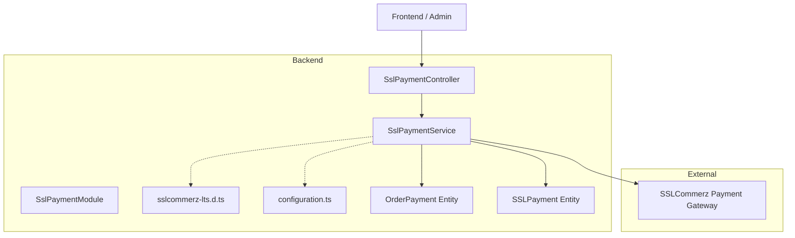
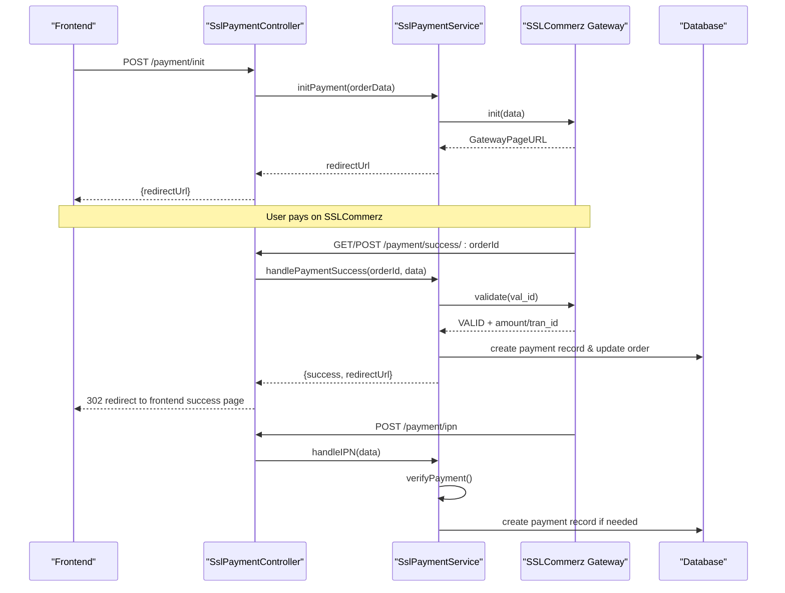
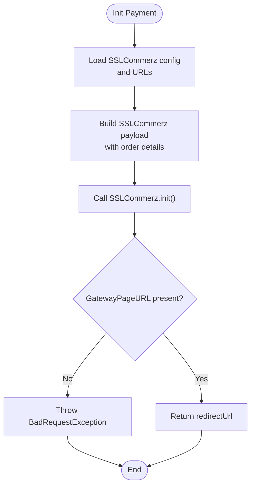
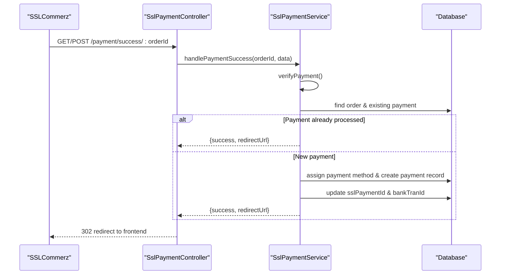
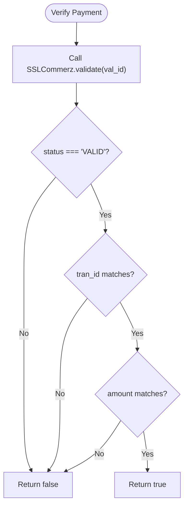
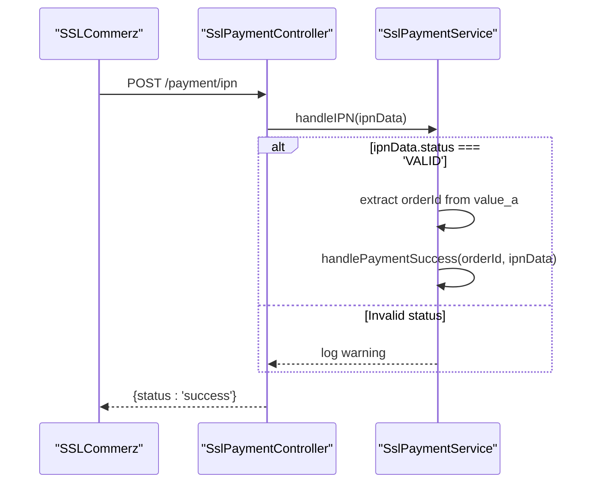
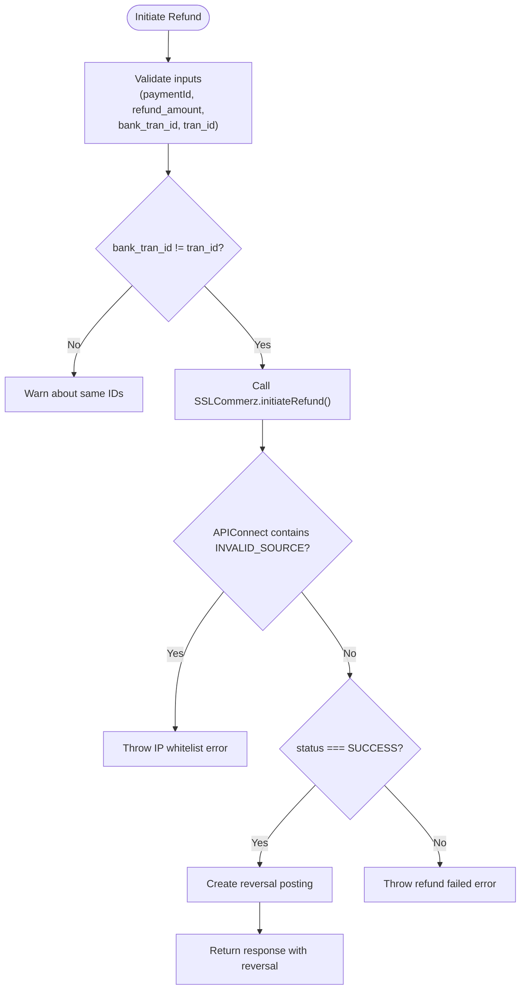
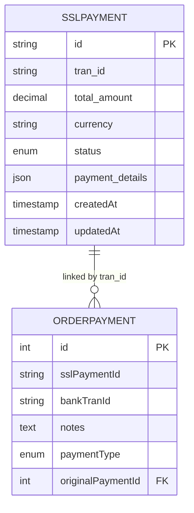
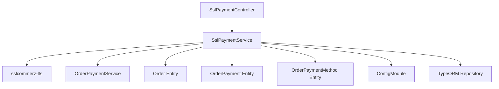

# SSLCommerz Gateway Integration

<cite>
**Referenced Files in This Document**
- [ssl-payment.service.ts](file://apps/backend/src/ssl-payment/ssl-payment.service.ts)
- [ssl-payment.controller.ts](file://apps/backend/src/ssl-payment/ssl-payment.controller.ts)
- [ssl-payment.module.ts](file://apps/backend/src/ssl-payment/ssl-payment.module.ts)
- [payment.entity.ts](file://apps/backend/src/ssl-payment/entities/payment.entity.ts)
- [initiate-refund.dto.ts](file://apps/backend/src/ssl-payment/dto/initiate-refund.dto.ts)
- [create-payment.dto.ts](file://apps/backend/src/ssl-payment/dto/create-payment.dto.ts)
- [update-ssl-payment.dto.ts](file://apps/backend/src/ssl-payment/dto/update-ssl-payment.dto.ts)
- [payment-response.dto.ts](file://apps/backend/src/ssl-payment/dto/payment-response.dto.ts)
- [sslcommerz-lts.d.ts](file://apps/backend/src/types/sslcommerz-lts.d.ts)
- [configuration.ts](file://apps/backend/src/config/configuration.ts)
- [order-payment.entity.ts](file://apps/backend/src/order-payment/entities/order-payment.entity.ts)
</cite>

## Table of Contents
1. [Introduction](#introduction)
2. [Project Structure](#project-structure)
3. [Core Components](#core-components)
4. [Architecture Overview](#architecture-overview)
5. [Detailed Component Analysis](#detailed-component-analysis)
6. [Dependency Analysis](#dependency-analysis)
7. [Performance Considerations](#performance-considerations)
8. [Troubleshooting Guide](#troubleshooting-guide)
9. [Conclusion](#conclusion)

## Introduction
This document explains the SSLCommerz payment gateway integration implemented in the backend application. It covers the complete payment lifecycle: initialization, redirect handling, callback processing, validation, webhook (IPN) handling, and refund processing. It also documents configuration parameters, API endpoints, response handling, security measures, error handling strategies, and practical usage examples.

## Project Structure
The SSLCommerz integration is implemented as a NestJS feature module under `apps/backend/src/ssl-payment`. The module exposes REST endpoints for initiating payments, handling success/failure/cancel callbacks, processing IPN webhooks, validating transactions, and initiating refunds.

**Diagram sources**
- [ssl-payment.controller.ts:31-257](file://apps/backend/src/ssl-payment/ssl-payment.controller.ts#L31-L257)
- [ssl-payment.service.ts:16-413](file://apps/backend/src/ssl-payment/ssl-payment.service.ts#L16-L413)
- [ssl-payment.module.ts:13-26](file://apps/backend/src/ssl-payment/ssl-payment.module.ts#L13-L26)
- [sslcommerz-lts.d.ts:89-125](file://apps/backend/src/types/sslcommerz-lts.d.ts#L89-L125)
- [configuration.ts:1-15](file://apps/backend/src/config/configuration.ts#L1-L15)
- [order-payment.entity.ts:48-97](file://apps/backend/src/order-payment/entities/order-payment.entity.ts#L48-L97)
- [payment.entity.ts:1-28](file://apps/backend/src/ssl-payment/entities/payment.entity.ts#L1-L28)

**Section sources**
- [ssl-payment.controller.ts:31-257](file://apps/backend/src/ssl-payment/ssl-payment.controller.ts#L31-L257)
- [ssl-payment.service.ts:16-413](file://apps/backend/src/ssl-payment/ssl-payment.service.ts#L16-L413)
- [ssl-payment.module.ts:13-26](file://apps/backend/src/ssl-payment/ssl-payment.module.ts#L13-L26)

## Core Components
- SslPaymentController: Exposes REST endpoints for payment initiation, callback handling, IPN processing, validation, and refund initiation.
- SslPaymentService: Implements business logic for initializing payments with SSLCommerz, verifying transactions, handling success/failure flows, processing IPN webhooks, and initiating refunds.
- DTOs: Define request/response shapes for refund initiation and generic payment payloads.
- Entities: Track SSL payment records and order payment records including SSL-specific fields such as transaction IDs and bank references.
- Type definitions: Provide TypeScript interfaces for the SSLCommerz client library.
- Configuration: Centralizes environment-based settings for SSLCommerz credentials and URLs.

**Section sources**
- [ssl-payment.controller.ts:31-257](file://apps/backend/src/ssl-payment/ssl-payment.controller.ts#L31-L257)
- [ssl-payment.service.ts:16-413](file://apps/backend/src/ssl-payment/ssl-payment.service.ts#L16-L413)
- [initiate-refund.dto.ts:4-38](file://apps/backend/src/ssl-payment/dto/initiate-refund.dto.ts#L4-L38)
- [create-payment.dto.ts:3-32](file://apps/backend/src/ssl-payment/dto/create-payment.dto.ts#L3-L32)
- [update-ssl-payment.dto.ts:1-5](file://apps/backend/src/ssl-payment/dto/update-ssl-payment.dto.ts#L1-L5)
- [payment-response.dto.ts:1-7](file://apps/backend/src/ssl-payment/dto/payment-response.dto.ts#L1-L7)
- [sslcommerz-lts.d.ts:1-127](file://apps/backend/src/types/sslcommerz-lts.d.ts#L1-L127)
- [configuration.ts:1-15](file://apps/backend/src/config/configuration.ts#L1-L15)
- [order-payment.entity.ts:48-97](file://apps/backend/src/order-payment/entities/order-payment.entity.ts#L48-L97)
- [payment.entity.ts:1-28](file://apps/backend/src/ssl-payment/entities/payment.entity.ts#L1-L28)

## Architecture Overview
The integration follows a standard e-commerce payment flow:
- Frontend calls `/v1/payment/init` to initialize a payment session.
- Backend returns a redirect URL to the SSLCommerz gateway.
- After user completes payment on the gateway, SSLCommerz redirects to success/fail/cancel endpoints or sends an IPN webhook.
- Backend verifies the transaction via SSLCommerz’s validation endpoint and updates internal records accordingly.
- Refunds are initiated through a protected admin endpoint that calls SSLCommerz’s refund API and creates reversal postings internally.

**Diagram sources**
- [ssl-payment.controller.ts:35-206](file://apps/backend/src/ssl-payment/ssl-payment.controller.ts#L35-L206)
- [ssl-payment.service.ts:44-328](file://apps/backend/src/ssl-payment/ssl-payment.service.ts#L44-L328)
- [sslcommerz-lts.d.ts:89-125](file://apps/backend/src/types/sslcommerz-lts.d.ts#L89-L125)

## Detailed Component Analysis

### Payment Initialization Flow
- Endpoint: `POST /payment/init`
- Authentication: JWT required
- Request body: Order data including total value, items, shipping method, user info, address, coupon code, and payment method name
- Response: Redirect URL to SSLCommerz gateway

Key implementation details:
- Credentials are loaded from environment variables (`SSLCOMMERZ_STORE_ID`, `SSLCOMMERZ_STORE_PASSWORD`, `SSLCOMMERZ_IS_LIVE`).
- Base URL and IPN URL are read from environment variables (`BASE_URL`, `PAYMENT_IPN_URL`).
- A unique transaction ID is generated by combining order ID and timestamp.
- Customer and shipping details are populated from order data.
- Custom values (`value_a`, `value_b`, `value_c`, `value_d`) store order ID, payment method name, item count, and coupon code for later reference.
- SSLCommerz’s `init` method is called; if no gateway URL is returned, a bad request exception is thrown.

**Diagram sources**
- [ssl-payment.service.ts:29-111](file://apps/backend/src/ssl-payment/ssl-payment.service.ts#L29-L111)
- [ssl-payment.controller.ts:35-64](file://apps/backend/src/ssl-payment/ssl-payment.controller.ts#L35-L64)

**Section sources**
- [ssl-payment.controller.ts:35-64](file://apps/backend/src/ssl-payment/ssl-payment.controller.ts#L35-L64)
- [ssl-payment.service.ts:29-111](file://apps/backend/src/ssl-payment/ssl-payment.service.ts#L29-L111)

### Redirect Handling and Callback Processing
Endpoints:
- `GET /payment/success/:orderId`
- `POST /payment/success/:orderId`
- `POST /payment/fail/:orderId`
- `POST /payment/cancel/:orderId`

Behavior:
- Success handlers call `handlePaymentSuccess`, which validates the payment via SSLCommerz, checks for existing payment records, assigns the SSLCommerz payment method to the order, creates an order payment record, and stores SSL-specific identifiers (`sslPaymentId`, `bankTranId`).
- Failure handlers log failure details and return a redirect to the frontend failure page.
- Cancel handlers return a redirect to the frontend cancellation page.

Security considerations:
- Logs only non-sensitive fields (`tran_id`, presence of `val_id`, `status`, `amount`) to avoid exposing PII.

**Diagram sources**
- [ssl-payment.controller.ts:66-134](file://apps/backend/src/ssl-payment/ssl-payment.controller.ts#L66-L134)
- [ssl-payment.service.ts:113-233](file://apps/backend/src/ssl-payment/ssl-payment.service.ts#L113-L233)

**Section sources**
- [ssl-payment.controller.ts:66-185](file://apps/backend/src/ssl-payment/ssl-payment.controller.ts#L66-L185)
- [ssl-payment.service.ts:113-267](file://apps/backend/src/ssl-payment/ssl-payment.service.ts#L113-L267)

### Payment Validation Mechanism
Validation ensures that:
- The transaction status returned by SSLCommerz is `VALID`.
- The transaction ID matches the one provided in the callback.
- The amount matches the expected amount.

Implementation:
- Uses SSLCommerz’s `validate` method with `val_id`.
- Compares status, transaction ID, and amount.
- Returns boolean indicating validity.

**Diagram sources**
- [ssl-payment.service.ts:269-306](file://apps/backend/src/ssl-payment/ssl-payment.service.ts#L269-L306)

**Section sources**
- [ssl-payment.service.ts:269-306](file://apps/backend/src/ssl-payment/ssl-payment.service.ts#L269-L306)

### Webhook Processing (IPN)
Endpoint:
- `POST /payment/ipn`

Behavior:
- Logs minimal callback fields.
- If IPN status is `VALID`, extracts order ID from `value_a` and processes it via `handlePaymentSuccess`.
- Otherwise logs invalid status.

**Diagram sources**
- [ssl-payment.controller.ts:187-206](file://apps/backend/src/ssl-payment/ssl-payment.controller.ts#L187-L206)
- [ssl-payment.service.ts:308-328](file://apps/backend/src/ssl-payment/ssl-payment.service.ts#L308-L328)

**Section sources**
- [ssl-payment.controller.ts:187-206](file://apps/backend/src/ssl-payment/ssl-payment.controller.ts#L187-L206)
- [ssl-payment.service.ts:308-328](file://apps/backend/src/ssl-payment/ssl-payment.service.ts#L308-L328)

### Refund Processing
Endpoint:
- `POST /payment/refund`
- Authentication: JWT + Permission guard
- Authorization: Restricted to module permissions for refunds report

Request DTO fields:
- `paymentId`: Original payment ID to refund
- `refund_amount`: Amount to refund (supports partial refunds)
- `refund_remarks`: Optional reason for refund
- `bank_tran_id`: Bank transaction ID from original payment
- `tran_id`: SSLCommerz transaction ID from original payment

Behavior:
- Validates that `bank_tran_id` and `tran_id` are different.
- Calls SSLCommerz’s `initiateRefund` with refund details.
- Checks for IP whitelist errors and throws a specific bad request if server IP is not whitelisted.
- On successful refund, creates a reversal posting via `orderPaymentService.createRefund`.
- Returns combined response with SSLCommerz result and reversal payment details.

**Diagram sources**
- [ssl-payment.controller.ts:229-256](file://apps/backend/src/ssl-payment/ssl-payment.controller.ts#L229-L256)
- [ssl-payment.service.ts:330-412](file://apps/backend/src/ssl-payment/ssl-payment.service.ts#L330-L412)
- [initiate-refund.dto.ts:4-38](file://apps/backend/src/ssl-payment/dto/initiate-refund.dto.ts#L4-L38)

**Section sources**
- [ssl-payment.controller.ts:229-256](file://apps/backend/src/ssl-payment/ssl-payment.controller.ts#L229-L256)
- [ssl-payment.service.ts:330-412](file://apps/backend/src/ssl-payment/ssl-payment.service.ts#L330-L412)
- [initiate-refund.dto.ts:4-38](file://apps/backend/src/ssl-payment/dto/initiate-refund.dto.ts#L4-L38)

### Configuration Parameters
Environment variables used:
- `SSLCOMMERZ_STORE_ID`: Merchant store identifier
- `SSLCOMMERZ_STORE_PASSWORD`: Merchant store password
- `SSLCOMMERZ_IS_LIVE`: Boolean string indicating live vs sandbox mode
- `BASE_URL`: Base URL for constructing callback URLs
- `PAYMENT_IPN_URL`: IPN webhook endpoint URL
- `FRONTEND_URL`: Frontend base URL for redirects

Configuration loading:
- `getStoreConfig()` retrieves credentials and live mode flag.
- Additional URLs are retrieved directly from `ConfigService`.

**Section sources**
- [ssl-payment.service.ts:29-42](file://apps/backend/src/ssl-payment/ssl-payment.service.ts#L29-L42)
- [configuration.ts:1-15](file://apps/backend/src/config/configuration.ts#L1-L15)

### API Endpoints Summary
- `POST /payment/init`: Initialize payment (JWT required)
- `GET /payment/success/:orderId`: Handle success redirect
- `POST /payment/success/:orderId`: Handle success callback
- `POST /payment/fail/:orderId`: Handle failure callback
- `POST /payment/cancel/:orderId`: Handle cancel callback
- `POST /payment/ipn`: Process IPN webhook
- `GET /payment/validate/:tranId`: Manual validation placeholder
- `POST /payment/refund`: Initiate refund (JWT + permission required)

**Section sources**
- [ssl-payment.controller.ts:35-256](file://apps/backend/src/ssl-payment/ssl-payment.controller.ts#L35-L256)

### Data Models and Relationships
- `SSLPayment` entity tracks SSL-specific payment records with fields like `tran_id`, `total_amount`, `currency`, `status`, and `payment_details`.
- `OrderPayment` entity includes `sslPaymentId` and `bankTranId` for linking to SSLCommerz transactions and supports refund relationships via `originalPaymentId`.

**Diagram sources**
- [payment.entity.ts:1-28](file://apps/backend/src/ssl-payment/entities/payment.entity.ts#L1-L28)
- [order-payment.entity.ts:48-97](file://apps/backend/src/order-payment/entities/order-payment.entity.ts#L48-L97)

**Section sources**
- [payment.entity.ts:1-28](file://apps/backend/src/ssl-payment/entities/payment.entity.ts#L1-L28)
- [order-payment.entity.ts:48-97](file://apps/backend/src/order-payment/entities/order-payment.entity.ts#L48-L97)

## Dependency Analysis
The SSLCommerz integration depends on:
- External library: `sslcommerz-lts` for API calls (init, validate, query, initiateRefund).
- NestJS modules: `ConfigModule` for environment configuration, `TypeOrmModule` for database access.
- Domain entities: `Order`, `OrderPayment`, `OrderPaymentMethod`.
- Services: `OrderPaymentService` for creating payments and refunds.

**Diagram sources**
- [ssl-payment.module.ts:13-26](file://apps/backend/src/ssl-payment/ssl-payment.module.ts#L13-L26)
- [ssl-payment.service.ts:16-27](file://apps/backend/src/ssl-payment/ssl-payment.service.ts#L16-L27)
- [sslcommerz-lts.d.ts:89-125](file://apps/backend/src/types/sslcommerz-lts.d.ts#L89-L125)

**Section sources**
- [ssl-payment.module.ts:13-26](file://apps/backend/src/ssl-payment/ssl-payment.module.ts#L13-L26)
- [ssl-payment.service.ts:16-27](file://apps/backend/src/ssl-payment/ssl-payment.service.ts#L16-L27)

## Performance Considerations
- Avoid logging full payloads containing PII; use trimmed logs with only essential fields.
- Use idempotency checks for callbacks to prevent duplicate payment processing.
- Ensure network timeouts and retries are handled at the HTTP client level when calling SSLCommerz APIs.
- Cache frequently accessed configuration where appropriate, though current environment-based config is lightweight.

[No sources needed since this section provides general guidance]

## Troubleshooting Guide
Common issues and resolutions:
- Missing SSLCommerz credentials: Ensure `SSLCOMMERZ_STORE_ID` and `SSLCOMMERZ_STORE_PASSWORD` are set.
- IP whitelist errors during refunds: Server IP must be whitelisted in the SSLCommerz merchant panel; otherwise, a specific bad request error is thrown.
- Invalid transaction validation: Verify that `val_id`, `tran_id`, and `amount` match between callback and validation response.
- Duplicate payment processing: Check for existing payment records before creating new ones.
- Network failures: Implement retry logic and monitor logs for SSLCommerz API errors.

**Section sources**
- [ssl-payment.service.ts:37-42](file://apps/backend/src/ssl-payment/ssl-payment.service.ts#L37-L42)
- [ssl-payment.service.ts:367-377](file://apps/backend/src/ssl-payment/ssl-payment.service.ts#L367-L377)
- [ssl-payment.service.ts:269-306](file://apps/backend/src/ssl-payment/ssl-payment.service.ts#L269-L306)
- [ssl-payment.service.ts:151-165](file://apps/backend/src/ssl-payment/ssl-payment.service.ts#L151-L165)

## Conclusion
The SSLCommerz integration provides a robust payment flow with secure validation, comprehensive callback handling, and refund support. Proper configuration, careful logging practices, and thorough error handling ensure reliable operation. The modular design allows easy extension and maintenance while adhering to security best practices.

[No sources needed since this section summarizes without analyzing specific files]