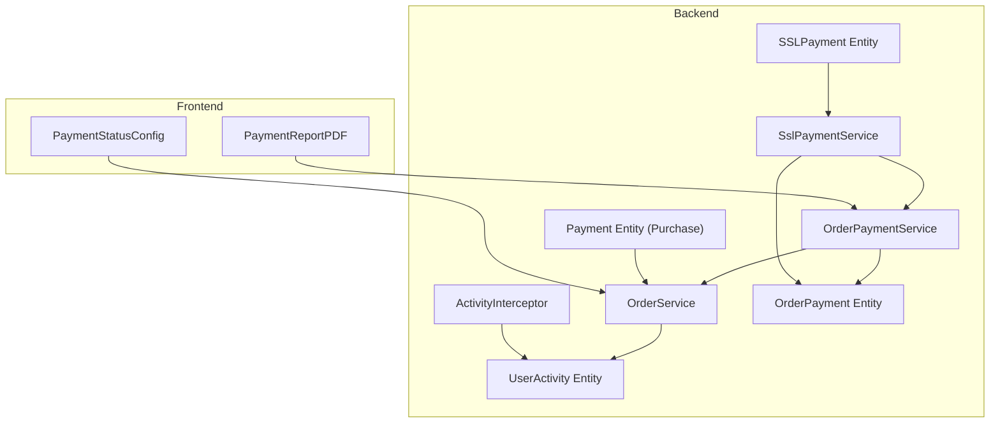
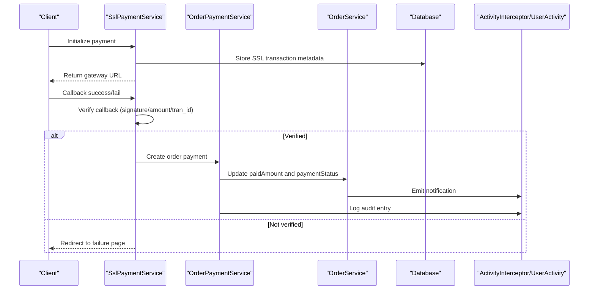
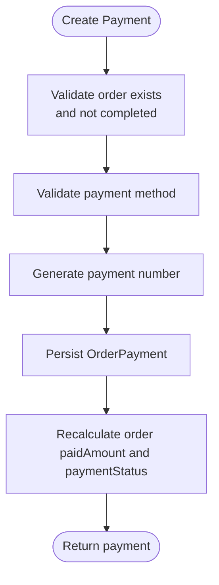
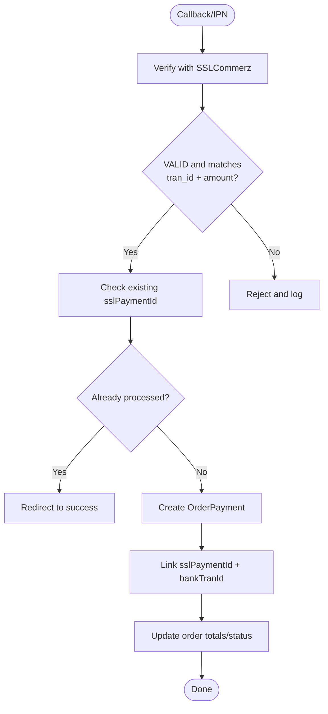
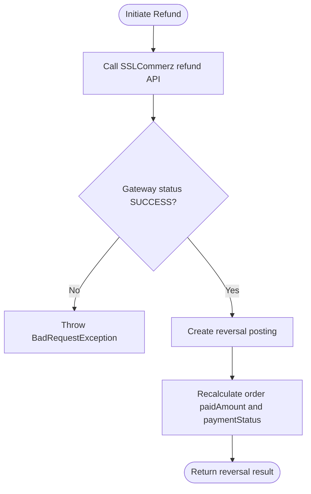
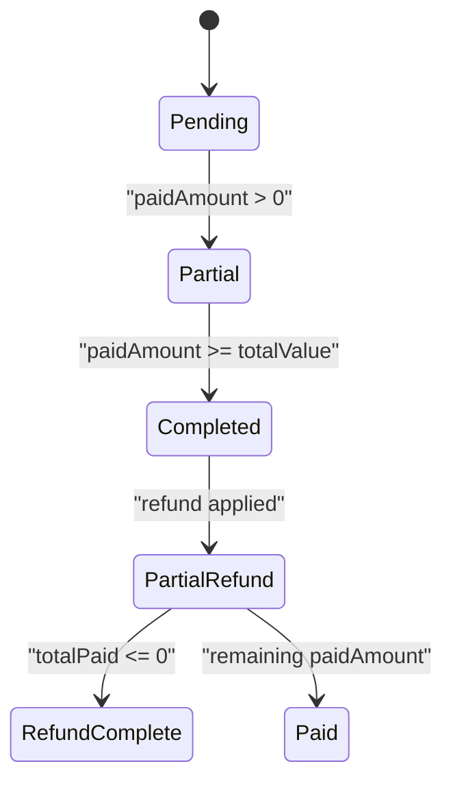
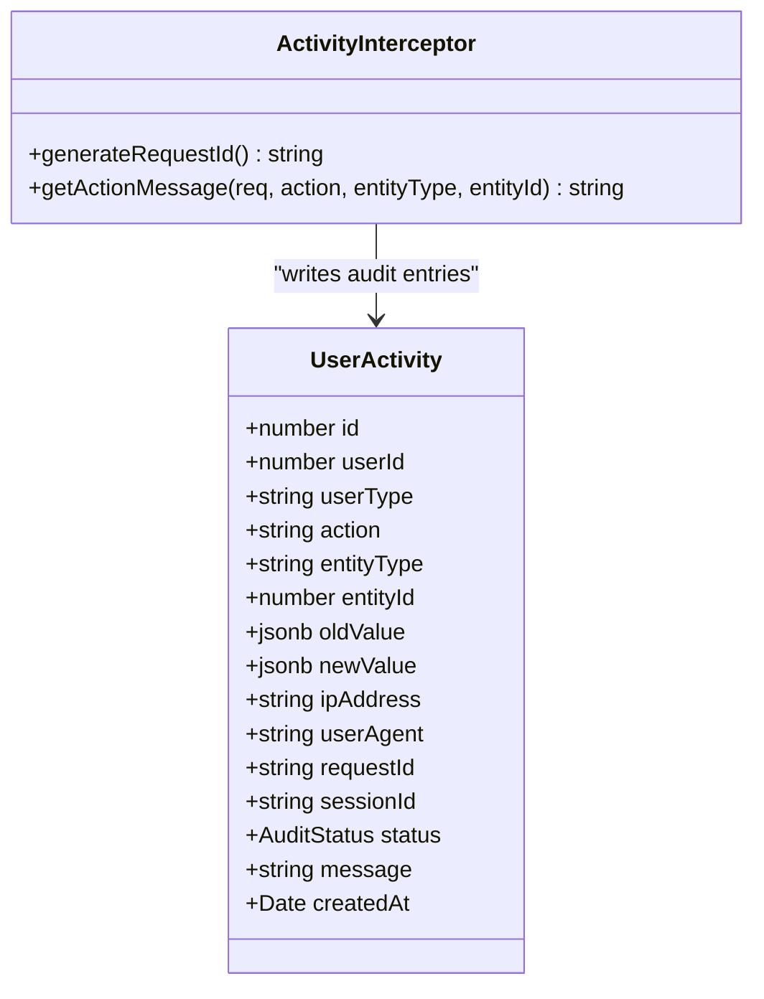
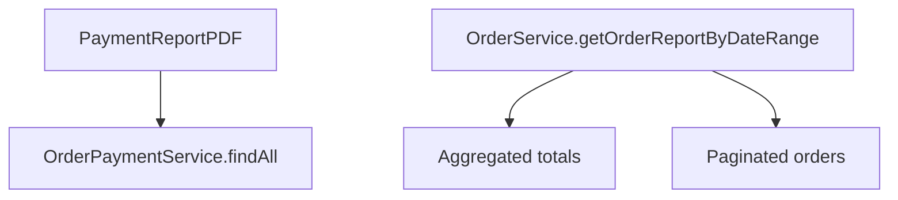
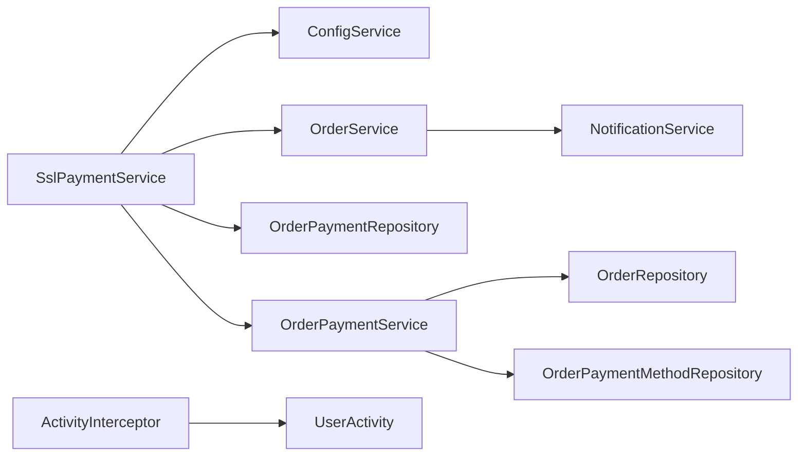

# Transaction Tracking & Audit

<cite>
**Referenced Files in This Document**
- [payment.entity.ts](file://apps/backend/src/payment/entities/payment.entity.ts)
- [order-payment.entity.ts](file://apps/backend/src/order-payment/entities/order-payment.entity.ts)
- [ssl-payment.entity.ts](file://apps/backend/src/ssl-payment/entities/payment.entity.ts)
- [user-activity.entity.ts](file://apps/backend/src/user-activity/entities/user-activity.entity.ts)
- [order-payment.service.ts](file://apps/backend/src/order-payment/order-payment.service.ts)
- [ssl-payment.service.ts](file://apps/backend/src/ssl-payment/ssl-payment.service.ts)
- [order.service.ts](file://apps/backend/src/order/order.service.ts)
- [activity.interceptor.ts](file://apps/backend/src/interceptor/activity.interceptor.ts)
- [PaymentReportPDF.tsx](file://apps/frontend/components/admin/reports/order-payments/PaymentReportPDF.tsx)
- [payment-status-config.ts](file://apps/frontend/utils/payment-status-config.ts)
</cite>

## Table of Contents
1. [Introduction](#introduction)
2. [Project Structure](#project-structure)
3. [Core Components](#core-components)
4. [Architecture Overview](#architecture-overview)
5. [Detailed Component Analysis](#detailed-component-analysis)
6. [Dependency Analysis](#dependency-analysis)
7. [Performance Considerations](#performance-considerations)
8. [Troubleshooting Guide](#troubleshooting-guide)
9. [Conclusion](#conclusion)

## Introduction
This document explains how payment transactions are recorded, validated, reconciled, and audited across the system. It covers:
- Transaction lifecycle from initiation to completion, failure, or refund
- Status management for orders and payments
- Audit trail generation for compliance and debugging
- Payment verification including signature validation and fraud detection patterns
- Querying transaction history and generating payment reports
- Integration points with analytics and business intelligence

The backend is a NestJS application using TypeORM entities and services. The frontend provides admin reporting and user-facing payment status pages.

## Project Structure
The payment tracking and audit system spans several modules:
- Order-level payment records and reconciliation
- SSLCommerz integration for online payments
- Generic purchase payment records
- User activity audit logging
- Admin reporting and UI configuration for payment statuses

**Diagram sources**
- [order-payment.service.ts:17-309](file://apps/backend/src/order-payment/order-payment.service.ts#L17-L309)
- [ssl-payment.service.ts:16-414](file://apps/backend/src/ssl-payment/ssl-payment.service.ts#L16-L414)
- [order.service.ts:1373-1398](file://apps/backend/src/order/order.service.ts#L1373-L1398)
- [activity.interceptor.ts:300-499](file://apps/backend/src/interceptor/activity.interceptor.ts#L300-L499)
- [user-activity.entity.ts:23-87](file://apps/backend/src/user-activity/entities/user-activity.entity.ts#L23-L87)
- [order-payment.entity.ts:18-126](file://apps/backend/src/order-payment/entities/order-payment.entity.ts#L18-L126)
- [payment.entity.ts:17-142](file://apps/backend/src/payment/entities/payment.entity.ts#L17-L142)
- [ssl-payment.entity.ts:3-28](file://apps/backend/src/ssl-payment/entities/payment.entity.ts#L3-L28)
- [PaymentReportPDF.tsx:1-270](file://apps/frontend/components/admin/reports/order-payments/PaymentReportPDF.tsx#L1-L270)
- [payment-status-config.ts:1-58](file://apps/frontend/utils/payment-status-config.ts#L1-L58)

**Section sources**
- [order-payment.service.ts:17-309](file://apps/backend/src/order-payment/order-payment.service.ts#L17-L309)
- [ssl-payment.service.ts:16-414](file://apps/backend/src/ssl-payment/ssl-payment.service.ts#L16-L414)
- [order.service.ts:1373-1398](file://apps/backend/src/order/order.service.ts#L1373-L1398)
- [activity.interceptor.ts:300-499](file://apps/backend/src/interceptor/activity.interceptor.ts#L300-L499)
- [user-activity.entity.ts:23-87](file://apps/backend/src/user-activity/entities/user-activity.entity.ts#L23-L87)
- [order-payment.entity.ts:18-126](file://apps/backend/src/order-payment/entities/order-payment.entity.ts#L18-L126)
- [payment.entity.ts:17-142](file://apps/backend/src/payment/entities/payment.entity.ts#L17-L142)
- [ssl-payment.entity.ts:3-28](file://apps/backend/src/ssl-payment/entities/payment.entity.ts#L3-L28)
- [PaymentReportPDF.tsx:1-270](file://apps/frontend/components/admin/reports/order-payments/PaymentReportPDF.tsx#L1-L270)
- [payment-status-config.ts:1-58](file://apps/frontend/utils/payment-status-config.ts#L1-L58)

## Core Components
- OrderPayment entity: Represents order-level payments and refunds, including SSL transaction references and bank transaction IDs used for reconciliation and refunds.
- Payment entity (purchase): Represents generic purchase payments with status and reference numbers.
- SSLPayment entity: Stores gateway-side transaction metadata such as tran_id, amount, currency, and status.
- OrderPaymentService: Creates payments, updates order totals and payment status, supports partial/full refunds, and exposes query helpers for reporting.
- SslPaymentService: Initializes payments via SSLCommerz, verifies callbacks, handles success/failure flows, IPN processing, and initiates refunds.
- OrderService: Updates order payment status and emits WebSocket notifications for real-time updates.
- ActivityInterceptor: Generates audit entries for API actions, including payment-related routes.
- UserActivity entity: Stores structured audit logs with actor, action, entity context, old/new values, request metadata, and outcome.
- Frontend PaymentReportPDF: Renders payment report PDFs with order and payment details.
- Frontend PaymentStatusConfig: Defines user-facing messages and styling for payment outcomes.

**Section sources**
- [order-payment.entity.ts:18-126](file://apps/backend/src/order-payment/entities/order-payment.entity.ts#L18-L126)
- [payment.entity.ts:17-142](file://apps/backend/src/payment/entities/payment.entity.ts#L17-L142)
- [ssl-payment.entity.ts:3-28](file://apps/backend/src/ssl-payment/entities/payment.entity.ts#L3-L28)
- [order-payment.service.ts:17-309](file://apps/backend/src/order-payment/order-payment.service.ts#L17-L309)
- [ssl-payment.service.ts:16-414](file://apps/backend/src/ssl-payment/ssl-payment.service.ts#L16-L414)
- [order.service.ts:1373-1398](file://apps/backend/src/order/order.service.ts#L1373-L1398)
- [activity.interceptor.ts:300-499](file://apps/backend/src/interceptor/activity.interceptor.ts#L300-L499)
- [user-activity.entity.ts:23-87](file://apps/backend/src/user-activity/entities/user-activity.entity.ts#L23-L87)
- [PaymentReportPDF.tsx:1-270](file://apps/frontend/components/admin/reports/order-payments/PaymentReportPDF.tsx#L1-L270)
- [payment-status-config.ts:1-58](file://apps/frontend/utils/payment-status-config.ts#L1-L58)

## Architecture Overview
The payment flow integrates three layers:
- Gateway layer: SSLCommerz initializes and validates payments.
- Application layer: Services orchestrate payment creation, verification, reconciliation, and refund handling.
- Persistence and audit layer: Entities store transactional data; interceptors and services generate audit trails.

**Diagram sources**
- [ssl-payment.service.ts:44-111](file://apps/backend/src/ssl-payment/ssl-payment.service.ts#L44-L111)
- [ssl-payment.service.ts:113-234](file://apps/backend/src/ssl-payment/ssl-payment.service.ts#L113-L234)
- [ssl-payment.service.ts:269-306](file://apps/backend/src/ssl-payment/ssl-payment.service.ts#L269-L306)
- [order-payment.service.ts:28-73](file://apps/backend/src/order-payment/order-payment.service.ts#L28-L73)
- [order-payment.service.ts:187-211](file://apps/backend/src/order-payment/order-payment.service.ts#L187-L211)
- [order.service.ts:1373-1398](file://apps/backend/src/order/order.service.ts#L1373-L1398)
- [activity.interceptor.ts:300-499](file://apps/backend/src/interceptor/activity.interceptor.ts#L300-L499)

## Detailed Component Analysis

### Transaction Recording and Reconciliation
- OrderPayment entity captures:
  - Unique payment number
  - Associated order and payment method
  - Amount and payment date
  - SSL transaction ID and bank transaction ID for reconciliation
  - Payment type (payment vs refund) and original payment link for reversals
- OrderPaymentService.create:
  - Validates order existence and prevents payments on completed orders
  - Generates sequential payment numbers per year
  - Persists payment and recalculates order totals and payment status
- OrderPaymentService.findAll:
  - Supports date range filtering and order status filtering
  - Joins order, payment method, and user fields for reporting

**Diagram sources**
- [order-payment.service.ts:28-73](file://apps/backend/src/order-payment/order-payment.service.ts#L28-L73)
- [order-payment.service.ts:187-211](file://apps/backend/src/order-payment/order-payment.service.ts#L187-L211)

**Section sources**
- [order-payment.entity.ts:18-126](file://apps/backend/src/order-payment/entities/order-payment.entity.ts#L18-L126)
- [order-payment.service.ts:28-73](file://apps/backend/src/order-payment/order-payment.service.ts#L28-L73)
- [order-payment.service.ts:81-139](file://apps/backend/src/order-payment/order-payment.service.ts#L81-L139)

### Payment Verification and Fraud Detection
- SslPaymentService.verifyPayment:
  - Calls SSLCommerz validation endpoint with val_id
  - Checks response status equals VALID
  - Compares returned tran_id and amount against the callback payload
- handlePaymentSuccess:
  - Logs non-sensitive fields only
  - Prevents duplicate processing by checking existing sslPaymentId
  - Associates payment with order and sets SSL/bank transaction references
- handleIPN:
  - Processes asynchronous IPN events when status is VALID
  - Delegates to success handler for consistent state updates

**Diagram sources**
- [ssl-payment.service.ts:113-234](file://apps/backend/src/ssl-payment/ssl-payment.service.ts#L113-L234)
- [ssl-payment.service.ts:269-306](file://apps/backend/src/ssl-payment/ssl-payment.service.ts#L269-L306)
- [ssl-payment.service.ts:308-328](file://apps/backend/src/ssl-payment/ssl-payment.service.ts#L308-L328)

**Section sources**
- [ssl-payment.service.ts:113-234](file://apps/backend/src/ssl-payment/ssl-payment.service.ts#L113-L234)
- [ssl-payment.service.ts:269-306](file://apps/backend/src/ssl-payment/ssl-payment.service.ts#L269-L306)
- [ssl-payment.service.ts:308-328](file://apps/backend/src/ssl-payment/ssl-payment.service.ts#L308-L328)

### Refund Processing and Reversal Posting
- SslPaymentService.initiateRefund:
  - Validates SSL credentials and calls gateway refund API
  - Detects IP whitelist errors and surfaces actionable error messages
  - On successful refund, creates a reversal posting via OrderPaymentService.createRefund
- OrderPaymentService.createRefund:
  - Validates original payment and refund amount limits
  - Generates unique refund number
  - Records negative amount and links to original payment
  - Recalculates order payment status for full/partial refund scenarios

**Diagram sources**
- [ssl-payment.service.ts:330-412](file://apps/backend/src/ssl-payment/ssl-payment.service.ts#L330-L412)
- [order-payment.service.ts:213-307](file://apps/backend/src/order-payment/order-payment.service.ts#L213-L307)

**Section sources**
- [ssl-payment.service.ts:330-412](file://apps/backend/src/ssl-payment/ssl-payment.service.ts#L330-L412)
- [order-payment.service.ts:213-307](file://apps/backend/src/order-payment/order-payment.service.ts#L213-L307)

### Transaction Status Management
- Order payment status calculation:
  - If paidAmount >= totalValue: COMPLETED
  - If paidAmount > 0 but less than totalValue: PARTIAL
  - Otherwise: PENDING
- After refund:
  - If totalPaid <= 0: REFUND_COMPLETE
  - If totalPaid < totalValue: PARTIAL_REFUND
  - Else: PAID
- OrderService.updatePaymentStatus:
  - Updates order.paymentStatus
  - Emits WebSocket notification to the associated user

**Diagram sources**
- [order-payment.service.ts:187-211](file://apps/backend/src/order-payment/order-payment.service.ts#L187-L211)
- [order-payment.service.ts:278-307](file://apps/backend/src/order-payment/order-payment.service.ts#L278-L307)
- [order.service.ts:1373-1398](file://apps/backend/src/order/order.service.ts#L1373-L1398)

**Section sources**
- [order-payment.service.ts:187-211](file://apps/backend/src/order-payment/order-payment.service.ts#L187-L211)
- [order-payment.service.ts:278-307](file://apps/backend/src/order-payment/order-payment.service.ts#L278-L307)
- [order.service.ts:1373-1398](file://apps/backend/src/order/order.service.ts#L1373-L1398)

### Audit Trail Generation
- ActivityInterceptor:
  - Captures route paths and generates human-readable action messages
  - Special handling for order payment status updates and other order operations
  - Enriches messages with order numbers and contextual details
- UserActivity entity:
  - Stores actor identity, action, entity type/id, old/new values, request metadata (IP, user agent, request/session IDs), outcome, and timestamp
  - Indexed for efficient querying by userId/action, entityType/entityId, and createdAt

**Diagram sources**
- [user-activity.entity.ts:23-87](file://apps/backend/src/user-activity/entities/user-activity.entity.ts#L23-L87)
- [activity.interceptor.ts:300-499](file://apps/backend/src/interceptor/activity.interceptor.ts#L300-L499)

**Section sources**
- [activity.interceptor.ts:300-499](file://apps/backend/src/interceptor/activity.interceptor.ts#L300-L499)
- [user-activity.entity.ts:23-87](file://apps/backend/src/user-activity/entities/user-activity.entity.ts#L23-L87)

### Reporting and Analytics Integration
- Payment report PDF:
  - Displays payment records with order summary, payment method, and creator/updater info
  - Includes company header and generated timestamp
- Order service reporting:
  - Provides aggregated summaries and paginated lists filtered by date ranges, order status, and payment status
  - Uses raw SQL aggregation for performance-critical totals

**Diagram sources**
- [PaymentReportPDF.tsx:1-270](file://apps/frontend/components/admin/reports/order-payments/PaymentReportPDF.tsx#L1-L270)
- [order-payment.service.ts:81-139](file://apps/backend/src/order-payment/order-payment.service.ts#L81-L139)
- [order.service.ts:1414-1559](file://apps/backend/src/order/order.service.ts#L1414-L1559)

**Section sources**
- [PaymentReportPDF.tsx:1-270](file://apps/frontend/components/admin/reports/order-payments/PaymentReportPDF.tsx#L1-L270)
- [order-payment.service.ts:81-139](file://apps/backend/src/order-payment/order-payment.service.ts#L81-L139)
- [order.service.ts:1414-1559](file://apps/backend/src/order/order.service.ts#L1414-L1559)

### Frontend Payment Status UX
- PaymentStatusConfig defines user-facing titles, descriptions, icons, and styling for success, failed, and canceled outcomes.
- These configurations drive consistent messaging and visual feedback during payment flows.

**Section sources**
- [payment-status-config.ts:1-58](file://apps/frontend/utils/payment-status-config.ts#L1-L58)

## Dependency Analysis
Key dependencies and relationships:
- SslPaymentService depends on:
  - ConfigService for SSLCommerz credentials and URLs
  - OrderRepository and OrderPaymentRepository for persistence
  - OrderPaymentService for creating payments and refunds
- OrderPaymentService depends on:
  - OrderRepository for updating order totals and status
  - OrderPaymentMethodRepository for validating payment methods
- OrderService.updatePaymentStatus triggers notifications via NotificationService
- ActivityInterceptor writes to UserActivity for audit trails

**Diagram sources**
- [ssl-payment.service.ts:16-27](file://apps/backend/src/ssl-payment/ssl-payment.service.ts#L16-L27)
- [order-payment.service.ts:17-26](file://apps/backend/src/order-payment/order-payment.service.ts#L17-L26)
- [order.service.ts:1373-1398](file://apps/backend/src/order/order.service.ts#L1373-L1398)
- [activity.interceptor.ts:300-499](file://apps/backend/src/interceptor/activity.interceptor.ts#L300-L499)

**Section sources**
- [ssl-payment.service.ts:16-27](file://apps/backend/src/ssl-payment/ssl-payment.service.ts#L16-L27)
- [order-payment.service.ts:17-26](file://apps/backend/src/order-payment/order-payment.service.ts#L17-L26)
- [order.service.ts:1373-1398](file://apps/backend/src/order/order.service.ts#L1373-L1398)
- [activity.interceptor.ts:300-499](file://apps/backend/src/interceptor/activity.interceptor.ts#L300-L499)

## Performance Considerations
- Use raw SQL aggregation for report totals to avoid loading large datasets into memory.
- Avoid eager-loading heavy relations in list endpoints; prefer selective joins for reporting queries.
- Index frequently queried columns such as paymentDate, orderStatus, paymentStatus, and createdAt.
- Limit sensitive data in logs; only include identifiers and non-PII fields.
- For high-volume IPN processing, consider queuing background jobs to decouple gateway callbacks from immediate state updates.

[No sources needed since this section provides general guidance]

## Troubleshooting Guide
Common issues and resolutions:
- Payment initialization fails:
  - Ensure SSLCommerz credentials are configured and environment variables are set correctly.
  - Check BASE_URL and PAYMENT_IP_URL configuration.
- Payment verification fails:
  - Confirm that the callback’s tran_id and amount match the gateway validation response.
  - Inspect logs for validation status mismatches.
- Duplicate payment processing:
  - Verify that sslPaymentId uniqueness prevents reprocessing.
- Refund failures:
  - Check SSLCommerz IP whitelist configuration if server IP is not whitelisted.
  - Validate bank_tran_id and tran_id inputs are correct and distinct.
- Audit trail gaps:
  - Ensure ActivityInterceptor is active and writing entries for payment-related routes.
  - Validate UserActivity indexes for efficient querying.

**Section sources**
- [ssl-payment.service.ts:29-42](file://apps/backend/src/ssl-payment/ssl-payment.service.ts#L29-L42)
- [ssl-payment.service.ts:113-234](file://apps/backend/src/ssl-payment/ssl-payment.service.ts#L113-L234)
- [ssl-payment.service.ts:330-412](file://apps/backend/src/ssl-payment/ssl-payment.service.ts#L330-L412)
- [activity.interceptor.ts:300-499](file://apps/backend/src/interceptor/activity.interceptor.ts#L300-L499)

## Conclusion
The system provides a robust pipeline for recording, verifying, and reconciling payment transactions, with clear status transitions and comprehensive audit trails. SSLCommerz integration includes signature validation and fraud checks through strict comparison of transaction identifiers and amounts. Reporting utilities support both operational queries and business intelligence needs. For enhanced security and scalability, consider adding webhook signature verification, rate limiting, and background job processing for IPN handling.

[No sources needed since this section summarizes without analyzing specific files]