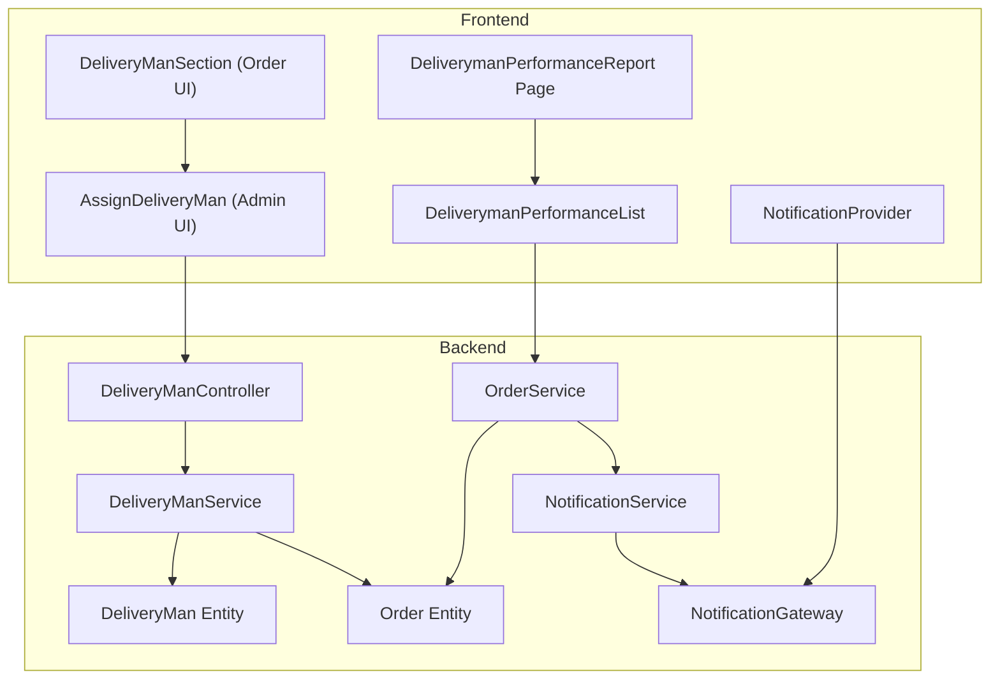
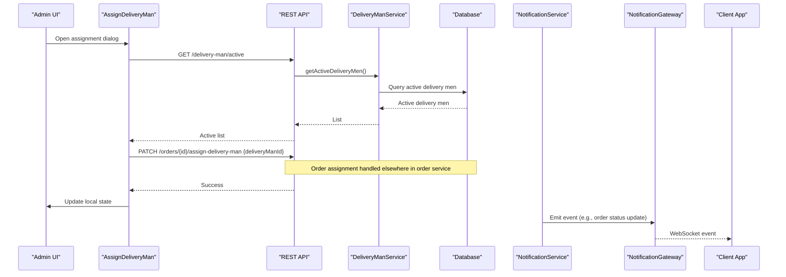
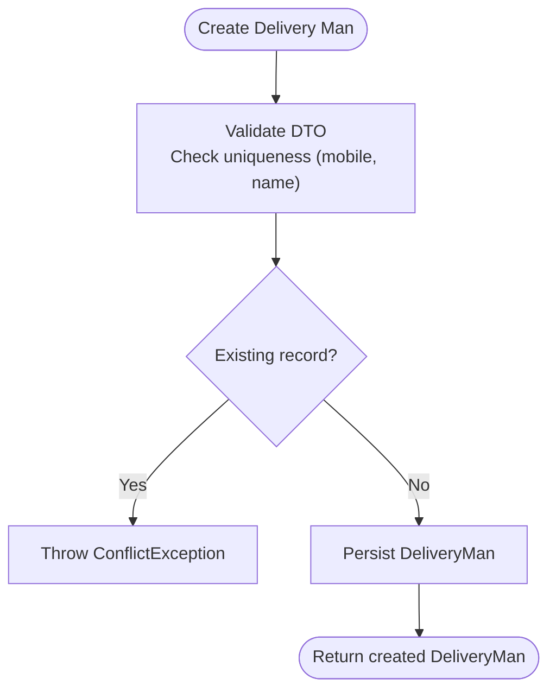
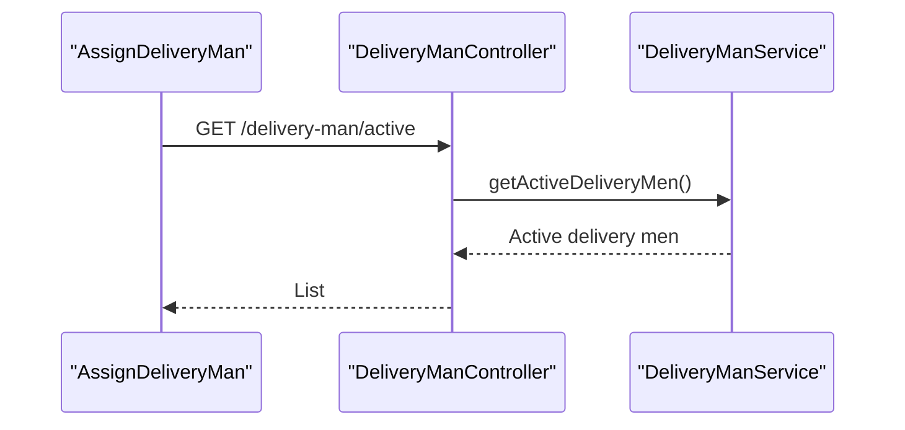
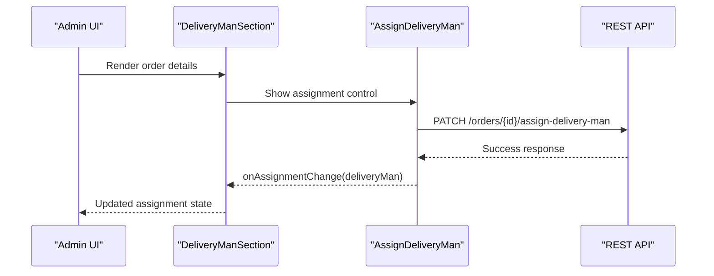
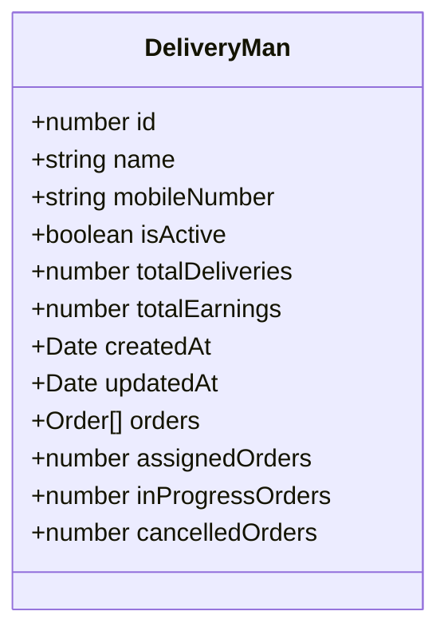
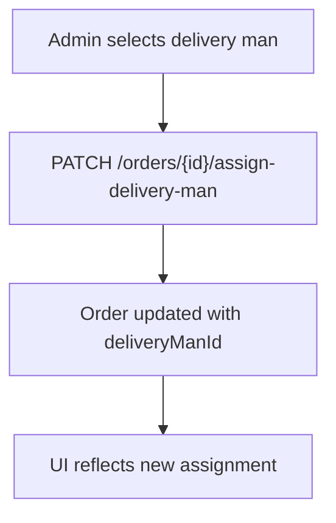
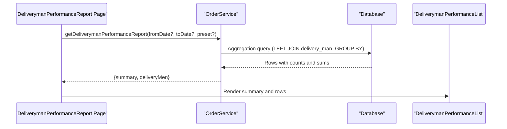
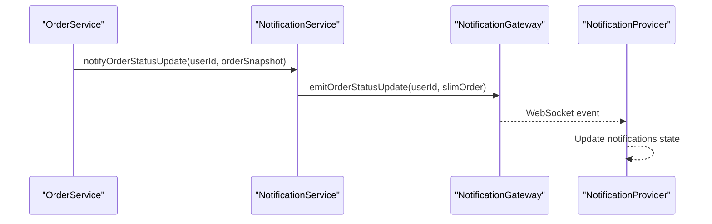
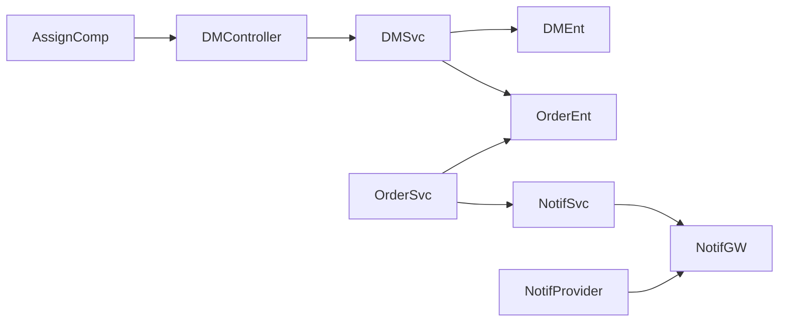

# Delivery Personnel Management

<cite>
**Referenced Files in This Document**
- [delivery-man.controller.ts](file://apps/backend/src/delivery-man/delivery-man.controller.ts)
- [delivery-man.service.ts](file://apps/backend/src/delivery-man/delivery-man.service.ts)
- [delivery-man.entity.ts](file://apps/backend/src/delivery-man/entities/delivery-man.entity.ts)
- [create-delivery-man.dto.ts](file://apps/backend/src/delivery-man/dto/create-delivery-man.dto.ts)
- [update-delivery-man.dto.ts](file://apps/backend/src/delivery-man/dto/update-delivery-man.dto.ts)
- [get-delivery-men-query.dto.ts](file://apps/backend/src/delivery-man/dto/get-delivery-men-query.dto.ts)
- [order.entity.ts](file://apps/backend/src/order/entities/order.entity.ts)
- [order.service.ts](file://apps/backend/src/order/order.service.ts)
- [assign-delivery-man.tsx](file://apps/frontend/components/admin/delivery-man/assign-delivery-man.tsx)
- [delivery-man-section.tsx](file://apps/frontend/components/admin/orders/delivery-man-section.tsx)
- [deliveryman-performance-list.tsx](file://apps/frontend/components/admin/reports/deliveryman-performance/deliveryman-performance-list.tsx)
- [deliveryman-performance-report-page.tsx](file://apps/frontend/app/admin/reports/deliveryman-performance/page.tsx)
- [notification.service.ts](file://apps/backend/src/notification/notification.service.ts)
- [notification.gateway.ts](file://apps/backend/src/notification/notification.gateway.ts)
- [notification-provider.tsx](file://apps/frontend/providers/notification-provider.tsx)
</cite>

## Table of Contents
1. [Introduction](#introduction)
2. [Project Structure](#project-structure)
3. [Core Components](#core-components)
4. [Architecture Overview](#architecture-overview)
5. [Detailed Component Analysis](#detailed-component-analysis)
6. [Dependency Analysis](#dependency-analysis)
7. [Performance Considerations](#performance-considerations)
8. [Troubleshooting Guide](#troubleshooting-guide)
9. [Conclusion](#conclusion)

## Introduction
This document explains the delivery personnel management system implemented in the monorepo. It covers:
- Delivery man registration and profile management
- Availability tracking via active/inactive status
- Assignment workflow for orders to delivery men
- Performance analytics and reporting
- Integration with order processing and real-time notifications

The backend exposes a REST API for CRUD operations on delivery men, while the frontend provides an admin interface to assign delivery men to orders and view performance reports. Real-time updates are delivered through WebSockets.

## Project Structure
The delivery personnel feature spans both backend and frontend:
- Backend NestJS module under apps/backend/src/delivery-man with controller, service, entity, and DTOs
- Order entity references a delivery man
- Frontend admin components for assigning delivery men and viewing performance reports
- Notification subsystem for real-time updates

**Diagram sources**
- [delivery-man.controller.ts:31-35](file://apps/backend/src/delivery-man/delivery-man.controller.ts#L31-L35)
- [delivery-man.service.ts:20-28](file://apps/backend/src/delivery-man/delivery-man.service.ts#L20-L28)
- [delivery-man.entity.ts:11-38](file://apps/backend/src/delivery-man/entities/delivery-man.entity.ts#L11-L38)
- [order.entity.ts:24-124](file://apps/backend/src/order/entities/order.entity.ts#L24-L124)
- [order.service.ts:1798-1866](file://apps/backend/src/order/order.service.ts#L1798-L1866)
- [notification.service.ts:21-29](file://apps/backend/src/notification/notification.service.ts#L21-L29)
- [notification.gateway.ts:15-37](file://apps/backend/src/notification/notification.gateway.ts#L15-L37)
- [assign-delivery-man.tsx:42-53](file://apps/frontend/components/admin/delivery-man/assign-delivery-man.tsx#L42-L53)
- [delivery-man-section.tsx:14-23](file://apps/frontend/components/admin/orders/delivery-man-section.tsx#L14-L23)
- [deliveryman-performance-list.tsx:49-87](file://apps/frontend/components/admin/reports/deliveryman-performance/deliveryman-performance-list.tsx#L49-L87)
- [deliveryman-performance-report-page.tsx:15-44](file://apps/frontend/app/admin/reports/deliveryman-performance/page.tsx#L15-L44)
- [notification-provider.tsx:86-161](file://apps/frontend/providers/notification-provider.tsx#L86-L161)

**Section sources**
- [delivery-man.controller.ts:31-35](file://apps/backend/src/delivery-man/delivery-man.controller.ts#L31-L35)
- [delivery-man.service.ts:20-28](file://apps/backend/src/delivery-man/delivery-man.service.ts#L20-L28)
- [delivery-man.entity.ts:11-38](file://apps/backend/src/delivery-man/entities/delivery-man.entity.ts#L11-L38)
- [order.entity.ts:24-124](file://apps/backend/src/order/entities/order.entity.ts#L24-L124)
- [assign-delivery-man.tsx:42-53](file://apps/frontend/components/admin/delivery-man/assign-delivery-man.tsx#L42-L53)
- [delivery-man-section.tsx:14-23](file://apps/frontend/components/admin/orders/delivery-man-section.tsx#L14-L23)
- [deliveryman-performance-list.tsx:49-87](file://apps/frontend/components/admin/reports/deliveryman-performance/deliveryman-performance-list.tsx#L49-L87)
- [deliveryman-performance-report-page.tsx:15-44](file://apps/frontend/app/admin/reports/deliveryman-performance/page.tsx#L15-L44)
- [notification.service.ts:21-29](file://apps/backend/src/notification/notification.service.ts#L21-L29)
- [notification.gateway.ts:15-37](file://apps/backend/src/notification/notification.gateway.ts#L15-L37)
- [notification-provider.tsx:86-161](file://apps/frontend/providers/notification-provider.tsx#L86-L161)

## Core Components
- DeliveryManController: REST endpoints for creating, listing, retrieving, updating, deleting delivery men; also lists active delivery men and updates statistics.
- DeliveryManService: Business logic for validation, persistence, pagination, search, filtering by active status, and computing display-only counters for assigned/in-progress/cancelled orders.
- DeliveryMan Entity: Persistent model with unique name/mobileNumber, isActive flag, totalDeliveries, totalEarnings, timestamps, and one-to-many relation to orders.
- DTOs: CreateDeliveryManDto, UpdateDeliveryManDto, GetDeliveryMenQueryDto define input contracts and query parameters.
- Order Entity: References a delivery man and tracks order status, payment status, timestamps, and delivery-related fields.
- OrderService: Provides per-delivery-man performance report aggregation over date ranges.
- Frontend AssignDeliveryMan: Admin UI component to select and assign/unassign a delivery man to an order.
- Frontend DeliveryManSection: Displays current assignment and triggers assignment dialog.
- Frontend DeliverymanPerformanceList/Page: Report UI for delivery man performance metrics.
- NotificationService/Gateway and NotificationProvider: Real-time notification infrastructure used across the app.

**Section sources**
- [delivery-man.controller.ts:31-259](file://apps/backend/src/delivery-man/delivery-man.controller.ts#L31-L259)
- [delivery-man.service.ts:20-228](file://apps/backend/src/delivery-man/delivery-man.service.ts#L20-L228)
- [delivery-man.entity.ts:11-45](file://apps/backend/src/delivery-man/entities/delivery-man.entity.ts#L11-L45)
- [create-delivery-man.dto.ts:4-29](file://apps/backend/src/delivery-man/dto/create-delivery-man.dto.ts#L4-L29)
- [update-delivery-man.dto.ts:1-5](file://apps/backend/src/delivery-man/dto/update-delivery-man.dto.ts#L1-L5)
- [get-delivery-men-query.dto.ts:5-40](file://apps/backend/src/delivery-man/dto/get-delivery-men-query.dto.ts#L5-L40)
- [order.entity.ts:24-124](file://apps/backend/src/order/entities/order.entity.ts#L24-L124)
- [order.service.ts:1798-1866](file://apps/backend/src/order/order.service.ts#L1798-L1866)
- [assign-delivery-man.tsx:42-100](file://apps/frontend/components/admin/delivery-man/assign-delivery-man.tsx#L42-L100)
- [delivery-man-section.tsx:14-71](file://apps/frontend/components/admin/orders/delivery-man-section.tsx#L14-L71)
- [deliveryman-performance-list.tsx:49-87](file://apps/frontend/components/admin/reports/deliveryman-performance/deliveryman-performance-list.tsx#L49-L87)
- [deliveryman-performance-report-page.tsx:15-44](file://apps/frontend/app/admin/reports/deliveryman-performance/page.tsx#L15-L44)

## Architecture Overview
The delivery personnel management architecture integrates:
- REST API for delivery man CRUD and availability queries
- Order assignment flow from admin UI to backend
- Aggregated performance reports
- Real-time notifications for order events

**Diagram sources**
- [assign-delivery-man.tsx:58-100](file://apps/frontend/components/admin/delivery-man/assign-delivery-man.tsx#L58-L100)
- [delivery-man.controller.ts:138-158](file://apps/backend/src/delivery-man/delivery-man.controller.ts#L138-L158)
- [delivery-man.service.ts:223-228](file://apps/backend/src/delivery-man/delivery-man.service.ts#L223-L228)
- [notification.service.ts:60-75](file://apps/backend/src/notification/notification.service.ts#L60-L75)
- [notification.gateway.ts:15-37](file://apps/backend/src/notification/notification.gateway.ts#L15-L37)

## Detailed Component Analysis

### Delivery Man Registration and Profile Management
- Registration: POST /delivery-man with CreateDeliveryManDto validates required fields and enforces uniqueness on mobile number and name.
- Listing: GET /delivery-man supports search, isActive filter, pagination, and returns display-only counters for assigned/in-progress/cancelled orders.
- Retrieval: GET /delivery-man/:id fetches a delivery man with related orders.
- Update: PATCH /delivery-man/:id allows partial updates with conflict checks for mobile number and name.
- Statistics: PATCH /delivery-man/:id/statistics recalculates totalDeliveries and totalEarnings based on delivered orders.
- Deletion: DELETE /delivery-man/:id removes a delivery man.

**Diagram sources**
- [delivery-man.controller.ts:38-88](file://apps/backend/src/delivery-man/delivery-man.controller.ts#L38-L88)
- [delivery-man.service.ts:30-59](file://apps/backend/src/delivery-man/delivery-man.service.ts#L30-L59)
- [create-delivery-man.dto.ts:4-29](file://apps/backend/src/delivery-man/dto/create-delivery-man.dto.ts#L4-L29)

**Section sources**
- [delivery-man.controller.ts:38-259](file://apps/backend/src/delivery-man/delivery-man.controller.ts#L38-L259)
- [delivery-man.service.ts:30-228](file://apps/backend/src/delivery-man/delivery-man.service.ts#L30-L228)
- [create-delivery-man.dto.ts:4-29](file://apps/backend/src/delivery-man/dto/create-delivery-man.dto.ts#L4-L29)
- [update-delivery-man.dto.ts:1-5](file://apps/backend/src/delivery-man/dto/update-delivery-man.dto.ts#L1-L5)
- [get-delivery-men-query.dto.ts:5-40](file://apps/backend/src/delivery-man/dto/get-delivery-men-query.dto.ts#L5-L40)

### Availability Tracking
- Active delivery men endpoint returns only those with isActive true.
- The assignment UI loads active delivery men to populate selection options.

**Diagram sources**
- [delivery-man.controller.ts:138-158](file://apps/backend/src/delivery-man/delivery-man.controller.ts#L138-L158)
- [delivery-man.service.ts:223-228](file://apps/backend/src/delivery-man/delivery-man.service.ts#L223-L228)
- [assign-delivery-man.tsx:58-76](file://apps/frontend/components/admin/delivery-man/assign-delivery-man.tsx#L58-L76)

**Section sources**
- [delivery-man.controller.ts:138-158](file://apps/backend/src/delivery-man/delivery-man.controller.ts#L138-L158)
- [delivery-man.service.ts:223-228](file://apps/backend/src/delivery-man/delivery-man.service.ts#L223-L228)
- [assign-delivery-man.tsx:58-76](file://apps/frontend/components/admin/delivery-man/assign-delivery-man.tsx#L58-L76)

### Order Assignment Workflow
- Admin UI shows current assignment or placeholder when none exists.
- AssignDeliveryMan opens a dialog to select an active delivery man and calls the order assignment endpoint.
- On success, UI updates local state and notifies user.

**Diagram sources**
- [delivery-man-section.tsx:14-71](file://apps/frontend/components/admin/orders/delivery-man-section.tsx#L14-L71)
- [assign-delivery-man.tsx:78-100](file://apps/frontend/components/admin/delivery-man/assign-delivery-man.tsx#L78-L100)

**Section sources**
- [delivery-man-section.tsx:14-71](file://apps/frontend/components/admin/orders/delivery-man-section.tsx#L14-L71)
- [assign-delivery-man.tsx:78-100](file://apps/frontend/components/admin/delivery-man/assign-delivery-man.tsx#L78-L100)

### Delivery Man Dashboard and Metrics
- Detail page displays total deliveries, total earnings, average earning per delivery, and active status.
- These values come from the DeliveryMan entity and computed averages in the UI.

**Diagram sources**
- [delivery-man.entity.ts:11-45](file://apps/backend/src/delivery-man/entities/delivery-man.entity.ts#L11-L45)

**Section sources**
- [delivery-man-detail.tsx:153-199](file://apps/frontend/components/admin/delivery-man/delivery-man-detail.tsx#L153-L199)
- [delivery-man.entity.ts:11-45](file://apps/backend/src/delivery-man/entities/delivery-man.entity.ts#L11-L45)

### Assignment Algorithm
- The repository does not implement an automated matching algorithm based on location, capacity, or performance metrics.
- Assignment is manual via the admin UI, selecting from active delivery men.
- Display-only counters (assignedOrders, inProgressOrders, cancelledOrders) are computed for list views using SQL aggregations.

**Diagram sources**
- [assign-delivery-man.tsx:78-100](file://apps/frontend/components/admin/delivery-man/assign-delivery-man.tsx#L78-L100)
- [delivery-man.service.ts:87-124](file://apps/backend/src/delivery-man/delivery-man.service.ts#L87-L124)

**Section sources**
- [assign-delivery-man.tsx:78-100](file://apps/frontend/components/admin/delivery-man/assign-delivery-man.tsx#L78-L100)
- [delivery-man.service.ts:87-124](file://apps/backend/src/delivery-man/delivery-man.service.ts#L87-L124)

### Delivery Performance Analytics and Reporting
- OrderService.getDeliverymanPerformanceReport aggregates per-delivery-man metrics over a date range: assigned count, delivered count, in-progress count, and delivered value.
- Frontend DeliverymanPerformanceReport page accepts preset or explicit date range and renders summary and rows.
- DeliverymanPerformanceList formats data for PDF export and displays summary metrics.

**Diagram sources**
- [order.service.ts:1798-1866](file://apps/backend/src/order/order.service.ts#L1798-L1866)
- [deliveryman-performance-report-page.tsx:15-44](file://apps/frontend/app/admin/reports/deliveryman-performance/page.tsx#L15-L44)
- [deliveryman-performance-list.tsx:49-87](file://apps/frontend/components/admin/reports/deliveryman-performance/deliveryman-performance-list.tsx#L49-L87)

**Section sources**
- [order.service.ts:1798-1866](file://apps/backend/src/order/order.service.ts#L1798-L1866)
- [deliveryman-performance-report-page.tsx:15-44](file://apps/frontend/app/admin/reports/deliveryman-performance/page.tsx#L15-L44)
- [deliveryman-performance-list.tsx:49-87](file://apps/frontend/components/admin/reports/deliveryman-performance/deliveryman-performance-list.tsx#L49-L87)

### Integration with Order Processing and Real-Time Tracking
- Order entity links to delivery man and tracks statuses and timestamps.
- NotificationService emits events (new order, order confirmation, status updates) via NotificationGateway.
- Frontend NotificationProvider connects to WebSocket namespace and handles events, updating UI and showing toasts.

**Diagram sources**
- [order.entity.ts:120-124](file://apps/backend/src/order/entities/order.entity.ts#L120-L124)
- [notification.service.ts:112-116](file://apps/backend/src/notification/notification.service.ts#L112-L116)
- [notification.gateway.ts:15-37](file://apps/backend/src/notification/notification.gateway.ts#L15-L37)
- [notification-provider.tsx:133-161](file://apps/frontend/providers/notification-provider.tsx#L133-L161)

**Section sources**
- [order.entity.ts:120-124](file://apps/backend/src/order/entities/order.entity.ts#L120-L124)
- [notification.service.ts:112-116](file://apps/backend/src/notification/notification.service.ts#L112-L116)
- [notification.gateway.ts:15-37](file://apps/backend/src/notification/notification.gateway.ts#L15-L37)
- [notification-provider.tsx:133-161](file://apps/frontend/providers/notification-provider.tsx#L133-L161)

### Examples of CRUD Operations and Status Updates
- Create: POST /delivery-man with name and mobileNumber; conflicts if duplicates exist.
- Read: GET /delivery-man/:id retrieves full profile including orders.
- Update: PATCH /delivery-man/:id updates fields with uniqueness checks.
- Delete: DELETE /delivery-man/:id removes entry.
- Statistics: PATCH /delivery-man/:id/statistics recalculates totals from delivered orders.

**Section sources**
- [delivery-man.controller.ts:38-259](file://apps/backend/src/delivery-man/delivery-man.controller.ts#L38-L259)
- [delivery-man.service.ts:30-228](file://apps/backend/src/delivery-man/delivery-man.service.ts#L30-L228)

### Rating Systems and Commission Calculations
- No rating system or commission calculation logic is present in the analyzed files.
- Earnings are tracked as totalEarnings on the delivery man entity and recomputed from delivered orders’ totalValue via updateStatistics.

**Section sources**
- [delivery-man.entity.ts:25-29](file://apps/backend/src/delivery-man/entities/delivery-man.entity.ts#L25-L29)
- [delivery-man.service.ts:196-221](file://apps/backend/src/delivery-man/delivery-man.service.ts#L196-L221)

## Dependency Analysis
Key dependencies and relationships:
- DeliveryManController depends on DeliveryManService for business logic.
- DeliveryManService uses TypeORM Repository for DeliveryMan and raw SQL for aggregated counters.
- Order entity has ManyToOne relation to DeliveryMan.
- OrderService provides performance reports that join delivery_man and order tables.
- NotificationService and NotificationGateway provide real-time channels consumed by NotificationProvider.

**Diagram sources**
- [delivery-man.controller.ts:31-35](file://apps/backend/src/delivery-man/delivery-man.controller.ts#L31-L35)
- [delivery-man.service.ts:20-28](file://apps/backend/src/delivery-man/delivery-man.service.ts#L20-L28)
- [order.entity.ts:24-124](file://apps/backend/src/order/entities/order.entity.ts#L24-L124)
- [order.service.ts:1798-1866](file://apps/backend/src/order/order.service.ts#L1798-L1866)
- [notification.service.ts:21-29](file://apps/backend/src/notification/notification.service.ts#L21-L29)
- [notification.gateway.ts:15-37](file://apps/backend/src/notification/notification.gateway.ts#L15-L37)
- [assign-delivery-man.tsx:42-53](file://apps/frontend/components/admin/delivery-man/assign-delivery-man.tsx#L42-L53)
- [notification-provider.tsx:86-161](file://apps/frontend/providers/notification-provider.tsx#L86-L161)

**Section sources**
- [delivery-man.controller.ts:31-35](file://apps/backend/src/delivery-man/delivery-man.controller.ts#L31-L35)
- [delivery-man.service.ts:20-28](file://apps/backend/src/delivery-man/delivery-man.service.ts#L20-L28)
- [order.entity.ts:24-124](file://apps/backend/src/order/entities/order.entity.ts#L24-L124)
- [order.service.ts:1798-1866](file://apps/backend/src/order/order.service.ts#L1798-L1866)
- [notification.service.ts:21-29](file://apps/backend/src/notification/notification.service.ts#L21-L29)
- [notification.gateway.ts:15-37](file://apps/backend/src/notification/notification.gateway.ts#L15-L37)
- [assign-delivery-man.tsx:42-53](file://apps/frontend/components/admin/delivery-man/assign-delivery-man.tsx#L42-L53)
- [notification-provider.tsx:86-161](file://apps/frontend/providers/notification-provider.tsx#L86-L161)

## Performance Considerations
- Use pagination and filters on delivery man listing to reduce payload size.
- Leverage the active delivery men endpoint to limit assignment options to available personnel.
- For performance reports, use presets or narrow date ranges to minimize aggregation cost.
- Avoid eager loading large relations unless necessary; rely on display-only counters where possible.

[No sources needed since this section provides general guidance]

## Troubleshooting Guide
Common issues and resolutions:
- Duplicate mobile number or name during create/update: Ensure uniqueness constraints are satisfied before submission.
- Not found errors when accessing delivery man by ID: Verify the ID exists and permissions allow access.
- Assignment failures: Confirm the selected delivery man is active and the order is not already delivered.
- Real-time notifications not appearing: Check WebSocket connection and ensure NotificationProvider is initialized with correct userId and isAdmin flags.

**Section sources**
- [delivery-man.service.ts:30-59](file://apps/backend/src/delivery-man/delivery-man.service.ts#L30-L59)
- [delivery-man.service.ts:140-184](file://apps/backend/src/delivery-man/delivery-man.service.ts#L140-L184)
- [assign-delivery-man.tsx:102-131](file://apps/frontend/components/admin/delivery-man/assign-delivery-man.tsx#L102-L131)
- [notification-provider.tsx:86-161](file://apps/frontend/providers/notification-provider.tsx#L86-L161)

## Conclusion
The delivery personnel management system provides robust CRUD operations, availability tracking, and manual assignment workflows integrated with order processing and real-time notifications. Performance analytics are available via aggregated reports. Ratings and commissions are not implemented in the analyzed codebase; earnings are tracked and recalculated from delivered orders. Future enhancements could include automated assignment algorithms considering location, capacity, and performance metrics, as well as rating and commission systems.

[No sources needed since this section summarizes without analyzing specific files]