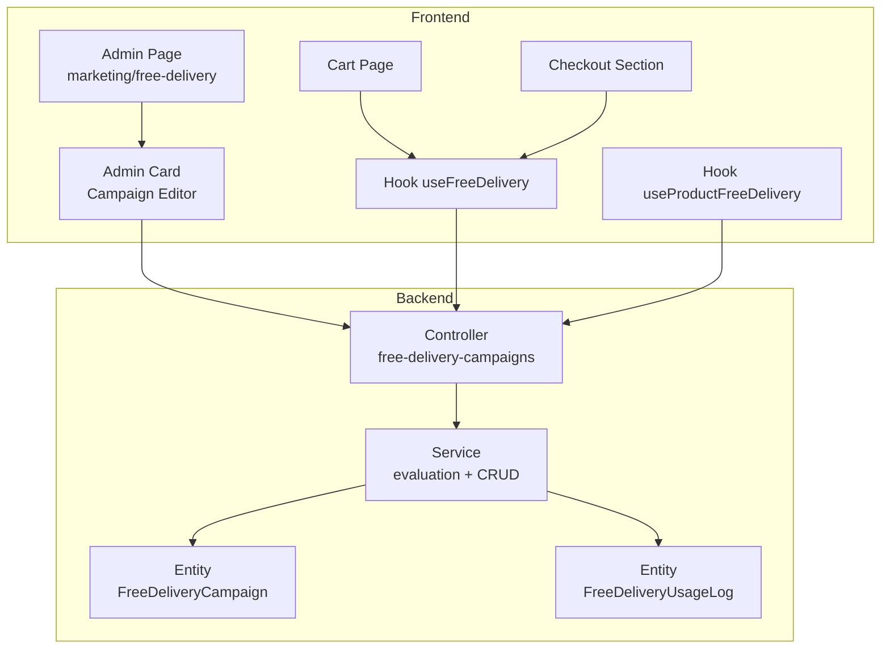
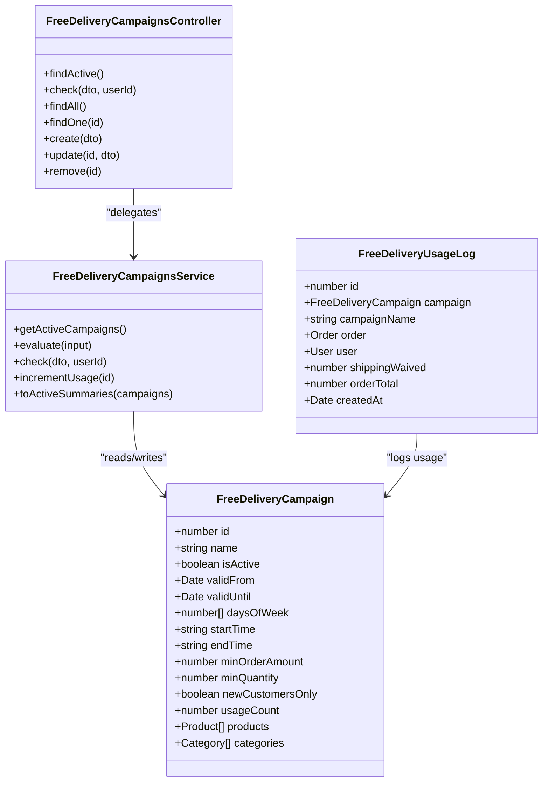
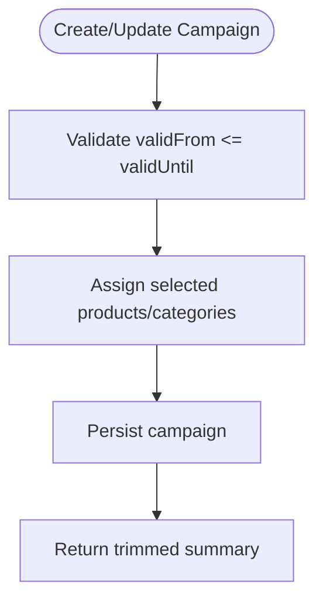
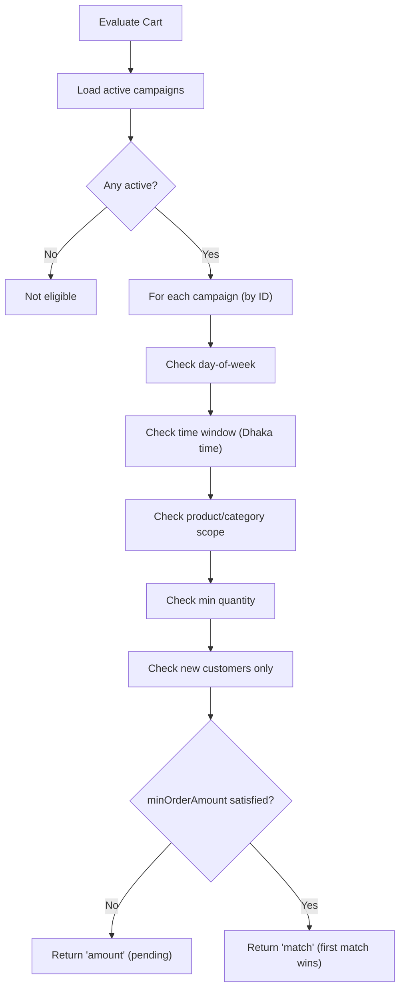
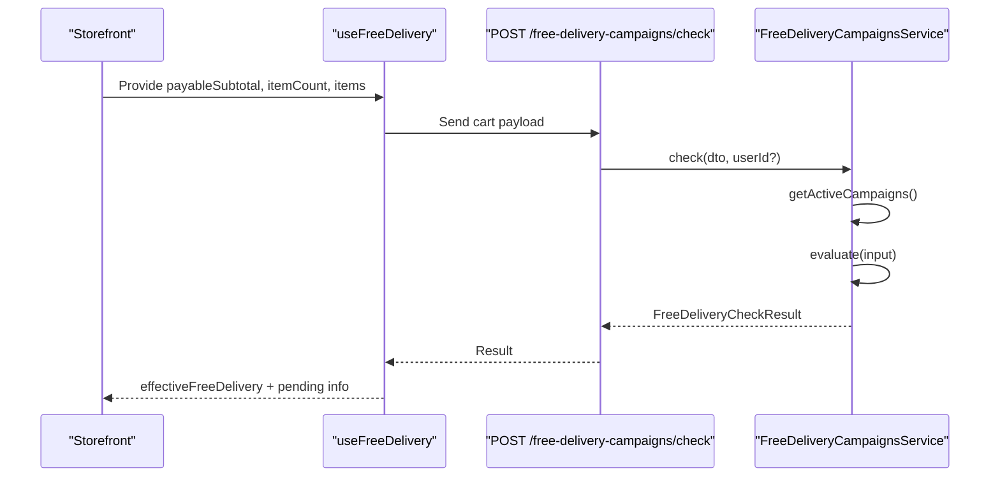
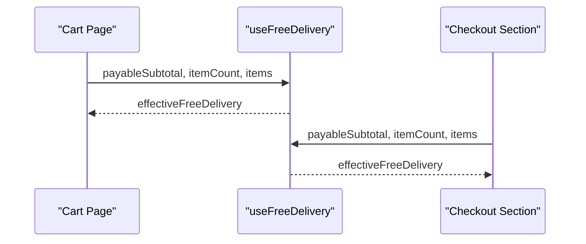
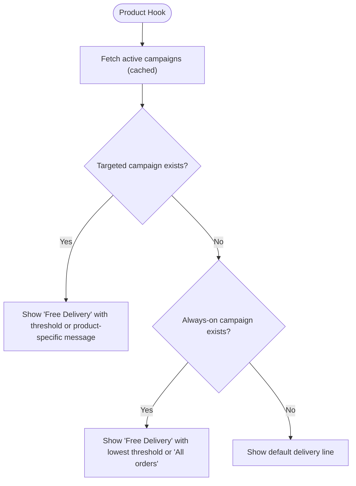
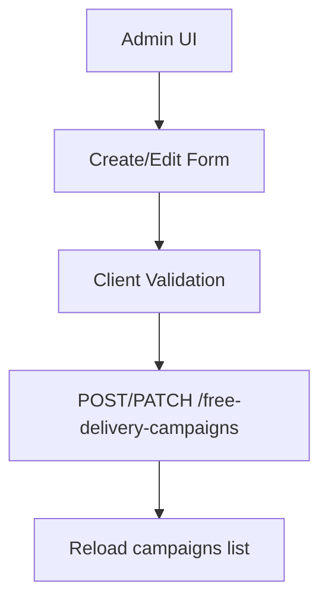
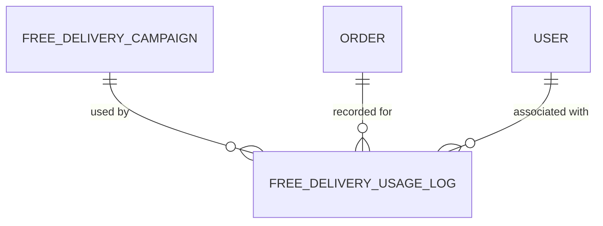
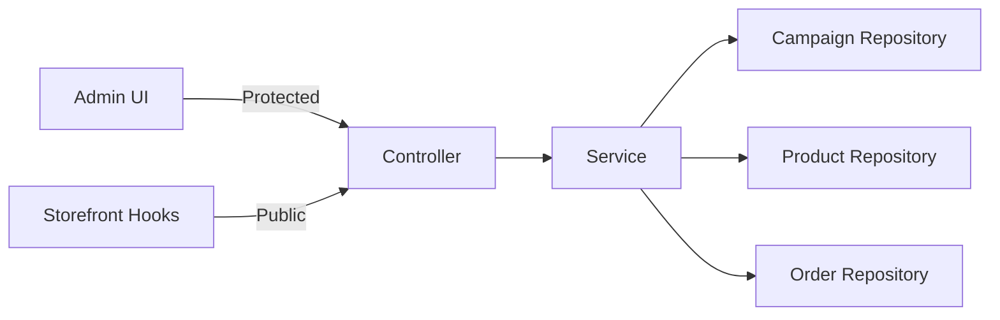

# Free Delivery Campaigns

<cite>
**Referenced Files in This Document**
- [free-delivery-campaigns.service.ts](file://apps/backend/src/free-delivery-campaigns/free-delivery-campaigns.service.ts)
- [free-delivery-campaigns.controller.ts](file://apps/backend/src/free-delivery-campaigns/free-delivery-campaigns.controller.ts)
- [free-delivery-campaign.entity.ts](file://apps/backend/src/free-delivery-campaigns/entities/free-delivery-campaign.entity.ts)
- [free-delivery-usage-log.entity.ts](file://apps/backend/src/free-delivery-usage-log/entities/free-delivery-usage-log.entity.ts)
- [use-free-delivery.ts](file://apps/frontend/hooks/use-free-delivery.ts)
- [use-product-free-delivery.ts](file://apps/frontend/hooks/use-product-free-delivery.ts)
- [cart-page.tsx](file://apps/frontend/components/cart/cart-page.tsx)
- [checkoutSection.tsx](file://apps/frontend/components/checkout/checkoutSection.tsx)
- [page.tsx](file://apps/frontend/app/admin/marketing/free-delivery/page.tsx)
- [free-delivery-campaigns-card.tsx](file://apps/frontend/components/admin/marketing/free-delivery/free-delivery-campaigns-card.tsx)
</cite>

## Table of Contents
1. [Introduction](#introduction)
2. [Project Structure](#project-structure)
3. [Core Components](#core-components)
4. [Architecture Overview](#architecture-overview)
5. [Detailed Component Analysis](#detailed-component-analysis)
6. [Dependency Analysis](#dependency-analysis)
7. [Performance Considerations](#performance-considerations)
8. [Troubleshooting Guide](#troubleshooting-guide)
9. [Conclusion](#conclusion)

## Introduction
This document explains the free delivery campaign system end-to-end: how campaigns are created and scheduled, how eligibility is evaluated (minimum order value, product categories, customer segments), how benefits are automatically applied during cart and checkout, and how administrators manage campaigns and analyze performance. It also covers integration points with cart calculations, expiration handling, and conflict resolution when multiple promotions apply.

## Project Structure
The feature spans backend modules for campaign management and evaluation, and frontend hooks and admin pages for configuration and storefront display.

**Diagram sources**
- [page.tsx:1-20](file://apps/frontend/app/admin/marketing/free-delivery/page.tsx#L1-L20)
- [free-delivery-campaigns-card.tsx:1-800](file://apps/frontend/components/admin/marketing/free-delivery/free-delivery-campaigns-card.tsx#L1-L800)
- [cart-page.tsx:43-80](file://apps/frontend/components/cart/cart-page.tsx#L43-L80)
- [checkoutSection.tsx:159-188](file://apps/frontend/components/checkout/checkoutSection.tsx#L159-L188)
- [use-free-delivery.ts:1-37](file://apps/frontend/hooks/use-free-delivery.ts#L1-L37)
- [use-product-free-delivery.ts:1-150](file://apps/frontend/hooks/use-product-free-delivery.ts#L1-L150)
- [free-delivery-campaigns.controller.ts:1-147](file://apps/backend/src/free-delivery-campaigns/free-delivery-campaigns.controller.ts#L1-L147)
- [free-delivery-campaigns.service.ts:1-418](file://apps/backend/src/free-delivery-campaigns/free-delivery-campaigns.service.ts#L1-L418)
- [free-delivery-campaign.entity.ts:1-106](file://apps/backend/src/free-delivery-campaigns/entities/free-delivery-campaign.entity.ts#L1-L106)
- [free-delivery-usage-log.entity.ts:1-63](file://apps/backend/src/free-delivery-usage-log/entities/free-delivery-usage-log.entity.ts#L1-L63)

**Section sources**
- [page.tsx:1-20](file://apps/frontend/app/admin/marketing/free-delivery/page.tsx#L1-L20)
- [free-delivery-campaigns-card.tsx:1-800](file://apps/frontend/components/admin/marketing/free-delivery/free-delivery-campaigns-card.tsx#L1-L800)
- [cart-page.tsx:43-80](file://apps/frontend/components/cart/cart-page.tsx#L43-L80)
- [checkoutSection.tsx:159-188](file://apps/frontend/components/checkout/checkoutSection.tsx#L159-L188)
- [use-free-delivery.ts:1-37](file://apps/frontend/hooks/use-free-delivery.ts#L1-L37)
- [use-product-free-delivery.ts:1-150](file://apps/frontend/hooks/use-product-free-delivery.ts#L1-L150)
- [free-delivery-campaigns.controller.ts:1-147](file://apps/backend/src/free-delivery-campaigns/free-delivery-campaigns.controller.ts#L1-L147)
- [free-delivery-campaigns.service.ts:1-418](file://apps/backend/src/free-delivery-campaigns/free-delivery-campaigns.service.ts#L1-L418)
- [free-delivery-campaign.entity.ts:1-106](file://apps/backend/src/free-delivery-campaigns/entities/free-delivery-campaign.entity.ts#L1-L106)
- [free-delivery-usage-log.entity.ts:1-63](file://apps/backend/src/free-delivery-usage-log/entities/free-delivery-usage-log.entity.ts#L1-L63)

## Core Components
- Campaign entity defines scheduling, scope, and thresholds.
- Backend controller exposes public endpoints for active campaigns and cart checks, plus protected CRUD endpoints for admins.
- Service implements campaign evaluation logic, date/time/day-of-week filtering, product/category scoping, new-customer gating, minimum amount/quantity checks, and usage counting.
- Frontend hooks call public endpoints to evaluate eligibility and render storefront messaging; the admin card provides full campaign authoring UI.

Key responsibilities:
- Campaign creation/update/deletion and activation toggling.
- Active campaign listing for storefront display.
- Cart/checkout eligibility check returning whether free delivery applies or how much more is needed.
- Usage logging fields for analytics.

**Section sources**
- [free-delivery-campaign.entity.ts:14-106](file://apps/backend/src/free-delivery-campaigns/entities/free-delivery-campaign.entity.ts#L14-L106)
- [free-delivery-campaigns.controller.ts:30-147](file://apps/backend/src/free-delivery-campaigns/free-delivery-campaigns.controller.ts#L30-L147)
- [free-delivery-campaigns.service.ts:84-418](file://apps/backend/src/free-delivery-campaigns/free-delivery-campaigns.service.ts#L84-L418)
- [use-free-delivery.ts:14-37](file://apps/frontend/hooks/use-free-delivery.ts#L14-L37)
- [use-product-free-delivery.ts:32-150](file://apps/frontend/hooks/use-product-free-delivery.ts#L32-L150)
- [free-delivery-campaigns-card.tsx:87-374](file://apps/frontend/components/admin/marketing/free-delivery/free-delivery-campaigns-card.tsx#L87-L374)

## Architecture Overview
The system separates concerns between data modeling, API exposure, business evaluation, and client-side presentation.

**Diagram sources**
- [free-delivery-campaign.entity.ts:14-106](file://apps/backend/src/free-delivery-campaigns/entities/free-delivery-campaign.entity.ts#L14-L106)
- [free-delivery-usage-log.entity.ts:14-63](file://apps/backend/src/free-delivery-usage-log/entities/free-delivery-usage-log.entity.ts#L14-L63)
- [free-delivery-campaigns.controller.ts:30-147](file://apps/backend/src/free-delivery-campaigns/free-delivery-campaigns.controller.ts#L30-L147)
- [free-delivery-campaigns.service.ts:84-418](file://apps/backend/src/free-delivery-campaigns/free-delivery-campaigns.service.ts#L84-L418)

## Detailed Component Analysis

### Campaign Data Model and Scheduling
- The campaign model supports:
  - Activation toggle and absolute date range validity.
  - Day-of-week selection and time window (including midnight wrap).
  - Minimum order subtotal and minimum item quantity.
  - New customers only gating.
  - Product and category scoping via many-to-many relations.
  - Usage counter for reporting.

**Diagram sources**
- [free-delivery-campaigns.service.ts:97-133](file://apps/backend/src/free-delivery-campaigns/free-delivery-campaigns.service.ts#L97-L133)
- [free-delivery-campaigns.service.ts:201-220](file://apps/backend/src/free-delivery-campaigns/free-delivery-campaigns.service.ts#L201-L220)
- [free-delivery-campaign.entity.ts:14-106](file://apps/backend/src/free-delivery-campaigns/entities/free-delivery-campaign.entity.ts#L14-L106)

**Section sources**
- [free-delivery-campaign.entity.ts:14-106](file://apps/backend/src/free-delivery-campaigns/entities/free-delivery-campaign.entity.ts#L14-L106)
- [free-delivery-campaigns.service.ts:97-133](file://apps/backend/src/free-delivery-campaigns/free-delivery-campaigns.service.ts#L97-L133)
- [free-delivery-campaigns.service.ts:201-220](file://apps/backend/src/free-delivery-campaigns/free-delivery-campaigns.service.ts#L201-L220)

### Eligibility Evaluation Logic
Eligibility is evaluated server-side against all active campaigns in ID order; the first matching campaign wins. Conditions checked per campaign:
- Days of week must include current day (Asia/Dhaka).
- Time window must include current time (supports midnight wrap).
- If products or categories are set, at least one cart item must match.
- Minimum total quantity must be met.
- New customers only requires a logged-in user with zero previous orders.
- Minimum order amount must be met; otherwise returns “pending” with remaining amount.

**Diagram sources**
- [free-delivery-campaigns.service.ts:224-340](file://apps/backend/src/free-delivery-campaigns/free-delivery-campaigns.service.ts#L224-L340)
- [free-delivery-campaigns.service.ts:269-318](file://apps/backend/src/free-delivery-campaigns/free-delivery-campaigns.service.ts#L269-L318)

**Section sources**
- [free-delivery-campaigns.service.ts:224-340](file://apps/backend/src/free-delivery-campaigns/free-delivery-campaigns.service.ts#L224-L340)
- [free-delivery-campaigns.service.ts:269-318](file://apps/backend/src/free-delivery-campaigns/free-delivery-campaigns.service.ts#L269-L318)

### Public API and Storefront Integration
- GET /free-delivery-campaigns/active: Returns active campaigns with minimal product/category summaries for storefront display.
- POST /free-delivery-campaigns/check: Evaluates cart against campaigns and returns whether free delivery applies, which campaign matched, or how much more is needed.

**Diagram sources**
- [free-delivery-campaigns.controller.ts:37-71](file://apps/backend/src/free-delivery-campaigns/free-delivery-campaigns.controller.ts#L37-L71)
- [free-delivery-campaigns.service.ts:346-410](file://apps/backend/src/free-delivery-campaigns/free-delivery-campaigns.service.ts#L346-L410)
- [use-free-delivery.ts:14-37](file://apps/frontend/hooks/use-free-delivery.ts#L14-L37)

**Section sources**
- [free-delivery-campaigns.controller.ts:37-71](file://apps/backend/src/free-delivery-campaigns/free-delivery-campaigns.controller.ts#L37-L71)
- [free-delivery-campaigns.service.ts:346-410](file://apps/backend/src/free-delivery-campaigns/free-delivery-campaigns.service.ts#L346-L410)
- [use-free-delivery.ts:14-37](file://apps/frontend/hooks/use-free-delivery.ts#L14-L37)

### Cart and Checkout Application
- Cart page computes payable subtotal after product discounts and coupon/BOGO previews, then calls the free delivery hook.
- Checkout section repeats this computation and uses the server-evaluated result to determine if shipping is waived.

**Diagram sources**
- [cart-page.tsx:43-80](file://apps/frontend/components/cart/cart-page.tsx#L43-L80)
- [checkoutSection.tsx:159-188](file://apps/frontend/components/checkout/checkoutSection.tsx#L159-L188)
- [use-free-delivery.ts:14-37](file://apps/frontend/hooks/use-free-delivery.ts#L14-L37)

**Section sources**
- [cart-page.tsx:43-80](file://apps/frontend/components/cart/cart-page.tsx#L43-L80)
- [checkoutSection.tsx:159-188](file://apps/frontend/components/checkout/checkoutSection.tsx#L159-L188)
- [use-free-delivery.ts:14-37](file://apps/frontend/hooks/use-free-delivery.ts#L14-L37)

### Product-Level Messaging
- Product-level hooks fetch active campaigns once (with TTL cache) and compute:
  - Whether a product is explicitly covered by a targeted campaign.
  - Best targeted campaign (lowest minimum order amount).
  - Always-on fallback (no schedule/product/category restrictions).

**Diagram sources**
- [use-product-free-delivery.ts:15-62](file://apps/frontend/hooks/use-product-free-delivery.ts#L15-L62)
- [use-product-free-delivery.ts:72-150](file://apps/frontend/hooks/use-product-free-delivery.ts#L72-L150)

**Section sources**
- [use-product-free-delivery.ts:15-62](file://apps/frontend/hooks/use-product-free-delivery.ts#L15-L62)
- [use-product-free-delivery.ts:72-150](file://apps/frontend/hooks/use-product-free-delivery.ts#L72-L150)

### Admin Interface
- Admin page hosts the campaign editor card.
- The card supports:
  - Creating/editing campaigns with name, status, schedule (date range, days of week, start/end time), conditions (min order amount, min quantity, new customers only), and scope (categories and products).
  - Toggling active status inline.
  - Viewing condition chips summarizing each campaign’s rules.
  - Validating inputs (e.g., start/end time equality).

**Diagram sources**
- [page.tsx:1-20](file://apps/frontend/app/admin/marketing/free-delivery/page.tsx#L1-L20)
- [free-delivery-campaigns-card.tsx:87-374](file://apps/frontend/components/admin/marketing/free-delivery/free-delivery-campaigns-card.tsx#L87-L374)
- [free-delivery-campaigns.controller.ts:73-147](file://apps/backend/src/free-delivery-campaigns/free-delivery-campaigns.controller.ts#L73-L147)

**Section sources**
- [page.tsx:1-20](file://apps/frontend/app/admin/marketing/free-delivery/page.tsx#L1-L20)
- [free-delivery-campaigns-card.tsx:87-374](file://apps/frontend/components/admin/marketing/free-delivery/free-delivery-campaigns-card.tsx#L87-L374)
- [free-delivery-campaigns.controller.ts:73-147](file://apps/backend/src/free-delivery-campaigns/free-delivery-campaigns.controller.ts#L73-L147)

### Usage Logging and Performance Analytics
- The usage log entity captures campaign snapshot, associated order/user, shipping waived, order total, and timestamp.
- The service increments a usage counter on campaigns; logs can be used to build dashboards and reports.

**Diagram sources**
- [free-delivery-usage-log.entity.ts:14-63](file://apps/backend/src/free-delivery-usage-log/entities/free-delivery-usage-log.entity.ts#L14-L63)
- [free-delivery-campaigns.service.ts:412-417](file://apps/backend/src/free-delivery-campaigns/free-delivery-campaigns.service.ts#L412-L417)

**Section sources**
- [free-delivery-usage-log.entity.ts:14-63](file://apps/backend/src/free-delivery-usage-log/entities/free-delivery-usage-log.entity.ts#L14-L63)
- [free-delivery-campaigns.service.ts:412-417](file://apps/backend/src/free-delivery-campaigns/free-delivery-campaigns.service.ts#L412-L417)

## Dependency Analysis
- Controller depends on Service for all operations.
- Service depends on TypeORM repositories for Campaign, Product, and Order entities.
- Frontend hooks depend on public REST endpoints exposed by the controller.
- Admin UI depends on protected endpoints requiring authentication and permissions.

**Diagram sources**
- [free-delivery-campaigns.controller.ts:1-147](file://apps/backend/src/free-delivery-campaigns/free-delivery-campaigns.controller.ts#L1-L147)
- [free-delivery-campaigns.service.ts:84-93](file://apps/backend/src/free-delivery-campaigns/free-delivery-campaigns.service.ts#L84-L93)
- [use-free-delivery.ts:14-37](file://apps/frontend/hooks/use-free-delivery.ts#L14-L37)
- [use-product-free-delivery.ts:15-30](file://apps/frontend/hooks/use-product-free-delivery.ts#L15-L30)

**Section sources**
- [free-delivery-campaigns.controller.ts:1-147](file://apps/backend/src/free-delivery-campaigns/free-delivery-campaigns.controller.ts#L1-L147)
- [free-delivery-campaigns.service.ts:84-93](file://apps/backend/src/free-delivery-campaigns/free-delivery-campaigns.service.ts#L84-L93)
- [use-free-delivery.ts:14-37](file://apps/frontend/hooks/use-free-delivery.ts#L14-L37)
- [use-product-free-delivery.ts:15-30](file://apps/frontend/hooks/use-product-free-delivery.ts#L15-L30)

## Performance Considerations
- Campaign evaluation runs server-side to ensure correctness and avoid client-side manipulation.
- Storefront caches active campaigns for five minutes and deduplicates concurrent requests to reduce load.
- Cart and checkout debounce the eligibility check to handle rapid cart changes efficiently.
- Admin UI batches initial loads and refreshes lists after mutations.

[No sources needed since this section provides general guidance]

## Troubleshooting Guide
Common issues and resolutions:
- Campaign not applying:
  - Verify campaign is active and within valid date range.
  - Check day-of-week and time window (Asia/Dhaka).
  - Ensure cart contains at least one product/category from the campaign scope.
  - Confirm minimum quantity and minimum order amount are satisfied.
  - For new customers only, ensure the user has no prior orders.
- Pending free delivery message:
  - Use the “remaining” field from the check endpoint to guide users to add more to their cart.
- Conflicts with other promotions:
  - First matching campaign wins; place higher-priority campaigns earlier by lower IDs or adjust scopes to avoid overlap.
- Expiration handling:
  - Campaigns outside validFrom/validUntil are excluded automatically.
  - Time windows that cross midnight are supported; verify start/end times are configured correctly.

**Section sources**
- [free-delivery-campaigns.service.ts:224-340](file://apps/backend/src/free-delivery-campaigns/free-delivery-campaigns.service.ts#L224-L340)
- [free-delivery-campaigns.service.ts:346-410](file://apps/backend/src/free-delivery-campaigns/free-delivery-campaigns.service.ts#L346-L410)

## Conclusion
The free delivery campaign system provides a robust, server-evaluated mechanism to offer free shipping based on flexible scheduling, product/category targeting, and customer segmentation. Administrators can create and manage campaigns through a comprehensive UI, while the storefront displays clear eligibility messaging and integrates seamlessly into cart and checkout flows. Usage counters and structured logs support ongoing analysis of campaign effectiveness.