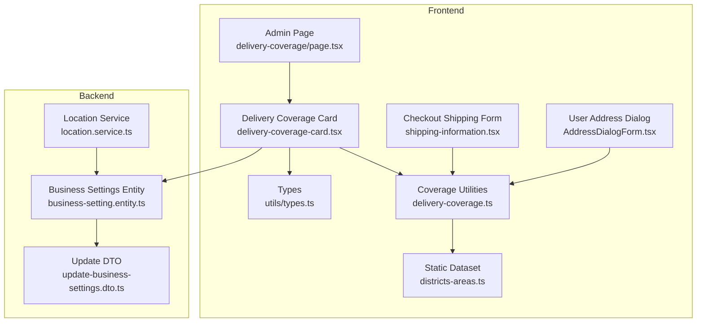
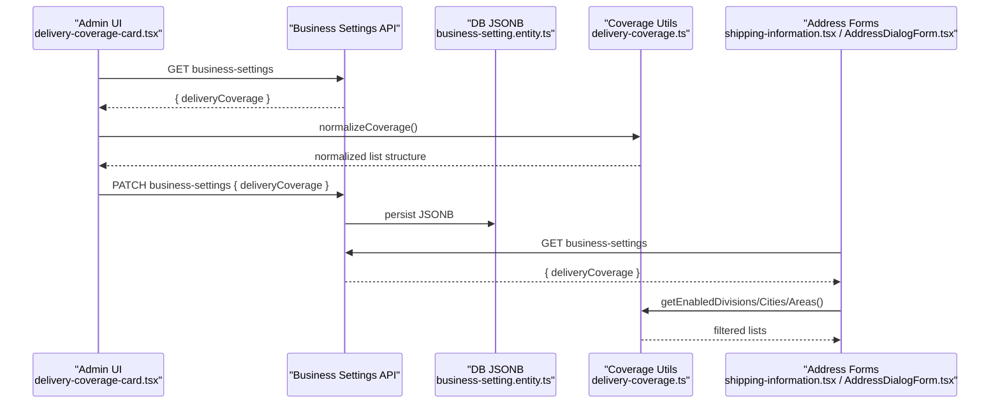
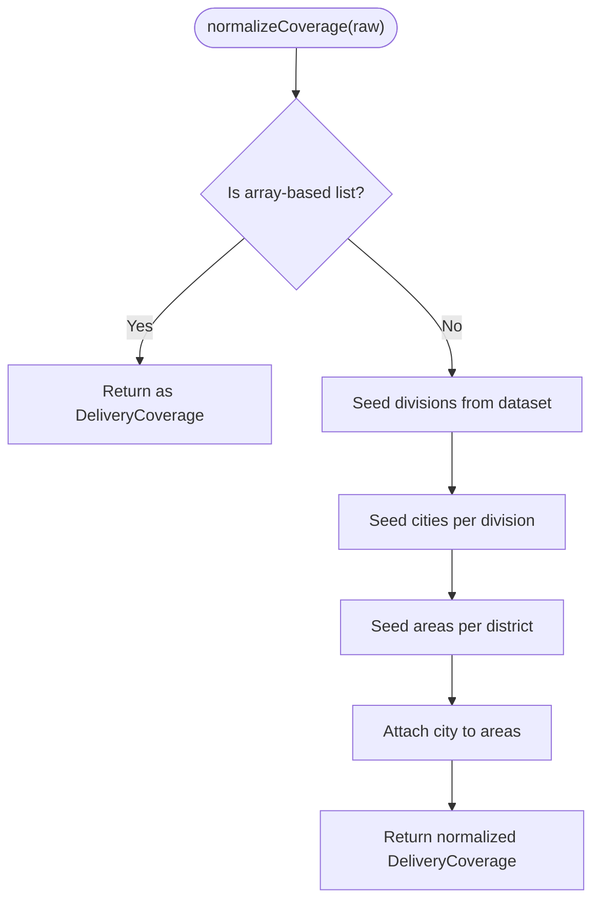
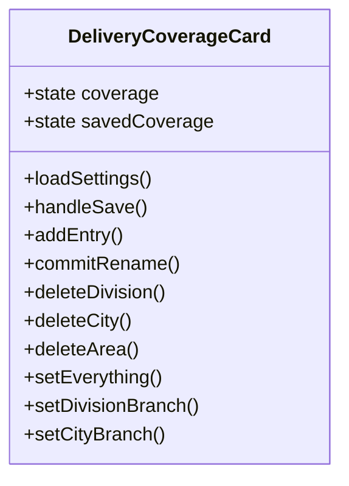
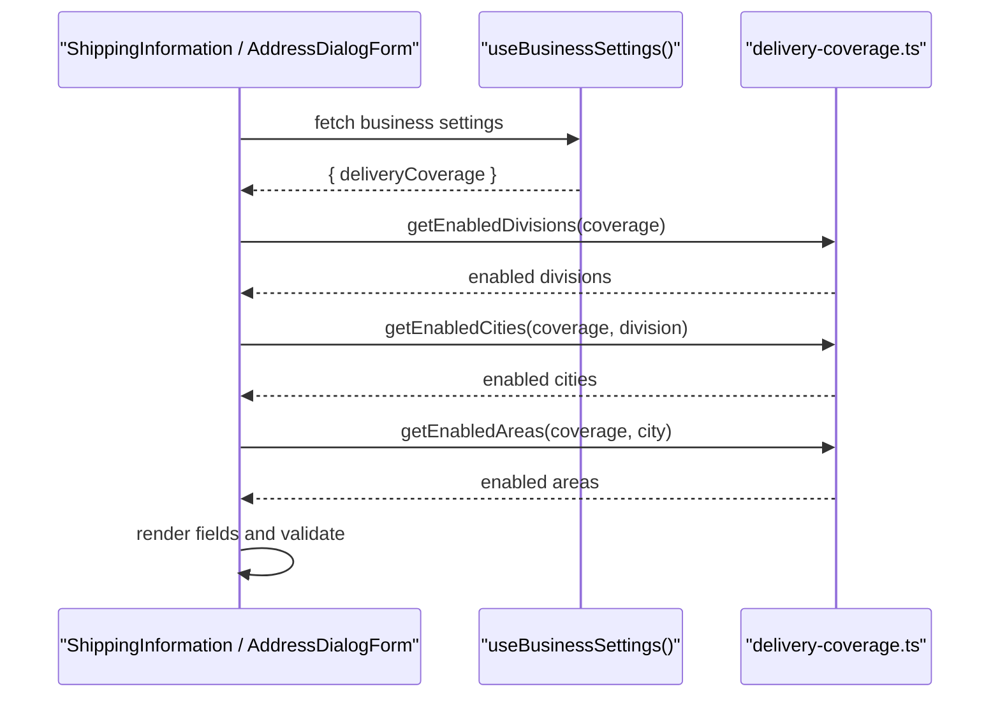
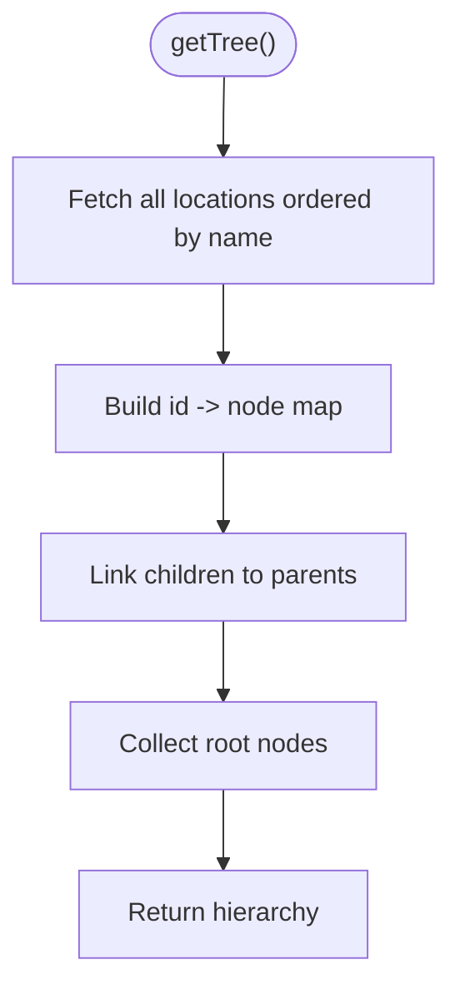
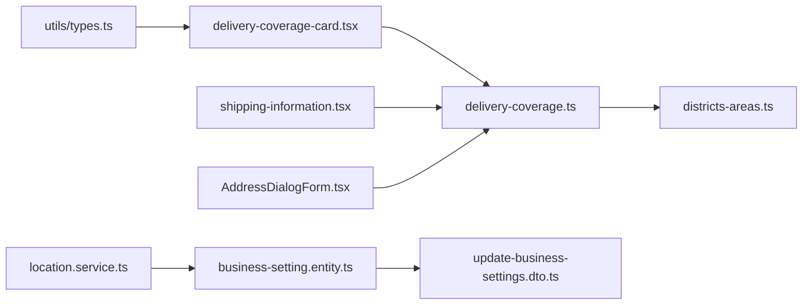

# Location & Delivery Coverage

<cite>
**Referenced Files in This Document**
- [delivery-coverage.ts](file://apps/frontend/lib/delivery-coverage.ts)
- [districts-areas.ts](file://apps/frontend/data/districts-areas.ts)
- [delivery-coverage-card.tsx](file://apps/frontend/components/admin/settings/delivery-coverage-card.tsx)
- [page.tsx](file://apps/frontend/app/admin/settings/delivery-coverage/page.tsx)
- [shipping-information.tsx](file://apps/frontend/components/checkout/shipping-information.tsx)
- [AddressDialogForm.tsx](file://apps/frontend/components/user-account/AddressDialogForm.tsx)
- [types.ts](file://apps/frontend/utils/types.ts)
- [business-setting.entity.ts](file://apps/backend/src/business-settings/entities/business-setting.entity.ts)
- [update-business-settings.dto.ts](file://apps/backend/src/business-settings/dto/update-business-settings.dto.ts)
- [location.service.ts](file://apps/backend/src/location/location.service.ts)
</cite>

## Table of Contents
1. [Introduction](#introduction)
2. [Project Structure](#project-structure)
3. [Core Components](#core-components)
4. [Architecture Overview](#architecture-overview)
5. [Detailed Component Analysis](#detailed-component-analysis)
6. [Dependency Analysis](#dependency-analysis)
7. [Performance Considerations](#performance-considerations)
8. [Troubleshooting Guide](#troubleshooting-guide)
9. [Conclusion](#conclusion)

## Introduction
This document explains the location-based delivery coverage system used to control where orders can be delivered. It covers how delivery areas are defined using administrative divisions, cities (districts), and areas; how the configuration is managed through the admin interface; how address forms validate against enabled coverage; and how backend location services integrate with the broader location model. It also documents data structures, coordinate systems, mapping integrations, performance considerations, and operational examples for setting up zones and handling out-of-area orders.

## Project Structure
The delivery coverage feature spans frontend and backend:

- Frontend
  - Configuration UI: Admin page and card component manage divisions, cities, and areas.
  - Coverage logic: Normalization and filtering functions compute enabled options at each level.
  - Address forms: Checkout and user account forms consume enabled coverage to restrict inputs.
  - Static dataset: Bundled Bangladesh division/city/area reference data.
  - Types: Business settings include a deliveryCoverage field.

- Backend
  - Persistence: Business settings entity stores deliveryCoverage as JSONB.
  - API contract: DTO validates incoming coverage payloads.
  - Location service: Provides hierarchical location queries (division → city → area).

**Diagram sources**
- [page.tsx:1-9](file://apps/frontend/app/admin/settings/delivery-coverage/page.tsx#L1-L9)
- [delivery-coverage-card.tsx:1-124](file://apps/frontend/components/admin/settings/delivery-coverage-card.tsx#L1-L124)
- [delivery-coverage.ts:1-134](file://apps/frontend/lib/delivery-coverage.ts#L1-L134)
- [districts-areas.ts:1-800](file://apps/frontend/data/districts-areas.ts#L1-L800)
- [shipping-information.tsx:39-72](file://apps/frontend/components/checkout/shipping-information.tsx#L39-L72)
- [AddressDialogForm.tsx:80-124](file://apps/frontend/components/user-account/AddressDialogForm.tsx#L80-L124)
- [types.ts:334-366](file://apps/frontend/utils/types.ts#L334-L366)
- [business-setting.entity.ts:108-122](file://apps/backend/src/business-settings/entities/business-setting.entity.ts#L108-L122)
- [update-business-settings.dto.ts:130-145](file://apps/backend/src/business-settings/dto/update-business-settings.dto.ts#L130-L145)
- [location.service.ts:1-80](file://apps/backend/src/location/location.service.ts#L1-L80)

**Section sources**
- [page.tsx:1-9](file://apps/frontend/app/admin/settings/delivery-coverage/page.tsx#L1-L9)
- [delivery-coverage-card.tsx:1-124](file://apps/frontend/components/admin/settings/delivery-coverage-card.tsx#L1-L124)
- [delivery-coverage.ts:1-134](file://apps/frontend/lib/delivery-coverage.ts#L1-L134)
- [districts-areas.ts:1-800](file://apps/frontend/data/districts-areas.ts#L1-L800)
- [shipping-information.tsx:39-72](file://apps/frontend/components/checkout/shipping-information.tsx#L39-L72)
- [AddressDialogForm.tsx:80-124](file://apps/frontend/components/user-account/AddressDialogForm.tsx#L80-L124)
- [types.ts:334-366](file://apps/frontend/utils/types.ts#L334-L366)
- [business-setting.entity.ts:108-122](file://apps/backend/src/business-settings/entities/business-setting.entity.ts#L108-L122)
- [update-business-settings.dto.ts:130-145](file://apps/backend/src/business-settings/dto/update-business-settings.dto.ts#L130-L145)
- [location.service.ts:1-80](file://apps/backend/src/location/location.service.ts#L1-L80)

## Core Components
- Coverage data model
  - Divisions: top-level administrative units with an enabled flag.
  - Cities (districts): belong to a division and have an enabled flag.
  - Areas: belong to a city and have an enabled flag.
  - All three lists are stored together under business settings.

- Normalization and querying
  - normalizeCoverage converts legacy or null coverage into the current list format, seeding from the bundled dataset when needed.
  - getEnabledDivisions, getEnabledCities, getEnabledAreas return sorted, deduplicated names based on enabled flags and parent filters.

- Admin configuration UI
  - The admin page renders the DeliveryCoverageCard.
  - The card loads business settings, normalizes coverage, supports add/rename/delete/toggle operations, search, bulk toggles, and saves changes back to business settings.

- Address form integration
  - Checkout shipping information and user address dialog use the same coverage utilities to show only enabled options and enforce required fields conditionally.

- Backend persistence and API contract
  - BusinessSetting entity includes deliveryCoverage as JSONB.
  - UpdateBusinessSettingsDto accepts and validates the coverage payload.

- Location service
  - Provides hierarchical location queries and tree building over a separate location table, useful for other features that need division/city/area hierarchies.

**Section sources**
- [delivery-coverage.ts:1-134](file://apps/frontend/lib/delivery-coverage.ts#L1-L134)
- [delivery-coverage-card.tsx:155-174](file://apps/frontend/components/admin/settings/delivery-coverage-card.tsx#L155-L174)
- [delivery-coverage-card.tsx:672-686](file://apps/frontend/components/admin/settings/delivery-coverage-card.tsx#L672-L686)
- [shipping-information.tsx:48-72](file://apps/frontend/components/checkout/shipping-information.tsx#L48-L72)
- [AddressDialogForm.tsx:88-124](file://apps/frontend/components/user-account/AddressDialogForm.tsx#L88-L124)
- [business-setting.entity.ts:108-122](file://apps/backend/src/business-settings/entities/business-setting.entity.ts#L108-L122)
- [update-business-settings.dto.ts:130-145](file://apps/backend/src/business-settings/dto/update-business-settings.dto.ts#L130-L145)
- [location.service.ts:21-56](file://apps/backend/src/location/location.service.ts#L21-L56)

## Architecture Overview
The system uses a layered approach:

- Data layer
  - Business settings store the active coverage lists.
  - Static dataset provides default coverage references.
  - Location service manages hierarchical location entities.

- Application layer
  - Coverage utilities compute enabled sets for UI and validation.
  - Admin UI edits coverage and persists via business settings API.
  - Address forms read coverage to constrain inputs.

- Integration points
  - Frontend calls business-settings endpoints to load/save coverage.
  - Backend exposes DTOs and entity schema for coverage.
  - Location service offers hierarchical queries for related features.

**Diagram sources**
- [delivery-coverage-card.tsx:155-174](file://apps/frontend/components/admin/settings/delivery-coverage-card.tsx#L155-L174)
- [delivery-coverage-card.tsx:672-686](file://apps/frontend/components/admin/settings/delivery-coverage-card.tsx#L672-L686)
- [delivery-coverage.ts:35-94](file://apps/frontend/lib/delivery-coverage.ts#L35-L94)
- [shipping-information.tsx:48-72](file://apps/frontend/components/checkout/shipping-information.tsx#L48-L72)
- [AddressDialogForm.tsx:88-124](file://apps/frontend/components/user-account/AddressDialogForm.tsx#L88-L124)
- [business-setting.entity.ts:108-122](file://apps/backend/src/business-settings/entities/business-setting.entity.ts#L108-L122)

## Detailed Component Analysis

### Coverage Data Model and Normalization
- Data model
  - Divisions: name + enabled.
  - Cities: division + name + enabled.
  - Areas: city + name + enabled.
  - Stored under BusinessSettings.deliveryCoverage.

- Normalization
  - If already in list format, returns as-is.
  - Otherwise, seeds from DIVISION_DISTRICTS and DISTRICT_AREAS, preserving old on/off states.
  - Attaches city to areas by lookup.

- Enabled queries
  - getEnabledDivisions returns all enabled divisions or defaults to full dataset if coverage is null.
  - getEnabledCities filters by division and enabled status.
  - getEnabledAreas filters by city and enabled status.

**Diagram sources**
- [delivery-coverage.ts:35-94](file://apps/frontend/lib/delivery-coverage.ts#L35-L94)
- [districts-areas.ts:1-800](file://apps/frontend/data/districts-areas.ts#L1-L800)

**Section sources**
- [delivery-coverage.ts:1-134](file://apps/frontend/lib/delivery-coverage.ts#L1-L134)
- [districts-areas.ts:1-800](file://apps/frontend/data/districts-areas.ts#L1-L800)
- [types.ts:334-366](file://apps/frontend/utils/types.ts#L334-L366)

### Admin Delivery Coverage Interface
- Responsibilities
  - Load business settings and normalize coverage.
  - Render hierarchical tree of divisions → cities → areas.
  - Support inline add, rename, delete, enable/disable, search, and bulk toggles.
  - Persist changes via PATCH business-settings.

- Key behaviors
  - Search expands matching nodes and collapses others while searching.
  - Rename cascades to children (city renamed updates its areas).
  - Delete removes dependent entries (e.g., deleting a division removes its cities and their areas).
  - Dirty state warns before leaving with unsaved changes.

**Diagram sources**
- [delivery-coverage-card.tsx:155-174](file://apps/frontend/components/admin/settings/delivery-coverage-card.tsx#L155-L174)
- [delivery-coverage-card.tsx:376-468](file://apps/frontend/components/admin/settings/delivery-coverage-card.tsx#L376-L468)
- [delivery-coverage-card.tsx:481-538](file://apps/frontend/components/admin/settings/delivery-coverage-card.tsx#L481-L538)
- [delivery-coverage-card.tsx:540-581](file://apps/frontend/components/admin/settings/delivery-coverage-card.tsx#L540-L581)
- [delivery-coverage-card.tsx:583-668](file://apps/frontend/components/admin/settings/delivery-coverage-card.tsx#L583-L668)
- [delivery-coverage-card.tsx:672-686](file://apps/frontend/components/admin/settings/delivery-coverage-card.tsx#L672-L686)

**Section sources**
- [delivery-coverage-card.tsx:155-174](file://apps/frontend/components/admin/settings/delivery-coverage-card.tsx#L155-L174)
- [delivery-coverage-card.tsx:376-468](file://apps/frontend/components/admin/settings/delivery-coverage-card.tsx#L376-L468)
- [delivery-coverage-card.tsx:481-538](file://apps/frontend/components/admin/settings/delivery-coverage-card.tsx#L481-L538)
- [delivery-coverage-card.tsx:540-581](file://apps/frontend/components/admin/settings/delivery-coverage-card.tsx#L540-L581)
- [delivery-coverage-card.tsx:583-668](file://apps/frontend/components/admin/settings/delivery-coverage-card.tsx#L583-L668)
- [delivery-coverage-card.tsx:672-686](file://apps/frontend/components/admin/settings/delivery-coverage-card.tsx#L672-L686)

### Address Management and Eligibility Checks
- Checkout shipping form
  - Reads business settings and computes enabled divisions, cities, and areas.
  - Hides fields when no options remain.
  - Pre-selects single-option values for streamlined UX.
  - Validates required fields conditionally based on enabled options.

- User address dialog
  - Uses the same coverage utilities to build scoped city and area lists.
  - Applies Zod validation based on whether division/city/area fields are enabled.

**Diagram sources**
- [shipping-information.tsx:48-72](file://apps/frontend/components/checkout/shipping-information.tsx#L48-L72)
- [AddressDialogForm.tsx:88-124](file://apps/frontend/components/user-account/AddressDialogForm.tsx#L88-L124)
- [delivery-coverage.ts:98-133](file://apps/frontend/lib/delivery-coverage.ts#L98-L133)

**Section sources**
- [shipping-information.tsx:48-72](file://apps/frontend/components/checkout/shipping-information.tsx#L48-L72)
- [AddressDialogForm.tsx:88-124](file://apps/frontend/components/user-account/AddressDialogForm.tsx#L88-L124)
- [delivery-coverage.ts:98-133](file://apps/frontend/lib/delivery-coverage.ts#L98-L133)

### Backend Location Service
- Purpose
  - Provides hierarchical location queries and tree construction for locations stored in the database.
  - Useful for features needing division/city/area relationships beyond coverage lists.

- Key methods
  - getTree: builds a full hierarchy from flat rows.
  - getCitiesByDivision: lists cities under a division.
  - getAreasByCity: lists areas under a city.
  - resolve/findByName: case-insensitive resolution with error handling.

**Diagram sources**
- [location.service.ts:21-38](file://apps/backend/src/location/location.service.ts#L21-L38)

**Section sources**
- [location.service.ts:1-80](file://apps/backend/src/location/location.service.ts#L1-L80)

## Dependency Analysis
- Frontend dependencies
  - delivery-coverage.ts depends on districts-areas.ts for default datasets.
  - Admin card and address forms depend on delivery-coverage.ts for normalization and filtering.
  - Types define BusinessSettings.deliveryCoverage shape.

- Backend dependencies
  - BusinessSetting entity defines JSONB schema for deliveryCoverage.
  - UpdateBusinessSettingsDto validates incoming coverage payloads.
  - LocationService depends on TypeORM repository and common enums.

**Diagram sources**
- [delivery-coverage.ts:1-134](file://apps/frontend/lib/delivery-coverage.ts#L1-L134)
- [districts-areas.ts:1-800](file://apps/frontend/data/districts-areas.ts#L1-L800)
- [delivery-coverage-card.tsx:1-124](file://apps/frontend/components/admin/settings/delivery-coverage-card.tsx#L1-L124)
- [shipping-information.tsx:39-72](file://apps/frontend/components/checkout/shipping-information.tsx#L39-L72)
- [AddressDialogForm.tsx:80-124](file://apps/frontend/components/user-account/AddressDialogForm.tsx#L80-L124)
- [types.ts:334-366](file://apps/frontend/utils/types.ts#L334-L366)
- [business-setting.entity.ts:108-122](file://apps/backend/src/business-settings/entities/business-setting.entity.ts#L108-L122)
- [update-business-settings.dto.ts:130-145](file://apps/backend/src/business-settings/dto/update-business-settings.dto.ts#L130-L145)
- [location.service.ts:1-80](file://apps/backend/src/location/location.service.ts#L1-L80)

**Section sources**
- [delivery-coverage.ts:1-134](file://apps/frontend/lib/delivery-coverage.ts#L1-L134)
- [delivery-coverage-card.tsx:1-124](file://apps/frontend/components/admin/settings/delivery-coverage-card.tsx#L1-L124)
- [shipping-information.tsx:39-72](file://apps/frontend/components/checkout/shipping-information.tsx#L39-L72)
- [AddressDialogForm.tsx:80-124](file://apps/frontend/components/user-account/AddressDialogForm.tsx#L80-L124)
- [types.ts:334-366](file://apps/frontend/utils/types.ts#L334-L366)
- [business-setting.entity.ts:108-122](file://apps/backend/src/business-settings/entities/business-setting.entity.ts#L108-L122)
- [update-business-settings.dto.ts:130-145](file://apps/backend/src/business-settings/dto/update-business-settings.dto.ts#L130-L145)
- [location.service.ts:1-80](file://apps/backend/src/location/location.service.ts#L1-L80)

## Performance Considerations
- Frontend
  - Coverage utilities perform simple array filters and sorts; complexity is linear in the number of items.
  - Admin card precomputes derived maps (citiesByDivision, areasByCity) to avoid repeated scans.
  - Search uses memoized tree computation; consider debouncing input if dataset grows significantly.
  - Avoid re-normalizing on every render; normalize once on load and keep local state.

- Backend
  - LocationService.getTree loads all rows; acceptable for small tables but should be cached if the location table grows.
  - Use indexes on type and parentId columns for getCitiesByDivision/getAreasByCity.
  - Consider caching the tree in memory or Redis for frequent reads.

- Caching strategies
  - Cache business settings deliveryCoverage in the client app context to avoid repeated network calls.
  - Invalidate cache after successful save operations.
  - For server-side, cache normalized coverage results keyed by business ID.

[No sources needed since this section provides general guidance]

## Troubleshooting Guide
- Admin cannot see expected divisions/cities/areas
  - Verify business settings deliveryCoverage is not null; if null, the system falls back to the bundled dataset.
  - Ensure entries are enabled; disabled entries do not appear in checkout.

- Changes not saving
  - Confirm PATCH business-settings succeeds and coverage payload matches the expected structure.
  - Check for dirty state warnings and ensure Save Changes is clicked.

- Address fields missing or unexpectedly required
  - Enabled options determine visibility and requirement. If a level has zero enabled options, the field is hidden.
  - Validation enforces required fields only when enabled options exist.

- Out-of-area orders
  - Orders placed with addresses outside enabled coverage will fail validation at the form stage.
  - To allow such orders, enable the corresponding division/city/area or adjust coverage rules.

**Section sources**
- [delivery-coverage.ts:98-133](file://apps/frontend/lib/delivery-coverage.ts#L98-L133)
- [delivery-coverage-card.tsx:672-686](file://apps/frontend/components/admin/settings/delivery-coverage-card.tsx#L672-L686)
- [shipping-information.tsx:48-72](file://apps/frontend/components/checkout/shipping-information.tsx#L48-L72)
- [AddressDialogForm.tsx:88-124](file://apps/frontend/components/user-account/AddressDialogForm.tsx#L88-L124)

## Conclusion
The delivery coverage system provides a flexible, list-based configuration for administrative divisions, cities, and areas. The admin interface allows comprehensive management of these lists, while frontend forms enforce eligibility checks using normalized and filtered coverage data. Backend persistence and DTOs ensure consistent storage and validation, and the location service supports hierarchical queries for related features. With careful attention to performance and caching, the system scales well for typical operational needs.

[No sources needed since this section summarizes without analyzing specific files]