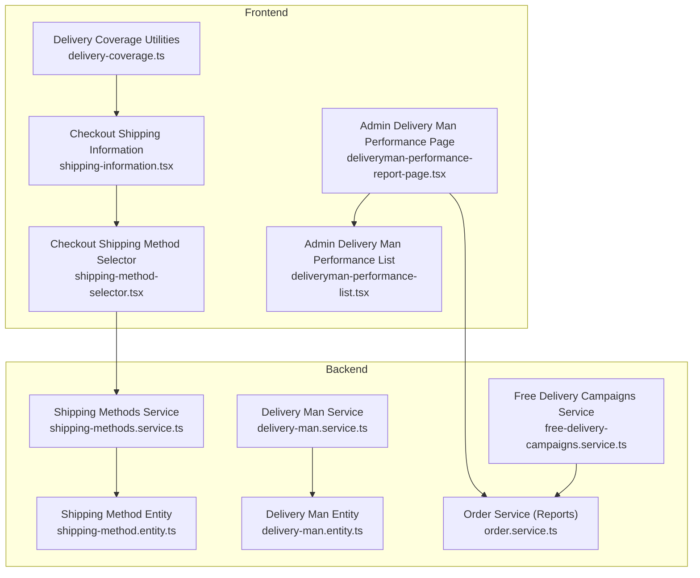
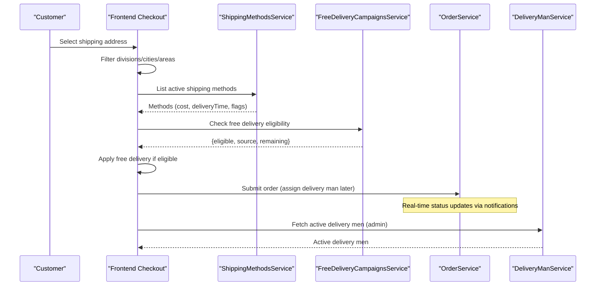
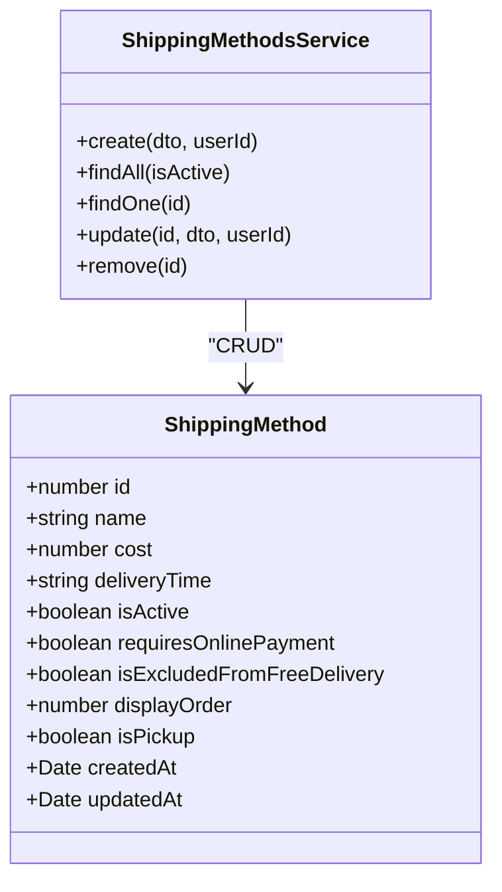
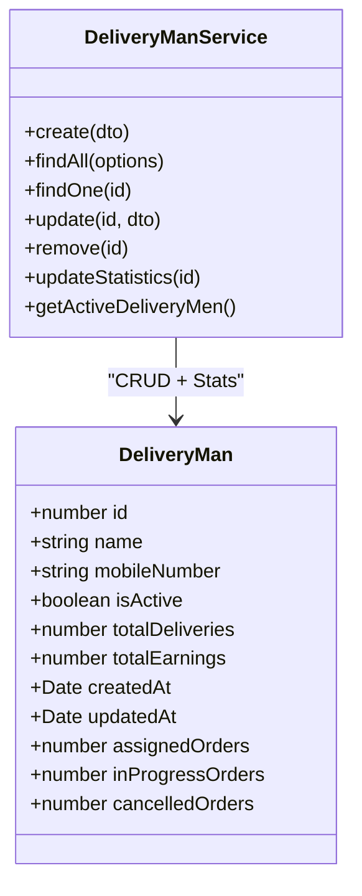
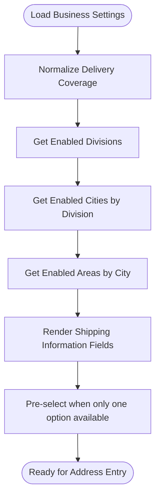
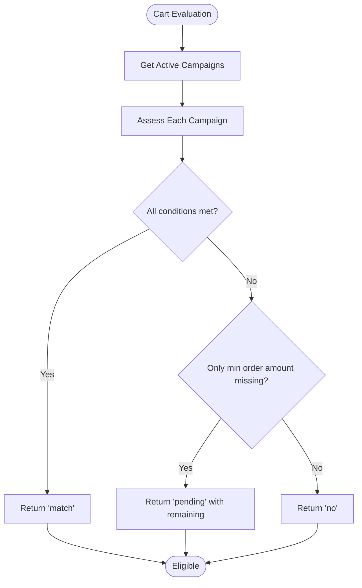
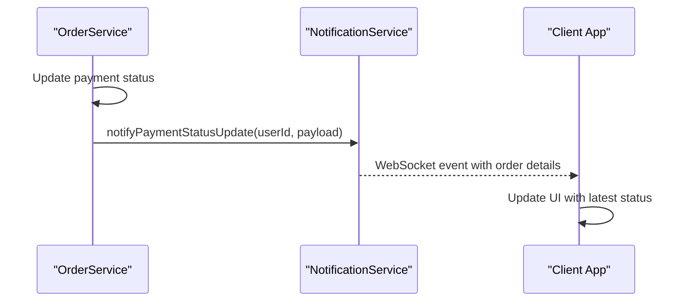
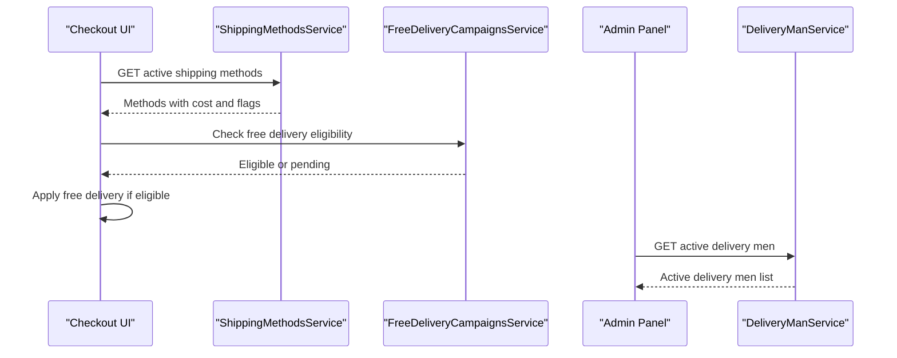
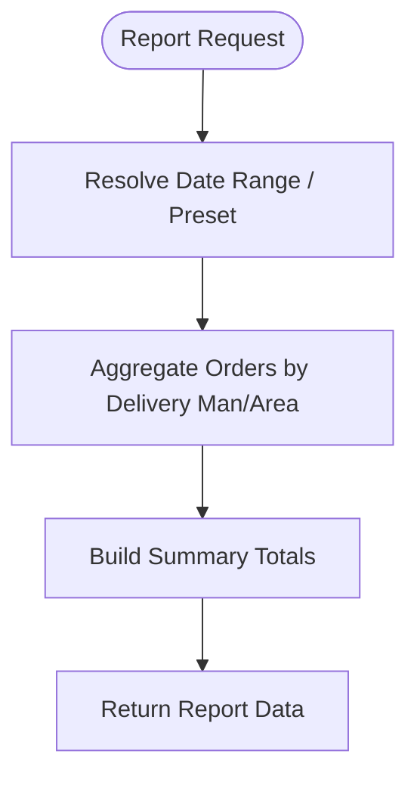
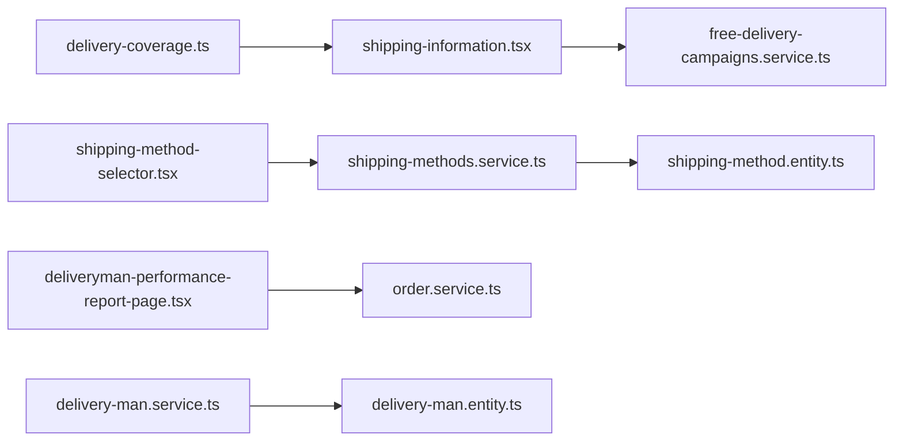

# Shipping & Delivery Management

<cite>
**Referenced Files in This Document**
- [shipping-method.entity.ts](file://apps/backend/src/shipping-methods/entities/shipping-method.entity.ts)
- [shipping-methods.service.ts](file://apps/backend/src/shipping-methods/shipping-methods.service.ts)
- [delivery-man.entity.ts](file://apps/backend/src/delivery-man/entities/delivery-man.entity.ts)
- [delivery-man.service.ts](file://apps/backend/src/delivery-man/delivery-man.service.ts)
- [free-delivery-campaigns.service.ts](file://apps/backend/src/free-delivery-campaigns/free-delivery-campaigns.service.ts)
- [order.service.ts](file://apps/backend/src/order/order.service.ts)
- [delivery-coverage.ts](file://apps/frontend/lib/delivery-coverage.ts)
- [shipping-information.tsx](file://apps/frontend/components/checkout/shipping-information.tsx)
- [shipping-method-selector.tsx](file://apps/frontend/components/checkout/shipping-method-selector.tsx)
- [deliveryman-performance-list.tsx](file://apps/frontend/components/admin/reports/deliveryman-performance/deliveryman-performance-list.tsx)
- [deliveryman-performance-report-page.tsx](file://apps/frontend/app/admin/reports/deliveryman-performance/page.tsx)
</cite>

## Table of Contents
1. [Introduction](#introduction)
2. [Project Structure](#project-structure)
3. [Core Components](#core-components)
4. [Architecture Overview](#architecture-overview)
5. [Detailed Component Analysis](#detailed-component-analysis)
6. [Dependency Analysis](#dependency-analysis)
7. [Performance Considerations](#performance-considerations)
8. [Troubleshooting Guide](#troubleshooting-guide)
9. [Conclusion](#conclusion)

## Introduction
This document explains the shipping and delivery management system implemented in the monorepo. It covers:
- Shipping method configuration, cost calculation, delivery time display, and geographic restrictions
- Delivery man assignment, availability tracking, performance metrics, and reporting
- Location-based delivery coverage and area-wise rules
- Free delivery campaign eligibility and checkout behavior
- Delivery tracking mechanisms and real-time status updates
- Integration points with external services (where present)
- Delivery performance analytics and reporting features

The goal is to help both technical and non-technical readers understand how shipping and delivery work end-to-end across backend services and frontend components.

## Project Structure
Shipping and delivery functionality spans backend NestJS modules and frontend Next.js pages and components:
- Backend:
  - Shipping methods entity and service for CRUD and listing
  - Delivery man entity and service for lifecycle and statistics
  - Free delivery campaigns service for eligibility evaluation
  - Order service for performance reports and dashboard metrics
- Frontend:
  - Delivery coverage normalization and filtering utilities
  - Checkout UI for location selection and shipping method selection
  - Admin report pages and tables for delivery man performance

**Diagram sources**
- [delivery-coverage.ts:1-134](file://apps/frontend/lib/delivery-coverage.ts#L1-L134)
- [shipping-information.tsx:1-218](file://apps/frontend/components/checkout/shipping-information.tsx#L1-L218)
- [shipping-method-selector.tsx:67-98](file://apps/frontend/components/checkout/shipping-method-selector.tsx#L67-L98)
- [deliveryman-performance-report-page.tsx:1-82](file://apps/frontend/app/admin/reports/deliveryman-performance/page.tsx#L1-L82)
- [deliveryman-performance-list.tsx:39-87](file://apps/frontend/components/admin/reports/deliveryman-performance/deliveryman-performance-list.tsx#L39-L87)
- [shipping-methods.service.ts:1-74](file://apps/backend/src/shipping-methods/shipping-methods.service.ts#L1-L74)
- [shipping-method.entity.ts:1-98](file://apps/backend/src/shipping-methods/entities/shipping-method.entity.ts#L1-L98)
- [delivery-man.service.ts:1-230](file://apps/backend/src/delivery-man/delivery-man.service.ts#L1-L230)
- [delivery-man.entity.ts:1-46](file://apps/backend/src/delivery-man/entities/delivery-man.entity.ts#L1-L46)
- [free-delivery-campaigns.service.ts:1-418](file://apps/backend/src/free-delivery-campaigns/free-delivery-campaigns.service.ts#L1-L418)
- [order.service.ts:1780-2000](file://apps/backend/src/order/order.service.ts#L1780-L2000)

**Section sources**
- [shipping-methods.service.ts:1-74](file://apps/backend/src/shipping-methods/shipping-methods.service.ts#L1-L74)
- [delivery-man.service.ts:1-230](file://apps/backend/src/delivery-man/delivery-man.service.ts#L1-L230)
- [free-delivery-campaigns.service.ts:1-418](file://apps/backend/src/free-delivery-campaigns/free-delivery-campaigns.service.ts#L1-L418)
- [order.service.ts:1780-2000](file://apps/backend/src/order/order.service.ts#L1780-L2000)
- [delivery-coverage.ts:1-134](file://apps/frontend/lib/delivery-coverage.ts#L1-L134)
- [shipping-information.tsx:1-218](file://apps/frontend/components/checkout/shipping-information.tsx#L1-L218)
- [shipping-method-selector.tsx:67-98](file://apps/frontend/components/checkout/shipping-method-selector.tsx#L67-L98)
- [deliveryman-performance-report-page.tsx:1-82](file://apps/frontend/app/admin/reports/deliveryman-performance/page.tsx#L1-L82)
- [deliveryman-performance-list.tsx:39-87](file://apps/frontend/components/admin/reports/deliveryman-performance/deliveryman-performance-list.tsx#L39-L87)

## Core Components
- Shipping Method Configuration
  - Defines name, cost, delivery time, activation, online payment requirement, exclusion from free delivery, display order, and pickup flag.
  - Service provides create, list (with optional active filter), find, update, remove operations.
- Delivery Man Assignment and Tracking
  - Tracks identity, activity status, total deliveries, earnings, and computed assigned/in-progress/cancelled counts.
  - Service supports CRUD, search, pagination, statistics recalculation, and fetching active delivery men.
- Free Delivery Campaigns
  - Evaluates active campaigns against cart items, quantity, minimum order amount, day/time windows, product/category targeting, and new customer restriction.
  - Returns match, pending (near threshold), or none with progress guidance.
- Location-Based Delivery Coverage
  - Normalizes business settings into divisions, cities, and areas; filters enabled options; pre-selects when only one option remains.
- Reports and Analytics
  - Per-delivery man performance report with summary totals.
  - Area-wise order report grouping orders by address area.
  - Dashboard delivery performance summary including average delivery hours and top delivery men.

**Section sources**
- [shipping-method.entity.ts:14-98](file://apps/backend/src/shipping-methods/entities/shipping-method.entity.ts#L14-L98)
- [shipping-methods.service.ts:17-72](file://apps/backend/src/shipping-methods/shipping-methods.service.ts#L17-L72)
- [delivery-man.entity.ts:11-46](file://apps/backend/src/delivery-man/entities/delivery-man.entity.ts#L11-L46)
- [delivery-man.service.ts:30-228](file://apps/backend/src/delivery-man/delivery-man.service.ts#L30-L228)
- [free-delivery-campaigns.service.ts:18-82](file://apps/backend/src/free-delivery-campaigns/free-delivery-campaigns.service.ts#L18-L82)
- [free-delivery-campaigns.service.ts:263-410](file://apps/backend/src/free-delivery-campaigns/free-delivery-campaigns.service.ts#L263-L410)
- [delivery-coverage.ts:35-133](file://apps/frontend/lib/delivery-coverage.ts#L35-L133)
- [order.service.ts:1798-1949](file://apps/backend/src/order/order.service.ts#L1798-L1949)

## Architecture Overview
The shipping and delivery flow integrates frontend checkout UI, backend shipping and campaign logic, and reporting endpoints.

**Diagram sources**
- [shipping-information.tsx:48-79](file://apps/frontend/components/checkout/shipping-information.tsx#L48-L79)
- [shipping-methods.service.ts:31-41](file://apps/backend/src/shipping-methods/shipping-methods.service.ts#L31-L41)
- [free-delivery-campaigns.service.ts:346-410](file://apps/backend/src/free-delivery-campaigns/free-delivery-campaigns.service.ts#L346-L410)
- [order.service.ts:1373-1398](file://apps/backend/src/order/order.service.ts#L1373-L1398)
- [delivery-man.service.ts:223-228](file://apps/backend/src/delivery-man/delivery-man.service.ts#L223-L228)

## Detailed Component Analysis

### Shipping Method Configuration
- Data model includes:
  - Cost, delivery time string, activation flag
  - Requires online payment (rejects cash on delivery)
  - Excluded from free delivery campaigns
  - Display order and pickup flag
- Service operations:
  - Create/update/remove with audit fields
  - Find all with optional active filter and ordering by display order

**Diagram sources**
- [shipping-method.entity.ts:14-98](file://apps/backend/src/shipping-methods/entities/shipping-method.entity.ts#L14-L98)
- [shipping-methods.service.ts:17-72](file://apps/backend/src/shipping-methods/shipping-methods.service.ts#L17-L72)

**Section sources**
- [shipping-method.entity.ts:14-98](file://apps/backend/src/shipping-methods/entities/shipping-method.entity.ts#L14-L98)
- [shipping-methods.service.ts:17-72](file://apps/backend/src/shipping-methods/shipping-methods.service.ts#L17-L72)

### Delivery Man Assignment System
- Entity tracks:
  - Identity, mobile number, activity status
  - Total deliveries and total earnings
  - Computed assigned/in-progress/cancelled counts attached at runtime
- Service capabilities:
  - Create/update/remove with uniqueness checks
  - Paginated list with search and active filter
  - Statistics recalculation based on delivered orders
  - Fetch active delivery men for assignment lists

**Diagram sources**
- [delivery-man.entity.ts:11-46](file://apps/backend/src/delivery-man/entities/delivery-man.entity.ts#L11-L46)
- [delivery-man.service.ts:30-228](file://apps/backend/src/delivery-man/delivery-man.service.ts#L30-L228)

**Section sources**
- [delivery-man.entity.ts:11-46](file://apps/backend/src/delivery-man/entities/delivery-man.entity.ts#L11-L46)
- [delivery-man.service.ts:30-228](file://apps/backend/src/delivery-man/delivery-man.service.ts#L30-L228)

### Location-Based Delivery Coverage and Area-Wise Rules
- Coverage normalization converts legacy formats into a structured list of divisions, cities, and areas with enabled flags.
- Filtering functions return enabled options per level and support fallback to bundled dataset when not configured.
- Checkout UI uses these utilities to:
  - Show/hide division/city/area fields based on enabled options
  - Pre-select single-option values automatically
  - Cascade resets when higher-level selections change

**Diagram sources**
- [delivery-coverage.ts:35-133](file://apps/frontend/lib/delivery-coverage.ts#L35-L133)
- [shipping-information.tsx:48-79](file://apps/frontend/components/checkout/shipping-information.tsx#L48-L79)

**Section sources**
- [delivery-coverage.ts:35-133](file://apps/frontend/lib/delivery-coverage.ts#L35-L133)
- [shipping-information.tsx:48-79](file://apps/frontend/components/checkout/shipping-information.tsx#L48-L79)

### Free Delivery Campaign Functionality and Eligibility
- Campaign evaluation considers:
  - Day-of-week and time window constraints
  - Product/category targeting
  - Minimum quantity and minimum order amount
  - New customers only restriction
- Public check returns:
  - Matched campaign (free delivery applied)
  - Pending campaign (near threshold with remaining amount)
  - None (no applicable campaign)

**Diagram sources**
- [free-delivery-campaigns.service.ts:263-410](file://apps/backend/src/free-delivery-campaigns/free-delivery-campaigns.service.ts#L263-L410)

**Section sources**
- [free-delivery-campaigns.service.ts:263-410](file://apps/backend/src/free-delivery-campaigns/free-delivery-campaigns.service.ts#L263-L410)

### Delivery Tracking Mechanisms and Real-Time Status Updates
- Order service notifies users about payment status updates via a notification service.
- While explicit delivery status tracking endpoints are not shown here, the order service exposes reporting and dashboard metrics that reflect delivery outcomes and timing.

**Diagram sources**
- [order.service.ts:1373-1398](file://apps/backend/src/order/order.service.ts#L1373-L1398)

**Section sources**
- [order.service.ts:1373-1398](file://apps/backend/src/order/order.service.ts#L1373-L1398)

### Examples: Shipping Cost Calculation and Delivery Assignment Workflows
- Shipping cost calculation example:
  - A selected shipping method has a cost field. If a free delivery campaign matches, the frontend displays the original cost crossed out and shows “FREE”.
  - If the method is excluded from free delivery, its cost remains unchanged even when a campaign applies.
- Delivery assignment workflow example:
  - Admin retrieves active delivery men via the delivery man service.
  - Orders can be associated with a delivery man; performance reports aggregate assigned, delivered, in-progress, and delivered value per delivery man.

**Diagram sources**
- [shipping-method-selector.tsx:67-98](file://apps/frontend/components/checkout/shipping-method-selector.tsx#L67-L98)
- [shipping-methods.service.ts:31-41](file://apps/backend/src/shipping-methods/shipping-methods.service.ts#L31-L41)
- [free-delivery-campaigns.service.ts:346-410](file://apps/backend/src/free-delivery-campaigns/free-delivery-campaigns.service.ts#L346-L410)
- [delivery-man.service.ts:223-228](file://apps/backend/src/delivery-man/delivery-man.service.ts#L223-L228)

**Section sources**
- [shipping-method-selector.tsx:67-98](file://apps/frontend/components/checkout/shipping-method-selector.tsx#L67-L98)
- [shipping-methods.service.ts:31-41](file://apps/backend/src/shipping-methods/shipping-methods.service.ts#L31-L41)
- [free-delivery-campaigns.service.ts:346-410](file://apps/backend/src/free-delivery-campaigns/free-delivery-campaigns.service.ts#L346-L410)
- [delivery-man.service.ts:223-228](file://apps/backend/src/delivery-man/delivery-man.service.ts#L223-L228)

### Delivery Performance Analytics and Reporting Features
- Per-delivery man performance report:
  - Aggregates assigned, delivered, in-progress, and delivered value per delivery man within a date range.
  - Includes summary totals and active delivery men count.
- Area-wise order report:
  - Groups orders by address area, including status breakdowns and value totals.
  - Unknown area group ensures no data loss.
- Dashboard delivery performance summary:
  - Computes average delivery hours and top delivery men by delivered orders over the last 30 days.

**Diagram sources**
- [order.service.ts:1798-1949](file://apps/backend/src/order/order.service.ts#L1798-L1949)
- [deliveryman-performance-report-page.tsx:15-82](file://apps/frontend/app/admin/reports/deliveryman-performance/page.tsx#L15-L82)
- [deliveryman-performance-list.tsx:39-87](file://apps/frontend/components/admin/reports/deliveryman-performance/deliveryman-performance-list.tsx#L39-L87)

**Section sources**
- [order.service.ts:1798-1949](file://apps/backend/src/order/order.service.ts#L1798-L1949)
- [deliveryman-performance-report-page.tsx:15-82](file://apps/frontend/app/admin/reports/deliveryman-performance/page.tsx#L15-L82)
- [deliveryman-performance-list.tsx:39-87](file://apps/frontend/components/admin/reports/deliveryman-performance/deliveryman-performance-list.tsx#L39-L87)

## Dependency Analysis
Key dependencies and relationships:
- Frontend checkout depends on:
  - Delivery coverage utilities for enabling/disabling regions
  - Shipping methods service for available methods and costs
  - Free delivery campaigns service for eligibility and progress
- Backend services depend on:
  - TypeORM repositories for entities
  - Order service for reporting and dashboard metrics
  - Notification service for real-time updates

**Diagram sources**
- [delivery-coverage.ts:1-134](file://apps/frontend/lib/delivery-coverage.ts#L1-L134)
- [shipping-information.tsx:1-218](file://apps/frontend/components/checkout/shipping-information.tsx#L1-L218)
- [shipping-method-selector.tsx:67-98](file://apps/frontend/components/checkout/shipping-method-selector.tsx#L67-L98)
- [shipping-methods.service.ts:1-74](file://apps/backend/src/shipping-methods/shipping-methods.service.ts#L1-L74)
- [free-delivery-campaigns.service.ts:1-418](file://apps/backend/src/free-delivery-campaigns/free-delivery-campaigns.service.ts#L1-L418)
- [deliveryman-performance-report-page.tsx:1-82](file://apps/frontend/app/admin/reports/deliveryman-performance/page.tsx#L1-L82)
- [order.service.ts:1780-2000](file://apps/backend/src/order/order.service.ts#L1780-L2000)
- [delivery-man.service.ts:1-230](file://apps/backend/src/delivery-man/delivery-man.service.ts#L1-L230)
- [shipping-method.entity.ts:1-98](file://apps/backend/src/shipping-methods/entities/shipping-method.entity.ts#L1-L98)
- [delivery-man.entity.ts:1-46](file://apps/backend/src/delivery-man/entities/delivery-man.entity.ts#L1-L46)

**Section sources**
- [delivery-coverage.ts:1-134](file://apps/frontend/lib/delivery-coverage.ts#L1-L134)
- [shipping-information.tsx:1-218](file://apps/frontend/components/checkout/shipping-information.tsx#L1-L218)
- [shipping-method-selector.tsx:67-98](file://apps/frontend/components/checkout/shipping-method-selector.tsx#L67-L98)
- [shipping-methods.service.ts:1-74](file://apps/backend/src/shipping-methods/shipping-methods.service.ts#L1-L74)
- [free-delivery-campaigns.service.ts:1-418](file://apps/backend/src/free-delivery-campaigns/free-delivery-campaigns.service.ts#L1-L418)
- [deliveryman-performance-report-page.tsx:1-82](file://apps/frontend/app/admin/reports/deliveryman-performance/page.tsx#L1-L82)
- [order.service.ts:1780-2000](file://apps/backend/src/order/order.service.ts#L1780-L2000)
- [delivery-man.service.ts:1-230](file://apps/backend/src/delivery-man/delivery-man.service.ts#L1-L230)
- [shipping-method.entity.ts:1-98](file://apps/backend/src/shipping-methods/entities/shipping-method.entity.ts#L1-L98)
- [delivery-man.entity.ts:1-46](file://apps/backend/src/delivery-man/entities/delivery-man.entity.ts#L1-L46)

## Performance Considerations
- Use active-only filters when listing shipping methods to reduce payload size.
- Leverage the delivery man service’s paginated list and search to avoid large result sets.
- Prefer the area-wise and per-delivery man reports for aggregated analytics instead of loading full order histories.
- Cache active free delivery campaigns on the frontend where appropriate to minimize repeated evaluations.

[No sources needed since this section provides general guidance]

## Troubleshooting Guide
- Shipping method not appearing:
  - Verify the method is marked active and ordered correctly.
  - Ensure it is not excluded from free delivery when expecting zero cost.
- Free delivery not applying:
  - Confirm campaign is active and within valid date/time windows.
  - Check product/category targeting and minimum order amount thresholds.
  - Review whether the selected shipping method is excluded from free delivery.
- Delivery man not assignable:
  - Ensure the delivery man is active and not already overloaded (check assigned/in-progress counts).
- Coverage issues:
  - Validate business settings delivery coverage; ensure desired divisions/cities/areas are enabled.
  - Confirm cascading selection logic in checkout is functioning (division -> city -> area).

**Section sources**
- [shipping-method.entity.ts:31-64](file://apps/backend/src/shipping-methods/entities/shipping-method.entity.ts#L31-L64)
- [free-delivery-campaigns.service.ts:263-410](file://apps/backend/src/free-delivery-campaigns/free-delivery-campaigns.service.ts#L263-L410)
- [delivery-man.service.ts:61-124](file://apps/backend/src/delivery-man/delivery-man.service.ts#L61-L124)
- [delivery-coverage.ts:96-133](file://apps/frontend/lib/delivery-coverage.ts#L96-L133)
- [shipping-information.tsx:48-79](file://apps/frontend/components/checkout/shipping-information.tsx#L48-L79)

## Conclusion
The shipping and delivery management system combines configurable shipping methods, robust free delivery campaign evaluation, precise location-based coverage, and comprehensive delivery man performance reporting. The frontend delivers an intuitive checkout experience with dynamic region filtering and cost visualization, while the backend provides reliable APIs for shipping configuration, campaign eligibility, and analytics. Together, these components enable scalable, transparent, and efficient shipping and delivery operations.

[No sources needed since this section summarizes without analyzing specific files]