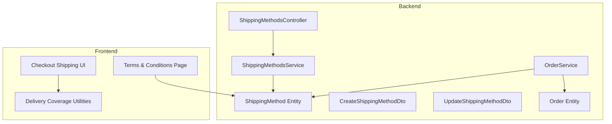
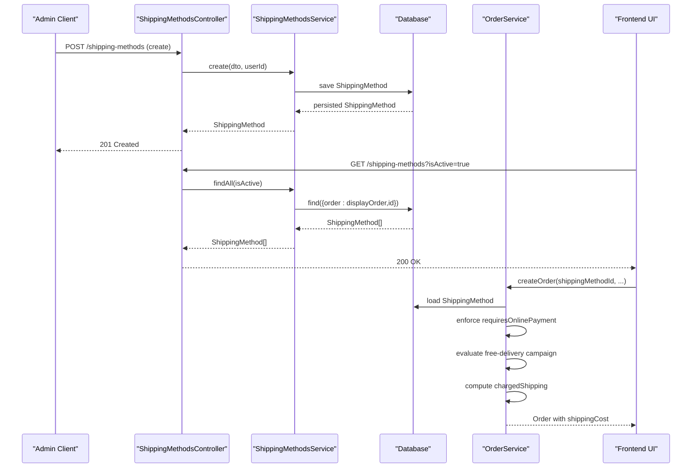
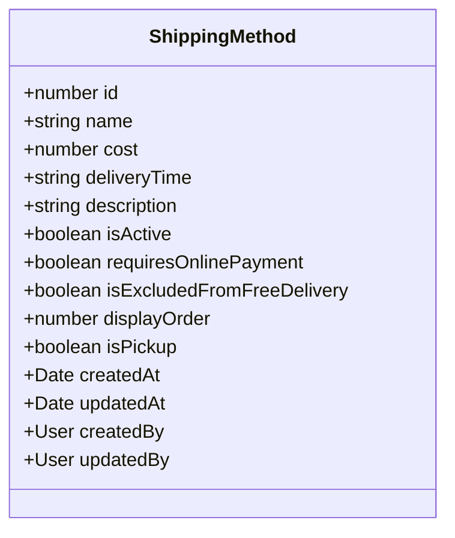
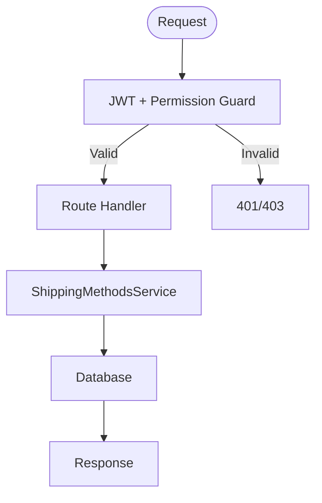
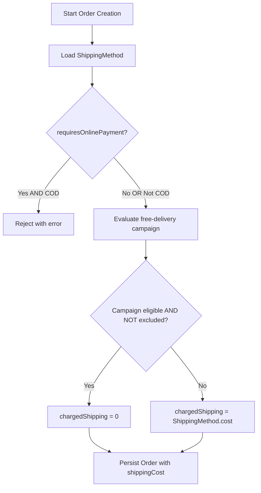
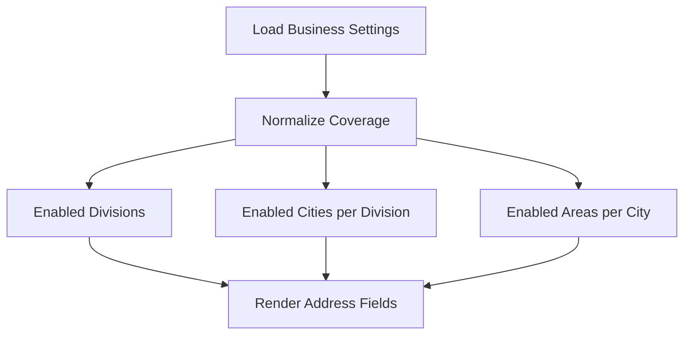
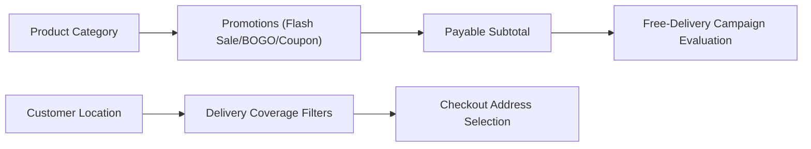
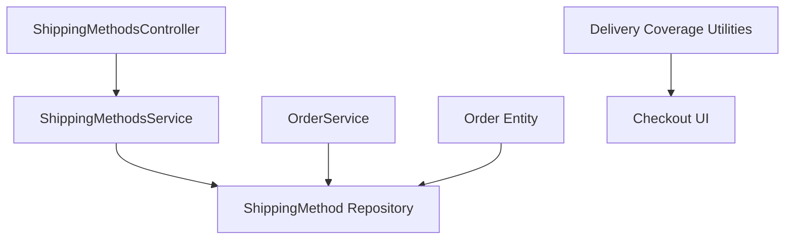

# Shipping Methods Configuration

<cite>
**Referenced Files in This Document**
- [shipping-method.entity.ts](file://apps/backend/src/shipping-methods/entities/shipping-method.entity.ts)
- [create-shipping-method.dto.ts](file://apps/backend/src/shipping-methods/dto/create-shipping-method.dto.ts)
- [update-shipping-method.dto.ts](file://apps/backend/src/shipping-methods/dto/update-shipping-method.dto.ts)
- [shipping-methods.service.ts](file://apps/backend/src/shipping-methods/shipping-methods.service.ts)
- [shipping-methods.controller.ts](file://apps/backend/src/shipping-methods/shipping-methods.controller.ts)
- [order.service.ts](file://apps/backend/src/order/order.service.ts)
- [order.entity.ts](file://apps/backend/src/order/entities/order.entity.ts)
- [delivery-coverage.ts](file://apps/frontend/lib/delivery-coverage.ts)
- [shipping-information.tsx](file://apps/frontend/components/checkout/shipping-information.tsx)
- [terms-and-conditions page.tsx](file://apps/frontend/app/(main)/(policy)/terms-and-conditions/page.tsx)
</cite>

## Table of Contents
1. [Introduction](#introduction)
2. [Project Structure](#project-structure)
3. [Core Components](#core-components)
4. [Architecture Overview](#architecture-overview)
5. [Detailed Component Analysis](#detailed-component-analysis)
6. [Dependency Analysis](#dependency-analysis)
7. [Performance Considerations](#performance-considerations)
8. [Troubleshooting Guide](#troubleshooting-guide)
9. [Conclusion](#conclusion)

## Introduction
This document explains the shipping methods configuration system, including how to set up and manage shipping methods, how costs are calculated during checkout, how delivery time is represented, and how geographic restrictions apply. It also covers the admin API for creating and managing shipping methods and shows how shipping integrates with orders, product categories, and customer locations.

## Project Structure
The shipping feature spans backend entities, DTOs, services, controllers, order processing logic, and frontend coverage utilities:

**Diagram sources**
- [shipping-methods.controller.ts:28-114](file://apps/backend/src/shipping-methods/shipping-methods.controller.ts#L28-L114)
- [shipping-methods.service.ts:10-74](file://apps/backend/src/shipping-methods/shipping-methods.service.ts#L10-L74)
- [shipping-method.entity.ts:14-98](file://apps/backend/src/shipping-methods/entities/shipping-method.entity.ts#L14-L98)
- [order.service.ts:103-448](file://apps/backend/src/order/order.service.ts#L103-L448)
- [order.entity.ts:24-157](file://apps/backend/src/order/entities/order.entity.ts#L24-L157)
- [delivery-coverage.ts:1-133](file://apps/frontend/lib/delivery-coverage.ts#L1-L133)
- [shipping-information.tsx:39-72](file://apps/frontend/components/checkout/shipping-information.tsx#L39-L72)
- [terms-and-conditions page.tsx:88-118](file://apps/frontend/app/(main)/(policy)/terms-and-conditions/page.tsx#L88-L118)

**Section sources**
- [shipping-methods.controller.ts:28-114](file://apps/backend/src/shipping-methods/shipping-methods.controller.ts#L28-L114)
- [shipping-methods.service.ts:10-74](file://apps/backend/src/shipping-methods/shipping-methods.service.ts#L10-L74)
- [shipping-method.entity.ts:14-98](file://apps/backend/src/shipping-methods/entities/shipping-method.entity.ts#L14-L98)
- [order.service.ts:103-448](file://apps/backend/src/order/order.service.ts#L103-L448)
- [order.entity.ts:24-157](file://apps/backend/src/order/entities/order.entity.ts#L24-L157)
- [delivery-coverage.ts:1-133](file://apps/frontend/lib/delivery-coverage.ts#L1-L133)
- [shipping-information.tsx:39-72](file://apps/frontend/components/checkout/shipping-information.tsx#L39-L72)
- [terms-and-conditions page.tsx:88-118](file://apps/frontend/app/(main)/(policy)/terms-and-conditions/page.tsx#L88-L118)

## Core Components
- ShippingMethod entity defines the data model for each shipping method, including cost, deliveryTime, activation flags, payment constraints, and display ordering.
- Create/Update DTOs validate inputs for name, cost, deliveryTime, description, isActive, requiresOnlinePayment, isExcludedFromFreeDelivery, displayOrder, and isPickup.
- ShippingMethodsService provides CRUD operations for shipping methods, including filtering by activation status and ordering by displayOrder.
- ShippingMethodsController exposes REST endpoints for creating, listing, retrieving, updating, and deleting shipping methods, with authentication and permission guards.
- OrderService integrates shipping into order creation, enforcing payment rules, applying free-delivery campaigns, and calculating the final shipping charge.
- Frontend delivery-coverage utilities normalize and filter divisions, cities, and areas based on business settings.
- Checkout UI uses coverage utilities to restrict address selection to enabled regions.
- Terms & Conditions page displays available shipping methods and their delivery times.

**Section sources**
- [shipping-method.entity.ts:14-98](file://apps/backend/src/shipping-methods/entities/shipping-method.entity.ts#L14-L98)
- [create-shipping-method.dto.ts:10-96](file://apps/backend/src/shipping-methods/dto/create-shipping-method.dto.ts#L10-L96)
- [update-shipping-method.dto.ts:1-7](file://apps/backend/src/shipping-methods/dto/update-shipping-method.dto.ts#L1-L7)
- [shipping-methods.service.ts:10-74](file://apps/backend/src/shipping-methods/shipping-methods.service.ts#L10-L74)
- [shipping-methods.controller.ts:28-114](file://apps/backend/src/shipping-methods/shipping-methods.controller.ts#L28-L114)
- [order.service.ts:103-448](file://apps/backend/src/order/order.service.ts#L103-L448)
- [delivery-coverage.ts:1-133](file://apps/frontend/lib/delivery-coverage.ts#L1-L133)
- [shipping-information.tsx:39-72](file://apps/frontend/components/checkout/shipping-information.tsx#L39-L72)
- [terms-and-conditions page.tsx:88-118](file://apps/frontend/app/(main)/(policy)/terms-and-conditions/page.tsx#L88-L118)

## Architecture Overview
The shipping configuration flows from admin API to order processing and frontend presentation:

**Diagram sources**
- [shipping-methods.controller.ts:35-51](file://apps/backend/src/shipping-methods/shipping-methods.controller.ts#L35-L51)
- [shipping-methods.service.ts:17-42](file://apps/backend/src/shipping-methods/shipping-methods.service.ts#L17-L42)
- [order.service.ts:103-448](file://apps/backend/src/order/order.service.ts#L103-L448)

## Detailed Component Analysis

### ShippingMethod Data Model
The ShippingMethod entity models a shipping option with:
- Unique name and decimal cost
- Human-readable deliveryTime string
- Activation flag (isActive)
- Payment constraint (requiresOnlinePayment)
- Free-delivery exclusion (isExcludedFromFreeDelivery)
- Display ordering (displayOrder)
- Pickup-only mode (isPickup)
- Audit fields (createdAt, updatedAt, createdBy, updatedBy)

**Diagram sources**
- [shipping-method.entity.ts:14-98](file://apps/backend/src/shipping-methods/entities/shipping-method.entity.ts#L14-L98)

**Section sources**
- [shipping-method.entity.ts:14-98](file://apps/backend/src/shipping-methods/entities/shipping-method.entity.ts#L14-L98)

### Shipping Methods API
Endpoints:
- POST /shipping-methods: Create a new shipping method (auth required).
- GET /shipping-methods: List all or filter by isActive query param.
- GET /shipping-methods/:id: Retrieve one shipping method.
- PATCH /shipping-methods/:id: Update a shipping method (auth required).
- DELETE /shipping-methods/:id: Delete a shipping method (auth required).

Authentication and permissions:
- JWT guard and permission guard protect mutating endpoints.
- Module-level permission decorator scopes access to admin settings.

Service behavior:
- findAll supports optional isActive filter and returns results ordered by displayOrder then id.
- findOne and update throw NotFoundException when missing.
- remove throws NotFoundException if no rows affected.

**Diagram sources**
- [shipping-methods.controller.ts:28-114](file://apps/backend/src/shipping-methods/shipping-methods.controller.ts#L28-L114)
- [shipping-methods.service.ts:31-74](file://apps/backend/src/shipping-methods/shipping-methods.service.ts#L31-L74)

**Section sources**
- [shipping-methods.controller.ts:28-114](file://apps/backend/src/shipping-methods/shipping-methods.controller.ts#L28-L114)
- [shipping-methods.service.ts:10-74](file://apps/backend/src/shipping-methods/shipping-methods.service.ts#L10-L74)

### Cost Calculation and Delivery Time Logic
During order creation:
- The selected ShippingMethod is loaded and validated.
- If the method requires online payment, cash-on-delivery is rejected.
- A free-delivery campaign may waive shipping; however, methods marked isExcludedFromFreeDelivery always incur their full cost.
- The final shippingCost is stored on the Order and used in emails and reports.

Delivery time:
- deliveryTime is a human-readable string attached to the ShippingMethod and displayed in storefront pages and terms.

**Diagram sources**
- [order.service.ts:135-170](file://apps/backend/src/order/order.service.ts#L135-L170)
- [order.service.ts:357-400](file://apps/backend/src/order/order.service.ts#L357-L400)
- [order.service.ts:428-448](file://apps/backend/src/order/order.service.ts#L428-L448)

**Section sources**
- [order.service.ts:103-448](file://apps/backend/src/order/order.service.ts#L103-L448)
- [order.entity.ts:94-100](file://apps/backend/src/order/entities/order.entity.ts#L94-L100)

### Geographic Restriction Rules
Geographic restrictions are managed via Business Settings deliveryCoverage:
- Divisions, cities, and areas can be enabled/disabled.
- Frontend normalizes coverage data and filters selectable options accordingly.
- Checkout UI hides fields with no enabled options and pre-selects single-option values.

**Diagram sources**
- [delivery-coverage.ts:35-133](file://apps/frontend/lib/delivery-coverage.ts#L35-L133)
- [shipping-information.tsx:48-72](file://apps/frontend/components/checkout/shipping-information.tsx#L48-L72)

**Section sources**
- [delivery-coverage.ts:1-133](file://apps/frontend/lib/delivery-coverage.ts#L1-L133)
- [shipping-information.tsx:39-72](file://apps/frontend/components/checkout/shipping-information.tsx#L39-L72)

### Admin Interface for Managing Shipping Methods
Administrators can:
- Create shipping methods with name, cost, deliveryTime, description, isActive, requiresOnlinePayment, isExcludedFromFreeDelivery, displayOrder, and isPickup.
- Filter active/inactive methods in lists.
- Update or delete existing methods.
- Use displayOrder to control presentation order.

Examples:
- Configure a flat-rate method with a fixed cost and a deliveryTime range.
- Mark an express method as requiresOnlinePayment and isExcludedFromFreeDelivery so it cannot be waived by promotions.
- Set isPickup to true for store pickup where no delivery charges apply.

**Section sources**
- [create-shipping-method.dto.ts:10-96](file://apps/backend/src/shipping-methods/dto/create-shipping-method.dto.ts#L10-L96)
- [shipping-methods.controller.ts:35-51](file://apps/backend/src/shipping-methods/shipping-methods.controller.ts#L35-L51)
- [shipping-methods.service.ts:31-42](file://apps/backend/src/shipping-methods/shipping-methods.service.ts#L31-L42)

### Integration with Product Categories and Customer Locations
- Product categories influence promotional pricing and BOGO eligibility during order creation; shipping cost calculation itself does not depend on category but uses the payable subtotal after product discounts and coupons.
- Customer location is restricted by deliveryCoverage; only enabled divisions/cities/areas are selectable at checkout.

**Diagram sources**
- [order.service.ts:180-355](file://apps/backend/src/order/order.service.ts#L180-L355)
- [order.service.ts:357-400](file://apps/backend/src/order/order.service.ts#L357-L400)
- [delivery-coverage.ts:98-133](file://apps/frontend/lib/delivery-coverage.ts#L98-L133)

**Section sources**
- [order.service.ts:180-400](file://apps/backend/src/order/order.service.ts#L180-L400)
- [delivery-coverage.ts:98-133](file://apps/frontend/lib/delivery-coverage.ts#L98-L133)

### Examples: Configuring Zones, Fees, and Timeframes
- Flat rate: Set cost to a fixed value and deliveryTime to a range like “1–2 business days”.
- Weight-based: Implement weight thresholds outside this module by adjusting cost via external logic before selecting a ShippingMethod; the system stores the final cost on the method.
- Location-based: Enable specific divisions/cities/areas in deliveryCoverage; customers outside these zones cannot select them at checkout.
- Delivery fees: Use isExcludedFromFreeDelivery to ensure certain methods always charge their cost even when free-delivery campaigns match.
- Delivery timeframes: Provide clear deliveryTime strings; they are displayed in storefront pages such as Terms & Conditions.

**Section sources**
- [shipping-method.entity.ts:22-26](file://apps/backend/src/shipping-methods/entities/shipping-method.entity.ts#L22-L26)
- [shipping-method.entity.ts:43-49](file://apps/backend/src/shipping-methods/entities/shipping-method.entity.ts#L43-L49)
- [terms-and-conditions page.tsx:90-100](file://apps/frontend/app/(main)/(policy)/terms-and-conditions/page.tsx#L90-L100)

## Dependency Analysis
Key relationships:
- ShippingMethodsController depends on ShippingMethodsService.
- ShippingMethodsService depends on TypeORM repository for ShippingMethod.
- OrderService depends on ShippingMethod to enforce payment rules and calculate shipping cost.
- Order entity references ShippingMethod and persists shippingCost.
- Frontend delivery-coverage utilities depend on Business Settings to filter address options.

**Diagram sources**
- [shipping-methods.controller.ts:28-114](file://apps/backend/src/shipping-methods/shipping-methods.controller.ts#L28-L114)
- [shipping-methods.service.ts:10-74](file://apps/backend/src/shipping-methods/shipping-methods.service.ts#L10-L74)
- [order.service.ts:103-448](file://apps/backend/src/order/order.service.ts#L103-L448)
- [order.entity.ts:24-157](file://apps/backend/src/order/entities/order.entity.ts#L24-L157)
- [delivery-coverage.ts:1-133](file://apps/frontend/lib/delivery-coverage.ts#L1-L133)

**Section sources**
- [shipping-methods.controller.ts:28-114](file://apps/backend/src/shipping-methods/shipping-methods.controller.ts#L28-L114)
- [shipping-methods.service.ts:10-74](file://apps/backend/src/shipping-methods/shipping-methods.service.ts#L10-L74)
- [order.service.ts:103-448](file://apps/backend/src/order/order.service.ts#L103-L448)
- [order.entity.ts:24-157](file://apps/backend/src/order/entities/order.entity.ts#L24-L157)
- [delivery-coverage.ts:1-133](file://apps/frontend/lib/delivery-coverage.ts#L1-L133)

## Performance Considerations
- Listing shipping methods:
  - Use isActive filter to reduce payload size.
  - Results are ordered by displayOrder and id, which avoids additional sorting overhead.
- Order creation:
  - Shipping cost evaluation is integrated with free-delivery campaign checks; keep campaign configurations minimal to reduce evaluation time.
  - Avoid unnecessary relations when fetching shipping methods in high-throughput paths.
- Frontend coverage:
  - Normalization runs once per settings load; cache Business Settings to avoid repeated computations.
  - Debounce cart changes before evaluating promotions and shipping-related calculations to reduce server calls.

[No sources needed since this section provides general guidance]

## Troubleshooting Guide
Common issues and resolutions:
- Cash on delivery rejected:
  - Occurs when the selected ShippingMethod has requiresOnlinePayment set to true. Switch to an online payment method or choose a different shipping method.
- Shipping cost not waived despite free-delivery campaign:
  - The selected ShippingMethod may be marked isExcludedFromFreeDelivery. Adjust the method’s exclusion flag or choose another method.
- No shipping methods listed:
  - Verify isActive filter and ensure methods exist in the database. Check that the admin has proper permissions to access the shipping methods module.
- Address fields hidden or limited:
  - Confirm deliveryCoverage in Business Settings includes the desired division/city/area. Enable entries in the settings to make them selectable.

**Section sources**
- [order.service.ts:163-170](file://apps/backend/src/order/order.service.ts#L163-L170)
- [order.service.ts:383-390](file://apps/backend/src/order/order.service.ts#L383-L390)
- [shipping-methods.service.ts:31-42](file://apps/backend/src/shipping-methods/shipping-methods.service.ts#L31-L42)
- [delivery-coverage.ts:98-133](file://apps/frontend/lib/delivery-coverage.ts#L98-L133)

## Conclusion
The shipping methods configuration system provides a flexible way to define shipping options with explicit cost and delivery time attributes, enforce payment constraints, and integrate with promotional campaigns. Geographic restrictions are enforced through deliveryCoverage, ensuring customers can only select valid locations. The admin API enables straightforward management of shipping methods, while order processing ensures accurate shipping cost calculation and consistent user experience across the frontend.

[No sources needed since this section summarizes without analyzing specific files]