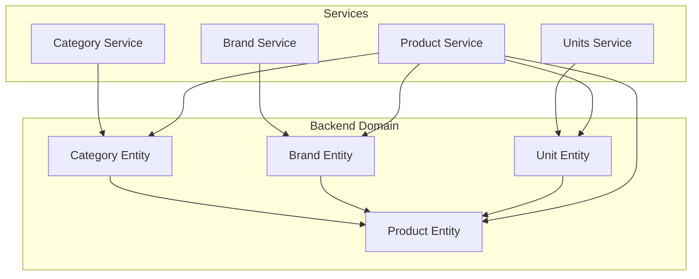
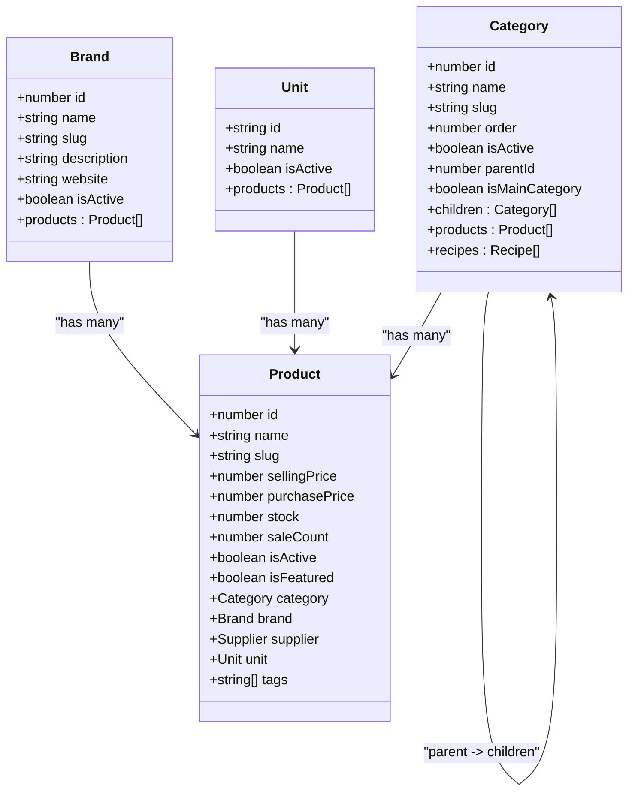
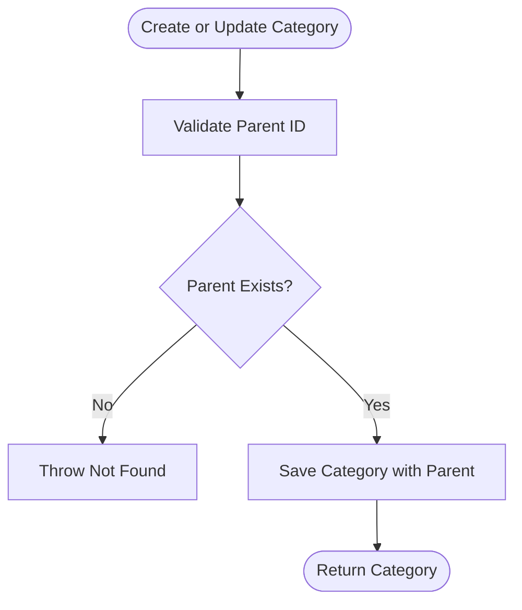
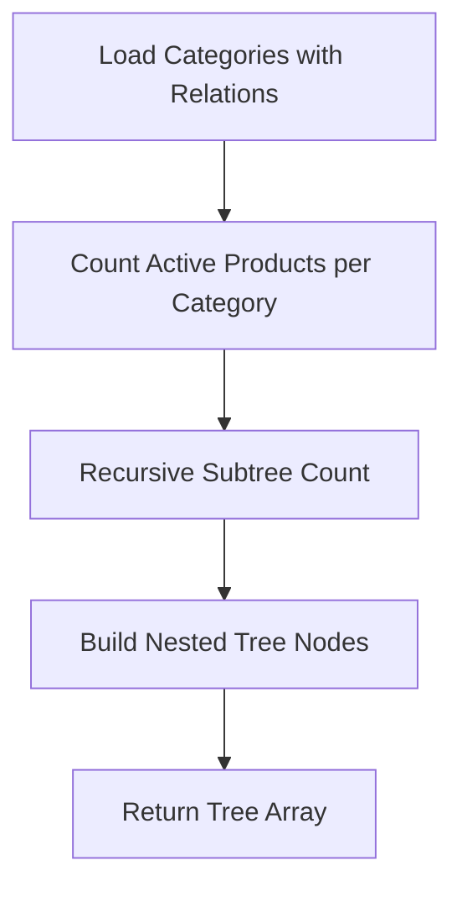
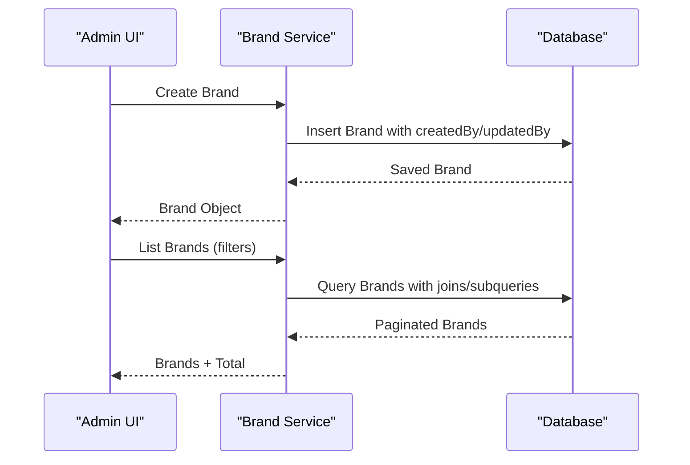
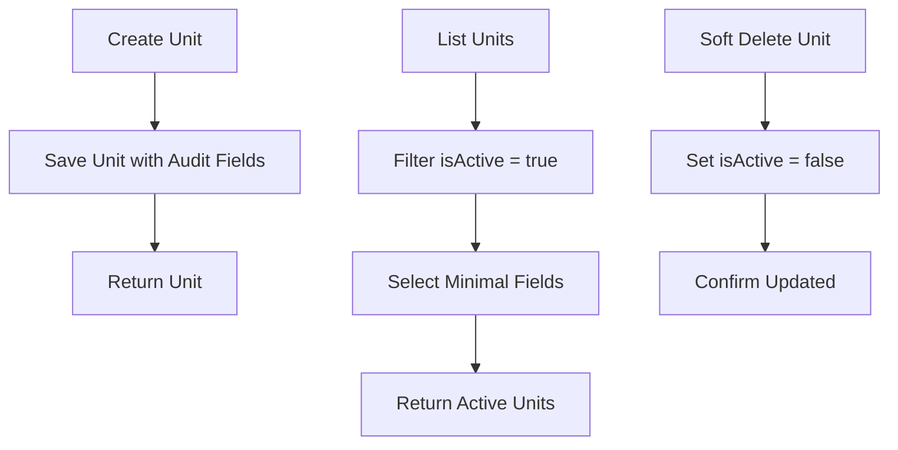
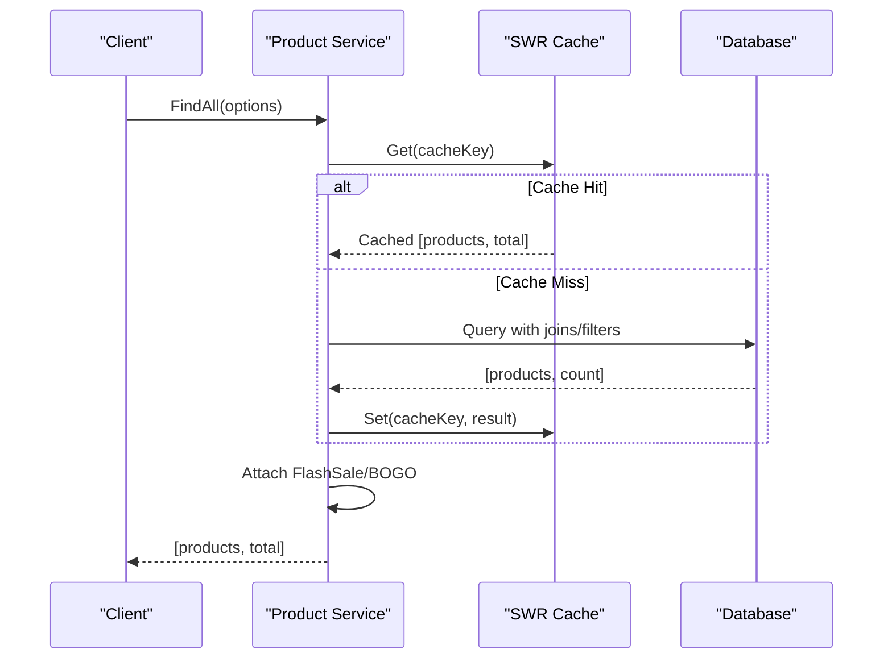
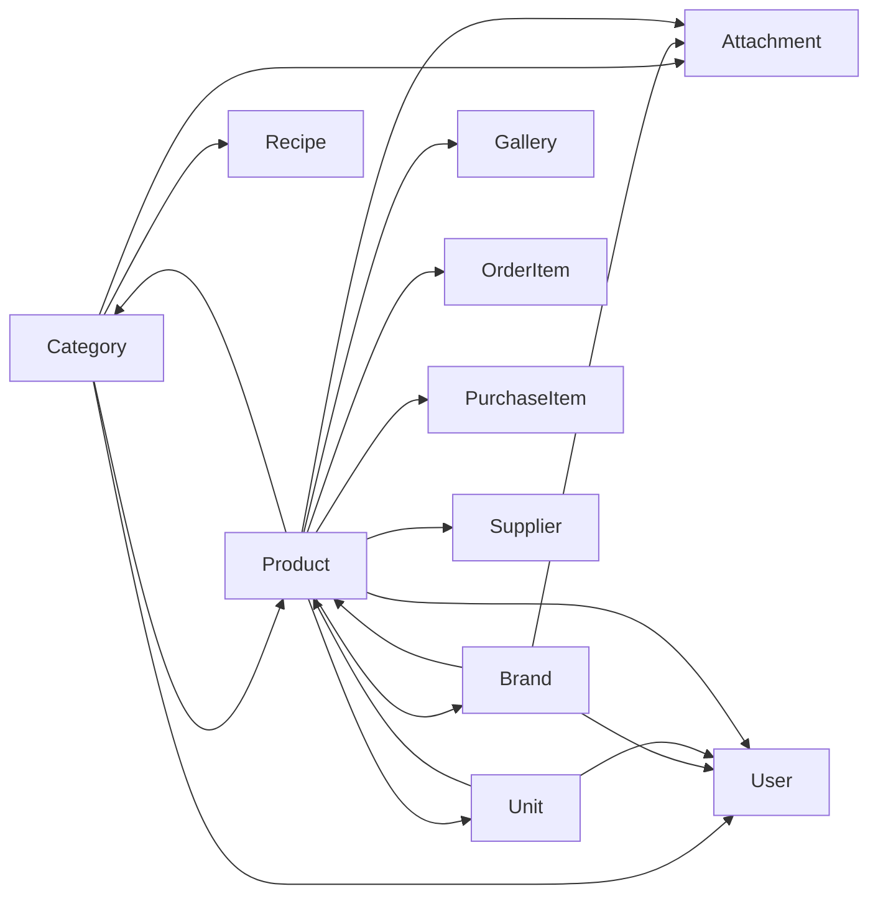

# Category & Brand Management

<cite>
**Referenced Files in This Document**
- [category.entity.ts](file://apps/backend/src/category/entities/category.entity.ts)
- [category.service.ts](file://apps/backend/src/category/category.service.ts)
- [brand.entity.ts](file://apps/backend/src/brand/entities/brand.entity.ts)
- [brand.service.ts](file://apps/backend/src/brand/brand.service.ts)
- [unit.entity.ts](file://apps/backend/src/unit/entities/unit.entity.ts)
- [unit.service.ts](file://apps/backend/src/unit/unit.service.ts)
- [product.entity.ts](file://apps/backend/src/product/entities/product.entity.ts)
- [product.service.ts](file://apps/backend/src/product/product.service.ts)
- [category-form.tsx](file://apps/frontend/components/admin/category/category-form.tsx)
- [category-filters.tsx](file://apps/frontend/components/products/filter/category-filters.tsx)
- [brand-filter.tsx](file://apps/frontend/components/products/filter/brand-filter.tsx)
- [product-breadcrumb.tsx](file://apps/frontend/app/(main)/products/product-breadcrumb.tsx)
</cite>

## Table of Contents
1. [Introduction](#introduction)
2. [Project Structure](#project-structure)
3. [Core Components](#core-components)
4. [Architecture Overview](#architecture-overview)
5. [Detailed Component Analysis](#detailed-component-analysis)
6. [Dependency Analysis](#dependency-analysis)
7. [Performance Considerations](#performance-considerations)
8. [Troubleshooting Guide](#troubleshooting-guide)
9. [Conclusion](#conclusion)

## Introduction
This document explains the category, brand, and unit management system used to organize products. It covers:
- Hierarchical categories with parent-child relationships and product aggregation.
- Brand management and brand-to-product associations.
- Product units for quantity measurement and their usage in product specifications.
- CRUD operations, hierarchy management, and relationship mapping.
- Examples for building category trees, associating brands with products, and managing product units.
- Performance considerations for deep category trees and efficient product filtering.

## Project Structure
The relevant backend modules are organized by feature under `apps/backend/src`:
- `category` defines hierarchical categories and services for listing, tree building, and hierarchy updates.
- `brand` defines brands and services for listing, filtering, and lifecycle management.
- `unit` defines measurement units and services for active unit management.
- `product` defines products and links them to categories, brands, suppliers, and units.

**Diagram sources**
- [category.entity.ts:22-105](file://apps/backend/src/category/entities/category.entity.ts#L22-L105)
- [brand.entity.ts:20-88](file://apps/backend/src/brand/entities/brand.entity.ts#L20-L88)
- [unit.entity.ts:17-77](file://apps/backend/src/unit/entities/unit.entity.ts#L17-L77)
- [product.entity.ts:145-218](file://apps/backend/src/product/entities/product.entity.ts#L145-L218)
- [category.service.ts:29-57](file://apps/backend/src/category/category.service.ts#L29-L57)
- [brand.service.ts:24-39](file://apps/backend/src/brand/brand.service.ts#L24-L39)
- [unit.service.ts:17-49](file://apps/backend/src/unit/unit.service.ts#L17-L49)
- [product.service.ts:56-82](file://apps/backend/src/product/product.service.ts#L56-L82)

**Section sources**
- [category.entity.ts:22-105](file://apps/backend/src/category/entities/category.entity.ts#L22-L105)
- [brand.entity.ts:20-88](file://apps/backend/src/brand/entities/brand.entity.ts#L20-L88)
- [unit.entity.ts:17-77](file://apps/backend/src/unit/entities/unit.entity.ts#L17-L77)
- [product.entity.ts:145-218](file://apps/backend/src/product/entities/product.entity.ts#L145-L218)
- [category.service.ts:29-57](file://apps/backend/src/category/category.service.ts#L29-L57)
- [brand.service.ts:24-39](file://apps/backend/src/brand/brand.service.ts#L24-L39)
- [unit.service.ts:17-49](file://apps/backend/src/unit/unit.service.ts#L17-L49)
- [product.service.ts:56-82](file://apps/backend/src/product/product.service.ts#L56-L82)

## Core Components
- Category entity supports a self-referencing parent-child hierarchy, slug generation, ordering, activation status, main menu flag, and relations to products and recipes.
- Brand entity stores brand metadata, slug, activation status, logo attachment, and one-to-many relation to products.
- Unit entity defines measurement units with activation status, audit fields, and relation to products.
- Product entity links to exactly one category, brand, supplier, and unit; it also tracks pricing, stock, discounts, tags, and computed values.

Key responsibilities:
- Category service provides create, list, merged product listing, tree building, find-by-id, update, and remove.
- Brand service provides create, list with price-range filters, find-by-id, update, and remove.
- Units service provides create, list (active only), find-by-id, update, and soft delete via deactivation.
- Product service validates references (brand, category, unit, supplier, gallery), lists with advanced filters, caches results, and enriches storefront data.

**Section sources**
- [category.entity.ts:22-138](file://apps/backend/src/category/entities/category.entity.ts#L22-L138)
- [brand.entity.ts:20-129](file://apps/backend/src/brand/entities/brand.entity.ts#L20-L129)
- [unit.entity.ts:17-77](file://apps/backend/src/unit/entities/unit.entity.ts#L17-L77)
- [product.entity.ts:51-218](file://apps/backend/src/product/entities/product.entity.ts#L51-L218)
- [category.service.ts:37-57](file://apps/backend/src/category/category.service.ts#L37-L57)
- [brand.service.ts:32-39](file://apps/backend/src/brand/brand.service.ts#L32-L39)
- [unit.service.ts:26-49](file://apps/backend/src/unit/unit.service.ts#L26-L49)
- [product.service.ts:127-173](file://apps/backend/src/product/product.service.ts#L127-L173)

## Architecture Overview
The system uses TypeORM entities to model domain concepts and NestJS services to implement business logic. Products are central entities that reference categories, brands, suppliers, and units. The category service builds hierarchical trees and aggregates product counts across subtrees. The product service applies filters including category hierarchy, brand, supplier, price range, search, and tags, then returns paginated results with optional caching.

**Diagram sources**
- [category.entity.ts:22-105](file://apps/backend/src/category/entities/category.entity.ts#L22-L105)
- [brand.entity.ts:20-88](file://apps/backend/src/brand/entities/brand.entity.ts#L20-L88)
- [unit.entity.ts:17-77](file://apps/backend/src/unit/entities/unit.entity.ts#L17-L77)
- [product.entity.ts:145-218](file://apps/backend/src/product/entities/product.entity.ts#L145-L218)

## Detailed Component Analysis

### Category Hierarchy and Tree Management
Categories support nested hierarchies through a self-referencing `parentId`. The category service:
- Creates categories with optional parent resolution.
- Lists categories with pagination, search, slug filter, parent filter, activation filter, and sorting.
- Merges child products into parent categories when requested.
- Builds a tree structure with aggregated product counts per subtree.
- Updates parent relationships safely.

**Diagram sources**
- [category.service.ts:37-57](file://apps/backend/src/category/category.service.ts#L37-L57)
- [category.service.ts:450-466](file://apps/backend/src/category/category.service.ts#L450-L466)
- [category.service.ts:477-483](file://apps/backend/src/category/category.service.ts#L477-L483)

Tree building and product count aggregation:
- Loads all categories with parent and children relations.
- Counts active products per category directly.
- Recursively sums direct and child counts to compute subtree totals.
- Returns a flat array of nodes with nested children.

**Diagram sources**
- [category.service.ts:380-423](file://apps/backend/src/category/category.service.ts#L380-L423)

Frontend category form allows selecting a parent category, disabling selection when marking as a main category.

**Section sources**
- [category.entity.ts:22-105](file://apps/backend/src/category/entities/category.entity.ts#L22-L105)
- [category.service.ts:37-57](file://apps/backend/src/category/category.service.ts#L37-L57)
- [category.service.ts:253-379](file://apps/backend/src/category/category.service.ts#L253-L379)
- [category.service.ts:380-423](file://apps/backend/src/category/category.service.ts#L380-L423)
- [category.service.ts:450-466](file://apps/backend/src/category/category.service.ts#L450-L466)
- [category.service.ts:477-483](file://apps/backend/src/category/category.service.ts#L477-L483)
- [category-form.tsx:334-362](file://apps/frontend/components/admin/category/category-form.tsx#L334-L362)

### Brand Management and Product Association
Brands store identity and metadata and relate to products via a one-to-many association. The brand service:
- Creates brands with audit fields.
- Lists brands with pagination, search, slug filter, activation filter, and price-range filtering using a subquery over products.
- Finds a brand by ID with related products and attachments.
- Updates and removes brands, optionally deleting associated attachments.

**Diagram sources**
- [brand.service.ts:32-39](file://apps/backend/src/brand/brand.service.ts#L32-L39)
- [brand.service.ts:41-115](file://apps/backend/src/brand/brand.service.ts#L41-L115)

Frontend brand filters allow selecting a single brand to narrow product listings.

**Section sources**
- [brand.entity.ts:20-129](file://apps/backend/src/brand/entities/brand.entity.ts#L20-L129)
- [brand.service.ts:32-159](file://apps/backend/src/brand/brand.service.ts#L32-L159)
- [brand-filter.tsx:403-436](file://apps/frontend/components/products/filter/brand-filter.tsx#L403-L436)

### Unit Measurement System
Units define measurement names and activation status. The units service:
- Creates units with default activation and audit fields.
- Lists active units with creator/updater details.
- Finds a unit by ID ensuring it is active.
- Updates units and soft-deletes by setting `isActive` to false.

Products reference a unit to express quantities and weights.

**Diagram sources**
- [unit.service.ts:26-49](file://apps/backend/src/unit/unit.service.ts#L26-L49)
- [unit.service.ts:51-80](file://apps/backend/src/unit/unit.service.ts#L51-L80)
- [unit.service.ts:112-156](file://apps/backend/src/unit/unit.service.ts#L112-L156)

**Section sources**
- [unit.entity.ts:17-77](file://apps/backend/src/unit/entities/unit.entity.ts#L17-L77)
- [unit.service.ts:26-156](file://apps/backend/src/unit/unit.service.ts#L26-L156)
- [product.entity.ts:145-150](file://apps/backend/src/product/entities/product.entity.ts#L145-L150)

### Product Filtering and Relationship Mapping
Products link to categories, brands, suppliers, and units. The product service:
- Validates referenced entities before creation.
- Lists products with filters for category (including children), brand, supplier, featured, activation, discount presence, search text, price range, and tags.
- Uses a separate count query without payload joins for performance.
- Applies sorting and pagination.
- Caches list results with SWR-style TTL and invalidates on mutations.
- Enriches products with flash-sale and BOGO campaign info after cache retrieval.

**Diagram sources**
- [product.service.ts:175-302](file://apps/backend/src/product/product.service.ts#L175-L302)
- [product.service.ts:306-353](file://apps/backend/src/product/product.service.ts#L306-L353)
- [product.service.ts:84-109](file://apps/backend/src/product/product.service.ts#L84-L109)

Frontend breadcrumbs reflect current category and brand filters.

**Section sources**
- [product.entity.ts:145-218](file://apps/backend/src/product/entities/product.entity.ts#L145-L218)
- [product.service.ts:127-173](file://apps/backend/src/product/product.service.ts#L127-L173)
- [product.service.ts:175-302](file://apps/backend/src/product/product.service.ts#L175-L302)
- [product.service.ts:306-353](file://apps/backend/src/product/product.service.ts#L306-L353)
- [product-breadcrumb.tsx:100-141](file://apps/frontend/app/(main)/products/product-breadcrumb.tsx#L100-L141)

## Dependency Analysis
- Category depends on Attachment, Product, Recipe, User, and itself for hierarchy.
- Brand depends on Attachment, Product, and User.
- Unit depends on Product and User.
- Product depends on Attachment, Gallery, OrderItem, PurchaseItem, Supplier, Category, Brand, Unit, and User.

**Diagram sources**
- [category.entity.ts:22-138](file://apps/backend/src/category/entities/category.entity.ts#L22-L138)
- [brand.entity.ts:20-129](file://apps/backend/src/brand/entities/brand.entity.ts#L20-L129)
- [unit.entity.ts:17-77](file://apps/backend/src/unit/entities/unit.entity.ts#L17-L77)
- [product.entity.ts:51-499](file://apps/backend/src/product/entities/product.entity.ts#L51-L499)

**Section sources**
- [category.entity.ts:22-138](file://apps/backend/src/category/entities/category.entity.ts#L22-L138)
- [brand.entity.ts:20-129](file://apps/backend/src/brand/entities/brand.entity.ts#L20-L129)
- [unit.entity.ts:17-77](file://apps/backend/src/unit/entities/unit.entity.ts#L17-L77)
- [product.entity.ts:51-499](file://apps/backend/src/product/entities/product.entity.ts#L51-L499)

## Performance Considerations
- Deep category trees:
  - Use the tree-building method to precompute subtree product counts rather than repeated recursive queries at runtime.
  - Avoid eager-loading large product sets unless necessary; prefer minimal selects for list endpoints.
- Product categorization queries:
  - Category filter includes both direct and child categories using `(category.id = :categoryId OR category.parentId = :categoryId)` to avoid N+1 queries.
  - Separate count queries without payload joins reduce overhead for pagination.
- Caching:
  - Product list uses an SWR-style cache with short fresh TTL and longer stale-while-revalidate window to mitigate thundering herd.
  - Campaign enrichment runs after cache retrieval so cached payloads remain stable while live deal data is attached per call.
- Indexes:
  - Category indexes on slug, isActive, parentId, order, and isMainCategory improve lookup and tree traversal.
  - Product indexes on slug, isActive, isFeatured, saleCount, sellingPrice, createdAt, and discount fields optimize common filters and sorting.

[No sources needed since this section provides general guidance]

## Troubleshooting Guide
Common issues and resolutions:
- Duplicate category names:
  - Creation throws a conflict exception if a category with the same name exists. Ensure unique naming or use slugs for URLs.
- Invalid parent category:
  - Creating or updating a category with a non-existent parent throws a not found error. Validate parent IDs before submission.
- Brand deletion failures:
  - Deleting a brand may fail due to database constraints or attachment cleanup errors; wrap removal in try/catch and handle bad request exceptions.
- Unit uniqueness conflicts:
  - Creating a unit with an existing name triggers a database constraint error mapped to a bad request response.
- Unit not found:
  - Retrieving or updating a unit requires it to be active; otherwise, a not found error is thrown.
- Product validation errors:
  - Creating a product requires valid references to brand, category, unit, supplier, and gallery; missing or invalid references cause validation failures.

**Section sources**
- [category.service.ts:37-57](file://apps/backend/src/category/category.service.ts#L37-L57)
- [category.service.ts:477-483](file://apps/backend/src/category/category.service.ts#L477-L483)
- [brand.service.ts:139-159](file://apps/backend/src/brand/brand.service.ts#L139-L159)
- [unit.service.ts:26-49](file://apps/backend/src/unit/unit.service.ts#L26-L49)
- [unit.service.ts:82-104](file://apps/backend/src/unit/unit.service.ts#L82-L104)
- [product.service.ts:127-173](file://apps/backend/src/product/product.service.ts#L127-L173)

## Conclusion
The category, brand, and unit systems provide a robust foundation for organizing products. Categories support flexible hierarchies with efficient tree building and product aggregation. Brands enable product branding and filtering. Units standardize product measurements. The product service integrates these domains with strong filtering, caching, and enrichment strategies. Following the documented patterns ensures scalable and maintainable category and brand management.

[No sources needed since this section summarizes without analyzing specific files]